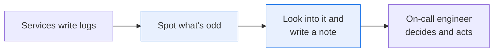
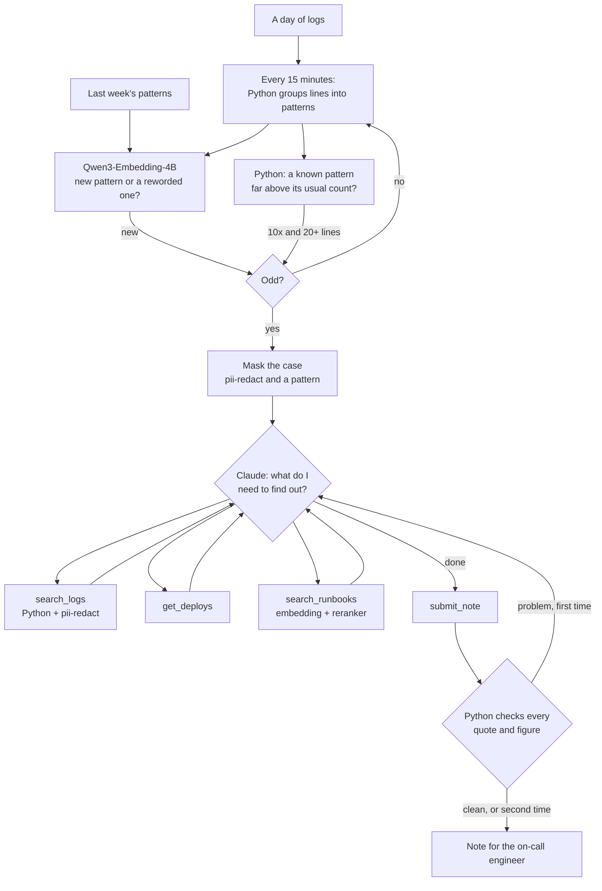

# Read every log line with small models, and hand only the odd ones to an agent

> **This example:** the on-call engineer at a small online shop, and a day of its logs: 88,347
> lines from seven services.
>
> **How it works:** a watcher with no agent in it reads every line. Python groups the lines into
> patterns, an embedding model on SIE spots the ones it has never seen, and Python spots familiar
> ones far above their usual count. Only those cases go to Claude, which looks into each one and
> writes a note for the on-call engineer.
>
> **Use the same pattern for:** payment or fraud events, support tickets, sensor readings, audit
> trails: anything with too many items for a large model to read, where most of them are routine.

## Background

An on-call engineer at an online shop is responsible for the site staying up, usually for a week at a
time, on top of their normal work. They find out about problems from alerts, and an alert only fires
for something someone thought to write a rule for: error rate above 5%, latency above a second. The
new error nobody predicted shows up in the logs first, and nobody reads the logs until a customer
complains.

So the engineer opens the log platform after the fact, searches around the time it started, checks
what was deployed, finds the runbook and decides whether to wake someone up. That's the part that
takes judgment. Reading the 88,000 lines that came before it isn't.

It matters because the gap between a deploy breaking payments and someone noticing is money: every
minute customers can't pay is orders lost. Paging people for things that don't matter costs too,
because an engineer woken for nothing three nights running stops trusting the pages.



## The problem

You could hand every line to Claude and ask it what's wrong. It would probably do a decent job, but
it would read 88,347 lines a day to find a handful worth reading, and most days nothing is wrong at
all. Each line costs about 36 tokens, so that's around 3.2 million input tokens a day before any
instructions or answers.

Most of the reading is the same thing over and over: "token issued for user ...", "query served in
... ms". What you need is something cheap that reads everything and only speaks up when a line is
new or a familiar line is suddenly far more common. Then something that can think looks into those
few cases: was there a deploy, what else is failing, what does the runbook say, does anyone need to
act now?

Two things make the cheap part harder than a word match:

- **Wording changes all the time.** A deploy can switch to a new log format, and every line looks new
  though nothing happened. The watcher needs to know "GET /api/cart returned 200 after 40 ms" is the same
  event as "GET /api/cart 200 in 40 ms".
- **Odd isn't the same as broken.** A new INFO line from a new feature is odd, and harmless. The watcher
  can't tell the difference, so the agent has to, and say so.

The output is one note per case for the on-call engineer: what's odd, the likely cause, whether to page,
the next step, and a source for every statement. Nothing pages anyone or changes anything on its own.
Each note gets one of these statuses:

- **`page_recommended`**: the agent recommends paging, and every quote and figure checks out.
- **`no_page_recommended`**: the agent recommends no page, and every quote and figure checks out.
- **`check_failed`**: a quote isn't in its source, a figure doesn't come from the case or a lookup, or the note
  claims something was done, even after Claude had a chance to fix it.
- **`out_of_steps`**: the agent hit its limit on lookups or requests.
- **`no_note`**: there's no note, because personal data couldn't be masked, Claude declined or an API call failed.

Whether to page is Claude's call, and Python only checks the note behind it. The on-call engineer decides.

### Examples

All the logs, deploys and runbooks are synthetic, generated by `make_data.py` or written for this recipe
under this repo's Apache 2.0 license. The shop and its customers aren't real.

**1. A deploy that breaks payments (10:40).**

> `payments ERROR card token decrypt failed for order 83303: key version 7 not found`

Two minutes after payments v2.14.0 goes out, this line appears 140 times every 15 minutes, along with
checkout's "payment step failed ... upstream 502". Neither was seen last week. Should raise a case for the
10:30 window, recommend a page, and name the deploy as the likely cause.

**2. A new line that's harmless (13:00).**

> `inventory INFO stock cache warmup finished for region eu-west-1 in 1240 ms`

An inventory deploy adds a cache warmup, which logs this line when an instance starts. It's new, so the
watcher should raise it, and the agent should close it without a page.

**3. Checkout getting slowly slower (12:00 to 20:00), which shows the limit.**

> `checkout INFO order 52741 placed, request completed in 431 ms`

Checkout goes from about 120 ms per order to about 900 ms over eight hours. The line is the same one as last
week, at the same rate. Only the number in it changes, and the watcher drops the numbers when it groups
lines. This should raise no case: the watcher misses it, and the README counts that as the expected
outcome, because it's the limit this design has.

## How we'll solve it

**Fixed work, before the day starts, with no agent.** Qwen3-Embedding-4B embeds last week's 17 log patterns
and the 11 runbook sections, once.

**The watcher, every 15 minutes, with no agent.**

1. Python turns each line into its pattern, swapping email addresses, ids, IP addresses and numbers for
   placeholders: `auth WARN token refresh failed for user <email>: upstream timeout`.
2. For a pattern it hasn't seen, Qwen3-Embedding-4B compares it with last week's patterns and with the new
   ones from earlier today. Close enough means the same event in new words. Otherwise it's new, and odd.
3. For each known pattern, Python counts its lines in the window, including new wordings of it, and calls
   it odd at 10 times its usual count and at least 20 lines.
4. A pattern that raised a case stays quiet for two hours, so one spike is one case.

**The agent, only on odd windows.** pii-redact and a plain pattern mask the case, then Claude calls these
tools until it's satisfied, with up to 8 lookups per case:

| Tool | What it does | What runs it |
| --- | --- | --- |
| `search_logs` | Counts matching lines by level and per 15 minutes, and returns up to 10 examples | Plain Python, then pii-redact on SIE |
| `get_deploys` | Deploys and config changes in a time range | Plain Python, a stand-in for your deploy log |
| `search_runbooks` | Asks the runbooks one question, and returns the closest sections with scores | Qwen3-Embedding-4B, then Qwen3-Reranker-4B on SIE |
| `submit_note` | Hands in the note, the page recommendation and a source per statement | Plain Python |

Claude only sees logs and deploys up to the time the case was raised, the way it would in real time.

**Checking, in plain code, when Claude submits.** Every quote must be word for word in its source, every
figure of two digits or more must come from the case, a lookup or a runbook, and the note can't say
something was paged or rolled back, because nothing here does that. Anything wrong goes back to Claude once.
Then Python sets the status.

## Picking the models

| Model | Its job here | Why this one, and not Claude |
| --- | --- | --- |
| `Qwen/Qwen3-Embedding-4B` | Tells a reworded line from a new one, and finds candidate runbook sections | A handful of calls a day, one per batch of new patterns, against a whole day of lines |
| `Qwen/Qwen3-Reranker-4B` | Scores runbook sections against the agent's question | Claude reads two sections per question, not every runbook |
| `superlinked/pii-redact` | Masks personal data before Claude sees a line | It has to run before Claude, so it can't be Claude |
| Claude Opus 5.5 | Looks into each case | This is the step that needs judgment: what to search, which deploy matters, whether anyone needs to act |

## The flow



## How it's built

The rules live in [`rules.yaml`](./rules.yaml): the model names, the watcher's window, similarity and rate
settings, Claude's system prompt and limits, the masking labels and patterns, and the Claude prices for the
cost comparison. You can change them without editing Python, and `--rules` runs a copy.

The watcher is plain Python with one model call per batch of new patterns. It never calls Claude, and it
only knows a window's lines once that window is over. The agent loop is plain Python around the Anthropic
SDK, the same shape as [`diagnose_high_bill_complaints`](../diagnose_high_bill_complaints), copied here so the
folder stands on its own.

`log_patterns.py` turns a line into its pattern. Both `make_data.py` and `recipe.py` use it, so last week's
patterns and today's lines group the same way. The vectors are a NumPy array: last week's 17 patterns, the
new ones from today and 11 runbook sections are few enough to compare with all of them at once.

| Step | Function | File | What runs it |
| --- | --- | --- | --- |
| Turn a line into its pattern | `pattern_of` | `log_patterns.py` | Python |
| Embed last week's patterns and the runbooks | `embed`, `split_sections` | `recipe.py` | Qwen3-Embedding-4B |
| Read a window | `windows_of`, `Watcher.step`, `Watcher.quiet` | `recipe.py` | Python, and Qwen3-Embedding-4B for new patterns |
| Describe and mask the case | `case_text`, `mask_personal_data` | `recipe.py` | pii-redact and a pattern |
| Run the loop | `investigate`, `run_agent`, `ask_claude`, `one_lookup`, `one_submission` | `recipe.py` | Claude |
| Search the logs | `Toolbox.search_logs` | `recipe.py` | Python, then pii-redact |
| Read the deploys | `Toolbox.get_deploys` | `recipe.py` | Python |
| Ask the runbooks | `Toolbox.search_runbooks` | `recipe.py` | Qwen3-Embedding-4B, Qwen3-Reranker-4B |
| Check the note | `check_note`, `figures`, `plain`, `readable`, `action_claims` | `recipe.py` | Python |
| Set the status | `status_of` | `recipe.py` | Python |
| Work out the cost | `claude_cost`, `tokens_per_line`, `summary_markdown` | `recipe.py` | Python, and Claude's token counting API |
| Write the outputs | `note_markdown`, `write_outputs` | `recipe.py` | Python |

`selfcheck.py` runs the whole committed day through the watcher with stand-in similarity scores and checks that
it raises exactly three cases: the payments break, the warmup line and the auth spike. It also tests the
grouping, the rate and quiet rules, the tools, the masking, the note checks, the statuses, the loop and the cost
sums, using hand-written stand-in replies. It never calls SIE or Claude.

## Run it

**Run this recipe using [SIE Serverless](https://superlinked.com/serverless?utm_source=github&utm_medium=docs&utm_campaign=sie-cookbook&utm_content=agentic-flag-unusual-logs-and-investigate), [SIE Cluster](https://superlinked.com/docs/deployment?utm_source=github&utm_medium=docs&utm_campaign=sie-cookbook&utm_content=agentic-flag-unusual-logs-and-investigate) or [SIE Local](https://superlinked.com/docs/quickstart?utm_source=github&utm_medium=docs&utm_campaign=sie-cookbook&utm_content=agentic-flag-unusual-logs-and-investigate).** The code runs on your machine either way. With SIE Serverless you pay per call and there are no GPUs to manage yourself: get an [SIE API key](https://console.superlinked.com/console/keys?utm_source=github&utm_medium=docs&utm_campaign=sie-cookbook&utm_content=agentic-flag-unusual-logs-and-investigate) and read the [API docs](https://superlinked.com/docs/reference/api?utm_source=github&utm_medium=docs&utm_campaign=sie-cookbook&utm_content=agentic-flag-unusual-logs-and-investigate). To run the models yourself, start from the [SIE repo](https://github.com/superlinked/sie).

You need [uv](https://docs.astral.sh/uv/), an SIE API key for SIE Serverless, and an `ANTHROPIC_API_KEY`, because
Claude investigates the cases. Claude's tokens are billed separately from SIE.

```bash
cp .env.example .env                 # then set SIE_API_KEY and ANTHROPIC_API_KEY
uv run recipe.py                     # watch the whole day
uv run recipe.py --until 12:00       # stop the day at noon
uv run selfcheck.py                  # optional: offline checks, no SIE or Claude call
uv run make_data.py                  # optional: rebuild the logs, known patterns and deploys
```

Each run writes `runs/<timestamp>/`: `windows.csv` with what the watcher found in every 15 minutes, `cases.csv`
with each case's status, tool calls, tokens and cost, `notes/<case>.md` for the on-call engineer,
`transcripts/<case>.json` with every tool call, and `summary.md` with the day in numbers.

On 7 Nov 2026 (UTC), the whole day took 44 s using SIE Serverless: 22 SIE calls (9 to Qwen3-Embedding-4B, 3 to
Qwen3-Reranker-4B and 10 to pii-redact), and Claude spent $0.13 on three cases. Each case took 5 to 7 tool
calls and 13 to 15 s. The models were warm. A cold one can add minutes to the first call.

## What came out

### The three examples

**1. A deploy that breaks payments (10:40).**

- **Expected outcome:** a case for the 10:30 window, a page recommended, and payments v2.14.0 named as the
  likely cause.
- **What came back:** `page_recommended`. Both new error patterns were in one case, raised at 10:45. Claude
  checked the deploys first, found payments v2.14.0 at 10:40 ("Move card token decryption to the new key
  service"), then searched the logs for "key version" and "upstream" and asked the runbooks when to page. The
  note names the deploy as the likely cause, says to roll it back and page payments, and quotes the runbook
  for both.
- **Verdict:** Pass.

**2. A new line that's harmless (13:00).**

- **Expected outcome:** a case for the 13:00 window, closed without a page.
- **What came back:** `no_page_recommended`. The warmup line showed up for two regions in the first window, as
  two new patterns in one case. Claude found the inventory v3.2.0 deploy, searched for errors, "stock low" and
  reservations, found nothing wrong, and closed it with the runbook line that says these INFO lines need no
  action. When the third region's line turned up at 13:30, the embedding model matched it to the first two,
  so it raised no second case. That's the trade-off: the watcher can't tell harmless from broken, so this case
  cost a Claude investigation, about $0.05.
- **Verdict:** Pass.

**3. Checkout getting slowly slower (12:00 to 20:00), which shows the limit.**

- **Expected outcome:** no case. The watcher misses this fault.
- **What came back:** no case. Checkout's line kept its pattern and its usual count all day, so neither check
  saw anything, though orders went from about 120 ms to about 900 ms. The runbook says checkout should finish
  in under 300 ms, and nobody was told.
- **Verdict:** Pass. It came out as expected, and that's a fault the recipe doesn't catch.

### Results

5 of 5 events came out as expected on the last of three live runs on 7 Nov 2026 (UTC), and on the two runs
before it. The five are the three examples, the auth spike and the frontend's new log format. An event counts
when the watcher raised a case or stayed quiet as expected, and the note's page recommendation and likely cause
came out right. The auth spike raised its case by the rate check, at about 45 times its usual count, and the
note names auth-config c-311, which cut the identity provider timeout from 5000 ms to 500 ms. The log format
change raised nothing.

| | Run 1 | Run 2 | Run 3 |
| --- | --- | --- | --- |
| Log lines read by the watcher | 88,347 | 88,347 | 88,347 |
| New patterns compared by the embedding model | 7 | 7 | 7 |
| Cases sent to Claude | 3 | 3 | 3 |
| Faults caught, of 3 | 2 | 2 | 2 |
| False alarms, all closed without a page | 1 | 1 | 1 |
| SIE calls | 22 | 21 | 22 |
| Claude, on the three cases | $0.16 | $0.13 | $0.13 |
| Run time | 49 s | 47 s | 44 s |

The three faults are the payments break, the auth spike and the slow checkout. The false alarm is the warmup line.

**What it would cost to have Claude read every line instead.** Claude's token counting API puts a sample of
2,000 lines at 36.3 tokens a line, so the day is 88,347 x 36.3 = 3,205,936 input tokens. At the prices in
`rules.yaml`, from Anthropic's pricing page on 7 Nov 2026:

| Reading every line with | Price per million input tokens | One day |
| --- | --- | --- |
| Claude Opus 5.5 | $4.00 | $12.82 |
| Claude Haiku 5.5 | $0.10 | $0.32 |
| The watcher, then Opus 5.5 on three cases | | $0.13 of Claude, plus 22 SIE calls |

That's input only, with no instructions and no answers, so reading everything would really cost more. Opus
reading everything costs about 100 times what the watcher and three cases cost. Haiku reading everything costs
about 2.5 times as much, a much smaller gap, and I didn't test whether Haiku reading 3.2 million tokens a day
would find these faults. The SIE side is small enough not to change the picture: SIE's
[Serverless page](https://superlinked.com/serverless) charts Qwen3-Embedding-4B at $0.06 per million tokens and
Qwen3-Reranker-4B at $15 per 100,000 queries, and the watcher embeds a few thousand tokens a day. I couldn't
confirm those chart figures are the Serverless rates, and the page lists no price for pii-redact, so I've left
SIE out of the dollar totals.

**Where it works:** telling a reworded line from a new one: the frontend's new access log format scored 0.88 to
0.90 against its old wording and raised nothing, while the payments errors scored 0.70 against their closest known
line. Treating a third region's warmup line as part of the first two. Catching the auth warning at about 45 times
its usual count, though the line itself was familiar. Linking each fault to the right deploy or config change,
and the harmless line to its deploy, on every run. Masking: the auth case had 23 email addresses masked, and no
email address from the logs appears in any transcript. Claude only saw logs up to the time of each case, so it
couldn't see that payments was rolled back at 11:20.

**Where it fails:**

- **A slow change in a number goes unseen.** The watcher drops numbers when it groups lines, so checkout's slowdown
  never raised a case. This is the expected miss in example 3.
- **Odd isn't broken.** One case in three was harmless and cost a Claude investigation. On a real system with many
  deploys a day, harmless new lines would be most of the cases.
- **A line that stops isn't noticed.** The rate check only looks for more lines, not fewer. If a line that should be
  there goes quiet, nobody's told. This day has no such case, so it isn't tested.
- **The thresholds fit this data.** I set the similarity of 0.83 after looking at the scores on these logs. The
  embedding swap below shows how much it depends on the model.
- **The faults are mine.** I generated the logs and wrote the faults, the deploy notes and the runbooks to fit
  together, and a runbook that names the exact fix makes the agent's job easy. Real logs are messier, and real
  runbooks are often out of date.
- **This isn't new.** Log platforms already offer anomaly detection. The point here is the split: something cheap
  reads everything, and the agent only gets the few cases worth thinking about.
- **Grouping is crude.** The pattern rules replace emails, ids, IPs and numbers, so "region eu-west-1" and "region
  us-east-2" become different patterns. The embedding model covered for that here. Real logs need a proper
  template miner, such as Drain.

### What you do next

The on-call engineer reads `notes/<case>.md` in the order the cases came in, starting with any marked
`page_recommended`. Each statement has its source, so they can check a quote before acting on it. The page
decision is theirs. For a case closed without a page, they decide whether the new line should join last week's
known patterns, so it stops showing up.

## Potential improvements

- **Use your own logs.** Point `load_logs` at your log platform's export, and build `known_patterns.csv` from a quiet
  week with `known_patterns` in `make_data.py`.
- **Watch the numbers too.** Keep a running median of the numbers in each pattern, such as request times, and flag a
  pattern whose median drifts. That would catch example 3.
- **Notice a line that stops.** Flag a known pattern whose count falls far below its usual.
- **Learn from the engineer.** When the engineer closes a case as harmless, add its pattern to the known ones.
- **Group lines with a real template miner** in place of the pattern rules in `log_patterns.py`.

## Try another model

Each model is one line under `models:` in `rules.yaml`, and `--rules` runs a copy. We swapped one at a time, changed
nothing else and ran the whole day once each using SIE Serverless on 7 Nov 2026 (UTC). One run each doesn't prove much.

| `rules.yaml` key | Swap in | What happened on this data |
| --- | --- | --- |
| `agent` | `claude-haiku-5-5` (with `fallbacks: null`, since it has no server-side fallback) | $0.0071 for the three cases, against $0.13 for Opus, with the same page recommendations and the same likely causes. But it handed in notes with no sources: on the payments case it fixed that when the review sent the note back, and on the auth case it did it again, so that case came out `check_failed` |
| `embed` | `tencent/R3-embedding-0.6b` | The frontend's new access log format scored 0.75 and 0.77 against its old wording, under the 0.83 threshold, so it raised a fourth case at 09:00. Claude closed it without a page and suggested teaching the watcher the new format. The other three cases came out with the same statuses as the default. The threshold was set for Qwen3-Embedding-4B, so a new embedding model needs its own |

See [MODELS.md](../../MODELS.md) for every model these recipes use.

## Run it using SIE Cluster or SIE Local

The same code runs on your machine and uses SIE Cluster or SIE Local ([SELF_HOSTING.md](../../SELF_HOSTING.md) says what SIE
Local can serve). Set `SIE_BASE_URL` in `.env`; an SIE key is then optional. Claude still goes through the Anthropic API, so
`ANTHROPIC_API_KEY` stays, and the masked cases and log examples still leave your network. The table gives the SIE v0.10.1
image each model runs on, from SIE's [compatibility matrix](https://github.com/superlinked/sie/blob/main/docs/compatibility.md).

| `rules.yaml` key | Model | Image | Tested on |
| --- | --- | --- | --- |
| `embed` | `Qwen/Qwen3-Embedding-4B` has no published image in v0.10.1: set `Qwen/Qwen3-Embedding-8B` instead, and check the similarity threshold again | `cuda12-default` | L4 |
| `rerank` | `Qwen/Qwen3-Reranker-4B` | `cuda12-default` | L4 |
| `pii` | `superlinked/pii-redact` | `cuda12-default` | L4 |

All three run on `cuda12-default`, so one SIE server can serve them. We ran this recipe using SIE Serverless, and the
images come from the compatibility matrix and the other recipes.

## Data and licenses

Everything in `data/` is synthetic and written for this recipe under this repo's Apache 2.0 license: the shop, its
services, the customers, their email addresses (all at `example.com`), the logs, the deploys and the runbooks. No real
company or person is in it. `make_data.py` rebuilds the logs, last week's known patterns and the deploys, byte for byte.
The runbooks are written by hand.

## Files

- `recipe.py`: the watcher, the masking, the tools, the agent loop, the checks, the cost sums and the CLI
- `log_patterns.py`: turns a log line into its pattern, for both the data and the recipe
- `sie_calls.py`: how the recipe calls SIE and handles failures
- `rules.yaml`: models, thresholds, limits, the system prompt, masking and prices
- `selfcheck.py`: offline checks, no SIE or Claude call
- `make_data.py`: rebuilds the generated files in `data/`
- `data/`: `logs.csv.gz` (one day, 88,347 lines), `known_patterns.csv` (last week), `deploys.csv` and `runbooks.md`
