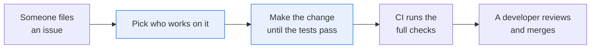
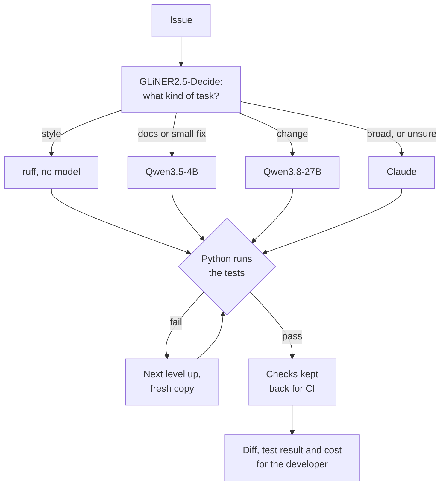

# Send each coding task to the cheapest model that passes its tests

> **This example:** a dev team that maintains Ledgerline, a made-up invoicing library, and works
> through a backlog of fifteen issues.
>
> **How it works:** a small model on SIE sorts each issue into a kind of task, which decides where it
> starts: a linter with no model, a small open model, a larger open model, or Claude. The tests
> decide when a task is done, and a task that still fails moves up one level. Every task also goes to
> Claude alone, so you can see what the routing saved.
>
> **Use the same pattern for:** any agent work with a clear done-check, such as SQL that has to
> return the right rows, a config change that has to pass validation, or a migration with tests.

## Background

Coding agents are good now, and they're billed per token. Point one at every lint warning, docstring
and one-line fix in a backlog and most of the bill goes on work a much smaller model, or no model at
all, could have done. Some teams have started running open models as the default for coding and
keeping a frontier model for the exceptions, and the usual question is which tasks go where.

The developer's job doesn't change much: someone files an issue, someone makes the change, the tests
run in CI and a reviewer reads the diff before it merges. What changes is who makes the change. That
matters to the company because the review step is the expensive one. A cheap model that gets the
tests passing with wrong code doesn't save anything once a reviewer has to find the mistake.



## The problem

Sending everything to the best model works, and it's the baseline here. The question is how much of
the work you can move to cheaper models without the reviewer paying for it. Three things make that
hard:

- **You can't tell from the title how hard a task is.** "Small fix: due dates on weekends" sounds like
  one line. It isn't: the invoice works out its own due date, so the fix has to go in two places. And an
  issue that reads like plain parsing can hide a dozen rules.
- **Something has to decide when a task is done, and it can't be the model.** A model that says "done"
  is the least useful signal you have. The tests are better, but only as good as what they test.
- **The decision about where to start has to be cheap.** If picking the level costs as much as doing the
  work, there's nothing left to save.

So the recipe tries the cheapest level that might work, lets the tests decide, and moves a task up when
they fail. Each task's output is the diff, whether the tests pass, which level did it, which levels failed
first, and what each cost, for the developer who reviews it.

### Examples

The library, the issues and the tests are synthetic, written for this recipe under this repo's Apache 2.0
license. Ledgerline isn't a real project.

**1. Lint, which needs no model (T01).**

> Ruff reports unused imports in money.py and formats.py, and unsorted imports in invoice.py and
> formats.py. Clean them up. Nothing else should change.

Should start at the tool level and pass there: `ruff --fix` does this with no model, for no tokens.

**2. Installments, which the small model can't finish (T15).**

> Add Invoice.installments(count, every_days=30). It returns a list of (due date, amount) pairs that add
> up exactly to the invoice total. Split the total evenly, rounding each part down to the cent, and add any
> cents left over one at a time to the earliest installments. [...] A due date on a weekend or a holiday in
> holidays.py moves to the next working day, but the next installment still counts from the date before it
> moved.

Should fail at the small model and pass at the larger open model, with the checks kept back for CI passing
too. This is the task moving up.

**3. Amounts the way customers type them (T14).**

> Add parse_amount(text) to money.py. [...] Accept an optional currency code or symbol before the amount,
> spaces around it, a leading minus or brackets for a negative amount, and thousands separators. The last
> comma or dot is the decimal mark when one or two digits follow it; otherwise every comma, dot or space in
> the number is a thousands separator. [...]

Lots of rules in one function. I expected the larger open model to finish it. It's the trade-off example:
what a task costs when the cheap levels try and fail before the expensive one does it.

## How we'll solve it

**Sort the issue.** `fastino/GLiNER2.5-Decide` on SIE reads the title and body and picks one of five kinds
in `rules.yaml`: style, docs, small fix, change or broad. Each kind names the level it starts at. If the
top kind scores under 0.35, the router doesn't trust itself and the task goes to Claude.

**Work on a copy, with four tools.** Every attempt starts from a fresh temporary copy of the library and the
task's tests. Every model gets the same instructions and the same tools: `list_files`, `read_file`,
`write_file` and `run_tests`, plus `finish` to say it's done.

**Let the tests decide.** When a model calls `finish`, Python puts the tests back as they were and runs them.
If they fail, the model sees the output once and can try again. If they still fail, the task moves up one
level and starts again from a clean copy. Python runs the tests once more at the end of every attempt,
whatever the model said.

**Run the checks it never saw.** Seven tasks also have tests the team keeps back for CI. They run after a task
passes, the way CI runs more than the issue's own tests.

**Compare.** Every task also goes to Claude alone, with the same tools, from a fresh copy.

The tools only touch the copy. A model can write `.py` files under `ledgerline/` and nothing else: not the
tests, not a path with `..`, not through a link. The tests run as a fixed command with a 60 s limit and no API
keys in their environment. But the tests import the code the model wrote, so **that code runs on your machine.
Run this recipe in a container.**

## Picking the models

| Level | Model | Its job here | Why this one |
| --- | --- | --- | --- |
| router | `fastino/GLiNER2.5-Decide` | Picks the kind of task | One cheap call per issue (4 SIE credits), with a score for every kind |
| tool | `ruff`, no model | Lint and formatting | It's what you'd run by hand, and it can't make anything up |
| small | `Qwen/Qwen3.5-4B` | Docstrings, type hints, small fixes | The smaller of the two open chat models SIE Serverless answered tool calls with when I checked |
| open | `Qwen/Qwen3.8-27B-FP8` | Most bug fixes and features | The larger open model on SIE Serverless that also makes tool calls |
| claude | Claude Opus 5.5 | Anything unclear, and whatever fails below | The model you'd otherwise send everything to |

Neither Qwen model is a coding specialist. When I checked SIE Serverless on 7 Nov 2026, these two were the only
chat models that answered tool calls. `zai-org/GLM-5.3-Flash`, the closest to what teams use for coding, is in
SIE's compatibility matrix for SIE Cluster, but SIE Serverless answered "Generation route is unavailable for this
deployment".

## The flow



Inside each model level, the model loops through `list_files`, `read_file`, `write_file` and `run_tests` until it
calls `finish` or runs out of requests (14 for the open models, 16 for Claude). Both Qwen models get an 8,192-token
window on SIE Serverless, shared by the conversation and the reply. A conversation that outgrows it ends that attempt,
and the task moves up, like a failing test.

## How it's built

The rules live in [`rules.yaml`](./rules.yaml): the models, the five kinds and the level each starts at, the
router's 0.35 bar, the ruff arguments, the workspace limits, the shared instructions and the Claude prices. The
library and the tasks are in `data/`, written by `make_data.py`. The library ships as one JSON file, not as `.py`
files, because this repo's lint hooks would otherwise fix the very lint problems T01 is about.

| Step | Function | File | What runs it |
| --- | --- | --- | --- |
| Sort the issue | `route_task` | `recipe.py` | GLiNER2.5-Decide |
| Make a copy and keep paths in it | `Workspace`, `Workspace.safe` | `recipe.py` | Python |
| Run the tests, with the tests put back | `Workspace.check`, `Workspace.run` | `recipe.py` | pytest, in a subprocess |
| Talk to an open model | `OpenModelChat` | `recipe.py` | Qwen3.5-4B or Qwen3.8-27B |
| Talk to Claude | `ClaudeChat` | `recipe.py` | Claude |
| The tool loop | `work_loop` | `recipe.py` | Python |
| One level, then the next | `run_level`, `solve_task` | `recipe.py` | Python |
| Add up the cost | `claude_cost`, `router_cost`, `Calls` | `recipe.py`, `sie_calls.py` | Python |
| Write the outputs | `task_markdown`, `summary_markdown`, `write_outputs` | `recipe.py` | Python |

`selfcheck.py` checks that every task's tests fail before a fix and that the baseline passes, that simple interest
gets past T10's own tests but not its CI checks, the path rules, links, the test reset, the time limit, the
routing, a task moving up from the small model to the larger one, a full context window ending an attempt but
not the run, the cost sums and the outputs. It uses stand-in
replies and never calls SIE or Claude, though it does run pytest and ruff on copies of the library.

## Run it

**Run this recipe using [SIE Serverless](https://superlinked.com/serverless?utm_source=github&utm_medium=docs&utm_campaign=sie-cookbook&utm_content=agentic-route-coding-tasks-to-open-models-first), [SIE Cluster](https://superlinked.com/docs/deployment?utm_source=github&utm_medium=docs&utm_campaign=sie-cookbook&utm_content=agentic-route-coding-tasks-to-open-models-first) or [SIE Local](https://superlinked.com/docs/quickstart?utm_source=github&utm_medium=docs&utm_campaign=sie-cookbook&utm_content=agentic-route-coding-tasks-to-open-models-first).** The code runs on your machine either way. With SIE Serverless you pay per call and there are no GPUs to manage yourself: get an [SIE API key](https://console.superlinked.com/console/keys?utm_source=github&utm_medium=docs&utm_campaign=sie-cookbook&utm_content=agentic-route-coding-tasks-to-open-models-first) and read the [API docs](https://superlinked.com/docs/reference/api?utm_source=github&utm_medium=docs&utm_campaign=sie-cookbook&utm_content=agentic-route-coding-tasks-to-open-models-first). To run the models yourself, start from the [SIE repo](https://github.com/superlinked/sie).

You need [uv](https://docs.astral.sh/uv/), an SIE API key for SIE Serverless, and an `ANTHROPIC_API_KEY`. Model-written
code runs when the tests run, so use a container.

```bash
cp .env.example .env                 # then set SIE_API_KEY and ANTHROPIC_API_KEY
uv run recipe.py                     # all fifteen tasks, through the router and through Claude alone
uv run recipe.py --task T12          # one task
uv run recipe.py --skip-claude-alone # the router only
uv run selfcheck.py                  # optional: offline checks, no SIE or Claude call
uv run make_data.py                  # optional: rebuild data/ from make_data.py
```

Each run writes `runs/<timestamp>/`: `tasks.csv`, `summary.md`, `tasks/<task>.md` with the diff and every attempt,
`diffs/<task>-router.diff` and `diffs/<task>-claude-alone.diff`, and `transcripts/<task>.json` with every tool call.

On 8 Nov 2026 (UTC), the last of three runs took 306 s for the router and 310 s for Claude alone, using SIE
Serverless: 94 SIE calls and 5,443 SIE credits ($0.0544) for the router, $0.1890 of Claude for the router, and $0.5977
for Claude alone. So the router cost $0.2434 in all, against $0.5977. The first run of the day can wait minutes while SIE
Serverless starts a cold model.

## What came out

### The three examples

**1. Lint, which needs no model (T01).**

- **Expected outcome:** done by the tool level, with no model.
- **What came back:** the router called it style (0.83), `ruff --fix` and `ruff format` ran, and the tests passed in under a
  second, for no credits and no tokens. Claude alone also passed, for $0.04 to $0.05 a run.
- **Verdict:** Pass.

**2. Installments, which the small model can't finish (T15).**

- **Expected outcome:** the small model fails, and the larger open model finishes it.
- **What came back:** the router called it a small fix (0.36), so the small model went first. On all three runs it broke its own
  tool call after two requests (SIE answered "unterminated <tool_call> block"), and the task moved up. The larger open model passed
  the tests in 8 requests for 314 to 536 SIE credits, and the checks kept back for CI passed too. Its change floors each part to the
  cent, hands out the leftover cents from the front, and counts each next date from the unmoved one, as the issue asked. The whole
  task cost the router about $0.004 to $0.006, against $0.05 to $0.06 for Claude alone.
- **Verdict:** Pass. Though the small model failed on formatting, not on the arithmetic, so it doesn't show the small model getting
  the logic wrong.

**3. Amounts the way customers type them (T14).**

- **Expected outcome:** the larger open model finishes it.
- **What came back:** it went through every level, on all three runs. The router called it style (0.41), so ruff went first and
  couldn't help. The small model wrote long replies and ran out of output tokens, or outgrew its 8,192-token window. The larger
  open model got further but was still failing tests when its conversation outgrew the same window, after 8 or 9 requests. Claude
  then passed it, CI checks included. The router spent 1,443 to 1,906 SIE credits and $0.055 to $0.060 of Claude, about $0.07
  in all, against $0.05 to $0.07 for Claude alone. It took 90 to 119 s, against 23 to 27 s.
- **Verdict:** Miss. Claude did it, not the larger open model. This is what a wrong first guess costs: a little more money and
  four times the wait.

### Results

7 of 15 tasks came out as expected on the last of three live runs on 8 Nov 2026 (UTC), and the same 7 on the other two. A task
counts when its tests pass, its CI checks pass where it has them, and the level I wrote down before its first run is the one that
finished it. The tests passed on all 15 tasks on every run, for the router and for Claude alone, and so did every CI check. The
router's picks and scores were the same on every run.

| | Router | Claude alone |
| --- | --- | --- |
| Tasks whose tests pass | 15 of 15 | 15 of 15 |
| Claude, per run | $0.18 to $0.20 | $0.57 to $0.60 |
| SIE, per run | 5,221 to 5,481 credits ($0.05), in 94 to 97 calls | none |
| In all, per run | $0.24 to $0.25 | $0.57 to $0.60 |
| Time, per run | 302 to 308 s | 209 to 310 s |
| Done by | tool 2, small 8, open 1, Claude 4 | Claude 15 |

That's about three times less Claude, and about 40% of the cost once the SIE credits are counted: the SIE console sold
5,000,000 credits for $50 on 8 Nov 2026, so a credit is $0.00001, and `sie_credit_usd` in `rules.yaml` holds that price. The
router saved $0.34 to $0.35 a run. It wasn't quicker, though: T14 alone spent about two minutes in the levels that failed. Most
of the credits are the small model's, at about 40 to 80 credits a request, more as the conversation grew. The larger open model
used 972 to 1,196 a run, and the router itself 4 to 6 a task.

**How these tasks came about.** I first wrote twelve tasks, T01 to T12, and the larger open model never ran on any of three runs:
the small model passed everything it was given. So I wrote T13 to T15 to be harder, with what I expected from each written down
before they ran. The first three runs with them stopped partway, because the recipe treated a full context window as a broken
SIE account and stopped the whole run. That was my bug, and it's fixed: now it ends that attempt and the task moves up. The
results above are the three runs after the fix.

**Where it works:** the tests deciding when a task is done, and moving a task up when they don't. T15 moved from the small model to
the larger open model and passed, and T14 moved through every level until Claude passed it. T07 and T09 started at the tool
level because the router called them style, ruff couldn't fix them, and the small model did. The small model did far more than I
expected: discount and quantity (T06), whole-invoice discount (T07), CSV quoting (T08), the tax rounding bug (T09) and the
weekend fix (T12), with the CI checks passing where there were any. Lint and formatting cost nothing. No model tried to write to
the tests or leave the copy: there wasn't a single tool error in the three runs.

**Where it fails:**

- **The router.** It picked "change" once, for T13, and with a score of 0.30, under the bar, so Claude did it. It called T07 (a
  new method), T09 (a rounding bug), T14 (a parser) and T11 (three modules) style, which cost a wasted ruff attempt each where the
  score cleared the bar. Most of its top scores were under 0.5. GLiNER2.5-Decide picks well from short, distinct options, and
  "what kind of coding task is this?" isn't that. The larger open model only ran because a task moved up to it.
- **T06, T07, T08, T09 and T12 missed** because the small model finished them, where I expected the larger open model to. That's
  a better result than I expected, and still a miss against what I wrote down.
- **T10 and T13 missed the other way.** The router scored them 0.33 and 0.30, under the bar, so Claude did them. A cheaper model
  might well have done them for a fraction of the cost.
- **T14 missed** because the larger open model ran out of room in its 8,192-token window before the tests passed, and Claude did it.
  With 2,000 output tokens a request instead of 4,000 it got through 11 or 12 requests, still without passing (see Try another
  model). SIE Serverless also lists a 256k-token profile of the model, but it answered "Generation route is unavailable for this
  deployment" when I tried it.
- **Passing tests isn't correct code.** On T07 the small model kept `float` in the tax sum, the very thing T09 is about. Every test
  passed, because no test for T07 has an amount where floats round wrong. A reviewer would have to catch it.
- **Fifteen tasks in a 150-line library aren't a benchmark.** Each file fits in one read, and every issue says what to change.
  Real issues are vaguer and real code is bigger, and I'd expect the small model to fail more often there.

### What you do next

The developer opens `tasks/<task>.md` for each task: the diff, which level did it, what failed first and what it cost. They review
the diff as they would any pull request, with extra care where a cheap level did it, because the tests passing is all the recipe
knows. A task where no level passed has the last test output at the bottom, and goes back to a person.

## Potential improvements

- **A better router.** Send the router's decision to a small chat model, or give Decide fewer, sharper kinds, and keep only the
  one cheap check that clearly works: whether ruff alone can do it.
- **Start every task at the small model.** It passed 8 of the 10 tasks it was given, and on the two it failed, a wasted try cost
  about 80 to 1,200 credits ($0.001 to $0.012).
- **A bigger window for the larger open model.** On SIE Cluster you can serve it with a longer context, which T14 needed.
- **Harder tasks.** A bigger library and vaguer issues would show more clearly where each level earns its place.
- **Run it in a container by default.** The tests run model-written code. A container with no network is the safe default.

## Try another model

Each model is one line under `models:` in `rules.yaml`, and `--rules` runs a copy. We swapped one at a time, changed nothing else
and ran once using SIE Serverless on 8 Nov 2026 (UTC). The first two swaps ran before T13 to T15 existed, on the first twelve
tasks. One run each, so a task either way doesn't prove much.

| `rules.yaml` key | Swap in | What happened on this data |
| --- | --- | --- |
| `claude` | `claude-sonnet-5-5` (for the Claude level and for Claude alone) | The same routes and the same 12 of 12. Claude cost about half: $0.0393 for the router, or about $0.07 with its SIE credits, and $0.1796 for Claude alone, with Claude alone the quicker at 95 s |
| `small` | `Qwen/Qwen3.8-27B-FP8` (the larger model at the small level too) | The same routes and 12 of 12, for 1,593 SIE credits ($0.016) against about 3,100 ($0.031) with the 4B: 47 requests at about 34 credits each, against the 4B's 53 at about 59. One run, so treat the credit gap as a hint. Its T07 change also shows the review problem: it changed the default `tax_rate` from `0.20` to `20` and worked tax out with `percent_of`, which passes every test and changes what every caller's tax rate means |
| `open` | `Qwen/Qwen3.8-27B-FP8:h100-256k` (the same model with a 256k-token window), T14 only, twice | Didn't run: SIE Serverless answered "Generation route is unavailable for this deployment", so T14 went on to Claude |
| `open_models.max_completion_tokens.open` | `2000` instead of `4000`, T14 only, twice | The larger open model got through 11 and 12 requests instead of 8 or 9, and 1,118 and 1,168 credits, still without passing, before its window filled up again. Claude passed it both times |

See [MODELS.md](../../MODELS.md) for every model these recipes use.

## Run it using SIE Cluster or SIE Local

The same code runs on your machine and uses SIE Cluster or SIE Local ([SELF_HOSTING.md](../../SELF_HOSTING.md) says what SIE
Local can serve). Set `SIE_BASE_URL` in `.env`; an SIE key is then optional. Claude still goes through the Anthropic API, so
`ANTHROPIC_API_KEY` stays, and the issues and code Claude works on leave your network. The table gives the SIE v0.10.1 image each
model runs on, from SIE's [compatibility matrix](https://github.com/superlinked/sie/blob/main/docs/compatibility.md).

| `rules.yaml` key | Model | Image | Tested on |
| --- | --- | --- | --- |
| `router` | `fastino/GLiNER2.5-Decide` | `cuda12-transformers5` | L4 |
| `small` | `Qwen/Qwen3.5-4B` | `cuda12-sglang` | L4 |
| `open` | `Qwen/Qwen3.8-27B-FP8` | `cuda13-sglang-cu130` | H100 80GB |

One SIE server runs one image, so these 3 images need SIE Cluster: the
[sie-cluster Helm chart](https://github.com/superlinked/sie/tree/main/deploy/helm/sie-cluster) with one worker pool per image
routes each model to its pool. See [SELF_HOSTING.md](../../SELF_HOSTING.md) for the values file. On SIE Cluster you could also try
`zai-org/GLM-5.3-Flash` (`cuda13-sglang-cu130`, 8 H100s in the matrix) as the `open` model; we haven't. We ran this recipe using SIE
Serverless, and the images come from the compatibility matrix and the other recipes.

## Data and licenses

Everything in `data/` is synthetic and written for this recipe under this repo's Apache 2.0 license: Ledgerline, its code, its
tests, the issues and the checks kept back for CI. `make_data.py` writes all of it.

## Files

- `recipe.py`: the router, the workspace and its limits, the two chat interfaces, the tool loop, the levels, the comparison and
  the CLI
- `sie_calls.py`: how the recipe calls SIE, handles failures and adds up the credits each reply reports
- `rules.yaml`: models, kinds and levels, the ruff arguments, limits, the shared instructions and the Claude prices
- `selfcheck.py`: offline checks, no SIE or Claude call
- `make_data.py`: writes the library and the tasks
- `data/`: `library.json` (the library and its baseline tests) and `tasks.json` (the issues, their tests and the CI checks)
