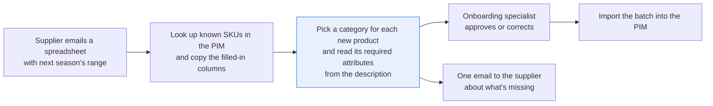
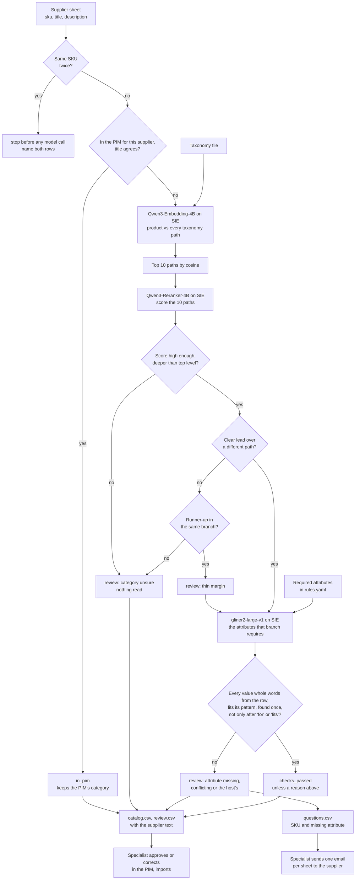

# Categorize products into your taxonomy and fill in the required attributes

> **This example:** a catalog onboarding specialist mapping a new supplier's spreadsheet.
>
> **How it works:** embeddings shortlist categories, a reranker picks one, and an extraction model
> pulls that category's attributes. Python keeps only values it finds in the supplier's own text.
>
> **Use the same pattern for:** mapping marketplace listings onto your category tree, suggesting
> customs tariff codes, sorting free-text return reasons.

## Background

A retailer takes on new products through its catalog onboarding team. A supplier emails a
spreadsheet (CSV or XLSX) with next season's range, and an onboarding specialist opens it in
Excel on one screen and the PIM (product information management system, e.g. Akeneo) or the
store admin on the other. First they look up each supplier SKU in the PIM: a product the store
already sells keeps the category and attributes it has. Then they map the columns the supplier
did fill in (brand, barcode, sometimes color or size) straight onto the catalog's fields. That
part is lookup and copying, and nobody needs a model for it.

What's left is the free text. A lot of suppliers send little more than a title and a paragraph
of description per row, and that's the case this recipe covers: `sku`, `supplier_title`,
`supplier_description`, nothing else. For each new product the specialist picks a category from
the store's taxonomy (thousands of paths; here the Shopify Standard Product Taxonomy), then
fills the attributes that category requires: size, color and material for clothing, brand and
model number for electronics, net weight or volume for food. They read those out of the
description, email the supplier about anything missing, and import the batch.

Why it matters: the category decides which browse page and which filters a product shows up
in. A sneaker filed under the wrong branch is invisible to the shopper who filters for
sneakers, and a sweater with no size can't be filtered by size at all. What goes wrong is
ordinary: a tired person files a T-shirt under *Shirts*, stops at a top-level *Home & Garden*
for a hose nozzle because the right branch wasn't obvious, or files replacement ear cushions as
headphones because the title says "AV-H700 headphones". Fifty rows in, every description starts
to look the same.

Here's the job end to end, and the step this recipe takes on:



## The problem

Picking from thousands of category paths by hand is slow, and the attributes have to be copied
one field at a time. Keyword rules on the title fall over quickly ("Tee" vs "T-shirt", a bottle
that could be a thermos). One call to a general chat model will name a plausible category and
fill every attribute, including the ones the supplier never gave, and you can't tell which
values it read and which it made up. The taxonomy and the required attributes also change, and
you don't want to retrain anything when they do.

So the recipe proposes, and a person approves. For each row it writes a category, the required
attributes with the words each came from, and a status:

- **`checks_passed`**: one category clearly beat the others on the shortlist, and every
  attribute that category requires was found in the row's own text. It's a proposal the
  specialist can approve quickly, not a product ready to list.
- **`review`**: the category score was low, two different categories were close, the pick
  stopped at a top-level branch, a required attribute is missing or was read twice with two
  values, a model number names the product an accessory fits, or a model call failed. The
  reasons say which.
- **`in_pim`**: the supplier SKU is already in the PIM under this supplier, with a title that
  agrees (the same words, and the same size, pack count and model number). The row keeps the
  PIM's category and attributes and never reaches a model.

Two files come out per supplier sheet that people act on. The proposals, in a column layout a
PIM import takes (one column per attribute), which the specialist approves or corrects before
importing. And one list of questions for the supplier (SKU, the attribute that's missing or
conflicting, and the supplier's own words around it), so the specialist sends one email per
sheet instead of one per product. Nothing is imported automatically, and no generative model
makes a decision: the statuses come from plain Python reading `rules.yaml`.

### Examples

Here are three of the rows in `data/supplier-products.csv`, and what should happen to each.

**1. A clear row.** TT-A02, "Womens High Rise Skinny Jean INDIGO 28"
- **Input:** "High-rise skinny jeans with five pockets. Material: stretch denim (98% cotton, 2%
  elastane). Color: indigo. Size: 28."
- **What should happen:** *Jeans* wins the category pick with a clear lead, and size, color and
  material are all read out of the description.
- **Expected outcome:** `checks_passed`, category *Jeans*.

**2. A missing size.** TT-A04, "Merino Crew Sweater - Charcoal"
- **Input:** "Fine-knit crew neck sweater with ribbed cuffs and hem. Material: 100% merino wool.
  Color: charcoal grey."
- **What should happen:** the category is easy, but clothing needs a size and there isn't one, so
  the attribute check fires and the supplier gets a question.
- **Expected outcome:** `review`, size not found, and a row in `questions.csv`.

**3. An accessory that names its host.** TT-E13, "Replacement Ear Cushions for Aurivox AV-H700
Headphones"
- **Input:** "Brand: Aurivox. Genuine replacement ear cushions for the Aurivox AV-H700 over-ear
  headphones, one pair. ..."
- **What should happen:** the title is full of headphone words, but the pick has to be a cushion
  category, and AV-H700 only ever follows "for", so a rule that checks what follows "for" or
  "fits" should catch it as the headphones' model number.
- **Expected outcome:** `review`, category *Headphone Cushions & Tips*, never *Headphones*, with
  the reason that the model number follows "for".

On the live run, 10 of 12 planted cases came out as expected; [What came out](#what-came-out) has
each one.

## How we'll solve it

1. **Start from what's already structured.** The supplier sheet, the store's taxonomy file,
   the PIM and, in `rules.yaml`, the attributes each top-level category requires. A SKU that
   appears twice on the sheet stops the run before any model call, with both rows named: two
   variants under one SKU would otherwise share one result. Then each SKU is looked up in the
   PIM (`pim.py`) by supplier and SKU together, with case ignored in the SKU as in the
   duplicate check. A carry-over product keeps what the PIM has. A SKU the PIM knows under a
   different title, or as another variant (another size, pack count, colour or model number),
   gets categorized like a new product and goes to review, since the supplier may have reused
   the code. So does a PIM record with no category. In your own setup the columns the
   supplier did fill in would be mapped here too, before any model sees the row.
2. **Shortlist categories.** `Qwen/Qwen3-Embedding-4B` embeds every taxonomy path once and each
   product (title plus description) as a query; the 10 closest paths by cosine go forward.
3. **Pick one.** `Qwen/Qwen3-Reranker-4B` scores those 10 paths against the product text.
   Python then checks the pick: the best score has to clear `min_top_score`, it has to lead the
   best *different* path (not its ancestor or descendant) by `min_logit_margin`, and it has to sit
   deeper than a top-level branch. Otherwise the row goes to review with the two paths side by
   side.
4. **Read the attributes.** `fastino/gliner2-large-v1` gets a schema with only the attributes
   the chosen category requires, over windows of at most 180 words, and returns spans of the
   description. The required attributes come from the pick's top-level branch, so a thin margin
   between two paths in the same branch (*Thermoses* or *Water Bottles*) still says what to
   read, and the row's supplier questions are ready when the specialist picks the category. A
   low score, a top-level pick, or a close runner-up in another branch reads nothing.
5. **Check every attribute in Python.** A value has to be whole words from the row ("M" is not
   a size read out of "Merino") and fit its pattern. A required attribute that is missing, says
   it wasn't given ("n/a", "not specified", "without ..."), or is found twice with different
   values sends the row to review. Two values are the same only when one stands as whole words
   in the other ("navy" in "heather navy"); "L" and "XL", or AV-H70 and AV-H700, conflict. So
   does a model number or brand that only ever follows "for", "fits" or "compatible with": it
   names the product an accessory fits, not the accessory.
6. **Write the proposals and the supplier questions.** One row per product with the category,
   attributes, status and reasons, plus a review sheet that carries the supplier's title and
   description, so the specialist doesn't have to reopen the original file, and one list of
   what to ask the supplier for, per SKU.

If an SIE call fails for a reason that may pass (a timeout, a 5xx, a rate limit, an over-long
input, a reply missing what we asked for), the rows in that call go to review with the reason
and the run carries on; if SIE refuses the call (a bad key, an unknown model) or every call
fails, the run stops with SIE's message and writes nothing.

## Picking the models

There are three models, and each does one narrow job.

The shortlist comes from `Qwen/Qwen3-Embedding-4B` through SIE's `encode` call. It takes an
instruction with the query, so each product is embedded as "a product listing from a supplier
spreadsheet" looking for "the product taxonomy category path that classifies the product",
while the paths are embedded plain. Taxonomy paths are short and formulaic ("Home & Garden >
Kitchen & Dining > ... > Thermoses"), and a good shortlist matters more than a perfect first
pick, because the reranker only sees what the embedder hands it. In our swaps, a different
embedder that left *Thermoses* out of the top 10 made the bottle row look settled (see Try
another model).

The pick comes from `Qwen/Qwen3-Reranker-4B` through `score`, called once per product with its
10 paths. It reads the product text and each path together, which is what tells "Rain Coats"
from "Rain Suits". Its scores are probabilities that crowd near 1.0 (0.99 vs 0.98 is common),
so the recipe measures the lead in log-odds, the reranker's own yes-vs-no logit, where 0.99 vs
0.98 is a margin of 0.70 and 0.99 vs 0.50 is 4.60.

The attributes come from `fastino/gliner2-large-v1` through `extract` with an `output_schema`.
It returns spans of the input, not generated text, which is the property we want: every value
can be checked against the supplier's words. It reads at most 512 tokens per item, so the row is
cut into overlapping windows of 180 words. It has one SIE Cloud habit worth knowing about (see
What came out): on some rows it answers with an HTTP 500 that SIE also sends when nothing is
found.

## The flow



## How it's built

Everything you'd want to argue about lives in [`rules.yaml`](./rules.yaml): the model names, the
supplier the sheet came from, the PIM title-match share, the taxonomy file and instructions,
`top_k`, `min_top_score`, `min_logit_margin`, `min_depth`, the window size, the words that mean
"not given", the "for"/"fits" words, and the required attributes per top-level category with
their patterns. [`recipe.py`](./recipe.py) is about 1,120 lines and reads top to bottom in the
order of the flow. [`pim.py`](./pim.py) stands in for the PIM: a product search filtered on
supplier and supplier SKU, over the seed in `data/pim-products.csv` loaded into an in-memory
SQLite database.

| Step | Code | SIE call | What it does |
| --- | --- | --- | --- |
| Load | `load_products`, `check_unique_skus` | none | Reads the sheet. A missing column, a row with no SKU or no text, or a SKU on two rows (case ignored) stops the run, naming the lines |
| PIM | `check_pim`, `variant_marks`, `Pim.find_by_supplier_sku` | none | Same supplier and SKU (case ignored), at least half (`min_title_share` 0.5) of the title's words in the PIM title, every PIM title word in the row, and the same sizes, pack counts and model numbers: `in_pim`. Several records, a record with no category, or a title or variant that disagrees: review |
| Shortlist | `retrieve`, `encode_batches`, `shortlist` | `encode` | All 2,344 paths in batches of 128 (19 calls), the products as queries (1 call); top 10 by cosine. A failed path batch sends every row to review; a failed product batch sends its rows, with SIE's error |
| Pick | `rerank`, `decide_category`, `log_odds`, `same_lineage` | `score` | One call per new product. A score that isn't a number is a failed call. Low score (< 0.50), a margin under 1.0 over a path that isn't the pick's ancestor or descendant, or a top-level pick: review |
| Read | `extract_attributes`, `windows`, `output_schema` | `extract` | One call per window of at most 180 words, overlapping by 30, with only the branch's required attributes and `overflow_policy: error`, so a window too long to read whole fails instead of being cut short. A window that wasn't read, or a value that isn't text, is a review reason. A branch with no attribute list in `rules.yaml` reads nothing and goes to review |
| Check | `merge_attributes`, `occurrences`, `not_given`, `lists_two_values`, `fits_spots`, `scan_values` | none | Whole words from the row, the attribute's `pattern`, one value (whole-word containment only: "L" is not "XL"), not only after a "for"/"fits"/"compatible with" word; for net quantity, every weight or volume in the row (glued or not) must agree |
| Write | `write_outputs`, `csv_safe` | none | `catalog.csv`, `review.csv`, `questions.csv`, `rows.json`; a cell a spreadsheet would run as a formula gets a leading `'` |

The SIE error rule is the same as in the security recipes. A call that fails for a reason that
may pass (a timeout, a lost connection, a 5xx, a rate limit, a model still loading, a window
too long to read whole, or a reply missing `dense`, `scores` or `data`, with a score that isn't
a number, or with an attribute value that isn't text) sends its rows to review with a short reason, and the run
carries on. A refusal every call would repeat (a bad key, no credits, a model name SIE doesn't
know) stops the run with SIE's full message and writes no outputs. If every call failed, the
run stops too. An empty `data` is a real result: the model found nothing. When a window wasn't
read, an attribute not found in the others isn't reported missing, because it may be in that
window, and the supplier isn't asked for it.

[`selfcheck.py`](./selfcheck.py) checks the sheet checks, the PIM lookup, every category rule,
the attribute checks, the windows, the outputs and that SIE error rule offline, with
hand-written strings and stand-in model replies, so you can change `rules.yaml` and know right
away if you broke something. [`make_data.py`](./make_data.py) writes the supplier sheets and the
PIM seed and trims the taxonomy; it rebuilds `data/` byte for byte.

## Run it

You need [uv](https://docs.astral.sh/uv/) and an SIE API key
([create one](https://console.superlinked.com/console/api-keys?utm_source=github&utm_medium=docs&utm_campaign=sie-cookbook&utm_content=ecommerce-categorize-products-into-taxonomy)).

```bash
cp .env.example .env   # then set SIE_API_KEY
uv run recipe.py
uv run recipe.py --products data/supplier-products-duplicate-sku.csv   # the duplicate-SKU stop
uv run selfcheck.py    # optional: offline checks, no SIE call
uv run --group data make_data.py   # optional: rebuild data/ (downloads the taxonomy)
```

`uv run` installs this recipe's few dependencies into its own `.venv` on the first run. Each run
writes `runs/<timestamp>/`. The first calls can wait a few minutes while SIE Cloud starts the
embedding, reranking and extraction models. Every run embeds the whole taxonomy file first. A
warm run makes 118 SIE calls (20 to the embedder, 50 to the reranker, 48 to the extractor) and
took about 45 seconds.

## What came out

The input is [`data/supplier-products.csv`](./data/supplier-products.csv): 51 synthetic rows
from a fictional supplier, Tollgate Trading (`sku`, `supplier_title`, `supplier_description`),
written by [`make_data.py`](./make_data.py). Two thirds of the descriptions (34) are labelled
("Material: ... Color: ... Size: ...") and the rest are plain prose ("Brown full-grain leather
dress belt with a brushed nickel buckle, waist size 34."), since suppliers write both.
[`data/pim-products.csv`](./data/pim-products.csv) holds three PIM records, and
[`data/supplier-products-duplicate-sku.csv`](./data/supplier-products-duplicate-sku.csv) is a
second, three-row sheet for the duplicate-SKU case. The taxonomy is
`data/shopify-categories-subset.txt`: 2,344 category paths from the Shopify Standard Product
Taxonomy, trimmed to the branches that cover these products (clothing, shoes, clothing
accessories, audio, computers, kitchen & dining, beverages, food items), in Shopify's format.

> **The supplier, the brands, the products and the PIM records are fictional.** The taxonomy is
> Shopify's public file (see Data and licenses).

On our live run on 4 Nov 2026 (UTC), 51 rows came back as 33 `checks_passed`, 17 `review` and
1 `in_pim`, and the duplicate-SKU sheet stopped before any SIE call.

### The three examples

- **TT-A02 jeans:** `checks_passed`, *Jeans*. As expected.
- **TT-A04 sweater:** `review`, size not found, and the questions file has
  `TT-A04,Merino Crew Sweater - Charcoal,size,missing,...`. As expected.
- **TT-E13 cushions:** `review`, category *Headphone Cushions & Tips*, never *Headphones*. Right
  status and category, but for other reasons: the reranker couldn't separate it from *Headphone
  Replacement Parts*, and the extract call got SIE's empty-result HTTP 500, so the model number
  was never read and the "for" rule didn't run. Not the outcome we planned.

### Every planted case

On the live run on 4 Nov 2026, 10 of 12 planted cases came out as expected (counting each of the
five clear rows on its own, and the duplicate-SKU pair as one case); TT-F07 and the cushions
(TT-E13) are the two that didn't.

| Case | What we planted | Came out | Why |
| --- | --- | --- | --- |
| Clear rows | TT-A02 jeans, TT-A09 sneakers, TT-E01 headphones, TT-H05 French press, TT-F01 coffee beans: one obvious category, every required attribute in the text | `checks_passed`, as planned: *Jeans*, *Sneakers*, *Over-Ear Headphones*, *French Presses*, *Coffee Beans & Ground Coffee* | The rows the specialist should only have to glance at |
| Thermos or water bottle | TT-H12, a vacuum-insulated bottle | `review`, as planned: *Thermoses* 0.93 vs *Water Bottles* 0.88, log-odds margin 0.60 | Two real categories fit; a person picks. Material was still read |
| Missing size | TT-A04 merino sweater, no size anywhere | `review`, as planned: size not found, and a question for the supplier | The supplier has to be asked; a guessed size ends up on the product page |
| Branch not in the taxonomy | TT-X01 brass hose nozzle (Lawn & Garden is not in the trimmed file) | `review`, as planned: best path plain *Home & Garden* at 0.47, so both the low score and the top-level rule fired | The right answer isn't on the list, and a top-level branch is not a category |
| Net volume in an odd format | TT-F07 sparkling water, "Net volume: 12 x 330 ml" | `review`: GLiNER2's reply had no `data` at all, which counts as a failed call | A pack-times-size quantity is how food suppliers write it |
| Duplicate SKU | Two rows with the same SKU, a black and a white variant | The run stopped before any model call and named both rows, as planned | One SKU, two products: the result for one would silently replace the other |
| Accessory naming its host | Replacement ear cushions "for the Aurivox AV-H700 over-ear headphones" | `review`, category *Headphone Cushions & Tips*, never *Headphones*. The model number was never read: the extract call got SIE's empty-result HTTP 500 | The title is full of headphone words, and AV-H700 is the headphones' model number, not the cushions' |
| Carry-over product (from the PIM lookup) | TT-A08 hiking socks, already PIM product P-10231 | `in_pim`, *Crew Socks*, no model call | A product the store already sells keeps what it has |

Two planted cases came out differently from the plan, and we left them that way. TT-F07 was meant to
show whether "12 x 330 ml" gets read; this time GLiNER2 answered without a `data` key, so it went to
review as a failed call, and we can't say whether it would have read the volume (the offline check
shows the recipe accepts "12 x 330 ml" when it is read). And the cushions went to review for two
reasons other than the one we planted: the reranker couldn't separate *Headphone Cushions & Tips*
from *Headphone Replacement Parts* (both fair), and the extraction call came back with the 500. So
the "for the AV-H700" rule did not run on this run; `selfcheck.py` shows it sending exactly this
row's text to review, and it did fire live when we swapped in the smaller extraction model (see Try
another model). Treat all of this as a demo that the pipeline works, not as a measure of accuracy:
51 rows tell you the wiring is right, not how often it's wrong.

A few things worth noticing:

- **Most of the review pile is the reranker being honest.** Nine rows went to review on a thin
  margin. Seven were between two real categories: *T-Shirts* vs *Shirts* (TT-A01), *Rain Coats*
  vs *Rain Suits*, *Activewear > Leggings* vs *Pants > Leggings*, *DAB Radios* vs *AM/FM
  Radios*, *Mixing Bowls* vs *Cookware Sets*, *Oat Drinks* vs *Milk*, and the planted bottle.
  The eighth is the cushions (TT-E13), between two fair accessory paths. The ninth, TT-F09
  honey, was close to *Honey Jars*, which is a container under Home & Garden, so the recipe
  didn't read its attributes at all: it doesn't know which branch's list to use. The T-shirt is
  the tired-person mistake from the Background, caught at 0.99 vs 0.98.
- **SIE Cloud's empty-result 500 hit four rows that do have the attribute.** TT-H01 ("Material:
  high-carbon stainless steel blade"), TT-F06 ("one 100 g bar"), TT-F10 ("a 2 kg bag") and the
  cushions all got "Inference completed without a valid conserved billing settlement". We
  sent TT-F10 (twice), TT-F06 and TT-H01 again on their own and got the same 500 every time.
  The recipe treats it as a window not read: review with the reason, no "missing" claim, no
  question to the supplier about something they did write.
- **The prose rows mostly read fine, with two misses.** "Washed cotton twill" on the khaki cap
  (TT-A10) wasn't picked up as material, and on the green tea (TT-F02) GLiNER2 returned "40"
  out of "40 g in total", which the pattern drops because it has no unit. Both went to review
  with a question for the supplier, which here is a little unfair to the supplier. The other
  prose rows passed, like the belt (`color=Brown; size=34; material=full-grain leather`).
- **The questions file is what the specialist emails.** From this run, all of it:

  ```text
  sku,supplier_title,attribute,issue,supplier_words
  TT-A04,Merino Crew Sweater - Charcoal,size,missing,Merino Crew Sweater - Charcoal
  TT-A10,Washed Cotton Baseball Cap Khaki,material,missing,Washed Cotton Baseball Cap Khaki
  TT-F02,Brightmere Organic Sencha Green Tea 20ct,net_quantity,missing,Brightmere Organic Sencha Green Tea 20ct
  ```

- **A passing row carries its evidence.** Here's TT-E01 from `rows.json`, abridged:

  ```json
  {"sku": "TT-E01", "status": "checks_passed",
   "category": {"gid": "gid://shopify/TaxonomyCategory/el-2-2-7-1-5",
                "path": "Electronics > Audio > Audio Components > Headphones & Headsets > Headphones > Over-Ear Headphones"},
   "attributes": {"brand": {"value": "Aurivox", "supplier_words": "Aurivox AV-H700 ANC Over Ear Headphones Black B..."},
                  "model_number": {"value": "AV-H700", "supplier_words": "Aurivox AV-H700 ANC Over Ear Headphones Black Brand: Au..."}}}
  ```

The run writes `catalog.csv` (every row, one column per attribute), `review.csv` (the rows to
check, with the supplier's description, the best and runner-up paths, their scores and the
margin), `questions.csv` and `rows.json` (every retrieved path with its cosine, every reranked
path with its score, and the notes).

### What you do next

The onboarding specialist opens `review.csv` first, with the supplier's own text beside the best
and runner-up paths, and approves or corrects each pick; the `checks_passed` rows in
`catalog.csv` only need a glance. Then they send the supplier one email from `questions.csv` and
import the batch into the PIM. Nothing is imported automatically.

## Potential improvements

- **The full taxonomy.** Download `categories.txt` from the release below (or a newer one) and
  point `taxonomy.file` in `rules.yaml` at it. Nothing else changes, and the first live run
  embeds all ~14,600 paths.
- **Your own taxonomy.** Give it any file with one `<id> : <Top> > ... > <Leaf>` line per
  category.
- **Your own attributes.** They are under `attributes` in `rules.yaml`: a description per
  attribute (it goes into the GLiNER2 schema), an optional regex `pattern`, and the
  `one_value`, `fits_check` and `scan` switches. **Pro-tip:** when you switch to the full
  taxonomy, add an entry for each top-level category you expect. A row whose category has no
  entry goes to review, so forgetting this sends a whole branch of your catalog to a person.
- **Category-level attributes.** One attribute list per top-level branch is coarse. Shopify
  attaches attributes to specific categories, and a real PIM has a family per category; keying
  `attributes` by a deeper path would ask a soundbar and a laptop different questions.
- **Your thresholds.** `top_k`, `min_top_score`, `min_logit_margin` and `min_depth` are starting
  points, so check them on your own sheets. The reranker's scores crowd near 1.0, so the margin
  is in log-odds, and an ancestor and its descendant never count as a tie.
- **Your models.** They are under `models` in `rules.yaml`, one line each.
- **The supplier's other columns.** This sheet has only free text. When a supplier also sends
  brand, barcode or size columns, map them onto the catalog first and ask the model only for
  what's left.
- **The variant check reads titles only.** A carry-over row whose title matches the PIM but
  whose description names another size still keeps the PIM's size; comparing the PIM's
  attributes with the description would catch it.
- **A near match in the PIM.** The lookup is exact on supplier and SKU. A product the PIM has
  under another SKU (same title, new code) comes in as new; a title search would flag it.
- **Dual units.** A label like "340 g (12 oz)" reads as two different net quantities and goes
  to review. Converting units before comparing would let it pass.
- **Known SIE Cloud behaviour.** `fastino/gliner2-large-v1` with `output_schema` answers some
  requests with HTTP 500 "Inference completed without a valid conserved billing settlement",
  including rows where the attribute is in the text (four in our run). When we once added an
  optional `color` field to the electronics schema, the error hit five of twelve electronics
  rows even though brand and model were in the text. That is why the schema asks only for the
  required attributes.
- **Measure it.** Fifty-one planted rows prove the wiring. Before you trust the statuses, run it
  on a few of your own past supplier sheets and compare with what your specialists chose.

## Try another model

Each model is one line under `models:` in `rules.yaml`. On 4 Nov 2026 (UTC) we swapped one model
at a time, changed nothing else, and ran the recipe on SIE Cloud. The default run had 33
`checks_passed`, 17 `review` and 1 `in_pim`.

| `rules.yaml` key | Swap in | What happened on this data |
| --- | --- | --- |
| `embed` | `tencent/R3-embedding-0.6b` | 32 `checks_passed`, 18 `review`. TT-A01 passed as *T-Shirts*, because *Shirts* wasn't in its top 10. TT-F12 peanut butter went to review with a low score (0.14): its top 10 was butter and margarine, no *Nut Butters*. TT-F04 spaghetti went to review between *Pasta Dough* and *Wheat* |
| `embed` | `Snowflake/snowflake-arctic-embed-l-v2.0` | 36 `checks_passed`, 14 `review`. The planted TT-H12 bottle passed as *Water Bottles* with no review: its top 10 was bottle caps, vacuum sealers and water bottles, no *Thermoses*. TT-A01 and TT-H04 passed for the same reason. TT-X01 still went to review (best score 0.03) |
| `rerank` | `Qwen/Qwen3-Reranker-0.6B` | 19 `checks_passed`, 31 `review`. Its scores crowd even closer to 1.0, so the log-odds margin of 1.0 flags many rows, including the clear TT-E01 and TT-F01. It passed TT-F09 honey as *Honey Jars* (a container, with material "glass jar") and TT-F04 spaghetti as *Wheat*. Our first try hit a read timeout on one taxonomy batch while the model was cold, and every row went to review with `shortlist_incomplete`; the numbers here are from the second try |
| `rerank` | `tencent/R3-rerank-0.6b` | 1 `checks_passed` (TT-H03), 49 `review`. Its best scores sit near 0.8 (median 0.78), so `min_logit_margin` 1.0 is far too strict for its scale. Its pick for TT-X01 was plain *Home & Garden* at 0.53, above `min_top_score`; the top-level rule sent it to review |
| `extract` | `fastino/gliner2-base-v1` | 26 `checks_passed`, 24 `review`, with the same categories. SIE's empty-result HTTP 500 hit 15 rows instead of 4, the clear TT-H05 French press among them. It did read TT-F07's "12 x 330 ml", TT-F10's "2 kg", TT-F02's "40 g" and TT-A10's material, which the default missed. And on the cushions (TT-E13) it returned AV-H700 as the model number, so the "for" rule fired live: `names_another_product: model_number 'AV-H700' follows 'for'` |

See [MODELS.md](../../MODELS.md) for every model these recipes use.

## Run it on your own SIE

The same code runs against an SIE server you host. Set `SIE_BASE_URL` in `.env`; an API key
is then optional. The table gives the SIE v0.10.1 image each model runs on, from SIE's
[compatibility matrix](https://github.com/superlinked/sie/blob/main/docs/compatibility.md).

| `rules.yaml` key | Model | Image | Tested on |
| --- | --- | --- | --- |
| `embed` | `Qwen/Qwen3-Embedding-4B` has no published image in v0.10.1: set `Qwen/Qwen3-Embedding-8B` instead | `cuda12-default` | L4 |
| `rerank` | `Qwen/Qwen3-Reranker-4B` | `cuda12-default` | L4 |
| `extract` | `fastino/gliner2-large-v1` | `cuda12-default` | L4 |

One container serves them all:

```bash
docker run --gpus all -p 8080:8080 -v sie-hf-cache:/app/.cache/huggingface \
  ghcr.io/superlinked/sie-server:v0.10.1-cuda12-default
# then set SIE_BASE_URL=http://localhost:8080 in .env and run: uv run recipe.py
```

## Data and licenses

- Supplier rows and PIM records: synthetic, written by `make_data.py`. The suppliers (Tollgate
  Trading, Marrowby Goods) and the brands (Aurivox, Brenmoor, Tavrin Computing, Velmora,
  Brightmere) are fictional.
- Taxonomy: Shopify Standard Product Taxonomy, release
  [`v2026-10`](https://github.com/Shopify/product-taxonomy/releases/tag/v2026-10), file
  `dist/en/categories.txt`, © Shopify, [MIT license](https://github.com/Shopify/product-taxonomy/blob/main/LICENSE).
  The subset keeps Shopify's lines unchanged (GID and path), plus a header line saying how it
  was trimmed. (The release's file header itself reads `2026-11-unstable`.)

This recipe builds on the SIE
[`taxonomy-classification`](https://github.com/superlinked/sie/tree/main/examples/taxonomy-classification)
example, which evaluates retrieval, reranking and verification on the same Shopify taxonomy.
Its notes on low-margin and ambiguous listings are why this recipe sends thin margins to
review.

## Files

- `recipe.py`: the pipeline
- `pim.py`: the PIM lookup, over `data/pim-products.csv`
- `selfcheck.py`: plain asserts on the sheet checks, PIM lookup, category and attribute rules,
  outputs and SIE failure rule, no SIE call (`uv run selfcheck.py`)
- `make_data.py`: writes the supplier sheets and the PIM seed, and trims the taxonomy
- `data/`: `supplier-products.csv`, `supplier-products-duplicate-sku.csv`, `pim-products.csv`
  and `shopify-categories-subset.txt`
- `rules.yaml`: models, supplier, PIM match, taxonomy file, thresholds and required attributes
- `pyproject.toml`, `uv.lock`: this recipe's dependencies

See the SIE task page for [classification](https://superlinked.com/classify?utm_source=github&utm_medium=docs&utm_campaign=sie-cookbook&utm_content=ecommerce-categorize-products-into-taxonomy).
