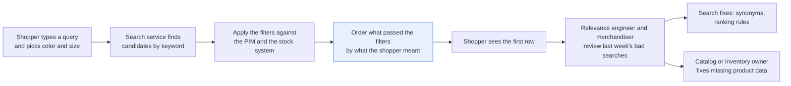
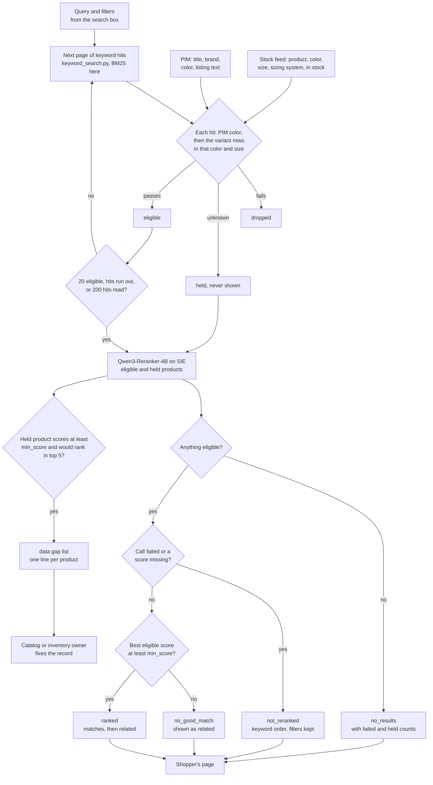

# Rerank search results without breaking the shopper's filters

> **This example:** a store's product search, where size, color and stock filters are facts, not
> preferences.
>
> **How it works:** size, color and stock filters run in plain Python, then a reranker orders only
> what passed. Products with missing data go on a list for their owner.
>
> **Use the same pattern for:** a parts search filtered by vehicle fitment, a help-center search
> limited to the shopper's country, accessories that must fit the product.

## Background

A shopper types into the search box on the store's site or app, picks a color and a size in
the filters on the left, and expects the first row of results to be what they asked for. Nobody
at the store touches that query. The search service retrieves candidates (often a keyword
engine like BM25, sometimes with synonyms bolted on), applies the filters against the catalog
and the stock system, and orders what's left, all in a few hundred milliseconds.

The people who own this are the search relevance engineer and the merchandiser. Their weekly
job happens after the fact: they open the search analytics dashboard, look at the queries with
no clicks or no results, reproduce them in a storefront preview, and fix what they can. Some
fixes are search fixes (a synonym, a ranking rule, a better model). Many are catalog fixes: a
product with no color in the PIM (the product information management system, where the catalog
team keeps titles, brands and attributes) never matches a color filter, and a product missing from the
inventory feed never counts as in stock. Those go to the catalog or inventory owner as a ticket.

What the systems already give you, structured: the query text and the filters the shopper
picked; product IDs, brand, color and listing text from the PIM; stock per sellable variant
(this size, this color, in stock or not) from the inventory system. None of that needs a model.
What does is the gap between how shoppers describe things ("warm jacket with a hood that is
waterproof") and how listings are written.

Why it matters: a keyword engine puts the products that repeat the query's words first, so
"cropped black shirt" fills the page with black T-shirts that aren't cropped. A shopper who
doesn't see what they want in the first row usually leaves. And a filter that's bent (a size 8
search showing a size 8.5, or a sold-out shoe) costs trust faster than a bad order does.

Here's the job end to end, and the step this recipe takes on:



## The problem

You want a better order without touching the filters. The obvious move, asking a model to rank
everything, lets the model trade a filter for relevance, and the shopper's size and stock are
facts, not preferences. Plain keyword ranking keeps the filters but gets the order wrong. And if
you filter after cutting the candidate list to the top 20, a matching product at rank 21 is
gone before anyone checks it.

So the filters stay in Python and the model only orders what passed them. Each search gets a
status, which is what the shopper sees:

- **`ranked`**: the eligible products in reranked order. Those scoring at least `min_score` are
  shown as matches, the rest below them as related items.
- **`no_good_match`**: even the best eligible product scores below `min_score`; the page shows
  them as related items, not as matches.
- **`no_results`**: no candidate passed the filters, after looking past the first page of
  keyword hits. The reason says how many failed a filter and how many were held.
- **`not_reranked`**: the reranker call failed for a reason that may pass; the page is the
  keyword order with the filters still applied.

Separately, a product the recipe couldn't check (no color in the catalog, not in the inventory
feed) is **held**: never shown, never guessed. If a held product would have ranked in the first
five, it goes on a **data gap list** for the catalog or inventory owner, one line per product
no matter how many queries hit it. The shopper still gets their results right away; the owner
decides whether to fix the record. None of the statuses is a decision about the store: the
relevance engineer and the merchandiser decide whether to switch the reranker on.

### Examples

Here are three of the searches in `data/queries.json`, and what should happen to each.

The product text and seven of the eight queries are real, from Amazon's Shopping Queries dataset
(ESCI, Apache-2.0). The filters, the stock feed, the sizes and Q-08 are made up.

**1. A wordy query.** Q-02
- **Input:** "i want a warm jacket with a hood and that is waterproof and black or dark coloured
  like navy", filters black or navy, in stock.
- **What should happen:** the filters keep the black and navy jackets in stock, and the reranker
  puts the waterproof hooded one first, which keyword ranking gets wrong.
- **Expected outcome:** `ranked`, the waterproof hooded jacket first.

**2. Products with no color in the catalog.** Q-04
- **Input:** "all white boots for girls", filter white, in stock. Two Dr. Martens "Optical White"
  boots have an empty color field in `pim.csv`.
- **What should happen:** the shopper gets the boots the filters can check; the two boots are
  held, never shown, and go on the data gap list for the catalog owner.
- **Expected outcome:** `ranked`, both boots on the data gap list.

**3. Shoes in stock that the model won't call a match.** Q-01
- **Input:** "women s black tennis shoes size 8", filters black, size women 8, in stock. Two
  sneakers that fit are sold out in that size, and a third is an 8.5.
- **What should happen:** the filters drop those three, and the black size 8 shoes still in stock
  come back ranked for the shopper.
- **Expected outcome:** `ranked`, with the sold-out sneakers and the 8.5 dropped.

On the live run, 8 of 10 cases came out as expected. [What came out](#what-came-out) has the
results.

## Where this runs, and what the output is for

This isn't a batch job or data labeling. The code below is the reranking step inside your search
endpoint: one shopper's query and filters go in, and the page of results that shopper sees comes
out, in order. In production your search service calls `search(query, filters)` on every request.

The recipe runs that same function two ways, so you can see what it does before you wire it in:

- **One search**: `uv run recipe.py "black tennis shoes" --color black --size 8` prints the page
  a shopper would get, next to the order the keyword engine alone would have shown.
- **Last week's bad searches**: with no arguments, it runs the eight sample queries (the kind
  the relevance engineer pulls from the analytics dashboard as no-click or no-result queries) and
  writes one before-and-after page per query plus the data gap list. That's what the engineer
  and the merchandiser look at to decide whether to switch the reranker on. No labels and no
  score: they read the pages.

The data gap list is the only output that goes to a person as work: the catalog or inventory
owner gets one line per product whose missing data kept it off a page it should have been on.

## How we'll solve it

1. **Start from what the systems already know.** The query and its filters, the PIM (title,
   brand, color, listing text) and a variant-level stock feed: one row per product, color, size
   and sizing system (women, men, toddler, ...), in stock or not. In your setup the candidates
   come from your own search engine; here BM25 over title, brand and color stands in.
2. **Filter while retrieving, not after.** Walk down the keyword hits a page of 20 at a time and
   apply the filters until 20 products pass or the hits run out (with a cap of 200 hits read).
   Color comes from the PIM; size and stock come from the variant rows in the shopper's color,
   so a sold-out black size 8 doesn't pass because the white size 8 is in stock. A product with
   no PIM color, or missing from the feed, is held. A failed filter is a fact and wins over
   anything unknown: a sock in the wrong color is dropped even if it's also missing from the
   feed.
3. **Rerank the eligible products.** `Qwen/Qwen3-Reranker-4B` scores each eligible and held
   product against the query, using the listing text, with an instruction that says it's
   judging shopping relevance. It's called once per search, with all of them.
4. **Decide in Python.** Eligible products in reranked order, matches first. If the best is
   below `min_score`, the status is `no_good_match`. Held products are never shown; a held
   product scoring at least `min_score` that would rank within `held_within` goes on the data
   gap list.
5. **Write two things.** The shopper's results per query, next to the keyword-only order, and
   the deduplicated data gap list for the catalog and inventory owners.

If an SIE call fails for a reason that may pass (a timeout, a 5xx, a rate limit, or a reply
without a numeric score for every product sent), that search falls back to the keyword order
with its filters still applied, and the run carries on; if SIE refuses the call or every call
fails, the run stops with SIE's message and writes nothing.

## Picking the model

There is one model, `Qwen/Qwen3-Reranker-4B`, through SIE's `score` call. It takes a query, an
instruction and a list of texts, and returns a score between 0 and 1 for each text: how likely
it answers the query. That is exactly the shape of this job. The candidates are already chosen
by rules, so you don't need a model that finds products, only one that reads "i want a warm
jacket with a hood and that is waterproof and black or dark coloured like navy" next to a
listing and says how well they fit. It reads the title, brand, color and the first 300
characters of the bullet points, which is where "waterproof" and "hooded" live.

Its score is useful in two ways here. As an order, it's strong: in our run it put the waterproof
hooded jacket first at 0.982, with everything else under 0.03. As an absolute value, it's a
starting point: `min_score` is 0.50, the reranker's yes/no midpoint, not a value fitted to this
data, and the swaps below show that another reranker's scores need another threshold. It also
reads the size words in the query as part of the request, which the filters already handled
(see Q-01 below).

The reranker is not a chat model and decides nothing on its own. It only orders products that
the filters already let through, plus the held ones, which it can score but never put on the
page.

## The flow



## How it's built

Everything you'd want to argue about lives in [`rules.yaml`](./rules.yaml): the model name, the
BM25 settings, the page size and the 200-hit cap, the words that count for each color facet, how
many products the reranker sees (20), the instruction, `min_score` (0.50), how many results are
shown (10), `held_within` (5) and who owns each kind of data gap. The existing systems are small
lookup modules, each backed by a committed CSV seed loaded into an in-memory SQLite database:

- [`pim.py`](./pim.py) stands in for your PIM's product API: `get_products(ids)` by exact
  product ID, and `all_products()` to build the search index.
- [`inventory.py`](./inventory.py) stands in for your inventory or availability API:
  `find_variants(product_id)` returns every variant row, and `[]` means the product isn't in
  the feed (stock unknown, which is not the same as sold out).
- [`keyword_search.py`](./keyword_search.py) stands in for your search engine: `search(query,
  offset, limit)` returns one page of BM25 hits, the way an Elasticsearch, OpenSearch or Solr
  query with `from` and `size` would.

[`recipe.py`](./recipe.py) holds the endpoint and the rules, in the same order as the flow.

| Step | Code | SIE call | What it does |
| --- | --- | --- | --- |
| Load | `load_rules`, `load_queries`, `SearchEndpoint.__init__` | none | Reads `rules.yaml` and the sample queries (an ID other than letters, digits, `_` and `-` stops the run, since it becomes a file name; color facets are lowercased), loads the PIM and feed seeds, builds the BM25 index from the PIM |
| Walk the hits | `SearchEndpoint.collect` | none | Asks the engine for pages of 20 hits and checks each one until 20 pass, the hits run out or 200 are read. A product the PIM doesn't have is dropped |
| Filters | `check_filters`, `color_matches`, `norm` | none | PIM color as a whole word or phrase from `color_words` (empty: held), so "Midnight Green" is not navy. Then the variant rows in the shopper's size and sizing system (none: dropped), in the shopper's color (none, or the color sold out, while a variant with a blank color could be it: held), and at least one in stock (none: dropped). Not in the feed: held. With `--any-stock` the variant color is still checked. Sizes compare without case or spaces, so `12 w` is `12W` but `8.5` is not `8` |
| Rerank | `rerank_text`, `SearchEndpoint.search`, `parse_scores` | `score` | One call per search with every eligible and held product. A reply with no `scores`, a missing score or a score that isn't a finite number is a failed call |
| Decide | `build_page`, `decide`, `gap_ids` | none | Orders by score, marks match or related, places each held product (`would_rank`), picks the status, and lists held products for the gap list |
| Gap list | `data_gaps` | none | One line per product across all searches, with everything it was held for and each owner, the queries it was held from, its best score and best rank |
| Write | `write_outputs`, `render_page`, `render_summary`, `csv_safe` | none | `pages/Q-xx.md`, `summary.md`, `results.json` and `data_gaps.csv`, every CSV cell defused against spreadsheet formulas |

The SIE error rule is the same as in the security recipes (`SIEStopped`, `is_fatal`, `describe`,
`short`, `stop_message`, `every_call_failed_advice`, `stop_on_refusal`), with each call wrapped
in `guarded` and counted in `CallLog` here. A transient failure sends that search to
`not_reranked` with a short reason and the run carries on. A refusal every call would repeat (a
bad key, no credits, a model name SIE doesn't know) stops the run with SIE's full message and
writes no outputs. If every call failed, the run stops too. The one-search command follows the
same rule.

[`selfcheck.py`](./selfcheck.py) checks the filters (the sold-out black 8 next to an in-stock
white 8, the 8.5 sneaker, near sizes like `18`, `12` and toddler `8`, colors like "Blackberry"
and "Midnight Green", a colorless in-stock variant next to a sold-out black one),
the walk past hit 20 and the hit cap, the ordering and gap rules, malformed reranker replies,
the outputs and the SIE error rule, with the committed data and hand-written stand-in replies.
It also checks that `inventory.csv` and `queries.json` are exactly what `make_data.py` writes.
[`make_data.py`](./make_data.py) builds the stock feed and queries from tables you can read,
and with `--esci` rebuilds the PIM seed from ESCI.

## Run it

**Try this recipe with [SIE Serverless](https://superlinked.com/serverless?utm_source=github&utm_medium=docs&utm_campaign=sie-cookbook&utm_content=ecommerce-rerank-search-within-filters).** The code runs on your machine and the models run on SIE Serverless, so you pay per call and there are no GPUs to manage yourself. Get an [SIE API key](https://console.superlinked.com/console/keys?utm_source=github&utm_medium=docs&utm_campaign=sie-cookbook&utm_content=ecommerce-rerank-search-within-filters), read the [API docs](https://superlinked.com/docs/reference/api?utm_source=github&utm_medium=docs&utm_campaign=sie-cookbook&utm_content=ecommerce-rerank-search-within-filters), or host SIE locally from the [SIE repo](https://github.com/superlinked/sie).

You need [uv](https://docs.astral.sh/uv/) and an SIE API key
([create one](https://console.superlinked.com/console/keys?utm_source=github&utm_medium=docs&utm_campaign=sie-cookbook&utm_content=ecommerce-rerank-search-within-filters)).

```bash
cp .env.example .env   # then set SIE_API_KEY
uv run recipe.py                                                  # the 8 sample queries
uv run recipe.py "black tennis shoes" --color black --size 8      # one search
uv run recipe.py "black running shoes" --color black --size 8.5 --size-system women
uv run selfcheck.py    # optional: offline checks, no SIE call
uv run --group data make_data.py   # optional: rebuild data/inventory.csv and data/queries.json
```

`uv run` installs this recipe's few dependencies into its own `.venv` on the first run. The
sample run writes `runs/<timestamp>/`; one search only prints. The first call can wait a few
minutes while SIE Serverless starts the reranker. A warm sample run makes 8 SIE calls, one per query,
and took about 5 seconds.

## What came out

The input is three seeds in [`data/`](./data):

- `pim.csv`: 79 products (title, brand, color and the first 300 characters of the bullet
  points). This is real public product text from the Amazon Shopping Queries dataset (ESCI),
  every US product with an English title that ESCI lists for seven of its shopper queries.
- `inventory.csv`: a **made-up** variant stock feed. Each listing is one variant, the size its
  title names in the PIM color, in stock, except the rows we changed for these
  examples. ESCI has no stock data.
- `queries.json`: 8 queries with the filters each shopper picked. Q-01 to Q-07 are ESCI's query
  text; Q-08 is written for this recipe. We wrote the filters, following the query's words.

> **The product text is real, the stock and filters are not.** They say nothing about any real
> seller's stock.

### The three examples

**1. A wordy query.** Q-02
- **Expected outcome:** `ranked`, the waterproof hooded jacket first.
- **What came back:** `ranked`, the Wantdo jacket first at 0.982.
- **Verdict:** Pass.

**2. Products with no color in the catalog.** Q-04
- **Expected outcome:** `ranked`, both boots on the data gap list.
- **What came back:** `ranked`; the boots scored 0.9071 and 0.8149, both would rank 4, and both are
  on the data gap list for the catalog owner.
- **Verdict:** Pass.

**3. Shoes in stock that the model won't call a match.** Q-01
- **Expected outcome:** `ranked`, with the sold-out sneakers and the 8.5 dropped.
- **What came back:** `no_good_match`. The sold-out sneakers and the 8.5 were dropped. What's left
  is a New Balance sneaker at 0.1275 and a ballet flat at 0.0228, shown as related items.
- **Verdict:** Miss. The filters did their job, but the reranker didn't call either shoe a match for
  "tennis shoes size 8".

### Results

On the live run on 4 Nov 2026, 8 of 10 cases came out as expected (Q-01 checks three
things, so it counts as three cases); Q-01 came out `no_good_match` instead of `ranked`, and so did
Q-06.

**Where it works:** the filters held in every case. Q-01 dropped the 8.5 sneaker (B01ESD61JI) and
the shoe sold out in black size 8 with other sizes and colors in stock (B071LF8XSF), Q-07 said
`no_results` when nothing was stocked in 12W, and Q-08 found the one shoe that fits at keyword hit
31. The reranker fixed the wordy Q-02, Q-05 said no good match instead of calling a black T-shirt
cropped, and the shoppers in Q-03 and Q-04 got their page while the sock and the boots with missing
data went on the data gap list.

**Where it fails:** Q-01 and Q-06 both have shoes that pass the filters, and the reranker scored
them below `min_score` (0.1275 and 0.1857 at best), so the shopper sees related items, not matches.
Q-06 is a typo ("biys sz 9 black tennis shoes"), kept as typed. Q-01 is the one to worry about: it's
a search with no typo in it.

Two cases came out differently from the plan, and we left them that way. Q-01 was meant
to be `ranked`. The only black women's size 8 shoes in stock are a New Balance sneaker (0.1275)
and a ballet flat (0.0228), and the reranker didn't call either a match for "tennis shoes size
8". Q-06 was meant to be `ranked` too; its three toddler size 9 sneakers scored 0.1857 at best.
Treat all of this as a demo that the wiring works, not as a measure of accuracy: eight queries
tell you the pieces fit, not how often the order is right.

A few things worth noticing:

- **Q-08 is why the filters run while walking.** "Black running shoes" pulls in every black
  thing with "running" or "shoe" in its title, and the first 30 hits are the wrong size, the
  wrong color or (one sock) missing from the stock feed. Cut at 20 and filter afterwards, and the
  shopper gets an empty page. The walk reads all 58 hits and finds the one that fits:

  ```text
  # Q-08: ranked
  Query: 'black running shoes'
  Filters: black, size women 8.5, in stock
  Keyword hits read: 58; 1 passed the filters.

  | 1 | Skechers Sport Women's Dlites-play On Memory Foam Lace-up Sneaker,Black/Black,8.5 M US (B01ESD61JI, hit 31) | 0.6544 | match | ...
  - Held B077ZJXCTH (hit 12, score 0.0115, would rank 2): not in the stock feed. Never shown.
  ```

  It's the same sneaker Q-01 dropped for being an 8.5. The shopper who wears an 8.5 gets it.
- **Q-04's keyword engine thought a pant was a boot.** The first keyword hit for "all white
  boots for girls" is "Dickies Girl Junior's Slim Worker Boot Cut Pant, White, 7". It has
  "white", "boot" and "girl", which is all BM25 asked for. The reranker put the Carter's ankle
  boot first at 0.9932 and moved the pant down to ninth.
- **The data gap list is short and specific.** Three lines, one per product, each with its
  owner:

  ```csv
  product_id,title,missing,owner,queries,best_score,best_rank
  B077ZJXCTH,"Gildan Men's Stretch Cotton Ankle Socks, 12-Pack, Black, Shoe Size: 6-12",not in the stock feed,inventory owner,Q-03,0.9163,4
  B07K35WGML,Dr. Martens Kid's Collection 1460 Pascal Mono Boot (Little Kid/Big Kid) Optical White Virginia 2 UK (US 3 Little Kid) M,color not in the PIM,catalog owner,Q-04,0.9071,4
  B07K36ZVM6,Dr. Martens Kid's Collection 1460 Pascal Mono Boot (Toddler) Optical White Virginia 5 UK (US 6 Toddler) M,color not in the PIM,catalog owner,Q-04,0.8149,4
  ```

  The sock is not in the feed, so every black search that reads it as a hit holds it (Q-01,
  Q-03, Q-06, Q-07 and Q-08), but only Q-03 lists it: the list needs a score of at least 0.50 and a
  place in the first five, and only Q-03 gave it both (on Q-08 it would rank 2, but it scored
  0.0115). Three DREAM PAIRS toddler sneakers have
  no PIM color either and were held from Q-06, but they scored 0.0507 or less, so they're not on
  the list. In ESCI they have no color; in a real PIM someone would want to know.
- **Sizing systems matter.** One search with `--size 8` and no sizing system lets a toddler 8
  through: "black tennis shoes" then put the nerteo toddler sneaker first at 0.505, just over
  `min_score`. Add `--size-system women` and it's gone. A size facet without its system isn't
  the filter the shopper meant. (`--size-system` without `--size` is refused: a sizing system
  alone filters nothing.)

### What you do next

The relevance engineer and the merchandiser read the before-and-after page for each query in
`runs/<timestamp>/` and decide whether to switch the reranker on; there are no labels and no
score, they read the pages. The data gap list goes to people as work: the inventory owner gets
the sock missing from the stock feed, and the catalog owner gets the two boots with no color,
and each decides whether to fix the record.

## Potential improvements

- **Your search.** Replace `keyword_search.py` with a call to your own engine, paging with
  `offset` and `limit`. Keep the filters and the reranker as they are.
- **Your catalog and feed.** Point `pim.py` and `inventory.py` at your PIM and stock system. A
  product missing an attribute you filter on is held, never guessed.
- **Filters.** `filters.color_words` in `rules.yaml` maps each color facet to the PIM words that
  count. A multicolor product counts for each color it names ("Brown/White" passes a white
  filter); if your store has a primary-color attribute, filter on that instead.
- **What the reranker reads.** `rerank_text()` in `recipe.py`. You can also strip the facet
  words ("size 8", "black") from the query before reranking; the filters already handle them,
  and on Q-01 the size words seem to count against the size-8 shoes.
- **Thresholds.** `min_score` (0.50, the reranker's yes/no midpoint) and `data_gaps.held_within`
  (5). At 3, neither held Dr. Martens boot (both at rank 4) would be listed. Both are starting points, so check them on your
  own queries.
- **Models.** `models` in `rules.yaml`.
- **Listing text is seller text.** The reranker reads the bullet points, so a listing that says
  "this is exactly what you're looking for" might lift its score. The filters still hold, but the
  order could be gamed; watch for it if third-party sellers write your listings.
- **Cache the scores.** A store with heavy repeat queries could cache the score per query and
  product, and call the reranker only for pairs it hasn't seen recently.

## Try another model

The model is one line under `models:` in `rules.yaml`. On 4 Nov 2026 (UTC) we swapped it,
changed nothing else, and ran the 8 sample queries against SIE Serverless.

| `rules.yaml` key | Swap in | What happened on this data |
| --- | --- | --- |
| `rerank` | `Qwen/Qwen3-Reranker-0.6B` | Same 8 statuses. The jacket still came first (0.9981) and Q-08's sneaker scored 0.9232. The data gap list was empty: the held sock scored 0.9691 in Q-03 but would rank 6, and the Dr. Martens boots scored 0.4042 and 0.1113. In Q-06 it scored the held sock (0.1053) above every toddler shoe |
| `rerank` | `tencent/R3-rerank-0.6b` | Q-05 and Q-06 became `ranked`: a novelty T-shirt at 0.5549 counted as a match for "cropped black shirt". Q-01 stayed `no_good_match` with the ballet flat first (0.4045). The data gap list was empty: the held sock would rank 11 and the boots 9 and 18. Its scores sit between about 0.16 and 0.82, so `min_score` 0.50 no longer marks a poor match |

See [MODELS.md](../../MODELS.md) for every model these recipes use.

## Run it on your own SIE

The same code runs against an SIE server you host. Set `SIE_BASE_URL` in `.env`; an API key
is then optional. The table gives the SIE v0.10.1 image each model runs on, from SIE's
[compatibility matrix](https://github.com/superlinked/sie/blob/main/docs/compatibility.md).

| `rules.yaml` key | Model | Image | Tested on |
| --- | --- | --- | --- |
| `rerank` | `Qwen/Qwen3-Reranker-4B` | `cuda12-default` | L4 |

One container serves it:

```bash
docker run --gpus all -p 8080:8080 -v sie-hf-cache:/app/.cache/huggingface \
  ghcr.io/superlinked/sie-server:v0.10.1-cuda12-default
# then set SIE_BASE_URL=http://localhost:8080 in .env and run: uv run recipe.py
```

## Data and licenses

- Product text and query text: the [Amazon Shopping Queries dataset (ESCI)](https://github.com/amazon-science/esci-data),
  Apache-2.0 ([license](https://github.com/amazon-science/esci-data/blob/main/LICENSE)), copied
  from the test split through the Hugging Face parquet mirror
  [`tasksource/esci`](https://huggingface.co/datasets/tasksource/esci) (file
  `default/test/0000.parquet` at the mirror's parquet revision
  `45c948250c2116f1e535bac67b92501c695307a4`, sha256 `01b0da5f...b04a8e`; `make_data.py` has the
  full hash and the download command). We keep ESCI only as public product text (title, brand,
  color, bullet points cut to 300 characters) and the text of seven queries. ESCI's relevance
  labels are not used or shipped. Product titles and brands are real Amazon listings.
- The stock feed, the sizes and sizing systems, the filters and Q-08 are made up for this demo.
  They say nothing about any real seller's stock.
- [`make_data.py`](./make_data.py) rebuilds `inventory.csv` and `queries.json` with
  `uv run --group data make_data.py`, and `pim.csv` too with `--esci esci-test-0.parquet`
  (download command in its docstring).

## Files

- `recipe.py`: the search endpoint (`SearchEndpoint.search`), the filters, the decision rules and
  the command line
- `pim.py`, `inventory.py`, `keyword_search.py`: stand-ins for the PIM, the stock system and the
  search engine
- `selfcheck.py`: plain asserts on the filters, the walk, the ordering and gap rules, reply
  parsing, outputs and the SIE failure rule, no SIE call (`uv run selfcheck.py`)
- `rules.yaml`: model, keyword search settings, color words, thresholds and gap owners
- `make_data.py`: builds `data/` from ESCI plus the made-up feed and filters
- `data/`: the PIM seed, the variant stock feed and the sample queries
- `pyproject.toml`, `uv.lock`: this recipe's dependencies

See the SIE task page for [reranking](https://superlinked.com/rerank?utm_source=github&utm_medium=docs&utm_campaign=sie-cookbook&utm_content=ecommerce-rerank-search-within-filters).
