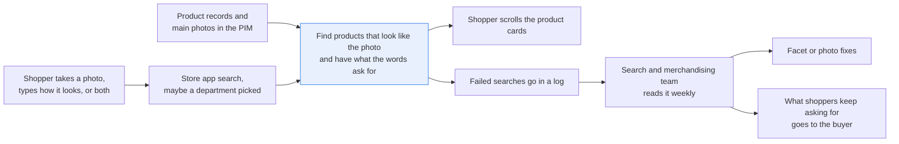
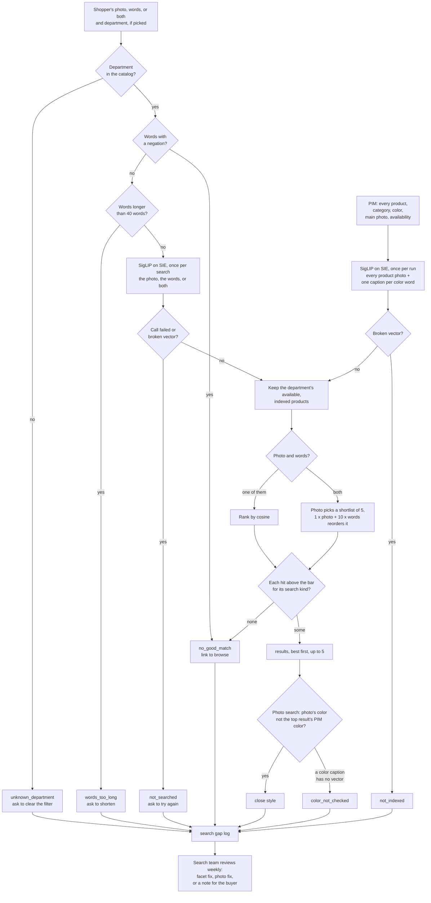

# Search products by photo, by words, or both

> **This example:** a shopper's camera search: "this lamp, but with a dark wood base".
>
> **How it works:** one model embeds photos and words in the same space, Python filters by
> department and stock, and every result must clear a score bar. Failed searches go to a weekly
> log.
>
> **Use the same pattern for:** finding near-duplicate product photos, finding a spare part from a
> photo of the broken one, shop-the-look suggestions from a lifestyle photo.

## Background

A shopper sees a lamp in a friend's living room, or a bag on someone at the airport, and wants
one like it. On the store's app they tap the camera icon, take or upload a photo, crop it to the
thing they care about, maybe pick a department, and scroll the product cards that come back. Or
they type how it looks ("grey laptop bag", "stemless wine glasses") because they don't know what
it's called. Often they do both: a photo of the lamp and a line under it, "like this, but the
base should be dark wood". The photo says what kind of thing; the words say what to change.
Nobody at the store sees that search while it happens, and nobody should: the shopper wants
results in a second, not a ticket.

The photo and the shopper's words are the only parts of this flow with no structure. The photo
carries no SKU and no barcode (if it did, a lookup would do and you wouldn't need any of this).
Everything else is already structured: the product records in the PIM, the product
information management system (product ID, title, category, color, main photo, availability),
and the department the shopper picked, which is just a facet value. The recipe reads those from
the PIM as they are and leaves only the photo and the words to the model.

The people who own the feature are the search and merchandising team, and their weekly job is
the searches that failed. They open a log of searches with no good match, look for patterns, and
fix what they can: a department facet the app still offers but the catalog renamed, a product
type shoppers keep asking for that the store doesn't sell (that one goes to the buyer, and so
does "people keep asking for this lamp with a wood base"), a product whose main photo is so poor
nothing ever finds it.

Why it matters: a visual search that always returns its nearest product will happily show a
recliner for "cordless power drill", which makes the whole feature look broken. One that ignores
"but with a dark wood base" and shows the same chrome lamp again tells the shopper it didn't
listen. And a search whose failures aren't logged can't get better.

Here's the job end to end, and the step this recipe takes on:



## The problem

Keyword search on titles misses all three kinds of search: the photo has no words, the shopper's
description doesn't use the catalog's, and "this, but different" isn't a keyword at all.
Embedding everything in one image-and-text space handles the first two, but nearest-neighbor
search always returns something, so you need a bar each result has to clear, not only the first
one. Text and photo scores also sit on very different scales, so one bar for both doesn't work.
And a photo plus words is two questions at once: does it look like this, and does it have what
I asked for?

So each search gets a status, which decides what the shopper sees:

- **`results`**: the products that cleared the bar, best first. A result that didn't clear it
  isn't shown, even if a better one did. For a photo plus words, a result has to clear both: it
  looks like the photo, and it matches the words.
- **`no_good_match`**: nothing cleared the bar. The shopper sees "no close match" and a link to
  browse the department, not a page of lookalikes. For a photo plus words, this includes "we
  found the lamp, but not with a dark wood base".
- **`unknown_department`**: the department the shopper picked doesn't exist in the catalog.
  The shopper is asked to clear the filter, and the search runs again without it.
- **`words_too_long`**: the words are longer than the model reads (`max_words`, 40). The
  shopper is asked to shorten them.
- **`not_searched`**: the search's SIE call failed or gave a broken vector. The shopper is asked
  to try again. This says nothing about the catalog, so the log keeps it apart from
  `no_good_match`.

Every search without results, every result that came back as a close style but not the exact
product, and every photo search whose color couldn't be checked goes into a **search gap log**
with the reason, and the shopper's words when they gave any. Nobody works through it per search.
The search team reads it weekly and decides whether it's a facet fix, a photo fix, or something
for the buyer.

What this recipe doesn't do: it doesn't know prices, sizes or brands beyond the title, it can't
tell the exact product from a lookalike in the same color, and an embedding doesn't understand
"not". Those are covered under Potential improvements.

### Examples

Here are three of the searches in `data/queries.csv`, and what should happen to each.

The catalog and the shopper photos are real listings from Amazon Berkeley Objects (CC BY 4.0). The
words searches were written for this recipe, and the `available` flag is made up.

**1. A photo cropped to the lamp.** Q07, department LAMP
- **Input:** a room shot from `query-photos.jpg` with the P11 lamp in the corner, cropped by the
  shopper to the lamp.
- **What should happen:** the photo is compared with every catalog photo in the department, and
  the lamp it shows should clear the photo bar first.
- **Expected outcome:** `results`, P11 first.

**2. Something the store doesn't sell.** Q04, no department
- **Input:** "cordless power drill"
- **What should happen:** the nearest product is still returned by the search, but nothing should
  clear the bar, so the shopper sees "no close match" and the search goes in the gap log.
- **Expected outcome:** `no_good_match`, logged.

**3. This, but with a wood base.** Q11, department LAMP
- **Input:** the same cropped lamp photo as Q07, plus "but the base should be dark wood". The
  catalog has the same faux wood lamp in espresso dark brown (P34) and oak (P35).
- **What should happen:** a result has to clear both bars, the photo and the words, so the words
  should change the answer that the photo alone gives.
- **Expected outcome:** `results`, P34 only, and the chrome P11 not shown.

On the live run, 13 of 13 searches came out as expected. [What came out](#what-came-out) has the
results.

## How we'll solve it

1. **Start from the catalog and the facet.** Product ID, category, title, color, main photo and
   availability come from the PIM; the department filter comes from the app. A department that
   isn't in the catalog's categories is caught here, before any model call. So are words with a
   negation in them ("without", "no", "isn't", "non-leather"), which an embedding reads much
   like the thing itself, and words longer than the model reads. A hyphenated product property
   such as "non-stick" is listed in `negation_kept` and isn't a negation.
2. **Embed the catalog once.** `google/siglip-so400m-patch14-384` embeds each product's main
   photo, plus one short caption per color word (`a photo of a navy product.`) for the
   close-style check in step 6. In production the photo vectors live in a vector index; here
   they're a dict in memory. A product whose photo comes back as a broken vector is left out of
   the index and goes to the log; if no photo gets a usable vector, the run stops.
3. **Embed the search.** A photo goes in as an image; words go in as a caption,
   `a photo of {query}.`, in the same space as the photos. A photo with words sends both in one
   call. A vector that comes back empty, all zeros or the wrong length fails the search instead
   of scoring.
4. **Filter, then rank.** Drop products outside the department and products that aren't
   available. A photo or words alone rank the rest by cosine similarity. A photo plus words
   ranks in two steps: the photo picks the closest `photo_shortlist` (5) products (what kind of
   thing), then the words reorder that shortlist (which one), by `1.0 x photo + 10 x words`. Both
   weights and the shortlist size are in `rules.yaml`.
5. **Apply the bar to every hit.** Each hit has to clear `min_score` for its search kind (words
   0.10, photo 0.70; a photo plus words has to clear 0.70 on the photo and 0.09 on the words).
   The ones that do are the results, five at most; the ones that don't stay in `results.json`
   as candidates, and in the log as context when the search failed.
6. **Check the color of a photo search's top result.** The photo's color is whichever color
   caption scores highest against it. If that isn't the product's color in the PIM, the result
   is still shown, and the search goes to the log as a close style. If any color caption has
   no vector this run, the check isn't done (the photo's real color may be the missing one),
   and the search goes to the log as `color_not_checked`.
7. **Log the gaps.** Failed searches and close-style results go to the search gap log with the
   search, the shopper's words, the reason and the top candidates.

That's one model, SigLIP, called once per run for the catalog index and once per search,
because the shopper is waiting. If a search's SIE call fails for a reason that may pass (a
timeout, a 5xx, a rate limit, a reply without its vectors), that search gets `not_searched`
with the reason in the log, and the run carries on; if SIE refuses a call, the catalog index
call fails, or every search's call fails, the run stops with SIE's message and writes nothing.

## Picking the model

`google/siglip-so400m-patch14-384` is an image-text embedding model: photos and short captions
come back as vectors in one space, through SIE's `encode` call, so one catalog index answers a
photo, words, or both. `match_products_to_catalog` uses the same model to compare product
photos. Its text side reads short captions (at most 64 tokens), which is why the shopper's words
go in wrapped as `a photo of ...`.

Two habits shape the rules. First, its scores sit on very different scales: no words search
scored above 0.193 against any product in our run, while a worn shot or a crop of the same
product scored 0.87 and up, and two unrelated products on white backgrounds already score about
0.6 against each other. Hence a bar per search kind, and a ten-times weight on the words
when they reorder a photo shortlist. Second, it sees color better than it sees identity: the
black Madison flat scored 0.929 against the navy one, higher than the worn bag against its own
catalog photo (0.895). A score alone can't say "exact product", which is why the color check
asks the PIM.

No generative model makes any decision here. Everything after the two kinds of `encode` call is
plain Python you can read.

## The flow



## How it's built

Everything you'd want to argue about lives in [`rules.yaml`](./rules.yaml): the model name,
`top_k`, the caption template, the shortlist size and the two weights, every score bar with a
comment on how we fitted it, the negation words and the hyphenated words kept, the word limit,
and the color words with their caption. The PIM is [`pim.py`](./pim.py): a few plain lookups
(`sellable`, `has_department`, `find_product`, `all_products`) on `data/catalog.csv` loaded into
an in-memory SQLite database, standing in for your PIM's product API. [`recipe.py`](./recipe.py)
reads top to bottom in the order of the flow.

| Step | Code | SIE call | What it does |
| --- | --- | --- | --- |
| Load | `PIM`, `load_queries`, `check_colors` | none | Reads the catalog and the searches. A search whose kind doesn't fit its inputs, or a PIM color missing from `close_style.colors`, stops the run before any SIE call |
| Catalog index | `build_index`, `encode`, `unit` | `encode` | One call per run: 35 product photos and 14 color captions. A broken vector leaves that product out (`not_indexed`); a failed call, or no usable photo vector at all, stops the run, since nothing can be searched |
| Facet and words | `load_rules`, `run_search`, `PIM.has_department`, `negation`, `too_long` | none | An unknown department, negated words or words over `max_words` end the search here, with no model call. `load_rules` refuses a negation word YAML didn't read as a string, and curly apostrophes count as straight ones |
| Embed the search | `run_search`, `caption`, `photo_bytes`, `guarded` | `encode` | One call per search with the photo, the caption, or both. A failed call or a broken vector gives `not_searched` with the reason |
| Rank and bar | `search`, `scores`, `ranked` | none | Department and availability filter from `PIM.sellable`, then cosine ranking, or the photo shortlist reordered by the words, and the bar on every hit |
| Close style | `close_style` | none | For a photo search with results: the color caption that scores highest against the photo, compared with the top result's PIM color; with any color caption missing, `color_not_checked` |
| Outputs | `result_rows`, `gap_log`, `csv_safe`, `write_outputs` | none | `results.json`, `results.csv` and `search_gap_log.csv`. Every CSV cell that a spreadsheet would run as a formula gets a leading `'` |

The SIE error rule is the same as in the security recipes. A search call that fails for a reason
that may pass (a timeout, a lost connection, a 5xx, a rate limit, a model still loading, or a
reply without a `dense` vector for every item) gives that search `not_searched` with a short
reason, and the run carries on. A refusal every call would repeat (a bad key, no credits, a model
name SIE doesn't know) stops the run with SIE's full message and writes no outputs. If every
search's call failed, or the catalog index call failed, the run stops too.

[`make_data.py`](./make_data.py) rebuilds `data/` from ABO byte for byte. [`selfcheck.py`](./selfcheck.py)
checks the data, the PIM lookups, the bar on every hit, the availability filter, the photo
shortlist and both bars, the negation words (a quoted `no`, curly apostrophes, `non-stick`)
and the word limit, the close-style check and a missing color caption, the vector guard, the
outputs and that SIE error rule offline, with hand-written vectors and stand-in model replies.

## Run it

**Run this recipe using [SIE Serverless](https://superlinked.com/serverless?utm_source=github&utm_medium=docs&utm_campaign=sie-cookbook&utm_content=ecommerce-search-products-by-photo-and-text), [SIE Cluster](https://superlinked.com/docs/deployment?utm_source=github&utm_medium=docs&utm_campaign=sie-cookbook&utm_content=ecommerce-search-products-by-photo-and-text) or [SIE Local](https://superlinked.com/docs/quickstart?utm_source=github&utm_medium=docs&utm_campaign=sie-cookbook&utm_content=ecommerce-search-products-by-photo-and-text).** The code runs on your machine either way. With SIE Serverless you pay for what each call uses and there are no GPUs to manage yourself: get an [SIE API key](https://console.superlinked.com/console/keys?utm_source=github&utm_medium=docs&utm_campaign=sie-cookbook&utm_content=ecommerce-search-products-by-photo-and-text) and read the [API docs](https://superlinked.com/docs/reference/api?utm_source=github&utm_medium=docs&utm_campaign=sie-cookbook&utm_content=ecommerce-search-products-by-photo-and-text). To run the models yourself, start from the [SIE repo](https://github.com/superlinked/sie).

You need [uv](https://docs.astral.sh/uv/) and, for SIE Serverless, an SIE API key
([create one](https://console.superlinked.com/console/keys?utm_source=github&utm_medium=docs&utm_campaign=sie-cookbook&utm_content=ecommerce-search-products-by-photo-and-text)).

```bash
cp .env.example .env   # then set SIE_API_KEY
uv run recipe.py
uv run selfcheck.py    # optional: offline checks, no SIE call
```

`uv run` installs this recipe's few dependencies into its own `.venv` on the first run. Each run
writes `runs/<timestamp>/`. The first call can wait a few minutes while SIE Serverless starts the
embedding model. A warm run makes 13 SIE calls (one for the catalog index, one for each of the
12 searches that reach the model) and takes about 5 seconds. To rebuild the data from ABO, run
`uv run make_data.py`.

## What came out

The input is four files in [`data/`](./data):

- `catalog.csv`: the PIM seed, 35 products (`product_id`, `category`, `title`, `color`,
  `available`, the ABO item and image IDs, and the photo's box `x,y,w,h` in the sprite sheet).
  `category` is ABO's own `product_type` (SOFA, CHAIR, LAMP, RUG, HANDBAG, BACKPACK, SUITCASE,
  DRINKING_CUP, BOOT, SHOES). `color` and `available` are ours: the color is picked by hand
  from ABO's color name and the photo, and only P15 is marked unavailable.
- `catalog-photos.jpg`: one sprite sheet with every catalog photo as a 256x256 tile.
- `queries.csv`: 13 shopper searches: words, a photo, or a photo with words, each with an
  optional department.
- `query-photos.jpg`: the shopper photos, on their own sprite sheet. Q11 and Q12 reuse the
  photos of Q07 and Q08.

> **The products and photos are real, the stock is not.** Every product and photo is a real
> amazon.com listing from Amazon Berkeley Objects (see Data and licenses below). The words
> searches were written for this recipe, and the availability flag is made up.

### The three examples

**1. A photo cropped to the lamp.** Q07, department LAMP
- **Expected outcome:** `results`, P11 first.
- **What came back:** `results`, P11 first (0.876), then four more lamps above 0.70.
- **Verdict:** Pass.

**2. Something the store doesn't sell.** Q04, no department
- **Expected outcome:** `no_good_match`, logged.
- **What came back:** `no_good_match`, logged; the best product was P05, a recliner, at 0.013.
- **Verdict:** Pass.

**3. This, but with a wood base.** Q11, department LAMP
- **Expected outcome:** `results`, P34 only, and the chrome P11 not shown.
- **What came back:** `results`, P34 only (photo 0.774, words 0.098); the chrome P11 not shown.
- **Verdict:** Pass. By a thin margin, though: the 0.09 words bar sits in a small gap, so move it a
  hair and the oak lamp or the glass lamp comes along (see below).

### Results

On the live run on 4 Nov 2026, 13 of 13 searches came out as expected.

**Where it works:** words alone find the stemless wine glasses (Q01) and the grey laptop bag, with
and without a department (Q02, Q03). A crop finds the lamp (Q07), a photo of a man wearing the bag
finds the bag (Q08), and a photo with words finds the dark wood lamp (Q11). It also says so when
nothing fits, instead of showing a lookalike: the drill (Q04), the uncropped room shot (Q06), the
claw hammer (Q10) and the brown leather bag (Q12). It handles a department that no longer exists
(Q05), and logs a close style when the color or the stock is off: the black flat (Q09) and the
unavailable rug (Q13).

**Where it fails:** not in these 13 searches, and that's a weak claim, because the thresholds were
fitted to this same data. Worry about Q11: the words separate the lamps by 0.022 at most, so move
the bar a hair and the answer changes. Q06 shows a limit too: an uncropped room shot gets "no close
match", so the shopper has to crop. And the recipe can't tell the exact product from a lookalike in
the same color, and an embedding doesn't understand "not".

That's with the rules as committed. The thresholds were fitted to this
data (the comments in `rules.yaml` say from which numbers), so treat
this as a demo that the wiring works, not as a measure of accuracy. Thirteen searches tell you
the plumbing is connected, not how often a shopper gets the right lamp.

A few things worth noticing:

- **Q11 is the reorder doing its job, barely.** By photo alone the chrome lamp P11 is first
  (0.876), the white glass lamp P09 second (0.788) and the dark wood lamp P34 third (0.774).
  The words move P34 to the top of the shortlist. Here's the search from `results.json`, titles
  cut short and the shortlist trimmed to three:

  ```json
  {"query_id": "Q11", "kind": "photo_and_text", "words": "but the base should be dark wood",
   "department": "LAMP", "status": "results",
   "reason": "1 of the 5-product photo shortlist cleared both bars; best P34 (photo 0.774, words 0.098).",
   "results": [{"rank": 1, "product_id": "P34", "score": 1.7574, "photo": 0.7744, "words": 0.0983}],
   "candidates": [
     {"product_id": "P34", "score": 1.7574, "photo": 0.7744, "words": 0.0983},
     {"product_id": "P09", "score": 1.6368, "photo": 0.7878, "words": 0.0849},
     {"product_id": "P11", "score": 1.6353, "photo": 0.8763, "words": 0.0759}]}
  ```

  The margins are thin. The words separate the lamps by 0.022 at most, and the model scored the
  white glass lamp (0.085) above the light wood one (0.081) for "dark wood". The 0.09 words bar
  sits in that small gap, which is why only P34 is shown. Move the bar a hair and the oak lamp
  or the glass lamp comes along.
- **Q12 is the same move turned down.** The photo finds the grey messenger bag at 0.895, and the
  words score it 0.041 for "in brown leather". The tan clutch P18 has the better words score
  (0.073) but looks nothing like the photo (0.531), so it doesn't count either. The log row
  reads "No good match: P17 0.895 cleared the photo bar, but none of them has what the words ask
  for (best words score P17 0.041, below 0.09)", which is exactly the note the buyer needs.
- **Q09 and Q13 are why the color check exists.** The black flat against the navy one scores
  0.929, higher than any exact match in the run. The color captions called the photo `black`
  and the PIM says `navy`, so the result is shown and logged. Q13 shows the same thing from the
  stock side: the photo is of P15, which is unavailable, so the grey P16 comes back at 0.738 and
  the log says the photo looks `blue`.
- **The log is short on purpose.** Seven rows for 13 searches: three searches with nothing close
  (Q04, Q06, Q10), the stale SANDAL facet, Q12's brown leather request, and the two close
  styles. No row says "everything worked", which is the point.

The run writes `results.json` for code (every search with its status, reason, shown results,
candidates and color check), `results.csv` with one row per shown result, and
`search_gap_log.csv` for the search team.

### What you do next

The shopper only ever sees the product cards or the "no close match" page. The search and
merchandising team reads `search_gap_log.csv` once a week, not per search, and sorts each row:
a facet fix (the stale SANDAL department), a photo fix, or a request for the buyer (black
Madison flats, a brown leather messenger bag).

## Potential improvements

- **Your catalog.** Load your PIM export or call its API in `pim.py` (`product_id, category,
  title, color, available` and a photo per product). If you have photo files or URLs instead of
  a sprite sheet, change `photo_bytes()` and `build_index()`. On a real catalog, keep the
  vectors in a vector index and query that instead of the dict in memory.
- **Filters.** Here the filters are the department and availability. Price, brand or size
  filters go in `PIM.sellable()` the same way: drop the products that fail before ranking.
- **Thresholds.** `min_score` in `rules.yaml`, one per search kind. They are fitted to this demo
  data (see the comments in `rules.yaml`). Two unrelated product photos
  on white backgrounds already score about 0.6 with this model, so a photo bar much lower than
  0.7 returns lookalikes for anything. Check them all on your own catalog and searches.
- **Exact product vs similar style.** Q09 shows that a color variant scores as high as the
  product itself. The color check catches a different color; it can't catch the same style in
  the same color from another listing. Your PIM's variant groups would.

**Pro-tip:** text and photo scores live on very different scales with this model (in this run,
on-target words scored 0.14 to 0.19 against their product, and a worn shot or a crop 0.87 and
up), so don't try to share one threshold between them.

- **Text template.** `text_template` in `rules.yaml`. SigLIP reads short captions; its text
  input is at most 64 tokens. "a photo of but the base should be dark wood." is not great
  English, and a template that names the department ("a photo of a lamp, ...") might separate
  dark from light wood better.
- **Model.** `models.embed` in `rules.yaml`.
- **Negation.** The recipe gives up on words with "not" or "without" in them, which is honest
  but blunt. Splitting the words into a wanted and an unwanted part, and pushing the unwanted
  part's score down, would let it answer them.
- **Measure it.** Before you trust any of the bars, run the recipe on a few weeks of logged
  searches with a person marking which results were right.

## Try another model

Each model is one line under `models:` in `rules.yaml`. On 4 Nov 2026 (UTC) we swapped the model,
changed nothing else, and ran the recipe using SIE Serverless.

| `rules.yaml` key | Swap in | What happened on this data |
| --- | --- | --- |
| `embed` | `google/siglip2-base-patch16-224` | 10 of 13 searches came out as expected. Q03 returned the other grey laptop backpack, P21, first (0.145 vs 0.131 for P22). Q06, the room shot, became `results` with the wrong lamp, P09, first at 0.758 (and was logged as a close style): its photo scores run higher, so the 0.70 photo bar no longer separates a small object in a room from a real match. Q13 put a different rug, P13, first (0.741) ahead of P16 (0.728). Q11 still put the dark wood lamp first (words 0.102) but also showed the oak lamp (0.100) and the glass lamp P09 (0.096); Q12 stayed `no_good_match` |

See [MODELS.md](../../MODELS.md) for every model these recipes use.

## Run it using SIE Cluster or SIE Local

The same code runs on your machine and uses SIE Cluster or SIE Local
([SELF_HOSTING.md](../../SELF_HOSTING.md) says what SIE Local can serve). Set `SIE_BASE_URL` in `.env`; an API key
is then optional. The table gives the SIE v0.10.1 image each model runs on, from SIE's
[compatibility matrix](https://github.com/superlinked/sie/blob/main/docs/compatibility.md).

| `rules.yaml` key | Model | Image | Tested on |
| --- | --- | --- | --- |
| `embed` | `google/siglip-so400m-patch14-384` | `cuda12-default` | L4 |

One container serves it:

```bash
docker run --gpus all -p 8080:8080 -v sie-hf-cache:/app/.cache/huggingface \
  ghcr.io/superlinked/sie-server:v0.10.1-cuda12-default
# then set SIE_BASE_URL=http://localhost:8080 in .env and run: uv run recipe.py
```

## Data and licenses

The catalog and the shopper photos come from
[Amazon Berkeley Objects (ABO)](https://amazon-berkeley-objects.s3.amazonaws.com/index.html):
real amazon.com product listings with their titles, product types, colors and catalog photos,
fetched from ABO's S3 bucket (the listings and images metadata as served on 3 Nov 2026; ABO
publishes no version tag to pin). The catalog uses each listing's main photo; the photo
searches use other ABO photos (a worn shot, a room shot, a variant the catalog does not carry,
a product from another department, another shot of a catalog rug). The two wood lamps are the
closest pair ABO has for "a dark wood base and a light wood base": one Ravenna Home table lamp
sold in espresso dark brown and in oak, and both titles say "Faux Wood". The words searches were
written for this recipe.

**License.** ABO is licensed under
[CC BY 4.0](https://creativecommons.org/licenses/by/4.0/). Credit for the data, including all
images, goes to Amazon.com; the dataset was built by Matthieu Guillaumin, Thomas Dideriksen,
Kenan Deng, Himanshu Arora (Amazon.com), Jasmine Collins and Jitendra Malik (UC Berkeley).
Changes: 35 listings and 5 other photos were picked, the photos were downscaled (ABO's "small"
set) and placed on two sprite sheets, the en dash in titles is written as a hyphen, one photo
(Q07) is a crop of ABO's full-size room shot, and we added a hand-picked `color` and a made-up
`available` flag per product. The sprite sheets are written from decoded pixels, so they carry
no EXIF or XMP metadata. All picks are in [`make_data.py`](./make_data.py).

## Files

- `recipe.py`: the pipeline
- `pim.py`: the PIM lookups, backed by `data/catalog.csv`
- `selfcheck.py`: plain asserts on the search rules, PIM lookups, gap log and SIE failure rule,
  no SIE call (`uv run selfcheck.py`)
- `rules.yaml`: the model ID, top-k, the caption template, the shortlist and weights, every score
  bar, the negation words, the word limit and the color words
- `make_data.py`: rebuilds `data/` from ABO
- `data/`: the PIM seed and the searches, each a CSV plus a sprite sheet
- `pyproject.toml`, `uv.lock`: this recipe's dependencies

See the SIE task page for [image search](https://superlinked.com/image-search?utm_source=github&utm_medium=docs&utm_campaign=sie-cookbook&utm_content=ecommerce-search-products-by-photo-and-text).
