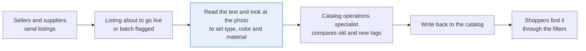
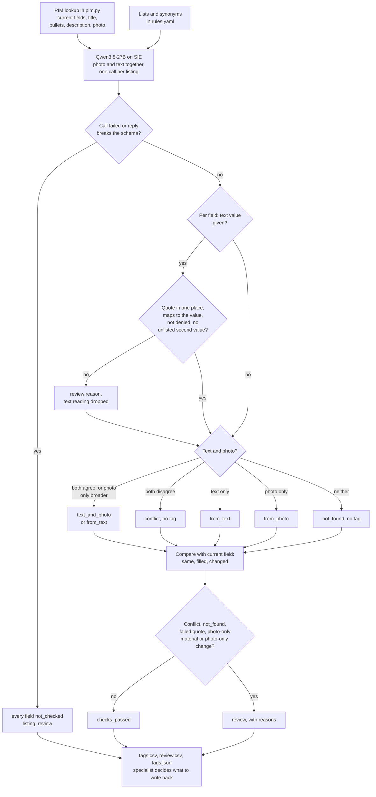

# Tag products from their photo and text against your tag lists

> **This example:** catalog operations rebuilding the type, color and material tags on marketplace
> listings.
>
> **How it works:** a vision-language model reads both against your tag lists and quotes its
> evidence. Python checks each quote is in the listing and means what the tag says.
>
> **Use the same pattern for:** style and occasion tags on fashion listings, spotting restricted
> items in seller listings, age ranges on toys.

## Background

On a marketplace, or any store that takes product data from sellers and suppliers, a catalog
operations specialist cleans up listings before they go live or when a batch is flagged. They
work at a desk in the listing editor or the PIM (product information management system). The
listing's fields sit on one side: product type, the seller's color, a standardized color,
material. Its text and photos sit on the other: title, bullet points, description, main photo.
The job is to make the tags say what the product actually is.

The tags are often wrong or empty even when the listing itself has the answer. "100% cotton" sits
in the third bullet point while the material field is blank. The title says "Faux Leather" while
the material tag says "Leather". The description says "storage bench" while the product type says
ottoman. And some things only the photo shows: the color of a product whose color field says
"Glass", or that the photo is of a different product altogether.

The specialist reads the text and looks at the photo together, because neither is enough on its
own. The text is better for anything you can't see: you can't tell cotton from polyester, faux
leather from leather, or enamelled cast iron from ceramic in a photo. The photo is better for
what sellers get wrong or leave out in the text, mostly color and whether the product is what
the title says.

Why it matters: type, color and material drive the filters shoppers use. A cotton shirt with no
material tag doesn't show up when someone filters for cotton, a black mirror tagged "brown"
doesn't show up under black, and a leather tag on a faux leather bag is how returns start.

The PIM already hands the specialist everything structured: the current fields, the title, the
bullet points and the photo, by listing ID. The recipe takes those as they are, from a lookup
that stands in for the PIM, and uses the model only for the part no field gives you: reading the
words and looking at the picture.

Here's the job end to end, and the step this recipe takes on:



## The problem

Doing this by hand means reading every bullet point and looking at every photo, for listings that
are mostly fine. A photo-only tagger misses everything the text says and guesses at material. A
text-only extractor misses the wrong photo and the color the seller didn't write down. Both
return their own words, not your team's lists of types, colors and materials.

The obvious shortcut, one prompt that says "here's the listing, give me the tags", has the same
problem as any single model call making a catalog decision: you can't see why it picked leather,
and a listing that says "Vegan Leather" in the title is exactly where a model, or a person in a
hurry, writes "leather".

So the recipe regenerates every tag from both, against the team's lists, and says where each tag
came from:

- **`from_text`**: the title, bullets or description say it, and the recipe quotes the words.
  The quote is checked against the listing text, so a tag can't cite words that aren't there.
- **`from_photo`**: only the photo shows it. For material this is always a suggestion to confirm
  against the supplier's spec sheet.
- **`text_and_photo`**: both say it and they agree.
- **`conflict`**: the text says one thing and the photo shows another. The recipe doesn't pick a
  winner.
- **`not_found`**: neither the text nor the photo settles it (or the answer isn't on the list).

Then it compares the new tags with the listing's current fields: **`same`**, **`filled`** (the
field was empty), or **`changed`** (old value and new value side by side). A current value the
lists don't know ("Glass" as a color with no standardized color, "NAVY/NATURAL") is kept as it
is, so a new tag shows up as `changed` from it, never as `filled`.

Per listing: **`checks_passed`** when every tag has evidence, nothing conflicts and no material
comes from the photo alone; **`review`** otherwise, with the reasons. Neither is a decision. The
specialist decides what to write back to the catalog, for every listing; the recipe writes
nothing back.

### Examples

Here are three of the listings in `data/`, and what should happen to each.

**1. A listing that's already right.** P01
- **Input:** "AmazonBasics Carry-On Travel Backpack - Black", type BACKPACK, color Black, material
  polyester; bullet 1 says "...made of durable polyester"; photo `P01.jpg`.
- **What should happen:** the text and the photo agree with every current field, so nothing
  changes and no one needs to look.
- **Expected outcome:** `checks_passed`, every tag `same`.

**2. A material tag that's wrong.** P11
- **Input:** "Amazon Basics Faux Leather Rectangular Storage Ottoman, Dark Chocolate", material
  field Leather; bullet 4 says "Faux leather upholstery with a dramatic tufted finish...".
- **What should happen:** the text names faux leather, a photo can't tell the two apart, so the
  text wins and the old tag is shown next to the new one.
- **Expected outcome:** material faux leather, `from_text`, `changed` from Leather.

**3. "Leather" that isn't leather.** P18
- **Input:** "...Ravenna Home Chic Vegan Leather Storage Ottoman, 50"W, Black", empty material
  field; bullet 3 says "...stylish vegan leather upholstery...".
- **What should happen:** the word "leather" is in the text, but the quote check reads it where
  it stands, so it has to map to faux leather, never leather.
- **Expected outcome:** faux leather or `not_found`, never leather.

On the live run, 11 of 14 planted cases came out as expected; [What came out](#what-came-out) has
each one.

## How we'll solve it

1. **Start from the listing.** Current fields (product type, color, standardized color,
   material), the text (title, bullet points, description) and the main photo come from the PIM,
   here the lookup in `pim.py`. The team's lists and the synonyms that map onto them ("navy
   blue" to blue, "vegan leather" to faux leather) are in `rules.yaml`.
2. **Read the photo and the text together.** `Qwen3.8-27B-FP8`, a vision-language model, gets
   the photo, the listing text and the team's lists with their synonyms, once per listing. For
   each field it returns, separately, what the text says (a value from the list and the exact
   words it relied on) and what the photo shows. The prompt says the listing text and anything
   printed in the photo are something to describe, never an instruction.
3. **Check the model's work in Python.** A quote has to appear in one place of the listing text
   (the title, one bullet point or the description), and the quoted words, read where they stand
   in the listing, have to map to the value the model picked through the synonyms in
   `rules.yaml`. So "leather" cut out of "Vegan Leather", "leather-free" or "not real leather"
   can't come out as leather, and a quote that names a second value ("Navy and Natural") must
   list it as a second color. A quote that fails sends the listing to review and the text
   reading is dropped. Text and photo that disagree are a `conflict`, unless the photo only
   names a broader value ("fabric" for "cotton"): then the tag is the text's.
4. **Compare with the current fields.** Same, filled or changed, field by field.
5. **Route.** Any conflict, missing tag, failed quote check or photo-only material sends the
   listing to review with the reasons. So does a tag only the photo supports that would change
   the current value: changing the catalog on a photo alone is something a person should see.

If an SIE call fails for a reason that may pass (a timeout, a 5xx, a rate limit), or its reply
breaks the schema, that listing goes to review with the reason and the run carries on; if SIE
refuses the call or no call gives a usable reply, the run stops with SIE's message and writes
nothing.

## Picking the model

One model, `Qwen/Qwen3.8-27B-FP8`, called once per listing through SIE's `chat_completions`
with the photo attached as an image. It's the vision-language model the other recipes in this
cookbook use to read images and answer in JSON. Here it gets a JSON schema with each field's
list as an allowed set (`response_format` with `strict: true`) and temperature 0, so it can't
answer "navy" or "cable" when the list says blue and has no cable.

Reading photo and text in one call matters more than it sounds. The model can tell you the
blanket in the photo is navy and cream while quoting "Navy and Natural" from the title, and it
reads "100% Cotton" out of the third bullet point, which no photo model ever could.

What it's less good at is staying humble about material. We tell it a photo shows a surface, not
what's under it, and to answer `unclear` when the surface could be several materials. It did
that for the enamelled Dutch oven, the faux leather ottoman and the vegan leather one. It did
not for the cotton blanket: the photo reading came back `cotton`, which no one can see in a
photo. That's why the recipe never lets a photo alone set a material, and why `text_and_photo`
for material is really "the text says so and the photo doesn't object".

An image embedding model such as `google/siglip-so400m-patch14-384`, scoring the photo against
label prompts, sees only the photo. It can't read the cotton in the bullets or the "Faux" in the
title, which is why this recipe uses a vision-language model.

## The flow



## How it's built

Everything you'd want to argue about lives in [`rules.yaml`](./rules.yaml): the model name, the
photo size, the three lists, the synonyms per field, which values cover narrower ones (fabric
covers cotton, velvet and jute; metal covers cast iron), the words that deny a value, how the
current product types map onto the type list, and which findings send a listing to review.
[`recipe.py`](./recipe.py) holds the prompt, the schema and the checks, and reads top to bottom
in the order of the flow. [`pim.py`](./pim.py) is the PIM lookup: `get_listing` stands in for a
GET on the PIM's product endpoint, `flagged_batch` for the saved search of listings waiting for
a clean-up. It loads the two CSV seeds in `data/` into an in-memory SQLite database, and looks
listings up by exact ID only.

| Step | Code | SIE call | What it does |
| --- | --- | --- | --- |
| Load | `pim.connect`, `pim.flagged_batch`, `pim.get_listing` | none | Every listing of the batch, before the first SIE call. A photo name that leads out of `data/photos/` or names a missing file raises an error |
| Ask | `listing_text`, `list_line`, `build_prompt`, `reply_schema`, `photo_jpeg`, `ask_tagger` | `chat_completions` | One call per listing: the photo (upright, longest side 512 pixels) and the prompt with the lists, synonyms, title, numbered bullet points and description. Strict JSON schema, temperature 0 |
| Parse | `parse_reply` | none | Exact keys, every value on its list, finish reason `stop`. Anything else is a review reason with what was wrong; nothing is repaired |
| Words | `normalize`, `phrases`, `phrase_pattern`, `negated`, `find_matches`, `find_values` | none | Values a piece of text names, longest phrase first so "faux leather" never yields leather. Whole words, any case, plural s or es. A value with a denying word before it (up to two words between) or after it is denied |
| Quote check | `segments`, `check_quote`, `quote_problem` | none | The quote, after straightening quotes and dashes, must be in the title, one bullet point or the description. The matches it overlaps there must name the value, not deny it, and name no other value the reply doesn't list under `also` |
| Current field | `current_value`, `one_value` | none | Product type through `current.types` (HOME and HOME_FURNITURE_AND_DECOR count as empty). Color from the standardized color, else the seller's color. Material from the material field. A field that names no single value is kept raw |
| Tag and route | `tag_field`, `tag_listing` | none | Source per field, comparison with the current field, and the review reasons; `checks_passed` only with no reason |
| Write | `csv_rows`, `csv_safe`, `write_outputs` | none | `tags.csv` (one row per listing and field), `review.csv` and `tags.json`; a cell a spreadsheet would run as a formula gets a leading `'` |

The SIE error rule is the same as in the security recipes. A call that fails for a reason that
may pass (a timeout, a lost connection, a 5xx, a rate limit, a model still loading, or a reply
with no `choices[0].message.content`) sends that listing to review with a short reason, and the
run carries on. A refusal every call would repeat (a bad key, no credits, a model name SIE
doesn't know) stops the run with SIE's full message and writes no outputs. A reply that comes
back but breaks the schema counts as a failed call: its listing goes to review, and if every call
failed or came back unusable, the run stops too.

[`selfcheck.py`](./selfcheck.py) checks the word matching, the quote check, the current fields,
every source and routing rule, the strict reply parsing, the prompt's line about printed text,
the outputs, the planted listings, that the photos carry no metadata, and the SIE error rule,
offline, with hand-written strings and stand-in model replies.
[`make_data.py`](./make_data.py) rebuilds `data/` from ABO.

## Run it

You need [uv](https://docs.astral.sh/uv/) and an SIE API key
([create one](https://console.superlinked.com/console/api-keys?utm_source=github&utm_medium=docs&utm_campaign=sie-cookbook&utm_content=ecommerce-tag-products-from-photo-and-text)).

```bash
cp .env.example .env   # then set SIE_API_KEY
uv run recipe.py
uv run selfcheck.py    # optional: offline checks, no SIE call
uv run make_data.py    # optional: rebuild data/ from ABO
```

`uv run` installs this recipe's few dependencies into its own `.venv` on the first run. Each run
writes `runs/<timestamp>/` in this folder. The first call can wait a few minutes while SIE Cloud
starts the model. A warm run makes 18 SIE calls, one per listing, and takes about 34 seconds.
`make_data.py` streams all 16 ABO listings files (about 88 MB, nothing saved) and 18 photos, and
writes the same files byte for byte.

## What came out

The input is the PIM seed: [`data/pim_listings.csv`](./data/pim_listings.csv) (18 listings:
listing ID, marketplace, ABO item ID, title, product type, the seller's color, standardized
color, material, description, photo file),
[`data/pim_bullets.csv`](./data/pim_bullets.csv) (105 bullet points, one per row, in the
listing's order) and the 18 main photos in [`data/photos/`](./data/photos).

> **All 18 listings are real.** They are Amazon Berkeley Objects (ABO) listings with their own
> titles, bullet points and fields, as ABO has them, mistakes included (see Data and licenses
> below). ABO has a description field, but none of these 18 listings fills it, so the recipe
> reads titles and bullet points here.

Two listings were planted for two checks. For "cotton in the bullets" we used P17, a Rivet throw
blanket whose third bullet point is just "100% Cotton", with no material field and no cotton in
the title. For the negated material, ABO has no listing that says "leather-free" among the ones
we searched; the closest real one is P18, a Ravenna Home storage ottoman whose title and third
bullet point say "vegan leather" and whose material field is empty.

On our live run on 4 Nov 2026 (UTC), 13 listings came back `checks_passed` and 5 `review`.

### The three examples

- **P01:** `checks_passed`, every tag `same` and `text_and_photo`. As expected.
- **P11:** material faux leather, `from_text`, `changed` from Leather; the photo said `unclear`.
  As expected.
- **P18:** faux leather, `from_text`, `filled`, quote "vegan leather"; the photo said `unclear`.
  As expected.

### Every planted case

On the live run on 4 Nov 2026, 11 of 14 planted cases came out as expected (counting each of the
four clear listings on its own). P12 came out `checks_passed` with color black instead of a photo
color for review. P17 and P04 got the tag we wanted, but as `text_and_photo` rather than
`from_text`, and both listings went to `review` for their color.

| Case | What we planted | Should come out | What came out | Why |
| --- | --- | --- | --- | --- |
| Clear listings | P01 backpack, P03 leather sofa, P07 ceramic planter, P09 suede sandal | `checks_passed`, every tag `same` | As planned: all four `checks_passed`, every tag `same` and `text_and_photo` | Most listings are fine, and those should take no one's time |
| Cotton in the bullets | P17 throw blanket, empty material field, "100% Cotton" in bullet 3 | material cotton, `from_text`, `filled` | cotton, `filled`, quote "100% Cotton" from bullet 3, but `text_and_photo`: the photo reading also said cotton. The listing went to `review` for its color, see below | The answer was in the listing all along; a photo could never have told you |
| Velvet, navy | P02, color "Navy Blue Velvet", material Velvet | color blue and material velvet, both `same` | As planned, quotes "Navy Blue" and "Velvet fabric" | The color field carries a material word; the synonyms have to cope |
| Faux leather | P11, title "Faux Leather", material tag "Leather" | material faux leather `from_text`, `changed` from Leather | As planned; the photo said `unclear` | The text beats a wrong tag, and the change is shown |
| Enamel or ceramic | P05 Dutch oven, text says enamelled cast iron | material cast iron `from_text`; the photo can't confirm it | As planned; the photo said `unclear` | What the photo alone sent to review, the text settles |
| Bench or ottoman | P04, text says storage bench, photo looks like an ottoman | type bench `from_text`; `review` only if the photo reading conflicts | type bench `text_and_photo`, `same` (the photo read bench too); the listing went to `review` for its color, see below | A storage bench really does look like one |
| Odd color field | P12 mirror, color "Glass", bronze-toned frame | color from the photo, `changed`, `review` | Not as planned: color black, `text_and_photo`, `same`, `checks_passed` | The title says "Black" and the model saw a black frame |
| Empty color | P14 boots with no color in the fields or the text | color `from_photo`, `filled` | As planned (brown); the listing went to `review` because its material came from the photo only | A gap only the photo can fill, for a person to confirm |
| Two-tone desk | P16, "White/Brown" | color white `same`, brown named as a second color | As planned: white `same`, `also` brown | Agreement on the main color; the second one isn't silently dropped |
| Not on the list | P15 Lightning cable | type `not_found`, `review`, never "headphones" | As planned (the photo said `none`); its material plastic was photo-only, a second reason | Nothing on the list fits, so nothing should be picked |
| Negated material | P18, "vegan leather" in the title and a bullet, empty material field | never leather; faux leather or `not_found` | faux leather, `from_text`, `filled`, quote "vegan leather"; the photo said `unclear` | The word "leather" in the text isn't the same as leather |

Four listings outside the table are ordinary traffic. P06 (hard-shell luggage,
plastic from "polycarbonate material") and P10 (grey velvet pouf) came out `checks_passed` with
every tag `same`. P13, a metal bed with no fields at all, got type bed, material metal from the
title and color black from the photo, all `filled`. P08's jute rug went to `review`, see below.

This is a demo that the wiring works, not a measure of accuracy. Eighteen listings tell you the
checks catch what they should; they don't tell you how often the model is right on your catalog.

A few things worth noticing:

- **The quote check earned its keep twice.** On P04 the model said the text gives the color red,
  quoting "Sundried" (from "Sundried Velvet"). Sundried is a lovely word and not a color on any
  list. On P17 it said the text gives blue, quoting "Navy and Natural", but listed white, not
  beige, as the second color; the synonyms read "Natural" as beige, so the quote names a color
  the reply doesn't list. Both text readings were dropped and both listings went to review.
  Here's P17 from `review.csv`, title cut:

  ```text
  P17,"...Throw Blanket, Soft and Stylish, 50"" x 60"", Navy and Natural","color: the reply says the text gives blue, but the quote 'Navy and Natural' also names beige | color: only the photo says blue, and the catalog says NAVY/NATURAL"
  ```

  The second reason is the photo-only change rule: with the text reading gone, only the photo
  says blue, and the catalog's color is the unmapped "NAVY/NATURAL". Whether natural is beige
  or white is a call for a person, not the model.
- **P08 is a real conflict.** Bullet 3 says "brown and tan hues", the photo read beige, and the
  catalog says Beige. The recipe doesn't pick a winner: the color is `conflict`, no tag, review.
  Natural jute sits between the two, and a person settles it in a second.
- **P12 didn't come out as planned, and we left it.** We planted it as "only the photo can say
  what color it is", because its color field says "Glass". But its standardized color is Black,
  its title ends in "Black", the first bullet says "black iron frame", and the model read the
  frame as black. Text, photo and catalog agree, so `checks_passed` is the honest answer. The
  odd "Glass" is still there in `tags.csv` as the seller's color if you want to clean it.
- **P17 is the case this recipe is for.** Here's its material row from `tags.csv`, title cut:

  ```text
  P17,"...Throw Blanket, Soft and Stylish, 50"" x 60"", Navy and Natural",review,material,cotton,text_and_photo,,filled,100% Cotton,bullet 3,holds,cotton,
  ```

  The material field was empty, and the answer was the whole of bullet point 3. The listing
  is `review` because of its color, above, not its material.
- **P18 is why the quote is read in context.** The model got it right here (faux leather,
  quoting "vegan leather"). If it had said leather and quoted just "Leather" from the title, the
  quote would be in the text, and a plain substring check would pass it. Read where it stands,
  it's part of "Vegan Leather", so the check says it means faux leather and the listing goes to
  review. `selfcheck.py` plants that reply.
- **Photo-only material is noisy on purpose.** P14's boots have "Outer: 100% Leather" in the
  material field but nothing about material in the title or bullets, so the only reading is the
  photo's. It agrees with the field (`same`) and still goes to review, because a photo of a boot
  can't tell you it isn't polyurethane. The same rule caught P15's cable as plastic.

### What you do next

The catalog operations specialist opens `review.csv` and works through the five listings with their
reasons: a color conflict on P08, a dropped quote on P04 and P17, a photo-only material on P14 and
P15 to confirm against the supplier's spec sheet, and P15's type that isn't on the list. `tags.csv`
has every tag with its old and new value side by side. The specialist decides what to write back to
the catalog for every listing; the recipe writes nothing back.

## Potential improvements

- **Your lists.** `lists` in `rules.yaml`. The model reads them from the prompt, so add, rename
  or remove values freely. Keep two values that look alike only if you need both: the more they
  overlap, the more conflicts you'll see.
- **Your words.** `synonyms` maps the words your sellers use onto your lists, and the same words
  read the model's quotes and your current fields. A seller color that maps to nothing shows up
  as `changed`, which is your hint to add it.
- **Your metadata.** `current.types` maps your product types onto the type list; a product type
  that is neither mapped nor in `broad_types` is kept as it is, so a new tag is `changed` from
  it and a person notices a new product line.
- **What goes to review.** `review` in `rules.yaml` switches each rule. If your team trusts the
  photo for color changes, turn off `photo_only.changed`; we wouldn't turn off `material`.
- **Photos.** The recipe sends the main photo only. Sending the other listing images (ABO has
  them) would help with materials and with the back of a product.
- **Ignore photo readings of materials no photo can show.** The model said "cotton" from a photo
  of a blanket. A list in `rules.yaml` of materials a photo can't establish (cotton, faux leather,
  leather, cast iron) could turn such a reading into `unclear` before the source is worked out.
- **Check the photo is the product.** The Background mentions photos of a different product
  altogether. The type reading from the photo catches some of that today; a dedicated yes/no
  question in the schema would catch more.

## Try another model

The model is one line under `models:` in `rules.yaml`. On 4 Nov 2026 (UTC) we swapped it,
changed nothing else, and ran the recipe on SIE Cloud.

| `rules.yaml` key | Swap in | What happened on this data |
| --- | --- | --- |
| `tagger` | `Qwen/Qwen3.5-4B` | 7 listings to review instead of 4, P17 among them only because its call timed out while the model was starting (the run took 29 minutes cold, and the recipe carried on as the error rule says). Most of the extra reviews are failed quote checks: it quoted "black", "brown" and "leather" for P13 and P14, words those listings don't contain, and "red" for P04. It also quoted "Rectangular ottoman bench" for P11's type (two types, review) and called P02's velvet "fabric" while quoting "velvet fabric". P11 and P18 still came out faux leather, never leather, and P05 cast iron. It read P04 as an ottoman (`changed` from BENCH) and P08's rug as beige, so P08 passed. |

See [MODELS.md](../../MODELS.md) for every model these recipes use.

## Run it on your own SIE

The same code runs against an SIE server you host. Set `SIE_BASE_URL` in `.env`; an API key
is then optional. The table gives the SIE v0.10.1 image the model runs on, from SIE's
[compatibility matrix](https://github.com/superlinked/sie/blob/main/docs/compatibility.md).

| `rules.yaml` key | Model | Image | Tested on |
| --- | --- | --- | --- |
| `tagger` | `Qwen/Qwen3.8-27B-FP8` | `cuda13-sglang-cu130` | H100 80GB |

One container serves it:

```bash
docker run --gpus all -p 8080:8080 -v sie-hf-cache:/app/.cache/huggingface \
  ghcr.io/superlinked/sie-server:v0.10.1-cuda13-sglang-cu130
# then set SIE_BASE_URL=http://localhost:8080 in .env and run: uv run recipe.py
```

## Data and licenses

The listings and photos come from
[Amazon Berkeley Objects (ABO)](https://amazon-berkeley-objects.s3.amazonaws.com/index.html):
real product listings with their catalog photos, bullet points and their own `product_type`,
`color` and `material` fields. The tags are compared with those fields, which are left exactly
as ABO has them, mistakes included.

**License.** ABO is licensed under
[CC BY 4.0](https://creativecommons.org/licenses/by/4.0/). Credit for the data, including all
images, goes to Amazon.com; the dataset was built by Matthieu Guillaumin, Thomas Dideriksen,
Kenan Deng, Himanshu Arora (Amazon.com), Jasmine Collins and Jitendra Malik (UC Berkeley).
We read ABO as served on 3 Nov 2026 (UTC); ABO publishes no version tag.
Changes: 18 listings were picked, the English title, product type, color, standardized color, material (`fabric_type` where
`material` is empty, as for P14), description and bullet points were copied into two CSV files,
and the photos are ABO's originals shrunk to a longest side of 512 pixels and saved as JPEG with
no metadata. [`make_data.py`](./make_data.py) lists each listing's ABO item and image ID and
rebuilds every file.

## Files

- `recipe.py`: the pipeline
- `pim.py`: the PIM lookup, backed by the CSV seeds in `data/`
- `selfcheck.py`: plain asserts on the word matching, quote check, tags, routing and SIE failure
  rule, no SIE call (`uv run selfcheck.py`)
- `rules.yaml`: model, lists, synonyms, broader values, denying words, current-field mapping and
  review rules
- `make_data.py`: rebuilds `data/` from ABO
- `data/pim_listings.csv`, `data/pim_bullets.csv`: the 18 listings and their bullet points
- `data/photos/`: the 18 main photos, no metadata
- `pyproject.toml`, `uv.lock`: this recipe's dependencies

See the SIE task page for [image classification](https://superlinked.com/image-classify?utm_source=github&utm_medium=docs&utm_campaign=sie-cookbook&utm_content=ecommerce-tag-products-from-photo-and-text).
