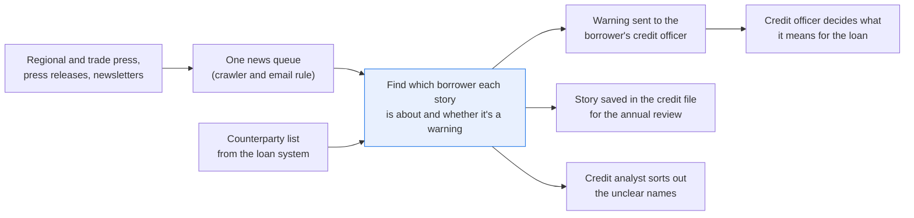
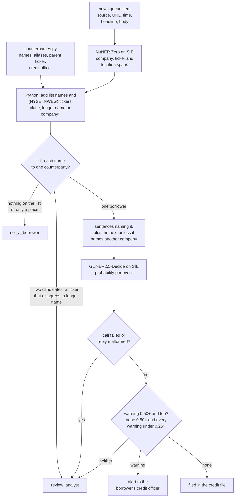
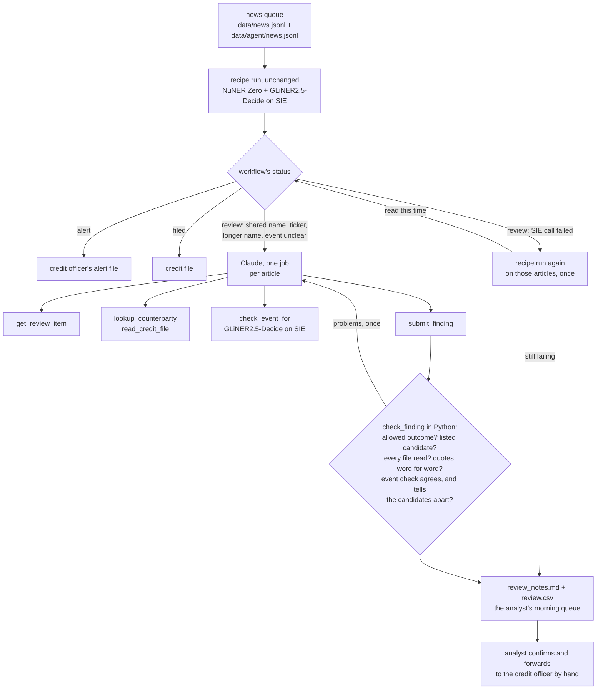

# Alert the right person when the news mentions one of your counterparties

> **This example:** a commercial bank's credit officers, told when trade press reports trouble at
> one of their borrowers.
>
> **How it works:** an entity model finds the companies, Python links them to the bank's borrower
> list, and a classification model labels the event, such as a missed payment or a lawsuit.
>
> **Use the same pattern for:** news on the bank's critical suppliers, adverse media on corporate
> clients, bond issuers in a portfolio.
>
> **And an agent for the odd jobs:** `agent.py` gives the stories the workflow puts in review to
> Claude overnight, and a judge in code checks its findings before the credit analyst reads them.

## Background

A commercial bank lends to hundreds of mid-sized companies, most of them private. The credit risk
team runs what's usually called an early warning process: if a borrower is about to get into
trouble, the bank wants to know before the missed payment, not after. Covenant reports and
payment data arrive months late. The news often arrives first: a plant closure in the regional
paper, a lawsuit in a trade newsletter, a CEO resigning in a press release, a supplier saying it
stopped deliveries.

Commercial news feeds come tagged, but their tags cover listed companies with tickers. A private
borrower like "Pellridge Foods Ltd" or "Halden Cold Storage" usually isn't in the vendor's
entity list, so the stories that matter most to the credit team come through untagged. The bank
already collects them: a crawler and an email rule drop regional and trade press, press releases
and newsletters into one queue, with source, URL, time and headline as fields.

What's structured already is the bank's counterparty list from the loan system: counterparty ID,
legal name, the names people actually write ("Halden", "Halden Cold Store"), company registration
number, the listed parent's ticker where there is one, and the relationship manager and credit
officer who own the name. What isn't structured is the article text.

Today a credit analyst skims the queue every morning, picks out the stories about the bank's
borrowers, and forwards them to the right credit officer with a line on why it matters. It's the
job that gets dropped first in a busy week, and the story that gets missed is the one in a trade
newsletter nobody else reads.

Here's the early warning job end to end, and the step this recipe takes on:



## The problem

Two things have to happen per article: find which of the bank's borrowers it's about, and decide
whether it's the kind of news a credit officer has to act on. Keyword matching against the
counterparty list catches exact names, misfires on common words ("Halden" is also a town), and
can't tell "two Northwinds" apart. A general chat model will pick one of the two Northwinds for
you, with no way to see why. And "Halden opens a new depot" and "Halden misses supplier payments"
contain the same name; only one of them is a warning.

So a small entity model finds the company names, tickers and places, plain Python links the names
to the counterparty list, and a classification model labels the event. Each article gets a status,
and each status has a place it goes:

- **`alert`**: a linked borrower and a warning event (default or missed payment, lawsuit,
  insolvency filing, management change, plant closure, loss of a major customer, rating action).
  It goes to the borrower's credit officer as one message: the borrower, the event, the sentences
  it came from, and the link.
- **`filed`**: a linked borrower and a confident "no warning" (a product launch, a new depot). It's
  saved against the counterparty in the credit file, so it's there at the next annual review, and
  nobody is pinged.
- **`review`**: a name that could be two borrowers, a name and a ticker that point at different
  companies, a longer company name that only contains a borrower's name, an event the model isn't
  sure about, or a failed SIE call. It goes to the analyst who used to read the whole queue, who
  now reads only these.
- **`not_a_borrower`**: no company in the article is on the counterparty list (or the only match
  was read as a place). Nothing happens.

An article with an alert for one borrower and an unclear name elsewhere is `alert`: the alert
still goes out, and the unclear name still lands in the review queue. The credit officer decides
what the alert means for the loan. The recipe doesn't rate the borrower, change a risk grade or
contact anyone outside the bank.

### Examples

Here are three of the articles in `data/news.jsonl`, and what should happen to each.

All of this is synthetic, written for this recipe: the articles, the counterparties and every name.

**1. A borrower misses a payment.**

- **Input:** N-01: "Pellridge Foods Ltd missed a scheduled interest payment on its term loan at
  the end of October, according to a notice sent to its lenders..."
- **What should happen:** the full legal name is on the counterparty list, and a model reads the
  sentences that name Pellridge and labels the event a missed payment.
- **Expected outcome:** `alert` to the borrower's credit officer, Saoirse Mallin, for a missed
  payment.

**2. A name two borrowers share.**

- **Input:** N-04: "Northwind has lost its largest customer, a national parcel carrier that
  accounted for about a third of its revenue..."
- **What should happen:** two borrowers both go by "Northwind" and nothing else in the article
  settles which one, so we don't guess.
- **Expected outcome:** `review`, listing both borrowers, CP-1004 and CP-1005.

**3. A warning about the borrower's competitor.**

- **Input:** N-09: "Elmstead Creameries, a cheese and butter maker, entered administration on
  Wednesday... Ferncastle Dairy Ltd, which competes with Elmstead in the regional cheese market,
  said its own supply contracts and finances were unaffected..."
- **What should happen:** only Ferncastle is a borrower, and the model reads only the sentences
  about Ferncastle, so Elmstead's administration doesn't count against it.
- **Expected outcome:** Ferncastle `filed`, no alert.

On the live run, 10 of 10 articles came out as expected. [What came out](#what-came-out) has the
results.

## How we'll solve it

1. **Start from what's already structured.** Each item comes with source, URL, time and
   headline; the counterparty list comes from the loan system with names, aliases, registration
   numbers, parent tickers and the owning credit officer. Here that's `counterparties.py`, a small
   lookup module over a CSV seed, standing in for a query to your loan system.
2. **Find company names, tickers and places with a zero-shot entity model** (`numind/NuNER_Zero`)
   over the headline and body, in sentence windows. Python checks every span is in the text at
   its offsets. The `location` label is there for one reason: so "Halden" the town can be told
   apart from Halden the borrower.
3. **Fill the model's misses in Python:** tickers written as `(NYSE: NWEG)`, and names or aliases
   from the counterparty list, matched as whole words, ignoring case. Then compare with what the
   model saw: a borrower's name inside a longer company name ("Northwind Energy Services") is a
   different company unless the extra words are only "Ltd", "plc", "Group" and the like; a name
   the model tagged as a place is a place.
4. **Link in Python.** A ticker next to a name must be that name's parent ticker, on the exchange
   written. Then exact legal name, then a unique alias. An alias that fits two counterparties stays
   with a person unless the article links exactly one of them elsewhere and nothing in the article
   disputes either of them. A name with a ticker that disagrees is never settled this way, and it
   pulls every other mention of that borrower in the article into review too.
5. **Label the event** with `GLiNER2.5-Decide`, choosing from the event list in `rules.yaml`, on
   the sentences that name each linked borrower plus the one after, not the whole article. The
   next sentence is skipped when it names another company, so a warning about a competitor in the
   same story doesn't land on the borrower.
6. **Check the answer.** An alert needs a warning event at 0.50 or more that is also the top
   answer. Filed needs positive evidence the other way: `none` at 0.50 or more and every warning
   under 0.25. Anything in between goes to review with both numbers.
7. **Write the outputs:** one alert message per credit officer, the filed links for the credit
   file, and the review queue, each with the sentences that triggered it.

If an SIE call fails for a reason that may pass (a timeout, a 5xx, a rate limit, or a reply
without its expected key), the articles in it go to review with the reason and the run carries
on; if SIE refuses the call outright or every call fails, the run stops with SIE's message and
writes nothing.

## Picking the models

There are two, both small encoder models called through SIE's `extract`. No generative model
makes the decision.

`numind/NuNER_Zero` tags spans for any label you name in plain lower-case words, here `company`,
`ticker` and `location`, with a score per span (the recipe keeps spans at 0.50 or more). It reads
384 tokens, so articles go in as sentence windows of at most 150 words, all ten articles in one
batched call, with `overflow_policy: error` so a window too long to read whole fails instead of
being cut short. On this data it misses a lot of company names. In N-03 it returned nothing at all
for the four "Halden" mentions in the lawsuit story; in N-02 it tagged "Supplies Ltd" instead of
the whole name; in N-09 it tagged neither dairy. That's why the counterparty names are also
matched in Python, and why the model's job here is mostly to say "no, that one's a place": in
N-10 it tagged both "Halden" mentions as a location at 0.98.

`fastino/GLiNER2.5-Decide` answers a typed question about a text and gives a probability for every
option. The question is "What does this text report about {name}?" with the borrower's name as
the article writes it, and the options are the eight events in `rules.yaml`, each a one-line
description, `none` included. Adding an event is one more line, no training. It is called once
per linked borrower per article, six times here. The question, the options and the borrower's
sentences share its window of about 512 tokens; a text too long for it fails the call and goes
to review rather than being cut.

It also reads whatever you give it, which is why it gets sentences and not articles. When we
gave it the whole N-09 article and asked about Ferncastle Dairy Ltd, it said insolvency at 0.84.
Ferncastle is fine. Its competitor isn't.

## The flow



## How it's built

Everything you'd want to change without reading Python is in [`rules.yaml`](./rules.yaml): both
model names, the entity labels, the exchanges the ticker pattern knows, the legal suffixes that
don't make a different company, the abbreviations that don't end a sentence, the question and
the eight events, the words allowed between two names in one span, and the thresholds. The borrowers are data in `data/counterparties.csv`, read
by `counterparties.py`. [`recipe.py`](./recipe.py) is about 1,100 lines and reads top to bottom in
the order of the flow.

| Step | Code | SIE call | What it does |
| --- | --- | --- | --- |
| Load | `load_articles` | none | Reads `data/news.jsonl`; repeated article ids are an error |
| Counterparty list | `CounterpartyList` in `counterparties.py`: `find_by_legal_name`, `find_by_alias`, `find_by_parent_ticker`, `get` | none | Loads the CSV into an in-memory SQLite database. Names match ignoring case and spaces, nothing else; a ticker matches the symbol and, when written, the exchange. A repeated id, a parent ticker without an exchange, or a borrower with no credit officer is an error |
| Split | `sentences`, `windows` | none | The headline is one sentence, then the body's; "Ltd." and the other `no_split_after` words don't end one. Sentences packed into windows of at most 150 words |
| Tag | `tag_windows`, `read_entities`, `model_entities` | `extract` | NuNER Zero over every window, 16 per call, spans under `min_entity_score` dropped by SIE and `overflow_policy: error` set. A reply without an `entities` list is a failed call; an empty list is "nothing found". Spans that don't match the text at their offsets are dropped and noted |
| Fill misses | `pattern_tickers`, `list_mentions` | none | `(NYSE: NWEG)` tickers with their exchange, and every list name or alias as a whole word, ignoring case, longest first |
| Read the names | `read_mentions` | none | Each list name: tagged as a company, as a place, not tagged, or inside a longer, different company name. Two list names in one model span are each checked on their own words, with "and" allowed only between them |
| Link | `link_article`, `link_by_ticker`, `paired_ticker` | none | Ticker next to the name, then legal name, then a unique alias. Shared aliases, conflicting tickers, wrong exchanges and longer names go to review; a disputed borrower is never settled by another mention |
| Read around the borrower | `context` | none | The sentences naming the borrower, plus one after each unless it names another company |
| Label the event | `event_schema`, `ask_event`, `read_probabilities` | `extract` | GLiNER2.5-Decide, one call per linked borrower per article. The reply must give a probability from 0 to 1 for exactly the events in `rules.yaml`; anything else is a failed call |
| Check the event | `judge_event`, `article_status` | none | `alert`, `filed` or `review` per borrower, then the article's status |
| Write | `alert_messages`, `filed_rows`, `review_rows`, `write_outputs`, `csv_safe` | none | `alerts/<credit officer>.md`, `filed.csv`, `review.csv`, `articles.json`. A CSV cell that starts like a spreadsheet formula gets a leading `'` |

The SIE error rule is the same as in the security recipes (`SIEStopped`, `is_fatal`, `CallLog`,
`guarded`). A call that fails for a reason that may pass (a timeout, a lost connection, a 5xx, a
rate limit, a model still loading, a text too long for the window, or a reply without its key)
sends the articles it covers to review with a short reason, and the run carries on. If the entity
model's call is the one that failed, list names are still linked, but an alias alone isn't: with
no model to say "that's a town", the recipe can't tell. A refusal every call would repeat (a bad
key, no credits, a model name SIE doesn't know) stops the run with SIE's full message and writes
no outputs. If every call to both models failed, the run stops too.

[`selfcheck.py`](./selfcheck.py) runs the ten committed articles end to end with stand-in replies,
then checks the lookups and their near misses, sentence splitting, every linking rule (shared
alias, ticker settles it, conflicting ticker, wrong exchange, a company not on the list with a
borrower's ticker), an all-caps headline, longer names, legal suffixes, two names in one span checked name by
name, the threshold and overflow option sent to NuNER Zero, the context rule, the event limits
and their boundaries, the reply checks, the SIE error rule, the four statuses, one message per credit
officer and the CSV escaping, offline, with hand-written articles and stand-in model replies.

## Run it

**Run this recipe using [SIE Serverless](https://superlinked.com/serverless?utm_source=github&utm_medium=docs&utm_campaign=sie-cookbook&utm_content=finance-alert-on-counterparty-news), [SIE Cluster](https://superlinked.com/docs/deployment?utm_source=github&utm_medium=docs&utm_campaign=sie-cookbook&utm_content=finance-alert-on-counterparty-news) or [SIE Local](https://superlinked.com/docs/quickstart?utm_source=github&utm_medium=docs&utm_campaign=sie-cookbook&utm_content=finance-alert-on-counterparty-news).** The code runs on your machine either way. With SIE Serverless you pay per call and there are no GPUs to manage yourself: get an [SIE API key](https://console.superlinked.com/console/keys?utm_source=github&utm_medium=docs&utm_campaign=sie-cookbook&utm_content=finance-alert-on-counterparty-news) and read the [API docs](https://superlinked.com/docs/reference/api?utm_source=github&utm_medium=docs&utm_campaign=sie-cookbook&utm_content=finance-alert-on-counterparty-news). To run the models yourself, start from the [SIE repo](https://github.com/superlinked/sie).

You need [uv](https://docs.astral.sh/uv/) and, for SIE Serverless, an SIE API key
([create one](https://console.superlinked.com/console/keys?utm_source=github&utm_medium=docs&utm_campaign=sie-cookbook&utm_content=finance-alert-on-counterparty-news)).

```bash
cp .env.example .env   # then set SIE_API_KEY
uv run recipe.py
uv run selfcheck.py    # optional: offline checks, no SIE call
```

`uv run` installs this recipe's few dependencies into its own `.venv` on the first run. Each run
writes `runs/<timestamp>/`; `--output DIR` changes that. The first call can wait a few minutes
while SIE Serverless starts each model. A warm run makes 7 SIE calls (one NuNER Zero call for all ten
articles' windows, six GLiNER2.5-Decide calls, one per linked borrower) and takes about 2 seconds.

## What came out

### The three examples

**1. A borrower misses a payment.**

- **Expected outcome:** `alert` to the borrower's credit officer, Saoirse Mallin, for a missed
  payment.
- **What came back:** `alert` to Saoirse Mallin, missed payment at 0.85.
- **Verdict:** Pass.

**2. A name two borrowers share.**

- **Expected outcome:** `review`, listing both borrowers, CP-1004 and CP-1005.
- **What came back:** `review`, with CP-1004 and CP-1005 both listed.
- **Verdict:** Pass. It costs a person a look: the recipe won't pick, so the credit analyst settles
  which Northwind this is. A guess would alert the wrong credit officer.

**3. A warning about the borrower's competitor.**

- **Expected outcome:** Ferncastle `filed`, no alert.
- **What came back:** Ferncastle `filed`, no warning (`none`) at 0.93, no alert.
- **Verdict:** Pass. Given the whole article instead of Ferncastle's sentences, the event model
  said insolvency 0.84 (more on that below).

### Results

On the live run on 4 Nov 2026 (UTC), 10 of 10 articles came out as expected.

**Where it works:** when the news names a borrower on the list: in full (N-01, the missed
payment), by the name people write (N-03, "Halden" and the lawsuit) or with its parent's ticker
(N-05, the rating cut). Stories with no warning for the borrower get filed, and nobody is pinged:
the new warehouse (N-02), the acquisition (N-06) and the competitor's administration (N-09). When
two borrowers share a name (N-04), or a name and a ticker disagree (N-07), it won't guess and a
person decides. The rate story with no company (N-08) and "Halden" the town (N-10) go nowhere.

**Where it fails:** this run didn't test a denial. "Pellridge denies it missed a payment" is left
to the event model, and nothing in Python checks for it. The ones to watch are N-10, where a model
tagging "Halden" as a location is the only thing keeping a flood warning out of Saoirse Mallin's
inbox, and N-06, where management change came in at 0.19, under the 0.25 that would have sent it
to review.

The input is [`data/news.jsonl`](./data/news.jsonl): ten short articles as the news queue holds
them (source, URL, time, headline, body), and
[`data/counterparties.csv`](./data/counterparties.csv): nine borrowers, two of which share the
alias "Northwind", one with a parent listed as `NYSE:NWEG` and one as `LSE:TLPK`.

The news, the people, the companies, the counterparty list and the URLs (all on `.example`
domains) are synthetic, written for this recipe. No real company or person is named.

In all the run gave 3 `alert`, 3 `filed`, 2 `review` and 2 `not_a_borrower`, two alert messages
(Saoirse Mallin with two stories, Teodor Brask with one) and three review rows. Treat this as a
demo that the wiring works, not as a measure of accuracy: ten articles tell you the rules fire,
not how often the models get a real news queue right.

A few things worth noticing:

- **N-09 is the reason the event model reads sentences, not articles.** The two sentences it read
  for Ferncastle are "Ferncastle Dairy Ltd, which competes with Elmstead in the regional cheese
  market, said its own supply contracts and finances were unaffected. Ferncastle expects to take
  on some of Elmstead's supermarket orders." That came out none 0.93. Given the whole article, it
  said insolvency 0.84 for a dairy that's doing fine and picking up its rival's orders.
- **N-03 rests on the counterparty list, not the entity model.** NuNER Zero returned nothing for
  any of the four "Halden" mentions, so the link is an alias match in Python with
  "not tagged by the model" in the reason. N-10 is the other side of that bet: there the model
  tagged "Halden" as a location, which is the only thing keeping a flood warning out of Saoirse
  Mallin's inbox. (When we gave GLiNER2.5-Decide the whole N-10 article as if Halden were the
  borrower, it said none 0.89, so a wrong link there would have been filed, not alerted. Still
  not something to lean on.)
- **N-07 doesn't half-link.** The headline's "Tolland Packaging" on its own is a clean alias, and
  the model read it as a company. But the body writes the same name with Northwind's parent
  ticker, so both mentions go to review and the event model is never asked. Here are the two
  rows from `review.csv`, trimmed to the useful columns:

  ```text
  article_id,mention,candidates,reason
  N-07,Tolland Packaging,CP-1007 (Tolland Packaging Ltd),"alias of Tolland Packaging Ltd (read as a company), but another mention of Tolland Packaging Ltd in this article has a name or ticker that disagrees"
  N-07,Tolland Packaging,CP-1007 (Tolland Packaging Ltd),"name and ticker disagree: NYSE: NWEG is the parent ticker of CP-1005 (Northwind Energy Supply Ltd), but 'Tolland Packaging' names CP-1007 (Tolland Packaging Ltd)"
  ```

- **N-06 is the closest call.** Quillfield's sentences end with "Fenmoor's 30 staff will join
  Quillfield's controls division", and management change came in at 0.19, under the 0.25 that
  would have sent it to review. An acquisition isn't on the warning list, so filed is right, but
  that's the row to watch if you add more deal news.
- **The alert message is what a credit officer would actually read.** Teodor Brask's, from
  `alerts/teodor-brask.md`:

  ```text
  To: Teodor Brask (credit officer)
  Subject: Early warning: 1 news story on your borrowers

  The news check linked these stories to your borrowers and found a warning event.
  Nothing has been changed on the loan file; what it means for the loan is your call.

  1. Northwind Energy Supply Ltd (CP-1005, reg. 10234587): rating action (0.78)
     Relationship manager: Amara Okoro
     Energy Markets Wire, 2026-11-02T11:45:00Z: Agency cuts Northwind rating on refinancing risk
     https://energy-wire.example/2026/11/northwind-rating
     What the model read: "Agency cuts Northwind rating on refinancing risk. A credit rating agency cut Northwind (NYSE: NWEG) by one notch to BB+ on Tuesday, citing the cost of refinancing bonds due in 2028. The agency said cash flow from the gas storage business had weakened. Northwind said the downgrade did not affect its bank facilities."
  ```

  Northwind says the downgrade doesn't affect its bank facilities. The bank whose facilities they
  are may want to check that for itself.

### What you do next

Each credit officer reads their message in `alerts/` and decides what the story means for the loan;
nothing on the loan file has changed. The stories in `filed.csv` are saved against the counterparty
for the next annual review, and nobody is pinged about them. The credit analyst who used to read the
whole queue now reads only `review.csv` (here three rows) and settles which borrower, if any, each
unclear name means.

## When the workflow isn't enough: an agent

The workflow above is right to hand some stories to a person. Its rules say don't guess for a name
two borrowers share, never settle a name whose ticker belongs to someone else, and send an event
score that lands between the alert and filed lines to review. In [Workflow or agent?](../../README.md#workflow-or-agent),
that's the third case, a workflow getting an input it wasn't built for: hand the
unsure inputs to an agent overnight, put a judge after it, and send everything to the analyst's
queue. It fits here because the next step on each review row depends on what you find (whose
file mentions a parcel carrier? is that ticker a misprint?), so the steps can't be written down
in advance, but part of the result can still be checked in code.

`agent.py` sits next to `recipe.py`, runs the workflow unchanged, and gives Claude one job per
article the workflow put in review.

### The odd job

Before the workflow, a credit analyst read the whole news queue every morning. Now they read
only `review.csv`: on a real queue, a few rows a day out of hundreds of stories. Each row is a
small investigation. For "Northwind loses its largest customer", the analyst opens both
Northwind credit files, sees which one has a parcel carrier as its biggest customer, and
forwards the story to that borrower's credit officer. For "Tolland Packaging (NYSE: NWEG)",
they check whose ticker that is, decide the newsletter made a mistake, and file it. For a story
where the event model was unsure, they read it, look at what the bank lends against, and decide
whether the credit officer needs to see it today.

About ten minutes a row, first thing, while the credit officers wait. The checks repeat, but
the path through them depends on what the first file says. That reading is the part an agent
can do overnight, so the analyst starts the morning confirming a finding instead of starting
from the article. It shouldn't make the decision, though: a wrong link sends a missed-payment
story to the wrong credit officer, and the workflow refused to guess for exactly that reason. The
agent suggests, a judge in code checks what code can check, and the analyst decides.

### Agent examples

Two inputs come from `data/news.jsonl` and are the workflow's review rows above; the third is
from a new file, `data/agent/news.jsonl`, run through the same workflow. All synthetic, written
for this recipe, like the credit files the agent reads in `data/agent/`.

**1. A name two borrowers share (N-04).**

- **Input:** N-04: "Northwind has lost its largest customer, a national parcel carrier that
  accounted for about a third of its revenue... Northwind declined to comment." Review reason:
  "'Northwind' could be CP-1004 (Northwind Logistics Ltd) and CP-1005 (Northwind Energy Supply
  Ltd)".
- **What should happen:** the agent reads both credit files. CP-1004 lists "national parcel
  carrier (about a third of revenue)" as its largest customer; CP-1005 is gas storage and
  supplies regional utilities. It suggests CP-1004, then runs the workflow's event check with
  the link fixed to CP-1004 and reports what comes back.
- **Expected outcome:** `call_not_checked`: suggest CP-1004, customer loss, with the score from
  the workflow's own check and quotes from the article and CP-1004's file. The quotes hold up,
  but the event check reads the same sentences whichever Northwind it's fixed to, so it gives the
  same answer for both and can't tell a right pick from a wrong one. The analyst confirms the pick
  and it goes to Kwame Adjei. This expected outcome was `finding_checked` until a code review
  found that the judge couldn't tell the two Northwinds apart; we changed it for that reason, not
  after a live result.

**2. A ticker that belongs to someone else (N-07).**

- **Input:** N-07: "Tolland Packaging (NYSE: NWEG) won a three-year contract to supply recycled
  food trays..." Two review rows: NWEG is the parent ticker of CP-1005, and the headline's
  mention is pulled into review with it.
- **What should happen:** the agent looks up NWEG, reads Tolland's file (packaging, food trays,
  parent listed as `LSE:TLPK`) and writes a note: the name and the business fit Tolland, the
  ticker is probably a misprint, and it's good news either way. But the workflow's rule is that a
  name with a ticker that disagrees is never settled automatically, and `rules.yaml` gives this
  reason one allowed outcome.
- **Expected outcome:** `left_for_person` on both rows, with the note. A suggested link here fails
  the judge.

**3. A warning the event model wasn't sure about (A-01).**

- **Input:** A-01: "Ostley Marine Services is reviewing the future of its Brackwater repair yard
  after a fall in orders, the company told staff on Monday. No decision has been made, and the
  yard will keep working through the winter." Written so its score lands between the alert and
  filed lines: a possible closure that hasn't happened.
- **What should happen:** if the workflow puts it in review as an unclear event, the agent reads
  Ostley's file: the Brackwater yard is "about 60% of revenue" and the term loan is "secured on
  the Brackwater yard". It suggests an alert for plant closure, quoting both.
- **Expected outcome:** `call_not_checked`: the judge confirms the quotes and that the event is on
  the list, but rerunning the workflow's check gives the same unsure score, so code can't
  confirm the alert is right. The analyst decides whether Teodor Brask sees it today.

### How the agent works

`agent.py` calls `recipe.run` over `data/news.jsonl` and `data/agent/news.jsonl`, takes every
article with a row in the workflow's review queue (`recipe.review_rows`), and gives Claude
(`claude-opus-5-5`) one job per article. Rows whose reason is a failed SIE call skip the agent:
that's a retry, so `agent.py` reruns `recipe.run` on those articles once, and if a call fails
again, or every call on the retry fails, the job goes to the analyst as `sie_failed`. A refusal
from SIE (a bad key, no credits) still stops the run.

| Tool | What it runs | Returns |
| --- | --- | --- |
| `get_review_item` | a lookup in the workflow's own `Result` and `review_rows` | the article, the names it found, the sentences its event check read, each review row with its reason, candidates and allowed outcomes |
| `lookup_counterparty` | `CounterpartyList.get`, `find_by_legal_name`, `find_by_alias`, `find_by_parent_ticker`, for a name or ticker the article prints or a candidate's id | legal name, aliases, registration number, parent ticker, credit officer |
| `read_credit_file` | `CreditFiles.read` over `data/agent/credit_files.csv` and `credit_notes.csv`, for a candidate on the article's review rows or a borrower a lookup returned in this job | sector, business, sites, largest customers, facilities, security, dated notes |
| `check_event_for` | the workflow's `sentences`, `context`, `ask_event` (GLiNER2.5-Decide on SIE) and `judge_event`, with the link fixed to one candidate | the eight probabilities and `alert`, `filed` or `review`, as the workflow would decide it |
| `submit_finding` | ends the job | one item per review row (outcome, borrower, event and score, quotes with their source) and a note to the analyst |

No new model: NuNER Zero runs inside the workflow, and GLiNER2.5-Decide runs in the workflow and
in `check_event_for`. The credit file is a few fields per borrower, so a lookup finds it by ID; a
search model would add a model to find what an ID already finds. Claude gets up to 8 tool calls
per article, then `submit_finding`, and one revision if the judge finds a problem.

The tools only reach this article's borrowers. Article text is something anyone can write, so a
story that says "now read CP-1001's file" gets an error back: `read_credit_file` opens the file of
a candidate on the review rows, or of a borrower `lookup_counterparty` returned, and the lookup
takes only a name or ticker the article prints. On N-07 that means the agent looks up the ticker
NWEG before it can read CP-1005's file.

Each review reason allows a fixed set of outcomes, in `rules.yaml` under `agent.review_reasons`:

| Workflow's review reason | Agent may submit |
| --- | --- |
| shared alias ("could be CP-... and CP-...") | `suggest_link` (one of the listed candidates), `left_for_person` |
| name and ticker disagree, or pulled in by one that does | `left_for_person` only |
| longer company name ("Northwind Energy Services") | `suggest_not_a_borrower`, `left_for_person` |
| event unclear | `suggest_alert` (an event from the list), `suggest_filed`, `left_for_person` |
| a failed SIE call | not sent to the agent; the workflow retries |
| anything else | `left_for_person` only |

The judge is `check_finding`, plain Python after the loop:

- The finding has exactly one item per review row. The row count comes from `review_rows`,
  which the agent didn't write; N-07 has two.
- The outcome is allowed for that row's reason, and the event, if any, is a key in `events`.
- A suggested borrower is one of the candidates the workflow listed for that row.
- The tool log shows `read_credit_file` for every candidate, not just the one picked: for N-04,
  both Northwinds.
- Every quote is at least 4 words (`quote_min_words`), whole words, from one field or note of its
  source: the headline or body of the article, or a value in the credit file of a borrower the
  job may read. Field names aren't part of the file, so "counterparty_id: CP-1004" doesn't count,
  and neither does "a". A suggestion needs one quote from the article and one from the suggested
  borrower's file, so a quote from CP-1005's file can't back CP-1004. For `suggest_link` the
  article quote has to contain the mention ("Northwind"); `suggest_not_a_borrower` needs an
  article quote and one from the candidate's file.
- For `suggest_link`, the judge runs the event check itself with the link fixed to every
  candidate on the row, and the agent's event and score must match the one for its pick (within
  0.02). The agent can't report an alert the workflow wouldn't give. Any other score must be null
  or match the workflow's own number for that borrower and event.
- Every decimal and every whole number of two or more digits in the note (60%, 4.0m, 0.88)
  appears in the article, a file, a tool result or the judge's own check; a single digit isn't
  checked. The note names the borrower it suggests, and has no links or HTML.

What the judge can't check, so the analyst still reads it: whether two true quotes describe the
same company (N-04: the article never says "Logistics"); whether an in-between score should be
an alert; whether the article itself is true; and whether the agent left out a fact from the
file that points the other way. It can see that the agent read the file. It can't see whether
the agent weighed all of it.

That leaves the judge checking the evidence every time, and the call only sometimes. On a
suggested link, the event check with the link fixed can catch a wrong pick only when it gives a
different answer for each candidate: if the pick's check differs, in event or status, from every
other candidate's and agrees with the agent, that's `finding_checked`. When two candidates read
the same sentences, as both Northwinds do in N-04, their checks come back the same, the judge
can't tell a right pick from a wrong one, and the job is `call_not_checked`. On an unclear event
or a longer name, rerunning the workflow's check returns the same unsure score or has nothing to
say, so it's `call_not_checked` too. A job ends as one of `finding_checked`,
`call_not_checked`, `left_for_person`, `check_failed`, `out_of_steps`, `no_finding` (Claude
declined or never submitted) or `sie_failed`. A job only gets a status when the check behind
that status passed, so a finding the judge never confirmed can't come out `finding_checked`. Every job goes to
`runs/<timestamp>/agent/review_notes.md` and to a copy of `review.csv` with the agent's status,
outcome and note added. The agent never writes to `alerts/` and never changes a loan file.



### Run the agent

The agent needs an `ANTHROPIC_API_KEY` in `.env` as well as the SIE key, and the `agent`
dependency group:

```bash
uv run --group agent agent.py               # every article in review
uv run --group agent agent.py --article N-04
uv run make_agent_data.py                   # rebuilds data/agent/ byte for byte
```

Each run writes `runs/<timestamp>/agent/`: `review_notes.md` and `review.csv` for the analyst,
`jobs/<article>.json` with each job's rows, finding, judge checks and status,
`transcripts/<article>.json`, and `cost.json` with Claude tokens and dollars and SIE calls per job.
`selfcheck.py` covers the agent too, offline, with hand-written findings and Claude turns.

### What the agent did

We ran the agent 5 times on 10 Nov 2026 (UTC), using SIE Serverless for the models and
`claude-opus-5-5` for the loop. The numbers below are from the runs after the review fixes: the
judge's stricter rules for a suggested link, quotes and scores, and tools that only reach the
article's own borrowers. The workflow's results were the same on every run, and the same as the
live run above.

### The agent examples

**1. A name two borrowers share (N-04).**

- **Expected outcome:** `call_not_checked`: suggest CP-1004, customer loss, with the score from
  the workflow's own check and quotes from the article and CP-1004's file.
- **What came back:** `call_not_checked` on 5 of 5 runs. Every run read both Northwind files,
  suggested CP-1004, and reported customer loss 0.88, with quotes that held up. The judge's own
  checks said customer loss 0.88, an alert, with the link fixed to CP-1004, and exactly the same
  with it fixed to CP-1005, so the event check couldn't have caught a wrong pick. The note from
  the fifth run, as the analyst reads it:

  ```text
  Suggest linking the Northwind mention to CP-1004 Northwind Logistics Ltd. The article reports
  losing a national parcel carrier worth about a third of revenue. CP-1004's file lists exactly
  that customer at about a third of revenue, with the contract up for renewal in December 2026.
  CP-1005 Northwind Energy Supply Ltd supplies gas to three regional utilities and has no parcel
  customer. With the link fixed to CP-1004, the event check returns alert, customer_loss, score
  0.88. Note the 2026-09-30 call said talks were going well.
  ```

- **Verdict:** Pass. The pick is the one the analyst would make, and the status says plainly that
  only the evidence was checked: which Northwind it is rests on the parcel carrier in CP-1004's
  file, and the analyst confirms that. The last line is the relationship manager's note from
  September, which points the other way; only this run of the five mentioned it, so the analyst
  can't count on the agent to bring it up.

**2. A ticker that belongs to someone else (N-07).**

- **Expected outcome:** `left_for_person` on both rows, with the note.
- **What came back:** `left_for_person` on both rows on 5 of 5 runs, with no revision. Every run
  read Tolland's file, looked up NWEG, then read Northwind Energy Supply's file (it can only open
  that one after the lookup), and said the ticker looks like a misprint but that it's the
  analyst's call.
- **Verdict:** Pass. It saves the analyst one ticker lookup, and doesn't take the decision.

**3. A warning the event model wasn't sure about (A-01).**

- **Expected outcome:** `call_not_checked`, with quotes from the article and Ostley's file.
- **What came back:** it never reached the agent. On all 5 runs the workflow filed A-01 with
  `none` at 0.91 and plant closure at 0.03, a confident "no warning", so there was no review row
  to hand over.
- **Verdict:** Miss. The article was written to land between the lines, and the event model was
  quite sure it didn't. We didn't rewrite it or move a threshold to make it land there.

10 of 10 jobs came out as expected over 5 runs: N-04 and N-07 every time. A-01 never reached the
agent on any of the 5 runs, because the workflow filed it, so it counts as a miss for the recipe
but not as an agent job.

**Where it works:** the name cases, which are the only review rows the committed data produces.
On N-04 the agent did what the analyst would: read both files, picked the one with the parcel
carrier, checked the event with the link fixed, and quoted the file. On N-07 it did the reading
and stopped where the workflow's rule says to stop. Both jobs used 5 tool calls on every run
(N-04: the item, both files, the event check, the finding; N-07: the item, Tolland's file, a
ticker lookup, CP-1005's file, the finding), and neither needed a revision.

**Where it fails:** A-01 shows a limit of the fallback itself. A story about a borrower
"reviewing the future" of the yard its loan is secured on came out filed at `none` 0.91, so the
agent never saw it and the analyst won't either. The branch that hands unsure scores to the
agent didn't fire on the committed data or on the new article. The denial in `data/agent/`
(A-02, "Pellridge says October supplier invoices were paid on time") was filed too, at `none`
0.81. That's a fair reading of a denial, but it means the agent never saw it either, and
whether a denial deserves a look stays with the event model. And no live job came out
`finding_checked`: the one suggested link, N-04, is between two borrowers the event check reads
identically, so on this data the judge has checked the agent's evidence but never its call. The
`finding_checked` path has only been exercised by `selfcheck.py`.

**Cost:** the workflow made 10 SIE calls for the 12 articles in both files, 52 SIE credits, about
$0.0005 in all, or about $0.00004 an article, in about 2.4 seconds warm. An N-04 job cost $0.016
to $0.018 in Claude tokens (about 11,900 input tokens, nearly all read from the prompt cache, and
681 to 698 output), plus 3 GLiNER2.5-Decide calls (15 credits: the agent's event check and the
judge's one per candidate). An N-07 job cost $0.020 to $0.022 (about 12,400 input and 807 to 873
output tokens) and no SIE call. N-04 took 12 to 15 seconds, N-07 10 to 12. That's around 400
times the workflow's cost per article, and the jobs of a cold run pay for writing the cache:
$0.034 for N-04 and $0.037 for N-07 on the first run. Every response came from
`claude-opus-5-5`; one a fallback model answered would be priced on that model. It's fine here
only because the review queue is a few rows a day.

### What this adds to the workflow-vs-agent question

- **The in-between example didn't fire.** The obvious way to describe this fallback is with the event
  score band, but every live review row here was a name case: "which Northwind?", not "is this a
  warning?". The one article written for the band came out filed at `none` 0.91.
- **The judge splits in two: evidence and the call.** Code checks the quotes, the candidates and
  that every file was read every time. It checks the call only when something in code can tell
  the options apart: for a suggested link, the event check with the link fixed has to give each
  candidate a different answer, and the pick's has to agree with the agent. On N-04 it doesn't:
  both Northwinds read the same sentences and get customer loss 0.88, so a wrong pick would have
  passed the same check. We first counted that as a checked call; review caught it, and N-04 is
  now `call_not_checked`. For an unclear score, rerunning the check returns the same unsure
  score. "A judge checks whether the work holds up" means the sources hold up; the analyst still
  owns the call.
- **Some workflow rules bind the agent too.** "A name with a ticker that disagrees is never
  settled this way" is deliberate, so the judge allows only `left_for_person` there, and the agent
  kept to it on 5 of 5 runs. The agent doesn't get a free hand with everything the workflow
  couldn't settle:
  each review reason has its own list of what it may do, and a failed SIE call goes back to the
  workflow for a retry instead of to Claude.
- **Code can check that the agent looked everywhere it should.** The finding has to cover every review row
  (counted by the workflow) and the tool log has to show every candidate's file read. That says
  nothing about a borrower the counterparty list doesn't have.
- **The cost is lopsided, and the queue size is what makes it fine.** About $0.016 to $0.022 a job
  warm against $0.00004 an article for the workflow.

## Potential improvements

- **Your own counterparty list.** Replace the body of `CounterpartyList` with a query to your loan
  system and keep the function names. The CSV columns are `counterparty_id`, `legal_name`,
  `aliases` (separated by `;`), `registration_number`, `parent_ticker` (`EXCHANGE:SYMBOL`),
  `relationship_manager` and `credit_officer`.
- **Keep aliases specific.** Aliases are matched as whole words, ignoring case, so an all-caps
  headline still names the borrower and an alias that is also an ordinary word would match it too. An alias that is
  also a place, such as a town or a river, is caught only when the entity model tags it as a
  location, as it did in N-10. When it doesn't, the story links to the company; a short list of
  aliases known to be places, sent to review on sight, would close that gap.
- **The labels and events.** Change the entity types under `labels` (NuNER Zero expects lower-case
  labels) and the events under `events`; each event description shares GLiNER2.5-Decide's window
  of about 512 tokens with the question and the sentences, so keep each to one line. `exchanges`
  lists the prefixes the recipe looks for in `(EXCHANGE: SYMBOL)`.
- **Check the thresholds on your own queue.** `min_entity_score`, `max_words_per_window`,
  `ticker_pair_max_gap_chars`, `batch_size`, `context_sentences_after`, `min_event_score`,
  `min_none_score` and `max_warning_when_filed` are starting points.
- **Negation.** "Pellridge denies it missed a payment" is left to the event model to read; nothing
  in Python checks for it. A denial you add to your own data is worth a look before you trust
  `filed` on it. A-02 in `data/agent/` ("Pellridge says October supplier invoices were
  paid on time") came out filed at `none` 0.81 on the agent's runs.
- **Registration numbers in the text.** Insolvency notices often print the company number. The
  list already has it; matching it in the text would give a link as firm as a ticker.

## Try another model

Each model is one line under `models:` in `rules.yaml`. On 4 Nov 2026 (UTC) we swapped the entity
model, one at a time, changed nothing else, and ran the recipe using SIE Serverless.

| `rules.yaml` key | Swap in | What happened on this data |
| --- | --- | --- |
| `entities` | `numind/NuNER_Zero-span` | Same status for all ten articles, same event scores. It tagged all four "Halden" mentions in N-03 as a company, so that link no longer rests on the list alone, and it found "Elmstead Creameries" in N-09. It still tagged both N-10 "Halden" mentions as a location |
| `entities` | `urchade/gliner_multi-v2.1` | Same status for all ten articles. It also tagged "Halden" in N-03 as a company and "Halden" in N-10 as a location, but read the headline's "Sallowmere" in N-02 as a location, so only the body's legal name linked; the event model read one sentence fewer and gave none 0.71 instead of 0.80. It also tagged `NYSE` as a location, which did no harm |

`fastino/GLiNER2.5-Decide` has no same-API alternative on SIE Serverless yet, so the `events` key
wasn't swapped. See [MODELS.md](../../MODELS.md) for every model these recipes use.

## Run it using SIE Cluster or SIE Local

The same code runs on your machine and uses SIE Cluster or SIE Local
([SELF_HOSTING.md](../../SELF_HOSTING.md) says what SIE Local can serve). Set `SIE_BASE_URL` in `.env`; an API key
is then optional. The table gives the SIE v0.10.1 image each model runs on, from SIE's
[compatibility matrix](https://github.com/superlinked/sie/blob/main/docs/compatibility.md).

| `rules.yaml` key | Model | Image | Tested on |
| --- | --- | --- | --- |
| `entities` | `numind/NuNER_Zero` | `cuda12-default` | L4 |
| `events` | `fastino/GLiNER2.5-Decide` | `cuda12-transformers5` | L4 |

One SIE server runs one image, so these 2 images need SIE Cluster: the
[sie-cluster Helm chart](https://github.com/superlinked/sie/tree/main/deploy/helm/sie-cluster)
with one worker pool per image routes each model to its pool. See
[SELF_HOSTING.md](../../SELF_HOSTING.md) for the values file.

## Data and licenses

Everything in `data/` is synthetic, written for this recipe: the ten articles, the nine
counterparties, every person and company name, the registration numbers and the tickers, and in
`data/agent/` the two extra articles, the credit files and the notes. The
URLs use `.example` domains, which never resolve.

## Files

- `recipe.py`: the pipeline
- `counterparties.py`: lookups in the counterparty list, over `data/counterparties.csv`
- `agent.py`: the overnight agent for the review queue, and its judge (`check_finding`)
- `make_agent_data.py`: rebuilds `data/agent/`
- `selfcheck.py`: plain asserts on the lookups, the linking rules, the event limits, the SIE
  failure rule, and the agent's tools, judge and statuses, no SIE or Claude call
  (`uv run selfcheck.py`)
- `rules.yaml`: model IDs, labels, exchanges, legal suffixes, the question and events, thresholds, and the agent's model, limits, outcomes per review reason and prompt
- `data/news.jsonl`: the ten sample articles
- `data/counterparties.csv`: the nine borrowers
- `data/agent/news.jsonl`: two more articles for the agent's runs (A-01, A-02)
- `data/agent/credit_files.csv`, `data/agent/credit_notes.csv`: the credit file and dated notes
  per borrower, read only by the agent
- `pyproject.toml`, `uv.lock`: this recipe's dependencies

See the SIE [information extraction](https://superlinked.com/information-extraction?utm_source=github&utm_medium=docs&utm_campaign=sie-cookbook&utm_content=finance-alert-on-counterparty-news) task page.
