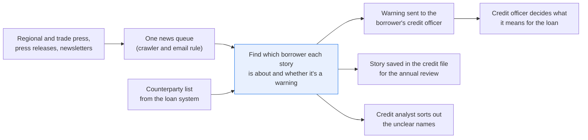
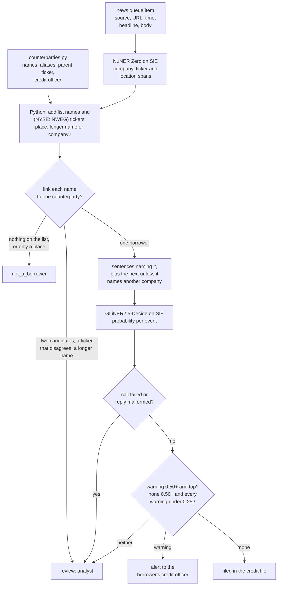

# Alert the right person when the news mentions one of your counterparties

> **This example:** a commercial bank's credit officers, told when trade press reports trouble at
> one of their borrowers.
>
> **How it works:** an entity model finds the companies, Python links them to the bank's borrower
> list, and a classification model labels the event, such as a missed payment or a lawsuit.
>
> **Use the same pattern for:** news on the bank's critical suppliers, adverse media on corporate
> clients, bond issuers in a portfolio.

## Background

A commercial bank lends to hundreds of mid-sized companies, most of them private. The credit risk
team runs what's usually called an early warning process: if a borrower is about to get into
trouble, the bank wants to know before the missed payment, not after. Covenant reports and
payment data arrive months late. The news often arrives first: a plant closure in the regional
paper, a lawsuit in a trade newsletter, a CEO resigning in a press release, a supplier saying it
stopped deliveries.

Commercial news feeds come tagged, but their tags cover listed companies with tickers. A private
borrower like "Pellridge Foods Ltd" or "Halden Cold Storage" usually isn't in the vendor's
entity list, so the stories that matter most to the credit team come through untagged. The bank
already collects them: a crawler and an email rule drop regional and trade press, press releases
and newsletters into one queue, with source, URL, time and headline as fields.

What's structured already is the bank's counterparty list from the loan system: counterparty ID,
legal name, the names people actually write ("Halden", "Halden Cold Store"), company registration
number, the listed parent's ticker where there is one, and the relationship manager and credit
officer who own the name. What isn't structured is the article text.

Today a credit analyst skims the queue every morning, picks out the stories about the bank's
borrowers, and forwards them to the right credit officer with a line on why it matters. It's the
job that gets dropped first in a busy week, and the story that gets missed is the one in a trade
newsletter nobody else reads.

Here's the early warning job end to end, and the step this recipe takes on:



## The problem

Two things have to happen per article: find which of the bank's borrowers it's about, and decide
whether it's the kind of news a credit officer has to act on. Keyword matching against the
counterparty list catches exact names, misfires on common words ("Halden" is also a town), and
can't tell "two Northwinds" apart. A general chat model will pick one of the two Northwinds for
you, with no way to see why. And "Halden opens a new depot" and "Halden misses supplier payments"
contain the same name; only one of them is a warning.

So a small entity model finds the company names, tickers and places, plain Python links the names
to the counterparty list, and a classification model labels the event. Each article gets a status,
and each status has a place it goes:

- **`alert`**: a linked borrower and a warning event (default or missed payment, lawsuit,
  insolvency filing, management change, plant closure, loss of a major customer, rating action).
  It goes to the borrower's credit officer as one message: the borrower, the event, the sentences
  it came from, and the link.
- **`filed`**: a linked borrower and a confident "no warning" (a product launch, a new depot). It's
  saved against the counterparty in the credit file, so it's there at the next annual review, and
  nobody is pinged.
- **`review`**: a name that could be two borrowers, a name and a ticker that point at different
  companies, a longer company name that only contains a borrower's name, an event the model isn't
  sure about, or a failed SIE call. It goes to the analyst who used to read the whole queue, who
  now reads only these.
- **`not_a_borrower`**: no company in the article is on the counterparty list (or the only match
  was read as a place). Nothing happens.

An article with an alert for one borrower and an unclear name elsewhere is `alert`: the alert
still goes out, and the unclear name still lands in the review queue. The credit officer decides
what the alert means for the loan. The recipe doesn't rate the borrower, change a risk grade or
contact anyone outside the bank.

### Examples

Here are three of the articles in `data/news.jsonl`, and what should happen to each.

All of this is synthetic, written for this recipe: the articles, the counterparties and every name.

**1. A borrower misses a payment.**

- **Input:** N-01: "Pellridge Foods Ltd missed a scheduled interest payment on its term loan at
  the end of October, according to a notice sent to its lenders..."
- **What should happen:** the full legal name is on the counterparty list, and a model reads the
  sentences that name Pellridge and labels the event a missed payment.
- **Expected outcome:** `alert` to the borrower's credit officer, Saoirse Mallin, for a missed
  payment.

**2. A name two borrowers share.**

- **Input:** N-04: "Northwind has lost its largest customer, a national parcel carrier that
  accounted for about a third of its revenue..."
- **What should happen:** two borrowers both go by "Northwind" and nothing else in the article
  settles which one, so we don't guess.
- **Expected outcome:** `review`, listing both borrowers, CP-1004 and CP-1005.

**3. A warning about the borrower's competitor.**

- **Input:** N-09: "Elmstead Creameries, a cheese and butter maker, entered administration on
  Wednesday... Ferncastle Dairy Ltd, which competes with Elmstead in the regional cheese market,
  said its own supply contracts and finances were unaffected..."
- **What should happen:** only Ferncastle is a borrower, and the model reads only the sentences
  about Ferncastle, so Elmstead's administration doesn't count against it.
- **Expected outcome:** Ferncastle `filed`, no alert.

On the live run, 10 of 10 articles came out as expected. [What came out](#what-came-out) has the
results.

## How we'll solve it

1. **Start from what's already structured.** Each item comes with source, URL, time and
   headline; the counterparty list comes from the loan system with names, aliases, registration
   numbers, parent tickers and the owning credit officer. Here that's `counterparties.py`, a small
   lookup module over a CSV seed, standing in for a query to your loan system.
2. **Find company names, tickers and places with a zero-shot entity model** (`numind/NuNER_Zero`)
   over the headline and body, in sentence windows. Python checks every span is in the text at
   its offsets. The `location` label is there for one reason: so "Halden" the town can be told
   apart from Halden the borrower.
3. **Fill the model's misses in Python:** tickers written as `(NYSE: NWEG)`, and names or aliases
   from the counterparty list, matched as whole words, ignoring case. Then compare with what the
   model saw: a borrower's name inside a longer company name ("Northwind Energy Services") is a
   different company unless the extra words are only "Ltd", "plc", "Group" and the like; a name
   the model tagged as a place is a place.
4. **Link in Python.** A ticker next to a name must be that name's parent ticker, on the exchange
   written. Then exact legal name, then a unique alias. An alias that fits two counterparties stays
   with a person unless the article links exactly one of them elsewhere and nothing in the article
   disputes either of them. A name with a ticker that disagrees is never settled this way, and it
   pulls every other mention of that borrower in the article into review too.
5. **Label the event** with `GLiNER2.5-Decide`, choosing from the event list in `rules.yaml`, on
   the sentences that name each linked borrower plus the one after, not the whole article. The
   next sentence is skipped when it names another company, so a warning about a competitor in the
   same story doesn't land on the borrower.
6. **Check the answer.** An alert needs a warning event at 0.50 or more that is also the top
   answer. Filed needs positive evidence the other way: `none` at 0.50 or more and every warning
   under 0.25. Anything in between goes to review with both numbers.
7. **Write the outputs:** one alert message per credit officer, the filed links for the credit
   file, and the review queue, each with the sentences that triggered it.

If an SIE call fails for a reason that may pass (a timeout, a 5xx, a rate limit, or a reply
without its expected key), the articles in it go to review with the reason and the run carries
on; if SIE refuses the call outright or every call fails, the run stops with SIE's message and
writes nothing.

## Picking the models

There are two, both small encoder models called through SIE's `extract`. No generative model
makes the decision.

`numind/NuNER_Zero` tags spans for any label you name in plain lower-case words, here `company`,
`ticker` and `location`, with a score per span (the recipe keeps spans at 0.50 or more). It reads
384 tokens, so articles go in as sentence windows of at most 150 words, all ten articles in one
batched call, with `overflow_policy: error` so a window too long to read whole fails instead of
being cut short. On this data it misses a lot of company names. In N-03 it returned nothing at all
for the four "Halden" mentions in the lawsuit story; in N-02 it tagged "Supplies Ltd" instead of
the whole name; in N-09 it tagged neither dairy. That's why the counterparty names are also
matched in Python, and why the model's job here is mostly to say "no, that one's a place": in
N-10 it tagged both "Halden" mentions as a location at 0.98.

`fastino/GLiNER2.5-Decide` answers a typed question about a text and gives a probability for every
option. The question is "What does this text report about {name}?" with the borrower's name as
the article writes it, and the options are the eight events in `rules.yaml`, each a one-line
description, `none` included. Adding an event is one more line, no training. It is called once
per linked borrower per article, six times here. The question, the options and the borrower's
sentences share its window of about 512 tokens; a text too long for it fails the call and goes
to review rather than being cut.

It also reads whatever you give it, which is why it gets sentences and not articles. When we
gave it the whole N-09 article and asked about Ferncastle Dairy Ltd, it said insolvency at 0.84.
Ferncastle is fine. Its competitor isn't.

## The flow



## How it's built

Everything you'd want to change without reading Python is in [`rules.yaml`](./rules.yaml): both
model names, the entity labels, the exchanges the ticker pattern knows, the legal suffixes that
don't make a different company, the abbreviations that don't end a sentence, the question and
the eight events, the words allowed between two names in one span, and the thresholds. The borrowers are data in `data/counterparties.csv`, read
by `counterparties.py`. [`recipe.py`](./recipe.py) is about 1,100 lines and reads top to bottom in
the order of the flow.

| Step | Code | SIE call | What it does |
| --- | --- | --- | --- |
| Load | `load_articles` | none | Reads `data/news.jsonl`; repeated article ids are an error |
| Counterparty list | `CounterpartyList` in `counterparties.py`: `find_by_legal_name`, `find_by_alias`, `find_by_parent_ticker`, `get` | none | Loads the CSV into an in-memory SQLite database. Names match ignoring case and spaces, nothing else; a ticker matches the symbol and, when written, the exchange. A repeated id, a parent ticker without an exchange, or a borrower with no credit officer is an error |
| Split | `sentences`, `windows` | none | The headline is one sentence, then the body's; "Ltd." and the other `no_split_after` words don't end one. Sentences packed into windows of at most 150 words |
| Tag | `tag_windows`, `read_entities`, `model_entities` | `extract` | NuNER Zero over every window, 16 per call, spans under `min_entity_score` dropped by SIE and `overflow_policy: error` set. A reply without an `entities` list is a failed call; an empty list is "nothing found". Spans that don't match the text at their offsets are dropped and noted |
| Fill misses | `pattern_tickers`, `list_mentions` | none | `(NYSE: NWEG)` tickers with their exchange, and every list name or alias as a whole word, ignoring case, longest first |
| Read the names | `read_mentions` | none | Each list name: tagged as a company, as a place, not tagged, or inside a longer, different company name. Two list names in one model span are each checked on their own words, with "and" allowed only between them |
| Link | `link_article`, `link_by_ticker`, `paired_ticker` | none | Ticker next to the name, then legal name, then a unique alias. Shared aliases, conflicting tickers, wrong exchanges and longer names go to review; a disputed borrower is never settled by another mention |
| Read around the borrower | `context` | none | The sentences naming the borrower, plus one after each unless it names another company |
| Label the event | `event_schema`, `ask_event`, `read_probabilities` | `extract` | GLiNER2.5-Decide, one call per linked borrower per article. The reply must give a probability from 0 to 1 for exactly the events in `rules.yaml`; anything else is a failed call |
| Check the event | `judge_event`, `article_status` | none | `alert`, `filed` or `review` per borrower, then the article's status |
| Write | `alert_messages`, `filed_rows`, `review_rows`, `write_outputs`, `csv_safe` | none | `alerts/<credit officer>.md`, `filed.csv`, `review.csv`, `articles.json`. A CSV cell that starts like a spreadsheet formula gets a leading `'` |

The SIE error rule is the same as in the security recipes (`SIEStopped`, `is_fatal`, `CallLog`,
`guarded`). A call that fails for a reason that may pass (a timeout, a lost connection, a 5xx, a
rate limit, a model still loading, a text too long for the window, or a reply without its key)
sends the articles it covers to review with a short reason, and the run carries on. If the entity
model's call is the one that failed, list names are still linked, but an alias alone isn't: with
no model to say "that's a town", the recipe can't tell. A refusal every call would repeat (a bad
key, no credits, a model name SIE doesn't know) stops the run with SIE's full message and writes
no outputs. If every call to both models failed, the run stops too.

[`selfcheck.py`](./selfcheck.py) runs the ten committed articles end to end with stand-in replies,
then checks the lookups and their near misses, sentence splitting, every linking rule (shared
alias, ticker settles it, conflicting ticker, wrong exchange, a company not on the list with a
borrower's ticker), an all-caps headline, longer names, legal suffixes, two names in one span checked name by
name, the threshold and overflow option sent to NuNER Zero, the context rule, the event limits
and their boundaries, the reply checks, the SIE error rule, the four statuses, one message per credit
officer and the CSV escaping, offline, with hand-written articles and stand-in model replies.

## Run it

**Try this recipe on [SIE Serverless](https://superlinked.com/serverless?utm_source=github&utm_medium=docs&utm_campaign=sie-cookbook&utm_content=finance-alert-on-counterparty-news).** You pay per call and there are no GPUs to manage yourself. Get an [SIE API key](https://console.superlinked.com/console/api-keys?utm_source=github&utm_medium=docs&utm_campaign=sie-cookbook&utm_content=finance-alert-on-counterparty-news), read the [API docs](https://superlinked.com/docs/reference/api?utm_source=github&utm_medium=docs&utm_campaign=sie-cookbook&utm_content=finance-alert-on-counterparty-news), or host SIE yourself from the [SIE repo](https://github.com/superlinked/sie).

You need [uv](https://docs.astral.sh/uv/) and an SIE API key
([create one](https://console.superlinked.com/console/api-keys?utm_source=github&utm_medium=docs&utm_campaign=sie-cookbook&utm_content=finance-alert-on-counterparty-news)).

```bash
cp .env.example .env   # then set SIE_API_KEY
uv run recipe.py
uv run selfcheck.py    # optional: offline checks, no SIE call
```

`uv run` installs this recipe's few dependencies into its own `.venv` on the first run. Each run
writes `runs/<timestamp>/`; `--output DIR` changes that. The first call can wait a few minutes
while SIE Serverless starts each model. A warm run makes 7 SIE calls (one NuNER Zero call for all ten
articles' windows, six GLiNER2.5-Decide calls, one per linked borrower) and takes about 2 seconds.

## What came out

### The three examples

**1. A borrower misses a payment.**

- **Expected outcome:** `alert` to the borrower's credit officer, Saoirse Mallin, for a missed
  payment.
- **What came back:** `alert` to Saoirse Mallin, missed payment at 0.85.
- **Verdict:** Pass.

**2. A name two borrowers share.**

- **Expected outcome:** `review`, listing both borrowers, CP-1004 and CP-1005.
- **What came back:** `review`, with CP-1004 and CP-1005 both listed.
- **Verdict:** Pass. It costs a person a look: the recipe won't pick, so the credit analyst settles
  which Northwind this is. A guess would alert the wrong credit officer.

**3. A warning about the borrower's competitor.**

- **Expected outcome:** Ferncastle `filed`, no alert.
- **What came back:** Ferncastle `filed`, no warning (`none`) at 0.93, no alert.
- **Verdict:** Pass. Given the whole article instead of Ferncastle's sentences, the event model
  said insolvency 0.84 (more on that below).

### Results

On the live run on 4 Nov 2026 (UTC), 10 of 10 articles came out as expected.

**Where it works:** when the news names a borrower on the list: in full (N-01, the missed
payment), by the name people write (N-03, "Halden" and the lawsuit) or with its parent's ticker
(N-05, the rating cut). Stories with no warning for the borrower get filed, and nobody is pinged:
the new warehouse (N-02), the acquisition (N-06) and the competitor's administration (N-09). When
two borrowers share a name (N-04), or a name and a ticker disagree (N-07), it won't guess and a
person decides. The rate story with no company (N-08) and "Halden" the town (N-10) go nowhere.

**Where it fails:** this run didn't test a denial. "Pellridge denies it missed a payment" is left
to the event model, and nothing in Python checks for it. The ones to watch are N-10, where a model
tagging "Halden" as a location is the only thing keeping a flood warning out of Saoirse Mallin's
inbox, and N-06, where management change came in at 0.19, under the 0.25 that would have sent it
to review.

The input is [`data/news.jsonl`](./data/news.jsonl): ten short articles as the news queue holds
them (source, URL, time, headline, body), and
[`data/counterparties.csv`](./data/counterparties.csv): nine borrowers, two of which share the
alias "Northwind", one with a parent listed as `NYSE:NWEG` and one as `LSE:TLPK`.

The news, the people, the companies, the counterparty list and the URLs (all on `.example`
domains) are synthetic, written for this recipe. No real company or person is named.

In all the run gave 3 `alert`, 3 `filed`, 2 `review` and 2 `not_a_borrower`, two alert messages
(Saoirse Mallin with two stories, Teodor Brask with one) and three review rows. Treat this as a
demo that the wiring works, not as a measure of accuracy: ten articles tell you the rules fire,
not how often the models get a real news queue right.

A few things worth noticing:

- **N-09 is the reason the event model reads sentences, not articles.** The two sentences it read
  for Ferncastle are "Ferncastle Dairy Ltd, which competes with Elmstead in the regional cheese
  market, said its own supply contracts and finances were unaffected. Ferncastle expects to take
  on some of Elmstead's supermarket orders." That came out none 0.93. Given the whole article, it
  said insolvency 0.84 for a dairy that's doing fine and picking up its rival's orders.
- **N-03 rests on the counterparty list, not the entity model.** NuNER Zero returned nothing for
  any of the four "Halden" mentions, so the link is an alias match in Python with
  "not tagged by the model" in the reason. N-10 is the other side of that bet: there the model
  tagged "Halden" as a location, which is the only thing keeping a flood warning out of Saoirse
  Mallin's inbox. (When we gave GLiNER2.5-Decide the whole N-10 article as if Halden were the
  borrower, it said none 0.89, so a wrong link there would have been filed, not alerted. Still
  not something to lean on.)
- **N-07 doesn't half-link.** The headline's "Tolland Packaging" on its own is a clean alias, and
  the model read it as a company. But the body writes the same name with Northwind's parent
  ticker, so both mentions go to review and the event model is never asked. Here are the two
  rows from `review.csv`, trimmed to the useful columns:

  ```text
  article_id,mention,candidates,reason
  N-07,Tolland Packaging,CP-1007 (Tolland Packaging Ltd),"alias of Tolland Packaging Ltd (read as a company), but another mention of Tolland Packaging Ltd in this article has a name or ticker that disagrees"
  N-07,Tolland Packaging,CP-1007 (Tolland Packaging Ltd),"name and ticker disagree: NYSE: NWEG is the parent ticker of CP-1005 (Northwind Energy Supply Ltd), but 'Tolland Packaging' names CP-1007 (Tolland Packaging Ltd)"
  ```

- **N-06 is the closest call.** Quillfield's sentences end with "Fenmoor's 30 staff will join
  Quillfield's controls division", and management change came in at 0.19, under the 0.25 that
  would have sent it to review. An acquisition isn't on the warning list, so filed is right, but
  that's the row to watch if you add more deal news.
- **The alert message is what a credit officer would actually read.** Teodor Brask's, from
  `alerts/teodor-brask.md`:

  ```text
  To: Teodor Brask (credit officer)
  Subject: Early warning: 1 news story on your borrowers

  The news check linked these stories to your borrowers and found a warning event.
  Nothing has been changed on the loan file; what it means for the loan is your call.

  1. Northwind Energy Supply Ltd (CP-1005, reg. 10234587): rating action (0.78)
     Relationship manager: Amara Okoro
     Energy Markets Wire, 2026-11-02T11:45:00Z: Agency cuts Northwind rating on refinancing risk
     https://energy-wire.example/2026/11/northwind-rating
     What the model read: "Agency cuts Northwind rating on refinancing risk. A credit rating agency cut Northwind (NYSE: NWEG) by one notch to BB+ on Tuesday, citing the cost of refinancing bonds due in 2028. The agency said cash flow from the gas storage business had weakened. Northwind said the downgrade did not affect its bank facilities."
  ```

  Northwind says the downgrade doesn't affect its bank facilities. The bank whose facilities they
  are may want to check that for itself.

### What you do next

Each credit officer reads their message in `alerts/` and decides what the story means for the loan;
nothing on the loan file has changed. The stories in `filed.csv` are saved against the counterparty
for the next annual review, and nobody is pinged about them. The credit analyst who used to read the
whole queue now reads only `review.csv` (here three rows) and settles which borrower, if any, each
unclear name means.

## Potential improvements

- **Your own counterparty list.** Replace the body of `CounterpartyList` with a query to your loan
  system and keep the function names. The CSV columns are `counterparty_id`, `legal_name`,
  `aliases` (separated by `;`), `registration_number`, `parent_ticker` (`EXCHANGE:SYMBOL`),
  `relationship_manager` and `credit_officer`.
- **Keep aliases specific.** Aliases are matched as whole words, ignoring case, so an all-caps
  headline still names the borrower and an alias that is also an ordinary word would match it too. An alias that is
  also a place, such as a town or a river, is caught only when the entity model tags it as a
  location, as it did in N-10. When it doesn't, the story links to the company; a short list of
  aliases known to be places, sent to review on sight, would close that gap.
- **The labels and events.** Change the entity types under `labels` (NuNER Zero expects lower-case
  labels) and the events under `events`; each event description shares GLiNER2.5-Decide's window
  of about 512 tokens with the question and the sentences, so keep each to one line. `exchanges`
  lists the prefixes the recipe looks for in `(EXCHANGE: SYMBOL)`.
- **Check the thresholds on your own queue.** `min_entity_score`, `max_words_per_window`,
  `ticker_pair_max_gap_chars`, `batch_size`, `context_sentences_after`, `min_event_score`,
  `min_none_score` and `max_warning_when_filed` are starting points.
- **Negation.** "Pellridge denies it missed a payment" is left to the event model to read; nothing
  in Python checks for it. A denial you add to your own data is worth a look before you trust
  `filed` on it.
- **Registration numbers in the text.** Insolvency notices often print the company number. The
  list already has it; matching it in the text would give a link as firm as a ticker.

## Try another model

Each model is one line under `models:` in `rules.yaml`. On 4 Nov 2026 (UTC) we swapped the entity
model, one at a time, changed nothing else, and ran the recipe on SIE Serverless.

| `rules.yaml` key | Swap in | What happened on this data |
| --- | --- | --- |
| `entities` | `numind/NuNER_Zero-span` | Same status for all ten articles, same event scores. It tagged all four "Halden" mentions in N-03 as a company, so that link no longer rests on the list alone, and it found "Elmstead Creameries" in N-09. It still tagged both N-10 "Halden" mentions as a location |
| `entities` | `urchade/gliner_multi-v2.1` | Same status for all ten articles. It also tagged "Halden" in N-03 as a company and "Halden" in N-10 as a location, but read the headline's "Sallowmere" in N-02 as a location, so only the body's legal name linked; the event model read one sentence fewer and gave none 0.71 instead of 0.80. It also tagged `NYSE` as a location, which did no harm |

`fastino/GLiNER2.5-Decide` has no same-API alternative on SIE Serverless yet, so the `events` key
wasn't swapped. See [MODELS.md](../../MODELS.md) for every model these recipes use.

## Run it on your own SIE

The same code runs against an SIE server you host. Set `SIE_BASE_URL` in `.env`; an API key
is then optional. The table gives the SIE v0.10.1 image each model runs on, from SIE's
[compatibility matrix](https://github.com/superlinked/sie/blob/main/docs/compatibility.md).

| `rules.yaml` key | Model | Image | Tested on |
| --- | --- | --- | --- |
| `entities` | `numind/NuNER_Zero` | `cuda12-default` | L4 |
| `events` | `fastino/GLiNER2.5-Decide` | `cuda12-transformers5` | L4 |

One SIE server runs one image, so these 2 images need a cluster: the
[sie-cluster Helm chart](https://github.com/superlinked/sie/tree/main/deploy/helm/sie-cluster)
with one worker pool per image routes each model to its pool. See
[SELF_HOSTING.md](../../SELF_HOSTING.md) for the values file.

## Data and licenses

Everything in `data/` is synthetic, written for this recipe: the ten articles, the nine
counterparties, every person and company name, the registration numbers and the tickers. The
URLs use `.example` domains, which never resolve.

## Files

- `recipe.py`: the pipeline
- `counterparties.py`: lookups in the counterparty list, over `data/counterparties.csv`
- `selfcheck.py`: plain asserts on the lookups, the linking rules, the event limits and the SIE
  failure rule, no SIE call (`uv run selfcheck.py`)
- `rules.yaml`: model IDs, labels, exchanges, legal suffixes, the question and events, thresholds
- `data/news.jsonl`: the ten sample articles
- `data/counterparties.csv`: the nine borrowers
- `pyproject.toml`, `uv.lock`: this recipe's dependencies

See the SIE [information extraction](https://superlinked.com/information-extraction?utm_source=github&utm_medium=docs&utm_campaign=sie-cookbook&utm_content=finance-alert-on-counterparty-news) task page.
