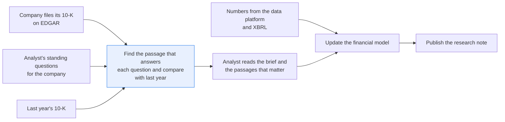
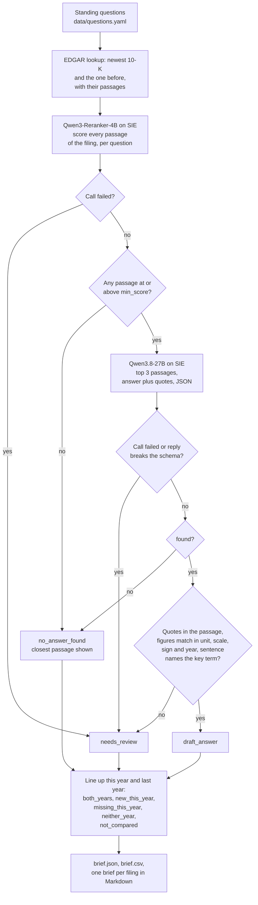

# Answer your standing questions on a new filing, next to last year's answers

> **This example:** an equity analyst's standing questions on Apple's and Target's 10-Ks.
>
> **How it works:** a reranker finds the passages, a language model drafts quoted answers, and
> Python checks every quote and figure, unit and year included.
>
> **Use the same pattern for:** standing questions on an earnings call transcript, covenant terms
> in a credit agreement, fee terms in a fund prospectus.

## Background

An equity or credit research analyst covers a list of companies. When one of them files its
annual report (the 10-K), the analyst has a few days to update the financial model and publish a
note, and every year they open the filing with the same questions for that company. For Apple:
how big are the manufacturing purchase obligations and how much is due within a year, why did the
tax rate move, what drove Greater China. For Target: what's the capex plan for next year and what
is it for, why did the tax rate move, why did inventory change. Most analysts keep these
questions in a notebook or the top of last year's note.

The numbers themselves aren't the problem. Revenue, net income, cash and the effective tax rate
come into the spreadsheet as structured data from the data platform or from the XBRL facts every
US filer submits. A filing also arrives labelled: it's filed on EDGAR by the company itself, with
its fiscal year and period end, so nobody has to work out which company or which year it's about.

What doesn't come structured is the explanation and the guidance: the sentences in the MD&A
(management's discussion and analysis) that say why, and what management expects next. So the
analyst searches inside the filing for each question, reads the paragraphs that come up, copies
the right sentence with its figure into the note, then opens last year's filing to see what it
said about the same thing. That last step is where the useful findings are: a risk that's now
described differently, a guidance figure that moved, a disclosure that disappeared.

Why it matters: a figure in a research note that comes from the wrong paragraph, the "other"
purchase obligations instead of the manufacturing ones, or last year's rate from a sentence that
gives both years, is the kind of mistake that travels. It gets quoted, then modelled, then
presented.

Here's the filing-season job end to end, and the step this recipe takes on:



## The problem

Each question has one paragraph in the filing that answers it, and several that look like they
do: the 2025 capex paragraph when the question is about the 2026 plan, the tax paragraph that
compares with the statutory rate when the question is about the change from last year. A keyword
search finds all of them in no useful order.

Handing the whole filing to a chat model and asking for a brief gets you something fluent with no
way to tell which paragraph each line came from, or whether "$56.2 billion" quietly became "$56.2
million" on the way. So the recipe ranks the paragraphs for each question, answers only from the
best ones, and has Python check the quote and the figures, for this year's filing and last
year's.

The output is one brief per filing, one row per standing question. Each row has a status for
this year:

- **`draft_answer`**: a short answer with a quote that is in the cited passage, and every figure
  in the answer is in that quote with the same unit, scale and year. The full passage is shown
  next to it, with its EDGAR link.
- **`no_answer_found`**: no passage scored high enough, or the ones that did talk about the topic
  without answering it. That means "not in the passages read", not "not disclosed"; the analyst
  checks the source (often the notes the passage points to).
- **`needs_review`**: a quote or a figure failed its check, or an SIE call for it failed. The
  model's draft is kept, labelled as a draft that failed its check, never as an answer, and its
  quotes are marked "unverified" in the brief and the CSV.

And a column comparing the two years, which says what the recipe found, not whether it matters:

- **`both_years`**: answered in both filings; the two answers and quotes sit side by side.
- **`new_this_year`** or **`missing_this_year`**: answered in one filing and not the other. These
  are the rows the analyst reads first.
- **`neither_year`**: no answer in either filing.
- **`not_compared`**: one of the two years is `needs_review`, so the recipe can't say whether the
  answer is new or missing until a person checks it.

The analyst reads the brief, opens the passages that matter, and decides what goes into the model
and the note. The recipe doesn't say whether a change is good or bad news, and it doesn't give
investment advice.

### Examples

Here are three of the standing questions in `data/questions.yaml`, the passages in `data/` they
meet, and what should happen to each.

**1. Apple's manufacturing purchase obligations (AAPL-1).**

- **Input:** P06 in the FY2025 10-K: "As of September 27, 2025, the Company had manufacturing
  purchase obligations of $56.2 billion, with $55.4 billion payable within 12 months." Next to
  it, P07 gives "other purchase obligations of $14.8 billion" in the same shape of sentence.
- **What should happen:** the reranker puts both near the top, the answer model cites P06, and
  Python checks the quote is in P06 and both figures are in it as billions for 2025.
- **Expected outcome:** `draft_answer` from P06, $56.2 billion with $55.4 billion in 12 months.

**2. Vision Pro revenue (AAPL-4).**

- **Input:** the question "How much revenue did Apple Vision Pro generate in fiscal 2025?" The
  passages that mention Vision Pro, such as P12 in Item 1, describe the product and give no
  figure.
- **What should happen:** no passage scores high enough to answer, so the answer model has
  nothing to guess from.
- **Expected outcome:** `no_answer_found` in both years, compared as `neither_year`.

**3. Target's tax rate, with two years in one sentence (TGT-2).**

- **Input:** P28: "Our 2025 effective income tax rate was 22.3 percent compared with 22.2 percent
  in 2024."
- **What should happen:** the year check has to tie 22.3 to 2025 and 22.2 to 2024, so an answer
  calling 22.2 percent the 2025 rate fails.
- **Expected outcome:** `draft_answer` from P28, 22.3 percent.

On the live run, 8 of 8 planted cases came out as expected; [What came out](#what-came-out) has
each one.

## How we'll solve it

1. **Start from what's structured.** The analyst's standing questions per company are in
   `data/questions.yaml`. The EDGAR lookup in `edgar.py` gives the company's newest 10-K and the
   one before, each with its fiscal year, period end, accession number and link, and the
   passages of each filing, so a question about this year's Target filing only ever sees
   passages from it.
2. **Rank the passages with a reranker on SIE.** `Qwen/Qwen3-Reranker-4B` scores every passage
   of the filing against each question, with an instruction from `rules.yaml`, once for this
   year's filing and once for last year's.
3. **Keep the best few in Python:** at or above `min_score`, at most `max_passages`. None means
   `no_answer_found`.
4. **Draft an answer with an LLM on SIE.** `Qwen3.8-27B-FP8` answers from those passages only, as
   JSON: whether it found an answer, one or two sentences, and a quote per cited passage that
   carries every figure and date the answer uses. The prompt says the passages are something to
   quote, never an instruction.
5. **Check the draft in Python.** Every quote must be in its passage. Every figure in the answer
   must appear in a quote with the same currency, scale and sign ("billion" is not "million"), a
   figure the quote gives for another year doesn't count as the year asked, and the sentence it
   comes from must name what the question asks about (its `key_terms`, e.g. "manufacturing
   purchase obligations").
6. **Line the two years up** per question and set the comparison column.
7. **Write the brief** as Markdown (one per filing), CSV and JSON: question, this year's
   answer and quote, last year's, both statuses, both EDGAR links.

If an SIE call fails for a reason that may pass (a timeout, a 5xx, a rate limit, a reply missing
its expected key), that question goes to `needs_review` with the reason and the run carries on; if
SIE refuses the call outright or every call fails, the run stops with SIE's message and writes
nothing.

## Picking the models

The reranker is `Qwen/Qwen3-Reranker-4B`, through SIE's `score` call. It takes the question, an
instruction ("judge whether this 10-K passage states the facts that answer the question") and a
list of passages, and gives each passage a score between 0 and 1. It reads the question and the
passage together, which is what this job needs: "manufacturing purchase obligations" and "other
purchase obligations" are one word apart, and both paragraphs have a dollar figure as of the same
date. On our data it ranked the right paragraph first for every question that has one, at 0.9997
or higher, and kept the two questions with no answer well below the 0.50 threshold (the best
Vision Pro passage scored 0.16, the best Target purchase-obligations one 0.06). It isn't a
filter, though: P07 (other purchase obligations) scored 0.9961 and still went to the answer step.
That's fine, because the answer step and the checks are there to tell them apart.

The answer model is `Qwen/Qwen3.8-27B-FP8`, through SIE's `chat_completions` call with a JSON
schema (`strict: true`) and temperature 0. It sees at most three passages, writes one or two
sentences, and gives a quote per passage it relies on. It's good at copying figures with their
units when you ask, and it picked P06 over P07 on its own. Its one habit worth knowing: it likes
quoting the clause that carries the reason ("due to a $10.7 billion year-over-year decrease in the
provision for income taxes...") rather than the whole sentence, which is why the key-term check
reads the sentence the quote sits in, not just the quote.

Neither model decides a status. Python does, from the scores, the quotes and the figures.

## The flow



Every box from the reranker down runs twice per question: once on this year's filing, once on
last year's.

## How it's built

What you'd want to change lives in two files. [`data/questions.yaml`](./data/questions.yaml)
holds the standing questions per company: the wording (with `{fiscal_year}`, `{prior_year}` and
`{next_year}` filled in from each filing), which year the figures are for (`about`: the filing's
own year, or `next_year` for guidance) and the `key_terms` the filing uses for the thing asked
about. [`rules.yaml`](./rules.yaml) holds the model names, the reranker instruction,
`min_score` (0.50) and `max_passages` (3), the answer limits (60 words, quotes of at least 5
words), the phrases that mean "not answered", the words that mark a figure as a change between
years and how close a year has to follow a figure to be its year (30 characters).

[`edgar.py`](./edgar.py) stands in for SEC EDGAR. Its lookups (`latest_10k`, `find_10k`,
`period_ends`, `passages`) are plain queries on an in-memory sqlite database loaded from
[`data/edgar_filings.csv`](./data/edgar_filings.csv), the filing list EDGAR's submissions API
would give you, and [`data/passages.jsonl`](./data/passages.jsonl). Two 10-Ks for the same
fiscal year raise an error instead of one being picked quietly. [`recipe.py`](./recipe.py) is the
rest, and reads top to bottom in the order of the flow.

| Step | Code | SIE call | What it does |
| --- | --- | --- | --- |
| Load | `load_questions`, `Edgar`, `Question.text`, `Question.asked_year` | none | Reads the questions and the EDGAR seed; for each company finds the newest 10-K and the one for the year before, and stops if either is missing or has no passages |
| Rank | `rank`, `labelled` | `score` | One call per question per filing, every passage of that filing labelled with company, fiscal year and section. A reply that doesn't score exactly the passages sent is a failed call, not a shorter list |
| Keep the best | `answer_on_filing` | none | Passages at or above `min_score`, at most `max_passages`; the others above it are listed as `above_not_shown`. None means `no_answer_found`, with the best passage shown |
| Draft | `answer_prompt`, `write_answer`, `parse_answer` | `chat_completions` | One call per question per filing that has a passage above the threshold. The reply must be exactly `found`, `answer` and `citations`, with the right types and a finish reason of `stop` |
| Check | `check_answer`, `locate`, `figures`, `figure_year`, `is_change`, `source_figures`, `check_figure` | none | Quotes found word for word after folding quotes, case and whitespace (pieces split at "..." must be in order). Every number in the answer in a quote; every figure matched on value, currency, scale, percent and sign; its year from the passage (a year right after it, else the first year earlier in the sentence, "respectively" pairs in order, a period-end date is its fiscal year, a change between years has none); and the sentence it comes from names a key term |
| Compare | `compare` | none | `both_years`, `new_this_year`, `missing_this_year`, `neither_year`, or `not_compared` when either year needs review |
| Write | `write_outputs`, `markdown`, `csv_row`, `csv_safe` | none | `brief.json`, `brief.csv` (a cell that starts like a formula gets a leading `'`) and `brief_<ticker>_FY<year>.md` per filing |

The SIE error rule is the same as in the security recipes. A call that fails for a reason that
may pass (a timeout, a lost connection, a 5xx, a rate limit, a model still loading, or a reply
missing the key we asked for, `scores` or the chat message) sends that question on that filing to
`needs_review` with a short reason, and the run carries on. A refusal every call would repeat (a
bad key, no credits, a model name SIE doesn't know) stops the run with SIE's full message and
writes no outputs. If every call failed, the run stops too.

[`selfcheck.py`](./selfcheck.py) checks the EDGAR lookups and the committed data, the figure and
year parsing, every answer check with hand-written stand-in answers (the `$56.2 million`, the
22.2 percent called this year's, P07's figure under P06's term, a stitched quote, "does not
disclose"), the boundaries of `min_score`, `max_answer_words` and `change_window_words`, a source sentence with
no year, the reply schema, the comparisons, the prompt's line about the passages, and the SIE
error rule, all offline. [`fetch_data.py`](./fetch_data.py) rebuilds `data/passages.jsonl` from
EDGAR; it reproduced the committed file byte for byte on 4 Nov 2026 (UTC).

## Run it

You need [uv](https://docs.astral.sh/uv/) and an SIE API key
([create one](https://console.superlinked.com/console/api-keys?utm_source=github&utm_medium=docs&utm_campaign=sie-cookbook&utm_content=finance-answer-questions-on-new-filing)).

```bash
cp .env.example .env   # then set SIE_API_KEY
uv run recipe.py
uv run selfcheck.py    # optional: offline checks, no SIE call
```

`uv run` installs this recipe's few dependencies into its own `.venv` on the first run. Each run
writes `runs/<timestamp>/`. The first calls can wait a few minutes while SIE Cloud starts the
reranker and the answer model. `--output DIR` changes the output directory. A warm run makes 28
SIE calls (16 rerank calls, one per question per filing, and 12 answer calls, since the two
questions with no passage above the threshold skip the answer step in both years) and took
about 29 seconds.

To rebuild the passages from EDGAR, set `EDGAR_USER_AGENT` to your name and contact email (SEC
EDGAR asks every client to identify itself) and run `uv run fetch_data.py`.

## What came out

### The three examples

- **AAPL-1** came out `draft_answer` from P06, $56.2 billion with $55.4 billion in 12 months, and
  last year's P33 gave $53.0 billion with $52.9 billion (`both_years`). P07 scored 0.9961 against
  P06's 0.9998 and the answer model still cited P06. As expected.
- **AAPL-4** came out `no_answer_found` in both years (best P12 at 0.16, P39 at 0.14),
  `neither_year`. As expected.
- **TGT-2** came out `draft_answer` from P28, 22.3 percent, with last year's P52 at 22.2 percent
  (`both_years`). The model wrote "22.3 percent, up from 22.2 percent in fiscal 2024" and the year
  check agreed on both figures. As expected.

### Every planted case

On the live run on 4 Nov 2026 (UTC), 8 of 8 planted cases came out as expected.

The input is two companies' standing questions in [`data/questions.yaml`](./data/questions.yaml)
(four each) and 56 passages from four 10-K filings: Apple FY2025 (16) and FY2024 (14), Target
FY2025 (15) and FY2024 (11). They are real paragraphs from Item 1 (Business), Item 1A (Risk
Factors) and Item 7 (MD&A). Besides the paragraph that answers each question, each filing has the
paragraphs that look like they do: other purchase obligations, leases and notes, the risk factor
on manufacturing purchase obligations with no figure, the tax rate against the statutory rate,
last year's capex, the inventory accounting estimate and the operating cash flow paragraph that
mentions inventory. Each filing's every passage is scored for every question.

Here's our live run on 4 Nov 2026 (UTC), with the settings as written:

| Question | What we planted | This year (FY2025) | Last year (FY2024) | Comparison | Why |
| --- | --- | --- | --- | --- | --- |
| AAPL-1 manufacturing purchase obligations, and how much is due in 12 months | Near misses: other purchase obligations (P07), leases (P05), notes (P04), all on topic | `draft_answer`: P06, $56.2 billion with $55.4 billion in 12 months | `draft_answer`: P33, $53.0 billion with $52.9 billion | `both_years` | Same shape of sentence, different obligation; P07 scored 0.9961 and the answer model still cited P06 |
| AAPL-2 why the tax rate moved from the prior year | The paragraph comparing with the statutory rate (P10, P37) | `draft_answer`: P11, the $10.7 billion State Aid decrease | `draft_answer`: P38, the $10.2 billion one-time charge | `both_years` | Two explanations of the same rate; the model cited the one against the prior year both times |
| AAPL-3 what drove Greater China sales | Services and Wearables explanations in the same section | `draft_answer`: P15 | `draft_answer`: P42, with the renminbi | `both_years` | Same sentence pattern, different segment |
| AAPL-4 Vision Pro revenue | Hits mention Vision Pro and Wearables, never a Vision Pro figure | `no_answer_found` (best P12, 0.16) | `no_answer_found` (best P39, 0.14) | `neither_year` | Not in these passages; the analyst gets no guess |
| TGT-1 capex plan for next year and what it's for | The 2025 capex paragraph (P23) and the store network | `draft_answer`: P22, about $5 billion in 2026 | `draft_answer`: P49, $4 billion to $5 billion in 2025 | `both_years` | Last year's actual is not next year's plan, and last year's plan is the comparison |
| TGT-2 effective tax rate and why it moved | One sentence gives 22.3 percent for 2025 and 22.2 percent for 2024 | `draft_answer`: P28, 22.3 percent | `draft_answer`: P52, 22.2 percent | `both_years` | The filing's year is not the year of every figure in it |
| TGT-3 why inventory changed | Other year-end balances, the inventory accounting estimate (P44, P55) | `draft_answer`: P30 | `draft_answer`: P54, with its two bullets | `both_years` | A "why" that only MD&A answers |
| TGT-4 manufacturing purchase obligations | Only a general paragraph that points to the notes | `no_answer_found` (best P26, 0.06) | `no_answer_found` (best P50, 0.04) | `neither_year` | The next step is in the notes, and the brief shows P26 saying so |

All eight came out as planted. No row came out `new_this_year` or `missing_this_year`:
Apple and Target answered the same standing questions in both years, which is what you'd hope
from two consecutive 10-Ks and also why we couldn't plant one from real filings. The near miss
the data can't hold, an answer that quotes the right sentence but says "$56.2 million", is in
`selfcheck.py` as a hand-written stand-in reply, along with an answer that calls 22.2 percent
Target's 2025 rate; both go to `needs_review`. Treat all of this as a demo that the wiring works,
not as a measure of accuracy: eight questions on four filings show the steps fit together, not
how often the answers are wrong.

A few things worth noticing:

- **AAPL-1 is the near miss doing its job.** The reranker can't tell manufacturing from other
  purchase obligations by much (0.9998 against 0.9961), so both went to the answer model, plus the
  leases at 0.8673. The notes paragraph scored 0.5092, also above the threshold, and is listed as
  `above_not_shown` instead of disappearing. Here's the row from `brief_AAPL_FY2025.md`:

  ```text
  **This year, AAPL FY2025: `draft_answer`.** Cited P06; the quotes are in the filing and the figures match them. Read the passage before using it.

  > As of September 27, 2025, Apple had manufacturing purchase obligations of $56.2 billion, with $55.4 billion payable within 12 months.

  - P06 (Item 7. MD&A, score 0.9998): quote "As of September 27, 2025, the Company had manufacturing purchase obligations of $56.2 billion, with $55.4 billion payable within 12 months."
  - Also at or above min_score, not sent to the answer step: P04
  ```

  Had the model cited P07's $14.8 billion instead, the figure's sentence wouldn't name
  "manufacturing purchase obligations" and the row would be `needs_review`.
- **AAPL-2 quotes a clause, and the check reads its sentence.** The model quoted only the clause
  with the cause ("due to a $10.7 billion year-over-year decrease...") and left out the start of
  the sentence that names the rate. The key-term check reads the passage sentence each quote sits
  in, so the clause counts: that sentence says "effective tax rate". It still keeps P07 out, since
  no sentence of P07 says "manufacturing purchase obligations".
- **TGT-2 is the year trap, and it was easy this time.** P28 says "Our 2025 effective income tax
  rate was 22.3 percent compared with 22.2 percent in 2024." The model wrote "22.3 percent, up
  from 22.2 percent in fiscal 2024", and the year check agreed on both figures: 22.3 takes the
  2025 earlier in the sentence, 22.2 the 2024 right after it. Last year's filing says 22.2
  percent for 2024, so the two columns agree with each other too.
- **TGT-4 is a "look in the notes".** No passage scored anywhere near 0.50, and the closest one is
  shown in the brief with its last sentence, "The Notes to the Consolidated Financial Statements
  provide additional information." That's the analyst's next step, and the recipe doesn't
  pretend otherwise.

The run writes the brief three ways: `brief.json` for code (with every passage's score, the
quotes, the full cited passages and the closest passages read), `brief.csv` for a spreadsheet
(one row per question, both years side by side), and one Markdown brief per filing for a person.

### What you do next

The analyst opens the Markdown brief for the new filing and reads any `new_this_year` or
`missing_this_year` rows first (none this time). For each `draft_answer` they read the full
passage next to it before using the figure; for each `no_answer_found` they check the source,
often the notes the passage points to, as TGT-4 shows. Then they decide what goes into the
financial model and the note.

## Potential improvements

- **Your own questions and filings.** Add companies and questions to `data/questions.yaml` and
  your filing index to `edgar.py`. The lookups are what EDGAR's submissions API returns, so
  swapping the seed for real calls changes one module.
- **Swapped figures pass.** An answer that says "$55.4 billion, with $56.2 billion due in 12
  months" passes every check, since both figures are in the quote with the right unit and year.
  The check proves the quote is in the filing and its figures match, not that the answer reads
  them right. Asking the model for each figure's label (total, due in 12 months) and checking
  each label against the words next to the figure would catch it.
- **The year heuristic is a heuristic.** "A year right after the figure, else the first year
  earlier in the sentence" holds for every passage here, and `selfcheck.py` pins it on the hard
  ones. A sentence that says "compared to 2023, a one-time charge of $10.2 billion" would put the
  charge in 2023. When it gets a sentence wrong it sends a right answer to review, not a wrong
  answer through.
- **Table-only answers.** Every answer here is in a paragraph. Figures that only appear in a
  table, with the year in the column header and the unit in a footnote, need the table parsed
  into cells before any of this works.
- **The thresholds** (`min_score` 0.50, `max_passages` 3, the answer limits) are starting points,
  not tuned values, so check them on your own questions. The models are under `models` in
  `rules.yaml`, one line each.
- **A smaller answer model.** See Try another model: the 4B model matched on six of the eight
  rows and sent two FY2024 answers to review for its quotes. That may be a fair trade for a
  cheaper, faster brief if your analysts read the review rows anyway.

## Try another model

Each model is one line under `models:` in `rules.yaml`. On 4 Nov 2026 (UTC) we swapped one model
at a time, changed nothing else, and ran the recipe on SIE Cloud.

| `rules.yaml` key | Swap in | What happened on this data |
| --- | --- | --- |
| `rerank` | `Qwen/Qwen3-Reranker-0.6B` | Same status, citation and comparison for all 8 questions in both years. It scores far more passages above 0.50 (on TGT-4 the general obligations paragraph scored 0.9949, on AAPL-4 the Wearables paragraph 0.9944), so all 16 question-filing pairs went to the answer step (16 answer calls instead of 12) and the answer model said "not found" for the two with no answer |
| `rerank` | `tencent/R3-rerank-0.6b` | Same status, citation and comparison for all 8 questions. Its scores sit between 0.19 and 0.84, so 0.50 filters little: 16 answer calls. On AAPL-1 it ranked P07 above P06, and on TGT-3 P44 above P30; the answer model still cited P06 and P30 |
| `answer` | `Qwen/Qwen3.5-4B` | 6 of 8 rows the same. FY2025 got the same status on all 8 questions (on AAPL-2 it cited P10 as well as P11). Two FY2024 answers went to `needs_review`, so AAPL-2 and TGT-3 came out `not_compared`: on AAPL-2 its quote of P37 left out the parenthetical note reference and wasn't in the passage word for word, and on TGT-3 it quoted only P54's bullets, so $12.7 billion and $11.9 billion weren't in any quote. Both are the checks doing their job, on a model that's sloppier with quotes |

See [MODELS.md](../../MODELS.md) for every model these recipes use.

## Run it on your own SIE

The same code runs against an SIE server you host. Set `SIE_BASE_URL` in `.env`; an API key
is then optional. The table gives the SIE v0.10.1 image each model runs on, from SIE's
[compatibility matrix](https://github.com/superlinked/sie/blob/main/docs/compatibility.md).

| `rules.yaml` key | Model | Image | Tested on |
| --- | --- | --- | --- |
| `rerank` | `Qwen/Qwen3-Reranker-4B` | `cuda12-default` | L4 |
| `answer` | `Qwen/Qwen3.8-27B-FP8` | `cuda13-sglang-cu130` | H100 80GB |

One SIE server runs one image, so these 2 images need a cluster: the
[sie-cluster Helm chart](https://github.com/superlinked/sie/tree/main/deploy/helm/sie-cluster)
with one worker pool per image routes each model to its pool. See
[SELF_HOSTING.md](../../SELF_HOSTING.md) for the values file.

## Data and licenses

Four 10-K filings from [SEC EDGAR](https://www.sec.gov/edgar), listed in
`data/edgar_filings.csv`:

| Filing | Accession number | Period end | Filed | Document |
| --- | --- | --- | --- | --- |
| Apple Inc. FY2025 (CIK 320193) | 0000320193-25-000079 | 2025-09-27 | 2025-10-31 | [aapl-20250927.htm](https://www.sec.gov/Archives/edgar/data/320193/000032019325000079/aapl-20250927.htm) |
| Apple Inc. FY2024 (CIK 320193) | 0000320193-24-000123 | 2024-09-28 | 2024-11-01 | [aapl-20240928.htm](https://www.sec.gov/Archives/edgar/data/320193/000032019324000123/aapl-20240928.htm) |
| Target Corporation FY2025 (CIK 27419) | 0000027419-26-000016 | 2026-01-31 | 2026-03-11 | [tgt-20260131.htm](https://www.sec.gov/Archives/edgar/data/27419/000002741926000016/tgt-20260131.htm) |
| Target Corporation FY2024 (CIK 27419) | 0000027419-25-000018 | 2025-02-01 | 2025-03-12 | [tgt-20250201.htm](https://www.sec.gov/Archives/edgar/data/27419/000002741925000018/tgt-20250201.htm) |

The CSV also lists each company's FY2023 10-K (no passages), so a date like "February 3, 2024"
maps to Target's fiscal 2023.

**License.** EDGAR filings are US government records in the public domain. Each passage is one
paragraph of the filing's HTML with only whitespace collapsed and a leading bullet removed; P54
also takes in the two bullet paragraphs that finish its sentence. `fetch_data.py` lists the
phrase that picks each one. The standing questions are neutral research questions written for
this recipe, and nothing here is investment advice.

## Files

- `recipe.py`: the pipeline
- `edgar.py`: the EDGAR lookups (filing list and passages) on an in-memory sqlite database
- `selfcheck.py`: plain asserts on the lookups, the figure, year and quote checks, the statuses
  and the SIE failure rule, no SIE call (`uv run selfcheck.py`)
- `rules.yaml`: models, the reranker instruction, thresholds and the check settings
- `fetch_data.py`: rebuilds `data/passages.jsonl` from EDGAR
- `data/questions.yaml`: the standing questions per company
- `data/edgar_filings.csv`: the 10-K filings on record, with accession numbers and links
- `data/passages.jsonl`: the 56 10-K passages
- `pyproject.toml`, `uv.lock`: this recipe's dependencies

See the SIE task page for [reranking](https://superlinked.com/rerank?utm_source=github&utm_medium=docs&utm_campaign=sie-cookbook&utm_content=finance-answer-questions-on-new-filing).
