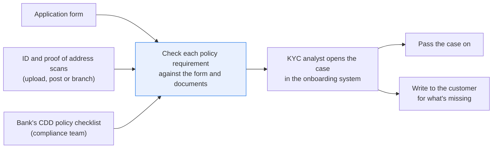
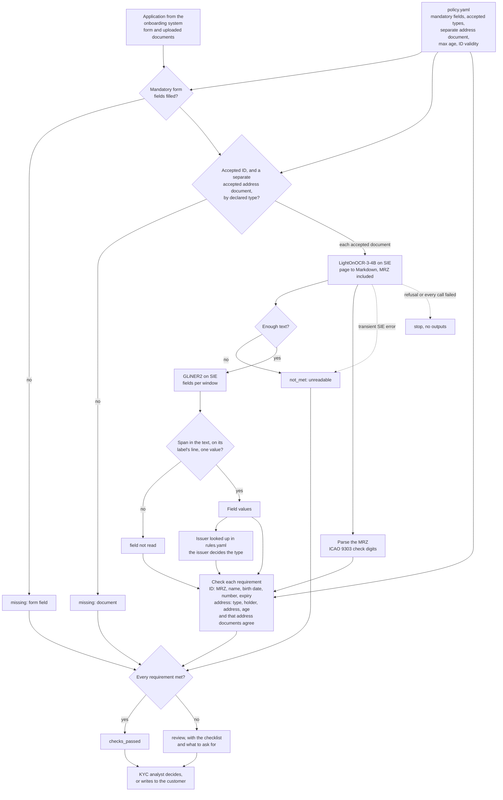

# Check KYC documents against your policy and list what's missing

> **This example:** a KYC analyst onboarding a personal customer from a scanned ID and a utility
> bill.
>
> **How it works:** OCR reads the scans, an extraction model pulls name, date of birth and address,
> and Python checks each policy rule, from MRZ check digits to document age.
>
> **Use the same pattern for:** director IDs for a business account, source-of-wealth documents, a
> mortgage applicant's payslips against the application.

## Background

Before a bank opens an account it has to know who the customer is. The law sets the floor. In
the US, the Customer Identification Program rule says the bank must collect at least name, date
of birth, address and an ID number, and verify them. In the UK, the Money Laundering Regulations
and the industry's JMLSG guidance say much the same and add that an address is proved by a
document other than the one that proves identity. Each bank's compliance team turns that into
its own customer due diligence (CDD) policy:

- which form fields are mandatory for a personal account (often occupation, nationality and tax
  residency on top of the legal minimum);
- which documents it accepts for identity (passport, national ID card, driving licence) and for
  address (a utility bill or bank statement, but not a mobile phone bill);
- how recent an address document must be (three months is common) and whether an expired ID
  counts;
- which fact has to be verified by which kind of document.

Most big banks hand the document part to an identity-verification vendor: the customer
photographs their ID in an app, and the bank gets structured results back. This recipe is for
the places where that doesn't happen: a smaller bank, broker or credit union that takes documents
by upload or post, a branch that scans paper, and the KYC remediation team going back through old
files where the documents are scans nobody ever extracted anything from.

The person doing the work is a KYC analyst (in a smaller firm, the onboarding or new-accounts
officer). They open the case in the onboarding system and work down the policy's checklist: is
the form complete, did the customer send the right kinds of documents, and does each document
actually prove what it has to? Name and date of birth from the ID. Address from a recent bill at
that address, in that name. MRZ check digits right (the `<<<` lines at the bottom of a passport
or ID card). ID still valid. Then they either pass the case on or write to the customer asking
for what's missing.

Why it matters: an account opened without the evidence the policy requires is a finding at the
next audit or regulator visit, whether or not the customer turns out to be fine. An account
opened on someone else's document is worse. And most cases are fine, which is what makes the one
with the wrong flat number easy to miss on a Friday afternoon.

Here's the onboarding job end to end, and the step this recipe takes on:



## The problem

Two things are structured: the application form and the policy. The documents aren't: they're
scans with no text layer, from outside the bank. Someone has to read them before anything can be
checked against the policy.

The obvious approaches each fall short. Retyping the fields is slow and is where the typos come
from. Asking one model "does this packet look right?" gives an answer you can't audit against the
policy. And checking the documents only against each other misses the case where the documents
agree perfectly and belong to somebody else, and says nothing about whether the customer sent the
documents the policy asks for at all.

So the recipe works through the policy one requirement at a time. Each requirement comes out as
**`met`** (with the document and the value that met it), **`not_met`** (with the reason) or
**`missing`** (no document of an accepted kind was provided, or a form field is blank). Each case
gets:

- **`checks_passed`**: every requirement is met. That isn't an approval; the analyst decides.
- **`review`**: at least one requirement is not met or missing, a page was unreadable, or an SIE
  call failed. The case comes with the checklist and a plain list of what to ask the customer for
  ("a proof of address dated on or after 26 July 2026", "your occupation").

Nothing is approved or rejected automatically. The recipe doesn't check that a document is
genuine (security features, photo, liveness), screen names against sanctions or PEP lists, or rate
the customer's risk; those are separate steps in the same onboarding.

### Examples

Here are three of the cases in `data/`, and what should happen to each. All three were received
on 26 October 2026.

All of this is synthetic, written for this recipe and stamped SPECIMEN. Every person, address and
number is invented.

**1. A bill that words things differently (`kyc-02`).**

- **Input:** the form for Tobias James Okafor-Bell, born 2 November 1979, at flat 2, 114 Harbour
  Road, Port Ellery, UT 40381, the ID card on page 2 of `id-documents.pdf`, and a bill on page 2
  of `address-documents.pdf` that drops the middle name, adds "Mr", writes "Flat 2, 114 Harbour
  Rd" and is 89 days old.
- **What should happen:** the name, address and date checks should see the same person at the
  same flat, inside three months.
- **Expected outcome:** `checks_passed`.

**2. One digit, different house (`kyc-06`).**

- **Input:** the form says 8 Quillon Street, Westmarch; the bill on page 6 of
  `address-documents.pdf` is at number 18.
- **What should happen:** it's not the address on the form, so the customer is asked for a bill
  that shows it.
- **Expected outcome:** `review`, with `address_matches` (the bill shows the address on the form)
  not met.

**3. Same words, different flat (`kyc-09`).**

- **Input:** the form says flat 2, house number 114, Harbour Road; the bill on page 9 of
  `address-documents.pdf` says "Flat 114, 2 Harbour Road".
- **What should happen:** the address is taken apart into flat, house number and street before
  it's compared, so the swap shows.
- **Expected outcome:** `review`, with `address_matches` not met.

On the live run, 12 of 12 cases came out as expected. [What came out](#what-came-out) has the
results.

## How we'll solve it

1. **Start from the policy and the application.** [`policy.yaml`](./policy.yaml) is what
   compliance owns: the mandatory form fields, the accepted document types for each purpose, that
   the address document must be separate from the ID, the maximum age of an address document,
   how long an ID must still be valid, and which requirement each kind of document is checked
   for. **It's a made-up policy modelled on the US Customer Identification Program rule and the
   UK JMLSG guidance, not legal advice** and not any bank's real policy. The application comes in
   structured from the onboarding system ([`onboarding.py`](./onboarding.py)), with the documents
   the customer uploaded and the type they said each one is.
2. **Check the form in Python.** Every mandatory field filled. A field holding only "n/a", "-",
   "tbc" or "unknown" counts as blank.
3. **Check the document types against the policy.** Is there an accepted identity document, and
   a separate accepted address document? Steps 2 and 3 need no model, so a blank occupation or an
   ID card offered as its own proof of address is known before any page is read.
4. **Read each accepted document with an OCR model,** MRZ included. A page that comes back nearly
   empty is unreadable.
5. **Parse the MRZ in Python** and check its ICAO 9303 check digits.
6. **Find each document's fields with an extraction model:** on the ID the name, date of birth,
   expiry and number; on the address document the holder, the address, the issuer and the date.
   Python keeps a value only if it's in the text on a line carrying that field's label, and when
   one field is read with two different values it keeps neither. The issuer is the exception: it's
   a heading with no label, so Python takes the whole heading and looks it up in the issuer list
   in `rules.yaml`. The issuer, not the upload label, decides the type, which is how a mobile
   phone bill gets told apart from an energy bill even when the customer called it a utility
   bill.
7. **Check each requirement in Python.** Name and date of birth against the application and the
   MRZ; address compared as house number, flat number, street and postcode; ID valid on the case
   date; address document within the policy's age; two address documents giving one address.
8. **Write the checklist,** the case status, and the list of what to ask the customer for.

If an SIE call fails for a reason that may pass (a timeout, a 5xx, a rate limit, or a reply
missing its expected key), the requirements that document had to meet come out `not_met` with
the reason and the run carries on; if SIE refuses the call outright, the run stops with SIE's
message and writes nothing. The same happens if every call fails.

## Picking the models

The reader is `lightonai/LightOnOCR-3-4B`, called through SIE's `extract` with the page as an
image, once per page. The documents are customer uploads, branch scans or post, with no text
layer, so the first step has to be OCR. LightOnOCR reads the MRZ too, `<<<` fillers and all,
and writes form boxes as HTML tables, which keeps each label next to its value. It isn't perfect
on the MRZ: on this data it dropped one check digit from the same ID card on every live run we
made (more on that below), and that's exactly what the check digits are there to catch.

The field finder is `fastino/gliner2-large-v1`, called through `extract` with an `output_schema`
(one optional string per field, with the `description` from `rules.yaml`), once per window of
the flattened page. GLiNER2 reads at most 512 tokens per item; a window of 180 words is about
that, not a guarantee, and the windows overlap by 30 words so a pair cut at one edge is whole in
the next. Every page here fits in one window. It's good at pointing at the right box on a
document it has never seen, and not something to trust with the value: it returns short spans
(the street without the house number, "GRACE" for "FOLASADE GRACE"), so Python checks the span
is really in the text and on its label's line, and keeps the whole cell.

Neither model takes a prompt, so there's no instruction for text printed on a document to
override. Two models, the OCR model called once per page and the extraction model once per
window, and no generative model makes the decision. The policy, the MRZ, the dates, the issuer
list and every comparison are plain Python reading `policy.yaml` and `rules.yaml`.

## The flow



## How it's built

Compliance's part lives in [`policy.yaml`](./policy.yaml): the mandatory fields and what to call
each when asking for it, the accepted identity and address document types, `mrz_types`,
`min_validity_days`, `separate_from_identity`, `max_age_months`, the requirements each document
is checked for, and the wording of every ask. A requirement with no ask (the MRZ, the ID number,
a document that couldn't be read) goes to the analyst instead of the customer: a failed check
digit may be a misread, and asking the customer about it gets you nowhere.
[`rules.yaml`](./rules.yaml) is how the documents are read: the two model names, the fields
asked of GLiNER2 with their labels, the issuer list, the name titles, the address parts (postcode
pattern, flat words, street types, abbreviations), the date formats and every threshold.
[`onboarding.py`](./onboarding.py) is the onboarding system lookup, and
[`recipe.py`](./recipe.py) is about 1,300 lines that read top to bottom in the order of the flow.

| Step | Code | SIE call | What it does |
| --- | --- | --- | --- |
| Look up the case | `OnboardingSystem.open_cases`, `OnboardingSystem.get_case` | none | Stands in for the onboarding system's case API: the form as the customer filled it, and each uploaded document with its purpose, declared type and scan page. Backed by two CSV seeds in an in-memory SQLite database |
| Form | `check_form` | none | Each mandatory field in `policy.yaml` filled; blank or a placeholder is `missing` with an ask |
| Document types | `sort_documents` | none | An accepted identity document; a separate address document of an accepted declared type. Only the accepted ones are read |
| Read each page | `read_document`, `read_page`, `flatten_markdown` | `extract` (image) | One call per page. Each form box becomes "Label \| value"; a passport's row of labels over a row of values is paired up |
| Find the fields | `extract_fields`, `labelled_cell`, `whole_cell` | `extract` + `output_schema` | One call per window, one item per call, with `overflow_policy: error`, so a window too long to read whole fails (and its document's requirements stay `not_met`) instead of being cut short. A span must be in the text and on a labelled line; the value is that whole cell. Two different values for one field keep neither |
| MRZ | `parse_mrz`, `check_digit`, `mrz_date` | none | TD1 (ID card) or TD3 (passport), with filler runs repaired; every check digit |
| Issuer | `issuer_type` | none | The issuer must match a whole entry in `issuers`; a page that also names a listed issuer of another type isn't trusted |
| ID requirements | `check_id_mrz`, `check_id_name`, `check_id_date_of_birth`, `check_id_number`, `check_id_valid` | none | Against the form and the MRZ. An MRZ value counts only when its check digit holds, and then it has to agree too. An MRZ found on the page is checked whatever type the customer declared, so a "driving licence" carrying a passport MRZ still has its check digits checked |
| Address requirements | `check_address_type`, `check_address_holder`, `check_address_matches`, `check_address_age`, `check_addresses_agree` | none | Holder by `name_matches` (titles dropped, a middle name may be left out); address by `parse_address` into house number, flat, street and postcode; age against `max_age_months` |
| SIE failures | `Calls.call`, `is_fatal`, `stop_message`, `stop_on_refusal` | none | A transient failure or a reply missing its key leaves that document's requirements `not_met`; a refusal, or every call failing, stops the run without outputs |
| Outputs | `write_outputs`, `requests_markdown`, `csv_safe` | none | `cases/<case>.json`, `checklist.csv`, `cases.csv` and `requests.md`. Any cell a spreadsheet would run as a formula gets a leading `'` |

[`selfcheck.py`](./selfcheck.py) checks all of this offline with hand-written OCR pages and
stand-in model replies: all 12 cases end to end (including that `kyc-11` reads only its
ID, and that every extraction call asks for `overflow_policy: error`); the MRZ with OCR quirks,
and a changed character in the optional data that fails only the composite digit on a TD1 and a
TD3; an MRZ on a document declared as a driving licence; addresses (the swapped flat and house number, a glued "Flat2", "114A"
against "114", a missing flat, a near-identical postcode, two addresses in one span); names
(half a surname, two people on one bill, a middle initial that is no given name's, the MRZ
surname or given names disagreeing); issuers ("Kestrel Energy
Mobile", "Kestrel", a page naming two kinds of issuer); dates (the three-month boundary, two
dates in one cell, a day and month swap, a printed expiry that isn't the MRZ's, an unread printed expiry with a valid MRZ one); an OCR page
one character under and at `min_page_chars`; the form and
document types; conflicting values; a set of adversarial stand-in replies; `csv_safe`; the
policy and the committed data (including that the PDFs carry no metadata); and the SIE failure
rule with a transient error, a refusal, every call failing, a reply missing its key, an OCR reply
with no markdown, and the empty-result 500 counted as "nothing found" only from the extraction
model. [`make_data.py`](./make_data.py) draws the scans and writes the onboarding seed.

## Run it

**Try this recipe on [SIE Serverless](https://superlinked.com/serverless?utm_source=github&utm_medium=docs&utm_campaign=sie-cookbook&utm_content=finance-check-kyc-documents-against-policy).** You pay per call and there are no GPUs to manage yourself. [Create an API key](https://console.superlinked.com/console/api-keys?utm_source=github&utm_medium=docs&utm_campaign=sie-cookbook&utm_content=finance-check-kyc-documents-against-policy) to start, or host SIE yourself from the [SIE repo](https://github.com/superlinked/sie).

You need [uv](https://docs.astral.sh/uv/) and an SIE API key
([create one](https://console.superlinked.com/console/api-keys?utm_source=github&utm_medium=docs&utm_campaign=sie-cookbook&utm_content=finance-check-kyc-documents-against-policy)).

```bash
cp .env.example .env   # then set SIE_API_KEY
uv run recipe.py
uv run selfcheck.py    # optional: offline checks, no SIE call
uv run make_data.py    # optional: rewrite data/
```

`uv run` installs this recipe's few dependencies into its own `.venv` on the first run. Each run
writes `runs/<timestamp>/` in this folder. A run makes 48 SIE calls on this data: 24 to
the OCR model (one per page) and 24 to the extraction model (one window per page). `kyc-11`'s ID
is read once, though it's listed twice. The first calls can wait a few minutes while SIE Serverless
starts the models; on 2026-11-04 (UTC) a run that found them still starting took 281 s, and a
run with both warm took 89 s.

## What came out

### The three examples

**1. A bill that words things differently (`kyc-02`).**

- **Expected outcome:** `checks_passed`.
- **What came back:** `checks_passed`: same person, same flat, inside three months.
- **Verdict:** Pass.

**2. One digit, different house (`kyc-06`).**

- **Expected outcome:** `review`, with `address_matches` not met.
- **What came back:** `review`, with `address_matches` not met and also `id_mrz` not met: "MRZ check
  digit fails for: document_number, composite".
- **Verdict:** Pass. The address was caught. The extra failure is the OCR model's: it read the ID
  card's first MRZ line without the document number's check digit, so the analyst has one more
  thing to look at, and on a clean case that alone would send it to review.

**3. Same words, different flat (`kyc-09`).**

- **Expected outcome:** `review`, with `address_matches` not met.
- **What came back:** `review`, with `address_matches` not met. The reason in `checklist.csv` reads
  "house number '2', application '114'; flat '114', application '2'".
- **Verdict:** Pass.

### Results

On the live runs on 2026-11-04 (UTC), 12 of 12 cases came out as expected, with the status and the
requirement we wrote each one to show; `kyc-06` also had one extra requirement not met (see below).

**Where it works:** a fault you can state as a rule against the form and the policy: an expired ID
(`kyc-03`), a wrong check digit (`kyc-04`), an old bill (`kyc-05`), an address off by a digit or
with the numbers swapped (`kyc-06`, `kyc-09`), a bill in a family member's name (`kyc-07`), day and
month swapped on the form (`kyc-08`), two recent bills at different addresses (`kyc-10`), a blank
occupation with the ID card as the only address proof (`kyc-11`), and a document of the wrong kind
(`kyc-12`). And it doesn't flag a clean case (`kyc-01`) or a bill that only words things differently
(`kyc-02`).

**Where it fails:** it depends on the scan being read properly. The OCR model's misread on `kyc-06`
added a failure that isn't on the card, and with either of the other two OCR models we tried, every
case went to review (see [Try another model](#try-another-model)). This run also doesn't test a
forged document: the recipe doesn't check that a document is genuine, and `checks_passed` isn't an
approval.

The input is twelve personal-account cases, all received on 26 October 2026, in
[`data/`](./data):

- `onboarding_cases.csv`: the onboarding system's application forms: surname, given names, date
  of birth, flat, house number, street, town, postcode, nationality, occupation and tax residency
- `onboarding_documents.csv`: one row per uploaded document and purpose: document id, `identity`
  or `address`, the type the customer said it is, and the scan's file and page
- `id-documents.pdf`: eleven ID cards (TD1, three-line MRZ, with the holder's address) and one
  passport (TD3, two-line MRZ)
- `address-documents.pdf`: twelve address documents: energy and water bills, and one mobile
  phone bill

> **All of it is synthetic and stamped SPECIMEN.** [`make_data.py`](./make_data.py) draws the
> pages with Pillow as image-only PDFs and rebuilds them byte for byte. The PDFs carry no
> document metadata (no title, author or dates). The documents are issued by "Utopia" (`UTO`),
> the fictional state ICAO Doc 9303 uses for its own specimens, and every person, utility,
> phone company, address and number is invented. The MRZ lines do carry real ICAO 9303 check
> digits.

Every case is dated 26 October 2026, so an address document must be dated 26 July 2026 or
later.

`kyc-06` came out with one extra requirement not met on every run. Treat that as a demo that the
wiring works, not as a measure of accuracy: twelve cases tell you each path through the
checks runs, not how often a real scan gets misread.

A few things worth noticing:

- **`kyc-06` has the fault we wrote into it and one we didn't.** LightOnOCR read the ID card's
  first MRZ line without the document number's check digit, so the document number and the
  composite check fail. The check digits did their job, the case was already going to review for
  the address, and we left it as found. Since an MRZ failure has no customer ask, the request
  splits it out (from `requests.md`):

  ```markdown
  ## kyc-06: review

  Please send us:
  - a proof of address showing the address on your application, dated on or after 26 July 2026

  For the analyst to look at first:
  - id_mrz (kyc-06-id): MRZ check digit fails for: document_number, composite
  ```

- **`kyc-09` is the case a bag of words gets wrong.** "Flat 114, 2 Harbour Road" and "Flat 2,
  114 Harbour Road" hold exactly the same words, so a check that compares addresses as words in
  any order passes it. Taking the address apart first makes it obvious (from `checklist.csv`):

  ```csv
  kyc-09,address_matches,kyc-09-poa,not_met,"'Flat 114, 2 Harbour Road, Port Ellery, UT 40381': house number '2', application '114'; flat '114', application '2'","a proof of address showing the address on your application, dated on or after 26 July 2026"
  ```

- **`kyc-12` is a perfectly good document of the wrong kind.** Right name, right address, dated
  17 days before the case, and every requirement but one met. The detail says why the one
  failed: "uploaded as utility_bill; 'Larkspur Mobile' issues mobile_phone_bill, which the
  policy doesn't accept as proof of address". Without the issuer list it would have sailed
  through on the customer's own label.
- **`kyc-11` costs one OCR call, not two.** The form and the document types are checked before
  anything is read, so the blank occupation and the missing proof of address are on the list
  from the policy alone; only the ID card is read, for the identity requirements, which it
  meets.
- **The label check earned its keep on two bills.** On `kyc-09` and `kyc-12` GLiNER2 offered
  "Eastbrook" as the service address city. It came from the customer service line ("PO Box 812,
  Eastbrook"), not the address, so Python dropped it with a note in the case file and used the
  labelled address line instead. Neither run hit SIE Serverless's empty-result error, and no field
  was read two ways.

### What you do next

The KYC analyst opens each case in the onboarding system with the checklist next to it. A
`checks_passed` case still needs their decision before it's passed on. For a `review` case they
look at the items under "For the analyst to look at first" in `requests.md` (an MRZ failure like
`kyc-06`'s has no customer ask), then write to the customer for what's on the "Please send us"
list.

## Potential improvements

- **Start with your policy.** `policy.yaml` is a made-up policy for the demo. Take the mandatory
  fields, accepted documents, `max_age_months`, `min_validity_days` and the asks from your
  compliance team. The requirement names in it map to check functions in `recipe.py`; a name
  with no function stops the run at load, so a typo can't quietly drop a check.
- **Teach it your documents.** `documents` in `rules.yaml` is what GLiNER2 is asked to find. The
  `description` goes to the model, and `label` lists the labels your documents use. To read a
  driving licence or a bank statement, add their labels; to check something new, add a check
  function and name it in `policy.yaml`.
- **Keep the issuer list real.** `issuers` stands in for the list your team keeps of who issues
  what. An issuer not on it sends the address document to review, which is safe and will be
  annoying until the list is complete.
- **The address parts are starting points.** `postcode_pattern`, `flat_words`, `street_types`
  and `abbreviations` in `rules.yaml` fit these documents. A different country's postcodes, a
  "c/o" line, a house name instead of a number, or a range like "12-14" will need their own
  rules; until then they go to review.
- **Specimens.** `specimen_policy: allow` lets the demo documents through with a note. In
  production a SPECIMEN marking is itself a red flag, so set it to `review` before you point this
  at real customers.
- **Compare the ID card's address too.** The ID cards print an address, and the recipe doesn't
  compare it with the application: under this policy the address is proved by the separate
  document. A policy that wants the two to agree is one more check.
- **Plug in your onboarding system.** `onboarding.py` reads two CSV seeds; swap its lookups for
  your case API. If an identity-verification vendor already returns the ID fields and MRZ result,
  take those as input and read only the address document.
- **Known SIE Serverless issue.** When GLiNER2 finds no field in a window, SIE Serverless currently answers
  the `output_schema` call with HTTP 500 "Inference completed without a valid conserved billing
  settlement". The recipe sends one window per call and records that answer as "no fields
  found" in the document's notes. A field that is never found leaves its requirement `not_met`,
  never met.
- **What this does not do.** It doesn't check that a document is genuine, screen names against
  sanctions or PEP lists, rate the customer's risk, or approve anything. It works through the
  policy and puts the gaps, and the letter to the customer, in front of the analyst.

## Try another model

Each model is one line under `models:` in `rules.yaml`. We swapped one model at a time, changed
nothing else, and ran the recipe on the twelve cases above on SIE Serverless on 2026-11-04 (UTC).

| `rules.yaml` key | Swap in | What happened on this data |
| --- | --- | --- |
| `ocr` | `lightonai/LightOnOCR-2-1B` | No MRZ was found on any of the 12 IDs, and GLiNER2 found no fields on the 11 ID cards, so every case went to review, `kyc-01` and `kyc-02` included, and `kyc-04`'s wrong check digit was never seen. The passport's printed fields were read, and `kyc-08` still got its day and month swap. Every address document came out as with the default: the faults we wrote into `kyc-05`, `kyc-06`, `kyc-07`, `kyc-09`, `kyc-10` and `kyc-12` were caught and nothing else. 48 calls |
| `ocr` | `zai-org/GLM-OCR` | Worse. No MRZ and no ID fields on any of the 12 IDs, so every case went to review. On the passport it kept writing `<` fillers until the page took 58 extraction windows, and the run made 101 SIE calls instead of 48. On 8 bills GLiNER2 then took the subtitle ("Electricity and gas", "Water and sewerage") as the issuer; neither is on the issuer list, so `address_type` was not met on those too. The address faults we wrote in were still caught |
| `extract` | `fastino/gliner2-base-v1` | 10 of 12 cases came out exactly as with the default, `kyc-01` and `kyc-02` still `checks_passed`. On `kyc-07` and `kyc-08` it didn't find the surname on the ID, so each case got `id_name` not met ("surname not read") on top of the reason we wrote it to fail. 48 calls, 86 s warm |

See [MODELS.md](../../MODELS.md) for every model these recipes use.

## Run it on your own SIE

The same code runs against an SIE server you host. Set `SIE_BASE_URL` in `.env`; an API key
is then optional. The table gives the SIE v0.10.1 image each model runs on, from SIE's
[compatibility matrix](https://github.com/superlinked/sie/blob/main/docs/compatibility.md).

| `rules.yaml` key | Model | Image | Tested on |
| --- | --- | --- | --- |
| `ocr` | `lightonai/LightOnOCR-3-4B` | `cuda12-sglang-vision-extract` | L4 |
| `extract` | `fastino/gliner2-large-v1` | `cuda12-default` | L4 |

One SIE server runs one image, so these 2 images need a cluster: the
[sie-cluster Helm chart](https://github.com/superlinked/sie/tree/main/deploy/helm/sie-cluster)
with one worker pool per image routes each model to its pool. See
[SELF_HOSTING.md](../../SELF_HOSTING.md) for the values file.

## Files

- `recipe.py`: the pipeline
- `onboarding.py`: the onboarding system lookup over the CSV seeds
- `policy.yaml`: the made-up CDD policy: mandatory fields, accepted documents, ages, asks
- `rules.yaml`: models, fields, the issuer list, address parts and thresholds
- `selfcheck.py`: offline checks with hand-written pages and stand-in replies, no SIE call
- `make_data.py`: draws the synthetic documents and writes the onboarding seed in `data/`
- `data/`: `onboarding_cases.csv`, `onboarding_documents.csv` and the two scanned PDFs
- `pyproject.toml`, `uv.lock`: this recipe's dependencies

See the SIE task page for [document field extraction](https://superlinked.com/doc-field-extraction?utm_source=github&utm_medium=docs&utm_campaign=sie-cookbook&utm_content=finance-check-kyc-documents-against-policy).
