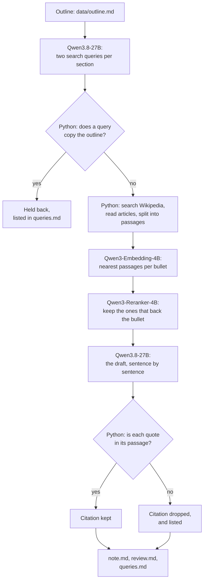

# Draft a research note from an analyst's outline, with open models and checked citations

> **This example:** an analyst at a research firm drafts a client note on who supplies AI chips,
> from her own outline, with a citation behind every fact the recipe can find one for.
>
> **How it works:** an open-weight model on SIE turns each section's bullets into search queries,
> Python searches Wikipedia, two retrieval models on SIE pick the passages that back each bullet,
> and the same open model writes the draft. Python checks every quote against its passage and
> keeps a record of which sentences the model wrote.
>
> **Use the same pattern for:** an internal strategy memo, a market update for a sales team, a
> policy briefing, a long blog post from your notes.

> **Not legal advice.** I'm an engineer, not a lawyer. This recipe is one option to try if you
> want drafts with no provider terms or watermark on them. It doesn't settle who owns
> AI-assisted writing where you work, what your clients or contracts allow, or what you have to
> disclose. For that, ask a lawyer.

## Background

Take Priya, a semiconductor analyst at a research firm. The firm sells research: client notes,
industry reports, briefings. Priya's notes start as an outline, a heading for each section and
the points she wants to make under each, and she spends a good part of her week turning outlines
into prose and digging up a source for every fact. The ideas, the numbers she trusts and the
advice to clients are hers. She wants a model for the part in between: put her points into
sentences, and find the source.

For most writers, any capable chat service would do. A research firm is different, because the
text is the product, and the firm has plans for it:

- **The terms on the output.** OpenAI and Anthropic say you own what their models write for you,
  but their terms also bar using it to develop or train models that compete with theirs
  ([OpenAI's terms](https://openai.com/policies/terms-of-use),
  [Anthropic's help page](https://support.claude.com/en/articles/12326764-can-i-use-my-outputs-to-train-an-ai-model)).
  The Llama 2 licence went further and barred using its outputs to improve any other large
  language model ([the licence](https://github.com/meta-llama/llama/blob/main/LICENSE)). The
  firm's archive of reports is exactly what it would train its own model on one day, say an
  assistant that answers client questions from its research. Nobody there wants to work out
  whether that counts as competing.
- **Watermarks in the text.** Google has watermarked Gemini's text with SynthID since 2024, by
  nudging which word the model picks next ([the Nature paper](https://www.nature.com/articles/s41586-024-08025-4)).
  Wikipedia's "AI watermarking" article
  ([revision 1384669856](https://en.wikipedia.org/w/index.php?oldid=1384669856)) says Anthropic
  announced in August 2026 that Claude would watermark all its output. The EU AI Act's Article 50
  requires providers of generative AI to mark its output, text included, in a way a machine can
  detect ([Baker Botts](https://www.bakerbotts.com/thought-leadership/publications/2026/september/eu-ai-act-article-50-transparency-obligations-go-live)).
  The firm is happy to tell clients where AI helped. It wants that to be its own statement, not a
  signal built into every report it sells.
- **Copyright and the record.** The US Copyright Office says typing a prompt doesn't make you the
  author of what comes back. What a person writes, and how they select and arrange the rest, can
  still be protected, and AI-written parts should be disclosed when you register
  ([Authors Guild summary](https://authorsguild.org/news/us-copyright-office-ai-report-part-2-what-authors-should-know/)).
  Priya doesn't rewrite every sentence; she edits what needs it. So the firm needs a record of
  which sentences a model drafted: for disclosure, and so it knows what it's training on later.

Open-weight models under Apache 2.0, like the Qwen3 models here, put no conditions on the output,
and the firm can pin a version and keep it. That covers the first two. For the third, this recipe
writes the record with every draft.

## The problem

Priya wants a first draft of each section from her bullets, with:

- a citation for every fact a public source backs, with the exact words it quotes, so she can
  check it in a minute;
- a list of the points nothing backed, so she knows what to source herself or present as the
  firm's view;
- a record of every sentence the model drafted;
- nothing added that she didn't say, and nothing she said dropped.

And the firm wants to know exactly what left the building, apart from the calls to SIE: the
topic of a note can be worth something before it's published.

### Examples

`data/outline.md` is the outline for "AI accelerators: who supplies them, and what limits
supply": four sections and 11 bullets. I wrote it for this recipe from facts on Wikipedia, plus
one claim I made up and the firm's own advice. The sources come from Wikipedia at run time, under
CC BY-SA 4.0. Three bullets and what should happen to each:

1. **"SK Hynix, Samsung and Micron are the largest makers of the high bandwidth memory these chips
   use."** Wikipedia says so, so the sentence should cite it.
2. **"Most cloud providers now sign five-year supply contracts for AI chips."** I made this up.
   Nothing should back it, and the review should say so.
3. **"In August 2025, Nvidia and AMD agreed to pay the US government 15% of certain chip sales in
   China to get export licenses."** Wikipedia's "Nvidia" article says this, so it should be
   cited.

## How we'll solve it

**Search.** For each section, Qwen3.8-27B writes two short encyclopedia queries from the bullets.
It's asked to use the general topic, not Priya's wording or views, because these queries leave
the firm. That's a request, so Python also holds back any query that copies more than three words
in a row from a bullet; `queries.md` lists what it held back. Python sends the rest to Wikipedia's
public search (no key needed), reads the top three articles for each, and keeps each article's
revision id, so a citation points at the exact text the draft read even after the article
changes. Sections like "See also" and "References" are dropped, as are paragraphs under 12 words,
and the rest is split into passages of up to 120 words.

**Pick the passages.** Qwen3-Embedding-4B embeds every passage and every bullet. For each bullet,
the eight nearest passages go to Qwen3-Reranker-4B, which scores whether the passage supports or
contradicts the bullet. The best two that score 0.5 or more are kept. A section's model sees at
most six passages, so the prompt fits: each bullet's best passage goes in first, then each one's
second, so one bullet's sources can't crowd out another's.

**Draft.** Qwen3.8-27B writes the section sentence by sentence, in the firm's voice, as JSON: the
sentence, the bullet it comes from, and its citations, each a passage id and the words it quotes
from that passage.

**Check.** Python keeps a citation only if it names a passage the model was given and the quote is
in that passage word for word, as whole words, in 3 to 30 words (case, spacing, the kind of quote
mark and `&amp;` for `&` aside). Then it lists, per section: bullets the draft left out, bullets
with no checked citation and why, citations it dropped and why, and any sentence that came from
no bullet and no source.

**Write it up.** `note.md` is the draft with numbered citations and a reference list (title,
revision, date read, link). `review.md` starts with what to check, then has a table of every
sentence: the bullet it came from and the words it quotes. That table is the record. `queries.md`
lists every query and article title sent to Wikipedia, and any query held back. The model's
sentences go into these files escaped, as plain text: no links, images or HTML.

## Picking the models

| `rules.yaml` key | Model | Its job here | Why this one |
| --- | --- | --- | --- |
| `write` | `Qwen/Qwen3.8-27B-FP8` | Search queries, then the draft | Apache 2.0, follows a JSON schema well, and the larger of the two chat models SIE Serverless answered with when I checked on 8 Nov 2026 |
| `embed` | `Qwen/Qwen3-Embedding-4B` | One vector per passage and bullet | Apache 2.0, takes an instruction for the bullets |
| `rerank` | `Qwen/Qwen3-Reranker-4B` | Does this passage back this bullet? | Apache 2.0, scores with an instruction, so "support or contradict" is the question it answers |

All three are open weights under Apache 2.0, so the licence puts no conditions on what the firm
does with the draft, and it can run the same versions on SIE Cluster or SIE Local and keep them.
Qwen3.8-27B gets an 8,192-token window on SIE Serverless, shared by the prompt and the reply.
That's why the recipe drafts one section at a time and shows the model at most six passages.

## The flow



## How it's built

Models do what needs reading and writing: the queries, the ranking and the draft. Python does
everything that has to be exact: what's allowed out, the search, the revision ids, the quote check
and the record. Every model name, threshold and the instructions the model gets are in
`rules.yaml`.

| Step | Functions | File | Runs on |
| --- | --- | --- | --- |
| Read the outline | `parse_outline` | `recipe.py` | Python |
| Search queries | `queries_prompt`, `chat_json`, `clean_queries`, `shared_run` | `recipe.py` | SIE (Qwen3.8-27B) |
| Search and read Wikipedia | `Wikipedia.search`, `Wikipedia.article` | `wikipedia.py` | Wikipedia's API |
| Split into passages | `split_article` | `recipe.py` | Python |
| Nearest passages per bullet | `embed` | `recipe.py` | SIE (Qwen3-Embedding-4B) |
| Rerank, and pick what the model sees | `rerank`, `pick_passages` | `recipe.py` | SIE (Qwen3-Reranker-4B) |
| Draft | `draft_prompt`, `chat_json` | `recipe.py` | SIE (Qwen3.8-27B) |
| Check citations and bullets | `check_draft`, `check_citation`, `section_flags` | `recipe.py` | Python |
| Write it up | `note_markdown`, `review_markdown`, `queries_markdown`, `inert` | `recipe.py` | Python |
| Count calls and credits | `Calls` | `sie_calls.py` | Python |

The outline and the passages go into the prompt escaped, inside tags, and the model is told that
text inside them is never an instruction. A Wikipedia article could still try. The quote check
limits what that can do to a citation, not to the prose, which is one more reason the review lists
every sentence the model wrote.

## Run it

**Run this recipe using [SIE Serverless](https://superlinked.com/serverless?utm_source=github&utm_medium=docs&utm_campaign=sie-cookbook&utm_content=finance-draft-research-note-from-outline), [SIE Cluster](https://superlinked.com/docs/deployment?utm_source=github&utm_medium=docs&utm_campaign=sie-cookbook&utm_content=finance-draft-research-note-from-outline) or [SIE Local](https://superlinked.com/docs/quickstart?utm_source=github&utm_medium=docs&utm_campaign=sie-cookbook&utm_content=finance-draft-research-note-from-outline).** The code runs on your machine either way. With SIE Serverless you pay per call and there are no GPUs to manage yourself: get an [SIE API key](https://console.superlinked.com/console/keys?utm_source=github&utm_medium=docs&utm_campaign=sie-cookbook&utm_content=finance-draft-research-note-from-outline) and read the [API docs](https://superlinked.com/docs/reference/api?utm_source=github&utm_medium=docs&utm_campaign=sie-cookbook&utm_content=finance-draft-research-note-from-outline). To run the models yourself, start from the [SIE repo](https://github.com/superlinked/sie).

You need [uv](https://docs.astral.sh/uv/), an SIE API key for SIE Serverless, and an internet
connection to Wikipedia.

```bash
cp .env.example .env   # then set SIE_API_KEY
uv run recipe.py                            # draft data/outline.md
uv run recipe.py --outline my_note.md       # your own outline
uv run selfcheck.py                         # optional: offline checks, no SIE call, no Wikipedia
```

Your outline: a `# Title` line, a `## Heading` per section and bullets under each (`- `, `* ` or
`1. `). An indented sub-bullet joins its bullet. Anything else in the file is ignored, so you can
keep notes in it.

**What leaves the firm.** The outline goes to SIE, which runs the three models. If the outline
itself must stay in-house, run the same models on SIE Cluster or SIE Local. The search queries and
the article titles go to Wikipedia; `queries.md` in each run lists them, and the ones held back.
If even topic-level queries are too much before a note is published, point the search at sources
the firm keeps itself (see Potential improvements).

Each run writes `runs/<timestamp>/`. On this outline a run made 51 to 54 SIE calls (8 to the chat
model, 11 to the reranker, the rest to the embedding model in batches of 32) and 25 or 26
Wikipedia requests, and took 45 to 56 s with the models warm. SIE charged 972 to 1,093 credits a
run, about $0.01 at the SIE console price of $0.00001 a credit on 8 Nov 2026.

## What came out

### The three examples

From the last of three runs. The other two came out the same way, with small differences in
wording.

**1. The memory makers (section 2, bullet 2).**

- **Expected outcome:** cited.
- **What came back:** "SK Hynix, Samsung Electronics, and Micron are the largest makers of the high
  bandwidth memory these chips use. [4] [5]", citing "along with Samsung Electronics and Micron,
  one of the "Big Three" memory manufacturers" from "SK Hynix", and "High Bandwidth Memory (HBM) is
  a computer memory interface" from "High Bandwidth Memory". The first backs the sentence. The
  second is in its passage, so Python kept it, but it only says what HBM is.
- **Verdict:** Pass. One good citation, and one that shows the limit of the check.

**2. The supply contracts I made up (section 3, bullet 3).**

- **Expected outcome:** no source, and the review says so.
- **What came back:** the model's query for it, "AI chip five year supply contracts", copied four
  words in a row from the bullet, so Python held it back; it's listed in `queries.md` under "Held
  back, not sent". No passage scored 0.5 or more, and `review.md` says: "no source (no passage
  scored high enough). Back it up yourself, or present it as your view". The draft still states it
  as fact: "Most cloud providers now sign five-year supply contracts for AI chips."
- **Verdict:** Pass. It only helps if Priya reads the review.

**3. The 15% export deal (section 3, bullet 2).**

- **Expected outcome:** cited, from "Nvidia".
- **What came back:** uncited. The reranker found the right passage (score 0.99), and the model
  quoted it: "In August 2025, Nvidia and competitor Advanced Micro Devices agreed to pay 15% of the
  revenues from certain chip sales in China as part of an arrangement to obtain export licenses".
  That's 31 words, one over the limit, so Python dropped the citation, and the review says "a
  citation was dropped because it quotes more words than allowed".
- **Verdict:** Miss. The source was found and quoted correctly; the check was stricter than the
  model's habit of quoting whole sentences.

### Results

9 of 11 bullets came out as expected on the last of three live runs using SIE Serverless on 9 Nov
2026 (UTC), and on the other two as well. A bullet counts when it's cited if I expected a citation,
or listed as having no source if I didn't, and it's in the draft either way. I wrote the
expectations before the first run on this outline.

| | Run 1 | Run 2 | Run 3 |
| --- | --- | --- | --- |
| Bullets as expected | 9 of 11 | 9 of 11 | 9 of 11 |
| Bullets with a checked citation | 5 | 5 | 5 |
| Citations kept / dropped | 7 / 2 | 7 / 2 | 8 / 2 |
| Bullets left out of the draft | 0 | 0 | 0 |
| Sentences from no bullet and no source | 0 | 0 | 0 |
| Queries held back | 1 | 1 | 1 |
| SIE credits | 1,093 | 1,038 | 972 |
| Time | 45 s | 45 s | 56 s |

The two misses are the same on every run: the two export-control bullets with facts in them,
October 2022 and the 15% deal. Both found the right passage in "Nvidia" with a score of 0.99, and
both citations were dropped for quoting 31 words.

**How this version came about.** I first built this as a book-writing recipe, with an author's
chapter outline. Its three runs got 12, 14 and 12 of 14 bullets as expected. The reasons to own
the output were weak for one author who rewrites every sentence, so I moved it to a research firm,
whose text is its product and its future training data. The code is the same apart from wording;
the outline and the expectations are new.

**Where it works:** the citations it keeps are in their passages, and most back their sentence:
the H100 and the cloud chips, TSMC's 70% share and its role as Nvidia's main supplier, the memory
makers, the Arizona chips going back to Taiwan for packaging. The query check held back the one
query that copied the outline, on every run. Nothing was left out, and the firm's own advice and
view came out uncited, which is right.

**Where it fails:**

- **A strict quote limit drops good citations.** Both misses are 31-word quotes of the right
  passage. With the limit at 50 (see Try another model), all 11 came out as expected. I kept 30,
  because a long quote is harder to check by eye, but it's a trade-off, and it's one line in
  `rules.yaml`.
- **A quote that exists isn't a quote that supports.** Python checks the words are in the passage,
  not that they back the sentence: "High Bandwidth Memory (HBM) is a computer memory interface"
  was kept as a citation for who makes it.
- **The model adds cited sentences.** On run 3 it added "By 2023, during the AI boom, H100s were in
  great demand. [2]", tied to the H100 bullet. It's cited and true, and it's still something
  Priya didn't say. The review lists it with its source like any other sentence.
- **The draft states unsupported bullets as fact.** The made-up contracts read as true in
  `note.md`. The review is where they're flagged, so the review isn't optional.
- **Wikipedia is a secondary source.** A client note should cite the filing or the announcement.
  Follow each citation to the reference Wikipedia cites.

### What you do next

Open `review.md` first. For each bullet with no source, find one or present it as the firm's view.
For each dropped citation, check the quote yourself: here, both were right and just long. Edit
the draft where it needs it, then keep `review.md` with the note: it's the record of what a model
drafted, for disclosure and for knowing what you're training on later.

## Potential improvements

- **Check that a quote supports its sentence,** not just that it exists: score each (sentence,
  quote) pair with the reranker and drop the ones under a bar.
- **Trim long quotes instead of dropping them:** keep the citation if a 30-word stretch of the
  quote is in the passage.
- **Search the firm's own sources.** Point the search at the filings, transcripts and past notes
  the firm already has, embedded once, so nothing about the note leaves the building but the calls
  to SIE.
- **Mark views in the outline,** for example a bullet ending in "(our view)", so the review
  doesn't ask for a source.
- **Primary sources.** Follow each Wikipedia citation to the reference it cites, and quote that.

## Try another model

Each model is one line under `models:` in `rules.yaml`, and `--rules` runs a copy. We swapped one
thing at a time, changed nothing else and ran each once using SIE Serverless on 9 Nov 2026 (UTC).
One run each, so a bullet either way doesn't prove much.

| `rules.yaml` key | Swap in | What happened on this data |
| --- | --- | --- |
| `write` | `Qwen/Qwen3.5-4B` | 8 of 11 as expected. It cited the October 2022 rules, but dropped the TSMC and 15% citations for quoting too many words, and left the made-up contracts bullet out of the draft altogether, which the review flagged. None of its queries copied the outline. Slower, 97 s, and 1,155 credits |
| `retrieval.min_rerank_score` | `0.3` instead of `0.5` | 9 of 11, the same two misses, 43 s and 1,041 credits. Two more passages reached the model, a TSMC one and a China one, and it cited neither |
| `write.max_quote_words` | `50` instead of `30` | 11 of 11 as expected: both export-control citations were kept, at 31 words each. 42 s and 1,011 credits |

Before the review fixes, on the book outline, a run with the reranker bar at 0.3 cited a bullet
about Apache 2.0 to "The Apache License is more comprehensive and explicit.", which doesn't
support it: a lower bar lets weaker sources through.

See [MODELS.md](../../MODELS.md) for every model these recipes use.

## Run it using SIE Cluster or SIE Local

The same code runs on your machine and uses SIE Cluster or SIE Local
([SELF_HOSTING.md](../../SELF_HOSTING.md) says what SIE Local can serve). Set `SIE_BASE_URL` in
`.env`; an API key is then optional. The table gives the SIE v0.10.1 image each model runs on, from
SIE's [compatibility matrix](https://github.com/superlinked/sie/blob/main/docs/compatibility.md).

| `rules.yaml` key | Model | Image | Tested on |
| --- | --- | --- | --- |
| `write` | `Qwen/Qwen3.8-27B-FP8` | `cuda13-sglang-cu130` | H100 80GB |
| `embed` | `Qwen/Qwen3-Embedding-4B` has no published image in v0.10.1: set `Qwen/Qwen3-Embedding-8B` instead | `cuda12-default` | L4 |
| `rerank` | `Qwen/Qwen3-Reranker-4B` | `cuda12-default` | L4 |

One SIE server runs one image, so these 2 images need SIE Cluster: the
[sie-cluster Helm chart](https://github.com/superlinked/sie/tree/main/deploy/helm/sie-cluster)
with one worker pool per image routes each model to its pool. See
[SELF_HOSTING.md](../../SELF_HOSTING.md) for the values file.

## Files

- `recipe.py`: the pipeline, the checks and the CLI
- `wikipedia.py`: Wikipedia search and article text, with revision ids
- `sie_calls.py`: one way to call SIE, counting calls and credits
- `rules.yaml`: model IDs, search settings, every threshold and the model's instructions
- `selfcheck.py`: offline checks, no SIE call and no Wikipedia request
- `data/outline.md`: the example outline
- `pyproject.toml`, `uv.lock`: this recipe's dependencies

See the SIE task page for
[reranking](https://superlinked.com/rerank?utm_source=github&utm_medium=docs&utm_campaign=sie-cookbook&utm_content=finance-draft-research-note-from-outline).
