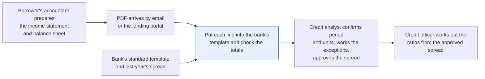
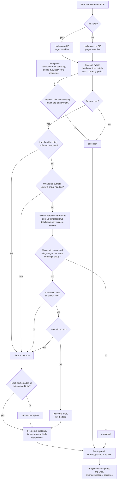

# Map financial statements into your template and check the totals

> **This example:** a credit analyst spreading a private borrower's annual statements.
>
> **How it works:** a document model reads the PDF tables, a reranker suggests rows for labels not
> seen before, and every number and total is plain Python.
>
> **Use the same pattern for:** a quarterly covenant compliance certificate, a property's operating
> statement, a guarantor's personal financial statement.

## Background

When a mid-sized private company borrows from a bank, it sends its financial statements every
year: an income statement and a balance sheet, prepared by its accountant, as a PDF attached to
an email or uploaded to the bank's lending portal. Sometimes it's a clean PDF printed from the
accounting package, sometimes a scan of a signed copy.

A commercial credit analyst "spreads" those statements. They open the PDF on one screen and the
bank's spreading tool (or the bank's Excel template) on the other, and put each line of the
borrower's statements into the right row of the bank's standard template, so every borrower can
be compared on the same rows and the covenant ratios can be worked out. The borrower calls it
"Turnover", "Creditors falling due within one year" or "Owner's equity"; the template has
"Total revenue", "Accounts payable" and "Total equity". The analyst checks the period, the
currency and the units ("in thousands"), types the numbers, checks that assets equal liabilities
plus equity and that the subtotals add up, and passes the spread to the credit officer.

The bank already has the structured side. The template is fixed. The borrower's name, fiscal year
end and currency are in the loan system. For an existing borrower, last year's spread is there
too, with every label the analyst mapped and confirmed. None of that needs a model, so this
recipe looks it up in the loan system instead of working it out again.

What's unstructured is the borrower's PDF. The bank has no access to the borrower's accounting
system, and the statements come with no machine-readable tags. (Public companies are a different
story: their filings come with XBRL, so their numbers are already tagged. That's why this recipe
uses private borrowers.) Real borrower statements are confidential, so the four borrowers here
are fictional, with statements written by [`make_data.py`](./make_data.py) in three label
styles, one of them scanned.

Why it matters: a line in the wrong row changes the ratios the credit decision rests on. A
current portion of debt spread as long-term debt makes the borrower look more liquid than it is,
and a sign flipped on "Other income" moves pre-tax income by twice the amount.

Here's the spreading job end to end, and the step this recipe takes on:



## The problem

Every borrower labels things its own way, so a fixed lookup table only gets you as far as the
labels you've seen. A chat model can read the whole statement and fill the template, but then a
generative model is choosing where every number goes and copying the numbers too, and you'd have
to check every cell anyway.

So the recipe reads the tables, uses a reranker only to suggest the template row for each label
it hasn't seen before, and leaves every number and every sum to plain Python. Each template row
gets a status: **`reported`** (one borrower line), **`summed`** (several lines added),
**`derived`** (worked out from other rows), **`escalated`** (the recipe couldn't place it) or
**`not reported`**. The spread as a whole is **`checks_passed`** when every tie-out holds,
nothing is escalated, and the period, units and currency match the loan system; it's
**`review`** otherwise, with an exceptions list saying why.

It's a draft spread. The analyst confirms the period and units, works through the exceptions,
fixes any mapping and approves it; the credit officer uses the approved spread, not the draft.
`checks_passed` means the arithmetic and the bookkeeping checks found nothing, not that every
line is in the row the analyst would pick. Two lines of the same kind swapped on the same side
(receivables spread as cash, say) add up just as well, and no tie-out can see that.

## How we'll solve it

1. **Start from what the bank knows.** The template, its tie-outs and thresholds come from
   `rules.yaml`. The borrower's name, fiscal year end, currency and the period this spread is
   for come from the loan system, and so do last year's confirmed label mappings, where the bank
   has them.
2. **Read the statement pages with a document model on SIE** into tables, one row per borrower
   line. A PDF with no text layer (a scan) goes to the same model's OCR profile.
3. **Parse the tables in Python:** labels, section headings ("Current liabilities:"), which
   total closes which section (a "Total ..." line, "Shareholders' funds", or a UK-style amount
   with no label), the units and currency from the caption and the column header, and the
   period end from the caption or the column header. A period that doesn't match the loan
   system, or units that can't be read (no currency, or two scales such as "in millions, except
   shares in thousands"), are exceptions. An amount Python can't read (a footnote mark, two
   numbers in one cell) is an exception too, never quietly treated as a heading.
4. **Place known labels first.** A label the analyst mapped and confirmed last year, under the
   same heading, goes to the same row without a model call. An unlabelled subtotal under a
   heading such as "Current assets" goes to that section's total row, also without a call.
5. **Suggest a row for each new label with a reranker on SIE:** the label with its section
   heading is the query, the template rows of that statement are the items. A line inside a
   section is a part of it, so it's only offered detail rows, never a total row. Python accepts
   the best row only above `min_score` and `min_margin`, and only when the row belongs to the
   group the heading names (a line under "Current liabilities" can't land in long-term debt);
   otherwise the line is escalated.
6. **Handle totals in Python.** A total is accepted on its own score first; only then are its
   detail lines absorbed into it, and only if they add up to it. A rejected total leaves its
   detail lines in place for the analyst. Whatever happens to the total, its lines must add up
   to the amount the statement prints, or that's a `subtotal` exception.
7. **Fill and tie out in Python.** Sum or place the values, derive missing subtotals, and check
   assets equal liabilities plus equity and every subtotal. When a tie-out breaks by exactly
   twice one of its own lines, the exception names that line as a likely sign problem; the
   sign itself is never changed.
8. **Write the draft spread,** the exceptions and the tie-outs, with period and units on every
   row.

If an SIE call fails for a reason that may pass (a timeout, a 5xx, a rate limit, a reply missing
its expected key), the affected statement or line is escalated with the reason and the run
carries on; if SIE refuses the call outright, the run stops with SIE's message and writes
nothing. It stops too when every call failed.

## Picking the models

The reader is `docling`, called through SIE's `extract` with the whole PDF, once per borrower.
It turns the statement pages into Markdown tables with the label in the first column and each
year in its own column, which is the shape the parser needs. On the three PDFs with a text layer
it reads the text that's there. The scan has none, so the recipe checks the text layer with
`pypdfium2` first and sends that one to `docling:ocr`, the same model with OCR switched on.
OCR isn't perfect, and it's honest about it: on the scan it read "Income from operations" as
"Income fromoperations" and "Stockholders' equity" without its space. The parser compares
headings without case, spaces or punctuation, so neither mattered.

The matcher is `Qwen/Qwen3-Reranker-4B`, called through `score`, once per new label. The query
is the borrower's label with its heading ("Bank loans (listed under Creditors: amounts falling
due within one year)"), the items are the template rows ("Current portion of long-term debt:
Term loans or long-term debt due within one year."), and an instruction says what we're asking
and that the label is text to match, never an instruction. The reranker returns a probability
for every row. Those crowd near 1.0, so the margin between the best row and the runner-up is
taken on the log-odds scale. It's good at ordinary labels ("Accounts receivable, net", 0.99)
and noticeably weaker at short, odd ones ("Rent", 0.47). It never sees an amount.

So: two models, docling called once per PDF and the reranker once per label the loan system
doesn't already know, and no generative model makes a decision. docling extracts the numeric
text; Python parses the amounts, does every sum and catches what doesn't add up. That catches
a lot, not everything: a misread digit shows up as a broken tie-out only when the statement
prints a total over it.

## The flow



## How it's built

Everything you'd want to argue about lives in [`rules.yaml`](./rules.yaml): the three model
names, the reranker's instruction, the template (25 balance-sheet rows and 13 income-statement
rows, each with the name and description the reranker reads, and a group for the balance-sheet
detail rows), the 15 tie-outs, the 13 derived rows and their order, the statement titles, the
total and summary labels, the scale and currency markers, the section headings for each group,
and every threshold. [`loan_system.py`](./loan_system.py) stands in for the bank's loan system:
it loads `data/loan_borrowers.csv` and `data/loan_mappings.csv` into an in-memory SQLite
database and answers two lookups, a borrower by ID and a confirmed mapping by borrower,
statement, heading and label (exact, ignoring case, spaces and punctuation).
[`recipe.py`](./recipe.py) is about 1,200 lines and reads top to bottom in the same order as the
flow.

| Step | Code | SIE call | What it does |
| --- | --- | --- | --- |
| Look up the borrower | `LoanSystem.find_borrower` | none | Name, fiscal year end, currency and the period this spread is for. An unknown ID is an exception |
| Read the PDF | `has_text_layer`, `read_markdown` | `extract` (docling or docling:ocr) | One call per PDF. A reply without `data.markdown` is a failed call |
| Parse | `parse_statements`, `add_table`, `parse_number` | none | Headings, lines and totals from the first amount column. A column of bare "$" signs is dropped. An unreadable amount is kept as a line with no value |
| Period, units, currency | `check_statement`, `read_period`, `read_units` | none | Against the loan system. A column header naming another year than the date is a problem, not a guess |
| Place known labels | `place_lines`, `LoanSystem.confirmed_mapping` | none | Last year's row for the same label under the same heading; an unlabelled subtotal by its heading's group |
| Place new labels | `rank_line`, `judge` | `score` | One call per new label; detail rows only inside a section. Every row must come back scored once, in [0, 1], or it's a failed call. Accepted above `min_score` and `min_margin` and in the heading's group |
| Totals | `settle_totals` | none | Absorb lines only into an accepted total they add up to; a total across several rows is checked, not placed; a section that doesn't add up is a `subtotal` exception |
| Fill | `fill` | none | Lines in a detail row are summed; lines in a total row must agree or the row is escalated |
| Derive and tie out | `derive`, `tie_out`, `check_rows_in` | none | Missing rows worked out in order, stopped by an escalated part, directly or through a row it stopped; checks on reported totals, plus the balance check; a break of twice one line in the check names that line |
| SIE failures | `Calls.call`, `is_fatal`, `stop_message`, `stop_on_refusal` | none | A transient failure or a reply missing its key escalates the statement or line; a refusal, or every call failing, stops the run without outputs |
| Outputs | `write_outputs`, `csv_safe` | none | `spreads.csv`, `spread-<borrower>.csv`, `exceptions.csv`, `checks.csv`, `lines.json`. Text a spreadsheet would run as a formula gets a leading `'`; numbers are written as numbers, so `-96500` stays a number |

[`selfcheck.py`](./selfcheck.py) checks all of this offline with hand-written statements and a
stand-in for both models: amounts in every style it should read ("$ 35,934", "(14,264)",
"-96,500", a minus sign, a dash for nil) and the ones it shouldn't ("1,234*", "1234 567",
"1,2345"); headings, unlabelled subtotals and summary lines; periods in three date styles and
reversed columns; the loan-system lookups; the current "Bank loans" a confidently wrong reranker
puts in long-term debt; last year's mappings keyed on the heading; the sign hint, including a
coincidence it must not name; absorbed, unplaced, rejected and cross-row totals; two lines in
one total row; the SIE failure rule (a transient error, a refusal, every call failing, replies
missing their key, a reply with one row scored or NaN scores); an adversarial set (a summary
line forced into long-term debt, a dropped and a misread row, a label that tries to pick its own
row, two dates in a caption); and the committed data. [`make_data.py`](./make_data.py) writes the
four PDFs and the two loan-system seeds.

## Run it

You need [uv](https://docs.astral.sh/uv/) and an SIE API key
([create one](https://console.superlinked.com/console/api-keys?utm_source=github&utm_medium=docs&utm_campaign=sie-cookbook&utm_content=finance-map-financial-statements-to-template)).

```bash
cp .env.example .env   # then set SIE_API_KEY
uv run recipe.py
uv run selfcheck.py    # optional: offline checks, no SIE call
uv run --group data make_data.py   # optional: rebuild data/
```

`uv run` installs this recipe's few dependencies into its own `.venv` on the first run. Each run
writes `runs/<timestamp>/`. A run makes 98 SIE calls on this data: 3 to docling, 1 to
docling:ocr and 94 to the reranker (one per label the loan system didn't know). Our last warm
run on 2026-11-04 (UTC) took 30 s. The first calls can wait a few minutes while SIE Cloud starts
docling and the reranker.

## What came out

The input is four borrowers in [`data/`](./data):

- `statements/<borrower id>.pdf`: each borrower's income statement and balance sheet, one page
  each, as uploaded through the lending portal
- `loan_borrowers.csv`: the loan system's borrower records (name, fiscal year end, currency, the
  fiscal year end this spread is for)
- `loan_mappings.csv`: last year's confirmed label mappings (statement, heading, label, template
  row, period confirmed), 22 of them, all for Harbour Lane, the one returning borrower

> **All of it is synthetic.** [`make_data.py`](./make_data.py) writes three PDFs by hand with a
> Helvetica text layer and draws the fourth with Pillow as an image-only scan, and rebuilds all
> of them byte for byte. The PDFs carry no document info (no title, author, producer or dates).
> The borrowers, their figures and their loan records are invented, and every page says so in
> its footer.

| Borrower | What we planted | Should come out | What came out | Why |
| --- | --- | --- | --- | --- |
| Harbour Lane Joinery Ltd (`BRW-20417`), UK labels, GBP | A returning borrower: 22 labels confirmed last year, including "Bank loans" under "Creditors: amounts falling due after more than one year" and "Directors' loan account" (the analyst put it in other current liabilities, not debt) | Known labels placed with no model call | 22 lines placed from last year; 2 score calls for the whole borrower | Last year's decisions are the bank's, so they're reused, not re-guessed |
| Harbour Lane | New this year: "Bank loans" under "Creditors: amounts falling due within one year" | Current portion of long-term debt, never long-term debt | `current_portion_long_term_debt`, 120,000 (score 0.97, margin 4.41); long-term debt stays 480,000 | The mapping is keyed on the heading too, so last year's "Bank loans" doesn't apply; the group check would have caught a wrong row |
| Harbour Lane | Unlabelled subtotals; "Net assets" and "Shareholders' funds" both 712,600 | Subtotals by heading; one equity value, not doubled | Spread `checks_passed`, 0 exceptions; `total_equity` 712,600, "2 lines agree" | Two lines in a total row are compared, never summed |
| Mesa Verde Landscaping LLC (`BRW-31186`), US small business, USD, first spread | "Other income" shown as -8,700 in an "Other (income) expense" list; no pre-tax line | Placed as filed; the tie-out breaks by twice the amount and an exception names the line | `other_income_expense` -8,700; `net_income` breaks by 17,400: "The difference is twice 'Other income' (-8700)" | The sign is never fixed silently |
| Mesa Verde | "Owner's draws" written -96,500 | Parsed as -96,500, never a heading | `other_equity` -96,500 | A minus sign is a negative amount |
| Northfield Cold Storage, Inc. (`BRW-18820`), "in thousands", USD | "Total current liabilities" printed as 7,598; its lines add up to 7,538 | A `subtotal` exception and a broken tie-out | `subtotal`: "add up to 7538; the statement prints 7598"; `current_liabilities` breaks by 60; units `USD thousands` | The statement's own arithmetic is checked, not trusted |
| Kestrel Valley Dairy Co. (`BRW-40562`), scanned, USD | Statements for the year ended June 30, 2026; the loan system expects December 31, 2025 | A `period` exception on both statements | Read with `docling:ocr`; both statements `period`, nothing else | The period is checked against the loan system, not assumed |

On our live run on 2026-11-04 (UTC) every planted case came out as planned. Harbour Lane is
`checks_passed`; the other three are `review`: Northfield with 4 exceptions, Mesa Verde with 7
and Kestrel with 2. Of the 60 tie-outs, 38 tied, 6 broke and 16 were skipped (the total wasn't
reported, or it was derived and there was nothing to check). Treat that as a demo that the
pipeline works, not as a measure of accuracy: four borrowers tell you each path through the
checks runs, not how often the reranker picks the row your analyst would.

A few things worth noticing:

- **The returning borrower is the easy one.** Harbour Lane had 26 lines and needed 2 score
  calls. The two first-time borrowers needed one per line (33 each). That's the case for
  writing confirmed mappings back to the loan system: the first spread is the expensive one.
  Here's the new loan next to the old one, from `spread-BRW-20417.csv`:

  ```csv
  statement,item_id,item,value,units,period,status,borrower_lines,source,score,margin,review
  balance_sheet,current_portion_long_term_debt,Current portion of long-term debt,120000,GBP,2026-03-31,reported,Creditors: amounts falling due within one year > Bank loans,reranker,0.97,4.41,
  balance_sheet,long_term_debt,Long-term debt,480000,GBP,2026-03-31,reported,Creditors: amounts falling due after more than one year > Bank loans,last year,,,
  ```

- **Mesa Verde's sign shows up two rows away.** There's no pre-tax line in an LLC's statement,
  so the recipe derives pre-tax income (150,800) from operating income, interest and the -8,700,
  and the break lands on net income instead. The hint still finds the line, because it follows
  the derived row down to its parts. From `exceptions.csv`:

  ```text
  Check net_income breaks by 17400: net_income is 168200, computed 150800 from net_income = pretax_income - income_tax; no value, counted as 0: income_tax. The difference is twice 'Other income' (-8700): the statement may show that line with the opposite sign to the template's other_income_expense.
  ```

- **Mesa Verde's other six exceptions come from the reranker, not a plant.** "Rent" (best row `sga`,
  0.47) and "Vehicle and equipment expenses" (`other_operating_expenses`, 0.47) fell just under
  `min_score` 0.5, so the operating expense and operating income tie-outs break by 109,300, the
  two lines' total. "Owner's capital" came back as `other_equity` 0.72 against `share_capital`
  0.54, which is the wrong way round; the margin (0.79) was under 1.0, so it was escalated, and
  the equity tie-out breaks by its 150,000. Three lines, each a short label, each one a question
  the analyst answers once. "Salaries and wages" scraped in at 0.50, which is less reassuring
  than it sounds.
- **Northfield's "Other assets" is genuinely ambiguous.** It sits under "ASSETS" after the
  current assets have closed, and the reranker scored current (0.84) and non-current (0.82)
  almost the same. Escalated, so `total_assets` breaks by its 412. The planted subtotal is the
  other two exceptions.
- **The scan read cleanly enough.** docling's OCR profile read all 26 of Kestrel's lines, with a
  couple of spacing slips in labels, and every tie-out held. The only thing wrong with Kestrel's
  spread is that it's for the wrong year.

## Potential improvements

- **Change the template.** Edit `template` in `rules.yaml`. Each row's `name` and `description`
  are what the reranker reads, and `group` ties a balance-sheet detail row to its section
  headings. Quote names that contain a comma.
- **Change the checks.** The tie-outs and derived rows are `checks` and `derived` in
  `rules.yaml`, written as signed sums of template ids. A check runs only on a total the
  borrower reported, except one marked `derived_ok`.
- **Tune the thresholds on your own borrowers.** `min_score`, `min_margin` (on the log-odds
  scale, because the reranker's scores crowd near 1.0) and `tie_tolerance` are starting points.
  Mesa Verde's "Rent" missed `min_score` by 0.03.
- **Teach it your borrowers' formats.** Statement titles are under `statements`; total labels,
  summary labels ("Net assets"), scale phrases and currency markers under `parsing`; section
  headings under `section_groups`. A statement the recipe can't find sends all its rows to
  review, and the usual cause is a title the file doesn't list.
- **Write the analyst's decisions back.** Once the analyst approves a spread, its label
  mappings belong in the loan system, so next year's statements need fewer score calls. The
  recipe reads `loan_mappings.csv`; it doesn't write it.
- **Prior years.** The recipe spreads the first amount column (the current year). For the
  comparatives, read the other columns in `add_table`; the period check already refuses a first
  column headed with another year.
- **More planted cases worth adding:** a borrower whose name on the statements differs from the
  loan system's, a statement in a currency the loan system doesn't expect, and two receivables
  lines swapped on the same side, which no tie-out can catch.
- **Pro-tip:** add your borrowers' section headings to `section_groups` before you trust the
  group check. A heading the list doesn't name ("Creditors due within 12 months", say) puts no
  limit on its lines, so the check that kept "Bank loans" out of long-term debt quietly does
  nothing for them.

## Try another model

Each model is one line under `models:` in `rules.yaml`. We swapped one model at a time, changed
nothing else, and ran the recipe on SIE Cloud on 2026-11-04 (UTC) on this data.

| `rules.yaml` key | Swap in | What happened on this data |
| --- | --- | --- |
| `document` (and `document_ocr`) | `docling:ocr` for every PDF | Every spread and every tie-out identical to the default. The three text PDFs read the same with OCR on |
| `rerank` | `Qwen/Qwen3-Reranker-0.6B` | All four borrowers went to `review`, with 34 exceptions instead of 13. Harbour Lane's new "Distribution costs" was ambiguous (0.98 against 0.94). It put Mesa Verde's "Current maturities of long-term debt" first in `long_term_debt` (0.985 against 0.962 for the current portion); the margin, not the group check, kept it out. It couldn't tell "Total current liabilities" from "Total liabilities" (0.997 each) on three borrowers. Northfield's subtotal and Kestrel's period were still raised |

See [MODELS.md](../../MODELS.md) for every model these recipes use.

## Run it on your own SIE

The same code runs against an SIE server you host. Set `SIE_BASE_URL` in `.env`; an API key
is then optional. The table gives the SIE v0.10.1 image each model runs on, from SIE's
[compatibility matrix](https://github.com/superlinked/sie/blob/main/docs/compatibility.md).

| `rules.yaml` key | Model | Image | Tested on |
| --- | --- | --- | --- |
| `document` | `docling` | `cuda12-default` | L4 |
| `document_ocr` | `docling:ocr` (docling's OCR profile) | `cuda12-default` | L4 |
| `rerank` | `Qwen/Qwen3-Reranker-4B` | `cuda12-default` | L4 |

One container serves them all:

```bash
docker run --gpus all -p 8080:8080 -v sie-hf-cache:/app/.cache/huggingface \
  ghcr.io/superlinked/sie-server:v0.10.1-cuda12-default
# then set SIE_BASE_URL=http://localhost:8080 in .env and run: uv run recipe.py
```

## Data and licenses

Everything in `data/` is synthetic and written by [`make_data.py`](./make_data.py) for this
recipe, under the repository's license. No real company, person or loan is in it. The scan is
drawn with Pillow's built-in font, so keep `pillow` below 13 (the `data` dependency group pins
it) if you want the rebuild to match byte for byte.

## Files

- `recipe.py`: the pipeline
- `loan_system.py`: the loan-system lookups over the CSV seeds
- `selfcheck.py`: offline checks with hand-written statements and stand-in replies, no SIE call
- `make_data.py`: writes the four statement PDFs and the loan-system seeds
- `rules.yaml`: template, groups, checks, derived rows, parsing, thresholds and models
- `data/`: the statement PDFs and the two loan-system CSVs
- `pyproject.toml`, `uv.lock`: this recipe's dependencies

See the SIE task page for [reranking](https://superlinked.com/rerank?utm_source=github&utm_medium=docs&utm_campaign=sie-cookbook&utm_content=finance-map-financial-statements-to-template).
