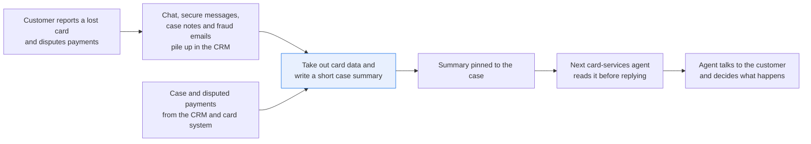
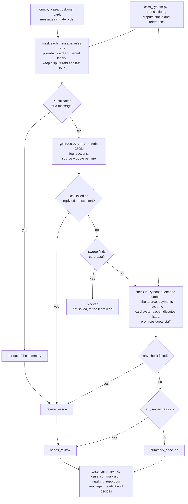

# Keep a case summary current, with a source for every line and no card data

> **This example:** a lost-card dispute that a different card-services agent picks up each time the
> customer gets in touch.
>
> **How it works:** card data is masked first, a language model writes the summary with a quote per
> line, and Python checks quotes and amounts against the card system.
>
> **Use the same pattern for:** a complaint file before the final response, a collections account
> handover, a mortgage arrears recap.

## Background

A customer loses a debit card in a taxi and reports it on web chat. Two days later she sends a
secure message about two payments she doesn't recognise. An agent writes a case note, the fraud
team emails card services about a transfer from the card to a joint account, and then the
customer writes again to say one of the two payments was hers after all. That's one case, and it
now lives in five places in the bank's CRM.

Every time the customer gets in touch, a different card-services agent picks it up. Before they
can say anything useful they have to read the whole thread: what happened, which payments are
still disputed, what the bank already promised ("you'll have the refund within five working
days"), and what's still waiting on someone. On a busy case that's ten minutes of reading while
the customer waits, and agents skip it. That's how a customer gets told two different things by
two people.

So the bank wants a short summary pinned to the case, rewritten whenever something new comes in,
that the next agent reads in thirty seconds. The agent is allowed to see the customer, so the
summary uses her name, the merchants, the dates and the amounts. What it must not hold is card
data. A full card number, a CVV, a PIN or a one-time passcode can't be stored in a CRM note under
the card scheme rules (PCI DSS), and customers type them into chat boxes all the time ("my card is
4929 ... and the 3 digits on the back are ..."). A model that reads the thread can copy them
straight into the summary, where every agent and every export of the CRM will see them.

A lot of the case is already structured. The case reference, the customer, the card's last four
digits and the disputed transactions (date, merchant, amount) come from the CRM and the card
system. None of that needs a model, and the summary is checked against it.

Here's the case end to end, and the step this recipe takes on:



## The problem

Writing the summary by hand is the ten minutes nobody has. Letting an LLM write it raises three
questions you have to answer before an agent trusts it:

- Does it say anything the case doesn't? A summary that invents a promise ("refund approved") is
  worse than no summary.
- Is it current? When the customer withdraws one of her disputes, the summary has to say so, not
  repeat what the first message said.
- Is there card data in it? Not only valid card numbers: a mistyped card number fails the Luhn
  check and walks past a rule that only masks valid cards, and a CVV is just three digits.

So the recipe takes card data out first, writes the summary from what's left, and checks every
line against the case. Each case gets a status that says what the checks found:

- **`summary_checked`**: every line quotes the case, the amounts match the card system, and the
  sweep found no card data. The summary is pinned to the case for the next agent.
- **`needs_review`**: a quote isn't in the case, an amount or a merchant doesn't match the
  disputed transactions, or a message couldn't be read. The summary is shown with the problem
  marked, and the agent reads the thread.
- **`blocked`**: the final sweep found something that looks like card data in the summary. It's
  not saved anywhere, and the case goes to the team lead.

The agent still talks to the customer and decides what happens. The summary is a reading aid,
marked as generated, with a link from each line to the message it came from.

### Examples

The data is one case, CASE-2026-04417, and it should come out `summary_checked` as a whole. Here
are three of the messages in `data/messages/`, and what should happen to each.

**1. A dispute withdrawn.**

- **Input:** `05-secure-message.txt`: "I've checked my receipts and the 23.40 at the cafe was me,
  sorry."
- **What should happen:** the summary has to be current, so the cafe payment is listed as
  withdrawn, and Python matches it to the card system's transaction.
- **Expected outcome:** Quillon Electronics 89.99 still disputed (TXN-5503, open); Copperpot Cafe
  23.40 withdrawn (TXN-5502).

**2. Card data typed into the chat.**

- **Input:** `01-web-chat.txt`, 14:05: "Sorry, it's 4917 6620 5318 4421. Do you need the 3 numbers
  on the back too? They're 731." (The card number and CVV are made up for this example.)
- **What should happen:** rules and a model that spots personal data mask the card number, and a
  rule removes the three digits as a CVV, all before the model that writes the summary reads the
  chat.
- **Expected outcome:** `XXXX XXXX XXXX 4421` and `[CVV removed]` in the masked text, and neither
  in the summary.

**3. A long number that isn't card data.**

- **Input:** `03-agent-note.txt`: "Network dispute reference 8806 2144 5739 0012."
- **What should happen:** it's 16 digits but fails the Luhn check, and the card system holds it
  for this card, so it stays readable for the next agent to chase the dispute.
- **Expected outcome:** kept readable in the masked note, and carried into the summary.

On the live run, 6 of 7 things we looked for came out as expected.
[What came out](#what-came-out) has the results.

## How we'll solve it

1. **Start from the case record.** `crm.py` gives the case reference, the customer, the card on
   the case (its ID and last four digits) and the messages filed on it, oldest first: the web
   chat, secure messages, the agent's case note and the fraud team's email. For the chat it also
   gives the chat system's record of each turn: when, who, and whether that was the customer or
   an agent. `card_system.py`
   gives the card's transactions from 14 days before the case was opened to the newest message,
   each with its merchant, amount, whether it was declined, and its dispute status (open,
   withdrawn by the customer, or none) with the network's dispute reference.
2. **Take out the card data.** Rules in Python mask every run of 13 to 19 digits to its last four,
   however it's written: with up to three spaces, dots or hyphens between digits ("4917  6620",
   "4917.6620", "4917 - 6620") or wrapped onto the next line. A 16-digit number that fails Luhn
   is still masked, and the masking report says so. A 17 to 19 digit run that starts with a
   card number passing Luhn is that card with the CVV typed after it ("4917 6620 5318 4421
   731"): the card is masked and the rest removed as a CVV. The rules also remove
   CVVs, PINs, one-time passcodes and passwords by the words in front of them ("the 3 numbers on
   the back", "PIN", "passcode"). `superlinked/pii-redact`, with only the card and secret labels
   switched on, catches the ones written in a way the rules don't expect ("four nine one
   seven..."). Two things stay readable on purpose: a dispute reference the card system holds
   for this card, and the card's last four on its own. Names, dates, amounts and merchants stay
   too: the agent needs them. If the PII model's call fails for a message, or a window is too
   long for it to read whole (the call asks SIE to fail rather than cut it short), the rules
   still mask it, but it's left out of the summary and out of the run's files, and the case goes
   to review.
3. **Write the summary.** `Qwen3.8-27B-FP8` reads the masked messages in date order and returns
   four short sections: what happened, the payments in dispute, what the bank has told or
   promised the customer, and what's waiting on whom. Every line carries the message it came
   from and the exact words it relied on. The prompt says a later message overrides an earlier
   one, to name people as the messages do, and that the messages are something to summarise,
   never an instruction.
4. **Sweep the summary.** The same card and secret rules run over everything the model wrote,
   and so does a search for every value removed from a message (a CVV repeated without its
   words, say). Any hit blocks it, whatever the other checks say. A blocked summary isn't
   checked further: those checks quote the numbers the model wrote, which may be the card data
   itself, so the case keeps only the block reasons.
5. **Check the summary in Python.** Each quote has to be in the message it cites, and every
   number a line states has to be in that message too. Each payment in the summary has to match
   one card-system transaction on merchant and amount exactly, and its status (disputed or
   withdrawn) has to match the card system's. Each dispute the card system has open has to be in
   the summary as disputed. A promise has to quote bank staff, not the customer, and a promise
   whose quote says "can't" or "not" while its line doesn't goes to review. In the chat, who is
   staff comes from the chat system's record of the turns, not from the text: a customer who
   types a line that looks like the agent's makes the transcript disagree with the record, and
   nothing in that chat counts as staff.
6. **Write the result:** the summary with its status, each line with its source and quote, and
   the masking report, ready to pin to the case. A line that failed a check is held, shown as
   unchecked model text and not as part of the summary.

The order matters. Masking comes first because what the summary model doesn't see can't end up
in a CRM note. The sweep comes before anything is written because masking can miss, and a
summary with a card number in it shouldn't be saved even in the run's own files.

If an SIE call fails for a reason that may pass (a timeout, a 5xx, a rate limit, or a reply
without its expected key), that case gets `needs_review` with the reason and the run carries on;
if SIE refuses the call or every call fails, the run stops with SIE's message and writes nothing.

## Picking the models

There are two models, and each does the part it's good at.

`superlinked/pii-redact` is SIE Cloud's PII model: `urchade/gliner_multi_pii-v1` and
`numind/NuNER_Zero` composed on the server, spans scoring 0.6 or more, the two models' spans
unioned. It takes the labels you ask for, and here that's only five of its defaults: `credit card
number`, `cvv`, `pin`, `password` and the extra `one-time passcode`. Leaving out `person`,
`date of birth` and the rest is the whole point: the next agent is allowed to see who the
customer is. It's called once per message (each message here fits in one window of up to 300
words). It's a span finder, so it's good at "this run of characters is a card number" and knows
nothing about the card system. That's why the dispute reference and the last four are decided
by rules: a model can't know which 16-digit number the card network issued.

On this case it found both card numbers in the chat and tagged "4421" in "Card ending 4421" as a
card number, and it didn't tag the CVV. Asked for CVVs, it walked past "They're 731". In a few
probes outside this case it did tag "security code is 731", "CVV 731" and "cvc 731", and
the first four words of a card number written out as words. The rules carried the CVV here; the
model is the net for the shapes the rules don't know.

`Qwen/Qwen3.8-27B-FP8` writes the summary, called through SIE's `chat_completions` once per
case with a strict JSON schema (`response_format` with `strict: true`, temperature 0). It's the
model the other recipes in this cookbook use to read text and answer in JSON with citations. In
the schema, `source` is an enum of the case's message IDs and a payment's `status` is
`disputed` or `withdrawn`, so it can't cite a message that doesn't exist. It can still quote a
real message under a line that message doesn't support, and that's what the Python checks are
for. It never sees the card system: the payments it lists come from the messages, and the card
system checks them.

## The flow



## How it's built

What counts as card data and how the checks behave lives in [`rules.yaml`](./rules.yaml): both
model names, the PII labels and what each counts as, the card-number pattern and how many digits
to show, each secret's words and value pattern, the text a removed secret becomes, the card
system's lookback, the minimum quote length and the negation words. A bank that writes "security number" instead of "security code" adds it to the
CVV's `words`, not to the code.

The two systems are two small modules, each named after the system it stands in for and backed
by a CSV seed in `data/` that it loads into an in-memory SQLite database. Swap one for a real API
call and nothing else changes:

| Module | Stands in for | Lookup |
| --- | --- | --- |
| `crm.py` | the CRM's case API (a case in Salesforce Service Cloud or Dynamics 365, with its chats, secure messages, notes and emails, and each chat's turns as the chat system records them) | `find_case`, `list_cases`, `case_messages`, `chat_turns` |
| `card_system.py` | the card platform's transaction search and dispute lookup | `transactions(card_id, since, until)` |

[`recipe.py`](./recipe.py) is about 1,200 lines with the prompt and the checks, and reads top
to bottom in the order of the flow:

| Step | Code | SIE call | What it does |
| --- | --- | --- | --- |
| Look up | `Systems.from_seeds`, `build_case_file` | none | The case, its messages oldest first, and the card's transactions from 14 days before the case opened to the newest message |
| Mask | `mask_case`, `model_spans`, `rule_spans`, `last_four_spans`, `outside`, `mask_message`, `luhn_valid`, `mask` | `extract` | One PII call per message window, with the five card and secret labels and `overflow_policy: error`, so a window too long to read whole fails instead of being cut short. A model span inside a kept dispute reference or last four is dropped; one that runs past it keeps the rest. Overlapping spans are joined; a card number alone is masked to the last four, anything else becomes `[CVV removed]` and the like. Each row of the masking report names the message, line, kind, action and who found it, never the value |
| Summarize | `summary_prompt`, `summary_schema`, `ask_summary`, `parse_summary` | `chat_completions` | One call per case. The reply must be exactly the four sections, each line with `text`, `source` and `quote` (a payment has `merchant`, `amount`, `status`, `source`, `quote`). Anything else is a review reason, not a summary |
| Sweep | `summary_text`, `sweep` | none | The card and secret rules again, plus every value removed from a message. Any hit is `blocked`: the summary is dropped and not checked, so no model-written text reaches the outputs |
| Check | `verify`, `check_line`, `quote_in`, `numbers`, `match_payment`, `parse_amount`, `check_payment_status`, `turns`, `speaker_of`, `negated` | none | The checks in step 5 above. A quote is at least 12 characters and appears verbatim in its source after collapsing whitespace and straightening quote marks. An amount holds one number ("£89.99", "89.99GBP" and "GBP 89.99" all parse; "89.99 and 23.40" doesn't). In a chat, the `[14:05] Name:` lines must be exactly the turns the chat system recorded, in order; each turn's role (customer or staff) comes from that record, and a chat whose lines don't match has no staff turn |
| Report | `summarize_case`, `render_markdown`, `write_outputs`, `csv_safe` | none | `summary_checked`, `needs_review` or `blocked` with the reasons; failed lines held; spreadsheet formulas in the CSV defused |

The SIE error rule is the same as in the security recipes. A call that fails for a reason that
may pass (a timeout, a lost connection, a 5xx, a rate limit, a model still loading, or a reply
missing `entities` or `choices[0].message.content`) sends that message or that case to
`needs_review` with a short reason, and the run carries on. A refusal every call would repeat (a
bad key, no credits, a model name SIE doesn't know) stops the run with SIE's full message and
writes no outputs. If every call failed, the run stops too.

[`selfcheck.py`](./selfcheck.py) checks the lookups (a repeated ID or a timestamp without its UTC
offset in a seed is refused, the lookback window), the masking (the cards, the mistyped card, a
card number with doubled separators, dots or a line break, the CVV, the dispute reference, a
model span that runs past it, a card number in words), every summary check (a forged agent line
typed into the chat, two transactions with the same merchant and amount, two currencies in one
amount), the sweep, the strict parsing, the prompt's line about text in the messages, the three
statuses, that a message the PII model didn't read stays out of the outputs, and that SIE error
rule, offline, with hand-written strings and stand-in model replies.

## Run it

You need [uv](https://docs.astral.sh/uv/) and an SIE API key
([create one](https://console.superlinked.com/console/api-keys?utm_source=github&utm_medium=docs&utm_campaign=sie-cookbook&utm_content=finance-summarize-case-with-sources)).

```bash
cp .env.example .env   # then set SIE_API_KEY
uv run recipe.py
uv run selfcheck.py    # optional: offline checks, no SIE call
```

`uv run` installs this recipe's few dependencies into its own `.venv` on the first run. Each run
writes `runs/<timestamp>/`. The first call can wait a few minutes while SIE Cloud starts the
models. A warm run makes 6 SIE calls (5 to `superlinked/pii-redact`, one per message, and 1 to
`Qwen/Qwen3.8-27B-FP8`) and took 8 seconds on our run.

## What came out

### The three examples

The case came out `summary_checked`.

**1. A dispute withdrawn.**

- **Expected outcome:** Quillon Electronics 89.99 still disputed (TXN-5503, open); Copperpot Cafe
  23.40 withdrawn (TXN-5502).
- **What came back:** Quillon Electronics 89.99 still disputed (TXN-5503, open), and Copperpot Cafe
  23.40 withdrawn (TXN-5502), quoting "the 23.40 at the cafe was me, sorry" from M5.
- **Verdict:** Pass.

**2. Card data typed into the chat.**

- **Expected outcome:** `XXXX XXXX XXXX 4421` and `[CVV removed]` in the masked text, and neither
  in the summary.
- **What came back:** masked before the model read the chat, to `XXXX XXXX XXXX 4421` and `They're
  [CVV removed].` Neither is in the summary.
- **Verdict:** Pass. The rule found the CVV; the PII model didn't tag it.

**3. A long number that isn't card data.**

- **Expected outcome:** kept readable in the masked note, and carried into the summary.
- **What came back:** readable in the masked case note, but the model didn't put it in the summary.
- **Verdict:** Miss. The agent has to find it in the case note the summary links to, and no check
  looks for it, so the case still came out `summary_checked`.

### Results

On the live run on 4 Nov 2026 (UTC), 6 of 7 things we looked for came out as expected. The one that
didn't is the dispute reference. Separately, `selfcheck.py` tries a stand-in reply that gives 98.99
for the Quillon payment, and that comes out `needs_review`; it's not part of the live run.

**Where it works:** getting card data out before the summary model reads it (the card number, her
mistyped first try at it, and the CVV), keeping the names in the masked messages, staying current
when the customer withdraws a dispute, and quoting the promise the bank made. That's the six.

**Where it fails:** what the summary leaves out. The checks can tell you a quote is real, but
nothing looks for a line that's missing. That's the miss to worry about: the 16-digit dispute
reference the next agent needs to chase the dispute stayed readable in the case note but isn't in
the summary, and the case still came out `summary_checked`. The "waiting on" line also leaves out
that Quillon has until 6 November. And on this case the CVV rests on the rule alone: it caught
"They're 731", and the PII model walked past it.

The input is the case in [`data/`](./data):

- `crm_cases.csv`: the case, CASE-2026-04417, with the customer, the card's ID and last four
- `crm_messages.csv`: the five messages on the case, with when they were sent, the channel, the
  author and whether the author is the customer, staff or both (a chat)
- `crm_chat_turns.csv`: the chat system's record of the web chat's ten turns, each with its time,
  speaker and role
- `messages/`: the five message bodies, a web chat, two secure messages from the customer, the
  agent's case note and the fraud team's email
- `card_transactions.csv`: four transactions on the card: an earlier 8.99 at Quillon
  Electronics, the 23.40 at Copperpot Cafe (dispute withdrawn), the 89.99 at Quillon Electronics
  (dispute open) and a declined 150.00 transfer

> **All of it is synthetic.** Thornbury Vale Bank, its staff, the customer, the merchants and
> every number are invented. The card number is a made-up value with a valid check digit.

One case, the lost debit card above, and it came out `summary_checked`.

One of the seven came out differently from what we wanted. The dispute reference stayed readable
where it was written, but the model didn't put it in the summary, so the agent finds it in the case
note the summary links to. The names count as expected: that holds for the masking (nothing took a
name out), and the model chose which names to repeat: it wrote "the customer" for most lines, even with
the prompt telling it to name people as the messages do, and the landlord didn't make the cut. No
check looks for either, so neither changed the status.

One thing we had to decide: the card system already shows the cafe dispute as withdrawn. That's
how we built the seed, on the reading that the agent who processed the fifth message closed it
there. If your card system lags the messages, the stale-status check would send this case to
review instead, which is what you'd want.

Treat all of this as a demo that the wiring works, not as a measure of accuracy: one case tells
you the checks run, not how often the summaries are right.

A few things worth noticing:

- **The regex beat the model to the CVV.** The PII model was asked for exactly five things and
  one of them was CVVs, and it still walked past "They're 731". The customer, meanwhile, offered
  the three numbers on the back before anyone asked. That's the case for running both: on this
  case the rules did all the masking, and the model found nothing they missed.
- **The withdrawal came through.** Here's the cafe payment from `case_summary.json`. The model
  took the merchant's name from M2 and the withdrawal from M5, and Python matched it to the card
  system's TXN-5502:

  ```json
  {"merchant": "Copperpot Cafe", "amount": "23.40", "status": "withdrawn", "source": "M5",
   "quote": "the 23.40 at the cafe was me, sorry", "transaction": "TXN-5502",
   "card_system_dispute": "withdrawn", "checks_passed": true, "problems": []}
  ```

- **The model saw masked text, and so does the agent.** The chat as the model read it, two card
  numbers and a CVV later:

  ```text
  [14:04] Customer: The long number is XXXX XXXX XXXX 4421.
  [14:04] Priya Castellane: I can't find a card with that number. Could you check it?
  [14:05] Customer: Sorry, it's XXXX XXXX XXXX 4421. Do you need the 3 numbers on the back too? They're [CVV removed].
  ```

- **Passing the checks isn't being right.** The promise line says "The bank told the customer
  she would have the refund within five working days", quoting the note. True to the note, and
  the note is what the bank said. Whether the bank should have said it is a question for the
  dispute team. The checks can tell you a quote is real; they can't tell you a line is the whole
  story (the summary's "waiting on" line leaves out that Quillon has until 6 November).
- **The negation check runs only on promises.** This run's "The customer disputed two payments"
  line quotes the customer's "I don't recognise either of them". Run on every line, the check
  would hold it, and a "don't" in the customer's words is how disputes start. On what the bank
  told the customer, "can't promise" really does change the meaning, so that's where it runs.

The run writes `case_summary.md` for the agent (each line with its source message, channel and
time, then the masking report), `case_summary.json` for code (every line with its check result,
the masked messages and the card system's rows) and `masking_report.csv`, one row per thing
masked or kept, with the line number but never the value.

### What you do next

The next card-services agent opens `case_summary.md`, pinned to the case, and reads it before
replying: which payment is still disputed, what the bank already promised, and what's still
waiting. Each line links to the message it came from, so the agent opens the source for anything
they're about to repeat to the customer, and for the dispute reference, which is in the case note,
not the summary. On a `needs_review` case they read the thread; a `blocked` case goes to the team
lead. The agent still talks to the customer and decides what happens.

## Potential improvements

- **Use your own systems.** Replace the two lookup modules' seeds with calls to your CRM and
  card platform. Each lookup takes the case reference or the card and a time range, so the rest
  of the recipe doesn't change.
- **Your own words for secrets.** Each secret in `rules.yaml` has the `words` that come before
  it. Read a few hundred of your chats and add the phrasings your customers use.
- **Card numbers in words.** The PII model tagged only the first four words of a card number
  written out in a probe, and the rules read digits only. Converting number words to digits
  before the rules run would close that.
- **Check the starting points.** `case.lookback_days`, `checks.min_quote_chars` and the
  window sizes are starting points. Check them on your own cases.
- **Check the dispute reference made it.** A rule that the summary repeats each open dispute's
  reference from the card system would catch the omission above.
- **Numbers written as words.** The number check reads digits only, so "five working days"
  isn't checked against its source.
- **A quoted line that doesn't support the text.** A real quote can sit under a line it doesn't
  support (see the 4B swap below). Only the agent reading the summary catches that.

## Try another model

Each model is one line under `models:` in `rules.yaml`. On 4 Nov 2026 (UTC) we swapped one model
at a time, changed nothing else, and ran the recipe on SIE Cloud.

| `rules.yaml` key | Swap in | What happened on this data |
| --- | --- | --- |
| `pii` | `urchade/gliner_multi_pii-v1` | Same masked text in all five messages and the same masking report (it also found both card numbers and tagged "4421" in the note, and missed the CVV). `summary_checked`, 8 seconds. |
| `summary` | `Qwen/Qwen3.5-4B` | `summary_checked`, same two payments with the same statuses, same two promises, and its "waiting on" line kept the 6 November deadline. 32 seconds. It wrote two "what happened" lines where the 27B model wrote four, and both passed while saying more than their sources: "The bank froze the card and the customer disputed payments..." cites M2, which doesn't mention the freeze, and the first line says she "disputed two unauthorized transactions" while citing the chat, which doesn't. |

`urchade/gliner_multi_pii-v1` is one of the two models `superlinked/pii-redact` combines, used
here alone. See [MODELS.md](../../MODELS.md) for every model these recipes use.

## Run it on your own SIE

The same code runs against an SIE server you host. Set `SIE_BASE_URL` in `.env`; an API key
is then optional. The table gives the SIE v0.10.1 image each model runs on, from SIE's
[compatibility matrix](https://github.com/superlinked/sie/blob/main/docs/compatibility.md).

| `rules.yaml` key | Model | Image | Tested on |
| --- | --- | --- | --- |
| `pii` | `superlinked/pii-redact` | `cuda12-default` | L4 |
| `summary` | `Qwen/Qwen3.8-27B-FP8` | `cuda13-sglang-cu130` | H100 80GB |

One SIE server runs one image, so these 2 images need a cluster: the
[sie-cluster Helm chart](https://github.com/superlinked/sie/tree/main/deploy/helm/sie-cluster)
with one worker pool per image routes each model to its pool. See
[SELF_HOSTING.md](../../SELF_HOSTING.md) for the values file.

## Data and licenses

Everything in `data/` is synthetic and written by hand for this recipe: the bank, its staff, the
customer, her landlord, the merchants, the transactions and the numbers. No real person,
customer, card or bank is in it. The card number is invented with a valid Luhn check digit; the
mistyped one and the dispute reference fail it.

## Files

- `recipe.py`: the pipeline
- `crm.py`, `card_system.py`: the lookups, one per system, each loading its CSV seed into SQLite
- `selfcheck.py`: plain asserts on the lookups, the masking, the parsing, every check and the
  SIE error rule, no SIE call (`uv run selfcheck.py`)
- `rules.yaml`: models, PII labels, masking rules, lookback and check settings
- `data/`: the CRM and card-system seeds, the chat's turn record and the five messages
- `pyproject.toml`, `uv.lock`: this recipe's dependencies

See the SIE task page for [PII redaction](https://superlinked.com/redact?utm_source=github&utm_medium=docs&utm_campaign=sie-cookbook&utm_content=finance-summarize-case-with-sources).
