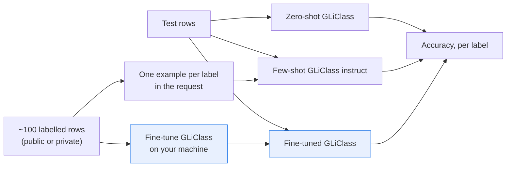

# Fine-tune your own decision model on 100 rows, and keep the data on your servers

> **This example:** two small decisions a team makes thousands of times a day. One is public: which team
> should handle a banking customer's message (Banking77). One is private: after a document parser runs, what
> is wrong with its output, so the pipeline knows whether to accept it, re-run OCR, re-parse the tables or send
> it to a person.
>
> **How it works:** a small GLiClass decision model (`knowledgator/gliclass-edge-v3.0`, 131 MB) answers each
> decision zero-shot from the label names. A same-size instruct model answers it again with labelled examples in
> the request (few-shot). Then the recipe fine-tunes the first model on about 100 labelled rows on your own
> machine and scores all of them on rows they never saw.
>
> **Use the same pattern for:** any yes/no or pick-one decision you make on text before spending money on it:
> routing to a model, a team or a queue, quality gates, triage, spam, intent.

## Background

Most pipelines are full of small decisions. Is this parsed page good enough to extract from? Which team should
get this message? Should this question go to the cheap model or the expensive one? Teams often send each of these
to a frontier LLM with a prompt, which works, costs something on every call, and sends the text to someone else's
servers.

A decision model is the other option: a classifier of a few hundred megabytes or less that picks one of your
labels. It runs on a CPU or a slice of a GPU you already have, in milliseconds, and the text never leaves your
network. The catch is that a general model doesn't know your labels the way you mean them. That's where 100
labelled rows come in.

## The problem

Zero-shot decision models read the label names and guess. On public, everyday text (a customer saying their
card hasn't arrived) that can be good enough. On your own data, with your own labels, it often isn't: "table
flattened into run-on numbers" means something specific in your pipeline, and the model has never seen your
parser's output. So the questions are:

- How far does zero-shot get on a public dataset, and on a private one?
- Does putting a few labelled examples in the request (few-shot) close the gap, with no training at all?
- How much does fine-tuning on about 100 rows help each?
- How long does that take, and on what hardware?

### Examples

`data/public/` is a slice of [Banking77](https://huggingface.co/datasets/PolyAI/banking77) (PolyAI, CC-BY-4.0; its
Parquet export at revision `5724874e`): six intents, 17 training messages each from its train split and 25 test
messages each from its test split. `data/private/` is synthetic, written by `make_data.py` for this recipe under
this repo's Apache 2.0 license: six kinds of parser output, 17 training and 10 test rows each. No test row appears
in training.

1. *"My card got lost."* (public): should be **card lost or stolen**, so the fraud team blocks the card.
2. *"De|ivery N0te frorn Gr`an1t~3 ¦1¬iisurance. P|3a$e quote r3f3r3n(3 B59874on @ll (orr3§$poiideiice..."*
   (private): should be **garbled OCR characters**, so the pipeline re-runs OCR with a stronger model.
3. *"Purchase Order from Northwind Supply. Goods were received in good condition on 24 April 2025. The lease
   agreement covers services delivered between December and..."* (private): should be **clean readable text**,
   so it goes on to extraction. It's the hard one: it reads like a document that stops early.

## How it works

1. `make_data.py` builds both datasets (Banking77 from Hugging Face; the private set from templates with a fixed
   seed).
2. `recipe.py` scores the zero-shot model on each test set: the label with the highest score wins.
3. It scores few-shot: `knowledgator/gliclass-instruct-edge-v1.0`, the same size and trained to read examples,
   with one training row per label in the request (six examples), and without them for comparison.
   `gliclass-edge-v3.0` isn't trained to read examples: given them, it gave every row the same label.
4. It fine-tunes the edge model on the ~100 training rows with GLiClass's own trainer.
5. It scores the fine-tuned model on the same test set and prints a table with one row per dataset.



### Why GLiClass

GLiClass reads the text and all the candidate labels together and scores each label, so the labels are plain
English you can change without retraining, and one forward pass scores all of them. The edge model is small
enough to fine-tune on a laptop in minutes. SIE serves GLiClass models as `extract` with `labels`, and can serve
fine-tuned GLiClass weights the same way (see below).

## How it's built

| Step | Where | What |
| --- | --- | --- |
| Labels, prompts, model, training and scoring settings | `rules.yaml` | The decision and what your pipeline does with each answer |
| Build the data | `make_data.py` | `build_public()`, `build_private()` |
| Score | `recipe.py` | `load_rows()` checks each row against `rules.yaml`; `decide()` and `score()`: one decision per row, accuracy overall and per label |
| Few-shot | `recipe.py` | `few_shot_examples()` picks the first training row of each label; `check_fits()` measures each input as GLiClass builds it (labels, prompt, the row, then the examples) and stops if it's over the 1,024-token window, because the model would silently cut off the examples |
| Fine-tune | `recipe.py` | `fine_tune()`: GLiClass `Trainer`, no augmentation, fixed seed |
| Serve | `sie_models/*.yaml` | One SIE model config per fine-tuned model, pointing `weights_path` at the saved weights |
| Score through SIE | `serve.py` | `decide()`: one `extract` call per 16 rows for zero-shot, few-shot (`options.examples`) and fine-tuned, scored by `recipe.py`'s `score()` |
| Offline checks | `selfcheck.py` | Data and SIE configs agree with `rules.yaml`; scoring counts right on stand-in replies |

## Run it

**Run this recipe using [SIE Serverless](https://superlinked.com/serverless?utm_source=github&utm_medium=docs&utm_campaign=sie-cookbook&utm_content=fine-tuning-fine-tune-a-decision-model), [SIE Cluster](https://superlinked.com/docs/deployment?utm_source=github&utm_medium=docs&utm_campaign=sie-cookbook&utm_content=fine-tuning-fine-tune-a-decision-model) or [SIE Local](https://superlinked.com/docs/quickstart?utm_source=github&utm_medium=docs&utm_campaign=sie-cookbook&utm_content=fine-tuning-fine-tune-a-decision-model).** The code runs on your machine either way. With SIE Serverless you pay for what each call uses and there are no GPUs to manage yourself: get an [SIE API key](https://console.superlinked.com/console/keys?utm_source=github&utm_medium=docs&utm_campaign=sie-cookbook&utm_content=fine-tuning-fine-tune-a-decision-model) and read the [API docs](https://superlinked.com/docs/reference/api?utm_source=github&utm_medium=docs&utm_campaign=sie-cookbook&utm_content=fine-tuning-fine-tune-a-decision-model). To run the models yourself, start from the [SIE repo](https://github.com/superlinked/sie).

Training and the comparison run on your machine (CUDA, Apple MPS or CPU) and need no key:

```sh
uv run --group data make_data.py   # rebuild data/ (downloads Banking77)
uv run recipe.py                   # zero-shot, few-shot and fine-tuned, both datasets
uv run recipe.py --only private    # one dataset
uv run serve.py                    # the same test rows through SIE (start SIE first, see below)
uv run selfcheck.py                # offline checks, no model and no SIE
```

The first run downloads the two models (131 MB each). Each run writes `runs/<timestamp>/results.json` with every decision,
and the fine-tuned weights under `runs/<timestamp>/<dataset>/model/`.

## What came out

We ran the recipe on 14 November 2026 on an Apple M-series laptop (MPS), with `knowledgator/gliclass-edge-v3.0`,
8 epochs, learning rate 2e-5, batch size 8, seed 20261114, and `knowledgator/gliclass-instruct-edge-v1.0` with
one example per label for few-shot.

### The three examples

1. *"My card got lost."*: zero-shot picked **wrong amount of cash from ATM** (score 0.99). The instruct model got
   it right zero-shot and again with six examples in the request (0.87). Fine-tuned picked **card lost or stolen**
   (1.00).

- **Verdict:** Pass.

2. The garbled delivery note: zero-shot picked **text not in English** (0.95), which is a fair guess at that mess
   of symbols, and would have sent it to translation. Few-shot picked **clean readable text** (1.00), which would have
   sent it to extraction. Fine-tuned picked **garbled OCR characters** (1.00).

- **Verdict:** Pass.

3. The purchase order: zero-shot and few-shot got it right (**clean readable text**, 0.98 and 1.00). Fine-tuned
   picked **document cut off mid-sentence**, with a top score of only 0.09.

- **Verdict:** Miss. A useful one: the model wasn't sure, and a score that low is your cue to send the row to a
  person instead of acting on it.


### Results

| | Zero-shot (edge) | Zero-shot (instruct) | Few-shot (instruct, 6 examples) | Fine-tuned (edge, 102 rows) |
| --- | --- | --- | --- | --- |
| Banking77, public (150 test messages) | 67.3% (101) | 63.3% (95) | 57.3% (86) | **93.3% (140)** |
| Parsed-document quality, private (60 test rows) | 30.0% (18) | 20.0% (12) | 16.7% (10) | **86.7% (52)** |

Fine-tuning took about 5 s for each dataset on the laptop, and scoring took 2 to 4 ms a row. 140 of 150 test messages
and 52 of 60 parsed pages came out as expected after fine-tuning.

Per label:

| Label | Zero-shot (edge) | Fine-tuned |
| --- | --- | --- |
| card has not arrived | 8% | 80% |
| card lost or stolen | 44% | 88% |
| exchange rate question | 100% | 100% |
| transfer not received by recipient | 72% | 96% |
| top-up failed | 88% | 100% |
| wrong amount of cash from ATM | 92% | 96% |
| clean readable text | 30% | 50% |
| garbled OCR characters | 10% | 100% |
| table flattened into run-on numbers | 0% | 100% |
| document cut off mid-sentence | 30% | 70% |
| handwriting left untranscribed | 10% | 100% |
| text not in English | 100% | 100% |

**Where it works:** anything a person can see at a glance but the label name doesn't describe well. Zero-shot read
every flattened table as a cut-off document (10 of 10), and most garbled OCR and untranscribed handwriting as "text
not in English" (8 of 10 and 5 of 10), which would send them to translation. A hundred examples fixed all three
(100%). On the public data, the biggest gain was "card has not
arrived", which zero-shot almost never picked (8% to 80%).

**Where it fails:** the two labels that differ only by how a document ends. All 8 private misses are clean text
and cut-off text swapped for each other (5 one way, 3 the other), because our synthetic clean documents also end
mid-thought sometimes. On Banking77, 7 of the 10 misses are "card has not arrived" and "card lost or stolen" swapped,
which people mix up too.

Few-shot scored below zero-shot on both datasets, for these models on this decision. On the
parser set the instruct model gave all 60 rows the same label. That's the model, not the examples: with no
examples at all it already gave 50 of the 60 rows "clean readable text", and the label it favors moves when you
reorder the labels. Reversed, 54 of 60 rows got "document cut off mid-sentence"; with "clean readable text" renamed
"no problem", the first label still won 59 of 60. On Banking77 it leaned on one label (70 of 150
messages got "transfer not received by recipient"), and the order of the six examples moved it a lot: the same
examples reversed scored 53.3%, and ten shuffles (`random.Random(seed).shuffle` with seeds 0 to 9) scored anywhere
from 20.0% to 69.3%. The best order edged past the edge model's zero-shot (67.3%), but nothing tells you in advance which order
that is. It wasn't the prompt (without it, few-shot scored 36.7%), and more
examples didn't help: two per label scored 55.3% and three per label 28.7%. The window caps it anyway: examples
share the model's 1,024 tokens with the row, and on the parser set two examples per label already don't fit.

These few-shot numbers need a fix to gliclass. Its `_create_segment_ids` (`gliclass/model.py`, 0.1.22) finds the
first example token with `argmin` instead of `argmax`, so with examples in the request it tags every token, the
labels and the row included, as an example. The instruct models read those tags; the edge model doesn't, so
zero-shot and fine-tuning aren't affected. `recipe.py` replaces that one function (`segment_ids()`). Without the fix
few-shot scored 26.0% and 15.0%. We checked that the fix matches how the model was trained, because gliclass
changed these tags on 8 February 2026 and the instruct model came out nine days later. It does: with the older
tags, the instruct model's zero-shot on Banking77 drops from 63.3% to 23.3%.

Two cautions. The private set is synthetic and made by templates, so it is easier to learn than your parser's real
output: treat 86.7% as what 100 rows can do on a clear-cut decision, not as a promise. And the test sets are small
(150 and 60 rows), so a few rows move the numbers by several points.

### What you do next

Label about 100 rows of your own decision, put them in `data/private/train.jsonl` in the same format, change the
labels in `rules.yaml`, and run the recipe. Look at the per-label table before the overall number, and add rows
where a label is weak. Then serve the fine-tuned model next to your pipeline with SIE (below).

## Serve your fine-tuned model with SIE

SIE serves any model it has a config for. A config is a small YAML file: SIE's catalog has one per model, and
`sie_models/` here has one for each model `recipe.py` trains. Each is a copy of the catalog's
`knowledgator__gliclass-edge-v3.0.yaml` with a new `sie_id` (`my-team/banking77-router` and
`my-team/parsed-page-check`), and `weights_path: /weights/public` or `/weights/private` in place of `hf_id` and
`hf_revision`, so SIE loads your weights from a folder instead of Hugging Face. They also score multi-label, as
`recipe.py` does, so each label gets its own score from 0 to 1 and a low top score means the same thing in both.
The weights never leave your machine.

### Start SIE Local in Docker

Mount the two configs into the image's models folder and the weights `recipe.py` saved where the configs say.
Use your own run folder in place of the timestamp:

```sh
RUN=runs/20261114T171002Z
docker run -d --name sie-decision -p 8080:8080 \
  -v sie-hf-cache:/app/.cache/huggingface \
  -v "$PWD/sie_models/public.yaml:/app/models/my-team__banking77-router.yaml:ro" \
  -v "$PWD/sie_models/private.yaml:/app/models/my-team__parsed-page-check.yaml:ro" \
  -v "$PWD/$RUN/public/model:/weights/public:ro" \
  -v "$PWD/$RUN/private/model:/weights/private:ro" \
  ghcr.io/superlinked/sie-server:v0.11.1-cpu-default

curl http://localhost:8080/readyz   # expect: ok
```

`curl http://localhost:8080/v1/models` now lists `my-team/banking77-router` and `my-team/parsed-page-check`
next to the catalog models. On a machine with an NVIDIA GPU, use `v0.11.1-cuda12-default` and add `--gpus all`.
On SIE Cluster, put the config in the cluster's models folder and the weights on a path or bucket its workers can
read.

### Ask it for a decision

```sh
curl -s http://localhost:8080/v1/extract/my-team/parsed-page-check \
  -H 'content-type: application/json' -H 'accept: application/json' \
  -d '{"items": [{"text": "Item Qty Unit price Total Freight 12 418.07 5016.84 Pallets 3 92.10 276.30 Subtotal 5293.14"}],
       "params": {"instruction": "What is wrong with this text a document parser produced?",
                  "labels": ["clean readable text", "garbled OCR characters", "table flattened into run-on numbers",
                             "document cut off mid-sentence", "handwriting left untranscribed", "text not in English"]}}'
```

The first call answers `MODEL_LOADING` while SIE loads the weights (9 s here); call again. Then each label comes
back with its own score, highest first (the scores don't add up to 1):

```json
"classifications": [
  {"label": "table flattened into run-on numbers", "score": 0.977},
  {"label": "document cut off mid-sentence", "score": 0.559},
  {"label": "text not in English", "score": 0.004},
  ...
]
```

From Python it's the same call the zero-shot model takes, with your model id (the SDK waits through the load):

```python
from sie_sdk import SIEClient
from sie_sdk.types import Item

LABELS = [
    "clean readable text",
    "garbled OCR characters",
    "table flattened into run-on numbers",
    "document cut off mid-sentence",
    "handwriting left untranscribed",
    "text not in English",
]
page = "Item Qty Unit price Total Freight 12 418.07 5016.84 Pallets 3 92.10 276.30 Subtotal 5293.14"

client = SIEClient(base_url="http://localhost:8080")
result = client.extract(
    "my-team/parsed-page-check",
    Item(text=page),
    labels=LABELS,
    instruction="What is wrong with this text a document parser produced?",
)
best = max(result["classifications"], key=lambda c: c["score"])
print(best)  # {'label': 'table flattened into run-on numbers', 'score': 0.977...}
```

### Check SIE gives the same answers

`serve.py` sends every test row to SIE for each approach (zero-shot, few-shot with the examples in
`options.examples`, and your fine-tuned model), and writes `runs/<timestamp>-served/results.json`:

```sh
SIE_BASE_URL=http://localhost:8080 uv run serve.py
```

We ran it on 14 November 2026 against the container above, on an Apple M-series laptop. The image is built for
x86, so Docker emulated it, and it used 1.1 GB of memory with all four models loaded. All 630 zero-shot and
fine-tuned decisions matched the ones `recipe.py` made in its own process, row for row, and every score was within
0.0001. Few-shot didn't match: SIE's GLiClass adapter copies gliclass's segment tags as they are, bug included ([`segment_ids()`](https://github.com/superlinked/sie/blob/dbfda27934f40f2e82b5a3cb827e8aeecda216a6/packages/sie_server/src/sie_server/adapters/gliclass/cuda_graphs.py#L791-L800) uses the same `argmin`), so
through SIE few-shot scores what it scored before the fix:

| | Zero-shot (edge) | Zero-shot (instruct) | Few-shot (instruct) | Fine-tuned |
| --- | --- | --- | --- | --- |
| Banking77, public (150) | 67.3%, 33 s | 63.3%, 23 s | 26.0%, 31 s | 93.3%, 12 s |
| Parsed-document quality, private (60) | 30.0%, 7 s | 20.0%, 7 s | 15.0%, 39 s | 86.7%, 12 s |

The times include loading each model on its first call. With SIE Serverless, `uv run serve.py --catalog-only`
scores zero-shot and few-shot on the catalog models; your fine-tuned weights need SIE Local or SIE Cluster, where you
control the configs.

## Potential improvements

- **More rows for the labels that miss.** The per-label accuracy in `results.json` says where to spend labelling
  time.
- **Train a LoRA adapter instead of the whole model.** SIE can load GLiClass LoRA adapters named in a model's
  config and pick one per request, so one base model can serve a different adapter per team or per pipeline.
- **Use the score, not only the top label.** A low top score is a good reason to send a row to a person.

## Try another model

`knowledgator/gliclass-base-v3.0` (746 MB) is a larger GLiClass model. Change `model:` in `rules.yaml`; nothing
else changes. We ran the edge model for this README.

For few-shot we swapped in `knowledgator/gliclass-instruct-edge-v1.0` (`few_shot.model`), the same size as the
edge model and trained to read examples. Zero-shot it scored a little below the edge model (63.3% and 20.0%
against 67.3% and 30.0%), and examples in the request lowered it further (57.3% and 16.7%). We first tried
few-shot on the edge model itself: it gave every test row the same label, at a score of 0.999.

We also tried two newer decision models on 15 November 2026, on the same rows, labels and prompts:

| Model | Banking77: zero-shot / few-shot / fine-tuned | Parser checks: zero-shot / few-shot / fine-tuned | Through SIE Local v0.11.1 |
| --- | --- | --- | --- |
| `knowledgator/gliclass-edge-v3.0` (this recipe) | 67.3% / 57.3%\* / 93.3% | 30.0% / 16.7%\* / 86.7% | Same decisions, scores within 0.0001 |
| `knowledgator/gliclass-v4-edge` | 98.0% / 96.7% / 98.0% | 51.7% / 23.3% / 96.7% | Loads only after a tokenizer fix; same decisions, scores up to 0.26 apart |
| `convaiinnovations/laya-multilingual` | 82.0% / n/a / 94.7% | 36.7% / n/a / 85.0% | Same decisions, scores within 0.0001 |

\* Few-shot runs on `gliclass-instruct-edge-v1.0`, as above.

`knowledgator/gliclass-v4-edge` (Apache 2.0, 882 MB, revision `885af1af`) is the most accurate model we ran. Set
`model:` and `model_revision:` in `rules.yaml` and run the recipe as it is; we kept the same training settings.
Zero-shot, it beat our fine-tuned edge model on Banking77 without seeing a single training row. Fine-tuned, it
missed 2 of 60 parsed pages, the same clean-versus-cut-off pair as the edge model. Few-shot still hurt, even though
v4-edge doesn't read the segment tags the gliclass bug breaks, so we can't blame the bug for everything: one example
per label sent 56 of 60 parsed pages to "garbled OCR characters". It costs you size and speed. Fine-tuning took
38 s and 61 s on the laptop, and scoring took 260 to 650 ms a row instead of 2 to 4 ms.

SIE's catalog doesn't have v4-edge yet, and SIE v0.11.1 can't load it as shipped. Its `tokenizer_config.json`
stores `extra_special_tokens` as a list, and the transformers in the image (4.57.6) expects a dict. With that key
deleted from the saved config (the token ids came out identical on all 210 test rows), SIE Local served our
fine-tuned weights with the same top label on every row. The scores didn't match, though. v4 models ship a
calibration step that gliclass added in 0.1.21, and the image's gliclass (0.1.17) skips it, so SIE's scores ran
higher than the local ones, by 0.16 on a typical parsed page and up to 0.26. Your decisions carry over; a threshold
you pick on local scores won't.

`convaiinnovations/laya-multilingual` (Apache 2.0, 322M parameters, revision `82d57fc4`) is already in SIE's
catalog. It doesn't read examples in the request, so it has no few-shot number. It also comes with its own package
(`laya` 0.4.33) and its own trainer, `laya.train.finetune()`, so `recipe.py` can't run it; we gave it the same rows,
epochs, batch size and seed. Fine-tuned, it landed close to our edge model in about 30 s per dataset. It trained on
92 rows instead of 102, because it holds 10 back to fit its calibration, and it warned that 10 rows is too few for
that fit. It was the fastest of the three on the laptop, at 15 to 20 ms a row. It was also the easiest to serve:
SIE Local loaded the fine-tuned weights from a copy of the catalog's `convaiinnovations__laya-multilingual.yaml`
with `weights_path` in place of `hf_id`, and all 420 decisions matched, every score within 0.0001.

## Run it using SIE Cluster or SIE Local

`recipe.py` trains and scores in its own process. `serve.py` sends the same rows to SIE: set `SIE_BASE_URL` in
`.env` to your SIE Cluster or SIE Local (an SIE key is then optional), and start it with the configs in
`sie_models/` as shown in "Serve your fine-tuned model with SIE".

| `rules.yaml` key | Model | Image | Tested on |
| --- | --- | --- | --- |
| `model` | `knowledgator/gliclass-edge-v3.0` | `cuda12-default` (`cpu-default` on CPU) | `v0.11.1-cpu-default` in Docker on an Apple M-series laptop |
| `datasets.public.served_model` | `my-team/banking77-router` (your weights, `sie_models/public.yaml`) | same | same |
| `few_shot.model` | `knowledgator/gliclass-instruct-edge-v1.0` | same | same |
| `datasets.private.served_model` | `my-team/parsed-page-check` (your weights, `sie_models/private.yaml`) | same | same |
