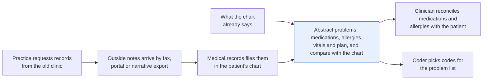
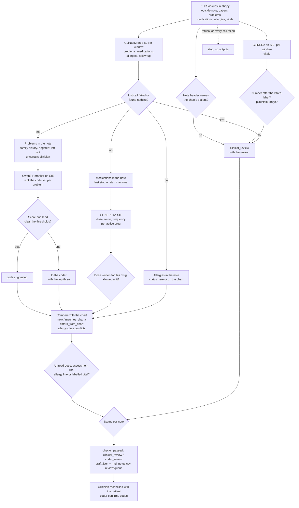

# Add outside visit notes to your chart, marked new, matching or different

> **This example:** a new patient's notes from another practice, before the first visit.
>
> **How it works:** an extraction model pulls problems, medications, allergies and vitals, Python
> checks them against the chart, and a reranker suggests codes for a coder.
>
> **Use the same pattern for:** a hospital discharge summary before follow-up, a home-health
> nursing note's medication list, a specialist's consult letter.

## Background

A patient transfers to your primary-care practice, and the practice asks their old clinic for
records. What comes back is often not something your EHR can import. It's the last few visit
notes, printed from the other clinic's system and faxed or uploaded through a portal, or a
narrative export from an EHR that clinic has since retired. When records arrive as a structured
summary (a C-CDA document, for example), the EHR can pull in the medication, allergy and problem
lists directly, and you don't need this recipe for that part. This recipe is for the notes that
arrive as plain narrative text.

In many practices, someone in medical records or a medical assistant files the notes in the
chart as documents, then abstracts the parts the practice needs into structured fields: the
problems, the medications with dose, route and frequency, the allergies, the last vitals and what
the other clinic planned next. They do it with the outside note open on one screen and the EHR on
the other. A clinician then reconciles the medication and allergy lists with the patient, usually
at the first visit, and a coder or the clinician picks the codes for the problem list.

Your EHR already gives you a lot of this as structured data, and none of it needs a model:

- **The patient.** The records request was made for a patient you already registered, so the
  outside notes come in attached to a known chart. Nobody has to work out who they belong to.
- **What the chart already says.** The medication and allergy lists the patient gave at
  registration or on the new-patient intake form, and any problems already on the problem list.
  For a brand-new patient these lists can be empty.
- **The practice's rules.** Dose units, plausible vital-sign ranges and the code set your
  practice uses. They come in as files the practice owns (`rules.yaml` and the code-set subset
  in `data/`), not as anything a model decides.

What doesn't arrive structured is the outside note itself. That's the only part a model reads.

Why it matters: the outside note is often the best record of what the patient was actually taking
and why. A stopped statin that stays on the list, a dose copied in the wrong unit, or a penicillin
allergy that never makes it into the chart are the errors medication reconciliation exists to
catch. Abstraction by hand is slow, and the person doing it is retyping someone else's typos: a
heart rate of 720, levothyroxine "50 mg" when it's dosed in micrograms, amoxicillin started in a
patient whose own note lists a penicillin allergy.

Here's the job end to end, and the step this recipe takes on:



## The problem

You want each outside note turned into a draft of what to add to the chart, compared item by item
with what the chart already says, with every value traceable to the sentence it came from. The
obvious shortcuts fall short. Keyword search finds "simvastatin" but can't tell that it was
stopped. One model asked to "fill in the record" gives you values you can't trace, and it can
list a diagnosis that the note only mentions as a family history or rules out. And a record built
only from what the model found looks complete even when a medication or a vital was never read.

So the recipe produces a **draft abstraction** for each note, never a chart update. Each item
(problem, medication, allergy) is marked **`new`**, **`matches_chart`** or
**`differs_from_chart`**. Each note gets a status that names what the checks found:

- **`checks_passed`**: every value was found in the note, passed the practice's rules and either
  matches the chart or is new. It's still a draft: the clinician reconciles it with the patient.
- **`clinical_review`**: something a clinician has to look at first. A value outside its plausible
  range, a dose in the wrong unit or with no dose at all, an active drug in the class of a
  documented allergy, no allergy status anywhere (not in the note, not in the chart), an item that
  differs from the chart, or a part of the note that couldn't be read.
- **`coder_review`**: the clinical checks passed, but at least one problem has no clear code
  candidate, so the coder picks it.

Codes are candidates, not coding decisions. The recipe ranks code descriptions from your code set
against each problem and suggests one only when the top candidate is clearly ahead. The coder
confirms every code against the code set's index and guidelines, and the clinician decides what
goes on the problem list. Nothing is written into the chart automatically.

The outside notes are PHI, and they reach SIE as they are, so SIE has to be an approved processor
for PHI (self-hosted inside your network, or with a BAA where required) before you run real notes
through it.

### Examples

Here are three of the outside notes in `data/`, and what should happen to each.

The notes and patients are synthetic, written for this recipe. The diagnosis codes are real, cut
from the public CMS ICD-10-CM list.

**1. A clean follow-up.** `note-01.txt`, filed in Marisol Quenby's chart.
- **Input:** "Medications: - Metformin 500 mg PO twice daily - Lisinopril 10 mg PO once daily ...
  1. Type 2 diabetes mellitus without complications. ... 2. Essential hypertension, controlled."
- **What should happen:** each dose goes with its own drug and matches the intake form, and
  both problems get a clear code.
- **Expected outcome:** `checks_passed`, both medications `matches_chart`, E11.9 and I10 suggested.

**2. An allergy the note contradicts.** `note-04.txt`, filed in Caius Wendell-Moore's chart.
- **Input:** "Allergies: Penicillin (hives). ... 1. Streptococcal pharyngitis. Start amoxicillin
  500 mg PO three times daily for 10 days."
- **What should happen:** amoxicillin is being started and it's in the penicillin class, so this
  goes to a clinician.
- **Expected outcome:** `clinical_review` for an allergy class conflict; J02.0 suggested.

**3. A note with no allergy statement.** `note-08.txt`, filed in Odile Fairbanks's chart.
- **Input:** "Medications: - Nitrofurantoin 100 mg PO twice daily for 5 days ... Vitals: BP 116/72,
  HR 88, Temp 100.9 F, RR 16, SpO2 99%." The note has no allergy line anywhere, and the chart has
  none on file either.
- **What should happen:** no statement at all isn't the same as "no allergies", so this goes to a
  clinician.
- **Expected outcome:** `clinical_review`: allergy status not documented anywhere; N30.00 suggested.

On the live run, 10 of 10 notes came out as expected. [What came out](#what-came-out) has the
results.

## How we'll solve it

1. **Start from the chart.** The EHR gives you the outside notes filed in each chart, the
   patient, and the chart's current problem list, medications with doses, allergies with their
   drug class and recent vitals. In this recipe those are lookups in [`ehr.py`](./ehr.py), the
   stand-in for your EHR's FHIR reads. The outside note comes in as text. If your outside records
   arrive as scanned faxes, run OCR first; this recipe starts from the text. Before anything
   else, the note's printed name and date of birth are each checked against the chart it was
   filed in, whichever of them the header prints. A date of birth that can't be read as a date
   goes to the clinician.
2. **Find the lists in the note with an extraction model.** GLiNER2 reads the note in windows and
   returns the problems, medications, allergies and follow-up. The vitals are a separate call,
   because asking for both at once made the model read "regular rate and rhythm" as a heart rate.
   Then a third call asks for each active drug's dose, route and frequency by name, on the
   sentence that writes its dose.
3. **Make Python prove every value.** A value counts only when it's in the note. A heart rate has
   to be written right after a heart-rate label ("HR 88"), not sit inside a blood pressure. A dose
   has to be written after its own drug, not the drug before it. A drug the note doesn't name is
   dropped. And it works the other way too: a dose in the note that belongs to no medication read,
   a numbered assessment line that gave no problem, or a labelled vital the model didn't return
   sends the note to the clinician, so a miss doesn't look like a clean draft.
4. **Read each item in its context.** The last mention of a drug decides whether it's active, so
   "Stop lisinopril" in the plan beats "Lisinopril 10 mg" in the medication list. A held drug
   and a negated start ("Do not restart metformin") are not active. A problem that the note only
   gives as a family history ("mother has type 2 diabetes") or rules out ("no diabetes") isn't
   listed as the patient's problem, but "No change in hypertension" or "Not at goal for type 2
   diabetes" still is. A numbered assessment line whose only problem reads as negated goes to the
   clinician rather than being dropped, and so does a problem read as negated in any other
   sentence ("No complications from type 2 diabetes" negates the complications, not the
   diabetes).
5. **Apply the practice's rules.** Dose needs a number and an allowed unit (levothyroxine in
   micrograms). A vital outside its plausible range is a likely typo. An active drug in the class
   of a documented allergy is flagged, whether the drug or the allergy is in the note or already
   on the chart. The note has to state an allergy or "no known drug allergies", unless the chart
   already has an allergy status. Each allergy on an allergy line ("Allergies: Penicillin, Codeine")
   that was not read goes to the clinician whatever the chart says.
6. **Compare with the chart.** Each problem, medication and allergy is `new`, `matches_chart` or
   `differs_from_chart` (a different dose, a drug the chart lists as active that the note says was
   stopped, an allergy on one side only).
7. **Rank code candidates for each problem.** The reranker scores every code description in the
   practice's code set against the problem, followed by the sentence it came from. A candidate is suggested only
   when its score and its lead over the next code clear the thresholds in `rules.yaml`. Otherwise
   the problem goes to the coder with the top three.
8. **Give the note its status** and write the draft, the evidence sentence for every value, and a
   review queue split by who picks it up (clinician or coder). The draft is meant to be filed with
   the outside note in the chart, so the clinician has it open at the new-patient visit when they
   reconcile the lists with the patient.

If an SIE call fails for a reason that may pass (a timeout, a 5xx, a rate limit, an over-long
window), that note goes to `clinical_review` with the reason and the run carries on; if SIE
refuses the call or every call fails, the run stops with SIE's message and writes nothing.

## Picking the models

The extraction model is `fastino/gliner2-large-v1`, through SIE's `extract` call with an
`output_schema`. You give it field names with a one-line description each, and it returns the
spans of the text that fill them. That's what makes the per-drug call possible: the schema asks
for "dose of amoxicillin with its unit", so the dose comes back tied to the drug you asked about.
`Ihor/gliner-biomed-large-v1.0` looks like the obvious pick for clinical text, but it's a span
tagger: it takes labels, not an `output_schema`, so it can't ask for the dose *of amoxicillin* or
keep a dose with its drug. gliner2-large-v1 reads about 512 tokens at a time, so the recipe cuts
notes into windows of 180 words (every sample note fits in one). It has a habit worth knowing:
asked for the lists and the vitals in one schema, it read the heart rate from "regular rate and
rhythm", which is why the recipe asks for them separately. It still reads a heart rate from the
wrong number now and then (see note-08 below), which is why Python checks the label.

The code ranker is `Qwen/Qwen3-Reranker-4B`, through SIE's `score` call with an instruction
("Given a problem from a clinical visit note, retrieve the ICD-10-CM code description that codes
it"). It returns a probability per code description. It puts the right family of codes on top
easily, and close siblings (mild intermittent against mild persistent asthma) all score above
0.99, where a plain difference in score says nothing. So the recipe measures the lead in
log-odds, `ln(p/(1-p))`, and wants 1.5 of it. Ranking the problem's sentence against code
descriptions is a relevance score, not a coding decision, which is why every code stays a
candidate the coder confirms.

Neither model writes the draft. No generative model makes a decision here: GLiNER2 points at
spans of the note, the reranker scores descriptions from a list you gave it, and everything after
that is a rule you can read.

## The flow



## How it's built

Everything you'd want to argue about lives in [`rules.yaml`](./rules.yaml): the model names, the
GLiNER2 schemas, the labels a vital is written after, the stop and start cues for medications,
the family, negation and uncertainty cues for problems, dose units, vital ranges, allergy
classes, the header labels and the code thresholds. The chart lookups are in
[`ehr.py`](./ehr.py), and [`recipe.py`](./recipe.py) is about 1,500 lines and reads top to bottom
in the same order as the flow.

| Step | Code | SIE call | What it does |
| --- | --- | --- | --- |
| Chart | `EHR.outside_documents`, `patient`, `problems`, `medications`, `allergies`, `vitals` | none | Loads the `data/ehr_*.csv` seeds into an in-memory SQLite database. Each lookup stands in for a FHIR read (DocumentReference, Patient, Condition, MedicationStatement, AllergyIntolerance, Observation). A seed whose allergy status doesn't agree with its allergy rows is refused |
| Right chart? | `header_patient`, `parse_dob`, `check_header` | none | The name and DOB printed after `Patient:` and `DOB:` (or the other `header_labels`) must match the chart, each checked whenever it's printed, or the clinician checks the note is filed in the right chart. The DOB is read as 4/22/1968, 1968-04-22, 4/22/68 (the century that puts it in the past) or April 22, 1968; anything else goes to the clinician |
| Read the note | `windows`, `read_windows`, `extract_fields` | `extract` | Two calls per window of 180 words: the lists, then the vitals. One item per call, with `overflow_policy: error`, so a window too long to read whole is a failed call, not a cut one. A list window that comes back with SIE's empty-result HTTP 500 is a reason for the clinician to read the note |
| Vitals | `labelled_readings`, `check_vital`, `add_vitals` | none | A reading counts only when the note writes that number right after one of the vital's labels. Outside `plausible` is a typo for the clinician (with the chart's last reading next to it); outside `normal` is a high/low flag. Two different readings for one vital, or a labelled reading the model didn't return, go to the clinician |
| Problems | `grounded`, `dedupe`, `assertion`, `problem_state`, `add_problems` | none | Every problem must be in the note. The last mention that isn't about a relative decides: family history and negated or ruled-out problems are left out (and listed as left out), uncertain ones go to the clinician. A cue in `not_negating` ("no change in", "not at goal") doesn't negate. Every numbered assessment line must give a problem that isn't negated, and a problem negated in any other sentence goes to the clinician |
| Codes | `rank_codes`, `logodds`, `suggest_code`, `compare_problem` | `score` | One call per problem, all 73 codes, on the problem followed by its deciding sentence (`code_query`). Suggested at a score of 0.50 or more and a log-odds lead of 1.5 or more; otherwise to the coder with the top three. A match with the chart needs the same name or the same suggested code; a different code in the same ICD-10-CM category differs |
| Medications | `medication_name`, `med_action`, `med_state`, `drug_doses`, `add_medications` | none | The cue nearest the drug in its clause (stop, hold, start, continue, "do not stop", "do not restart") decides each mention; the last mention with a cue decides the drug. Every dose the note writes must belong to a medication that was read |
| Dose details | `add_details`, `check_dose`, `compare_medication` | `extract` | One call per active drug, on the last sentence that writes a dose for it. The dose must be written after that drug in that sentence, have an allowed unit, and match the drug's expected unit. A match with the chart needs the same drug name and dose; a similar name (same first word) differs |
| Allergies | `allergy_name`, `allergy_lines`, `unread_allergies`, `add_allergies`, `allergy_members`, `allergy_conflicts`, `check_allergy_conflicts` | none | Allergies in the note are compared with the chart's; an allergy on one side only differs. Each item on an allergy line (split on the separators in `rules.yaml`) that names no allergy read and no "no known allergies" goes to the clinician. Every active drug, from the note or on the chart and not stopped in the note, is checked against every allergy's class (named, implied by a member drug, or recorded on the chart) |
| Write | `render_markdown`, `write_outputs`, `csv_safe` | none | `drafts/<note>.json` and `.md`, `notes.csv` and `review-queue.csv`; a cell a spreadsheet would run as a formula gets a leading `'` |

The SIE error rule is the same as in the security recipes. A call that fails for a reason that
may pass (a timeout, a lost connection, a 5xx, a rate limit, an over-long window, a model still
loading, or a reply missing the key we asked for, `data` or `scores`) sends that note to
`clinical_review` with a short reason, and the run carries on. A refusal every call would repeat
(a bad key, no credits, a model name SIE doesn't know) stops the run with SIE's full message and
writes no outputs. If every call failed, the run stops too. GLiNER2's empty-result HTTP 500 is
SIE Serverless's way of saying it found nothing: for a list window that goes to the clinician, and for
a drug's details it leaves the dose missing, which goes to the clinician anyway.

[`selfcheck.py`](./selfcheck.py) runs all ten notes through the real decision functions with
hand-written stand-in model replies and checks that each comes out as expected. It also checks the
stop-and-start reading (held drugs and negated starts too), doses that belong to the wrong drug,
family history and negation ("no change in" doesn't negate), the chart comparison, allergy
classes and an unread allergy line, label-bound vitals (Celsius, pounds, an impossible blood
pressure), the unread-dose and unread-line checks, the header check and date-of-birth formats,
the per-problem code query, the code thresholds, the SIE error rule (and that every extract call
asks SIE to fail an over-long window) and the committed data, all offline, so you
can change `rules.yaml` and know right away if you broke something.

## Run it

**Run this recipe using [SIE Serverless](https://superlinked.com/serverless?utm_source=github&utm_medium=docs&utm_campaign=sie-cookbook&utm_content=healthcare-add-outside-notes-to-chart), [SIE Cluster](https://superlinked.com/docs/deployment?utm_source=github&utm_medium=docs&utm_campaign=sie-cookbook&utm_content=healthcare-add-outside-notes-to-chart) or [SIE Local](https://superlinked.com/docs/quickstart?utm_source=github&utm_medium=docs&utm_campaign=sie-cookbook&utm_content=healthcare-add-outside-notes-to-chart).** The code runs on your machine either way. With SIE Serverless you pay for what each call uses and there are no GPUs to manage yourself: get an [SIE API key](https://console.superlinked.com/console/keys?utm_source=github&utm_medium=docs&utm_campaign=sie-cookbook&utm_content=healthcare-add-outside-notes-to-chart) and read the [API docs](https://superlinked.com/docs/reference/api?utm_source=github&utm_medium=docs&utm_campaign=sie-cookbook&utm_content=healthcare-add-outside-notes-to-chart). To run the models yourself, start from the [SIE repo](https://github.com/superlinked/sie).

You need [uv](https://docs.astral.sh/uv/) and, for SIE Serverless, an SIE API key
([create one](https://console.superlinked.com/console/keys?utm_source=github&utm_medium=docs&utm_campaign=sie-cookbook&utm_content=healthcare-add-outside-notes-to-chart)).

```bash
cp .env.example .env   # then set SIE_API_KEY
uv run recipe.py
uv run selfcheck.py    # optional: offline checks, no SIE call
```

`uv run` installs this recipe's few dependencies into its own `.venv` on the first run. Each run
writes `runs/<timestamp>/`. The first calls can wait a few minutes while SIE Serverless starts the
extraction and reranker models. A warm run makes 48 SIE calls (33 to GLiNER2: two per note plus
one per active drug, and 15 to the reranker, one per problem) and took 16 seconds warm.

To rewrite the notes and chart seeds, or the code subset from the CMS file:

```bash
uv run make_data.py
uv run make_data.py --cms-codes icd10cm_codes_2027.txt
```

## What came out

The input is ten outside notes in [`data/outside_notes/`](./data/outside_notes), filed in ten
charts through [`data/ehr_documents.csv`](./data/ehr_documents.csv). The charts are the other
`ehr_*.csv` seeds: ten patients registered in October 2026, two problems already on their lists,
nine intake-form medications, one charted allergy (sulfa drugs) and one nurse blood-pressure
visit. The code set is [`data/icd10cm-subset.tsv`](./data/icd10cm-subset.tsv), 73 ICD-10-CM codes.

### The three examples

**1. A clean follow-up.** `note-01.txt`, filed in Marisol Quenby's chart.
- **Expected outcome:** `checks_passed`, both medications `matches_chart`, E11.9 and I10 suggested.
- **What came back:** `checks_passed`, metformin and lisinopril both `matches_chart`, E11.9 and I10
  suggested.
- **Verdict:** Pass.

**2. An allergy the note contradicts.** `note-04.txt`, filed in Caius Wendell-Moore's chart.
- **Expected outcome:** `clinical_review` for an allergy class conflict; J02.0 suggested.
- **What came back:** `clinical_review` with the allergy class conflict, and J02.0 suggested.
- **Verdict:** Pass.

**3. A note with no allergy statement.** `note-08.txt`, filed in Odile Fairbanks's chart.
- **Expected outcome:** `clinical_review`: allergy status not documented anywhere; N30.00 suggested.
- **What came back:** `clinical_review`: allergy status not documented anywhere; N30.00 suggested.
  Plus one more review item: the model read the heart rate as `72`, and the draft has no heart rate.
- **Verdict:** Pass. The status is right, but the note says "HR 88" and that number isn't in the
  draft, so the clinician has to read it off the note.

### Results

On the live run on 4 Nov 2026 (UTC), 10 of 10 notes came out as expected.

**Where it works:** the clean follow-up (note-01) is a draft the clinician only has to confirm. The
checks caught the unit slip on levothyroxine (note-02), the "HR 720" (note-03), the allergy conflict
(note-04), the statin the other clinic stopped (note-05), the inhaler with no dose (note-06) and the
missing allergy statement (note-08). The later "stop" won over the medication list (note-09), family
history stayed off the problem list (note-10), and the problem with no good code went to the coder
(note-07).

**Where it fails:** the extraction model still misreads things. note-08 also got one review item we
didn't expect (a heart rate it couldn't trust, below); that only adds to a review it was getting
anyway, and it's the one to look at. Some details came back partial (note-01, note-03, note-07). A
"hold" reads as stopped, and none of these notes covers several visits in one note.

> **The notes and charts are synthetic.** [`make_data.py`](./make_data.py) writes them; every
> patient, clinician and clinic (Larkspur Family Practice, Harrow Creek Medical Group, Bellwether
> Internal Medicine) is invented. No real patient data.

Treat this as a demo that the wiring works, not as a measure of accuracy: ten notes tell you the
checks fire, not how often the models miss something in your own outside records.

A few things worth noticing:

- **note-05 is the one a busy morning gets wrong.** The patient wrote simvastatin on the intake
  form, the other clinic stopped it for muscle aches, and the only mention of it in the note is
  in the HPI. Here's the draft the clinician opens, from `drafts/note-05.md`, abridged:

  ```text
  | Atorvastatin | active | 20 mg |  | nightly | new: not on the chart | Start atorvastatin 20 mg nightly. |
  | Simvastatin | discontinued |  |  |  | differs_from_chart: the chart lists Simvastatin 40 mg nightly (intake form); the note says it was stopped | Simvastatin 40 mg was stopped on 09/30/2026 because of muscle aches, which have since resolved. |
  ```

  The atorvastatin dose came from the plan ("Start atorvastatin 20 mg nightly"), the last sentence
  that writes one, not the medication list.
- **Sibling codes all score high.** For "Mild intermittent asthma" the top three were J45.20
  (0.9996), J45.30, mild *persistent* asthma (0.9911), and J45.909 (0.9866). A plain score
  threshold can't tell those apart; the log-odds lead of 3.21 can, so J45.20 was suggested.
  Allergic rhinitis cleared it too, J30.1 over J30.9 by 2.07. Each problem is ranked on its own
  phrase followed by its sentence, which matters in a sentence that names two problems; when the
  lead is under 1.5 the problem goes to the coder with the top three.
- **note-08's heart rate.** The note says "BP 116/72, HR 88", and GLiNER2 returned `72` for the
  heart rate. 72 isn't written after a heart-rate label, so the
  draft has no heart rate and a review item says why. The note was going to the clinician anyway
  for its allergy status, but now you know which number not to trust.
- **note-07's plantar fasciitis.** The FY2027 code set added `M67.A02` "Plantar fasciitis, left
  foot", and our subset leaves the `M67.A0-` codes out on purpose. The best the reranker could do
  was M79.672 "Pain in left foot" at 0.23, below the 0.50 floor, so the coder gets it with the top
  three. That's the right outcome: a coder with the full code set finds the real code in a
  minute.
- **Some details came back partial, and that's allowed.** Atorvastatin "at bedtime" (note-03) has
  no frequency, ibuprofen "every 8 hours as needed" (note-07) became "as needed", and GLiNER2 read
  only "3 months" as note-01's follow-up. The recipe records route and frequency but only requires
  a dose (`required_medication_fields`), and the outside clinic's follow-up is context, not a
  requirement (`require_follow_up: false`).

### What you do next

The draft for each note, `drafts/<note>.md`, is filed with the outside note in the chart, so the
clinician has it open at the new-patient visit and reconciles the medication and allergy lists
with the patient. `review-queue.csv` splits the rest by who picks it up: the clinician takes the
`clinical_review` items (the unit slip, the HR 720, the penicillin conflict), and the coder
confirms every suggested code and picks one for each problem sent to them with the top three.
Nothing goes into the chart's structured lists without that reconciliation.

## Potential improvements

- **Your fields.** `record_fields`, `vital_fields` and `medication_fields` in `rules.yaml` are the
  GLiNER2 schemas (field: description); `{drug}` is filled with each medication's name.
- **Medication rules.** `dose_units`, `expected_units` (drugs dosed in one unit),
  `required_medication_fields`, `stop_terms`, `start_terms` and `allergy_classes`. Swap the
  allergy classes for your formulary's cross-sensitivity table; the five here are a short
  example.
- **Vital ranges.** `vitals`: `plausible` catches typos, `normal` sets the high/low flags.
- **Codes.** Replace `data/icd10cm-subset.tsv` with the codes your practice uses (or the full
  file, ranked in batches). `min_code_score` and `min_code_margin_logodds` decide when a code is
  suggested. They are starting points; check them against your coders' choices.
- **Hook it up.** Attach `drafts/<note>.md` to the outside document in the EHR (a
  DocumentReference that points at the note, for example) so it's open at the first visit, and
  send `review-queue.csv` rows to the clinician or the coder. Don't write the drafted items into
  the structured lists without the reconciliation.
- **Held drugs.** "Hold metformin before the scan" counts as stopped, so the draft says
  `discontinued`. A `hold_terms` list with its own `held` status would be a few lines.
- **A note from several visits.** The checks assume one visit per note; two readings of one vital
  already go to review, but a note with an old and a new medication list would need the visit
  dates read first.
- **Measure it.** Ten sample notes prove the wiring. Before you trust it, run it on a few weeks
  of your own outside records and compare the drafts with what your staff abstracted by hand.

**Known SIE Serverless issue.** When gliner2-large-v1 finds no field in an item, SIE Serverless currently
answers the `output_schema` call with HTTP 500 "Inference completed without a valid conserved
billing settlement" (and fails a whole batch if any item is empty, so items are sent one by one).
The recipe treats that as "nothing found", and a list window with nothing found goes to the
clinician. In our run it happened once: albuterol's details call ("Albuterol inhaler as needed
for wheeze" has no dose to find), which is noted in the draft.

## Try another model

Each model is one line under `models:` in `rules.yaml`. On 4 Nov 2026 (UTC) we swapped one model
at a time, changed nothing else, and ran the recipe using SIE Serverless.

| `rules.yaml` key | Swap in | What happened on this data |
| --- | --- | --- |
| `extract` | `fastino/gliner2-base-v1` | Much worse, but caught. All 10 notes went to `clinical_review`, including the three that pass with the large model. It missed a labelled blood pressure or heart rate in every note, read "HR 720" (note-03) and "HR 88" (note-08) as respiratory rates, read a blood pressure of '32' in note-07, never read amoxicillin (note-04), simvastatin (note-05) or losartan (note-09) or amlodipine's dose (note-03), and missed type 2 diabetes (note-01), the asthma (note-06) and every problem in note-09 and note-10. Each miss was flagged by the unread-vital, unread-dose or unread-assessment-line checks, which is what they're for. The amoxicillin and penicillin conflict itself was never seen |
| `rerank` | `Qwen/Qwen3-Reranker-0.6B` | No change in what comes out. All 10 notes got the same status and the same 14 suggested codes as the default, and plantar fasciitis still went to the coder (M79.672 scored 0.20, against 0.23 with the 4B). Its margins are thinner (I10 by 4.1 to 5.2 log-odds instead of 8.3 to 9.0), and the closest calls were J02.0 over J02.9 (2.22) and J45.20 over J45.909 (2.30), both still above 1.5. 48 SIE calls, 17 s warm against 16 s for the default |
| `rerank` | `tencent/R3-rerank-0.6b` | Its scores are squeezed together (top scores 0.66 to 0.82), so the 1.5 log-odds margin no longer fits: 8 of 15 problems went to the coder as too close to a sibling instead of 1, namely E11.9, K21.9, E78.5 (twice), J02.0, J30.1, J45.20 and E66.9. Note-01 dropped from `checks_passed` to `coder_review`; the other notes kept their status. It also suggested M79.672 "Pain in left foot" for plantar fasciitis (0.72, margin 2.21 over a nicotine dependence code), a wrong code the default kept back. 48 SIE calls in 15 s. Thresholds tuned for it would have to be new ones |

See [MODELS.md](../../MODELS.md) for every model these recipes use.

## Run it using SIE Cluster or SIE Local

The same code runs on your machine and uses SIE Cluster or SIE Local
([SELF_HOSTING.md](../../SELF_HOSTING.md) says what SIE Local can serve). Set `SIE_BASE_URL` in `.env`; an API key
is then optional. The table gives the SIE v0.10.1 image each model runs on, from SIE's
[compatibility matrix](https://github.com/superlinked/sie/blob/main/docs/compatibility.md).

| `rules.yaml` key | Model | Image | Tested on |
| --- | --- | --- | --- |
| `extract` | `fastino/gliner2-large-v1` | `cuda12-default` | L4 |
| `rerank` | `Qwen/Qwen3-Reranker-4B` | `cuda12-default` | L4 |

One container serves them all:

```bash
docker run --gpus all -p 8080:8080 -v sie-hf-cache:/app/.cache/huggingface \
  ghcr.io/superlinked/sie-server:v0.10.1-cuda12-default
# then set SIE_BASE_URL=http://localhost:8080 in .env and run: uv run recipe.py
```

## Data and licenses

The notes, the chart seeds and the patients are synthetic, written by `make_data.py` for this
recipe.

The code subset is public data. It is cut from the CMS FY2027 ICD-10-CM code descriptions
([2027 ICD-10-CM](https://www.cms.gov/medicare/coding-billing/icd-10-codes/2027-icd-10-cm),
file [`2027-code-descriptions-tabular-order.zip`](https://www.cms.gov/files/zip/2027-code-descriptions-tabular-order.zip),
`icd10cm_codes_2027.txt`). FY2027 applies from 1 Oct 2026, which covers a problem list built in
November 2026; the 73 descriptions in the subset read the same as in
FY2026. ICD-10-CM is maintained by CDC's National Center for Health Statistics and published by
CMS; it is in the public domain in the US. Plantar fasciitis (`M67.A01`, `M67.A02`, `M67.A09`)
is left out on purpose so one problem in the notes has no right answer.

## Files

- `recipe.py`: the pipeline
- `ehr.py`: the EHR lookups (outside notes, patient, problems, medications, allergies, vitals)
- `selfcheck.py`: plain asserts on the reading, the chart comparison, the statuses and the SIE
  failure rule, with stand-in model replies and no SIE call (`uv run selfcheck.py`)
- `rules.yaml`: model IDs, GLiNER2 schemas, vital labels, medication cues, problem cues, dose
  units, vital ranges, allergy classes, header labels and code thresholds
- `make_data.py`: the synthetic notes and chart seeds, and the code subset
- `data/outside_notes/`: the ten outside notes
- `data/ehr_*.csv`: the chart seeds
- `data/icd10cm-subset.tsv`: the practice's code-set subset
- `pyproject.toml`, `uv.lock`: this recipe's dependencies

See the SIE task page for [information extraction](https://superlinked.com/information-extraction?utm_source=github&utm_medium=docs&utm_campaign=sie-cookbook&utm_content=healthcare-add-outside-notes-to-chart).
