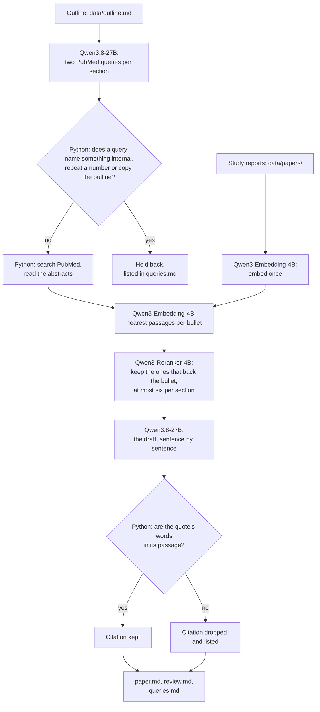

# Draft a short internal paper from a scientist's outline, citing your own study reports and PubMed

> **This example:** a biotech company where any program writes a short internal paper whenever it
> has something to share about a compound or a study. Here, the PCSK9 team writes up a liver
> finding from its outline, citing its own study reports for the results and PubMed for the
> public science.
>
> **How it works:** an open-weight model on SIE writes PubMed queries for each section, Python
> holds back any query that names something internal, two retrieval models on SIE pick the
> passages from study reports and abstracts that back each bullet, and the same open model
> writes the draft. Python checks every quote against its passage and keeps a record of which
> sentences the model wrote.
>
> **Use the same pattern for:** an internal tech note at any company that keeps its own reports,
> a study summary from a lab notebook outline, an internal literature review.

> **Not legal advice.** I'm an engineer, not a lawyer. This recipe is one option to try if you
> want drafts made with models you control, from papers that stay in-house. It doesn't settle who
> owns AI-assisted writing, what your agreements allow, or what you have to disclose. For that,
> ask a lawyer.

## Background

Take Corvane Bio, a made-up biotech. Its scientists used to share results in slide decks and
long quarterly updates, which nobody could search and nobody wanted to write. The company
started an internal paper series: whenever a program has something worth sharing about a
compound or a study, someone writes a short paper, two or three sections, citing the study
reports it rests on. The papers go into an internal library that everyone, and later the
company's own research agents, can read.

Writing one is still the slow part. The scientist knows what she wants to say, and she has it as
an outline: the sections and the points under each. Then she spends half a day turning it into
prose and digging up the report behind every number. The results and the conclusions are the
team's. A model can do the part in between: put her points into sentences and find the report
each one came from.

Three things make a hosted chat service the wrong place for that here:

- **The papers can't leave.** Internal reports hold unpublished results, compound names and doses.
  Pasting them into a service run by someone else is a disclosure the company has to manage, and
  it can matter for patents. With open-weight models on SIE Cluster or SIE Local, the reports and
  the draft stay on the company's own servers.
- **The company wants its own research agents.** Corvane plans to fine-tune agents on its internal
  papers: one that answers "what did we see in the 28-day study?", one that drafts the next
  paper. A steady series of short, cited papers is exactly the material for that. Open weights
  under Apache 2.0, like the Qwen3 models here, put no conditions on the output, and the team can
  pin a version and fine-tune it on its own servers.
- **It needs to know which sentences a model wrote.** The scientist edits the draft; she doesn't
  rewrite every sentence. So the record of what a model drafted travels with the paper: for
  disclosure, and so the team knows how much of its fine-tuning data a model wrote. The US
  Copyright Office asks you to disclose AI-generated parts of a work when you register it
  ([its March 2023 guidance](https://www.copyright.gov/ai/ai_policy_guidance.pdf)), and its 2025
  report says prompting alone doesn't make you the author of what comes back
  ([Authors Guild summary](https://authorsguild.org/news/us-copyright-office-ai-report-part-2-what-authors-should-know/)).

**A note on provider terms.** OpenAI and Anthropic say you own what their models write for you,
and bar using it to develop models that compete with theirs
([OpenAI's terms](https://openai.com/policies/terms-of-use),
[Anthropic's help page](https://support.claude.com/en/articles/12326764-can-i-use-my-outputs-to-train-an-ai-model)).
As I read it, that clause binds the provider's own customer. If someone else wrote a paper with a chat service
and you fine-tune on it, you never agreed to those terms; the paper's copyright and licence apply,
as with any text. Lemley and Henderson argue the clause is hard to enforce even against the
customer ([summary](https://spicyip.com/2025/01/discussing-lemley-and-hendersons-the-mirage-of-artificial-intelligence-terms-of-use-restrictions.html)),
and fine-tuning an internal research agent is a long way from building a rival chatbot. For
Corvane the terms are a footnote. It uses open models to keep its papers in-house and to own the
models it fine-tunes.

## The problem

The scientist wants a first draft of each section from her bullets, with:

- a citation for every point a study report or a published abstract backs, with the exact words
  it quotes, so she can check it in a minute;
- internal and public sources told apart, because a journal paper can't cite an internal report
  the way it cites a published one;
- a list of the points nothing backed, so she knows what to source or present as the team's view;
- a record of every sentence the model drafted;
- nothing added that she didn't say, and nothing she said dropped.

And the company wants to know exactly what went to PubMed: no code names, no results, no report
ids.

### Examples

`data/outline.md` is the outline for a short paper, "Liver findings with CVN-114 at 30 mg/kg
reversed within two weeks": three sections and 9 bullets. `data/papers/` holds the five study
reports and memos it can cite: a cell study, a single-dose mouse study, a repeat-dose liver safety
study, a stability report and a decision memo. I wrote all of it for this recipe, so there's no
license to record; Corvane Bio, CVN-114 and every result in it are made up. The public science behind it, GalNAc-siRNA drugs and
their liver safety, is real, and the abstracts come from PubMed at run time. Abstracts stay under
their publishers' copyright; the draft quotes a few words of each, with the citation, and nothing
from PubMed is committed here. Three bullets and what should happen to each:

1. **"ALT was back in the normal range two weeks after the last dose."** The liver safety report
   says so, so the sentence should cite internal report CVB-R-2026-017.
2. **"A similar finding in rats led another company to halve its top dose last year."** I made
   this up. Nothing should back it, and the review should say so.
3. **"We think this is a dose effect, not a reason to stop the program."** The team's view, so I
   expected no source.

## How we'll solve it

**Read the study reports.** Each report in `data/papers/` is a Markdown file with its id, date
and title at the top. Python splits them into passages of up to 120 words, keeping the heading,
and Qwen3-Embedding-4B embeds them once per run.

**Search PubMed.** For each section, Qwen3.8-27B writes two short PubMed queries for the public
science behind the bullets. It's asked to use general terms and never internal names or results.
That's a request, so Python also holds back any query that names something on the `never_send`
list in `rules.yaml` (CVN-114, Corvane, report ids), however it's spelled ("CVN 114" and
"cvn‑114" count), repeats a number from the outline (30, 2.4, 52%), or copies more than three
words in a row from the title, a heading or a bullet. `queries.md` lists what it held back and
why. Python sends the rest to PubMed's public API (no key
needed), reads the abstracts of the top three papers for each, and keeps each PMID.

**Pick the passages.** Qwen3-Embedding-4B embeds the abstracts and every bullet. For each bullet,
the eight nearest passages, internal and public together, go to Qwen3-Reranker-4B, which scores
whether the passage supports or contradicts the bullet. The best two that score 0.5 or more are
kept. A section's model sees at most six passages, so the prompt fits: each bullet's best passage
goes in first, then each one's second.

**Draft.** Qwen3.8-27B writes the section sentence by sentence, in the team's voice, as JSON: the
sentence, the bullet it comes from, and its citations, each a passage id and the words it quotes.

**Check.** Python keeps a citation only if it names a passage the model was given and the quote's
words are in that passage in the same order: 3 to 40 words, with punctuation, case and spacing not
counted, and "..." allowed to skip up to 30 words as long as each piece is at least 3 words and
there, in order. Signs that change a claim count as words, so "p < 0.05" doesn't match
"p > 0.05", and Greek letters count too, so TGF-α doesn't match TGF-β. Then it lists,
per section: bullets the draft left out, bullets with no checked citation and why, citations it
dropped and why, and any sentence that came from no bullet and no source.

**Write it up.** `paper.md` is the draft with numbered citations and a reference list that
marks each source as an internal report (id, title, date) or a PubMed paper (title, journal,
year, PMID, link). `review.md` starts with what to check, then has a table of every sentence: the
bullet it came from and the words it quotes. That table is the record. `queries.md` lists every
query sent to PubMed, every query held back, and every abstract read. The model's sentences go
into these files escaped, as plain text: no links, images or HTML.

## Picking the models

| `rules.yaml` key | Model | Its job here | Why this one |
| --- | --- | --- | --- |
| `write` | `Qwen/Qwen3.8-27B-FP8` | PubMed queries, then the draft | Apache 2.0, follows a JSON schema well, and the larger of the two chat models SIE Serverless answered with when I checked on 8 Nov 2026 |
| `embed` | `Qwen/Qwen3-Embedding-4B` | One vector per passage and bullet | Apache 2.0, takes an instruction for the bullets |
| `rerank` | `Qwen/Qwen3-Reranker-4B` | Does this passage back this bullet? | Apache 2.0, scores with an instruction, so "support or contradict" is the question it answers |

All three are open weights under Apache 2.0: the licence puts no conditions on the output, and
the same versions run on SIE Cluster or SIE Local inside the company. Qwen3.8-27B gets an
8,192-token window on SIE Serverless, shared by the prompt and the reply. That's why the recipe
drafts one section at a time and shows the model at most six passages.

## The flow



## How it's built

Models do what needs reading and writing: the queries, the ranking and the draft. Python does
everything that has to be exact: what's allowed out, the search, the quote check and the record.
Every model name, threshold, the `never_send` list and the instructions the model gets are in
`rules.yaml`.

| Step | Functions | File | Runs on |
| --- | --- | --- | --- |
| Read the outline | `parse_outline` | `recipe.py` | Python |
| Read the internal reports | `read_report`, `internal_passages`, `split_text` | `recipe.py` | Python |
| Draft one section, start to end | `draft_section` | `recipe.py` | Python, calling the steps below |
| PubMed queries | `queries_prompt`, `chat_json`, `clean_queries`, `squash`, `numbers_in`, `shared_run` | `recipe.py` | SIE (Qwen3.8-27B) |
| Search PubMed and read abstracts | `PubMed.search`, `PubMed.papers`, `paper_passages` | `pubmed.py`, `recipe.py` | PubMed's API |
| Embed passages and bullets | `embed`, `embed_batch` | `recipe.py` | SIE (Qwen3-Embedding-4B) |
| Rerank, and pick what the model sees | `rerank`, `pick_passages` | `recipe.py` | SIE (Qwen3-Reranker-4B) |
| Draft | `draft_prompt`, `chat_json` | `recipe.py` | SIE (Qwen3.8-27B) |
| Check citations and bullets | `check_draft`, `check_citation`, `find_run`, `section_flags` | `recipe.py` | Python |
| Write it up | `paper_markdown`, `review_markdown`, `queries_markdown`, `inert` | `recipe.py` | Python |
| Count calls and credits | `Calls` | `sie_calls.py` | Python |

The outline and the passages go into the prompt escaped, inside tags, and the model is told that
text inside them is never an instruction. An abstract could still try. The quote check limits what
that can do to a citation, not to the prose, which is one more reason the review lists every
sentence the model wrote.

## Run it

**Run this recipe using [SIE Serverless](https://superlinked.com/serverless?utm_source=github&utm_medium=docs&utm_campaign=sie-cookbook&utm_content=healthcare-draft-internal-paper-from-outline), [SIE Cluster](https://superlinked.com/docs/deployment?utm_source=github&utm_medium=docs&utm_campaign=sie-cookbook&utm_content=healthcare-draft-internal-paper-from-outline) or [SIE Local](https://superlinked.com/docs/quickstart?utm_source=github&utm_medium=docs&utm_campaign=sie-cookbook&utm_content=healthcare-draft-internal-paper-from-outline).** The code runs on your machine either way. With SIE Serverless you pay per call and there are no GPUs to manage yourself: get an [SIE API key](https://console.superlinked.com/console/keys?utm_source=github&utm_medium=docs&utm_campaign=sie-cookbook&utm_content=healthcare-draft-internal-paper-from-outline) and read the [API docs](https://superlinked.com/docs/reference/api?utm_source=github&utm_medium=docs&utm_campaign=sie-cookbook&utm_content=healthcare-draft-internal-paper-from-outline). To run the models yourself, start from the [SIE repo](https://github.com/superlinked/sie).

You need [uv](https://docs.astral.sh/uv/), an SIE API key for SIE Serverless, and an internet
connection to PubMed.

```bash
cp .env.example .env   # then set SIE_API_KEY, or SIE_BASE_URL for SIE Cluster or SIE Local
uv run recipe.py                                               # draft data/outline.md
uv run recipe.py --outline my_paper.md --papers ~/our-reports   # your own outline and reports
uv run selfcheck.py                                            # optional: offline, no SIE or PubMed
```

Your outline: a `# Title` line, a `## Heading` per section and bullets under each (`- `, `* ` or
`1. `). An indented sub-bullet joins its bullet. Your reports: Markdown files with `id`, `date`
and `title` between `---` lines at the top, then `## Heading` sections.

**Pro-tip:** put your own code names and report id prefixes in `never_send` in `rules.yaml`
before the first run, not after you spot one in `queries.md`.

**What leaves the company.** With SIE Serverless, the outline and the internal passages go to SIE
to run the models. That's fine for this made-up example; for real unpublished work, run the same
models on SIE Cluster or SIE Local, and then the only thing that leaves is the PubMed queries.
`queries.md` in each run lists every one, and every one held back. Even with the checks, the
queries of one run, taken together, say what the paper is about (siRNA, liver safety, GalNAc), and
a result reworded without its numbers or code names would still get through. Read `queries.md`
for anything sensitive, and put undisclosed target names in `never_send` too.

Each run writes `runs/<timestamp>/`. On this outline a run made 22 SIE calls (6 to the chat model,
9 to the reranker, 7 to the embedding model) and 12 PubMed requests, and took 31 to 52 s with the
models warm. SIE charged 418 to 477 credits a run, $0.004 to $0.005 at the SIE console price of
$0.00001 a credit on 8 Nov 2026.

## What came out

### The three examples

From the last of three runs. The other two gave the same verdicts, with small differences in
wording.

**1. ALT back to normal (section 2, bullet 3).**

- **Expected outcome:** cited, to internal report CVB-R-2026-017.
- **What came back:** "Two weeks after the last dose, ALT in those animals was back within the
  normal range. [5]", where [5] is internal report CVB-R-2026-017, quoted word for word.
- **Verdict:** Pass.

**2. The other company I made up (section 2, bullet 4).**

- **Expected outcome:** no source, and the review says so.
- **What came back:** the liver safety report scored 0.59 for it, so the model was shown it, and
  rightly didn't cite it: the report says nothing about another company. `review.md` lists the
  bullet with no source. The paper still states it as fact, with a straight face: "A similar
  finding in rats led another company to halve its top dose last year."
- **Verdict:** Pass. It only helps if the scientist reads the review.

**3. The team's view (section 3, bullet 1).**

- **Expected outcome:** no source.
- **What came back:** the view itself, "We think this is a dose effect, not a reason to stop the
  program.", is uncited. But the model followed it with "The finding appears only at ten times the
  dose that gives most of the LDL effect. [5]", quoting the liver report's own interpretation, and
  tied that sentence to the same bullet. So the bullet counts as cited.
- **Verdict:** Miss by my rule, though a fair one: the report does back the reasoning behind the
  view. My expectation was stricter than the evidence, which is a strange thing to lose a point
  over, but those are the rules I wrote down before the run.

### Results

8 of 9 bullets came out as expected on the last of three live runs using SIE Serverless on 9 Nov
2026 (UTC), and on the other two as well. A bullet counts when it's cited if I expected a
citation, or listed as having no source if I didn't, and it's in the draft either way. I wrote the
expectations before the first run on this outline.

| | Run 1 | Run 2 | Run 3 |
| --- | --- | --- | --- |
| Bullets as expected | 8 of 9 | 8 of 9 | 8 of 9 |
| Bullets with a checked citation | 8 | 8 | 8 |
| Citations kept / dropped | 13 / 0 | 13 / 0 | 13 / 0 |
| Citations to internal reports | 10 | 10 | 10 |
| Bullets left out of the draft | 0 | 0 | 0 |
| Sentences from no bullet and no source | 0 | 0 | 0 |
| PubMed queries held back | 0 | 0 | 0 |
| SIE credits | 477 | 458 | 418 |
| Time | 31 s | 38 s | 52 s |

The only miss is the team's view, above. The model never put CVN-114, Corvane or a report id in a
query, so the `never_send` check had nothing to hold back on these runs. It's there for the run
where the model does.

**What changed along the way.** On an earlier outline for this recipe, a quarterly program update,
the first run had a stricter quote check that dropped two good citations: one because the model
wrote "PCSK9 binds" where the abstract has "(PCSK9) binds", one because the quote skipped words
with "...". I changed the check to compare words only and to accept "...". Before any run on that
outline I also raised the quote limit from 30 to 40 words, because an earlier version of this
recipe lost good citations to 31-word quotes. Both changes came before the runs above. After a
review of this version, I also made the check keep signs and Greek letters, limit what "..." can
skip, and hold back queries with the outline's numbers or title, then ran the three runs above
again. They came out the same as the three before the review.

**How this version came about.** I first built this as a book-writing recipe, then as a research
note at an analyst firm, both citing Wikipedia. The reasons to control the models were weak for
both. A biotech company with unpublished results is the case where they're strong, and it has its
own reports to cite, so the recipe reads them and searches PubMed. The quarterly update became a
short internal paper, because a series of those is what the company would write often and fine-tune
on later. On the quarterly-update outline, three runs got 9 of 11 bullets as expected. They missed
a public bullet (inclisiran) because neither PubMed query asked about it, and cited the decision
memo for a plan I expected to have no source.

**Where it works:** every result in the paper was cited to the right study report on every run,
quoted word for word: the 52% LDL drop, the ALT rise at 30 mg/kg, the vacuolation without
necrosis, the return to normal, the top dose for the GLP study. The rat hepatotoxicity background
was cited to a Nature Communications paper with "rodent hepatotoxicity observed at
supratherapeutic exposures can be largely attributed to RNAi-mediated off-target effects".
Nothing was left out, and no query named anything internal.

**Where it fails:**

- **A quote that exists isn't a quote that supports.** For "GalNAc-siRNA drugs are taken up
  mainly by liver cells", the citations were "histologic findings in the organ of pharmacodynamic
  effect (liver)" and "SLN360 is a liver-targeted ... siRNA". Both are in their abstracts, and
  neither quite says liver cells take the drug up. Python checks that the words exist, not that
  they support the sentence.
- **The model adds cited sentences.** In the last section it added "The program review agreed to
  move CVN-114 into a GLP toxicology study." and "We will watch liver enzymes closely in the GLP
  study.", both cited to the reports and true, and neither in the outline. The table in
  `review.md` lists them as coming from no bullet, but "Check these first" doesn't, because it
  only flags added sentences that are also uncited. Read the table too.
- **The draft states unsupported bullets as fact.** The made-up company reads as true in
  `paper.md`. The review is where it's flagged, so the review isn't optional.
- **Internal and public citations sit in one list.** The reference list marks which is which, but
  a paper that goes outside the company needs the internal ones taken out by a person.

### What you do next

Open `review.md` first. For each bullet with no source, find one or present it as the team's view.
For each citation, open the report or the PubMed page and read the passage around the quote. Edit
the draft where it needs it, then add the finished paper to the library with its `review.md`: the
next paper can cite it, and the record says which sentences a model drafted when you fine-tune
your agents on the library.

## Potential improvements

- **Cite earlier papers, not just study reports.** Add each finished paper to `data/papers/` with
  front matter, so the next paper on the program can cite it.
- **Many programs, one library.** With several programs' reports in one library, flag any citation
  to another program's report: similar-looking numbers from the wrong compound are the mistake to
  catch.
- **Check that a quote supports its sentence,** not just that it exists: score each (sentence,
  quote) pair with the reranker and drop the ones under a bar.
- **Mark views in the outline,** for example a bullet ending in "(our view)", so neither the
  review nor my count asks for a source.
- **Fine-tuning data.** Export each paper with its record, so a fine-tuning run can weight or
  leave out the sentences a model drafted.

## Try another model

Each model is one line under `models:` in `rules.yaml`, and `--rules` runs a copy. We swapped one
thing at a time, changed nothing else and ran each once using SIE Serverless on 9 Nov 2026 (UTC).
One run each, so a bullet either way doesn't prove much.

| `rules.yaml` key | Swap in | What happened on this data |
| --- | --- | --- |
| `write` | `Qwen/Qwen3.5-4B` | 8 of 9 as expected, the same miss. It found a better source for the liver uptake bullet, "Givosiran selectively targets hepatocytes due to its linkage to N-acetylgalactosamine (GalNac) leading to its selective uptake via asialoglycoprotein receptors (ASGPR).", and kept 9 citations instead of 13. It added "We will watch liver enzymes closely in the GLP study and keep its top dose at or below 10 mg/kg." but tied it to the view bullet, so the record misses it as an addition, and the paper then says the top dose twice. Slower, 90 s, and 343 credits |
| `retrieval.min_rerank_score` | `0.3` instead of `0.5` | 8 of 9, the same citations as the 27B at 0.5, 35 s and 418 credits. A paper on liver transplant injury (score 0.96) reached the model for the vacuolation bullet; it didn't cite it. On the quarterly-update outline the same setting cited a made-up claim to a real paper on rat hepatotoxicity, so a lower bar can let a misleading source through |

See [MODELS.md](../../MODELS.md) for every model these recipes use.

## Run it using SIE Cluster or SIE Local

The same code runs on your machine and uses SIE Cluster or SIE Local
([SELF_HOSTING.md](../../SELF_HOSTING.md) says what SIE Local can serve). Set `SIE_BASE_URL` in
`.env`; an API key is then optional. For real unpublished work, this is how you'd run it. The
table gives the SIE v0.10.1 image each model runs on, from SIE's
[compatibility matrix](https://github.com/superlinked/sie/blob/main/docs/compatibility.md).

| `rules.yaml` key | Model | Image | Tested on |
| --- | --- | --- | --- |
| `write` | `Qwen/Qwen3.8-27B-FP8` | `cuda13-sglang-cu130` | H100 80GB |
| `embed` | `Qwen/Qwen3-Embedding-4B` has no published image in v0.10.1: set `Qwen/Qwen3-Embedding-8B` instead | `cuda12-default` | L4 |
| `rerank` | `Qwen/Qwen3-Reranker-4B` | `cuda12-default` | L4 |

One SIE server runs one image, so these 2 images need SIE Cluster: the
[sie-cluster Helm chart](https://github.com/superlinked/sie/tree/main/deploy/helm/sie-cluster)
with one worker pool per image routes each model to its pool. See
[SELF_HOSTING.md](../../SELF_HOSTING.md) for the values file.

## Files

- `recipe.py`: the pipeline, the checks and the CLI
- `pubmed.py`: PubMed search and abstracts, through NCBI's E-utilities
- `sie_calls.py`: one way to call SIE, counting calls and credits
- `rules.yaml`: model IDs, search settings, the `never_send` list, every threshold and the
  model's instructions
- `selfcheck.py`: offline checks, no SIE call and no PubMed request
- `data/outline.md`: the example outline
- `data/papers/`: the five made-up internal reports
- `pyproject.toml`, `uv.lock`: this recipe's dependencies

See the SIE task page for
[reranking](https://superlinked.com/rerank?utm_source=github&utm_medium=docs&utm_campaign=sie-cookbook&utm_content=healthcare-draft-internal-paper-from-outline).
