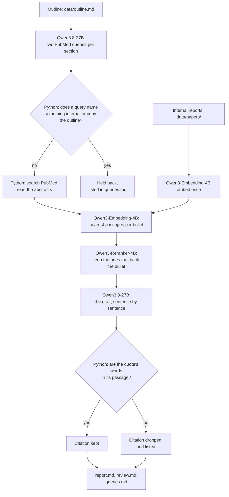

# Draft an internal research report from a scientist's outline, citing your own reports and PubMed

> **This example:** a biotech research team drafts its quarterly program update from the lead
> scientist's outline, citing the team's own internal reports for its results and PubMed for the
> public science.
>
> **How it works:** an open-weight model on SIE writes PubMed queries for each section, Python
> holds back any query that names something internal, two retrieval models on SIE pick the
> passages from internal reports and abstracts that back each bullet, and the same open model
> writes the draft. Python checks every quote against its passage and keeps a record of which
> sentences the model wrote.
>
> **Use the same pattern for:** a study report from a lab notebook outline, an internal
> literature review, a section of a regulatory submission, a technical memo at any company that
> keeps its own reports.

> **Not legal advice.** I'm an engineer, not a lawyer. This recipe is one option to try if you
> want drafts made with models you control, from papers that stay in-house. It doesn't settle who
> owns AI-assisted writing, what your agreements allow, or what you have to disclose. For that,
> ask a lawyer.

## Background

Take Corvane Bio, a made-up biotech, and its PCSK9 program: CVN-114, an siRNA drug meant to lower
LDL cholesterol. Every quarter the lead scientist writes a program update for the research
leadership. She starts from an outline, the sections and the points she wants to make under each,
and then spends a day turning it into prose and tracking down the source for every number: this
cell study, that mouse study, the decision memo from August, and the published papers for the
background. The results and the conclusions are the team's. A model can do the part in between:
put her points into sentences and find the report each one came from.

Three things make a hosted chat service the wrong place for that here:

- **The papers can't leave.** Internal reports hold unpublished results, compound names and doses.
  Pasting them into a service run by someone else is a disclosure the company has to manage, and
  it can matter for patents. With open-weight models on SIE Cluster or SIE Local, the reports and
  the draft stay on the company's own servers.
- **The team wants its own research agents.** Corvane plans to fine-tune agents on its internal
  papers: one that answers "what did we see in the 28-day study?", one that drafts the next
  update. Open weights under Apache 2.0, like the Qwen3 models here, put no conditions on the
  output, and the team can pin a version and fine-tune it on its own servers.
- **It needs to know which sentences a model wrote.** The scientist edits the draft; she doesn't
  rewrite every sentence. So the record of what a model drafted travels with the report: for
  disclosure, and so the team knows how much of its fine-tuning data a model wrote. The US
  Copyright Office says prompting alone doesn't make you the author of what comes back, and that
  AI-written parts should be disclosed when you register
  ([Authors Guild summary](https://authorsguild.org/news/us-copyright-office-ai-report-part-2-what-authors-should-know/)).

**A note on provider terms.** OpenAI and Anthropic say you own what their models write for you,
and bar using it to develop models that compete with theirs
([OpenAI's terms](https://openai.com/policies/terms-of-use),
[Anthropic's help page](https://support.claude.com/en/articles/12326764-can-i-use-my-outputs-to-train-an-ai-model)).
That clause binds the provider's own customer. If someone else wrote a paper with a chat service
and you fine-tune on it, you never agreed to those terms; the paper's copyright and licence apply,
as with any text. Lemley and Henderson argue the clause is hard to enforce even against the
customer ([summary](https://spicyip.com/2025/01/discussing-lemley-and-hendersons-the-mirage-of-artificial-intelligence-terms-of-use-restrictions.html)),
and fine-tuning an internal research agent is a long way from building a rival chatbot. So for
Corvane the terms are a footnote. The reasons above, keeping the papers in-house and owning the
models it fine-tunes, are what matter.

## The problem

The scientist wants a first draft of each section from her bullets, with:

- a citation for every point an internal report or a published abstract backs, with the exact
  words it quotes, so she can check it in a minute;
- internal and public sources told apart, because only one kind can go in a paper later;
- a list of the points nothing backed, so she knows what to source or present as the team's view;
- a record of every sentence the model drafted;
- nothing added that she didn't say, and nothing she said dropped.

And the company wants to know exactly what went to PubMed: no code names, no results, no report
ids.

### Examples

`data/outline.md` is the outline for "CVN-114 program update, Q3 2026": four sections and 11
bullets. `data/papers/` holds five internal reports: a cell study, a single-dose mouse study, a
repeat-dose liver safety study, a stability report and a decision memo. I wrote all of it for this
recipe; Corvane Bio, CVN-114 and every result in it are made up. The public science behind it,
PCSK9, inclisiran and GalNAc delivery, is real, and the abstracts come from PubMed at run time. Abstracts stay under their publishers'
copyright; the draft quotes a few words of each, with the citation, and nothing from PubMed is
committed here.
Three bullets and what should happen to each:

1. **"One 3 mg/kg dose lowered LDL cholesterol by 52% in mice at day 28."** The single-dose report
   says so, so the sentence should cite internal report CVB-R-2026-014.
2. **"A competitor stopped its own PCSK9 siRNA program this year after liver findings."** I made
   this up. Nothing should back it, and the review should say so.
3. **"Inclisiran, an siRNA against PCSK9, lowers LDL cholesterol with dosing twice a year."**
   Public and well documented, so it should cite a PubMed abstract.

## How we'll solve it

**Read the internal reports.** Each report in `data/papers/` is a Markdown file with its id, date
and title at the top. Python splits them into passages of up to 120 words, keeping the heading,
and Qwen3-Embedding-4B embeds them once per run.

**Search PubMed.** For each section, Qwen3.8-27B writes two short PubMed queries for the public
science behind the bullets. It's asked to use general terms and never internal names. That's a
request, so Python also holds back any query that names something on the `never_send` list in
`rules.yaml` (CVN-114, Corvane, report ids) or copies more than three words in a row from a
bullet; `queries.md` lists what it held back. Python sends the rest to PubMed's public API (no key
needed), reads the abstracts of the top three papers for each, and keeps each PMID.

**Pick the passages.** Qwen3-Embedding-4B embeds the abstracts and every bullet. For each bullet,
the eight nearest passages, internal and public together, go to Qwen3-Reranker-4B, which scores
whether the passage supports or contradicts the bullet. The best two that score 0.5 or more are
kept. A section's model sees at most six passages, so the prompt fits: each bullet's best passage
goes in first, then each one's second.

**Draft.** Qwen3.8-27B writes the section sentence by sentence, in the team's voice, as JSON: the
sentence, the bullet it comes from, and its citations, each a passage id and the words it quotes.

**Check.** Python keeps a citation only if it names a passage the model was given and the quote's
words are in that passage in the same order: 3 to 40 words, with punctuation, case and spacing not
counted, and "..." allowed to skip words as long as each piece is there, in order. Then it lists,
per section: bullets the draft left out, bullets with no checked citation and why, citations it
dropped and why, and any sentence that came from no bullet and no source.

**Write it up.** `report.md` is the draft with numbered citations and a reference list that
marks each source as an internal report (id, title, date) or a PubMed paper (title, journal,
year, PMID, link). `review.md` starts with what to check, then has a table of every sentence: the
bullet it came from and the words it quotes. That table is the record. `queries.md` lists every
query sent to PubMed, every query held back, and every abstract read. The model's sentences go
into these files escaped, as plain text: no links, images or HTML.

## Picking the models

| `rules.yaml` key | Model | Its job here | Why this one |
| --- | --- | --- | --- |
| `write` | `Qwen/Qwen3.8-27B-FP8` | PubMed queries, then the draft | Apache 2.0, follows a JSON schema well, and the larger of the two chat models SIE Serverless answered with when I checked on 8 Nov 2026 |
| `embed` | `Qwen/Qwen3-Embedding-4B` | One vector per passage and bullet | Apache 2.0, takes an instruction for the bullets |
| `rerank` | `Qwen/Qwen3-Reranker-4B` | Does this passage back this bullet? | Apache 2.0, scores with an instruction, so "support or contradict" is the question it answers |

All three are open weights under Apache 2.0: the licence puts no conditions on the output, and
the same versions run on SIE Cluster or SIE Local inside the company. Qwen3.8-27B gets an
8,192-token window on SIE Serverless, shared by the prompt and the reply. That's why the recipe
drafts one section at a time and shows the model at most six passages.

## The flow



## How it's built

Models do what needs reading and writing: the queries, the ranking and the draft. Python does
everything that has to be exact: what's allowed out, the search, the quote check and the record.
Every model name, threshold, the `never_send` list and the instructions the model gets are in
`rules.yaml`.

| Step | Functions | File | Runs on |
| --- | --- | --- | --- |
| Read the outline | `parse_outline` | `recipe.py` | Python |
| Read the internal reports | `read_report`, `internal_passages`, `split_text` | `recipe.py` | Python |
| PubMed queries | `queries_prompt`, `chat_json`, `clean_queries`, `shared_run` | `recipe.py` | SIE (Qwen3.8-27B) |
| Search PubMed and read abstracts | `PubMed.search`, `PubMed.papers`, `paper_passages` | `pubmed.py`, `recipe.py` | PubMed's API |
| Embed passages and bullets | `embed` | `recipe.py` | SIE (Qwen3-Embedding-4B) |
| Rerank, and pick what the model sees | `rerank`, `pick_passages` | `recipe.py` | SIE (Qwen3-Reranker-4B) |
| Draft | `draft_prompt`, `chat_json` | `recipe.py` | SIE (Qwen3.8-27B) |
| Check citations and bullets | `check_draft`, `check_citation`, `section_flags` | `recipe.py` | Python |
| Write it up | `report_markdown`, `review_markdown`, `queries_markdown`, `inert` | `recipe.py` | Python |
| Count calls and credits | `Calls` | `sie_calls.py` | Python |

The outline and the passages go into the prompt escaped, inside tags, and the model is told that
text inside them is never an instruction. An abstract could still try. The quote check limits what
that can do to a citation, not to the prose, which is one more reason the review lists every
sentence the model wrote.

## Run it

**Run this recipe using [SIE Serverless](https://superlinked.com/serverless?utm_source=github&utm_medium=docs&utm_campaign=sie-cookbook&utm_content=healthcare-draft-research-report-from-outline), [SIE Cluster](https://superlinked.com/docs/deployment?utm_source=github&utm_medium=docs&utm_campaign=sie-cookbook&utm_content=healthcare-draft-research-report-from-outline) or [SIE Local](https://superlinked.com/docs/quickstart?utm_source=github&utm_medium=docs&utm_campaign=sie-cookbook&utm_content=healthcare-draft-research-report-from-outline).** The code runs on your machine either way. With SIE Serverless you pay per call and there are no GPUs to manage yourself: get an [SIE API key](https://console.superlinked.com/console/keys?utm_source=github&utm_medium=docs&utm_campaign=sie-cookbook&utm_content=healthcare-draft-research-report-from-outline) and read the [API docs](https://superlinked.com/docs/reference/api?utm_source=github&utm_medium=docs&utm_campaign=sie-cookbook&utm_content=healthcare-draft-research-report-from-outline). To run the models yourself, start from the [SIE repo](https://github.com/superlinked/sie).

You need [uv](https://docs.astral.sh/uv/), an SIE API key for SIE Serverless, and an internet
connection to PubMed.

```bash
cp .env.example .env   # then set SIE_API_KEY, or SIE_BASE_URL for SIE Cluster or SIE Local
uv run recipe.py                                               # draft data/outline.md
uv run recipe.py --outline my_report.md --papers ~/our-reports  # your own outline and reports
uv run selfcheck.py                                            # optional: offline, no SIE or PubMed
```

Your outline: a `# Title` line, a `## Heading` per section and bullets under each (`- `, `* ` or
`1. `). An indented sub-bullet joins its bullet. Your reports: Markdown files with `id`, `date`
and `title` between `---` lines at the top, then `## Heading` sections. Put your own code names
and report id prefixes in `never_send` in `rules.yaml` before the first run.

**What leaves the company.** With SIE Serverless, the outline and the internal passages go to SIE
to run the models. That's fine for this made-up example; for real unpublished work, run the same
models on SIE Cluster or SIE Local, and then the only thing that leaves is the PubMed queries.
`queries.md` in each run lists every one, and every one held back.

Each run writes `runs/<timestamp>/`. On this outline a run made 28 SIE calls (8 to the chat model,
11 to the reranker, 9 to the embedding model) and 15 PubMed requests, and took 34 or 35 s with the
models warm. SIE charged 443 to 502 credits a run, about $0.005 at the SIE console price of
$0.00001 a credit on 8 Nov 2026.

## What came out

### The three examples

From the last of three runs. The other two came out the same way, with small differences in
wording.

**1. The single-dose mouse result (section 2, bullet 2).**

- **Expected outcome:** cited, to internal report CVB-R-2026-014.
- **What came back:** "In humanized PCSK9 mice, a single 3 mg/kg dose lowered LDL cholesterol by
  52% at day 28.", citing internal report CVB-R-2026-014 with the model's quote "single
  subcutaneous dose of CVN-114 at 3 mg/kg... LDL cholesterol by 52% at day 28". The "..." skips
  the PCSK9 result in between, and both pieces are in the report, in order. Run 1 quoted the whole
  sentence instead.
- **Verdict:** Pass.

**2. The competitor I made up (section 3, bullet 2).**

- **Expected outcome:** no source, and the review says so.
- **What came back:** no passage scored 0.5 or more, and `review.md` says: "no source (no passage
  scored high enough). Back it up yourself, or present it as your view". The draft still states it
  as fact: "A competitor stopped its own PCSK9 siRNA program this year after liver findings."
- **Verdict:** Pass. It only helps if the scientist reads the review.

**3. Inclisiran (section 1, bullet 2).**

- **Expected outcome:** cited, to a PubMed abstract.
- **What came back:** uncited. The model's two queries for the section were "PCSK9 LDL receptor
  degradation" and "GalNAc siRNA liver delivery", so no abstract about inclisiran was read, and the
  review flags the bullet.
- **Verdict:** Miss. Two queries per section weren't enough for three public bullets.

### Results

9 of 11 bullets came out as expected on the last of three live runs using SIE Serverless on 9 Nov
2026 (UTC), and on the other two as well. A bullet counts when it's cited if I expected a
citation, or listed as having no source if I didn't, and it's in the draft either way. I wrote the
expectations before the first run on this outline.

| | Run 1 | Run 2 | Run 3 |
| --- | --- | --- | --- |
| Bullets as expected | 9 of 11 | 9 of 11 | 9 of 11 |
| Bullets with a checked citation | 8 | 8 | 8 |
| Citations kept / dropped | 13 / 0 | 13 / 0 | 13 / 0 |
| Citations to internal reports | 10 | 10 | 10 |
| Bullets left out of the draft | 0 | 0 | 0 |
| Sentences from no bullet and no source | 0 | 0 | 0 |
| PubMed queries held back | 0 | 0 | 0 |
| SIE credits | 502 | 443 | 443 |
| Time | 34 s | 34 s | 35 s |

The two misses are the same on every run: inclisiran, above, and "Test monthly and quarterly
dosing in the next mouse study", which I expected to have no source. The model cited the decision
memo for it, quoting "dosing every month, and possibly every three months". The memo does say
the mouse data support those intervals, so the citation is fair and my expectation was too
strict; it still counts as a miss.

The model never put CVN-114, Corvane or a report id in a query, so the `never_send` check had
nothing to hold back on these runs. It's there for the run where the model does.

**What changed after the first run.** Before these three runs I made one run with a stricter
quote check. It dropped two good citations: one because the model wrote "PCSK9 binds" where the
abstract has "(PCSK9) binds", one because the quote skipped words with "...". I changed the check
to compare words only and to accept "...", and ran the three runs above on the new check. Before
any run on this outline I also raised the quote limit from 30 to 40 words, because the earlier
version of this recipe (below) lost good citations to 31-word quotes.

**How this version came about.** I first built this as a book-writing recipe, then as a research
note at an analyst firm, both citing Wikipedia. The reasons to control the models were weak for
both. A biotech team with unpublished results is the case where they're strong, and it has its
own papers to cite, so the recipe now reads internal reports and searches PubMed.

**Where it works:** every internal result in the outline was cited to the right report, on every
run, with quotes that back the sentence: the 87% knockdown, the 52% LDL drop, the liver findings
at 30 mg/kg, the six-month stability and the GLP study plan. The PCSK9 and GalNAc background was
cited to PubMed. Nothing was left out, nothing was added, and no query named anything internal.

**Where it fails:**

- **Two queries per section can miss a topic.** Inclisiran went uncited on every run because
  neither query asked about it.
- **A lower bar invents support.** With the reranker bar at 0.3 (see Try another model), the
  model turned the made-up competitor bullet into "This decision aligns with the practice of not
  advancing GalNAc-siRNAs that show rat hepatotoxicity to clinical development.", citing a real
  paper on rat hepatotoxicity. The quote is in the abstract, so Python kept it, and the bullet's
  claim had quietly changed. Python checks that the words exist, not that they support the
  sentence.
- **The draft states unsupported bullets as fact.** The made-up competitor reads as true in
  `report.md`. The review is where it's flagged, so the review isn't optional.
- **Internal and public citations sit in one list.** The reference list marks which is which, but
  a report that goes outside the company needs the internal ones taken out by a person.

### What you do next

Open `review.md` first. For each bullet with no source, find one or present it as the team's view.
For each citation, open the report or the PubMed page and read the passage around the quote. Edit
the draft where it needs it, then keep `review.md` with the report: it's the record of what a
model drafted, for disclosure and for knowing what you fine-tune your agents on later.

## Potential improvements

- **More queries for public bullets,** or one query per bullet that the reranker says has no
  internal source, so a topic like inclisiran isn't missed.
- **Check that a quote supports its sentence,** not just that it exists: score each (sentence,
  quote) pair with the reranker and drop the ones under a bar.
- **Full text, not abstracts.** PubMed Central has full text for open-access papers, with clearer
  licences for quoting at length.
- **Mark views and plans in the outline,** for example a bullet ending in "(our view)", so the
  review doesn't ask for a source.
- **Fine-tuning data.** Export each report with its record, so a fine-tuning run can weight or
  leave out the sentences a model drafted.

## Try another model

Each model is one line under `models:` in `rules.yaml`, and `--rules` runs a copy. We swapped one
thing at a time, changed nothing else and ran each once using SIE Serverless on 9 Nov 2026 (UTC).
One run each, so a bullet either way doesn't prove much.

| `rules.yaml` key | Swap in | What happened on this data |
| --- | --- | --- |
| `write` | `Qwen/Qwen3.5-4B` | 10 of 11 as expected. Its queries happened to find a review of inclisiran, so that bullet was cited, though its quote, "The administration is only required every 3 to 6 months", doesn't quite say twice a year. One PubMed citation was dropped as not in its passage. It also added two cited sentences of its own in the last section. Slower, 95 s, and 469 credits |
| `retrieval.min_rerank_score` | `0.3` instead of `0.5` | 7 of 11. The made-up competitor bullet was rewritten and cited to a real paper on rat hepatotoxicity, and the team's view on dosing was cited to a trial of a different drug (an antibody, AMG 145). More citations, and two that mislead. 36 s and 507 credits |

See [MODELS.md](../../MODELS.md) for every model these recipes use.

## Run it using SIE Cluster or SIE Local

The same code runs on your machine and uses SIE Cluster or SIE Local
([SELF_HOSTING.md](../../SELF_HOSTING.md) says what SIE Local can serve). Set `SIE_BASE_URL` in
`.env`; an API key is then optional. For real unpublished work, this is how you'd run it. The
table gives the SIE v0.10.1 image each model runs on, from SIE's
[compatibility matrix](https://github.com/superlinked/sie/blob/main/docs/compatibility.md).

| `rules.yaml` key | Model | Image | Tested on |
| --- | --- | --- | --- |
| `write` | `Qwen/Qwen3.8-27B-FP8` | `cuda13-sglang-cu130` | H100 80GB |
| `embed` | `Qwen/Qwen3-Embedding-4B` has no published image in v0.10.1: set `Qwen/Qwen3-Embedding-8B` instead | `cuda12-default` | L4 |
| `rerank` | `Qwen/Qwen3-Reranker-4B` | `cuda12-default` | L4 |

One SIE server runs one image, so these 2 images need SIE Cluster: the
[sie-cluster Helm chart](https://github.com/superlinked/sie/tree/main/deploy/helm/sie-cluster)
with one worker pool per image routes each model to its pool. See
[SELF_HOSTING.md](../../SELF_HOSTING.md) for the values file.

## Files

- `recipe.py`: the pipeline, the checks and the CLI
- `pubmed.py`: PubMed search and abstracts, through NCBI's E-utilities
- `sie_calls.py`: one way to call SIE, counting calls and credits
- `rules.yaml`: model IDs, search settings, the `never_send` list, every threshold and the
  model's instructions
- `selfcheck.py`: offline checks, no SIE call and no PubMed request
- `data/outline.md`: the example outline
- `data/papers/`: the five made-up internal reports
- `pyproject.toml`, `uv.lock`: this recipe's dependencies

See the SIE task page for
[reranking](https://superlinked.com/rerank?utm_source=github&utm_medium=docs&utm_campaign=sie-cookbook&utm_content=healthcare-draft-research-report-from-outline).
