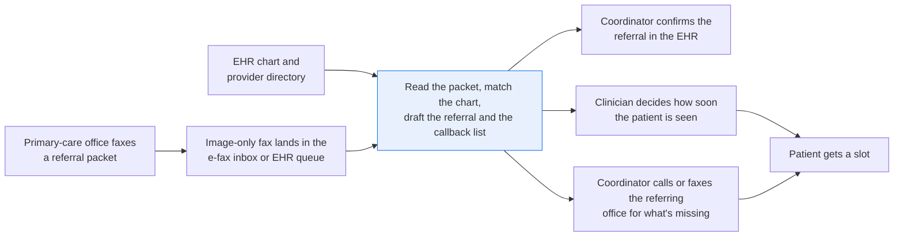
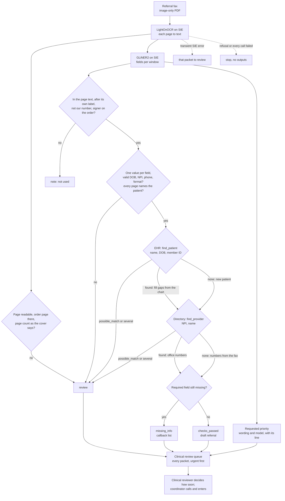

# Turn a faxed referral into a draft intake record

> **This example:** a referral coordinator working the e-fax queue, checking the EHR before calling
> the office back.
>
> **How it works:** OCR reads the fax, an extraction model pulls patient, insurance and provider,
> and Python checks each value and looks the patient up in the EHR.
>
> **Use the same pattern for:** a faxed prior authorization against the scheduled procedure, faxed
> lab orders from outside clinicians, faxed records requests matched to charts.

## Background

A cardiology practice (the fictional Larkspur Valley Cardiology Associates here) gets new-patient
referrals from primary-care offices it doesn't share an EHR with. Many of those still arrive by
fax: a cover sheet, a referral order and the last clinic note. The fax lands in an e-fax inbox or
the EHR's incoming-documents queue as an image-only PDF.

The referral coordinator works that queue. For each packet they read the order and the note,
search the EHR for the patient by name and date of birth, match the packet to an existing chart
or register a new patient, enter the referral (reason, referring provider, the priority the
referring clinician asked for), and attach the pages. Then the packet goes two ways at once. A
clinician (a cardiologist or a triage nurse, depending on the practice) reviews it and decides how
soon the patient needs to be seen. And the coordinator chases whatever the intake rules say is
missing, by phone or fax to the referring office: a member ID, a signature on the order. Only
after both, and any insurance authorization, does the patient get a slot.

A good part of what the coordinator needs is already structured in your own systems:

- **Existing patients.** If the patient has been seen before, the EHR has their demographics,
  phone, insurance plan and member ID on file.
- **Referring providers.** Your provider directory has the referring clinician's NPI, practice,
  phone and fax for the offices that refer regularly.
- **The intake rules.** Which fields your practice requires before scheduling, set by the
  practice, not by the fax. The intake lead owns that checklist; here it's the `required` list
  in `rules.yaml`, so changing it means editing a list, not code.

So the recipe asks those systems instead of re-reading them off the fax. [`ehr.py`](./ehr.py) has
one function, `find_patient(name, dob, member_id)`, standing in for an EHR patient search (a FHIR
Patient search plus the patient's coverage), and
[`provider_directory.py`](./provider_directory.py) has `find_provider(npi, name)`, standing in for
an NPI lookup in your referring-provider directory. Both run over a small, readable CSV seed in
`data/` loaded into an in-memory SQLite database, so you can swap in your real search later
without touching the rest. What isn't structured is the fax itself. The referring office had all
of it in their own EHR, and faxing turned it back into a picture. That's what the models read.

Why it matters: a referral that sits in the fax queue is a patient who isn't on anyone's list
yet. A packet that says "within 72 hours" without the word "urgent" can wait behind routine ones.
A callback for a member ID the EHR already has wastes a call and a day. And a signed clinic note
stapled behind an unsigned order looks complete at a glance.

Here's the job end to end, and the step this recipe takes on:



## The problem

You want each packet read, checked against what you already know, and turned into a draft
referral the coordinator can confirm, with the list of what's truly missing and the referring
clinician's requested priority, both in front of the right person the same day. The obvious
approaches fall short. There's no text layer to search, since every page is a scan. One model
asked "is this referral complete?" gives you an answer you can't audit. And a check that asks the
referring office for anything not on the fax ignores the chart you already have.

The recipe gives each packet a status that names what the checks found:

- **`checks_passed`**: every required field was read and checked, either on the fax or in your
  EHR. The coordinator confirms the draft and enters it.
- **`missing_info`**: a required field isn't on the fax and isn't in the EHR either. The output
  lists each item with the referring office's phone and fax, so the coordinator can call.
- **`review`**: the recipe can't trust what it read. The pages disagree on who the patient is, the
  patient on the fax matches a chart only partly (a married surname, the same name with another
  date of birth), a page couldn't be read, or a value failed its check. Review wins over
  `missing_info`, because there's no point calling about a member ID for the wrong patient.

Every packet also carries the **requested priority** as the referring clinician wrote it (e.g.
"URGENT", "within 72 hours", "Routine", or not stated), with the line it came from. That's a
routing hint, not triage. **Every packet goes to clinical review, whatever its status**, sorted
with requested-urgent and time-bound packets first, and the clinical reviewer decides how soon the
patient is seen. A packet with something missing goes to clinical review and to the callback list
at the same time, not one after the other.

None of this signs anything off. `checks_passed` means the checks found nothing, not that the
referral is approved or the patient is ready to schedule; the coordinator still confirms it, and
insurance authorization is a separate step this recipe doesn't touch.

### Examples

Here are three of the fax packets in `data/`, and what should happen to each.

**1. A complete packet.** `fax-1021-brightwater-family-medicine.pdf`
- **Input:** three image-only pages (cover, signed referral order, clinic note) for Delphine
  Arkwright, a new patient, with a member ID, a reason and "Routine" on the order.
- **What should happen:** every required field is read after its own label and checked, the EHR
  finds no chart, so she's new, and nothing is left to chase.
- **Expected outcome:** `checks_passed`, requested priority routine.

**2. A signature on the wrong page.** `fax-1021-quarry-hill-medical-group.pdf`
- **Input:** a referral order for Rosalind Teague with a blank signature line, and a clinic note
  behind it that is electronically signed.
- **What should happen:** the signature check only counts a signer on the order page, so the
  note's e-signature is set aside and the signed order goes on the callback list.
- **Expected outcome:** `missing_info`: signed referral order.

**3. A blank member ID and a time frame.** `fax-1021-juniper-road-family-practice.pdf`
- **Input:** three image-only pages for Odessa Pruitt, a new patient. The form says "Please see
  within 72 hours" with no urgent keyword, the member ID is blank, and the reason reads "New leg
  swelling, breathless lying flat, BNP 1,240 pg/mL."
- **What should happen:** there's no chart to fill the member ID from, so the coordinator calls
  about it. The time frame counts as time-bound without the word "urgent", so the clinician sees
  it near the top of the queue. The reason is on the fax, so nobody should call about that.
- **Expected outcome:** `missing_info`: insurance member ID, requested priority time_bound.

On the live run, 8 of 8 packets came out as expected, one of them (Juniper Road) with an extra
callback item we didn't expect. [What came out](#what-came-out) has every one.

## How we'll solve it

1. **Start from what you already know.** The EHR and the provider directory are lookups the
   recipe calls. The fax comes in as an image-only PDF.
2. **Read each page with an OCR model** (LightOnOCR on SIE). A page that comes back nearly empty
   goes to review as unreadable. Each page's title says what it is (cover sheet, referral order,
   clinic note), and the cover's page count ("Pages (including cover): 3") must match the pages
   that arrived.
3. **Find the fields with an extraction model.** GLiNER2 reads the text in overlapping windows and
   points at the patient's name, date of birth and phone, the insurance plan and member ID, the
   referring provider, NPI, practice and office phone and fax, the reason, the requested priority
   and the order's signer.
4. **Make Python prove them.** A value only counts when it's in the text of its page, isn't a
   blank form line, and sits right after one of its own field's labels ("Member ID:", not
   "Insurance plan:"; "Patient phone:", not the office's "Phone:"). The practice's own fax number
   on the cover's "To" line is never the referring office's. The date of birth must be a real
   date, the NPI must pass its check digit, a phone number must have 10 digits, and a member ID
   or a name must look like one value, not two. Two different values for an identity field go to
   review instead of the first one winning. Names match as whole words, so "Ann Lee" never merges
   with "Joann Lee", and the patient's name and the order's signer must be the whole name after
   the label: "Arkwright" read from "Patient name: Delphine Arkwright" goes to review.
5. **Check the signature on the right document.** The referral order itself must carry a signer's
   name on its signature line. A signed clinic note doesn't sign the order. And every page after
   the cover must name the patient, so a stray page from another patient's chart can't ride along.
6. **Match the patient and the referring provider.** Look the patient up in the EHR by name, date
   of birth and member ID, and the provider by NPI. Only an exact match fills gaps from your
   records (the member ID on file, the office's fax) and says so; a close or ambiguous match goes
   to review, and no match means a new patient or a new referring provider. With no NPI on the
   fax, a provider matched by name alone counts only when the fax's practice or an office number
   agrees with the directory and none disagrees.
7. **Read the requested priority from the wording.** "Urgent", "stat" or a time frame such as
   "within 72 hours" are recorded as written; "not urgent" isn't urgent. When the model and the
   wording disagree, the packet sorts with the more pressing of the two and says why.
8. **List what's still missing** against the practice's checklist in `rules.yaml`, give the packet
   its status, and write the draft referral, the callback list and the clinical review queue.

If an SIE call fails for a reason that may pass (a timeout, a 5xx, a rate limit, an over-long
window), that packet goes to review with the reason and the run carries on; if SIE refuses the
call or every call fails, the run stops with SIE's message and writes nothing.

## Picking the models

There are two models, and neither makes the decision. LightOnOCR is called once per page and
GLiNER2 once per window of text; everything after that is Python you can read.

**OCR: `lightonai/LightOnOCR-3-4B`.** A fax page is a dithered, slightly tilted, speckled
black-and-white image, and there is no text layer underneath to fall back on. LightOnOCR is a
vision-language model that turns a page image into Markdown, and on these pages it keeps the
"Label: value" lines intact, which is what the label check needs. It is generative, so it could
in principle write a word that isn't on the page; the recipe doesn't trust any single value it
returns without the checks in step 4, and the EHR and directory matches only use exact hits.

**Extraction: `fastino/gliner2-large-v1`.** GLiNER2 takes a schema (one description per field,
from `rules.yaml`) and points at spans of the text that fill it. It doesn't write anything; every
value is a piece of the page, which is what makes the "is it in the text, and after its label?"
check possible. It reads about 512 tokens at a time, hence the 180-word windows with a 30-word
overlap. Its weak spot is long free text: it returns short spans, and a reason for referral written
as a long sentence can come back empty (you'll see that below). And when it finds nothing in a
window, SIE Cloud currently answers the `output_schema` call with HTTP 500 "Inference completed
without a valid conserved billing settlement" (and fails a whole batch if any item is empty, so
windows are sent one by one). The recipe records that exact error as "no fields found", which can
only make a field missing, never pass one; any other 500 is a failed call.

## The flow



## How it's built

Everything you'd want to argue about lives in [`rules.yaml`](./rules.yaml): the two model names,
the render resolution and window size, the extraction schema with each field's labels, the
format a member ID or a name must have, the intake lead's `required` checklist with the wording
the coordinator uses on the phone, the words that mark each page type, the practice's own fax
number, the priority wording (urgent terms, the time-frame pattern, negations and the sort order)
and the EHR's close-name threshold. [`recipe.py`](./recipe.py) is about 1,200 lines, most of it
the checks, and reads top to bottom in the same order as the flow. [`ehr.py`](./ehr.py) and
[`provider_directory.py`](./provider_directory.py) are the two lookups.

| Step | Code | SIE call | What it does |
| --- | --- | --- | --- |
| Read pages | `read_pages`, `flatten_markdown` | `extract` (LightOnOCR) | One call per page, rendered at 200 DPI and shrunk to a longest side of 2048 pixels. Markdown bold, bullets and headings are dropped so each "Label: value" sits on one line. A page under 80 characters, a failed call or a reply without markdown sends the packet to review |
| Page types | `page_kind`, `page_count` | none | The first 4 lines of a page name it: cover, order, note or other. No order page, or a cover page count that doesn't match the pages received, is a review reason |
| Find fields | `windows`, `extract_candidates` | `extract` (GLiNER2, `output_schema`) | One call per window of 180 words with a 30-word overlap, one item per call. The empty-result HTTP 500 is a note; a window that failed is a review reason |
| Keep what's backed | `keep_candidates`, `on_labelled_line`, `label_owner`, `whole_value` | none | Drops a form blank, a value not in the text, a value not right after its own field's label (the longest matching label decides, so "Patient phone" isn't "Phone"), the practice's own number, and an order signer read off any page but the order. Each drop gets a note. A patient name or order signer that is only part of what follows its label is a review reason |
| Merge and check | `merge_field`, `check_value`, `check_patient_on_every_page` | none | Two different values for a field go to review, listed in page order; the earliest page's value is recorded. Then the format, NPI check digit, phone digits and DOB plausibility checks, and every page after the cover must name the patient |
| Look up | `match_patient` (`EHR.find_patient`), `match_provider` (`ProviderDirectory.find_provider`) | none | `found` fills gaps from the chart or directory and marks the source; `possible_match` and `several` go to review; `none` means new. Skipped when the name or DOB is already under review |
| Priority | `classify_priority`, `requested_priority` | none | Each line of every page and the model's span get a kind (urgent, time_bound, routine, not_stated); the more pressing wins, with a note when they disagree |
| Outputs | `build_referral`, `callback_rows`, `queue_rows`, `write_outputs` | none | The checklist gives the missing items; the status, the drafts, the callback list (missing_info packets only) and the queue (every packet) |

The lookups match honestly. `find_patient` returns `found` for exactly one chart with the same
name (same words, any order) and date of birth; `possible_match` for one chart that comes close
(the same DOB with a shared name word or a name a typo away, the same name with another DOB, or
the same member ID under another name); `several` when more than one fits; `none` otherwise.
`find_provider` returns `found` when the NPI is in the directory under the name on the fax,
`possible_match` when the NPI or the name belongs to someone else in the directory, `several`
for an ambiguous name with no NPI, and `none` for a new referring provider. With no NPI, a name
match (a surname alone counts) is `found` only when the fax's practice or an office number
agrees with the directory's; `match_provider` turns it into `possible_match` when one disagrees
or nothing confirms it, and nothing is filled from the directory.

The SIE error rule is the same as in the security recipes. A call that fails for a reason that
may pass (a timeout, a lost connection, a 5xx, a rate limit, a model still loading, an over-long
window, or a reply missing the key we asked for, `entities` or `data`) sends that packet to review
with a short reason, and the run carries on. A refusal every call would repeat (a bad key, no
credits, a model name SIE doesn't know) stops the run with SIE's full message and writes no
outputs. If every call failed, the run stops too. An empty `data` object is a real result:
GLiNER2 found nothing in that window.

[`selfcheck.py`](./selfcheck.py) runs the whole recipe offline on the committed packets, with
stand-in OCR text built from the lines `make_data.py` draws and a stand-in extractor that returns
the value after each label. It checks every packet, the label and signature rules, the
name matching, the lookups, the priority wording, the adversarial cases listed further down, the
SIE error rule and that the PDFs carry no metadata. [`make_data.py`](./make_data.py) rebuilds
every file in `data/` byte for byte.

## Run it

You need [uv](https://docs.astral.sh/uv/) and an SIE API key
([create one](https://console.superlinked.com/console/api-keys?utm_source=github&utm_medium=docs&utm_campaign=sie-cookbook&utm_content=healthcare-process-faxed-referrals)).

```bash
cp .env.example .env   # then set SIE_API_KEY
uv run recipe.py
uv run selfcheck.py    # optional: offline checks, no SIE call
uv run make_data.py    # optional: rebuild the packets and the two seeds in data/
```

`uv run` installs this recipe's few dependencies into its own `.venv` on the first run. Each run
writes `runs/<timestamp>/` in this folder: `drafts/<packet>.json`, `callback-list.csv` and
`clinical-review-queue.csv`. The first calls can wait a few minutes while SIE Cloud starts the OCR
and extraction models. A warm run makes 48 SIE calls (24 to LightOnOCR, one per page, and 24 to
GLiNER2, one per window; every page here fits in one window) and took 68 seconds.

> **PHI.** The fax pages reach SIE as images before any check runs, so SIE has to be an approved
> processor for PHI (self-hosted inside your network, or with a BAA where required) before you
> run real faxes through it. The packets here are synthetic.

## What came out

The input is 8 fax packets in [`data/`](./data), each three image-only pages (cover sheet,
referral order, clinic note), plus the two lookup seeds: `ehr_patients.csv` (6 charts) and
`provider_directory.csv` (8 referring providers).

> **Every patient, provider, clinic, insurer, phone number, MRN and NPI is invented.** NPIs are
> well-formed and not assigned in the NPPES NPI Registry as of 4 Nov 2026 (UTC), and phone
> numbers use the 555-01xx range.
> `make_data.py` rebuilds the packets byte for byte. It draws each page at fax "fine" resolution,
> tilts it, speckles it, dithers it to black and white and stores it as CCITT G4, with a fax
> header line on top, no text layer and no document info, so the recipe has to OCR it like a
> real fax.

### The three examples

**1. A complete packet.** `fax-1021-brightwater-family-medicine.pdf`
- **Expected outcome:** `checks_passed`, requested priority routine.
- **What came back:** `checks_passed`, requested priority routine.
- **Verdict:** Pass.

**2. A signature on the wrong page.** `fax-1021-quarry-hill-medical-group.pdf`
- **Expected outcome:** `missing_info`: signed referral order.
- **What came back:** `missing_info` with one callback item, "Signed referral order (provider
  signature)", to Quarry Hill Medical Group at (555) 010-7730.
- **Verdict:** Pass. The note's e-signature didn't count.

**3. A blank member ID and a time frame.** `fax-1021-juniper-road-family-practice.pdf`
- **Expected outcome:** `missing_info`: insurance member ID, requested priority time_bound.
- **What came back:** `missing_info`: insurance member ID and reason for referral; requested
  priority time_bound, second in the queue; office numbers from the fax.
- **Verdict:** Pass. The status, priority and member ID item are right, but GLiNER2 returned no
  reason for referral, so the callback list also asks the office for a reason that's printed on
  page 2. That's a wasted call, on a packet where the clinical reviewer would want the reason most.

### Every example

On the live run on 4 Nov 2026 (UTC), 8 of 8 packets came out as expected.

**Where it works:** it checks your own records before asking for anything (Millbrook's member ID came
from the chart, matched on name and date of birth). It puts a callback on the list for what's
truly missing (Hollis Creek, Quarry Hill), sorts urgent and time-bound packets first (Fenwick
Street, Juniper Road), and hands pages that disagree or a chart that only partly matches to a
person (Cobble Lane, Orchard Bend).

**Where it fails:** Juniper Road also got one callback item we didn't expect, "Reason for referral". It
fails closed (the office is only asked for something already on the fax), so it's named here and
doesn't fail the case. It's the one to worry about: a long free-text field is where the extraction
model is weakest, and a reason it doesn't return turns into a call nobody needed.

| Case | What's in it | Came out | Why |
| --- | --- | --- | --- |
| Brightwater | Complete packet, new patient | `checks_passed`; requested priority routine | The clean case |
| Hollis Creek | Member ID left blank; the patient isn't in the EHR | `missing_info`: insurance member ID, with the office's phone and fax from the directory | Truly missing, so a callback is right |
| Millbrook | Member ID left blank on the fax; the patient is in the EHR with the member ID on file, and so is his son, same name, another date of birth | `checks_passed`; member ID `SHC-417730-1` taken from chart MRN-100231 and marked as such; the son's chart noted | The near miss: check your own records before calling, and match on name and date of birth, never the name alone |
| Quarry Hill | Order signature line blank; the clinic note behind it is electronically signed | `missing_info`: signed referral order | A signature on the wrong document doesn't count |
| Fenwick Street | Marked urgent on the cover and the form; an existing patient | `checks_passed`; requested priority urgent ("URGENT", page 2), top of the clinical review queue | Urgency goes to the clinician, not into a status |
| Juniper Road | The form says "Please see within 72 hours" with no urgent keyword, the member ID is blank for a new patient, and the referring provider isn't in the directory | `missing_info`: insurance member ID and reason for referral; requested priority time_bound, second in the queue; office numbers from the fax | Time-bound wording without the keyword; clinical review and the callback run in parallel. The extra reason item is the model's miss, see below |
| Cobble Lane | The referral is for "Ann Lee"; the attached clinic note is for "Joann Lee" with a different date of birth | `review`: the pages disagree on the patient's name and date of birth; the EHR isn't searched | Similar names must not merge, and review wins over a callback |
| Orchard Bend | Helena Marchetti, member ID blank; the EHR has her as Helena Voss, her maiden name, same date of birth and phone, with a member ID on file | `review`: EHR possible match to MRN-100689; nothing filled from that chart | A close match is someone's call, not the recipe's |

These ran live on SIE Cloud on 4 Nov 2026 (UTC). All eight got the status we wrote them to get, and
seven came out exactly as planned. Juniper Road came out `missing_info` with the priority and member
ID item we wrote it to get, plus one item we didn't expect: GLiNER2 returned no reason for referral
for "New leg swelling, breathless lying flat, BNP 1,240 pg/mL.", so the callback list asks the
office for a reason that's printed on page 2. We left it that way rather than shorten the reason we
wrote on the packet; it's the long-free-text weakness from Picking the models, on a packet where
the clinical reviewer would want the reason most. Treat all of this as a demo that the wiring
works, not as a measure of accuracy: eight packets tell you the checks fire on the cases they were
built for, not how often they're wrong on yours.

A few things worth noticing:

- **The label check did a lot of quiet work.** Across the 8 packets, 32 spans the model pointed at
  were set aside with a note, and none of them changed a status. Every packet's clinic note had an
  e-signature the model offered as the order's signer (on Quarry Hill, that's the whole case), and
  every note page's fax header "TO: (555) 010-2200" came back as the patient's phone. The model was
  confident; the fax header was not the patient.
- **Millbrook is the callback that didn't happen.** The member ID is blank on the fax, the chart
  has it, and the draft says where it came from:

  ```json
  "member_id": {"value": "SHC-417730-1", "source": "ehr", "mrn": "MRN-100231"}
  ```

  with the note "Chart MRN-100232 has the same name with DOB 1998-11-04; matched MRN-100231 on name
  and DOB". Had the fax misprinted his date of birth by a day, both charts would have come back as
  `several` and nothing would be filled; `selfcheck.py` tries exactly that.
- **Orchard Bend is the same shape with the opposite answer.** Same date of birth, same phone, a
  chart with a member ID right there. But the name differs, so the recipe sends it to review and
  leaves the member ID blank rather than borrow it from a chart that may not be hers.
- **Review beats the callback list.** Orchard Bend also has a blank member ID, and Cobble Lane is
  otherwise complete; neither shows up on the callback list. The list from this run:

  ```csv
  requested_priority,packet,patient,referring_provider,practice,office_phone,office_fax,contact_from,item
  time_bound,fax-1021-juniper-road-family-practice.pdf,Odessa Pruitt,"Tomasz Wierzbicki, MD",Juniper Road Family Practice,(555) 010-2750,(555) 010-2751,fax,Insurance member ID
  time_bound,fax-1021-juniper-road-family-practice.pdf,Odessa Pruitt,"Tomasz Wierzbicki, MD",Juniper Road Family Practice,(555) 010-2750,(555) 010-2751,fax,Reason for referral
  routine,fax-1021-hollis-creek-internal-medicine.pdf,Gideon Pashley,Iris Vandermolen,Hollis Creek Internal Medicine,(555) 010-5520,(555) 010-5521,directory,Insurance member ID
  routine,fax-1021-quarry-hill-medical-group.pdf,Rosalind Teague,"Samuel Achterberg, MD",Quarry Hill Medical Group,(555) 010-7730,(555) 010-7731,directory,Signed referral order (provider signature)
  ```

- **A priority span has to say something about priority.** GLiNER2 can offer "six months" (from
  "Recheck in six months") as the requested priority. A span with no priority wording in it is
  not counted, so it can't outrank the form's "Routine" and sort Cobble Lane as "not stated";
  `selfcheck.py` holds that case.

`selfcheck.py` tries to break the checks offline with stand-in replies and edited pages: only a
first name read on the note page, or only a surname on the order (review), the note's visit date
offered as the date of birth (dropped), the patient's phone offered as the office's (dropped),
two member IDs in one span and "Delphine and Ivo Arkwright" as one patient (review), a glued
"phone:(555)010-3381" (read), Corwin Ashdown's DOB off by a day (`several`, nothing filled), a
nickname with the same DOB (`possible_match`), a "not urgent" form with the model saying urgent
(sorted urgent with a note), an NPI that belongs to another directory provider (review), a
surname with no NPI whose practice and numbers aren't the directory's (`possible_match`, nothing
filled), a two-digit birth year "03/14/61" (read as 1961, not 2061), a window too long for the
extractor (review, never read cut short), and a cover that says 4 pages when 3 arrived (review).

### What you do next

The coordinator confirms each draft in `drafts/<packet>.json` and enters the referral, and works
`callback-list.csv` by phone or fax to the referring office, using the numbers on each row. Every
packet, whatever its status, is in `clinical-review-queue.csv` with urgent and time-bound packets
first, and the clinical reviewer decides how soon the patient is seen. The `review` packets
(Cobble Lane, Orchard Bend) need someone to look at the pages and the chart by hand before
anything is filled or anyone is called.

## Potential improvements

- **Edit the schema and the checklist, not the code.** `fields` in `rules.yaml` is the extraction
  schema, and each `description` goes to GLiNER2; each field's `labels` are what your forms
  print. `required` lists what must be present, with the wording staff use when they call back.
- **Check the thresholds on your own faxes.** `thresholds` holds the window size and overlap,
  render resolution, minimum page length, maximum age and the EHR's close-name ratio. They are
  starting points.
- **Read long reasons another way.** GLiNER2 returns short spans, so a reason for referral written
  as a long sentence can come back empty and turn into a callback item (Juniper Road did). A
  labelled-cell read in Python for that one field, used only when the model returns nothing and
  marked as such, would stop the needless call.
- **A smarter name match.** The EHR's close match is plain: a shared name word or a `difflib`
  ratio. A nickname table ("Bill" for "William") and the patient's address and phone would make
  `possible_match` rarer without making `found` any looser.
- **Practice-specific checklists.** One `required` list fits every referral here. Real practices
  need an uninsured pathway (no member ID to chase) and different lists per specialty or payer.
- **A signature is a name, not proof.** The recipe checks that a name sits on the order's
  signature line. It can't tell a wet or valid electronic signature from typed text; that stays
  with the coordinator.
- **Keep the chart current.** When the fax and an exact chart match disagree (a new member ID,
  say), the recipe uses the fax value and notes it. Pushing that note into the EHR's update
  queue would close the loop.

## Try another model

Each model is one line under `models:` in `rules.yaml`. We swapped one model at a time, changed
nothing else, and ran the recipe on SIE Cloud on 4 Nov 2026 (UTC), on the 8 packets above.

| `rules.yaml` key | Swap in | What happened on this data |
| --- | --- | --- |
| `ocr` | `zai-org/GLM-OCR` | Same status, priority and field values for all 8 packets. Only the notes differ: 23 spans set aside instead of 32 |
| `ocr` | `lightonai/LightOnOCR-2-1B` | The 8 drafts came out byte for byte the same as the default's |
| `extract` | `fastino/gliner2-base-v1` | Same status and priority for all 8, and the same field values except Juniper Road's practice in capitals (read off the fax header). But it pointed at far more wrong spans: 80 set aside, among them "New Patient Intake" as the patient, clinic names as the referring provider and the order's signer, "BNP 1,240 pg/mL" as an NPI and the practice's own fax as the office phone. The label check caught every one; with the large model there are fewer to catch |

See [MODELS.md](../../MODELS.md) for every model these recipes use.

## Run it on your own SIE

The same code runs against an SIE server you host. Set `SIE_BASE_URL` in `.env`; an API key
is then optional. The table gives the SIE v0.10.1 image each model runs on, from SIE's
[compatibility matrix](https://github.com/superlinked/sie/blob/main/docs/compatibility.md).

| `rules.yaml` key | Model | Image | Tested on |
| --- | --- | --- | --- |
| `ocr` | `lightonai/LightOnOCR-3-4B` | `cuda12-sglang-vision-extract` | L4 |
| `extract` | `fastino/gliner2-large-v1` | `cuda12-default` | L4 |

One SIE server runs one image, so these 2 images need a cluster: the
[sie-cluster Helm chart](https://github.com/superlinked/sie/tree/main/deploy/helm/sie-cluster)
with one worker pool per image routes each model to its pool. See
[SELF_HOSTING.md](../../SELF_HOSTING.md) for the values file.

## Data and licenses

Everything in `data/` is synthetic, written for this recipe by `make_data.py`: the 8 fax packets,
`ehr_patients.csv` and `provider_directory.csv`. No real patient, provider or clinic is in it, and
the PDFs carry no document info (no title, author or dates).

## Files

- `recipe.py`: the pipeline
- `ehr.py`: the EHR lookup, `find_patient(name, dob, member_id)`, over `data/ehr_patients.csv`
- `provider_directory.py`: the directory lookup, `find_provider(npi, name)`, over
  `data/provider_directory.csv`
- `selfcheck.py`: offline checks of every packet, the label, signature, name, lookup and
  priority rules, the adversarial cases and the SIE failure rule, no SIE call
  (`uv run selfcheck.py`)
- `rules.yaml`: models, thresholds, extraction schema with labels, formats, the intake checklist,
  page types, the practice's own numbers and the priority wording
- `make_data.py`: writes the synthetic fax packets and the two seeds in `data/`
- `data/`: the 8 fax packets, `ehr_patients.csv` and `provider_directory.csv`
- `pyproject.toml`, `uv.lock`: this recipe's dependencies

See the SIE task page for [document field extraction](https://superlinked.com/doc-field-extraction?utm_source=github&utm_medium=docs&utm_campaign=sie-cookbook&utm_content=healthcare-process-faxed-referrals).
