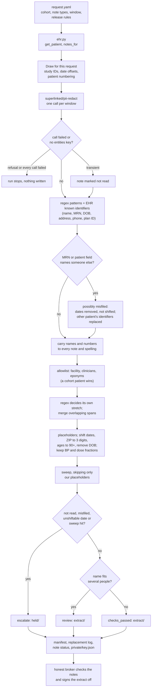

# Pseudonymize clinical notes and log every replacement

> **This example:** an approved research data request, filled by the honest broker.
>
> **How it works:** a PII model, regex and known identifiers find what to replace, and Python keeps
> pseudonyms consistent, shifts dates and sweeps the result. The key never leaves the honest
> broker.
>
> **Use the same pattern for:** a registry submission, a radiology teaching file, case notes for an
> outside quality collaborative.

## Background

A quality-improvement team wants to know what happens to patients in the weeks after they leave
the hospital: who gets a follow-up call, who ends up confused or not eating at home, whose labs
were never repeated. The structured data (admission and discharge dates, diagnoses, readmissions)
comes out of the clinical data warehouse easily. The answers to their questions are in the notes:
the discharge summary, the referral letter, the home nursing call, the outside lab fax. So they
file a data request for those notes.

That request goes through the IRB or the privacy office first, which approves the cohort, the note
types, the date window and how the data may be released. Then it lands with someone in the health
system's research data or analytics team (often called the honest broker) whose job is to fulfil
it. Physically, the analyst runs the cohort query in the warehouse, pulls the notes, runs them
through a de-identification tool, opens the flagged notes in a viewer next to the original, fixes
what the tool missed, and only then hands the extract over. The requester never sees the original
notes and never gets the key that links the extract back to patients.

The warehouse and the approved request already give the analyst a lot as structured data, and none
of it needs a model:

- **The approved request.** Request ID, approval reference, the cohort's patient IDs, the note
  types and date window approved, and what the release may keep (shifted dates, three-digit ZIPs,
  ages grouped at 90 and over). In this recipe that's `request.yaml`.
- **Which patient each note belongs to.** The export carries the patient ID with every note, so the
  recipe doesn't have to guess it from an MRN printed in the text.
- **What the patient's identifiers are.** Name and known aliases, MRN, date of birth, address and
  phone from the patient table, so they're replaced even where a model misses them.

In this recipe the EHR side is a small lookup module, [`ehr.py`](./ehr.py). It stands in for the
calls your tooling makes to the EHR's reporting database or the warehouse: a patient by ID (a FHIR
Patient read), a patient by MRN (a Patient search on the MRN identifier) and the cohort's notes by
type and date (a DocumentReference search, or the warehouse's note table). It loads readable CSV
seeds from `data/` into an in-memory SQLite database, so you can see exactly what a real call
would hand back and swap in the real one.

What the warehouse can't give you is everything identifying that's written inside the narrative:
the daughter's name and phone number, the son-in-law's employer, the granddaughter's email, "Mr. Quill"
three lines after the full name. Structured fields don't reach into the text. That's what the
model reads. (A faxed lab report has to go through OCR first. This recipe starts from text.)

Why it matters: a research extract is the one place where taking the names out is the whole point.
Every identifier left in a note is a patient the requester could recognise, in a dataset that may
live on a laptop for two years. And deleting every date is no good either, because "readmitted
five days after discharge" is exactly what the study is about.

Here's the job end to end, and the step this recipe takes on:

```mermaid
flowchart LR
    A["Quality-improvement team<br/>files a data request for notes"] --> B["IRB or privacy office<br/>approves the request"]
    B --> C["Honest broker pulls the cohort's notes<br/>from the data warehouse"]
    C --> D["Replace the identifiers, shift the dates,<br/>log what was replaced"]
    D --> E["Honest broker checks flagged notes<br/>against the originals"]
    E --> F["Honest broker or privacy officer<br/>signs off the extract"]
    F --> G["Requester gets the extract,<br/>never the key"]
    classDef recipe fill:#e8f0fe,stroke:#1a73e8
    class D recipe;
```



## The problem

You want each note in the cohort with every identifier of the patient and the people around them
replaced, the same pseudonym for the same person across notes (`[PATIENT_1]` is one person
everywhere), each patient's dates moved by one fixed offset so the gaps between them survive, and
a log of what was replaced so the honest broker can check the work before signing it off. Regex
alone misses names and employers. A model alone misses the odd format and occasionally tags the
wrong thing. And neither one can tell you a note is safe to release.

Let's be plain about what this is: **pseudonymization with date shifting**. Whether the extract
counts as de-identified under HIPAA, and by which route, isn't this recipe's call. Safe Harbor
removes every element of a date except the year, so notes with shifted calendar dates don't meet
it on that rule alone. Releases that keep shifted dates usually rest on an expert's determination
that the risk of re-identifying anyone is very small for this data and this recipient, or go out
as a limited data set under a data use agreement, which is still PHI. The IRB and the privacy
office pick the route when they approve the request; the recipe follows the release rules they
set. Two things hold whatever the route. The key that undoes the pseudonyms and the per-patient
date offsets stay with the honest broker, and the pseudonyms aren't derived from the MRN or any
other identifier. And the raw notes reach SIE before anything is replaced, so SIE has to be an
approved processor for PHI too (self-hosted inside your network, or with a BAA where required)
before you run real notes through it.

Each note gets a status that names what the checks found:

- **`checks_passed`**: no check fired. The honest broker still reviews it against the original
  before the extract goes out.
- **`review`**: pseudonymized, but a placeholder may point at the wrong person (e.g. "Ms. Vance"
  could be the patient or her daughter). For a study, that's the difference between the patient's
  history and her family's. The honest broker picks.
- **`escalate`**: something may still be readable, part of the note was never read, or the note's
  text doesn't match the patient the export says it belongs to, so its dates couldn't be shifted
  safely. The note stays out of the extract until someone fixes it.

Nothing is released by the recipe. The honest broker (or the privacy officer, depending on how your
organization splits it) signs off on the extract, and only then does it go to the requester.

### Examples

Here are three of the notes in `data/notes/`, and what should happen to each.

**1. A clean discharge summary.** `01-discharge-summary.txt`, filed under Teodora Vance.
- **Input:** "Patient: Teodora Vance MRN: 00482913 DOB: 04/22/1959 Address: 27 Quillfeather Lane,
  Harrowgate, MA 02134 ... Admitted: 09/03/2026 Discharged: 09/08/2026"
- **What should happen:** the name, MRN, address, phone, daughter and employer are replaced, the
  DOB removed, the dates shifted by her offset, ZIP cut to three digits; the attending stays.
- **Expected outcome:** `checks_passed`, with admission and discharge still five days apart.

**2. A name that fits two people.** `02-referral-letter.txt`
- **Input:** "Ms. Vance lives with her daughter, who drives her to appointments; please call the
  daughter at (508) 555-0164 to schedule."
- **What should happen:** "Ms. Vance" could be the patient or her daughter Ines Vance, so it gets
  its own placeholder and the honest broker decides whose it is.
- **Expected outcome:** `review`: a name that could be `[PATIENT_1]` or `[PERSON_1]`.

**3. A fax filed under the wrong patient.** `04-lab-fax.txt`, filed under Teodora Vance.
- **Input:** "Patient: Hollis Merriweather MRN: 00993021 DOB: 1971-11-02 Collected: 2026-10-01"
- **What should happen:** the identity check sees a patient field and an MRN that aren't
  Teodora's, so the dates are removed instead of shifted and the note is held out.
- **Expected outcome:** `escalate`, held out of the extract.

On the live run, 12 of 13 planted cases came out as expected; [What came out](#what-came-out) has each one.

## How we'll solve it

1. **Start from the approved request and the EHR.** The request gives the cohort, the note types,
   the date window and the release rules; a release rule the recipe doesn't know, or a cohort
   patient the EHR doesn't have, stops the run before any SIE call. Each note comes with its
   patient ID, and the EHR gives that patient's known identifiers. The facility's allowlist (its
   own name, its departments, its clinicians, eponyms like "Hashimoto's") comes from `rules.yaml`.
2. **Draw this request's pseudonyms.** Each patient gets a random study ID and a random date offset
   (10 to 60 days, earlier or later), and the cohort is numbered `[PATIENT_1]`, `[PATIENT_2]` in a
   random order. None of it comes from an identifier, and a second request draws its own, so two
   extracts can't be joined on them.
3. **Find the identifiers in the narrative with a PII model.** It reads the text in windows and
   returns names, employers, addresses, MRNs, phones, emails and plan IDs.
4. **Add what rules find better than a model.** Regex catches the formatted identifiers (MRN,
   phone, ZIP, plan IDs, full dates, ages over 89, also written "92yo"). The patient's known
   identifiers from the EHR are always replaced, in any spelling; a date equal to the patient's
   date of birth is removed as one even with no "DOB" in front of it.
5. **Check the note against its patient.** An MRN in the text that isn't the patient's, or a
   "Patient:" or "Re:" field naming someone else, sends the note to `escalate` as possibly
   misfiled. If the MRN belongs to another EHR patient, that patient's identifiers are replaced
   too.
6. **Carry each identifier everywhere.** A name found once is replaced in every note, also as
   "SURNAME, FIRST", the surname or the first name alone; a number found once is replaced in every
   spelling. A cohort patient's name wins over the allowlist.
7. **Let the regex decide its own stretch.** Where a model span overlaps a regex match, the regex
   decides its part (the date is shifted, "MRN:" stays readable) and the rest of the model's span
   is still replaced. Overlapping spans then merge into one.
8. **Assign placeholders and generalize instead of deleting where the release rules allow it.** A
   name that fits several people goes to `review`. Dates move by the patient's offset for this
   request (`[DATE 2026-09-14]`), the date of birth is removed, the ZIP keeps three digits or
   becomes `000`, ages over 89 become `[AGE 90+]`. Blood pressures like `BP 98/64` and dose
   fractions like `1/2 tablet` stay as they are; a date with no year, like "9/29", can't be
   shifted, so it's removed and the note escalates.
9. **Sweep the output.** Regex runs again on the pseudonymized text, skipping only the placeholders
   this recipe wrote. Brackets that were in the original text are swept like any other text. Any
   hit escalates.
10. **Write the extract, the replacement log and the private key.** The extract has one file per
    note plus a manifest (study patient ID, note type, shifted note date). The replacement log gives
    each note's status and every replacement by line, category and placeholder, never the original
    value; it's what the honest broker checks and what the privacy office can audit later. The key
    (placeholder to value, study ID to patient ID, date offsets) goes in `private/` and never
    travels with the extract.

If an SIE call fails for a reason that may pass (a timeout, a 5xx, a rate limit, an over-long
window) or its reply has no `entities` key, that note escalates with the reason and the run
carries on; if SIE refuses the call or every call fails, the run stops with SIE's message and
writes nothing.

## Picking the model

There's one model here, `superlinked/pii-redact`, called once per window of at most 300 words. 300
words of clinical prose is about 400 model tokens, under the model's limit of about 512, and every
call asks SIE to fail rather than cut a window short. Each of the four notes fits in one window,
so a run makes 4 calls. It's SIE Cloud's PII model: two span extractors,
`urchade/gliner_multi_pii-v1` and `numind/NuNER_Zero`, composed on the server, with spans scoring
0.6 or more kept, the two models' spans unioned and person names propagated. You hand it a list of
labels (its 36 default personal-data types plus `organization`, because a relative's employer
identifies a family as well as a name does) and it returns spans with a label, offsets and a score
through SIE's `extract` call.

It's the right tool for the part no EHR field holds: "Ines Vance", "Rafael Ostrander", "Corrimore
Freight", a granddaughter's email. It's the wrong tool for the formatted and the known stuff: it
can tag ordinary dates as dates of birth and an MRN as a "unique identifier", "MRN" label and all.
So the model only proposes; the regex, the EHR's known identifiers and the release rules decide
what each stretch becomes, and no generative model makes the decision anywhere in the flow.

## The flow



## How it's built

Everything you'd want to argue about lives in [`rules.yaml`](./rules.yaml): the model and its
labels, the date formats, the dates the rules can't shift, the clinical numbers that aren't dates,
the regex patterns, the patient-field pattern for the identity check, the restricted ZIP prefixes,
the date-shift range and study ID shape, the allowlist, placeholder names, the sweep patterns and
every threshold. It also has Safe Harbor's 18 identifiers as a checklist of what covers each. What
a release may keep comes from the request ([`data/request.yaml`](./data/request.yaml)), not from
the rules. [`recipe.py`](./recipe.py) reads top to bottom in the order of the flow.

| Step | Code | SIE call | What it does |
| --- | --- | --- | --- |
| Request and EHR | `load_request`, `build_works`, `ehr.Ehr.get_patient`, `ehr.Ehr.notes_for` | none | Reads the request and checks its release rules and window; fetches each cohort patient with every identifier on file and the cohort's notes of the approved types inside the window. An unknown release rule, a cohort patient the EHR doesn't have or a request with no notes stops here, before any SIE call. A note path that leads out of `data/` is refused |
| Draw | `draw_pseudonyms` | none | A random study ID and date offset per patient and a random patient numbering, from `random.SystemRandom` in a live run |
| Find identifiers | `detect_pii`, `guarded`, `CallLog` | `extract` | One call per window of at most 300 words, with `overflow_policy: error`. A transient failure or a reply without `entities` marks the note as not read, with a reason that names the error class but never echoes SIE's message into `note-status.csv`; a refusal stops the run (`SIEStopped`, `is_fatal`, `stop_message`), and so does a run where every call failed (`CallLog.stop_if_all_failed`). A span whose offsets don't match its text escalates the note |
| Regex | `pattern_matches`, `pattern_spans`, `clinical_ranges` | none | MRN, labelled DOB, phone, plan ID, ZIP, ages over 89, full dates and dates the rules can't shift; a date equal to a known DOB is a DOB; blood pressures and dose fractions are never dates |
| Known identifiers | `known_spans` | none | Every cohort patient's name, aliases, MRN and phone in any spelling, street, city, ZIP and other identifiers on file |
| Identity check | `check_identity`, `name_fits`, `ehr.Ehr.find_by_mrn` | none | An MRN that isn't the patient's, or a patient field naming someone else (a part of the name, like "Vance", doesn't count), escalates the note and removes its dates instead of shifting them; another EHR patient's identifiers are replaced too |
| Carry names and numbers | `propagate_names`, `name_form_spans`, `second_spellings`, `extend_to_patterns` | none | Names to every note, also as "SURNAME, FIRST", surname and first name alone; numbers and emails in any spelling |
| Allowlist | `apply_allowlist`, `released_terms`, `known_releases` | none | Facility, clinicians and eponyms stay, as whole terms; a cohort patient's name wins over the list and the note goes to review |
| Regex decides its stretch | `ruled_ranges`, `outside_ruled`, `worth_replacing`, `merge_spans` | none | The regex match decides its part; the rest of a model or EHR span is still replaced unless it's a lone label like "MRN" |
| Placeholders | `Placeholders.assign`, `generalize` | none | One placeholder per entity across the extract; shifted dates, `[ZIP 021]`, `[AGE 90+]` per the release rules; a name that fits several people goes to review |
| Sweep and status | `redact`, `residual_sweep`, `Work.status` | none | Regex for emails, phones, SSNs, URLs, IPs, MRNs, long digit runs, plan IDs, ZIPs, dates, ages and "Mr./Ms. Surname" on the output, blanking only the placeholders this recipe wrote |
| Write | `write_outputs`, `manifest_rows`, `log_rows`, `status_rows`, `key_json`, `csv_safe` | none | `extract/` (notes and `manifest.csv`), `held/`, `replacement-log.csv`, `note-status.csv`, `private/key.json`. Every CSV cell goes through `csv_safe` |

[`selfcheck.py`](./selfcheck.py) checks all of this offline with hand-written strings, the
committed `data/` and hand-written stand-in model replies: the EHR lookups, the request's checks,
the draws (in range, per request, never from an MRN), blood pressures and dose fractions next to
a real yearless date, ages written every way, an unlabelled DOB, the release rules set to
`remove`, the identity check with a neighbouring MRN and near-miss names, the sweep reading
original brackets, the overlap rule, name forms, ambiguity, a patient whose name is on the
allowlist, the committed notes' statuses and outputs, and the SIE error rule (transient, an
over-long window, a reply missing its key, refusal, every call failed). It never calls SIE.

## Run it

You need [uv](https://docs.astral.sh/uv/) and an SIE API key
([create one](https://console.superlinked.com/console/api-keys?utm_source=github&utm_medium=docs&utm_campaign=sie-cookbook&utm_content=healthcare-pseudonymize-clinical-notes)).

```bash
cp .env.example .env   # then set SIE_API_KEY
uv run recipe.py
uv run recipe.py --request data/second_request.yaml
uv run selfcheck.py    # optional: offline checks, no SIE call
```

`uv run` installs this recipe's few dependencies into its own `.venv` on the first run. Each run
writes `runs/<timestamp>/`. The first call can wait a few minutes while SIE Cloud starts the
PII model. A warm run takes about a second.

## What came out

The input is [`data/request.yaml`](./data/request.yaml): request QI-2026-031 from a
quality-improvement team, approved by the privacy office under reference PO-2026-118, for the
discharge summaries, referral letters, home nursing notes and outside lab results of patients
P-1001 and P-1002 dated 1 Sep to 31 Oct 2026, keeping shifted dates, three-digit ZIPs and ages
grouped at 90 and over. [`data/second_request.yaml`](./data/second_request.yaml) is a second team's
request (RS-2026-044, IRB-2026-0219) for the same cohort. The EHR seeds are
[`data/ehr_patients.csv`](./data/ehr_patients.csv) (three patients, one outside the cohort),
[`data/ehr_identifiers.csv`](./data/ehr_identifiers.csv) (an alias and plan member IDs) and
[`data/ehr_notes.csv`](./data/ehr_notes.csv) (four notes, with their text in
[`data/notes/`](./data/notes)).

> **All of it is synthetic.** Every patient, relative, employer, address and number is invented,
> and so is the facility. Phone numbers use the 555-01xx range and emails a reserved `.example`
> domain.

The run of QI-2026-031 on 2026-11-04 (UTC) made 4 SIE calls.

### The three examples

- **01** came out `checks_passed` with 17 replacements, admission and discharge moved by +11 days
  to `[DATE 2026-09-14]` and `[DATE 2026-09-19]`, `[ZIP 021]`, and the attending kept. As expected.
- **02** came out `review` with 11 replacements: `a name that could be [PATIENT_1], [PERSON_1];
  replaced as [PERSON_5]`. As expected.
- **04** came out `escalate` with 7 replacements, dates removed as `[DATE_1]`, `[DATE_2]`, and held
  out of the extract. As expected.

### Every planted case

On the live run on 2026-11-04 (UTC), 12 of 13 planted cases came out as expected. The bracketed
emergency contact in 03 is the one that didn't: its phone was replaced, but by the regex, so the
sweep inside brackets that we planted it for never ran (more below).

| Case | What we planted | Came out | Why |
| --- | --- | --- | --- |
| 01 | Discharge summary: name, MRN, DOB, address, phone, daughter, employer, five dates | `checks_passed`, 17 replacements | The clean case still goes to the honest broker |
| 01, 02 | Admission and discharge five days apart; the follow-up date in 01 is the letter's date in 02 | Both notes moved by +11 days: `[DATE 2026-09-14]` to `[DATE 2026-09-19]`, and the follow-up and the letter are both `[DATE 2026-10-03]` | The reason to shift instead of delete |
| 01, 02 | MRN `00482913` and `0048-2913`; DOB in both | One `[MRN_1]`, one `[DOB_1]`; DOB removed, not shifted | Two spellings of one identifier |
| 01, 03 | ZIP 02134 and ZIP 03601 (a restricted three-digit area) | `[ZIP 021]` and `[ZIP 000]` | ZIP rule |
| 01, 03 | "67-year-old" vs "92-year-old" and "Age: 92" | 67 kept; 92 becomes `[AGE 90+]` | Near miss on the age rule |
| 01, 02 | Attending, referral addressee, the facility, "Hashimoto's thyroiditis", "since 2019" | Kept | The allowlist, and a year alone is allowed |
| 01 | "BP 98/64" and "take 1/2 tablet" planted in the discharge summary | Both kept; 01 stays `checks_passed` | Clinical numbers must not look like dates |
| 02 | "Ms. Vance": the patient or her daughter Ines Vance? | `review`, 11 replacements: `a name that could be [PATIENT_1], [PERSON_1]; replaced as [PERSON_5]` | A name that fits two people, and the study needs to know whose history it is |
| 03 | "Mr. Quill" | `Mr. [PATIENT_2]` | Title plus surname |
| 03 | "since the nurse's visit on 9/29": a date with no year | Removed as `[DATE_3]`; `escalate`, 17 replacements | A date the rules can't shift |
| 03 | The note already has a bracketed line, "[Emergency contact: W. Brightwater 603-555-0187]" | `[Emergency contact: W. [PERSON_4] [PHONE_4]]`: the regex took the phone, so the sweep had nothing left to catch | Original brackets must not hide from the sweep |
| 04 | The export files the lab fax under Teodora Vance, but the fax names a different patient and MRN | `escalate`, 7 replacements: the patient field and the MRN (another EHR patient's) don't match; dates removed as `[DATE_1]`, `[DATE_2]`; held out of the extract | A note under the wrong patient would get the wrong offset, and the wrong patient's text would go out |
| Two requests | The same cohort run under RS-2026-044 | Study IDs S-94XC3V and S-K88AMZ in the first extract, S-2Y44HQ and S-TQRZ7M in the second; offsets +11 and -26 days in the first, -39 and -32 in the second, so the discharge is `2026-09-19` in one manifest and `2026-07-31` in the other | Two extracts handed to different teams can't be joined on their pseudonyms |

Every planted case came out with the output we planned, one of them for a different reason. They
show the wiring works; they don't measure accuracy. Thirteen cases in four notes tell you each path through the flow does what it says, not how often
a real note slips past it.

A few things worth noticing:

- **The rules did most of the work, which is the point.** Of the 52 replacements, 34 came from
  regex, 5 from the EHR's known identifiers and 13 from the PII model. The model's 13 are the ones
  nothing else could find: the daughter, the son-in-law, the employer, the street addresses, the
  granddaughter and her email, the outside lab's name, "Teodora" and "Quill" on their own, and
  "Ms. Vance".
- **The extract the requester would read keeps what the study needs.** Here's the referral letter
  as it came out in `extract/notes/S-94XC3V-02_referral_letter.txt`:

  ```text
  Date: [DATE 2026-10-03]
  Re: [PATIENT_1], MRN [MRN_1], DOB [DOB_1]

  I saw [PATIENT_1] in the pulmonary clinic today, two weeks after her discharge on [DATE 2026-09-19] ...

  [PERSON_5] lives with her daughter, who drives her to appointments; please call the daughter at [PHONE_2] to schedule. Her son-in-law, [PERSON_2], works night shifts at [ORG_2] and is not available by phone.
  ```

  "Two weeks after her discharge" still matches the dates: 19 Sep to 3 Oct.
- **The bracketed line was planted for the sweep, and the sweep never got to play.** Anything
  inside square brackets that the model and regex missed would go out readable if the sweep
  skipped brackets, and somebody typing "[Emergency contact: ...]" into a note is exactly how that
  happens. The sweep reads inside them like any other text. Here the regex took the phone first, so the case passed for the
  boring reason. `selfcheck.py` covers the interesting one with an SSN in brackets that nothing
  replaces: the sweep reads it and the note escalates. The initial "W." is still readable, which is
  one letter and the honest broker's call.
- **The lab fax shows why the export's patient ID isn't the end of it.** The fax's own header says
  Hollis Merriweather, MRN 00993021, and the EHR knows that MRN as another patient. Shifting its
  dates by Teodora's offset would have put an outside patient's result into her timeline. The
  recipe removes the dates, replaces Hollis's identifiers from the EHR, and holds the note in
  `held/`. Its row in `note-status.csv` says `possibly misfiled under this patient: dates were
  removed, not shifted; held out | line 5: a patient field names someone other than the EHR
  patient | line 6: an MRN that isn't this patient's (another EHR patient's)`.
- **The patient numbering is drawn, and on both runs it happened to come out the same.** With two
  patients there's a one-in-two chance of that. In the model swap below it came out the other way
  round, with Bartholomew Quill as `[PATIENT_1]`.

### What you do next

The honest broker opens each note in `extract/` and `held/` next to its original, using
`note-status.csv` and `replacement-log.csv` to see what was replaced and why each note was flagged.
They pick the right person for each `review` note, fix or drop the `escalate` notes (the lab fax
stays out until someone sorts out whose it is), and check the initials and first names the
recipe can leave readable. Then they or the privacy officer sign off the extract, and the
requester gets `extract/` without `private/key.json`.

## Potential improvements

- **Put your facility in `allowlist`** in `rules.yaml`: facility and department names, clinicians
  (in every form their names get written) and eponyms. Matching is whole-term and
  case-insensitive. Better still, read the clinicians from your provider directory instead of a
  list.
- **Wire `ehr.py` to your EHR or warehouse.** Patients, aliases, MRNs and other identifiers on file
  come from there; the cohort patients' names are always replaced and numbered `[PATIENT_n]` in the
  order drawn for the request.
- **Keep the key per request.** Offsets and study IDs are drawn fresh on every run, so rerunning a
  request after a fix gives new ones. Reusing the key from the first run would let a corrected note
  join the extract it belongs to. `min_days`/`max_days` set the offset range.
- **A keep-the-year option.** If a request needs strict Safe Harbor dates, `dates: remove` takes
  them all out today; keeping only the year would be a third option in `generalize()`. Add your own
  formats to `date_formats` if you want them shifted.
- **`zip_restricted_prefixes` comes from the 2000 Census list in the HHS guidance.** Check the
  current list.
- **`residual_patterns` must never match pseudonymized output.** `clinical_numbers` keeps blood
  pressures and dose fractions out of the date rules and the sweep; a slash pair with no "BP",
  "mmHg" or dose unit next to it (e.g. "pressure 98/64") is still treated as a date and holds the
  note. Add your own clinical shapes there. `unshiftable_dates` removes dates the rules can't
  shift.
- **`allowlist_suffixes` are credentials that may follow a clinician's name in one span.**
  `propagate_labels` are the labels whose values are copied, as written, to every note; numbers
  (once they have `second_spelling_min_digits` digits) and emails always are, in any spelling.
- **Check the thresholds on your own notes.** `window_words`, `window_overlap_words`,
  `propagate_min_letters` and `leftover_value_min_chars` are starting points.
- **What still gets through.** A relative named only by first name that the model doesn't tag, and
  initials like "W.", stay readable, and no sweep pattern can tell "Mateo" from a drug name. A
  patient field with a nickname in it ("Teodora Vance (Teddie)") escalates as a mismatch, which is
  safe but noisy.
- **Faxes need OCR first.** The lab fax here is already text; a real one is an image that needs a
  reading step before this recipe.

## Try another model

Each model is one line under `models:` in `rules.yaml`. We swapped one model at a time, changed
nothing else, and ran the recipe on SIE Cloud on 2026-11-04 (UTC).

| `rules.yaml` key | Swap in | What happened on this data |
| --- | --- | --- |
| `pii` | `urchade/gliner_multi_pii-v1` | Same status for all 4 notes (`checks_passed`, `review`, `escalate`, `escalate`) and the same pseudonymized text for 01 to 03, apart from the freshly drawn offsets and numbering. In 04 it also replaced the sender "Client services" as `[ORG_3]` (8 replacements instead of 7). It didn't tag "Teodora" or "Quill" on their own, or "Brightwater" in the bracketed line, but the EHR's name forms and the surname carried from "Willa Brightwater" replaced them anyway |

`superlinked/pii-redact` runs this model and `numind/NuNER_Zero` together on the server, with
its own windowing and name propagation. This recipe windows the text and carries names in
Python, so the single model was a drop-in here; on these 4 notes the second model added no span
the recipe needed.
See [MODELS.md](../../MODELS.md) for every model these recipes use.

## Run it on your own SIE

The same code runs against an SIE server you host. Set `SIE_BASE_URL` in `.env`; an API key
is then optional. The table gives the SIE v0.10.1 image each model runs on, from SIE's
[compatibility matrix](https://github.com/superlinked/sie/blob/main/docs/compatibility.md).

| `rules.yaml` key | Model | Image | Tested on |
| --- | --- | --- | --- |
| `pii` | `superlinked/pii-redact` | `cuda12-default` | L4 |

One container serves it:

```bash
docker run --gpus all -p 8080:8080 -v sie-hf-cache:/app/.cache/huggingface \
  ghcr.io/superlinked/sie-server:v0.10.1-cuda12-default
# then set SIE_BASE_URL=http://localhost:8080 in .env and run: uv run recipe.py
```

Running it inside your own network is also the simplest way to keep raw notes from leaving it.

## Data and licenses

All data is synthetic and written for this recipe. Sources for the rules: Safe Harbor's
identifiers from 45 CFR 164.514(b)(2) and the HHS
[de-identification guidance](https://www.hhs.gov/hipaa/for-professionals/special-topics/de-identification/index.html)
(restricted ZIP prefixes, and the Safe Harbor and expert determination routes).

## Files

- `recipe.py`: the pipeline, in the order of the flow
- `ehr.py`: the EHR lookup (patient by ID, patient by MRN, notes by cohort, type and date)
- `selfcheck.py`: offline checks with hand-written strings and stand-in replies, no SIE call
- `rules.yaml`: model and labels, dates, clinical numbers, patterns, identity check, allowlist,
  placeholders, sweep and thresholds
- `data/`: the two approved requests, the EHR seeds and the four notes
- `pyproject.toml`, `uv.lock`: this recipe's dependencies

See the SIE task page for [PII redaction](https://superlinked.com/redact?utm_source=github&utm_medium=docs&utm_campaign=sie-cookbook&utm_content=healthcare-pseudonymize-clinical-notes).
