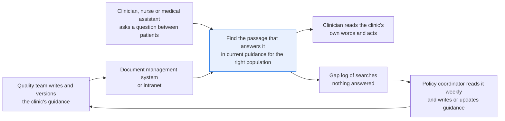
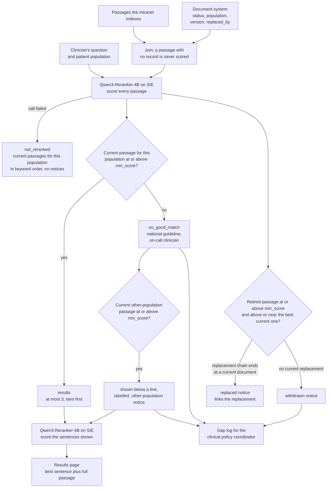

# Search clinical guidance and put the passage that answers first

> **This example:** a clinic's own protocols, searched by nurses and doctors between patients.
>
> **How it works:** Python drops retired documents and the wrong population, and a reranker orders
> the rest. No model writes an answer; the clinician reads the clinic's own words.
>
> **Use the same pattern for:** the nursing procedure manual on the ward, the current
> infection-control policy during an outbreak, order-set guidance for a diagnosis.

## Background

Every clinic and health system writes its own guidance on top of the national guidelines: when to
recheck a high blood pressure, how soon a positive FIT gets a colonoscopy, which quit program to
refer to, who phones whom about a critical potassium. It lives in a document management system
or on the intranet, a few hundred short documents, each with a section, a population (adult,
pediatric, all), a status (current or retired) and a version, kept by a clinical policy
coordinator or the quality team.

Clinicians, nurses and medical assistants search it between patients. They type a question the
way they'd ask a colleague ("child asthma action plan how often", "potassium 6.4 who calls"),
read the first few results, and act on what the top one says. The search box on most intranets
is keyword search: it puts the documents that repeat the query's words first, so the retired 2021
edition of a protocol can sit above the current one, and the adult version comes up for a child.

The document system already knows what's current and who each document is for. That's
structured, and it doesn't need a model. What does is matching how a clinician phrases a question
to the passage that answers it, when the two share few words.

Why it matters: a nurse who acts on the retired version of the FIT protocol books the colonoscopy
on the old timeline. A clinician who gets nothing useful back stops searching and asks whoever is
nearby, and the clinic's own guidance stops being used.

Here's the job end to end, and the step this recipe takes on:



## The problem

You want the passage that answers the question at the top, from current documents for the right
population, with a link to the document and its version. Keyword search gets the order wrong. A
chat model that writes an answer is a different product, with its own risks (there are other
recipes in this cookbook for that); here the clinician reads the clinic's own words.

So the recipe is search: filter on what the document system knows, rerank what's left, and say
plainly when nothing answers. Each search gets a status, which is what the person searching sees:

- **`results`**: the current passages for that population, best first, with the sentence that
  scored highest picked out, and the document's title, version and link.
- **`no_good_match`**: nothing current scored above `min_score`. The page says no passage in the
  clinic's current guidance scored as an answer (the search may have missed one) and points to
  the national guideline or the on-call contact, instead of showing the nearest passage as if it
  answered.
- **`not_reranked`**: the rerank call failed for a reason that may pass. The page shows current
  passages for that population in keyword order and says so.

And notices on the page, where they apply:

- **Replaced:** a retired document matched about as well as or better than anything current. It
  isn't shown; the page says it was replaced and links its replacement.
- **Withdrawn:** a retired document with no replacement matched. The page says the guidance was
  withdrawn, so nobody goes looking for it.
- **Other population only:** the only good match is written for adults when the search was for a
  child, or the other way round. It's shown, labelled, below a line.

Every `no_good_match` and every withdrawn or other-population-only search goes to a **gap log** for
the clinical policy coordinator, who reads it weekly and decides which guidance to write or
update. Nobody else sees it.

### Examples

Here are three of the searches in `data/searches.json`, and what should happen to each.

**1. A question the guidance answers.** Q-01, adult.
- **Input:** "An adult's office blood pressure reads 142/88 and they have no symptoms. What does our
  guidance say to do next?"
- **What should happen:** three hypertension passages share its words; a model should put
  G01, "repeat the measurement after five minutes of seated rest", first.
- **Expected outcome:** `results`, G01 first.

**2. A retired edition that matches better.** Q-02, adult.
- **Input:** "How soon after a positive FIT should the diagnostic colonoscopy take place?"
- **What should happen:** the retired 2021 edition G05 ("within 90 days") uses the question's own
  words. It's retired, so it stays off the page, and a notice says G04 ("within 60 days") replaced
  it.
- **Expected outcome:** `results` with G04, and a replaced notice for G05.

**3. A question about a withdrawn protocol.** Q-06, adult.
- **Input:** "How often should a patient doing home INR self-testing check their INR?"
- **What should happen:** the clinic retired its home INR protocol, G13, and nothing replaced it, so
  it stays off the page and a notice says it was withdrawn. The current clinic INR passage, G14, can
  only show as the current alternative, and the search goes to the gap log.
- **Expected outcome:** withdrawn notice for G13; G14 below `min_score` or shown as the current
  alternative; logged.

On the live run, 9 of 9 searches came out as expected. [What came out](#what-came-out) has the
results.

## How we'll solve it

1. **Start from the document system.** Each passage comes with section, title, population, status,
   version and the document it was replaced by. The search comes with the question and the
   population (from the patient in context, or picked by the person searching).
2. **Filter in Python.** Current documents for that population or for all go to the reranker.
   Retired and other-population passages are scored too, but only to decide the notices; they're
   never shown as results.
3. **Rerank with `Qwen/Qwen3-Reranker-4B`** on SIE, every passage against the question, with an
   instruction from `rules.yaml` saying it's judging whether a passage answers a clinical question.
   One call per search for the passages, and one for the sentences of what's shown (each sentence
   sent with its section and title), to pick out the sentence to read first. The full passage is
   always on the page next to it.
4. **Decide in Python.** Results at or above `min_score`, at most `max_results`. A retired passage
   that clears `min_score` and outscores the best current one, or comes within `notice_margin`
   log-odds of it, adds the replaced or withdrawn notice. An other-population
   passage that clears the bar when nothing for the right population does is shown below the line.
5. **Write two things:** the results page per search, and the gap log.

There's no generative model in this recipe: what the clinician reads is the clinic's own text. If
an SIE call fails for a reason that may pass (a timeout, a 5xx, a rate limit), that search falls
back to keyword order with the filters still applied and the page says so (with no notices, since
nothing was scored), and the run carries on. If SIE refuses the call or every call fails, the run
stops with SIE's message and writes nothing.

## Picking the model

There's one model, `Qwen/Qwen3-Reranker-4B`, through SIE's `score` call. It takes a query, an
instruction and a list of texts, and returns a score between 0 and 1 for each text: how likely it
is to answer the query. That's the whole job here. The document system already decided what may
be shown, so you don't need a model that writes an answer, only one that reads "potassium 6.4,
how quickly must the ordering clinician act" next to "The lab phones the ordering clinician, who
contacts the patient the same day" and says they belong together.

The same model does both calls with a different instruction from `rules.yaml`: once over the 24
passages (section, title and text), once over the sentences of what made the page. A sentence
on its own often doesn't say what it's about ("The lab phones the ordering clinician" about
what?), so each one goes with its section and title.

Its scores are strong as an order and saturated at the top. In our run, on the five searches with
a passage that really answers, that passage scored 0.9997 or more, and the retired FIT edition
beat the current one by 0.0002. That's enough to order a page. It's thin ice for a rule that
compares two near-identical passages, which comes up again under What came out. `min_score` is 0.50, the
reranker's yes/no midpoint, not a value fitted to this data.

The reranker decides nothing on its own. It never sees status, population or version, and it
can't put a retired or other-population passage on the page: Python does that, from the document
system.

## The flow



## How it's built

Everything you'd want to argue about lives in [`rules.yaml`](./rules.yaml): the model name,
which document populations count for each patient population, the status that may be shown
(`current`) and the one that only raises notices (`retired`), both instructions, `min_score`
(0.50), `max_results` (3), `notice_margin` (2.0 log-odds), the BM25 settings for the fallback, the no-good-match message and who
reads the gap log. The existing systems are small modules:

- [`document_system.py`](./document_system.py) stands in for your document management system's
  metadata call: `get_documents(ids)` by exact ID, and `find_replacement(doc_id)`, which follows
  `replaced_by` until it reaches a current document, or says why it didn't (no replacement, an ID
  the system doesn't have, a loop). It loads the committed seed `data/document_system.csv` into
  an in-memory SQLite database. Status and population are compared after trimming case and
  spaces, so " Current" is current and "draft" is never shown.
- [`keyword_search.py`](./keyword_search.py) stands in for the intranet search box: plain BM25
  over title and passage text, knowing nothing about status or population. The recipe uses it
  for the fallback and to show, in the summary, what the search box would have put first.

[`recipe.py`](./recipe.py) holds the search and the rules, in the same order as the flow.

| Step | Code | SIE call | What it does |
| --- | --- | --- | --- |
| Load | `load_rules`, `load_searches`, `check_search`, `load_passages` | none | Reads the rules and searches (an unknown population or an empty question stops before any SIE call), joins each passage to its document record; a passage with no record is never scored |
| Score passages | `GuidanceSearch.search`, `GuidanceSearch.score`, `parse_scores` | `score` | One call per search over every passage. A reply with no `scores`, a missing score or a score that isn't a finite number is a failed call |
| Filter | `classify`, `ranked` | none | Each document is `eligible` (current, right population), `retired` (right population), `other_population` (current) or `ignored` |
| Decide | `build_page`, `retired_notice` | none | Results at or above `min_score`; replaced or withdrawn notices for retired passages above the best current one or within `notice_margin` log-odds of it (`close_to_best`, `log_odds`); the below-the-line passage and its notice when nothing eligible clears the bar; the status and its reason |
| Fallback | `keyword_page` | none | When the passage call failed: eligible passages in BM25 order, `not_reranked`, no notices |
| Pick sentences | `split_sentences`, `GuidanceSearch.search`, `add_sentences` | `score` | One call over the sentences of the results and the below-the-line passage; the best one is shown above the full passage. If it fails, the page says the sentence wasn't picked |
| Gap log | `gap_line` | none | One line per search with `no_good_match`, a withdrawn notice or an other-population notice |
| Write | `write_outputs`, `render_page`, `notice_text`, `render_summary`, `csv_safe` | none | `pages/Q-xx.md`, `summary.md`, `results.json` and `gap_log.csv`, every CSV cell defused against spreadsheet formulas |

The SIE error rule is the same as in the security recipes (`SIEStopped`, `is_fatal`, `describe`,
`short`, `stop_message`, `every_call_failed_advice`, `stop_on_refusal`), with each call wrapped
in `guarded` and counted in `CallLog`. A transient failure on the passage call puts that search
in keyword order with a short reason; on the sentence call, the page keeps its results and says
the sentence wasn't picked. A refusal every call would repeat (a bad key, no credits, a model
name SIE doesn't know) stops the run with SIE's full message and writes no outputs. If every call
failed, the run stops too. The one-search command follows the same rule.

[`selfcheck.py`](./selfcheck.py) checks the filters (drafts, odd casing, a retired document for
another population), each search's page with hand-written scores, ties and near ties
between a retired and a current edition, replacement chains (two hops, a missing ID, a loop, a
replacement written for another population), sentence splitting ("6.0 mmol/L" and "38.0 C" stay
whole) and the pick, the fallback, malformed replies, the outputs and the SIE error rule, with
the committed data and stand-in replies. There's no `make_data.py`: the data is three small
hand-written files.

## Run it

You need [uv](https://docs.astral.sh/uv/) and an SIE API key
([create one](https://console.superlinked.com/console/api-keys?utm_source=github&utm_medium=docs&utm_campaign=sie-cookbook&utm_content=healthcare-search-clinical-guidance)).

```bash
cp .env.example .env   # then set SIE_API_KEY
uv run recipe.py                                                       # the 9 sample searches
uv run recipe.py "asthma action plan how often" --population pediatric   # one search
uv run selfcheck.py    # optional: offline checks, no SIE call
```

`uv run` installs this recipe's few dependencies into its own `.venv` on the first run. The
sample run writes `runs/<timestamp>/`; one search only prints its page. The first call can wait a
few minutes while SIE Cloud starts the reranker. A warm sample run makes 16 SIE calls (9 passage
calls and 7 sentence calls; the two searches with nothing to show skip the second) and took about
6 seconds.

## What came out

The input is three files in [`data/`](./data):

- `document_system.csv`: 24 guidance documents across ten sections, with section, title,
  population (`adult`, `pediatric` or `all`), status (`current` or `retired`), version and
  `replaced_by`. G05 is the retired 2021 edition of the FIT protocol, replaced by G04; G13, home
  INR self-testing, is retired with no replacement.
- `passages.jsonl`: the text of each document, what the intranet search indexes.
- `searches.json`: 9 searches, each with the patient population.

> **The guidance is synthetic:** written for this demo as the internal guidance of a fictional
> clinic network (Larkspur). It is not real clinical guidance and is not copied from any
> published guideline. No US-government text was used, so there is no license to record.

### The three examples

**1. A question the guidance answers.** Q-01, adult.
- **Expected outcome:** `results`, G01 first.
- **What came back:** `results`: G01 (0.9998), then G02 (0.9968); G03 at 0.0571 stayed off.
- **Verdict:** Pass.

**2. A retired edition that matches better.** Q-02, adult.
- **Expected outcome:** `results` with G04, and a replaced notice for G05.
- **What came back:** `results`: G04 (0.9997), with a replaced notice for G05 (0.9999).
- **Verdict:** Pass. G05 scored a hair higher, and keyword search put G05 first.

**3. A question about a withdrawn protocol.** Q-06, adult.
- **Expected outcome:** withdrawn notice for G13; G14 below `min_score` or shown as the current
  alternative; logged.
- **What came back:** `results`: G14 (0.7876) as the current alternative; withdrawn notice for G13
  (0.9999); logged.
- **Verdict:** Pass. G14 is about clinic visits, not home testing, and its best sentence scored
  0.4944, under the bar a passage needs. The page still shows it as a plain result, so the notice is
  what tells the nurse the clinic stopped doing this.

### Results

On the live run on 4 Nov 2026 (UTC), 9 of 9 searches came out as expected.

**Where it works:** the model put the passage that answers first when several share the topic (blood
pressure, Q-01; critical potassium, Q-08) and picked the right sentence inside a passage (HbA1c
interval, Q-09). Python kept retired documents off the page (the old FIT edition, Q-02; home INR
testing, Q-06) and the wrong population off it or below a line (child asthma plan, Q-03; child
retinal screening, Q-07), including where keyword search put them first (Q-02, Q-06, Q-07). When
nothing answered, the page said so (hypnotherapy, Q-04; yellow fever vaccine, Q-05).

**Where it fails:** Q-06 is the one to worry about, because a passage that doesn't answer the question
still shows as a plain result. The filter also stops at population: Q-07 mixes adult and child with
type 1 and type 2 diabetes, and it only catches the first. And nothing checks for two current
documents that disagree; these nine searches don't include that.

Four searches (Q-04, Q-05, Q-06, Q-07) went to the gap log. Two things in the sample guidance were
worded for the demo, and no rule or threshold was fitted to this data:

- G04 and G05 were worded the way real editions tend to be. Current editions don't copy the
  clinician's phrasing and retired ones often use the old shorthand, so G04 says "aim to
  complete it within 60 days" and G05 uses "positive FIT", the way the question does.
- G10, the HbA1c guidance, gives its two intervals in two sentences, so the sentence pick has
  something to choose between.

Treat all of this as a demo that the wiring works, not as a measure of accuracy: nine searches
tell you the pieces fit, not how often the order is right.

A few things worth noticing:

- **The two FIT editions score almost the same.** G05 at 0.9999 against G04 at 0.9997 is about
  1.1 apart in log-odds, inside `notice_margin` (2.0), so Q-02 gets the replaced notice whichever
  edition comes out a hair ahead. Compared as raw scores, the notice would hang on the fourth
  decimal, and the nurse who remembers the 90-day rule would only be told it changed when the old
  edition happened to score higher.
- **Keyword search really does put the old version first.** The summary shows the search box's
  first three hits next to each page. For Q-02 it's G05, the retired edition; for Q-06 it's G13,
  the withdrawn protocol; for Q-07 it's G12, the adult passage, for a child. The reranker scored
  all three of them high too (0.9999, 0.9999, 0.5974). It agrees with keyword search about what
  the passage is about. It just isn't allowed to decide whether it's current.
- **Q-06's result is the current alternative, not the answer, and the sentence score hints at
  it.** G14 passed at 0.7876, but its best sentence scored 0.4944, under the bar a passage needs:

  ```text
  # Q-06: results

  ### 1. Clinic INR monitoring (G14)

  Anticoagulation, version 2025.1, written for adult patients. Score 0.7876.
  Best sentence (score 0.4944):
  > Patients taking warfarin who attend the anticoagulation clinic have their INR checked at every clinic visit.

  ## Notices

  - Withdrawn: G13 'Home INR self-testing', version 2020.2 (retired, score 0.9999) matched about as well as or better than the best current passage. It is not shown, and nothing current replaces it (no replacement).
  ```

  The withdrawn notice is what tells the nurse the clinic stopped doing this, and the gap log is
  what tells the coordinator someone is still asking.
- **The gap log has four lines, one per search**, each with the closest current passage and its
  score. Q-07's closest current passage for a child is G08, the asthma plan, at 0.0001, which
  is as close as the clinic's pediatric guidance gets to retinal screening (reason cut short):

  ```csv
  search_id,population,question,status,notices,closest_passage,closest_score,reason,owner
  Q-07,pediatric,When should a child with type 1 diabetes have their first retinal screening?,no_good_match,other_population,G08,0.0001,"No good match: ...",clinical policy coordinator
  ```

### What you do next

The clinician reads `pages/Q-xx.md`: the best sentence, the full passage under it, and any
replaced, withdrawn or other-population notice, and acts on the clinic's own words or, on a
`no_good_match` page, goes to the national guideline or the on-call contact. The clinical policy
coordinator reads `gap_log.csv` weekly (four lines here: Q-04, Q-05, Q-06, Q-07) and decides which
guidance to write or update. Nobody else sees the gap log.

## Potential improvements

- **Your documents.** Split your own guidance into passages in `passages.jsonl`, and point
  `document_system.py` at your document management system for status, population, version and
  replacements. Public-domain US-government text (for example CDC pages) can go here too;
  record its source in this README.
- **Populations and statuses.** `population.eligible` in `rules.yaml` says which document
  populations may answer a search about each patient population (add `geriatric`, `pregnancy`,
  and so on). `status.shown` and `status.retired` name the statuses. Adult and pediatric aren't
  enough for questions that depend on an exact age, pregnancy or diabetes type; Q-07 mixes a
  population mismatch with a type 1 and type 2 mismatch, and the filter only catches the first.
- **Thresholds.** `min_score` (0.50), `max_results` (3) and `notice_margin` (2.0). They were set before the live run and
  not changed after it. Treat them as starting points and check them on your own searches.
- **The replaced notice.** `notice_margin` keeps two near-equal editions from flipping the notice,
  but a retired edition clearly below its replacement still raises nothing. Raising the notice
  for any retired passage that clears `min_score` and whose replacement is on the page would tell
  the nurse about the change every time.
- **A weak best sentence.** When a result's best sentence scores under `min_score` (Q-06's G14
  at 0.4944), the page could label it "related" instead of a plain result.
- **Two current documents that disagree.** Nothing checks for them. Two current passages giving
  different intervals for the same thing would both show up as results, which is at least
  visible; a check in the document system is the right place to catch it.
- **Models.** `models` in `rules.yaml`.

## Try another model

The model is one line under `models:` in `rules.yaml`. On 4 Nov 2026 (UTC) we swapped it,
changed nothing else, and ran the 9 sample searches on SIE Cloud.

| `rules.yaml` key | Swap in | What happened on this data |
| --- | --- | --- |
| `rerank` | `Qwen/Qwen3-Reranker-0.6B` | Same 9 statuses, the same results and the same notices, with the same 4 searches on the gap log. G05 still beat G04 (0.9999 against 0.9995). Q-08's sentence pick went to "A potassium result above 6.0 mmol/L is a critical value." instead of the phone-call sentence; the other picks were the same |
| `rerank` | `tencent/R3-rerank-0.6b` | Lost both retired notices: G04 beat G05 by 0.0009 (0.829 against 0.8281) and G14 beat G13 (0.8244 against 0.8213). Q-04 became `results` with the tobacco brief-advice passage G15 at 0.5143, which doesn't mention hypnotherapy. Only Q-05 and Q-07 went to the gap log. Its scores sit between about 0.12 and 0.84, so `min_score` 0.50 is close to unrelated passages; raise it if you use this model |

See [MODELS.md](../../MODELS.md) for every model these recipes use.

## Run it on your own SIE

The same code runs against an SIE server you host. Set `SIE_BASE_URL` in `.env`; an API key
is then optional. The table gives the SIE v0.10.1 image each model runs on, from SIE's
[compatibility matrix](https://github.com/superlinked/sie/blob/main/docs/compatibility.md).

| `rules.yaml` key | Model | Image | Tested on |
| --- | --- | --- | --- |
| `rerank` | `Qwen/Qwen3-Reranker-4B` | `cuda12-default` | L4 |

One container serves it:

```bash
docker run --gpus all -p 8080:8080 -v sie-hf-cache:/app/.cache/huggingface \
  ghcr.io/superlinked/sie-server:v0.10.1-cuda12-default
# then set SIE_BASE_URL=http://localhost:8080 in .env and run: uv run recipe.py
```

## Files

- `recipe.py`: the search (`GuidanceSearch.search`), the filters, notices and gap log, and the
  command line
- `document_system.py`, `keyword_search.py`: stand-ins for the document management system and
  the intranet search box
- `selfcheck.py`: plain asserts on the filters, notices, replacement chains, sentence pick,
  fallback, reply parsing, outputs and the SIE failure rule, no SIE call (`uv run selfcheck.py`)
- `rules.yaml`: model, populations, statuses, instructions, thresholds and the gap log owner
- `data/`: the document system seed, the passage text and the sample searches
- `pyproject.toml`, `uv.lock`: this recipe's dependencies

See the SIE task page for [reranking](https://superlinked.com/rerank?utm_source=github&utm_medium=docs&utm_campaign=sie-cookbook&utm_content=healthcare-search-clinical-guidance).
