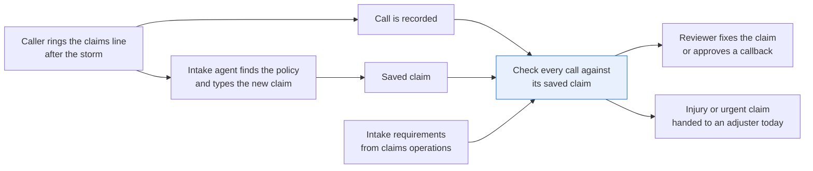
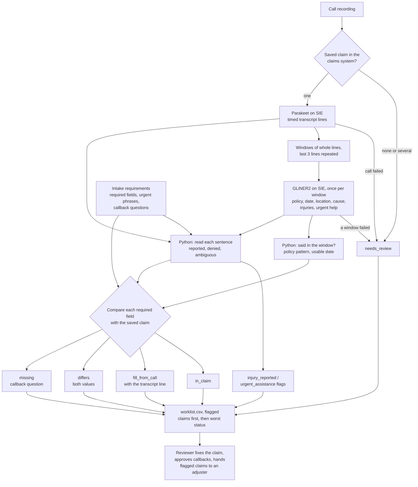

# Check a recorded call against the claim record that was saved

> **This example:** a call reviewer checking first-notice-of-loss calls for missed fields, injuries
> and urgent help.
>
> **How it works:** speech to text transcribes the call, an extraction model pulls the claim
> fields, and Python compares each one with the saved claim.
>
> **Use the same pattern for:** a recorded statement against the adjuster's notes, a total-loss
> settlement call checked for required disclosures, a status call against its file note.

## Background

After a big storm, a homeowners insurer's claims line takes hundreds of first-notice-of-loss
(FNOL) calls a day. The intake agent answers on a headset with the claims system's new-claim
screen open. They find the policy (by number if the caller has it, otherwise by name and
address), confirm the property, and ask what happened, when, and whether anyone was hurt. They
type the answers into the fields and the notes box, save the claim, and tell the caller an
adjuster will be in touch. The call is recorded.

The saved claim is what everyone works from next. The adjuster triages from it, and the claims
system routes it. So when the agent misses something, it matters: a blank date of loss holds the
claim up, an injury the caller mentioned but nobody ticked doesn't get seen first, and a house
number typed as 78 instead of 87 sends the field adjuster to the neighbor's door. With a
queue on the screen and the next caller waiting, some of this is going to happen.

That's why claims operations runs call quality review. A reviewer, or the intake team lead,
takes saved claims, plays back the recording next to the claim screen, and checks one against
the other. Where the call has something the claim doesn't, they fix the claim. Where neither
has it, they set up a callback with the question to ask. Where the caller said something that
needs someone today (an injury, water still coming in, a house nobody can live in), they get it
to an adjuster now. It's careful work, and nobody can do it faster than they can
listen, which is why only a sample gets reviewed.

The claims system already gives you the saved claim, structured: claim number, the policy the
agent found, the insured, the callback phone, and whatever went into the date of loss, location,
cause and injury fields. Missing from the call doesn't mean missing from the claim; a caller
with no policy number is normal, because the agent looked the policy up by name. The recording
is the only unstructured part, and the only part a model needs to touch.

Here's the intake job end to end, and the step this recipe takes on:



## The problem

You want every call checked against its saved claim, not a sample, with the reviewer only
looking at the claims where the two disagree or something is still missing.

Reading the transcript alone isn't enough, and that's the mistake the obvious version makes: it
treats "not said on the call" as "missing from the claim" and books a callback asking the
customer for their policy number, which the agent already found. The reverse happens too: a
value said clearly on the call can still be missing or wrong in the claim, and only the
comparison shows it. And an injury rule that throws out any sentence with a "not" in it reads
"he was hurt but didn't need an ambulance" as nobody hurt.

Which fields are required, and what counts as needing someone today, isn't the recipe's call.
Claims operations owns the intake requirements: the fields every new claim must have and the
triage triggers the intake script tells agents to escalate. They come in as a file
(`intake_requirements.yaml`), along with the callback question to ask for each field.

For each required field (in this file: date of loss, location, cause, injuries, policy), the
recipe gives a **field status**:

- **`in_claim`**: the claim has it, and the call agrees or doesn't mention it.
- **`fill_from_call`**: the claim is blank, the call has it. The value comes with the transcript
  line and timestamp, so the reviewer can hear it and copy it in.
- **`differs`**: the claim and the call disagree. Both values are shown.
- **`missing`**: neither has it. This field becomes a callback question.

For each call, a **check status** that names what the checks found. Worst first:
**`needs_review`** (the recipe couldn't do the check: no saved claim for the recording, a failed
SIE call, or a transcript too short to trust), **`callback_needed`** (at least one field
`missing`), **`differs`**, **`fill_from_call`** and **`checks_passed`** (every field `in_claim`).
On top of that, two flags that put the claim at the top of the list: **`injury_reported`** when the
caller describes someone being hurt, and **`urgent_assistance`** when they describe water still
coming in or a home they can't stay in. An ambiguous injury sentence raises the flag and says
it's ambiguous; a missed injury costs more than a second look.

Nothing is changed in the claims system, and nobody is called automatically. The reviewer fixes
the claim, approves the callback, or hands the flagged claim to an adjuster.

### Examples

Here are three of the inputs in `data/`, and what should happen to each.

All of this is synthetic, written for this recipe. The calls are scripts spoken by macOS `say`, and
no real person, policy or claim is in them.

**1. A complete call.** Quintero.
- **Input:** `fnol-1021-quintero.wav`, a call where the caller gives every field ("It's H M 4 4 7 1
  2 0 9 3.", "On Tuesday night, October 20th, around nine o'clock.", "No, nobody was hurt."), and
  the saved claim `CLM-26-104417` for Marisol Quintero: policy HM44712093, phone (415) 555-0141,
  date of loss 2026-10-20, at 214 Alder Creek Road, Millbrook, hail and wind, injuries "No".
- **What should happen:** every required field is in the claim and the call agrees, so nothing
  needs fixing and no flag goes up.
- **Expected outcome:** `checks_passed`, no flag.

**2. An injury the claim lost, and a date nobody asked for.** Vellanki.
- **Input:** `fnol-1021-vellanki.wav`, where the caller says "My husband cut his arm on the broken
  glass when he went out to look. We took him to urgent care and he needed stitches." The saved
  claim `CLM-26-104419` has injuries "No" and a blank date of loss, and the agent never asks when
  it happened.
- **What should happen:** the claim says nobody was hurt and the caller says someone was, so both
  values get shown and the injury flag goes up. The date of loss is in neither, so it becomes a
  question for a callback.
- **Expected outcome:** `callback_needed` (date of loss), injuries `differs`, `injury_reported`.

**3. Hurt, but "he didn't need an ambulance".** Okafor.
- **Input:** `fnol-1021-okafor.wav`, where the caller says "My son was out on the porch. He was
  hurt but he didn't need an ambulance." The saved claim `CLM-26-104420` has injuries "No".
- **What should happen:** the "didn't" is about the ambulance, not the injury, so this can't read
  as nobody hurt. The injury flag goes up and says the sentence is ambiguous, and a person listens
  to it. That costs a second look, which is cheaper than a missed injury.
- **Expected outcome:** `differs` on injuries, `injury_reported (ambiguous)`.

On the live run, 7 of 7 cases came out as expected. [What came out](#what-came-out) has the results.

## How we'll solve it

1. **Start from the saved claim and the intake requirements.** The recipe looks the claim up in
   the claims system by the call recording's file name and gets the claim number, policy number,
   insured, callback phone, and the date of loss, location, cause and injury fields as the agent
   saved them (blank where they're blank). No saved claim, or two of them, and the call goes to
   review before any model runs. `intake_requirements.yaml` lists the required fields, the
   urgent triggers and the callback question for each field.
2. **Transcribe the call.** `parakeet-tdt-0.6b-v3` turns the audio into timed sentence lines, so
   every value can point at the second it was said.
3. **Fill the claim fields from the transcript.** `gliner2-large-v1` reads the transcript in
   overlapping windows and returns the policy number, date of loss, location, cause, injuries
   and any sign that help is needed now. A value only counts if it was said in its window. Two
   different values for one field (a caller who corrects the house number) are both kept.
4. **Check the values in Python.** The policy number must match your policy pattern, and a date
   of loss must name a day or a date ("during the storm" doesn't count). An injury is reported
   when a sentence that isn't a question has an injury word; a negation only cancels it when it
   negates the injury itself ("nobody was hurt"), and a sentence that does both is flagged as
   ambiguous. Urgent help works the same way, with claims operations' urgent phrases ("still
   coming through", "staying with family").
5. **Compare with the claim, field by field.** Each field gets `in_claim`, `fill_from_call`,
   `differs` or `missing`. Addresses compare after normalizing ("St" and "Street", "unit 2" and
   "#2"); dates compare as dates; the cause compares by peril (hail, wind, flood, fallen tree).
   A value the recipe can't compare ("yesterday" or a weekday alone against a saved date) is
   `differs`, with both shown, so a person looks.
6. **Write the worklist.** One row per call with its status, flags and the callback questions,
   injury and urgent claims first, and one JSON record per call with the timed transcript and
   every field's evidence.

If an SIE call fails for a reason that may pass (a timeout, a 5xx, a rate limit, an over-long
window), that call goes to review with the reason (a failed window may hide a correction, so it
never counts as "nothing said") and the run carries on; if SIE refuses the call (a bad key, an
unknown model, no credits) or every call fails, the run stops with SIE's message and writes
nothing.


## Picking the models

Two models, both on SIE's `extract` endpoint, and neither of them makes a decision.

**`nvidia/parakeet-tdt-0.6b-v3`** turns each recording into text, once per call. We ask for
sentence segments with start times (`timestamp_granularities: ["segment"]`), and each segment
becomes a numbered transcript line. That matters twice: every value in the output points at the
line and second it was said, so the reviewer can jump straight to it in the recording, and the
injury and urgency rules read one sentence at a time. Parakeet punctuates, and the recipe leans
on that: a line ending in `?` is a question and never counts as a report. What it doesn't do is
say who is speaking (more on that under Potential improvements). It is also only as good as the
audio. On synthetic voices it hears plain street names fine and stumbles on unusual ones, which
you'll see under What came out.

**`fastino/gliner2-large-v1`** fills a small schema from the transcript, once per window. The
schema is the `fields` block in `rules.yaml`: policy number, date of loss, location, cause,
injuries and urgent help, each with a one-line description that goes to the model. GLiNER2
returns short spans copied from the text, which is what you want here, since every span is then
checked against the window it came from. It reads about 512 tokens at a time, so the transcript
goes in windows of whole lines up to 180 words, each repeating the last 3 lines of the one
before, so a question and its answer stay together. On these short calls every transcript fit in
one window. The weak spot is that a span isn't a judgment: on two calls it returned "nobody" as
the injury, from "No, nobody was hurt." The recipe drops a span that sits on a sentence that only
denies the injury, and leaves a note.

Why not a chat model reading the transcript and the claim? Because what counts as missing,
different or urgent is claims operations' call, and they already wrote it down. The models do
the two things rules can't (hear the audio, find the value in a sentence), and the rules you can
read in `intake_requirements.yaml` and `rules.yaml` do the rest.

## The flow



## How it's built

What a claim must have belongs to claims operations, so it lives in its own file:
[`intake_requirements.yaml`](./intake_requirements.yaml) holds the five required fields with the
callback question for each, and the two urgent triggers with their phrases. How the recipe reads
a call lives in [`rules.yaml`](./rules.yaml): the two model names, the window size and overlap,
the shortest transcript worth trusting (20 words), the fields GLiNER2 is asked for, the policy
number pattern, the words that make a date usable, the address words that mean the same thing,
the perils, and the clause, negation, hedge and partial words the sentence rule uses. The saved
claim comes from [`claims_system.py`](./claims_system.py), a small lookup over
[`data/claims.csv`](./data/claims.csv) in an in-memory SQLite database. It stands in for a call to
your claims system (for example a Guidewire ClaimCenter claim lookup by the call's recording ID)
and matches the recording's file name exactly: one claim is found, none or several go to review.
[`recipe.py`](./recipe.py) reads top to bottom in the order of the flow.

| Step | Code | SIE call | What it does |
| --- | --- | --- | --- |
| Load the rules | `load_rules`, `load_requirements` | none | Stops at the start if claims operations requires a field the recipe can't read or compare |
| Find the saved claim | `ClaimsSystem.find_claim`, `process_call` | none | One claim per recording; none or several sends the call to review with no SIE call |
| Transcribe | `transcribe` | `extract` (audio) | Once per call. Parakeet's sentence segments become numbered lines with start times. A reply without `data.segments` is a failed call |
| Window and extract | `windows`, `extract_candidates`, `output_schema` | `extract` + `output_schema` | Once per window, with `overflow_policy: error`, so a window too long to read whole fails instead of being cut short. Every field value GLiNER2 returns, with the window it came from. A failed window sends the call to review |
| Check the values | `usable`, `locate`, `valid_policy`, `heard_values` | none | The value must be in its window's text; a policy number must match the pattern (a number with 6 or more digits that doesn't is kept, so it can't vanish); a date must name a day or a date. Distinct values are kept in the order they were said; a value counts as the same as a longer one only when its whole words sit inside it ("14 Alder Creek Road" and "214 Alder Creek Road" stay apart) |
| Injuries and urgent help | `read_trigger`, `decide_trigger` | none | Each sentence that isn't a question is cut into clauses and read as reported, denied or ambiguous. A model span no sentence confirms still raises the flag, marked ambiguous; spans on a denial are dropped before the first remaining span is taken |
| Compare | `compare_field`, `compare_injuries`, `same_date`, `same_address`, `same_cause` | none | `in_claim`, `fill_from_call`, `differs` or `missing` per field; two values from the call, a policy number off the pattern, or a value that can't be compared are `differs` |
| SIE failures | `Calls.call`, `is_fatal`, `stop_message`, `stop_on_refusal` | none | A transient failure or a reply missing its key sends the call to review; a refusal, or every call failing, stops the run without outputs |
| Outputs | `worklist_rows`, `write_outputs`, `csv_safe` | none | `worklist.csv` (flagged claims first, then worst status) and `claims/<recording>.json`. A cell a spreadsheet would run as a formula gets a leading `'` |

[`selfcheck.py`](./selfcheck.py) checks all of this offline with hand-written transcript lines
and stand-in model replies: the claims lookup (found, not found, several, a neighboring file
name); the sentence rule on every wording in the sample calls plus "not badly hurt", "nobody else
was hurt" and a trigger phrase that holds its own negation ("no power"); the transposed house
number, the dropped unit, a neighboring street type and another town; spoken dates with times, glued
ordinals, a day with no month, another year, relative words, a weekday alone and two dates in one
span; values a digit apart ("October 2" and "October 20", "HM4471209" and "HM44712093") kept as two
values; a denial span heard before a real injury; saved injury text such as "Not injured" and
"Pending"; a value not said in its own window; a transcript too short to trust; a near-identical
policy number and one off the pattern; the cause by peril; `overflow_policy` on every window call;
the statuses and the worklist order; `csv_safe`; and the SIE failure rule with a transient error, a
refusal, every call failing, a reply missing its key and the empty-result 500.
[`make_data.py`](./make_data.py) writes the claims seed and renders the call audio.

## Run it

**Try this recipe on [SIE Serverless](https://superlinked.com/serverless?utm_source=github&utm_medium=docs&utm_campaign=sie-cookbook&utm_content=insurance-check-call-against-claim-record).** You pay per call and there are no GPUs to run.

You need [uv](https://docs.astral.sh/uv/) and an SIE API key
([create one](https://console.superlinked.com/console/api-keys?utm_source=github&utm_medium=docs&utm_campaign=sie-cookbook&utm_content=insurance-check-call-against-claim-record)).

```bash
cp .env.example .env   # then set SIE_API_KEY
uv run recipe.py
uv run selfcheck.py    # optional: offline checks, no SIE call
uv run --group data make_data.py   # optional: rewrite data/ (the audio needs macOS)
```

`uv run` installs this recipe's few dependencies into its own `.venv` on the first run. Each run
writes `runs/<timestamp>/` in this folder. A run makes 10 SIE calls on this data: 5 to Parakeet
(one per call) and 5 to GLiNER2 (one window per call). Our runs on 2026-11-04 (UTC) took 5 s.
The first calls can wait a few minutes while SIE Serverless starts the speech and extraction models.

## What came out

### The three examples

**1. A complete call.** Quintero.
- **Expected outcome:** `checks_passed`, no flag.
- **What came back:** `checks_passed`, no flag.
- **Verdict:** Pass.

**2. An injury the claim lost, and a date nobody asked for.** Vellanki.
- **Expected outcome:** `callback_needed` (date of loss), injuries `differs`, `injury_reported`.
- **What came back:** `callback_needed` with "date_of_loss: On what date, and at about what time,
  did the damage happen?", plus "injuries: claim 'No', call 'Yes' [00:26]" and `injury_reported`.
- **Verdict:** Pass.

**3. Hurt, but "he didn't need an ambulance".** Okafor.
- **Expected outcome:** `differs` on injuries, `injury_reported (ambiguous)`.
- **What came back:** `differs` with "injuries: claim 'No', call 'Yes' [00:36]" and
  `injury_reported (ambiguous)`.
- **Verdict:** Pass. The recipe doesn't settle what the sentence means. It marks it ambiguous and an
  adjuster hears it, so a sentence like this one always costs a second look.

### Results

On the live run on 2026-11-04 (UTC), 7 of 7 cases came out as expected.

**Where it works:** when the call and the saved claim can be read side by side. The complete call
(Quintero) passes clean. The policy number the agent found by name stays out of the callbacks, and
the transposed house number shows both values (both Achterberg). The lost injury and the date nobody
asked for both come up (both Vellanki). "He didn't need an ambulance" (Okafor) and the rain still
coming in on a complete call (Delacroix) still raise their flags.

**Where it fails:** what this run didn't test. These are five clean text-to-speech recordings in
voices Parakeet hears well; with other voices, the same values came out as `differs`. "Yesterday" or
"Tuesday night" comes out as `differs` too, because it can't be compared with a saved date, a cause
told with a negation ("hail, no wind") reads as both perils, and we haven't tried a noisy,
interrupted call. Try those on your own calls first.

The input is five synthetic calls in [`data/`](./data) (16 kHz mono WAV, 39 to 44 s each) and
[`data/claims.csv`](./data/claims.csv), the five claims the intake agent saved from them.

> **The audio is macOS text-to-speech, not real calls.** [`make_data.py`](./make_data.py) holds
> the scripts and renders them with the built-in `say` command (one voice for the agent, another
> for each caller) and `afconvert`. Every caller, policy number, claim number, phone number,
> address and the insurer (Harborline Mutual) is invented; the phone numbers are in the
> 555-0100 to 555-0199 range set aside for fiction.

Seven cases on five calls show the wiring works end to end; they don't measure accuracy, and
your calls will find things these don't.

- **The worklist reads the way a reviewer works.** Here are its first two rows, the two injury
  claims, ahead of everything else:

  ```csv
  claim_number,insured,callback_phone,recording,flags,check_status,fill_from_call,differs,callback_questions,review_reasons
  CLM-26-104419,Priya Vellanki,(415) 555-0123,fnol-1021-vellanki.wav,injury_reported,callback_needed,,"injuries: claim 'No', call 'Yes' [00:26]","date_of_loss: On what date, and at about what time, did the damage happen?",
  CLM-26-104420,Tomas Okafor,(415) 555-0164,fnol-1021-okafor.wav,injury_reported (ambiguous),differs,,"injuries: claim 'No', call 'Yes' [00:36]",,
  ```

  Vellanki needs two things from two people: someone fixes the injury field now, and someone
  calls her back about the date. The row says both.

- **The Achterberg policy number is the case the obvious version gets wrong.** The transcript
  has "Do you have your policy number?" and "Not with me." and no number. Reading the call alone,
  that's a callback. With the saved claim next to it, the field is `in_claim` and nobody phones a
  customer with a flooded basement to ask for paperwork that's in the flooded basement.

- **Okafor's flag says why it's ambiguous.** The JSON record keeps the sentence and the second
  it was said, so the adjuster hears it before deciding anything:

  ```json
  {
    "flag": "injury_reported",
    "ambiguous": true,
    "detail": "Ambiguous: the sentence both reports and denies it ('He was hurt but he didn't need an ambulance.')",
    "evidence": [{"line": 16, "at": "00:36", "text": "He was hurt but he didn't need an ambulance."}]
  }
  ```

- **Delacroix is complete and still first in line after the injuries.** All five fields are
  `in_claim`, so the check status is `checks_passed`. The `urgent_assistance` flag comes from
  line 13, "Rain is still coming through the bedroom ceiling, and we are staying with family
  until it is fixed." Parakeet wrote the street as "62 Harborview Road"; the address compare drops
  the spaces in the street name, so it matched "62 Harbor View Road".

- **The voices are picked so Parakeet hears the values in the scripts.** With the `Fred` voice,
  Parakeet heard "87 Larkspur Lane, Fenwick" as "87 larks per lane, unit 2, fanny"; with `Kathy`
  it heard "P R 7 1 9 4 0 2 5 8" as "TR71940258" and "Harbor View" as "Harperview". Those come
  out as `differs`, the safe direction (a reviewer listens and finds the claim was right), but
  they bury the cases we wrote, so Achterberg uses `Karen` and "87 Maple Street, unit 2, Oakdale"
  and Delacroix uses `Tessa`. Spelled-out letters and unusual street names in synthetic speech are
  a weak spot. `say` output can change between macOS versions; the committed WAVs are the inputs
  of record.

### What you do next

The reviewer opens `worklist.csv`, where the injury and urgent claims sit at the top. They copy
`fill_from_call` values into the claim, check each `differs` by jumping to the transcript line
and second in `claims/<recording>.json`, approve the callback questions, and hand flagged claims
to an adjuster today. Nothing changes in the claims system and nobody is called until they do.

## Potential improvements

- **Your own required fields.** `required_fields` in `intake_requirements.yaml` is claims
  operations' list, with the callback question for each. The recipe compares five kinds of field
  (policy, date, location, cause, injuries) and stops at the start if the list names another, so a
  new field (say, a vehicle VIN for auto claims) needs a field in `rules.yaml` and a comparison in
  `same_value`.
- **Your own urgent triggers.** The `phrases` under `urgent_triggers` decide `injury_reported` and
  `urgent_assistance`. When the model reads an injury or urgent help that no sentence confirms,
  the flag still goes up, marked ambiguous, instead of being dropped.
- **Your policy format and date words.** `policy_number_pattern` is your insurer's policy format
  (spaces, dots and dashes are dropped first). `date_words` are the words that make a date of
  loss usable.
- **The sentence rule.** `clause_words`, `negation_words`, `hedge_words` and `partial_words`
  drive the injury and urgency reading. A clause with a trigger and a negation is a denial;
  "Nobody else, but my son was hurt" reads as a report, because the report sits in its own
  clause. Check the rule on your own calls.
- **Thresholds.** `thresholds` in `rules.yaml` are starting points (180-word windows, 3 lines of
  overlap, 20 words for a transcript worth trusting). Check them on your own calls. `models`
  names the two models, one line each.
- **Speakers.** Parakeet doesn't label who is speaking, so a value the agent reads back counts the
  same as one the caller says. Questions (lines ending in `?`) never count as a report, which
  means a transcript that drops the question mark turns "Was anyone hurt." into an injury report.
  That errs towards a second look, but speaker labels would fix it properly.
- **Unpunctuated transcripts.** The sentence rule needs sentence ends. Whisper ran two turns
  together on the Delacroix call (see Try another model), and the urgency flag came out ambiguous
  because "nobody was hurt" landed in the same clause as "staying with family".
- **Known SIE Serverless issue.** When GLiNER2 finds no field in a window, SIE Serverless currently answers
  the `output_schema` call with HTTP 500 "Inference completed without a valid conserved billing
  settlement". The recipe reads that as "no fields found" in that window, with a note, instead of
  retrying, since a retry gets the same 500. A blank field then becomes a callback question, never
  a pass; a field the claim already has stays `in_claim`, the same as for a call that didn't
  mention it. Any other failed window sends the call to review.
- **Relative dates.** "Yesterday" or "Tuesday night" can't be compared with a saved date today,
  so it comes out as `differs`. Passing the call's own date from the telephony system would let the recipe resolve
  it.
- **Harder calls to add next.** A caller who corrects the policy number in a later window, a
  call that gives both the day the damage happened and the day it was found, a cause told with a
  negation ("hail, no wind", which reads as both perils today) and a noisy, interrupted call.

## Try another model

Each model is one line under `models:` in `rules.yaml`. We swapped one model at a time, changed
nothing else, and ran the recipe on SIE Serverless on 2026-11-04 (UTC).

| `rules.yaml` key | Swap in | What happened on this data |
| --- | --- | --- |
| `transcribe` | `openai/whisper-large-v3-turbo` | Six of the seven cases came out the same. Okafor gained a second `differs`: Whisper heard "455 Birch Avenue" as "455 Bridge Avenue". Delacroix kept `checks_passed` and `urgent_assistance`, but the flag came out ambiguous: Whisper ran the last turns together without punctuation, so "nobody was hurt" shared a clause with "staying with family". |
| `extract` | `fastino/gliner2-base-v1` | Every case came out the same. On Vellanki it also returned "urgent care" as urgent help, so that claim gained `urgent_assistance (ambiguous)`. It missed Quintero's date of loss; the claim has it, so the field stayed `in_claim`. |

See [MODELS.md](../../MODELS.md) for every model these recipes use.

## Run it on your own SIE

The same code runs against an SIE server you host. Set `SIE_BASE_URL` in `.env`; an API key
is then optional. The table gives the SIE v0.10.1 image each model runs on, from SIE's
[compatibility matrix](https://github.com/superlinked/sie/blob/main/docs/compatibility.md).

| `rules.yaml` key | Model | Image | Tested on |
| --- | --- | --- | --- |
| `transcribe` | `nvidia/parakeet-tdt-0.6b-v3` | `cuda12-transformers5` | L4 |
| `extract` | `fastino/gliner2-large-v1` | `cuda12-default` | L4 |

One SIE server runs one image, so these 2 images need a cluster: the
[sie-cluster Helm chart](https://github.com/superlinked/sie/tree/main/deploy/helm/sie-cluster)
with one worker pool per image routes each model to its pool. See
[SELF_HOSTING.md](../../SELF_HOSTING.md) for the values file.

## Data and licenses

All data is synthetic and written by [`make_data.py`](./make_data.py): the call scripts, rendered
with macOS `say` and `afconvert`, and the claims seed. No real person, policy, claim or phone
number is in it. `make_data.py` rebuilds `claims.csv` byte for byte anywhere; the audio rebuilt
byte for byte on our machine, and another macOS version can give slightly different audio.

## Files

- `recipe.py`: the pipeline
- `claims_system.py`: the claims-system lookup over `data/claims.csv`
- `intake_requirements.yaml`: claims operations' required fields, callback questions and urgent
  triggers
- `rules.yaml`: models, extraction fields, policy pattern, date, address and peril words, the
  sentence rule, thresholds
- `selfcheck.py`: offline checks, no SIE call
- `make_data.py`: the call scripts, the `say`/`afconvert` rendering and the claims seed
- `data/`: the five call recordings (WAV) and `claims.csv`
- `pyproject.toml`, `uv.lock`: this recipe's dependencies

See the SIE task page for [speech to text](https://superlinked.com/speech-to-text?utm_source=github&utm_medium=docs&utm_campaign=sie-cookbook&utm_content=insurance-check-call-against-claim-record).
