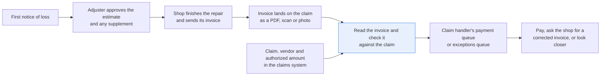
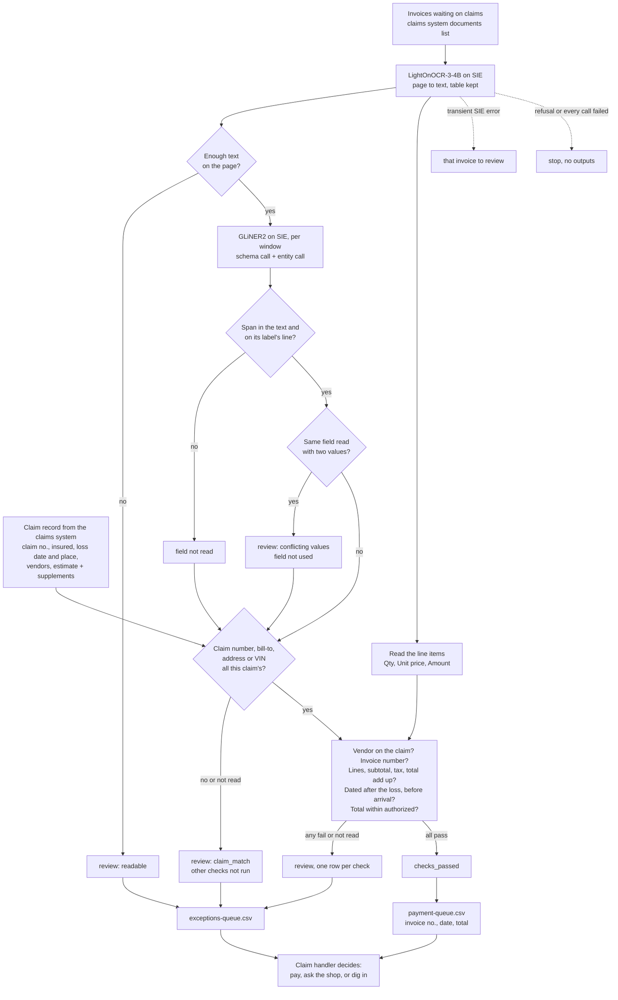

# Check an invoice against the claim before it's paid

> **This example:** a claims handler checking a water-damage repair invoice against the authorized
> amount.
>
> **How it works:** OCR reads the invoice, an extraction model points at the fields, and plain
> Python does every check against the claim record.
>
> **Use the same pattern for:** a rental car bill against approved days, a tow and storage bill, a
> medical bill against authorized treatment.

## Background

By the time a repair invoice turns up, the claim has been open for days or weeks. Someone took
the first notice of loss on the phone or through the web portal, the policy was found, an
adjuster looked at the damage, a repair shop or contractor was agreed and an estimate was
approved. Sometimes the shop found more damage once it opened things up and asked for a
supplement, which the adjuster approved too. All of that already lives in the claims system
(e.g. Guidewire ClaimCenter or Duck Creek): the claim number, the named insured, the date and
place of the loss, the vendor on the claim, and the repair amount the adjuster has authorized
so far.

Then the shop finishes and sends its invoice. It comes from outside: a PDF emailed to the
claims inbox, a scan from a small contractor who still prints everything, or a phone photo the
insured uploads to the portal after paying the shop themselves. It lands in the claim's
documents list as an image. Nothing in the claims system knows what's on it until someone reads
it.

That someone is a claims processor or the desk adjuster on the claim. They open the invoice on
one screen and the claim on the other, and go through it: is this our claim (claim number, the
insured's name, the address or vehicle), is it from the shop on the claim, do the lines add up,
is the date after the loss, and is the total inside what was authorized? Then they type the
invoice number, date and amount into the payment screen. Most invoices are fine. That's the
trouble: after the fortieth clean one, the forty-first gets the same quick look.

What goes wrong is expensive in a quiet way. An invoice with a subtotal that doesn't match its
lines gets paid at the printed total. An invoice billed to a different customer of the same
shop, with a total that happens to look right, gets paid on the wrong claim. A total that runs
past the authorized amount gets paid because the processor compared it with the first estimate
and forgot the supplement, or the other way round.

Here's the claim end to end, and the step this recipe takes on:



## The problem

You want each incoming invoice read, checked against the claim it was filed under, and the
exceptions put in front of the right person with the reason. Retyping is slow, and the checks
are the kind people do by eye when the queue is long.

The obvious shortcuts fall short. There's no text layer to search, because the invoice is an
image. Re-reading the whole claim from scanned forms makes no sense either: the claims system
already has every claim field, so the only thing a model needs to read is the invoice. And
asking one model "is this invoice OK?" gives you an answer you can't audit, with limits you
can't change.

So a model reads the invoice and points at its fields, and plain Python compares them with the
claim record. Each invoice gets one status that names what the checks found:

- **`checks_passed`**: the invoice is for this claim and this vendor, its lines add up, its date
  fits, and its total is inside the authorized amount. That's not a payment. It lands in the
  claim handler's payment queue with the invoice number, date and total read and checked, ready
  to copy into the payment screen. The handler still approves it, they just have less to read.
- **`review`**: at least one check failed or couldn't run, with the reason. A field that wasn't
  read (a blank tax line, a smudged claim number) is a reason in its own right, never a pass.
  It lands in the handler's exceptions queue, one row per failed check.

Nothing is paid, denied or booked automatically. The claim handler decides what happens next:
pay, ask the shop for a corrected invoice, or take a closer look at a vendor or an amount. The
recipe doesn't decide coverage, set reserves or judge whether a repair price is fair either.

### Examples

Here are three of the inputs in `data/`, and what should happen to each.

All of this is synthetic, written for this recipe: the insurer, the insureds, the shops and every
number are invented.

**1. A clean roofing invoice.** `clm-01`.
- **Input:** page 1 of `repair-invoices.pdf`, a Brightwater Roofing & Gutters Ltd invoice for
  claim `CLM-26-104817`: Dana Whitcombe's homeowners claim on policy HO-2026-004817, loss on
  2026-10-04 at 41 Fernhollow Lane, Ashby Vale, CO 80911, with an authorized estimate of 3650.00.
- **What should happen:** every check runs and passes: right claim, right vendor, the lines add
  up, the date fits and the total is inside the authorized amount.
- **Expected outcome:** `checks_passed`, ready for the payment queue.

**2. A near miss: right shop, right amount, wrong customer.** `clm-09`.
- **Input:** page 9 of `repair-invoices.pdf`, from Brightwater Roofing & Gutters Ltd (the vendor on
  `CLM-26-118206`), with the same total as the claim's 2033.08 estimate, but billed to Margit
  Allanby at a different address and with no claim number.
- **What should happen:** we check first that the invoice belongs to the claim. It doesn't, so it
  goes to review before anyone compares the shop and the amount, which would both pass.
- **Expected outcome:** `review`, `claim_match` (the invoice doesn't match this claim).

**3. A blank tax line.** `clm-08`.
- **Input:** page 8 of `repair-invoices.pdf`, a Northgate Plumbing Co. invoice for `CLM-26-709315`.
  The page prints "Sales tax (6%)" with nothing next to it, and the total includes tax.
- **What should happen:** a blank tax line isn't a zero tax line, so the arithmetic can't be checked
  and the invoice should go to review. On the live run the model reading the page filled in the
  blank, so this one missed.
- **Expected outcome:** `review`, `invoice_math` (the tax wasn't read).

On the live run, 9 of 10 invoices came out as expected. [What came out](#what-came-out) has the
results.

## How we'll solve it

1. **Start from the claim record.** The claims system gives us, per claim: the claim number,
   policy number, named insured, date and location of the loss (the property address, or for
   auto the vehicle and its VIN), the vendors on the claim, and the authorized repair amount
   (the approved estimate plus any approved supplements). No model touches these. Here,
   [`claims_system.py`](./claims_system.py) stands in for your claims system's API: plain
   lookups over four CSV seeds, and a claim is found by its exact number or not at all.
2. **Read the invoice with an OCR model.** The invoice is an image, so `LightOnOCR-3-4B` turns
   each page into text with the line-item table kept as a table. A page that comes back nearly
   empty goes to review as unreadable.
3. **Find the invoice fields with an extraction model, then make Python prove them.**
   `gliner2-large-v1` points at the vendor letterhead, bill-to name, claim number, service
   address or vehicle, invoice number and date, subtotal, tax and total. A value only counts if
   it's in the text and on the line with its label. A blank tax line stays blank: it is not
   zero.
4. **Read the line items in Python** from the table, by the Qty, Unit price and Amount columns.
5. **Check that the invoice belongs to the claim.** The claim number on the invoice must be this
   claim's, the bill-to name must be the insured, and the service address or vehicle must match
   the loss location. This comes first, because every later check assumes you're looking at the
   right claim, so when it fails the other checks don't run.
6. **Check the vendor, the arithmetic, the dates and the amount.** The vendor must be one on
   the claim (after dropping "Inc.", "LLC" and the like). Each line is qty times unit price, the
   lines add up to the subtotal, and subtotal plus tax is the total. The invoice is dated on or
   after the loss and not after it arrived. The total is at or below the authorized amount, and
   when it isn't, the difference is shown.
7. **Write the result.** One record per invoice with every field, every check and its detail,
   the payment queue (invoice number, date and total ready to key in) and the exceptions queue
   with one row per failed check.

If an SIE call fails for a reason that may pass (a timeout, a 5xx, a rate limit, an over-long
input), that invoice goes to review with the reason and the run carries on; if SIE refuses the
call (a bad key, an unknown model, no credits) or every call fails, the run stops with SIE's
message and writes nothing.

## Picking the models

The reader is `lightonai/LightOnOCR-3-4B`, called through SIE's `extract` with the page as an
image, once per page. Invoices reach the claim as scans, phone photos or PDFs that are really
pictures, so the reading step has to be OCR. LightOnOCR returns the line-item table as an HTML
table, which keeps each amount in its column, and that's the shape the line-item reader leans on.

The field finder is `fastino/gliner2-large-v1`, called through `extract` twice per window of the
flattened page. The first call carries an `output_schema` (one optional string per field, with
the `description` from `rules.yaml`). The second uses entity labels ("street address", "vehicle
identification number", "person name") instead. Why two? A property invoice carries two
addresses, the shop's letterhead and the job, and the schema call can pick neither and return
no service address. Entity mode returns every street address it sees, and Python keeps the one
sitting on the "Service address" line. The "person name" label is there because it also points
at the bill-to line, which helps GLiNER2 find the job address next to it on all ten invoices.

GLiNER2 reads at most 512 tokens per item, and a window of 180 words is about that, not a
guarantee. The recipe asks SIE for `overflow_policy: error`, so a window that runs over comes
back as an input-too-long error, which the recipe treats as a failed call (the invoice goes to
review), instead of being cut short without telling us. These invoices fit in one window.
GLiNER2 is good at pointing at the right line on a layout it has never seen. It's not something
to trust with the value itself, which is why Python checks that the span is really in the text
and on its label's line, and keeps the whole cell. Neither model takes a prompt, so there's no instruction in an
invoice for either to follow.

So: two models, the OCR model called once per page and the extraction model twice per window,
and no generative model makes the decision. The claim match, vendor match, arithmetic, dates
and authorized amount are plain Python reading `rules.yaml`.

## The flow



## How it's built

Everything you'd want to argue about lives in [`rules.yaml`](./rules.yaml): the two model names,
the fields GLiNER2 is asked for with their labels, the entity labels for the second call, the
line-item columns, the vendor suffixes that are ignored, the address abbreviations, the date
formats and every threshold. The claim data lives behind
[`claims_system.py`](./claims_system.py), which loads `claims.csv`, `claim_vendors.csv`,
`authorizations.csv` and `claim_documents.csv` into an in-memory SQLite database and answers
`get_claim(number)` and `waiting_invoices()`. [`recipe.py`](./recipe.py) is about 990 lines and
reads top to bottom in the same order as the flow.

| Step | Code | SIE call | What it does |
| --- | --- | --- | --- |
| Load the queue | `ClaimsSystem.waiting_invoices`, `ClaimsSystem.get_claim` | none | The invoices waiting on claims, and each one's claim record: insured, loss date and place, vendors, estimate and supplements |
| Read the page | `read_page`, `flatten_markdown` | `extract` (image) | One call per page. Each table row becomes one line with its cells joined by " \| " |
| Find the fields | `extract_fields`, `span_cell`, `labelled_cell`, `letterhead_line` | `extract` + `output_schema`, then `extract` + labels | Two calls per window, one item per call. A span must be in the text and on a line carrying the field's label; the value is that whole cell. The vendor is the letterhead line, never the bill-to line. Two different values for one field go to review |
| Line items | `line_items` | none | Every row under the header naming Qty, Unit price and Amount. A row with a cell missing or a non-number is a problem, not the end of the table |
| Claim match | `claim_problems`, `name_key`, `address_key`, `vins_in` | none | Claim number exactly this claim's (and if it's another claim's, which one); bill-to is the insured; service address is the loss address, or the vehicle line carries the claim's VIN and no other |
| Other checks | `check_invoice`, `check_invoice_math`, `vendor_key`, `parse_money` | none | Vendor on the claim; one invoice number; line arithmetic with a blank or rate-only tax line as not read; subtotal and total above zero and tax not below it (a negative line, such as a discount, is only checked by the arithmetic); date between the loss and arrival; total at or below estimate plus supplements |
| SIE failures | `Calls.call`, `is_fatal`, `stop_message`, `stop_on_refusal` | none | A transient failure or a reply missing its key sends the invoice to review; a refusal, or every call failing, stops the run without outputs |
| Outputs | `write_outputs`, `payment_row`, `csv_safe` | none | `invoices/<document>.json`, `invoices.csv`, `payment-queue.csv` and `exceptions-queue.csv`. Any cell a spreadsheet would run as a formula gets a leading `'` |

[`selfcheck.py`](./selfcheck.py) checks all of this offline with hand-written OCR pages and
stand-in model replies: all ten invoices on faithful pages; the tax line (blank, the rate
alone, "exempt", a printed 0.00); near misses (a shorter vendor name, a claim number belonging
to another claim, two claim numbers in one cell, "D. Whitcombe", a neighbouring house number,
the right street in another ZIP, a VIN one character off, a vehicle line with two VINs); a
credit note, a line whose qty times price isn't its amount, a row that lost a cell, the
authorized limit to the cent, clm-10 without its supplement; a span on the wrong line, a value
nobody wrote, the bill-to name offered as the vendor, two totals in two windows; the claims
system lookups; `csv_safe` and the queues; the committed data (the PDF carries no metadata, no
VIN could be real); and the SIE failure rule with a transient error, a refusal, every call
failing, a reply missing its key (an OCR reply with no Markdown counts as a failed call), and the
empty-result 500 counted as "nothing found" only from the extraction model; and the guards: every
GLiNER2 call asks for `overflow_policy: error`, a claim that isn't open runs no check, a page
shorter than `min_page_chars` (table tags not counted) is unreadable, and a document file in the seed must be a bare file
name inside `data/`. [`make_data.py`](./make_data.py) draws the invoices and writes the seeds.

## Run it

**Try this recipe on [SIE Serverless](https://superlinked.com/serverless?utm_source=github&utm_medium=docs&utm_campaign=sie-cookbook&utm_content=insurance-check-invoice-against-claim).** You pay per call and there are no GPUs to run.

You need [uv](https://docs.astral.sh/uv/) and an SIE API key
([create one](https://console.superlinked.com/console/api-keys?utm_source=github&utm_medium=docs&utm_campaign=sie-cookbook&utm_content=insurance-check-invoice-against-claim)).

```bash
cp .env.example .env   # then set SIE_API_KEY
uv run recipe.py
uv run selfcheck.py    # optional: offline checks, no SIE call
uv run make_data.py    # optional: rewrite data/
```

`uv run` installs this recipe's few dependencies into its own `.venv` on the first run. Each run
writes `runs/<timestamp>/` in this folder. A run makes 30 SIE calls on this data: 10 to the OCR model (one per page) and 20 to the extraction
model (two per window, one window per invoice). The first calls can wait a few minutes while SIE
Serverless starts the OCR and extraction models. On 2026-11-04 (UTC) a run that waited for them took
138 s; with both models warm it took 57 s.

## What came out

### The three examples

**1. A clean roofing invoice.** `clm-01`.
- **Expected outcome:** `checks_passed`, ready for the payment queue.
- **What came back:** `checks_passed`, in the payment queue with invoice BRG-10442, dated
  2026-10-12, subtotal 3394.00, tax 203.64, total 3597.64, against 3650.00 authorized.
- **Verdict:** Pass.

**2. A near miss: right shop, right amount, wrong customer.** `clm-09`.
- **Expected outcome:** `review`, `claim_match` (the invoice doesn't match this claim).
- **What came back:** `review`, `claim_match`, with "no claim number read on the invoice; billed to
  'Margit Allanby', not the insured".
- **Verdict:** Pass.

**3. A blank tax line.** `clm-08`.
- **Expected outcome:** `review`, `invoice_math` (the tax wasn't read).
- **What came back:** `checks_passed`, in the payment queue with tax 76.20 and total 1346.20.
- **Verdict:** Miss. The OCR model wrote "Sales tax (6%): $76.20" where the page has no amount, and
  the arithmetic check then agreed with itself. The handler still approves each payment, but the
  row looks like any other.

### Results

On the live runs on 2026-11-04 (UTC), 9 of 10 invoices came out as expected. The one that
didn't is `clm-08`, covered below.

**Where it works:** when the page is read faithfully. The invoice that matches in every field
(`clm-01`), the shop name written two ways with a total right on the limit (`clm-02`) and the
approved supplement (`clm-10`) all pass. The invoice dated before the loss (`clm-03`), the claim
number missing a digit (`clm-04`), the subtotal that doesn't match its lines (`clm-05`), the other
shop (`clm-06`), the total over the limit (`clm-07`) and the wrong customer (`clm-09`) all go to
review.

**Where it fails:** when the reader fills in what the page doesn't say. `clm-08` is the one to worry
about: the tax line is blank, the OCR model wrote one in, every check passed on the text it was
given, and the invoice is in the payment queue with a tax the shop never printed. Checks that only
see a model's output can't catch that.

The input is ten invoices waiting on ten open claims, in [`data/`](./data):

- `claims.csv`: one open claim per row: claim number, policy number, line of business, named
  insured, date of loss, loss address, and for auto the vehicle and its VIN
- `claim_vendors.csv`: the vendor approved on each claim
- `authorizations.csv`: the approved estimate for each claim, and on `clm-10` an approved
  supplement of 1,180.00
- `claim_documents.csv`: which invoice is waiting on which claim, when it arrived (all on
  2026-10-20) and which page of the PDF holds it
- `repair-invoices.pdf`: the ten invoices, one page each, with a line-item table and totals

> **All of it is synthetic.** [`make_data.py`](./make_data.py) draws the pages with Pillow as an
> image-only PDF (what a scanner gives you) and rebuilds every file byte for byte. The PDF
> carries no document metadata (no title, author or dates). The insurer ("Larkspur Mutual"),
> the insureds, the shops, the addresses, the vehicles and every number are invented, and every
> page says so in its footer. Every VIN carries a Q, a letter real VINs never use.

Both runs gave the same results. Treat that as a demo that the pipeline works, not as a measure
of accuracy: ten invoices tell you each path through the checks runs, not how often a real scan
gets misread. The one that didn't, `clm-08`, is the interesting one.

A few things worth noticing:

- **`clm-08` passed, and it shouldn't have.** The page prints "Sales tax (6%)" with nothing next
  to it. LightOnOCR-3-4B wrote "Sales tax (6%): $76.20" anyway, which is exactly 6% of 1,270.00,
  and it wrote the totals as plain lines with dollar signs the page doesn't have. Everything
  downstream did its job on the text it was given. Here's what the recipe read (from
  `invoices/clm-08.json`):

  ```json
  "subtotal": "$1,270.00",
  "tax": "$76.20",
  "total": "$1,346.20",
  {"check": "invoice_math", "status": "pass", "detail": "3 lines = 1270.00; 1270.00 + tax 76.20 = 1346.20"}
  ```

  The OCR model did the shop's arithmetic for it, helpfully, and the arithmetic check then
  agreed with itself. We didn't change the rules to hide it. The rule is right: when the tax
  isn't on the page, `selfcheck.py` shows the invoice goes to review with "Not read: tax (a
  blank tax line is not zero)", and with `LightOnOCR-2-1B` as the reader it did exactly that
  live (see Try another model). It's still worth knowing that a reader which "fixes" a document
  can't be caught by checks that only see its output.
- **`clm-09` is the reason the claim match runs first.** Same shop as the claim, a total equal
  to the claim's estimate, so the vendor and amount checks would both have passed. From
  `exceptions-queue.csv`:

  ```csv
  clm-09,CLM-26-118206,claim_match,"no claim number read on the invoice; billed to 'Margit Allanby', not the insured; insured is Tobias Fenwick; service address '7 Thornfield Close, Ashby Vale, CO 80912'; loss address is 19 Copperbeech Way, Ashby Vale, CO 80911. Other checks not run: this may not be this claim's invoice"
  ```

- **`clm-10` and `clm-07` are the same question with different answers.** Both totals are above
  the first estimate. `clm-10` has an approved 1,180.00 supplement on the claim, so its 3,959.00
  is exactly what's authorized now; `clm-07` has no supplement, so its 6,800.00 is 537.52 over.
- **A row in the payment queue can still be wrong.** The four invoices that passed (`clm-08` among them,
  with the OCR's invented tax) land there with the invoice number, the date as an ISO date and
  the amounts as plain numbers (from `payment-queue.csv`):

  ```csv
  document,claim_number,named_insured,vendor,invoice_number,invoice_date,subtotal,tax,total,authorized
  clm-01,CLM-26-104817,Dana Whitcombe,Brightwater Roofing & Gutters Ltd,BRG-10442,2026-10-12,3394.00,203.64,3597.64,3650.00
  clm-02,CLM-26-211532,Marcus Ellery-Thorne,"Kestrel Auto Body and Paint, Inc.",KAB-2026-0917,2026-09-18,2279.00,159.53,2438.53,2438.53
  clm-08,CLM-26-709315,Hana Lindqvist,Northgate Plumbing Co.,NP-58377,2026-10-11,1270.00,76.20,1346.20,1400.00
  clm-10,CLM-26-224417,Lena Okafor-Reyes,Marlow Collision Center,MCC-88213,2026-10-15,3700.00,259.00,3959.00,3959.00
  ```

- **GLiNER2's schema call won't pick the job address.** On its own, the schema call returns
  nothing for the service address when the page also prints the shop's address, so every
  property invoice would go to review as "no service address read"; the entity call is what
  finds it. On the auto
  invoices it sometimes offered the shop's address instead, which Python dropped because it
  isn't on a "Vehicle" line. That's the labelled-line rule earning its keep.

### What you do next

The claim handler works two files. `payment-queue.csv` has the invoices that passed, with the
invoice number, date and total ready to key into the payment screen; they still approve each
one against the invoice itself, because a row can pass with a misread value, as `clm-08`'s
invented tax did. `exceptions-queue.csv` has one row per failed check with the reason, and from there they
ask the shop for a corrected invoice or take a closer look at the vendor or the amount.

## Potential improvements

- **Teach it your invoices' labels.** `documents` in `rules.yaml` is what GLiNER2 is asked to
  find. The `description` goes to the model, and `label` lists the labels your shops actually
  print. To add a field (e.g. the deductible, a PO number or the adjuster), add it here and add
  the check that uses it in `check_invoice`. `line_item_columns` names the header words for
  quantity, unit price and amount, and `money_tolerance` is the rounding allowed. Both are
  starting points.
- **Vendor names.** Vendor matching drops the legal suffixes in `vendor_suffixes_ignored` and
  reads "&" as "and". Anything else (a trading name, a different branch, a shorter name) goes to
  review, so add an alias list if your shops invoice under another name.
- **Plug in your own claims system.** `claims_system.py` stands in for your claims system's API.
  Swap its four lookups for real calls; the recipe only needs `get_claim` and
  `waiting_invoices`.
- **Models.** `models` in `rules.yaml` names the two models, one line each. For born-digital PDFs
  with a text layer, `docling` is an option for the reading step.
- **Catch the OCR filling in a blank.** On `clm-08` the OCR model wrote a tax amount that isn't
  on the page (see What came out), so the arithmetic checked a number nobody printed. A second
  look at just the totals block (a crop read by another model, or the same model asked only for
  that region) would show whether the tax cell is really empty.
- **Duplicate invoices and the tax rate.** The recipe doesn't look at what's already been paid
  on the claim, so the same invoice sent twice would pass twice; the claims system's payment
  history would catch it. It also doesn't check the tax amount against the printed rate, since
  many states tax parts and not labor; a per-state rule in `rules.yaml` could.
- **Known SIE Serverless issue.** When GLiNER2 finds nothing in a window, SIE Serverless currently answers
  the call with HTTP 500 "Inference completed without a valid conserved billing settlement". The
  recipe sends one window per call, so the error only hits that window, and records the answer
  as "none found" in the invoice's notes. A field that is never found sends its check to review,
  never past it.

## Try another model

Each model is one line under `models:` in `rules.yaml`. We swapped one model at a time, changed
nothing else, and ran the recipe on SIE Serverless on 2026-11-04 (UTC).

| `rules.yaml` key | Swap in | What happened on this data |
| --- | --- | --- |
| `ocr` | `lightonai/LightOnOCR-2-1B` | All ten as planned, `clm-08` included. It left the blank tax line blank, so `clm-08` went to `review` with "Not read: tax (a blank tax line is not zero)". Same 30 calls, 49 s |
| `ocr` | `zai-org/GLM-OCR` | All ten went to `review`. It read the header fields fine, but no line items came out of its table, so `invoice_math` said "Not read: line items" on every invoice it got to; it also wrote the tax cell as "(6%) 203.64". `line_items` and `flatten_markdown` are written for LightOnOCR's output. `clm-04` and `clm-09` still stopped at `claim_match` |
| `extract` | `fastino/gliner2-base-v1` | Seven of ten as planned. It missed the tax amount on `clm-01`, `clm-07` and `clm-10` (it offered the label "Sales tax (6%)" instead, which isn't a value on that line), so those went to `review` as "Not read: tax". On `clm-08` it read the OCR's invented 76.20 and passed, like the default |

See [MODELS.md](../../MODELS.md) for every model these recipes use.

## Run it on your own SIE

The same code runs against an SIE server you host. Set `SIE_BASE_URL` in `.env`; an API key
is then optional. The table gives the SIE v0.10.1 image each model runs on, from SIE's
[compatibility matrix](https://github.com/superlinked/sie/blob/main/docs/compatibility.md).

| `rules.yaml` key | Model | Image | Tested on |
| --- | --- | --- | --- |
| `ocr` | `lightonai/LightOnOCR-3-4B` | `cuda12-sglang-vision-extract` | L4 |
| `extract` | `fastino/gliner2-large-v1` | `cuda12-default` | L4 |

One SIE server runs one image, so these 2 images need a cluster: the
[sie-cluster Helm chart](https://github.com/superlinked/sie/tree/main/deploy/helm/sie-cluster)
with one worker pool per image routes each model to its pool. See
[SELF_HOSTING.md](../../SELF_HOSTING.md) for the values file.

## Files

- `recipe.py`: the pipeline
- `claims_system.py`: the claims system lookups over the CSV seeds
- `selfcheck.py`: offline checks with hand-written pages and stand-in replies, no SIE call
- `make_data.py`: draws the synthetic invoices and writes the claims-system seeds
- `rules.yaml`: fields, labels, checks, normalisation and thresholds
- `data/`: the four CSV seeds and `repair-invoices.pdf`
- `pyproject.toml`, `uv.lock`: this recipe's dependencies

See the SIE task page for [document field extraction](https://superlinked.com/doc-field-extraction?utm_source=github&utm_medium=docs&utm_campaign=sie-cookbook&utm_content=insurance-check-invoice-against-claim).
