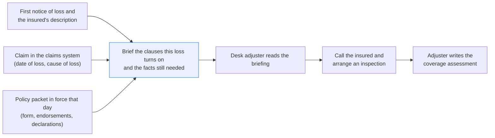
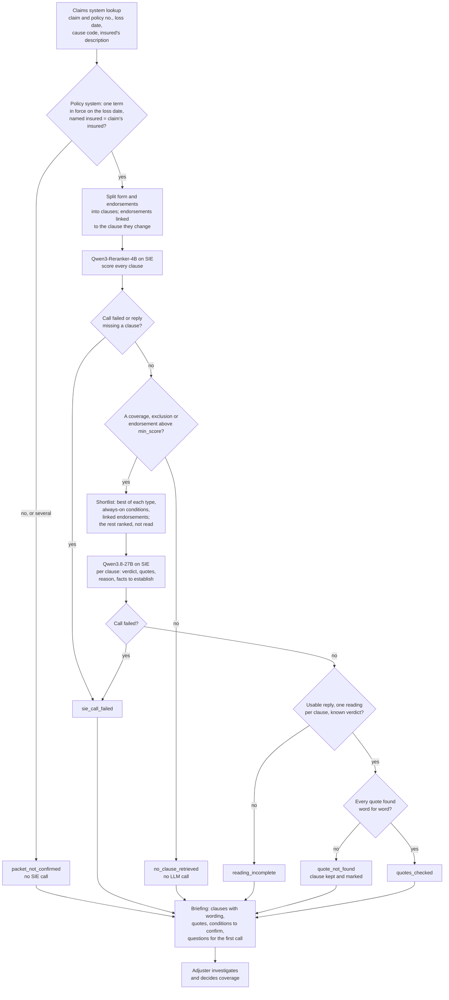

# Create a coverage brief from the policy wording, with exact quotes

> **This example:** a desk adjuster's first look at a home claim's policy and endorsements.
>
> **How it works:** a reranker finds the clauses, a language model explains each with quotes, and
> Python checks every quote word for word. It doesn't decide coverage.
>
> **Use the same pattern for:** a liability claim against the exclusions, business interruption
> wording on a commercial loss, the treaty clauses a large loss turns on.

## Background

When a homeowners claim lands on a desk adjuster's queue, they open it in the claims system,
read the first notice of loss and the insured's own description of what happened, and then
open the policy. Not the whole thing. They pull up the form and endorsements that were in force
on the date of loss and look for the few clauses this loss turns on: the peril that might cover
it, the exclusions that might take it away, and the conditions the insured has to meet. They
note what they found and, just as important, what they still need to know. Then they call the
insured, arrange an inspection if it needs one, and write up their coverage assessment.

The hard part is that very different losses read almost the same in a first notice. "Water came
through the ceiling" is a burst pipe the policy covers, or a drip that's been going for months
and is excluded, or a frozen pipe in a house left empty with the heat off, which turns on
whether anyone kept the heat on. The wording that decides it is spread across a long form, and
an endorsement can replace a clause outright (a water backup endorsement gives back what the
sewer backup exclusion takes away). Miss the exclusion and the claim gets paid when it
shouldn't. Miss the endorsement, or treat a question as an answer, and an insured gets told no
when the policy says yes.

The claims and policy systems already give you the structured side: the claim number, the
policy number, the date of loss, the cause-of-loss code from intake, and the policy packet in
force that day (the form, its endorsements and the declarations with limits and deductible).
This recipe looks both up, the way your claims application does when you open a claim, and
takes that packet as the right one; choosing the right policy version isn't something to hand
to a model. If the policy system has no term in force on the loss date, or two, or the term's
named insured isn't the claim's insured, the recipe says so and reads nothing. What's left unstructured is the insured's description and the policy's
prose. Matching one against the other is the reading job.

Here's the coverage review end to end, and the step this recipe takes on:



## The problem

You want the adjuster to start from a briefing instead of a blank page: which clauses look
relevant, how each one seems to bear on this loss, the exact words that say so, and the facts
nobody has established yet. Nothing in it is a coverage decision.

A keyword search doesn't do this. "Water" hits half the form, and "dripping for months" doesn't
contain the words "seepage" or "14 or more days". And the intake code doesn't help much either:
six of the ten sample claims are `WATER`, from the burst hose to the flooded basement. One
LLM call with the whole policy and the question "is this covered?" gives you a verdict that
sounds sure of itself, quotes you can't trust without checking, and a habit of filling missing
facts with assumptions. So a reranker picks the candidate clauses, an LLM drafts a reading of
each one with quotes and a list of open facts, and plain Python checks every quote against the
text.

For each claim, the briefing lists every shortlisted clause with the LLM's reading (`applies`,
`does_not_apply` or `unclear`), the policy and claim quotes, whether each quote was found, the
clause's full wording next to its quote, any endorsement next to the clause it changes, the
conditions to confirm (all of them, including the unclear ones) and the facts to establish. Its
status says what the checks found:

- **`quotes_checked`**: every quote the briefing relies on was found word for word in the
  policy or the claim. It's a draft that's safe to read, not an answer. A found quote means the
  words are in the text, not that the reading is right.
- **`quote_not_found`**: at least one quote isn't in the text, a clause read as `applies` or
  `does_not_apply` came with no claim quote, or the claim quote talks about the policy ("the
  flood exclusion does not apply") instead of the loss. That clause stays in the briefing, marked, and the
  adjuster reads the wording themselves. A clause the LLM set aside as `does_not_apply` with an
  unchecked quote is never quietly dropped.
- **`reading_incomplete`**: the LLM skipped a shortlisted clause, read one twice, used a verdict
  outside the three, or sent a reply that was cut off or not JSON. Every clause is still listed,
  and the adjuster reads the ones without a reading.
- **`no_clause_retrieved`**: nothing in the packet ranked high enough. That means the search
  found nothing, not that the policy is silent, and the adjuster reviews the wording by hand.
- **`sie_call_failed`** and **`packet_not_confirmed`**: an SIE call failed for this claim, or
  the policy system had no single term in force on the loss date, or that term's named insured
  isn't the claim's insured. The reason says which, and the adjuster reads the wording (or
  confirms the policy) by hand.

The adjuster decides coverage, after the call and the inspection. A disputed reading goes to
whoever handles coverage questions in your company. The recipe never denies, and never
says covered either.

### Examples

Here are three of the claims in `data/claims.csv`, and what should happen to each.

**1. A sudden leak.** CLM-01.
- **Input:** CLM-01, `WATER`: "On Sunday morning the braided supply hose to our dishwasher split
  while it was running. Water sprayed across the kitchen for about twenty minutes before we shut
  the valve..."
- **What should happen:** a model shortlists the water clauses, the LLM reads the sudden
  discharge coverage as applying and the 14-day seepage exclusion as not, and every quote is
  found.
- **Expected outcome:** `quotes_checked`; COV-05 (the discharge coverage) `applies`, EXC-03 (the
  seepage exclusion) `does_not_apply`.

**2. A leak nobody can date from the description.** CLM-10.
- **Input:** CLM-10, `WATER`: "...We noticed a stain on the hallway floor about two weeks ago and
  thought it was spilled detergent..."
- **What should happen:** "about two weeks" sits on the exclusion's 14-day line, so the reading
  should be unclear and the gap should become a question for the insured.
- **Expected outcome:** `quotes_checked`; EXC-03 `unclear`, with a fact to establish about the
  14 days.

**3. A backed-up drain, and an endorsement that changes the answer.** CLM-09.
- **Input:** CLM-09, `WATER`: "Heavy rain overnight and by morning the floor drain in our finished
  basement had backed up..." This policy carries a water backup endorsement, WB-01, which replaces
  the backup exclusion, EXC-02.
- **What should happen:** the adjuster should see the two side by side: the exclusion read as
  printed, which says no on its own, and the endorsement, which gives the cover back. The prompt
  asks the LLM to read it that way, and this is where it didn't.
- **Expected outcome:** `quotes_checked`; EXC-02 read as printed and WB-01 `applies`, shown
  together.

On the live run, 8 of 10 claims came out as expected. [What came out](#what-came-out) has every
one.

## How we'll solve it

1. **Start from the claim and its policy packet.** The claims system (`claims_system.py`) gives
   the claim number, policy number, date of loss, cause-of-loss code and the insured's
   description. The policy system (`policy_admin.py`) gives the term in force on that date: its
   declarations, the form and the endorsements attached to that term. Python splits the packet
   into clauses by their headings, and each endorsement clause records which clause it
   replaces or adds to.
2. **Rank every clause against the description.** `Qwen3-Reranker-4B`, given an instruction
   about what it's ranking for, scores every clause in the packet in one call per claim. The
   best few coverages, exclusions, conditions and endorsements above a minimum score make the
   shortlist, plus the conditions that bind every claim (duties after loss, the deductible). An
   endorsement that changes a shortlisted clause comes along with it, and so does the clause a
   shortlisted endorsement changes. Anything that scored at least 0.10 and didn't make the cut
   is listed as "ranked, not read", so a near miss stays in front of the adjuster.
3. **Draft a reading of each shortlisted clause.** `Qwen3.8-27B-FP8` reads the description, the
   declarations and the shortlist, and returns, per clause: `applies`, `does_not_apply` or
   `unclear`, a quote from the policy, a quote from the claim, a one-line reason, and the facts
   the adjuster would need to settle it ("how long was the pipe leaking?", "was the heat kept
   on?"). Which endorsement changes which clause is said once, outside the clause wording, so
   the model can't quote the note as if it were policy text (more on that below).
4. **Check every quote in Python.** A quote counts only if it appears word for word in its own
   clause or in the description, after straightening quote marks and spaces and ignoring case.
   No ellipses stitching two pieces together, since the bit in the middle is often the
   exception. A quote from the neighbouring clause doesn't count for this one, and a claim quote
   that talks about the policy (a word from `judge.policy_words` such as "exclusion" or
   "coverage") is the insured's opinion, not evidence of the loss, so it doesn't count either.
5. **Write the briefing.** Clauses grouped as coverages, exclusions and conditions, endorsements
   shown with the clause they change, every quote marked found or not found, the open facts as a
   checklist, and the status. The briefing would be saved to the claim; here it's written to
   `runs/`. The open facts are the adjuster's question list for the first call with the insured
   and the inspection.

If an SIE call fails for a reason that may pass (a timeout, a 5xx, a rate limit, an over-long
input), that claim's briefing is written with the failure as its reason and the run carries on;
if SIE refuses the call (a bad key, an unknown model, no credits) or every call fails, the run
stops with SIE's message and writes nothing.

## Picking the models

The reranker is `Qwen/Qwen3-Reranker-4B`, through SIE's `score` call. It takes the claim
description as the query, every clause as a candidate and an instruction ("retrieve the policy
clauses ... that bear on whether the loss is covered"), and returns a score from 0 to 1 per
clause. It's good at the job a keyword search fails: on CLM-03 it put seepage (EXC-03) at 0.99
for "dripping for what looks like many months", a description that never says "seepage". It's
bad at conditions. "Duties after loss" scored under 0.25 on every claim in our run, which is why
`always_conditions` adds it and the deductible to every shortlist instead of trusting the rank.
It reads the whole packet, 20 or 21 clauses, in one call per claim, so the LLM only ever sees
a short list.

The reader is `Qwen/Qwen3.8-27B-FP8`, through `chat_completions` with a `response_format` JSON
schema (`strict: true`) and temperature 0. The schema limits `clause_id` to the shortlist and
`verdict` to the three values. It's the model the other document recipes here use for reading
text and answering in JSON with quotes, and on this data it copied quotes cleanly: every quote
in our run was found. It is also, left to itself, an enthusiastic question asker: CLM-01, a
burst dishwasher hose, came back with 8 questions, and CLM-03 with 8 more.

No generative model sets the status. Both models are called once per claim, except that a claim
the search finds nothing for never reaches the LLM.

## The flow



## How it's built

Everything you'd want to change without touching Python lives in [`rules.yaml`](./rules.yaml):
the two model names, the clause heading pattern and the endorsement link pattern, the
reranker's instruction, `min_score` (0.30), `top_k` per type (3 coverages, 3 exclusions, 2
conditions, 2 endorsements), `always_conditions` (CON-01, CON-04), `show_unread_from` (0.10),
`max_completion_tokens` (4000) and `min_quote_chars` (12). The prompt, the JSON schema, the quote
check and the status rules are in [`recipe.py`](./recipe.py). The two systems are small lookup
modules over committed CSV seeds loaded into an in-memory SQLite database, so the code reads like
the queries you'd send the real ones.

| Step | Code | SIE call | What it does |
| --- | --- | --- | --- |
| Claim | `ClaimsSystem.queue`, `ClaimsSystem.claim` (`claims_system.py`) | none | Reads `data/claims.csv`. A claim is found by its exact number only; a number one digit off finds nothing |
| Policy | `PolicyAdmin.packet_on` (`policy_admin.py`) | none | The term of exactly this policy number with `effective_from <= loss date < effective_to`, its declarations and the wording of its form and endorsements from `data/forms/`. None, several overlapping terms, or a named insured that isn't the claim's insured (`brief_claim` compares them, ignoring case and spacing) is `packet_not_confirmed` and no SIE call. The card shows both names and the risk address |
| Split | `split_document`, `split_packet`, `changed_by` | none | One clause per `## <ID> <Type>: <title>` heading. An endorsement's first line (`**Replaces:** EXC-02`) links it to the clause it changes. A heading that doesn't match, an endorsement without a link, a link to a clause the form lacks, or a clause ID used twice raises an error |
| Rank | `rank_clauses`, `clause_block` | `score` | One call per claim with every clause. A reply without `scores`, one that doesn't score every clause exactly once, or a score that isn't a number, is a failed call |
| Shortlist | `shortlist` | none | Best of each type at or above 0.30, the always-on conditions, endorsement links both ways, and the ranked-not-read list. No coverage, exclusion or endorsement above 0.30 is `no_clause_retrieved` |
| Read | `judge_prompt`, `declarations`, `endorsement_links`, `judge_schema`, `ask_judge`, `parse_readings` | `chat_completions` | One call per claim with the shortlist, the declarations and the endorsement links. A reply cut off, not JSON or without a `clauses` list leaves every clause without a reading |
| Check | `quote_problem`, `normalize`, `policy_talk`, `read_clause` | none | Each quote must be at least 12 characters, have no ellipsis and appear in its own clause (policy) or the description (claim). A claim quote with a word from `judge.policy_words` doesn't count. A claim quote is required for `applies` and `does_not_apply` on a coverage, exclusion or endorsement |
| Brief | `brief`, `collect_facts`, `markdown`, `csv_row`, `csv_safe` | none | The status, the reasons, the clauses grouped by type, and each fact to establish once with the clauses that raised it. Every CSV cell goes through `csv_safe` |

The SIE error rule is the same as in the security recipes (`SIEStopped`, `is_fatal`, `guarded`,
`CallLog`). A call that fails for a reason that may pass (a timeout, a lost connection, a 5xx, a
rate limit, a model still loading, or a reply missing the key we asked for) gives that claim
`sie_call_failed` with a short reason, and the run carries on. A refusal every call would repeat
(a bad key, no credits, a model name SIE doesn't know) stops the run with SIE's full message and
writes no outputs. If every call failed, the run stops too.

[`selfcheck.py`](./selfcheck.py) checks the two lookups (the renewal date, no term, overlapping
terms, a claim whose insured isn't the named insured), the clause splitting, the shortlist, the
quote check, every status, the prompt's line about text being something to read, the SIE error
rule (including a score that isn't a number), and eleven adversarial stand-in replies (an
ellipsis over the exception, a quote from the neighbouring clause, a claim quote copied from
the policy, the insured's own "the flood exclusion does not apply" quoted as evidence, an
injected instruction, two readings of one clause and so on), none of which may come
out `quotes_checked`. It uses hand-written strings, the committed `data/` and stand-in model
replies, and never calls SIE.

## Run it

You need [uv](https://docs.astral.sh/uv/) and an SIE API key
([create one](https://console.superlinked.com/console/api-keys?utm_source=github&utm_medium=docs&utm_campaign=sie-cookbook&utm_content=insurance-create-coverage-brief-for-claim)).

```bash
cp .env.example .env   # then set SIE_API_KEY
uv run recipe.py
uv run selfcheck.py    # optional: offline checks, no SIE call
```

`uv run` installs this recipe's few dependencies into its own `.venv` on the first run. Each run
writes `runs/<timestamp>/` with `briefings.json`, `briefings.csv` and `briefings.md` (one card
per claim, the question list first). The first calls can wait a few minutes while SIE Cloud
starts the reranker and the LLM. A warm run makes 19 SIE calls (10 `score` calls, one per claim,
and 9 `chat_completions` calls, since CLM-08 never reaches the LLM) and took about 90 seconds.

## What came out

### The three examples

**1. A sudden leak.** CLM-01.
- **Expected outcome:** `quotes_checked`; COV-05 (the discharge coverage) `applies`, EXC-03 (the
  seepage exclusion) `does_not_apply`.
- **What came back:** `quotes_checked`; COV-05 `applies`, EXC-03 `does_not_apply`.
- **Verdict:** Pass.

**2. A leak nobody can date from the description.** CLM-10.
- **Expected outcome:** `quotes_checked`; EXC-03 `unclear`, with a fact to establish about the
  14 days.
- **What came back:** `quotes_checked`; EXC-03 `unclear`, with "Was the water leaking continuously
  or repeatedly for at least 14 days prior to the date of loss?" to establish.
- **Verdict:** Pass.

**3. A backed-up drain, and an endorsement that changes the answer.** CLM-09.
- **Expected outcome:** `quotes_checked`; EXC-02 read as printed and WB-01 `applies`, shown
  together.
- **What came back:** `quotes_checked`; EXC-02 and WB-01 shown together, WB-01 `applies`, but EXC-02
  `does_not_apply`, "deleted and replaced by endorsement WB-01".
- **Verdict:** Miss. The status and the clauses are right, and the side by side is what the adjuster
  needs. But the model didn't read EXC-02 as printed, so the "read on its own, the exclusion says
  no" line isn't in the briefing, and nothing in the status tells you that.

### Every example

On the live run on 4 Nov 2026 (UTC), 8 of 10 claims came out as expected. CLM-06 and CLM-09
got the status and the clauses we wrote them to get, but not the detail: CLM-06 asked only half the
question we expected, and CLM-09 didn't read EXC-02 as printed. Both are explained below the table.

**Where it works:** when the description holds the fact that decides it: CLM-01 and CLM-03 get opposite answers
from the same room, CLM-02, CLM-04, CLM-05 and CLM-07 find their clauses, CLM-08 says the search
found nothing instead of "not covered", and CLM-10 turns "about two weeks" into a question for the
insured.

**Where it fails:** on the finer detail: CLM-06 asked only half the question, and CLM-09, the one to
worry about, got `quotes_checked` on a reading that isn't the one the prompt asks for. A found quote
means the words are in the text, not that the reading is right.

The inputs are in [`data/`](./data):

- `claims.csv`: the claims system seed, 10 claims with claim and policy number, date of loss,
  date reported, cause-of-loss code (`WATER`, `WIND`, `THEFT`, `FIRE`, `OTHER`), the insured and
  their description
- `policy_terms.csv`: the policy system seed, 12 policy terms (two policies have a prior term)
  with the named insured, risk address, term dates, form, endorsements, limits and deductible
- `forms/KBM-HO-3.md`: a fictional homeowners policy (Kestrel Bay Mutual, form KBM-HO-3) split
  into 20 clauses, one `## <ID> <Type>: <title>` section each: 8 coverages, 8 exclusions, 4
  conditions
- `forms/KBM-WB-1.md`: a fictional water backup endorsement, one clause (WB-01) that replaces
  EXC-02. Only policy HO3-4471888 carries it, and only from its 2026-2027 term

> **All of it is synthetic.** The policy wording was written for this recipe in the style of a
> standard homeowners form, and the insurer, the insureds and the claims are invented. It is not
> a real policy, and none of this is legal advice.

Our live run on 4 Nov 2026 (UTC), with the settings as committed:

| Case | What's in it | Came out | Why |
| --- | --- | --- | --- |
| CLM-01 | Dishwasher hose splits; water across the kitchen for 20 minutes | `quotes_checked`; COV-05 `applies`, EXC-03 `does_not_apply` | The sudden leak the policy is written to cover; twenty minutes is not 14 days |
| CLM-02 | Wind blows a tree through the roof; rain comes in through the hole | `quotes_checked`; COV-04 and COV-07 `applies` | Two perils in one loss, both worth citing |
| CLM-03 | Drain dripping for months; rot and mold. Near miss of CLM-01 | `quotes_checked`; EXC-03 `applies` (EXC-04 too), COV-05 `does_not_apply` | Same room, same water, opposite answer. The months are what matter |
| CLM-04 | Creek overflows into the basement | `quotes_checked`; EXC-01 `applies` | Flood exclusion, with the creek named in the description |
| CLM-05 | Garage break-in, bikes and tools taken, police report made | `quotes_checked`; COV-06 `applies`, CON-02 (police report) in the conditions to confirm | The coverage hangs on a condition, so the condition has to be in the briefing |
| CLM-06 | Pipe freezes while the house is empty with the heat off. Near miss of CLM-01 | `quotes_checked`; EXC-06 `applies`, with "Did the insured shut off the water supply and drain all plumbing systems before leaving?" to establish | The exclusion has its own exception, and the adjuster has to ask about it |
| CLM-07 | Stove oil fire, smoke damage | `quotes_checked`; COV-03 `applies` | The plain fire case |
| CLM-08 | A caterer keeps a wedding deposit: not a property loss | `no_clause_retrieved` (best: EXC-08 at 0.07), no LLM call | The search found nothing, and the briefing says that rather than "not covered" |
| CLM-09 | Near miss: a floor drain backs up into the basement; this policy carries a water backup endorsement | `quotes_checked`; EXC-02 and WB-01 shown together, WB-01 `applies` | Read on its own, the exclusion says no. The endorsement gives it back |
| CLM-10 | Near miss: a leak behind the washing machine; the insured "noticed a stain about two weeks ago" | `quotes_checked`; EXC-03 `unclear`, with "Was the water leaking continuously or repeatedly for at least 14 days prior to the date of loss?" to establish | The exclusion starts at 14 days, and "about two weeks" doesn't settle it |

Every claim got the status we wrote it to get, but two missed the detail they were written for. On
CLM-06 we expected the question "was heat maintained or the water shut off?". The model asked only
the second half; the insured had already said they turned the heating off. And on CLM-09 the model
didn't read EXC-02 as printed, as the prompt asks: it read it as `does_not_apply`, "deleted and
replaced by endorsement WB-01". The briefing still puts the two side by side, which is what the
adjuster needs, but if you wanted the "read on its own, the exclusion says no" line in the briefing,
you won't get it from this model. Treat all of this as a demo that the wiring works, not as a
measure of accuracy: ten claims tell you the pipeline does what it says, not how often the readings
are right.

A few things worth noticing:

- **CLM-10 is the one the briefing exists for.** The description is two weeks of "we thought
  it was spilled detergent" and nothing that settles how long the fitting dripped. The model
  read the coverage (COV-05) as `applies`, quoting the dripping fitting, and the exclusion
  (EXC-03) as `unclear` with no claim quote (allowed for `unclear`), and turned the gap into
  questions. Here's the exclusion's reading from `briefings.json`, abridged:

  ```json
  {"clause": "EXC-03", "kind": "exclusion", "title": "Continuous seepage or leakage", "verdict": "unclear",
   "policy_quote": "We do not cover loss caused by constant or repeated seepage or leakage of water or steam over a period of 14 or more days ...",
   "policy_quote_found": true, "claim_quote": "", "claim_quote_found": null,
   "reason": "The insured noticed a stain two weeks ago, which is near the 14-day threshold, but it is unclear if the leakage was constant or repeated for the full period or if the current damage is from a sudden discharge.",
   "facts_to_establish": ["Was the water leaking continuously or repeatedly for at least 14 days prior to the date of loss?",
                          "Is the current damage the result of a sudden discharge or the accumulation of long-term seepage?"]}
  ```

  (The "..." is our abridgement for this README. The model's quote in the file is the whole
  sentence, and a quote with an ellipsis in it would not have been found.)
- **Our own notes stay out of the clause text.** The line that says which endorsement changes
  which clause ("Endorsements that change a clause above: WB-01 replaces EXC-02.") goes after
  the clauses, not inside them. Put inside EXC-02's block, it is text the model can quote as
  EXC-02's wording, and on CLM-09 it does, even when the prompt says not to. The quote check
  catches that (the line isn't in the clause's wording, so the claim comes out
  `quote_not_found`); kept outside, every quote in this run was found.
- **Give the model what the systems already know.** The prompt carries the limits and the
  deductible from the policy system's declarations, so the question list doesn't ask "What is
  the deductible amount shown in the Declarations?", a number the adjuster already has.
- **Ranked, not read.** Four claims had a clause above 0.10 that didn't make the shortlist:
  COV-01 (0.28) and EXC-03 (0.18) on CLM-04, EXC-04 (0.11) on CLM-06, EXC-03 (0.22) on CLM-09 and
  EXC-04 (0.26) on CLM-10. None of them changes the story, but wear and tear on a washing machine
  fitting is a fair thing for an adjuster to glance at, and it would have vanished under a plain
  threshold.
- **A found quote can still be the whole clause.** On CLM-09 the model quoted WB-01 in full, all
  four sentences, as the words that decide it. That's in the text, so it passes. It also tells
  the adjuster nothing about which sentence matters, which is the kind of thing the quote check
  can't see.

### What you do next

The desk adjuster opens their claim's card in `briefings.md`, question list first, and reads
each shortlisted clause with its quotes and full wording. The facts to establish go into the
call with the insured and the inspection; a clause marked `quote_not_found`, or a claim marked
`no_clause_retrieved`, means they read the wording themselves. They write the coverage
assessment, and a disputed reading goes to whoever handles coverage questions.

## Potential improvements

- **Your own policy forms.** Replace `data/forms/` with your form library and
  `data/policy_terms.csv` with a call to your policy system. `policy.clause_heading` in
  `rules.yaml` is the pattern that splits a form into clauses, `policy.types` maps heading words
  to coverage, exclusion, condition or endorsement, and `policy.endorsement_changes` reads the
  line that links an endorsement to its clause.
- **Tune the shortlist on your claims.** `rerank.min_score`, `rerank.top_k` and
  `judge.min_quote_chars` are starting points. Raising `min_score` sends more claims to
  `no_clause_retrieved`; lowering it gives the LLM more clauses to read.
- **The reranker's instruction.** `rerank.instruction` tells the reranker what it is ranking for.
- **No deny, no covered.** The statuses say what the checks found. There is deliberately no
  status that decides the claim, and adding one would be a different recipe.
- **Coverage attaches to property, not just a peril.** The form has no other-structures coverage,
  so CLM-05's broken detached garage door has nothing to attach to, and the reading doesn't say
  so. Asking for the damaged property per clause (dwelling, contents, other structures) would
  surface that.
- **Mixed building and contents damage.** A claim where part of the damage is covered and part
  isn't (CLM-04's furnace against its stored furniture, say) deserves a case of its own.
- **Opinions that dodge the word list.** A claim quote about the policy counts only when it
  uses a word from `judge.policy_words`; "this should be covered" gets through, since "covered"
  also describes a floor covered in water. A separate check that the claim quote describes the
  loss, not the policy, would close that.
- **Ask for the deciding sentence.** A quote can be the whole clause and still pass. A rule that
  a policy quote must be shorter than the clause, or a separate "deciding sentence" field, would
  make the quote say more.
- **Fewer, better questions.** CLM-01 got 8 questions and CLM-06 got 7, several of them
  overlapping. A cap per clause, or a second pass that merges near-duplicates, would give the
  adjuster a list they'd actually read out on a call.

## Try another model

Each model is one line under `models:` in `rules.yaml`. On 4 Nov 2026 (UTC) we swapped one model
at a time, changed nothing else, and ran the recipe on SIE Cloud.

| `rules.yaml` key | Swap in | What happened on this data |
| --- | --- | --- |
| `rerank` | `Qwen/Qwen3-Reranker-0.6B` | Its scores bunch near 1: Neglect (EXC-07) scored 0.98 to 0.998 on nine claims and 0.69 on CLM-08, so the caterer's deposit cleared 0.30 and went to the LLM (`quotes_checked`, every clause read as `does_not_apply`) instead of `no_clause_retrieved`. Shortlists ran longer (up to 9 clauses above 0.30 per claim, against 2 to 5 with the default) and the ranked-not-read lists filled up. CLM-02 and CLM-03 came out `quote_not_found` (a claim quote with "...", and readings with no claim quote). Apart from CLM-08, every reading we expected held, CLM-10's EXC-03 `unclear` included. `min_score: 0.30` separates much less on this scale. |
| `judge` | `Qwen/Qwen3.5-4B` | Same shortlists. Only 4 of 10 claims came out `quotes_checked`: on six it left claim quotes out of `does_not_apply` readings or shortened them with "...", and the check marked them. It also read CLM-04's flood exclusion (EXC-01) as `does_not_apply` while its own reason says the creek overflow "is a surface water exclusion", and that claim still came out `quotes_checked`. A found quote doesn't make a reading right; this is the case that shows it. CLM-10's EXC-03 was `unclear`, as with the 27B model. |

See [MODELS.md](../../MODELS.md) for every model these recipes use.

## Run it on your own SIE

The same code runs against an SIE server you host. Set `SIE_BASE_URL` in `.env`; an API key
is then optional. The table gives the SIE v0.10.1 image each model runs on, from SIE's
[compatibility matrix](https://github.com/superlinked/sie/blob/main/docs/compatibility.md).

| `rules.yaml` key | Model | Image | Tested on |
| --- | --- | --- | --- |
| `rerank` | `Qwen/Qwen3-Reranker-4B` | `cuda12-default` | L4 |
| `judge` | `Qwen/Qwen3.8-27B-FP8` | `cuda13-sglang-cu130` | H100 80GB |

One SIE server runs one image, so these 2 images need a cluster: the
[sie-cluster Helm chart](https://github.com/superlinked/sie/tree/main/deploy/helm/sie-cluster)
with one worker pool per image routes each model to its pool. See
[SELF_HOSTING.md](../../SELF_HOSTING.md) for the values file.

## Data and licenses

Everything in `data/` was written for this recipe and is synthetic: the claims, the policy terms,
the insureds, their addresses, the insurer Kestrel Bay Mutual and the wording of KBM-HO-3 and
KBM-WB-1. No public dataset is used. It ships under this repository's license.

## Files

- `recipe.py`: the pipeline
- `claims_system.py`: the claims system lookup over `data/claims.csv`
- `policy_admin.py`: the policy system lookup over `data/policy_terms.csv` and `data/forms/`
- `selfcheck.py`: plain asserts on the lookups, splitting, shortlist, quote check, statuses and
  SIE failure rule, no SIE call (`uv run selfcheck.py`)
- `rules.yaml`: models, clause patterns and thresholds
- `data/claims.csv`: the 10 sample claims
- `data/policy_terms.csv`: the 12 policy terms
- `data/forms/KBM-HO-3.md`, `data/forms/KBM-WB-1.md`: the fictional policy form and endorsement
- `pyproject.toml`, `uv.lock`: this recipe's dependencies

See the SIE task page for [rerank](https://superlinked.com/rerank?utm_source=github&utm_medium=docs&utm_campaign=sie-cookbook&utm_content=insurance-create-coverage-brief-for-claim).
