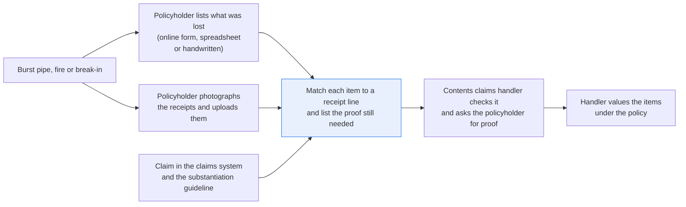
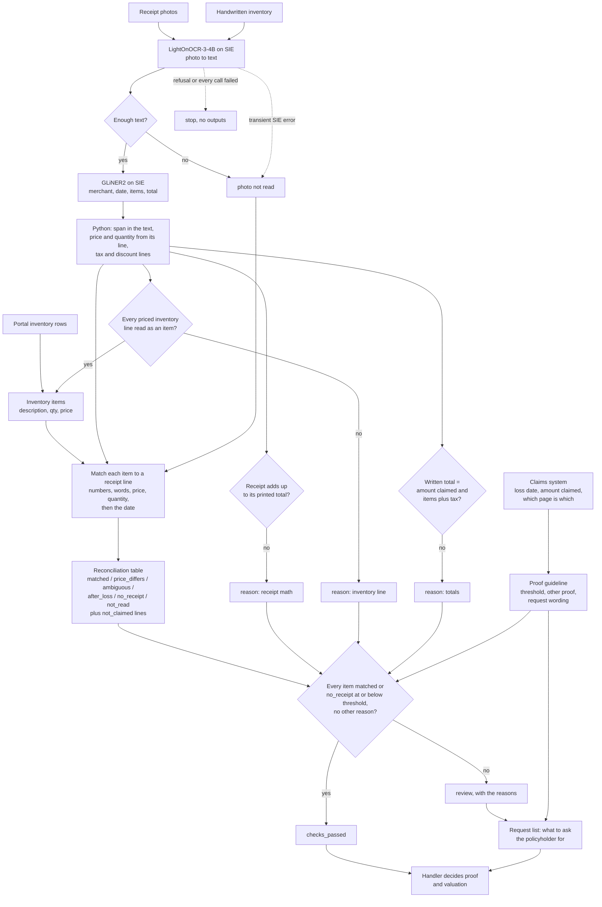

# Match claimed items to receipts and list the proof still needed

> **This example:** a contents handler working through a home claim's inventory and receipt photos.
>
> **How it works:** OCR reads receipt photos and handwritten lists, an extraction model finds items
> and prices, and Python matches them with price, date and total checks.
>
> **Use the same pattern for:** hotel and meal receipts on a living-expenses claim, jewelry against
> appraisals, business interruption expenses against invoices.

## Background

After a burst pipe, a fire or a break-in, the policyholder has two jobs on top of cleaning up.
They list what was lost or damaged (the contents inventory: each item, how many, what they paid
and roughly when), and they dig out whatever proof they have. Some fill in the insurer's online
inventory form or a spreadsheet. Others write the list by hand on the insurer's paper form or a
sheet of notepaper. The receipts nearly always arrive the same way: laid out on the kitchen
table, photographed with a phone, uploaded to the claims portal or attached to an email.

On the insurer's side, a contents claims handler opens the claim in the claims system, with the
inventory and the attachments next to it. For each item on the inventory they look for proof of
ownership and the price: find the receipt that covers it, find the line, check it's the same
thing at the same price and quantity, and check the receipt is from before the loss. Items with
no receipt get a note, and the handler asks for something else (a photo of the item, a bank
statement, the box it came in). Then the handler moves on to valuation: depreciation, actual
cash value against replacement cost, and the policy's limits. That last part isn't this recipe.

The claims system already gives you the claim number, the policy, the policyholder, the date of
loss and the contents amount claimed. If the inventory came through the portal or a
spreadsheet, the items, quantities and prices are structured too, and you take them as they
are. What the insurer doesn't have is the shop's side of the purchase. There's no access to a
retailer's till records, and the barcode at the bottom of a receipt doesn't give an adjuster the
transaction. So the receipt photos have to be read, and so does a handwritten inventory when
that's what the policyholder sent.

How much proof is enough is the insurer's rule, not the handler's mood. Claims teams keep a
substantiation guideline: items above a set value need proof of ownership, and when there's no
receipt, the guideline lists what else is accepted (a bank or card statement line, a photo of
the item in the home, the box or the manual). Nobody asks for the receipt for a $24 doormat.

Why it matters: an item paid on a receipt line for something else, or at a price nobody paid,
is money out the door. And a handler who adds up every receipt and compares it with the claim
gets the wrong answer in both directions.

Here's the contents claim end to end, and the step this recipe takes on:



## The problem

The naive check is "the claimed amount equals the sum of the receipts". It breaks on ordinary
claims. A receipt from an electronics shop has the TV that was ruined and the HDMI cable that
survived. A receipt for three bowls covers a claim for the two that broke. A receipt dated a week
after the loss can be the replacement purchase, which is how replacement cost gets settled.
And an item with no receipt isn't suspicious; most people don't keep the receipt for a rug.

So the recipe works item by item: for each inventory item, find the receipt line that supports
it, or say plainly that there isn't one. A vision OCR model reads the photos, an extraction
model points at the fields, and plain Python does the matching and every sum.

For each inventory item, a **match status**:

- **`matched`**: one receipt line is the same item, at the same unit price, for at least the
  quantity claimed, on a receipt dated on or before the loss.
- **`price_differs`**: the item is on a receipt, at a different price than the inventory says.
- **`ambiguous`**: a receipt line could be it but the words don't agree (a "TV stand" against a
  "TV wall mount" at the same price), or two lines fit equally well.
- **`after_loss`**: the only matching line is on a receipt dated after the loss. It may well be
  the replacement purchase; the handler decides what it proves.
- **`no_receipt`**: nothing on any receipt fits. Above the guideline's proof threshold, the
  handler asks for other proof; below it, the item is listed and nothing is asked for.
- **`not_read`**: the receipt that would cover it couldn't be read.

For each claim, a **check status**: **`checks_passed`** when every item is `matched` (or is
`no_receipt` below the proof threshold), every receipt adds up to its own printed total, and the
total written on the inventory equals the amount in the claims system and is what its items
add up to with sales tax; **`review`** otherwise, with the reasons.

Each claim in review also gets a **request list**: what to ask the policyholder for, item by
item, in plain words the handler can paste into the portal message or the letter ("For the
headphones (279.00): a bank or card statement showing the purchase, or a photo of them in your
home"; "The second receipt photo is too dark to read: please send it again in daylight"). The
handler checks it, sends it, and the claim waits for the answer.
Receipt lines nobody claimed are listed as "not claimed", for information, and send nothing to
review.

Neither status is a decision. `checks_passed` means the paperwork lines up. The handler still
decides what proof is enough and what each item is worth under the policy, and nothing is paid
or denied automatically.

### Examples

Here are three of the claims in `data/`, and what should happen to each.

All of this is synthetic, written for this recipe. The handwriting is drawn with the Caveat font
(SIL Open Font License).

**1. A mixed receipt.** `CLM-26-1001`.
- **Input:** `CLM-26-1001`, a handwritten inventory (page 1 of `inventories.pdf`) that writes
  "Nimbus 55in TV", and two receipt photos (pages 1 and 2 of `receipt-photos.pdf`), one with
  "NIMBUS 55IN 4K TV" and an HDMI cable that's no longer on the inventory.
- **What should happen:** each item finds its receipt line despite the different wording, and the
  cable is listed as a line nobody claimed, which sends nothing to review.
- **Expected outcome:** `checks_passed`; 4 `matched`, the cable `not_claimed`.

**2. Two items with no receipt.** `CLM-26-1005`.
- **Input:** `CLM-26-1005`, a handwritten inventory (page 5 of `inventories.pdf`) that adds
  headphones (279.00) and a doormat (24.00) that are on no receipt; the claims system's amount,
  1325.15, includes both.
- **What should happen:** both items come out `no_receipt`, and the guideline's proof threshold
  decides that only the headphones are worth asking about.
- **Expected outcome:** `review`; headphones `no_receipt` on the request list, the doormat
  `no_receipt` and not asked for.

**3. Same price, different thing.** `CLM-26-1008`.
- **Input:** `CLM-26-1008`, an inventory from the portal with two walnut bar stools at 64.00 each
  and a TV stand at 39.99, against a receipt photo (page 10) with "TV WALL MOUNT 39.99".
- **What should happen:** the stools match; the stand has the price and one word in common with
  the mount, and that isn't enough to call it proof. The recipe doesn't decide what it is: the
  handler asks, and the claim waits.
- **Expected outcome:** `review`; TV stand `ambiguous`, nothing asked; the stools `matched`.

On the live run, 8 of 8 claims came out as expected. [What came out](#what-came-out) has the
results.

## How we'll solve it

1. **Start from the claims system and the guideline.** Per claim, the claims system gives the
   claim and policy number, the policyholder, the date of loss, the contents amount claimed, and
   which uploaded pages are receipts and which is the inventory. If the inventory came through
   the portal, it comes in as rows (description, quantity, unit price) and skips steps 2 and 3.
   The substantiation guideline comes in as `proof_guidelines.yaml`: the proof threshold, the
   other proof accepted, and the wording of each request. It's a made-up guideline for the demo,
   not any insurer's.
2. **Read each photo with an OCR model.** `LightOnOCR-3-4B` reads both printed receipts and
   handwriting, and keeps a receipt's item and price on the same line. A photo that comes back
   with fewer than 60 characters of text is marked unreadable.
3. **Find the fields with an extraction model, then make Python prove them.** On a receipt,
   `gliner2-large-v1` points at the merchant, the purchase date, the item lines and the total;
   on a handwritten inventory, at each item and the total. A value only counts if it's in the
   text, and a total only counts on a line labelled TOTAL. Two different totals or dates read on
   one page go to review instead of the first one winning. Python reads the price from the
   item's line, the quantity from notation like "2 @ 14.99" on a receipt or "(2)" on a
   handwritten list, and the tax and discount lines by their labels. Labels match whole words,
   so "CASH" marks a payment line but "Cashmere sweater" is still an item. On the inventory, every
   line with a price on it has to be either an item or the total: a priced line the model
   didn't point at is a reason for review, so a dropped item can't let the claim pass on the
   items that were read.
4. **Check each receipt on its own.** Its item lines, discounts and tax must add up to its
   printed total, to the cent. A receipt that doesn't add up is a reason for review whatever
   else matches. A line that says "2 @ 14.99" but prices itself at 30.98 counts as unpriced.
5. **Match each inventory item to a receipt line.** Python compares the price and the words,
   with a short list of spellings treated as the same ("qt" and "quart", "in" and "inch"). Same
   words mean every number on the inventory side is on the receipt line (a 14in laptop is not a
   15in one), at least two words are shared (all of the line's words when the line is shorter,
   so "Laptop" is not "LAPTOP SLEEVE 14IN"), and at least 60% of the inventory's words are on
   the line. Same price and the same words, for at least the quantity claimed, make a match.
   Same price with words that only partly agree is `ambiguous`, never a match, and so are two
   different lines that both fit, or a line with fewer units left than the item claims. The
   receipt date then decides between `matched` and `after_loss`; when the same item is on a
   receipt from before the loss and one from after, the earlier one counts. An item the
   receipts don't show is `not_read` rather than `no_receipt` while any receipt photo on the
   claim couldn't be read, since it may be on that one.
6. **Check the inventory's written total** against the amount in the claims system, and
   against its own items. The policyholder writes the total with sales tax included, so it has
   to lie between the sum of the item prices and that sum plus 10% (`max_sales_tax_rate`); a
   total outside that range means an item was missed or misread. A portal inventory has no
   written total; the claims system's amount came from the same rows.
7. **Write the reconciliation table.** One row per inventory item, with the receipt page and
   line it matched, both descriptions, both prices and the status, plus the receipt lines
   nobody claimed. That table is what the handler works from.
8. **Write the request list** for each claim in review, from the guideline's wording: other
   proof for each `no_receipt` item above the threshold, a new photo of each receipt photo that
   couldn't be read (naming the items it may show), and a confirmation of the price for each
   `price_differs` one. `ambiguous` and `after_loss` items stay with the handler, who knows
   whether to ask.

If an SIE call fails for a reason that may pass (a timeout, a 5xx, a rate limit, an over-long
input), the photo it was reading counts as not read, the items that depended on it are marked
`not_read`, the claim goes to review with the reason, and the run carries on. The policyholder
isn't asked for a new photo then: the photo was fine, the call wasn't, and that's ours to rerun.
A reply missing the key it should carry (`entities` from the OCR model, `data` from the
extraction model), and an OCR reply with no Markdown in it, count as failed calls too; an empty answer is a real "nothing found". If SIE
refuses the call (a bad key, an unknown model, no credits), the run stops with SIE's full message
and writes nothing, and so it does when every call failed.

## Picking the models

The reader is `lightonai/LightOnOCR-3-4B`, called through SIE's `extract` with the photo as an
image, once per photo. Receipts and handwritten lists arrive as phone photos with no text layer,
so the reading step has to be OCR. One model reads both the printed receipts and the
handwriting, and it writes a receipt's item and price on the same Markdown line or table row,
which is the shape every price check after it leans on. OCR models built on language models can
invent text on a photo they can't really read (two of the swaps under Try another model did);
that's why nothing the reader returns counts until Python finds it on a line with a label or a
price.

The field finder is `fastino/gliner2-large-v1`, called through `extract` with an `output_schema`
(the fields and their `description` from `rules.yaml`), once per window of the flattened page.
GLiNER2 reads at most 512 tokens per item, and a window of 180 words is about that, not a
guarantee; windows overlap by 30 words, so a line cut at one edge is whole in the next. Each
call sets `overflow_policy: error`, so a window too long to read whole fails (and the page goes
to review) instead of being cut short. It's
good at telling a product line from a payment line on a receipt it has never seen. It is not
something to trust with the value itself, which is why Python checks that each span is in the
text, reads the price from the span's line, and cross-checks the lines against the receipt's
total and the inventory's priced lines.

Neither model takes a prompt, so there's no instruction in a photo for either to follow. So:
two models, the OCR model called once per photo and the extraction model once per window, and
no generative model makes a decision. The matching, the arithmetic, the dates, the threshold
and the request wording are plain Python reading `rules.yaml` and `proof_guidelines.yaml`.

## The flow



## How it's built

Everything you'd want to argue about lives in two files. [`rules.yaml`](./rules.yaml) holds the
two model names, the fields GLiNER2 is asked for on each kind of page, the labels that mark the
total, tax and discount lines, the word-matching rule (`min_shared_words`, `min_word_share`, the
ignored words and the spellings treated as the same) and every threshold.
[`proof_guidelines.yaml`](./proof_guidelines.yaml) is the substantiation guideline: the proof
threshold (100.00), the other proof accepted and the wording of every request. It's made up for
this demo; put your team's in its place. [`claims_system.py`](./claims_system.py) stands in for
the claims system's API with four lookups (`open_contents_claims`, `get_claim`, `attachments`,
`inventory_rows`) over CSV seeds in `data/`. [`recipe.py`](./recipe.py) reads top to bottom in
the order of the flow.

| Step | Code | SIE call | What it does |
| --- | --- | --- | --- |
| Load the claim | `ClaimsSystem.get_claim`, `attachments`, `inventory_rows` | none | The claim, which page is which, and the portal's rows when there are any. An attachment's file must be a plain file name in `data/`, never a path |
| Read each photo | `ocr_text`, `read_page`, `flatten_markdown` | `extract` (image) | One call per photo. A reply with no Markdown is a failed call. Table rows become "cell \| cell" lines so an item and its price share a line; under 60 characters is unreadable |
| Find the fields | `extract_spans`, `one_amount` | `extract` + `output_schema` | One call per window, one item per call, `overflow_policy: error`. A span must be in the text; a total must sit on a TOTAL line; two different totals or dates go to review |
| Read the lines | `item_line_indexes`, `priced_line`, `line_price`, `describe_line` | none | The line each item span sits on, its quantity, unit price and line price, and the description without the numbers. A span across two lines gives two items |
| Receipts | `read_receipt`, `receipt_math` | none | Purchase date, discount and tax lines, and the arithmetic against the printed total |
| Inventory | `read_inventory` | none | Items and the written total; a priced line that isn't an item or the total is a reason for review |
| Match | `reconcile`, `match_item`, `words_agree`, `item_words` | none | The status per item, quantity used up line by line, and the receipt lines nobody claimed |
| Status and requests | `settle`, `items_against_total`, `requests`, `request_page` | none | The reasons for review (including a written total its items plus sales tax don't make), and the request list in the guideline's wording |
| SIE failures | `Calls.call`, `is_fatal`, `stop_message`, `stop_on_refusal` | none | A transient failure or a reply missing its key marks the photo not read; a refusal, or every call failing, stops the run without outputs |
| Outputs | `write_outputs`, `table_row`, `csv_safe` | none | `reconciliation.csv`, `claims.csv`, `requests/<claim>.md` and `claims/<claim>.json`. Any cell a spreadsheet would run as a formula gets a leading `'` |

[`selfcheck.py`](./selfcheck.py) checks all of this offline with hand-written OCR pages and
stand-in model replies: the money and quantity parsing (glued prices like "LAPTOP899.00", "2 @
14.99" against its line price); the word rule on every pair from the sample claims and on near
misses (TV stand against TV wall mount, 14in against 15in, "Laptop" against the laptop sleeve,
"Stand mixer bowl lid" against "STAND MIXER"); whole-word labels ("Cashmere sweater" is an item,
"CASH" is not); an inventory whose items don't add up to its written total; each kind of claim in
`data/`; the threshold at exactly 100.00 and at 100.01; a dropped inventory line, two items in one
span, two totals on one receipt, a receipt with no date, the same item before and after the loss, an
item listed twice, three bowls against two, two lines that both fit, a portal row with quantity 0,
an unreadable inventory; the statuses and output files; `csv_safe`; the committed data and the
claims-system lookups (including that the PDFs carry no metadata and that an attachment's file can't
be a path); `overflow_policy: error` on every extraction call; and the SIE failure rule with a
transient error, a refusal, every call failing, a reply missing its key, an OCR reply with no
markdown (counted as a failed call), and the empty-result 500 counted as "nothing found" only from
the extraction model. Break any one of those rules and a check fails.
[`make_data.py`](./make_data.py) draws the photos and writes the claims system's seed.

## Run it

**Try this recipe on [SIE Serverless](https://superlinked.com/serverless?utm_source=github&utm_medium=docs&utm_campaign=sie-cookbook&utm_content=insurance-match-claimed-items-to-receipts).** You pay per call and there are no GPUs to manage yourself. Get an [SIE API key](https://console.superlinked.com/console/api-keys?utm_source=github&utm_medium=docs&utm_campaign=sie-cookbook&utm_content=insurance-match-claimed-items-to-receipts), read the [API docs](https://superlinked.com/docs/reference/api?utm_source=github&utm_medium=docs&utm_campaign=sie-cookbook&utm_content=insurance-match-claimed-items-to-receipts), or host SIE yourself from the [SIE repo](https://github.com/superlinked/sie).

You need [uv](https://docs.astral.sh/uv/) and an SIE API key
([create one](https://console.superlinked.com/console/api-keys?utm_source=github&utm_medium=docs&utm_campaign=sie-cookbook&utm_content=insurance-match-claimed-items-to-receipts)).

```bash
cp .env.example .env   # then set SIE_API_KEY
uv run recipe.py
uv run selfcheck.py    # optional: offline checks, no SIE call
uv run --group data make_data.py   # optional: rewrite data/
```

`uv run` installs this recipe's few dependencies into its own `.venv` on the first run. Each run
writes `runs/<timestamp>/` in this folder. A run makes 33 SIE calls on this data: 17 to the OCR
model (one per photo) and 16 to the extraction model (one per window; the unreadable photo gets
none). The first calls can wait a few minutes while SIE Serverless starts the OCR and extraction
models; our run on 2026-11-04 (UTC) took 45 s with the models
already warm.

## What came out

### The three examples

**1. A mixed receipt.** `CLM-26-1001`.
- **Expected outcome:** `checks_passed`; 4 `matched`, the cable `not_claimed`.
- **What came back:** `checks_passed`, four matches and one line marked `not_claimed`.
- **Verdict:** Pass.

**2. Two items with no receipt.** `CLM-26-1005`.
- **Expected outcome:** `review`; headphones `no_receipt` on the request list, the doormat
  `no_receipt` and not asked for.
- **What came back:** `review`, with one request: "For the Aurora wireless headphones (279.00): we
  couldn't find it on the receipts you sent." The doormat is listed as "Not asked for (no receipt,
  at or below 100.00): Doormat (24.00)".
- **Verdict:** Pass.

**3. Same price, different thing.** `CLM-26-1008`.
- **Expected outcome:** `review`; TV stand `ambiguous`, nothing asked; the stools `matched`.
- **What came back:** `review`; the TV stand `ambiguous` ("same price as receipt 1 line 2 'TV WALL
  MOUNT', but the words don't agree"), the stools `matched`.
- **Verdict:** Pass. It costs the handler a question: `ambiguous` sends nothing to the policyholder,
  so someone still has to ask whether it was a stand or a mount.

### Results

On the live run on 2026-11-04 (UTC), 8 of 8 claims came out as expected.

**Where it works:** on messy but honest paperwork. Different wording for the same item
(`CLM-26-1001`) and a coupon with a quantity line (`CLM-26-1002`) pass. A receipt that doesn't add
up (`CLM-26-1003`), a wrong price (`CLM-26-1004`), missing receipts (`CLM-26-1005`) and an
unreadable photo (`CLM-26-1006`) land in review. The receipt dated after the loss (`CLM-26-1007`)
and the stand against the mount (`CLM-26-1008`) land there too with nothing asked, so the handler
does that judging.

**Where it fails:** what this run didn't test. It doesn't check that a receipt is genuine (a
duplicate across claims, an edited photo), a list that says "x2" or "two of" comes out as
`price_differs` or `ambiguous` instead of a match, and the photos are drawn, not real phone photos.

The input is eight contents claims:

- `data/claims.csv`, `data/attachments.csv` and `data/portal_inventory.csv`: the claims
  system's seed. Each claim's policy, policyholder, date of loss, contents amount claimed and
  whether the inventory is handwritten or from the portal; which uploaded page is each receipt
  and which is the inventory; and the portal's inventory rows for `CLM-26-1008`
- `data/receipt-photos.pdf`: ten receipt photos, one per page, tilted on a table, unevenly lit,
  with sensor noise and JPEG compression
- `data/inventories.pdf`: seven handwritten inventories, one per claim that has one: what
  happened, each item and its price, and the total claimed with sales tax

> **All of it is synthetic.** [`make_data.py`](./make_data.py) draws the photos with Pillow, and
> rerunning it rebuilds them byte for byte. The PDFs carry no document metadata (no title,
> author or dates). Every policyholder, store, address, product and claim number is invented,
> and so is the substantiation guideline. The inventories are written in
> [Caveat](https://github.com/googlefonts/caveat), a handwriting font under the
> [SIL Open Font License 1.1](https://openfontlicense.org); `make_data.py` downloads it from
> [google/fonts](https://github.com/google/fonts/tree/5571d84c0d8c70ec1af4f64072d8c5cf1e4e9643/ofl/caveat)
> at a pinned commit, checks its SHA-256 and caches it outside the repo. Only the rendered pages
> are committed, not the font file.

Treat this as a demo that the wiring works, not as a measure of accuracy: eight claims tell you
each path through the matching runs, not how often a real phone photo gets misread.

A few things worth noticing:

- **The doormat is the guideline doing its job.** `CLM-26-1005` has two items with no receipt,
  and only one of them turns into a letter. Here's the request list the recipe wrote for it
  (`requests/CLM-26-1005.md`):

  ```markdown
  ## Why this claim is in review

  - Aurora wireless headphones (279.00): no_receipt, on no receipt line

  ## To ask the policyholder for

  1. For the Aurora wireless headphones (279.00): we couldn't find it on the receipts you sent. Please send one of these instead: a bank or card statement showing the purchase, a photo of it in your home, or the box, the manual or the warranty card.

  Not asked for (no receipt, at or below 100.00): Doormat (24.00)
  ```

  The doormat is still in the reconciliation table as `no_receipt`, with `proof_requested` set
  to "no: at or below 100.00", so the handler can see it was looked at. Nobody gets a letter
  about a 24.00 doormat.
- **`CLM-26-1008` is why one shared word and the same price aren't enough.** A matcher that
  accepted that would take "TV WALL MOUNT" as proof of a "TV stand". Here the same receipt has
  both outcomes side by side (from `reconciliation.csv`):

  ```csv
  claim,inventory_line,inventory_item,inventory_qty,inventory_amount,receipt,receipt_page,receipt_line,receipt_item,receipt_qty,receipt_unit_price,purchase_date,status,proof_requested,detail
  CLM-26-1008,1,Walnut bar stool,2,128.00,1,receipt-photos.pdf p10,1,BAR STOOL WALNUT,2,64.00,2026-07-30,matched,,"receipt 1 line 1 'BAR STOOL WALNUT', bought 2026-07-30"
  CLM-26-1008,2,TV stand,1,39.99,1,receipt-photos.pdf p10,2,TV WALL MOUNT,1,39.99,2026-07-30,ambiguous,,"same price as receipt 1 line 2 'TV WALL MOUNT', but the words don't agree"
  ```

  The handler asks the obvious question (did you have a stand or a mount?) better than a form
  letter would, so `ambiguous` sends nothing to the policyholder.
- **`CLM-26-1001` shows why the recipe doesn't add up the receipts against the claim.** The
  cable is on the receipt and not on the inventory, so "claimed amount equals the receipts"
  would flag a claim where nothing is wrong. Item by item, it's four matches and one line marked `not_claimed`.
- **The blurred photo really is blank to this OCR model.** On `CLM-26-1006`, LightOnOCR
  returned no text at all for page 8, so the dehumidifier is `not_read` and the request asks for
  that photo again, naming the dehumidifier. If a transient SIE error had caused the same gap,
  the claim would still go to review, but no request would go out: there'd be nothing wrong with
  the photo.
- **The safety nets didn't fire on this run, and that's fine.** Every handwritten line with a
  price on it was read as an item, no receipt read two different totals or dates, and GLiNER2
  never hit SIE Serverless's empty-result error. Every handwritten inventory's items, plus its sales
  tax, made its written total. If GLiNER2 skipped a line like "Mixing bowls (2)", the inventory
  line check would name that line and the total check would show the gap, so the claim couldn't
  come out clean on the items that were read.

### What you do next

The contents claims handler opens `reconciliation.csv` for the item-by-item picture and, for
each claim in review, its `requests/<claim>.md`. They check the request list and send it
through the portal message or the letter, and the claim waits for the answer. The `ambiguous`
and `after_loss` items are theirs to judge, and valuation under the policy comes after.

## Potential improvements

- **Teach it your documents' wording.** `documents` in `rules.yaml` is the extraction schema for
  each kind of page, and each `description` goes to GLiNER2. To add a field (e.g. a receipt
  number or a payment card), add it there and use it in `read_receipt`. `labels` lists the words
  that mark the total, tax and discount lines, and the summary and payment lines that are never
  items. Add your stores' wording ("AMOUNT DUE", "HST", "MEMBER SAVINGS").
- **Tune the thresholds on your own claims.** `money_tolerance` is zero, so receipts must add
  up to the cent. `min_page_chars` decides when a photo counts as unreadable; it measures how
  much text came back, not how legible the photo was. `min_shared_words` and `min_word_share`
  decide how close two descriptions have to be. `max_sales_tax_rate` (10%) is how far a written
  total may sit above its items; a missed item worth less than that margin doesn't show in the
  total check, so the inventory line check is the one that catches it. They're all starting
  points nobody tuned.
- **Use your own guideline.** `proof_guidelines.yaml` is made up. Put in your threshold, the
  proof your team accepts and your own wording, and add a request type if you need one.
- **Plug in your claims system.** `claims_system.py` reads three CSV seeds; swap its four
  lookups for calls to your claims system's API. The models are in `models` in `rules.yaml`,
  one line each.
- **What this does not do.** It does not check that a receipt is genuine (a duplicate across
  claims, an edited photo, a store that does not exist), it does not work out depreciation or
  actual cash value, and it does not decide what the policy covers. It doesn't check that the
  claim number written on the inventory is this claim's. It reads the photos, matches the items
  and lists the gaps, so the handler starts from the exceptions.
- **Known SIE Serverless issue.** When GLiNER2 finds no field in a window, SIE Serverless currently answers
  the `output_schema` call with HTTP 500 "Inference completed without a valid conserved billing
  settlement". The recipe sends one window per call and records that answer as "no fields found"
  in the claim's notes. A field that is never found sends the claim to review, never past it.
- **Quantities written other ways.** The recipe reads "2 @ 14.99" and "(2)". A list that says
  "x2" or "two of", or a set of two sold as one line, comes out as `price_differs` or
  `ambiguous` instead of a match. A few more patterns in `line_price` would cover them.
- **Cases worth adding next.** The same receipt uploaded on two claims, a receipt for three
  bowls against a claim for the two that broke, and an inventory whose written claim number is
  a different claim's.

## Try another model

Each model is one line under `models:` in `rules.yaml`. We swapped one model at a time, changed
nothing else, and ran the recipe on this data on SIE Serverless on 2026-11-04 (UTC).

| `rules.yaml` key | Swap in | What happened on this data |
| --- | --- | --- |
| `ocr` | `lightonai/LightOnOCR-2-1B` | 7 of 8 claims came out as with the default. On the blurred photo in `CLM-26-1006` it returned enough text for the photo to count as readable, but GLiNER2 found no date, total or item in it. The claim still went to review, but the dehumidifier came out `no_receipt` instead of `not_read`, so the request asks for other proof of it instead of a new photo. 37 calls (20 to the extraction model), 65 s. |
| `ocr` | `zai-org/GLM-OCR` | The same 7 of 8. On the same blurred photo it invented a receipt (merchant "brooklynreceipts@yahoo.com", dated 2023-04-17, total 50.00) with no priced item, so that receipt went to review as "no priced item read" and the dehumidifier came out `no_receipt`, with the same other-proof request. 34 calls, 19 s. |
| `extract` | `fastino/gliner2-base-v1` | 6 of 8 claims came out as with the default. On `CLM-26-1001` it missed the TV line on the first receipt, so that receipt didn't add up and the TV came out `no_receipt` (with a request); on `CLM-26-1005` it missed the laptop sleeve, so the receipt didn't add up and the sleeve came out `no_receipt`. `CLM-26-1001` went to review instead of passing and `CLM-26-1005` stayed in review; in both the receipt math names the gap. 33 calls, 43 s. |

An OCR model that reads text into a blank photo turns "send that photo again" into "send other
proof"; the claim still goes to review, but the request is the wrong one. The default model
returns nothing for that photo, which is why it's the default.

See [MODELS.md](../../MODELS.md) for every model these recipes use.

## Run it on your own SIE

The same code runs against an SIE server you host. Set `SIE_BASE_URL` in `.env`; an API key
is then optional. The table gives the SIE v0.10.1 image each model runs on, from SIE's
[compatibility matrix](https://github.com/superlinked/sie/blob/main/docs/compatibility.md).

| `rules.yaml` key | Model | Image | Tested on |
| --- | --- | --- | --- |
| `ocr` | `lightonai/LightOnOCR-3-4B` | `cuda12-sglang-vision-extract` | L4 |
| `extract` | `fastino/gliner2-large-v1` | `cuda12-default` | L4 |

One SIE server runs one image, so these 2 images need a cluster: the
[sie-cluster Helm chart](https://github.com/superlinked/sie/tree/main/deploy/helm/sie-cluster)
with one worker pool per image routes each model to its pool. See
[SELF_HOSTING.md](../../SELF_HOSTING.md) for the values file.

## Data and licenses

Everything in `data/` is synthetic and made by `make_data.py`. The only outside asset is the
Caveat font (SIL Open Font License 1.1) used to draw the handwriting, downloaded at a pinned
commit of [google/fonts](https://github.com/google/fonts/tree/5571d84c0d8c70ec1af4f64072d8c5cf1e4e9643/ofl/caveat)
and not committed.

## Files

- `recipe.py`: the pipeline
- `claims_system.py`: the claims system as lookups over the CSV seeds
- `selfcheck.py`: offline checks with hand-written pages and stand-in replies, no SIE call
- `make_data.py`: draws the synthetic photos and writes the claims system's seed in `data/`
- `rules.yaml`: fields, labels, the word-matching rule and thresholds
- `proof_guidelines.yaml`: the made-up substantiation guideline and the request wording
- `data/`: the claims system's CSV seed, the receipt photos and the handwritten inventories
- `pyproject.toml`, `uv.lock`: this recipe's dependencies

See the SIE task page for [document field extraction](https://superlinked.com/doc-field-extraction?utm_source=github&utm_medium=docs&utm_campaign=sie-cookbook&utm_content=insurance-match-claimed-items-to-receipts).
