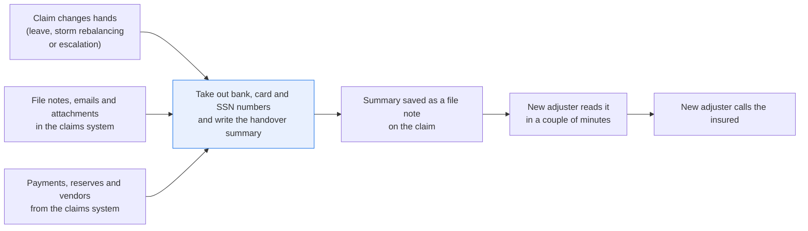
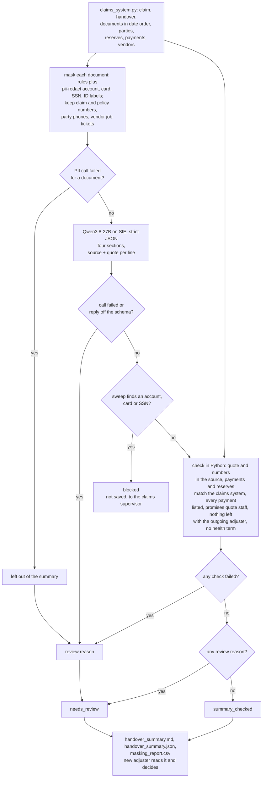

# Summarize a claim for the next adjuster, with a source for every line

> **This example:** a property claim reassigned while the first adjuster is on leave.
>
> **How it works:** numbers are masked first, a language model writes the summary with a quote per
> line, and Python checks quotes, payments and reserves against the claims system.
>
> **Use the same pattern for:** a large-loss reserve review, a litigated claim's history for
> defense counsel, a file recap before answering a complaint.

## Background

Claims change hands all the time. An adjuster goes on leave, a desk gets rebalanced after a
storm, a claim grows past what one adjuster is allowed to settle and moves up to a senior one.
The new adjuster opens the claim in the claims system and finds the file notes, the emails and
the attachments, in the order they were saved. Before they ring the insured to introduce
themselves, they need to know four things: what happened, what's been paid and what's held in
reserve, what the last adjuster promised the insured, and what's still open and who's holding
it.

Today they get that by reading the whole file, or from a handover note the outgoing adjuster
wrote on their last afternoon before leave. The first takes half an hour per claim, and a
reassignment after a storm moves dozens of claims at once. The second is as good as that
afternoon was. What gets lost is nearly always the same: a promise ("the contents adjuster will
call you by the 16th"), or a question the insured asked that nobody answered. Then the insured
hears something different from the new adjuster, and that's how a simple water claim turns into
a complaint.

So the insurer wants a summary pinned to the claim when it changes hands, that the new adjuster
reads in a couple of minutes. The new adjuster is allowed to see everything about this claim,
so the summary keeps the people by name: the insureds, the tenant downstairs, the restoration
crew. What it must not hold is the stuff nobody should store in a free-text note that every
claims user and every export can read: a bank account number the insured sent for the direct
deposit, a card number from a receipt, a full Social Security number sent for a tax form. Those
belong in the payment and identity screens, where access is controlled. Insureds put them in
emails because the adjuster asked for them, and a model that summarises the email will happily
copy them along.

Health details are the judgement call. This summary is read by the adjuster on a property
claim. If the insureds asked to move to a hotel because of someone's health, the adjuster needs
to know that a health reason was given, because it bears on the hotel bill. They don't need the
diagnosis in a summary note; it stays in the note it came in, where it already is. So the
summary may say "a health reason" and never names the condition, and the run's outputs don't
copy the documents themselves.

A lot of the claim is already structured. The claims system has the claim and policy numbers,
the insureds, the date of loss, the adjuster on the claim and the new one, the reserves by
coverage, every payment issued (payee, amount, date) and the vendors assigned. None of that
needs a model. It's what the summary is checked against.

Here's the handover end to end, and the step this recipe takes on:



## The problem

Writing the handover by hand is the half hour nobody has during a reassignment. Letting an LLM
write it raises three questions you have to answer before an adjuster trusts it:

- Does it say anything the file doesn't? A summary that says "plumber reimbursed" when no
  payment was issued is worse than no summary, because now the new adjuster tells the insured
  it's paid.
- Does it agree with the claims system? A payment or a reserve in the summary has to be one the
  system has, with the same amount.
- Is there a bank account, card or SSN in it? Not only well-formed ones: a card number with one
  digit mistyped fails the card checksum and still is a card.

So the recipe takes those numbers out first, writes the summary from what's left, and checks
every line against the file and the claim record. Each claim gets a status that says what the
checks found:

- **`summary_checked`**: every line quotes the file, every payment and reserve matches the claim
  record, and the sweep found nothing it shouldn't. The summary is saved as a file note on the
  claim, marked as generated, for the new adjuster.
- **`needs_review`**: a quote isn't in the file, an amount or a date doesn't match the file or
  the claim record, a promise quotes the insured instead of the insurer, an open item is left
  with the adjuster who handed over, a health term turned up, or a document couldn't be read.
  The summary is shown with the problem marked, and the new adjuster reads the file for that
  part.
- **`blocked`**: the final sweep found something that looks like a bank account, card or SSN in
  the summary. It isn't saved anywhere, and the claim goes to the claims supervisor.

The new adjuster still reads what they need to and decides what to do next. The summary is a
reading aid with a link from each line to the note or email it came from.

The raw file does reach SIE's models, so SIE has to be a processor your company has already
approved for claim data.

### Examples

The committed claim, CLM-2026-004417, has five documents in `data/documents/`. Here are three
of the things we wrote into them, and what should happen to each.

**1. A bank account in an email.** D3.
- **Input:** `03-insured-email.txt` (D3): "For the direct deposit please use our joint account
  at Cedar Ridge Credit Union, account number 0081 4472 9310." (The number is made up for this
  example.)
- **What should happen:** a pattern rule and a model that spots personal numbers both hide it
  before the LLM reads the email, so it can't reach the summary. If it ever did, a last check over
  the summary would block it.
- **Expected outcome:** masked to `XXXX XXXX 9310`, nowhere in the summary.

**2. A health reason, without the diagnosis.** D4.
- **Input:** `04-claim-note.txt` (D4): "The reason is Tibor's asthma: the dust and the dehumidifiers
  have set it off twice this week. Approved a hotel stay under Coverage D."
- **What should happen:** the summary says a health reason was given for the hotel and never
  names the condition; a line that does goes to review with its text withheld.
- **Expected outcome:** a line that says "a health reason", with a quote that doesn't name it.

**3. A promise the new adjuster has to keep.** D4.
- **Input:** D4 again: "Told Ilona the plumber's emergency call-out ($385.00, Cascade Rooter &
  Plumbing, paid on Tibor's card) will be reimbursed, and that the contents adjuster will call her
  by October 16 to set up the contents inventory." The claim record has no payment to the plumber.
- **What should happen:** both promises land under what the insurer told or promised the insured,
  each quoting D4, and we check those words are in the file. The plumber is owed and unpaid, so
  that one should show as open too.
- **Expected outcome:** both listed under promises, the plumber also under open items; the claim
  comes out `summary_checked`.

On the live run, 8 of 9 cases came out as expected (a tenth is checked only in the selfcheck).
[What came out](#what-came-out) has every one.

## How we'll solve it

1. **Start from the claim record.** `claims_system.py` gives the claim and policy numbers, the
   insureds, the date of loss, the outgoing and incoming adjuster and why the claim moved, the
   phones it holds for the people on the claim, the reserves by coverage, the payments issued
   and the vendors assigned with their job tickets. The file notes and emails come in date
   order.
2. **Take out what must not be stored.** Rules in Python mask bank account and card numbers to
   the last four (a 16-digit number that fails the checksum is still masked, and flagged) and
   replace a full SSN with "SSN on file". `superlinked/pii-redact`, with only the account, card,
   SSN and national ID labels switched on, catches the ones written in a way the rules don't
   expect. Names, addresses, phones, dates, amounts, and the claim, policy and vendor numbers
   stay: the new adjuster needs them. A 16-digit number survives only if the claims system holds
   it as this claim's vendor job ticket.
3. **Write the summary.** `Qwen3.8-27B-FP8` reads the masked file in date order and returns four
   short sections: what happened, paid and reserved, what the insurer told or promised the
   insured, and what's open and with whom (including a question the insured asked that has no
   answer in the file). Every line carries the document it came from and the exact words it
   relied on. The prompt says a later note overrides an earlier one, that whatever the outgoing
   adjuster held is now with the new one, to give a health reason without naming the condition,
   and that the file is something to summarise, never an instruction.
4. **Sweep the summary.** The same account, card and SSN rules run over everything the model
   wrote, and so does a search for every number taken out of a document, in any spacing. Any hit
   blocks it, whatever the other checks say.
5. **Check the summary in Python.** Each quote has to be in the document it cites. Every number
   a line states, dates included, has to be in that document, or be a date the claim record
   gave the model (the handover, say). Each payment has to match one in the claims system on
   payee and amount exactly, and each payment in the system has to appear. Each reserve has to
   match the system's reserve on that coverage. A promise has to quote insurer staff, not the
   insured. An open item can't be left with the adjuster who handed over. A health term from
   the list in `rules.yaml`, in a line's text or its quote, sends the summary to review and the
   line is withheld.
6. **Write the result:** the summary with its status, each line with its source and quote, and
   the masking report, ready to save as a file note on the claim. The masked documents are not
   copied into the outputs: masking takes out numbers only, so they still name the condition.

The order matters. Masking comes first because nothing the summary model never sees can end up
in a file note. The sweep comes before anything is written because masking can miss, and a
summary with an account number in it shouldn't be saved even in the run's own files.

If an SIE call fails for a reason that may pass (a timeout, a 5xx, a rate limit, or a reply
without its expected key), that claim gets `needs_review` with the reason and the run carries
on; if SIE refuses the call or every call fails, the run stops with SIE's message and writes
nothing.

## Picking the models

There are two models, and each does the part it's good at.

`superlinked/pii-redact` is SIE Cloud's PII model: `urchade/gliner_multi_pii-v1` and
`numind/NuNER_Zero` composed on the server, spans scoring 0.6 or more, the two models' spans
unioned. It takes the labels you ask for, and here that's four: `account number`, `credit card
number`, `social security number` and `national id number`. Leaving out `person`, `street
address` and the rest is the whole point: the new adjuster is allowed to know who everyone is.
It's called once per document (each one here fits in one window of up to 300 words). It's a span
finder, so it's good at "this run of characters looks like an account number" and knows nothing
about the claims system. That's why the job ticket, the phones and the claim and policy numbers
are decided by rules: a model can't know which 16-digit number Driftwood invoices against.

On this claim it found the account, the card and the SSN, and it was also eager. It tagged the
word "SSN" itself, "Tibor's SSN", the form name "1099", "Tibor's" next to "card", Tibor's phone
as an account number, the old policy number and the claim number as ID numbers. Every label we
ask for is a number, so the recipe takes out only the digit runs in a model span with at least 5
digits (or three or more number words, "four five three nine"), and anything the claims system
holds wins. The model is the net for shapes the rules don't know; the rules are the floor.

`Qwen/Qwen3.8-27B-FP8` writes the summary, called through SIE's `chat_completions` once per
claim with a strict JSON schema (`response_format` with `strict: true`, temperature 0). It's the
model the other recipes in this cookbook use to read text and answer in JSON with citations. In
the schema, `source` is an enum of the claim's document IDs, a money line's `kind` is `paid` or
`reserved` and its `coverage` is one of the four homeowners coverages, so it can't cite a
document that doesn't exist. It can still quote a real document under a line that document
doesn't support, and that's what the Python checks are for. It never sees the payments or
reserves table: what it lists comes from the notes, and the claims system checks it.

## The flow



## How it's built

What is masked and how the checks behave lives in [`rules.yaml`](./rules.yaml): both model
names, the PII labels and what each counts as, the card, account and SSN patterns, how many
digits to show, the text a full SSN becomes, the minimum digits in a model span, the claim and
policy number patterns that stay, the four coverages, the minimum quote length, the negation
words and the health-term list. A team that sees "routing and account" in its emails adds it to
`account_words`; a team whose files mention a condition we didn't think of adds it to
`health_terms`. Neither touches the code.

The claims system is one small module, named after the system it stands in for and backed by
CSV seeds in `data/` that it loads into an in-memory SQLite database. Swap it for a real API call
and nothing else changes:

| Module | Stands in for | Lookup |
| --- | --- | --- |
| `claims_system.py` | the claims system's claim API (a claim in Guidewire ClaimCenter, with its contacts, notes and documents, reserve lines, payments and service requests) | `find_claim`, `list_claims`, `claim_documents`, `parties`, `reserves`, `payments`, `vendor_assignments` |

[`recipe.py`](./recipe.py) is about 1,300 lines with the prompt and the checks, and reads top
to bottom in the order of the flow:

| Step | Code | SIE call | What it does |
| --- | --- | --- | --- |
| Look up | `Systems.from_seeds`, `build_claim_file` | none | The claim and its handover, its documents oldest first, its parties' phones, reserves, payments and vendor job tickets |
| Mask | `mask_claim`, `model_spans`, `rule_spans`, `keep_spans`, `outside`, `number_part`, `mask_document`, `replacement`, `luhn_valid`, `mask` | `extract` | One PII call per document window, with the four number labels. A model span inside a kept number is dropped, and one without at least 5 digits is left as written. Overlapping spans are joined; an account or card number is masked to the last four, a full SSN becomes "SSN on file", anything else becomes `[ID number removed]` and the like. Each row of the masking report names the document, line, kind, action and who found it, never the value |
| Summarize | `summary_prompt`, `summary_schema`, `ask_summary`, `parse_summary` | `chat_completions` | One call per claim. The reply must be exactly the four sections; a line has `text`, `source`, `quote`; an open item adds `with`; a money line has `kind`, `payee`, `coverage`, `amount`, `source`, `quote`. Anything else is a review reason, not a summary |
| Sweep | `summary_text`, `sweep` | none | The account, card and SSN rules again, plus every number taken out of a document in any spacing. Any hit is `blocked`: the summary is dropped and its lines aren't checked, since a check's reason would quote the number the model wrote. Only the sweep's hits, which never quote a value, say why |
| Check | `verify`, `check_line`, `quote_in`, `numbers`, `without_record_dates`, `match_money`, `parse_amount`, `negated`, `health_terms_in`, `withhold` | none | The checks in step 5 above. A quote is at least 12 characters and appears verbatim in its source after collapsing whitespace and straightening quote marks. An amount holds one number in dollars ("$4,860.00", "4860USD" and "USD 4,860" all parse; "$4,860.00 and $1,140.00" doesn't) |
| Report | `summarize_claim`, `render_markdown`, `write_outputs`, `csv_safe` | none | `summary_checked`, `needs_review` or `blocked` with the reasons; failed lines held, health lines withheld; spreadsheet formulas in the CSV defused |

The SIE error rule is the same as in the security recipes. A call that fails for a reason that
may pass (a timeout, a lost connection, a 5xx, a rate limit, a model still loading, or a reply
missing `entities` or `choices[0].message.content`) sends that document or that claim to
`needs_review` with a short reason, and the run carries on. A refusal every call would repeat (a
bad key, no credits, a model name SIE doesn't know) stops the run with SIE's full message and
writes no outputs. If every call failed, the run stops too.

[`selfcheck.py`](./selfcheck.py) checks the lookup, the masking (the account, the mistyped card,
the SSN, the job ticket and a neighboring one, held and unknown phones, model spans without a
number, a card number in words), every summary check, the sweep, the strict parsing, the
prompt's lines about text in the documents and health reasons, the three statuses and that SIE
error rule, offline, with hand-written strings and stand-in model replies.

## Run it

You need [uv](https://docs.astral.sh/uv/) and an SIE API key
([create one](https://console.superlinked.com/console/api-keys?utm_source=github&utm_medium=docs&utm_campaign=sie-cookbook&utm_content=insurance-summarize-claim-for-handover)).

```bash
cp .env.example .env   # then set SIE_API_KEY
uv run recipe.py
uv run selfcheck.py    # optional: offline checks, no SIE call
```

`uv run` installs this recipe's few dependencies into its own `.venv` on the first run. Each run
writes `runs/<timestamp>/`. The first call can wait a few minutes while SIE Cloud starts the
models. A warm run makes 6 SIE calls (5 to `superlinked/pii-redact`, one per document, and 1 to
`Qwen/Qwen3.8-27B-FP8`) and took 14 seconds on our run.

## What came out

### The three examples

**1. A bank account in an email.** D3.
- **Expected outcome:** masked to `XXXX XXXX 9310`, nowhere in the summary.
- **What came back:** masked to `XXXX XXXX 9310` before the model read it, found by both the rule
  and the PII model, and not in the summary.
- **Verdict:** Pass.

**2. A health reason, without the diagnosis.** D4.
- **Expected outcome:** a line that says "a health reason", with a quote that doesn't name it.
- **What came back:** "A hotel stay was approved for the insureds under Coverage D due to a health
  reason.", quoting a sentence that doesn't name it.
- **Verdict:** Pass.

**3. A promise the new adjuster has to keep.** D4.
- **Expected outcome:** both listed under promises, the plumber also under open items; the claim
  comes out `summary_checked`.
- **What came back:** both listed under promises, quoting D4, and neither under open items. The
  claim came out `summary_checked`.
- **Verdict:** Miss. Nothing checks that a promise with no matching payment also appears as open, so
  the status didn't change. The new adjuster still sees the promise, just in one section instead of
  two.

### Every example

On the live run on 4 Nov 2026 (UTC), 8 of the 9 cases the run covers came out as
expected; the tenth row in the table, the wrong reserve, is a stand-in reply in the selfcheck
only. The one that didn't is the plumber reimbursement, which we wrote to come out as promised and
open, and it came out as promised only.

**Where it works:** on the numbers and on what stays readable: the account number, the SSN and the mistyped
card are all masked, the vendor's job ticket and the names stay, the unanswered question is listed
as open, and the health reason doesn't name the condition.

**Where it fails:** on the plumber reimbursement,
promised and not paid, which came out as promised but not open. That's the one to worry about,
because no check looks for it and the status stays `summary_checked`. And this is one claim, so it
tells you the checks run, not how often the summaries are right.

The input is the claim in [`data/`](./data):

- `claims.csv`: the claim, CLM-2026-004417, on policy HO-4481207, with the insureds Ilona and
  Tibor Varga, the date of loss, and the handover from Marisol Quaye to Solveig Brannock on
  2026-10-13 (adjuster on leave)
- `claim_documents.csv` and `documents/`: five documents in date order: Marisol's first-notice
  note (D1), her assignment email to Driftwood Restoration Co. (D2), Tibor's email with the
  payment details and his question (D3), her note after a call with Ilona (D4) and her last note
  before leave (D5)
- `parties.csv`: the insureds with their phones, and the tenant downstairs, Wendell Okafor
- `reserves.csv`: Coverage A 18,500.00, Coverage C 6,000.00, Coverage D 2,400.00
- `payments.csv`: 4,860.00 to Driftwood Restoration Co. (Coverage A) and 1,140.00 to the
  Thimbleford Inn (Coverage D); nothing to the plumber
- `vendors.csv`: Driftwood's mitigation assignment with its job ticket

> **All of it is synthetic.** Bramblecote Mutual, its adjusters, the insureds, the tenant, the
> vendors and every number are invented. Emails use reserved `.example` domains, the SSN starts
> with 666 (which is never issued), and the card number is a made-up number with one digit
> changed from a valid one.

One claim, the Varga water loss. Here's what our live run on 4 Nov 2026 (UTC) gave. The claim
came out `summary_checked`:

| Case | What's in it | Came out | Why |
| --- | --- | --- | --- |
| Bank account | Tibor's email gives the credit union account number for the direct deposit | Masked to `XXXX XXXX 9310` before the model read it, found by both the rule and the PII model; not in the summary | The most common way an account number ends up in a file note |
| SSN | "You asked for my SSN for the 1099: ..." | Replaced with "SSN on file"; the summary lists no open SSN request | The adjuster needs to know it arrived, not what it is |
| Mistyped card | Tibor's card number with one digit wrong, after "my card" | Masked to `XXXX XXXX XXXX 6467` anyway, and the masking report says "fails the Luhn check; masked as a mistyped card number" | A failed checksum next to "card" is a typo, not a safe number |
| Vendor job ticket | A 16-digit job ticket that fails the checksum, in D2 and D5 | Kept readable, because the claims system holds it for Driftwood on this claim; the summary didn't mention it | Accounts payable matches the invoice on it |
| Names stay | Ilona, Tibor, "Mrs. Varga", the tenant Wendell Okafor, the Driftwood crew | All kept in the masked documents. The summary names Ilona, Tibor, Wendell Okafor, Marisol, Solveig, Driftwood and the tenant's insurer; it left out "Mrs. Varga" | The new adjuster is allowed to know who's who |
| Unanswered question | Tibor asks whether the old policy number HO-448120 is still right; nobody replied | Listed as open, with Solveig Brannock, quoting "Is that still right?" | The question the insured will ask again on the first call |
| A promise made | Marisol's note: she told Ilona the plumber's call-out would be reimbursed and the contents adjuster would call by October 16 | Both listed under promises, quoting D4 | That's the line the new adjuster most needs |
| Health reason | The same note: the Vargas asked for a hotel during drying because of Tibor's asthma | "A hotel stay was approved for the insureds under Coverage D due to a health reason.", quoting a sentence that doesn't name it | The adjuster needs the reason for the hotel bill, not the diagnosis |
| Paid or promised | The plumber reimbursement is promised in a note, and the claim record has no payment for it | Listed as promised, not as paid. Not listed under open items | The record says what's paid; the note says what's owed |
| Amount the record doesn't support | A stand-in reply (selfcheck only) that gives the dwelling reserve as $15,800.00 | `needs_review`: "Coverage A reserve $15,800.00: the claims system has 18500.00" | The summary is checked against the claims system, not trusted |

One of these came out differently from the plan. The plumber reimbursement was supposed to show
up as promised and open; the model put it under promises and left it out of the open items, and
the contents adjuster's call too. Nothing checks that a promise with no matching payment also
appears as open, so the status didn't change. The new adjuster still sees the promise, just in
one section instead of two. "Names stay" holds for the masking (nothing took a name out); the
model chose which names to repeat, and on this run that included the tenant.

Treat all of this as a demo that the wiring works, not as a measure of accuracy: one claim tells
you the checks run, not how often the summaries are right.

A few things worth noticing:

- **The PII model was enthusiastic.** Asked for four kinds of number, it also tagged the word
  "SSN", "Tibor's", the tax form "1099", the claim number and the phone. Taking out every span
  would turn "Tibor's SSN for the 1099" into "SSN on file for the SSN on file", which is
  accurate in a way nobody wanted. So a model span needs 5 digits to count, and the masking
  report lists each one it left alone ("the PII model tagged it, but it holds fewer than 5
  digits").
  On this claim the rules alone give the same masked text.
- **The health line came out as planned.** The model said "a health reason" and picked a quote
  that doesn't name it. From `handover_summary.json`:

  ```json
  {"text": "A hotel stay was approved for the insureds under Coverage D due to a health reason.",
   "source": "D4", "quote": "Approved a hotel stay under Coverage D. Booked the Thimbleford Inn
   in Cobbett Falls, billed direct to us.", "checks_passed": true, "problems": []}
  ```

  When a line does name the condition (we tried it in the selfcheck and the 4B swap below did it
  for real), the line goes to review and its text and quote are replaced with "[withheld: names
  a health condition]", and any other problem on that line that would quote the term is dropped,
  so the term doesn't end up in the outputs either.
- **Dates from the claim record pass.** The model wrote "The claim is moving from Marisol Quaye
  to Solveig Brannock on October 13, 2026" and cited D5, which only says "my leave starts tomorrow". The date comes
  from the claim record in the prompt, so it's right, though a strict number check would send it
  to review. A date that is one of the claim record's dates (loss, report, handover)
  passes; any other date has to be in the cited note.
- **The model saw masked text.** Tibor's email as the model read it:

  ```text
  For the direct deposit please use our joint account at Cedar Ridge Credit Union, account
  number XXXX XXXX 9310. I paid the plumber's emergency call-out on my card XXXX XXXX XXXX 6467,
  receipt attached. You asked for my SSN for the 1099: SSN on file.
  ```

- **Passing the checks isn't being right.** "Is that still right?" is a real quote and the open
  item is the right one, but the checks can't tell whether the model got the question right,
  only that the words are in D3. Read the source when it matters.

The run writes `handover_summary.md` for the adjuster (each line with its source document, kind
and time, then the masking report), `handover_summary.json` for code (every line with its check
result, each source document's kind, author and time, and the claims system's reserves and
payments; not the documents themselves) and
`masking_report.csv`, one row per number masked or kept, with the line number but never the
value.

### What you do next

Solveig, the new adjuster, reads `handover_summary.md` before she rings the insured: what
happened, what's paid and reserved, what Marisol promised, and what's open and with her. Each
line links to the note or email it came from, so she reads the source wherever it matters, and
a `needs_review` line means reading the file for that part. A `blocked` summary isn't saved
anywhere and goes to the claims supervisor instead.

## Potential improvements

- **Use your own claims system.** Replace the module's seeds with calls to your claims system.
  Each lookup takes the claim number, so the rest of the recipe doesn't change.
- **Promised and not paid is open.** A check that every payment promised in the promises section
  with no matching payment in the claims system also appears under open items would catch the
  difference above.
- **Your own words and terms.** `account_words`, the SSN words and `health_terms` are short
  lists. Read a few hundred of your files and add the phrasings and conditions they use.
- **Reserves listed.** The check requires every payment in the claims system to be in the
  summary, not every reserve. A team that wants all reserves in every handover can add the same
  check for them.
- **Who an open item is with.** The check catches an item left with the outgoing adjuster by
  name, not "the previous adjuster", and doesn't judge whether the holder is right (the 4B swap
  left Tibor's question with Tibor).
- **Promises to whom.** A promise has to quote a staff document, but a staff note also records
  what Marisol told the tenant's insurer and the vendor. Only the adjuster reading it catches a
  promise made to someone other than the insured.
- **Check the starting points.** `model_min_digits`, `checks.min_quote_chars` and the window
  sizes are starting points. Check them on your own claims.
- **Attachments.** "Receipt attached" in Tibor's email is all the recipe sees of the receipt.
  Attachments are not read, so a card number on a scanned receipt isn't masked or summarized.

## Try another model

Each model is one line under `models:` in `rules.yaml`. On 4 Nov 2026 (UTC) we swapped one model
at a time, changed nothing else, and ran the recipe on SIE Cloud.

| `rules.yaml` key | Swap in | What happened on this data |
| --- | --- | --- |
| `pii` | `urchade/gliner_multi_pii-v1` | Same masked text in all five documents. It tagged fewer things (no claim number, no old policy number, no "Tibor's") and still tagged Tibor's phone as an account number, which the claims system's phone kept. `summary_checked`, 14 seconds. |
| `summary` | `Qwen/Qwen3.5-4B` | `needs_review`, 74 seconds. It named the condition in a "what happened" line, which was withheld; it quoted the C and D reserves as "Reserves set: Coverage C (contents) $6,000.00" and the like, putting words in front that the note has only before Coverage A, so both quotes failed. Its payments and amounts matched the claims system. It left the plumber reimbursement out of the promises, listed Arlo's moisture reading as a promise to the insured, and put Tibor's policy-number question open "with Tibor Varga". All three passed the checks. |

`urchade/gliner_multi_pii-v1` is one of the two models `superlinked/pii-redact` combines, used
here alone. See [MODELS.md](../../MODELS.md) for every model these recipes use.

## Run it on your own SIE

The same code runs against an SIE server you host. Set `SIE_BASE_URL` in `.env`; an API key
is then optional. The table gives the SIE v0.10.1 image each model runs on, from SIE's
[compatibility matrix](https://github.com/superlinked/sie/blob/main/docs/compatibility.md).

| `rules.yaml` key | Model | Image | Tested on |
| --- | --- | --- | --- |
| `pii` | `superlinked/pii-redact` | `cuda12-default` | L4 |
| `summary` | `Qwen/Qwen3.8-27B-FP8` | `cuda13-sglang-cu130` | H100 80GB |

One SIE server runs one image, so these 2 images need a cluster: the
[sie-cluster Helm chart](https://github.com/superlinked/sie/tree/main/deploy/helm/sie-cluster)
with one worker pool per image routes each model to its pool. See
[SELF_HOSTING.md](../../SELF_HOSTING.md) for the values file.

## Data and licenses

Everything in `data/` is synthetic and written by hand for this recipe: the insurer, its
adjusters, the insureds, the tenant, the vendors, the hotel, the reserves, the payments and the
numbers. No real person, customer, account or insurer is in it. The SSN starts with 666, which
is never issued. The card number is a valid one with one digit changed, so it fails the Luhn
check; the job ticket fails it too.

## Files

- `recipe.py`: the pipeline
- `claims_system.py`: the claims system lookup, loading its CSV seeds into SQLite
- `selfcheck.py`: plain asserts on the lookup, the masking, the parsing, every check and the SIE
  error rule, no SIE call (`uv run selfcheck.py`)
- `rules.yaml`: models, PII labels, masking rules, coverages, health terms and check settings
- `data/`: the claims-system seeds and the five documents
- `pyproject.toml`, `uv.lock`: this recipe's dependencies

See the SIE task page for [PII redaction](https://superlinked.com/redact?utm_source=github&utm_medium=docs&utm_campaign=sie-cookbook&utm_content=insurance-summarize-claim-for-handover).
