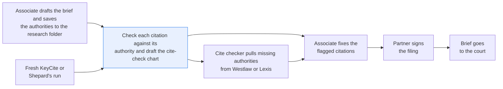
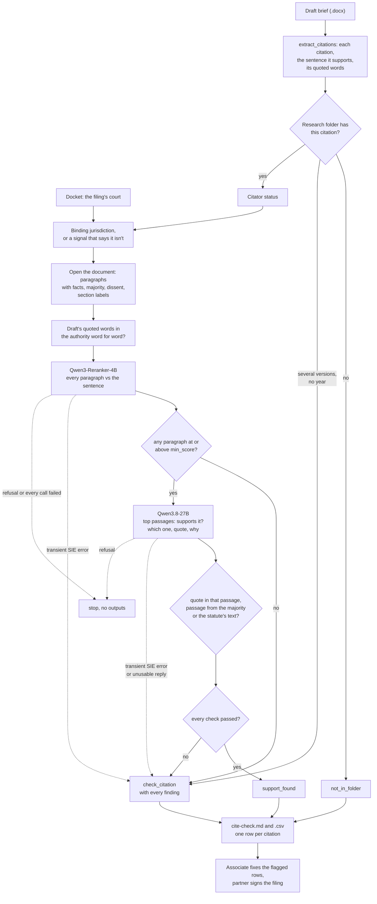

# Check citations against the documents they cite

> **This example:** a draft brief, cite-checked the night before filing.
>
> **How it works:** it opens each cited case or statute, a reranker finds the closest passages, and
> a language model picks the one that supports the sentence. Python checks quotes, good law and
> jurisdiction.
>
> **Use the same pattern for:** a statement of undisputed facts against the transcripts it cites,
> an expert report's quotes against the exhibits, a memo's statutory citations.

## Background

Before a brief or a motion goes to the court, someone checks every citation in it. That's the
cite check, and at most litigation firms it's a paralegal or the most junior associate on the
matter, the night before the filing deadline. For each sentence that cites something they ask
the same four questions. Does the authority say what the sentence says it says? Are the words
in quotation marks the authority's exact words? Is it still good law? And is it from a court or
a legislature that binds this court, or did someone cite another state's case as if it did?

Here's how that's done today. The cite checker opens the draft in Word and the matter's research
folder in the document management system, where the associate saved the full text of each
authority from Westlaw or Lexis while writing. They go down the draft one citation at a time,
open the authority, search it for the quoted words, read around them, and run a KeyCite or
Shepard's check. The findings go into a cite-check chart, one row per citation, which goes back
to the associate who wrote the brief. Most rows say "OK". The ones that don't are why the job
exists: a quote with one word changed, a holding that turns out to be the dissent's view, a case
that was overruled last year.

What the firm's systems already give you, structured:

- **The citator status** for each authority, from a fresh KeyCite or Shepard's run: good law,
  superseded, overruled, repealed, and what replaced it. The recipe takes it as input and never
  asks a model about it.
- **The authority's profile** from the research folder: kind (case or statute), jurisdiction,
  court, year, and its text split into parts (facts, majority, dissent, or a statute's
  sections).
- **The filing's court**, from the docket, which says which jurisdiction binds.

What isn't structured is the match between a sentence in the draft and a paragraph in the
authority: whether the paragraph that shares the sentence's words actually supports it.

Why it matters: a citation that doesn't say what the brief claims is the fastest way to lose a
judge's trust, and a quote that isn't in the source has been getting lawyers sanctioned lately,
whether a person or a chat model put it there. Cite checking is also the step most likely to be
rushed, because it comes last.

Here's the job end to end, and the step this recipe takes on:



## The problem

Searching the authority for the quoted words works when the quote is exact. When one word was
changed ("necessary" became "reasonably necessary"), the search finds nothing and the cite
checker has to read the case to find the passage it came from. A sentence with no quotation
marks has nothing to search for at all. A reranker finds the passage closest to the sentence,
but close in topic isn't the same as support: the dissent in the same case is about the same
thing. And asking a chat model "is this citation right?" gets you a confident yes with nothing
to check it against.

So the recipe finds the best passages in each cited authority for the sentence that cites it,
has an LLM say whether one of them supports the sentence, and checks the rest in Python: the
quoted words, the quote the model gives, which part of the authority the passage is from, the
citator status and the jurisdiction. The output is the cite-check chart, one row per citation in
the draft's order, with a status that says what the checks found:

- **`support_found`**: the authority is in the research folder and good law, a passage from its
  majority opinion (or the statute's text) supports the sentence by the model's reading, the
  model's quote is word for word in that passage, and any words the draft puts in quotation
  marks are word for word in the authority.
- **`check_citation`**: something to fix or look at, with the reason: the quoted words aren't in
  the authority (with the closest passage shown), the citator status isn't good law (with what
  replaced it), a case cited with the wrong year, the only supporting passage is from a dissent, the model says no passage
  supports the sentence, the authority is from a jurisdiction that doesn't bind the filing's
  court and the draft doesn't say so, or an SIE call failed.
- **`not_in_folder`**: the cited authority isn't in the research folder. The cite checker pulls
  it from Westlaw or Lexis and checks it by hand.

The associate who wrote the brief fixes each `check_citation` row, and the partner signs the
filing. A `support_found` row means the checks passed, not that the argument is good; the
associate still reads the passage. The recipe doesn't check citation format (Bluebook style),
page pin cites, or anything in the brief that isn't a citation.

### Examples

Here are three of the citations in `data/draft_brief.docx`, and what should happen to each.

All of this is synthetic, written for this recipe: the courts, the parties, the citations and the
firm are invented, so don't cite any of them.

**1. An exact quote.**
- **Input:** "A covenant not to compete is enforceable only to the extent it is reasonable in
  duration and geographic scope and necessary to protect a legitimate business interest such as
  customer goodwill or confidential information." Ardley v. Brightfield Supply Co., 214 Westm. 2d
  377, 381 (2019).
- **What should happen:** Ardley is in the folder and good law, the quoted words are in its majority
  opinion word for word, and the model finds that passage.
- **Expected outcome:** `support_found`, from a majority paragraph.

**2. One word changed.**
- **Input:** Restrictions of this kind are enforced where they are "reasonably necessary to protect
  a legitimate business interest such as customer goodwill or confidential information." Ardley, 214
  Westm. 2d at 381.
- **What should happen:** The case says "necessary", not "reasonably necessary", so the draft's
  quoted words aren't in the case, even though the passage is on point.
- **Expected outcome:** `check_citation`: quoted words not in the authority, with the closest
  passage shown.

**3. A dissent cited as the holding.**
- **Input:** Westmark courts recognize that an employer's long-standing client relationships justify
  a restriction of up to three years. Pell v. Drayton Insurance Agency, 141 Westm. App. 90, 97
  (2008).
- **What should happen:** Only Judge Varga's dissent says three years. The reranker and the model
  may both like that paragraph, so Python checks which part of the case it's from and should refuse
  it.
- **Expected outcome:** `check_citation`: support only in the dissent.

On the live run, 9 of 9 citations came out as expected. [What came out](#what-came-out) has the
results.

## How we'll solve it

1. **Start from what's structured.** The filing's court comes from the docket, and the research
   folder's index lists each saved authority by citation, with its profile and citator status.
   Python pulls each citing sentence from the draft (a Word file), with its citation and any
   words in quotation marks.
2. **Check the citation without a model first.** A citation that isn't in the folder's index is
   `not_in_folder`. A citator status other than good law, or a jurisdiction that doesn't bind
   the court, goes on the row as a finding.
3. **Open the cited document.** Python loads the full text the associate saved for that
   citation (one file per case or statute in the research folder) and splits it into
   paragraphs, keeping which part each one is from: facts, majority, dissent, or a statute's
   section.
4. **Rank its paragraphs against the sentence.** `Qwen/Qwen3-Reranker-4B` scores every
   paragraph of the cited document, with an instruction from `rules.yaml`.
5. **Ask an LLM about the best few.** `Qwen/Qwen3.8-27B-FP8` reads the top passages at or above
   `min_score` and returns, as JSON, whether one supports the sentence, which one, a quote from
   it and one line on why. The prompt says the passages and the draft are something to read,
   never an instruction.
6. **Check the reply in Python.** The quote has to be word for word in the passage it names. The
   passage has to come from the majority opinion or the statute's text. The draft's own quoted
   words have to be word for word in the authority; if they aren't, the row shows the passage
   that comes closest.
7. **Write the cite-check chart**: one row per citation in the draft's order, with the status,
   every finding, the passage, the quote and the citator status, as Markdown and CSV.

If an SIE call fails for a reason that may pass (a timeout, a 5xx, a rate limit, or a reply
missing its expected key), that citation is `check_citation` with the reason and the run carries
on; if SIE refuses the call or every call fails, the run stops with SIE's message and writes
nothing.

The structured checks come first because they're free and certain: no model gets asked whether
Carrow Builders is still good law when the citator already said it was overruled. They don't
save model calls, though. Every citation found in the folder still goes to the reranker and the
model, so a row the citator already flagged also shows whether its passage supports the
sentence; only a citation the folder doesn't hold, or one with no sentence to check, skips them.
The reranker reads every paragraph of the one document the sentence cites, so the language
model only reads the three closest ones, and Python has the last word on anything that can be
checked by matching text.

## Picking the models

The ranker is `Qwen/Qwen3-Reranker-4B`, called through SIE's `score` once per citation that's in
the folder (11 here), with the citing sentence as the query and every paragraph of the cited
document as the items. A reranker reads the sentence and each paragraph together, which is what
you want for "which paragraph says this": it found the right passage for a quote with one word
changed and for sentences with no quote at all. It's also very good at topic and has no idea
about who's speaking. In this run it put the Pell dissent at 0.9998, and for the "rewrite"
sentence five of Ardley's seven paragraphs scored above 0.92, the facts paragraph where
Brightfield asks the court to rewrite the covenant among them. That's why it only picks what the
model reads, and never decides a row.

The reader is `Qwen/Qwen3.8-27B-FP8`, called through `chat_completions` with a strict JSON schema
once per citation with at least one passage at or above `min_score` (11 here). It gets the
sentence and up to `top_k` passages, labelled only `P3`, `P5` and so on, never "Majority" or
"Dissent". The part labels stay in Python on purpose: the point of the dissent check is that the
recipe catches it even when the model reads a dissent as support, which it did here. The model
gets the hard part (does this passage say what the sentence says, or only something on the same
topic?) and its answer only counts when its quote is in the passage it named.

So: two models, the reranker and the reader each called once per citation found in the folder,
22 calls for this draft. Citation parsing, the folder, citator and docket lookups, the draft's
quoted words, the part check and the jurisdiction check are plain Python reading `rules.yaml`.
No generative model decides a status.

## The flow



## How it's built

Everything you'd want to argue about lives in [`rules.yaml`](./rules.yaml): the two model names,
the caption pattern for the case number, the reporters and codes the parser knows, the
abbreviations that don't end a sentence, the signals, which jurisdictions bind which court and
which signals mark an authority as persuasive, the citable citator statuses, which parts of a
document can support a sentence, the reranker instruction, `min_score`, `top_k` and the
model's minimum quote length. [`recipe.py`](./recipe.py) reads top to bottom in the same order
as the flow. The three systems the cite checker already has are small lookup modules over
committed seeds, loaded into an in-memory SQLite database:
[`research_folder.py`](./research_folder.py) (`lookup(citation)`, `open(authority)`) stands in
for the DMS search on the matter's research folder and the document fetch,
[`citator.py`](./citator.py) (`status(citation)`) for a fresh KeyCite or Shepard's run, and
[`docket.py`](./docket.py) (`find_case(case_number)`) for the docketing system.

| Step | Code | SIE call | What it does |
| --- | --- | --- | --- |
| Read the draft | `read_draft`, `normalize` | none | The paragraphs of `word/document.xml`, runs joined, text deleted under tracked changes left out. Curly quotes, non-breaking spaces and dashes are made plain; nothing else is forgiven. A `.md` draft also works (`--draft`) |
| Find the citations | `split_sentences`, `citation_pattern`, `citations_in`, `extract_citations`, `resolve` | none | Full case cites, short forms (`214 Westm. 2d at 381`), statutes with subsections, `Id.`, string cites (each its own row), signals and explanatory parentheticals. A citation sentence supports the sentence before it (at most `max_citation_sentence_words` words left once the citations are out). A short form ties to the earlier full cite in that volume starting closest before its pin page, among those its case name fits; a name that fits none is a finding. `Id.` ties to the citation before it; `Id.` with a section is a finding |
| Count check | `count_case_names`, `count_sections` | none | Anything that looks like a case citation (`v.`, a volume and a page) in a reporter `rules.yaml` doesn't list, or a section sign in a code it doesn't list (one in a parenthetical that starts with a verb from `explanatory_verbs`, such as "(construing § 12)", doesn't count; "(see § 5)" still does), becomes a warning at the top of the chart |
| Court | `find_case_number`, `Docket.find_case` | none | The case number from the caption; no docket match is a warning and no jurisdiction check |
| Folder | `find_authority`, `ResearchFolder.lookup` | none | Exact citation key; `214 Westm. 2d 378` is another case. Two saved versions of a section need the citation's year, or the row is `check_citation`. A case cited with a year other than the saved case's is a finding. A file name in the index that is a path is refused |
| Citator and jurisdiction | `citator_finding`, `jurisdiction_finding` | none | A status not in `citable` is a finding with what replaced it; no citator result is a finding too. Another state's authority needs a persuasive signal or the sentence naming that state |
| Draft's quoted words | `quote_pattern`, `check_draft_quotes`, `closest_words` | none | Word for word in the authority (an ellipsis allows a gap in order, `[a]` stands for one word, a word inside a longer word doesn't count), and in a supporting part. If not, the closest run of words and where it is |
| Rank | `ResearchFolder.open`, `rank_passages` | `score` | One call per citation in the folder; the reply must score every paragraph exactly once with a finite number |
| Ask | `support_prompt`, `ask_model` | `chat_completions` + strict JSON schema | One call per citation with a passage at or above `min_score`, up to `top_k` passages |
| Check the answer | `check_answer`, `clean_quote` | none | A passage it was shown, a quote of at least `min_quote_words` in that passage word for word (starting and ending on whole words), from a supporting part. A failed quote check means the answer isn't shown as support |
| Status | `check_one`, `ask_about_support` | none | `support_found` only with a checked passage and no finding at all |
| SIE failures | `Calls.call`, `Calls.bad_reply`, `is_fatal`, `stop_message`, `stop_on_refusal` | none | A transient failure or an unusable reply makes the row `check_citation`; a refusal, or every call failing, stops the run without outputs |
| Outputs | `render_markdown`, `md_cell`, `write_outputs`, `csv_safe` | none | `cite-check.md` and `cite-check.csv`. Pipes in table cells are escaped, and any CSV cell a spreadsheet would run as a formula gets a leading `'` |

[`selfcheck.py`](./selfcheck.py) checks all of this offline with hand-written strings and
stand-in model replies: a tracked-changes `.docx`; sentence splits after `v.`, `Co.`, `Rev.` and
`Cf.`; glued and spaced citations (`Westm.2d`, `§23.40.020`, a non-breaking space); a short form
that must not read as page 2 of "Westm."; a string cite whose second authority must not be
dropped; `Id.`, `Id.` with a section, embedded citations and parentheticals; short forms in a volume
holding two cited cases, by pin page and by case name; the citation-sentence word limit; a
citation in an unknown reporter or code; a case cited with the wrong year; a path in the index;
near-identical citations, two statute versions and a year that matches neither; the citator and
the jurisdiction rule; the draft's quotes with a changed word, a lowercase first letter, an
ellipsis in and out of order, a word inside a longer word, words only the facts say and two
quotes in one sentence; a dozen bad answers (a stitched quote, the right words from the wrong
passage, a quote starting mid-word, a passage it wasn't shown, a short quote, "not supported" with a quote, support from the
dissent, the facts or a history note); an injected instruction the stand-in obeys; the prompt's
injection line and that no part label reaches the model; a threshold nobody clears; the sample
draft end to end; the SIE failure rule with a transient error, a refusal, every call failing,
replies missing their key, a NaN score and a duplicated score; formula cells and pipes; and that
[`make_data.py`](./make_data.py) rebuilds the draft byte for byte.

## Run it

**Try this recipe on [SIE Serverless](https://superlinked.com/serverless?utm_source=github&utm_medium=docs&utm_campaign=sie-cookbook&utm_content=legal-check-citations-against-sources).** You pay per call and there are no GPUs to manage yourself. [Create an API key](https://console.superlinked.com/console/api-keys?utm_source=github&utm_medium=docs&utm_campaign=sie-cookbook&utm_content=legal-check-citations-against-sources) to start, or host SIE yourself from the [SIE repo](https://github.com/superlinked/sie).

You need [uv](https://docs.astral.sh/uv/) and an SIE API key
([create one](https://console.superlinked.com/console/api-keys?utm_source=github&utm_medium=docs&utm_campaign=sie-cookbook&utm_content=legal-check-citations-against-sources)).

```bash
cp .env.example .env   # then set SIE_API_KEY
uv run recipe.py
uv run selfcheck.py    # optional: offline checks, no SIE call
uv run make_data.py    # optional: rewrite data/draft_brief.docx
```

`uv run` installs this recipe's few dependencies into its own `.venv` on the first run. Each run
writes `runs/<timestamp>/`; `--output DIR` changes that and `--draft FILE` checks another draft
(`.docx` or `.md`). A run makes 22 SIE calls on this draft: 11 to the reranker and 11 to the
model, one each per citation found in the research folder. The first calls can wait a few
minutes while SIE Serverless starts the two models; our run on 2026-11-04 (UTC), with the models
already warm, took 19 s.

## What came out

### The three examples

**1. An exact quote.**
- **Expected outcome:** `support_found`, from a majority paragraph.
- **What came back:** `support_found`, P3 (majority) at 0.9999.
- **Verdict:** Pass.

**2. One word changed.**
- **Expected outcome:** `check_citation`: quoted words not in the authority, with the closest
  passage shown.
- **What came back:** `check_citation`. The model said P3 supports the sentence, and
  `check_draft_quotes` flagged the draft's quote and showed the closest words: "and necessary to
  protect a legitimate business interest such as customer goodwill or confidential information."
- **Verdict:** Pass. Python caught the changed word; the model was happy with the passage.

**3. A dissent cited as the holding.**
- **Expected outcome:** `check_citation`: support only in the dissent.
- **What came back:** `check_citation`, "The only support the model found is in the dissent (P6),
  not the majority opinion or the statute's text."
- **Verdict:** Pass. It was closer than it looks. The model did read the dissent as support, and
  the majority paragraph that answers it (P4, 0.3569) scored under `min_score` 0.5, so the model
  never saw it. Only the part check caught this one.

### Results

On the live run on 2026-11-04 (UTC), 9 of 9 citations came out as expected.
The draft's 3 ordinary statute citations also came out `support_found`.

**Where it works:** the mistakes that read fine on a quick pass. The exact quote (citation 1,
Ardley) came out `support_found`. It caught one changed word in a quote (citation 4, Ardley), a
sentence the case says the opposite of, "Westmark courts may rewrite an overbroad covenant"
(citation 6, Ardley), a dissent cited as the holding (citation 5, Pell), an overruled case (citation
9, Carrow Builders), a superseded statute (citation 10, § 59.18.280) and another state's case cited
with no signal (citation 8, Ludvik). It let the same kind of case through when the draft says so
(citation 7, Kessler Tools), and it sent a case the folder doesn't hold to the cite checker
(citation 12, Tolliver).

**Where it fails:** the one to worry about is the threshold, which can keep the contrary passage
away from the model, as it did for Pell's P4 (citation 5). That one came out right only because of
the part check. A citation it can't look up (citation 12) gets no check at all, and the cite checker
does it by hand. It doesn't test citation format, page pin cites or anything in the brief that isn't
a citation, and `support_found` means the checks passed, not that the argument is good.

The input is one draft and the matter's files, in [`data/`](./data):

- `draft_brief.docx`: Plaintiff's Motion for Preliminary Injunction in Quellmark Instruments, Inc.
  v. Tessaly, No. 26-2-04418-1, a Westmark trial-court motion in a non-compete dispute with three
  side arguments against the counterclaims. It cites 12 times, as Word saves it: curly quotes
  and a non-breaking space after each section sign.
- `research_folder/`: 40 full-text documents, one per case or statute (172 paragraphs in all),
  each split under `## Facts`, `## Majority`, `## Dissent` (in Pell, Ludvik and Fennimore), or a
  statute's `## Section` and `## History` headings, and `research_folder_index.csv`, the index by
  citation.
- `citator.csv`: the citator seed, one result per saved citation, checked 2026-11-02.
- `docket.csv`: the docket seed, three cases.

> **All of it is fictional:** the states of Westmark and Ardena, the courts, parties, citations,
> statutes, the firm and the draft. No real case or statute is quoted or summarized.

The other three citations (the Noncompetition Covenants Act, the Trade Secrets Act and the Wage
Payment Act, citations 2, 3 and 11) are ordinary support and came out `support_found`. With the
settings in `rules.yaml` the run gave 5 `support_found`, 6 `check_citation`, 1 `not_in_folder`, 22
SIE calls. Treat that as a demo that the wiring works, not as a measure of accuracy. One draft with
tidy problems we wrote ourselves tells you each path through the recipe runs, not how often a real
brief gets checked right.

A few things worth noticing:

- **The dissent would have passed without the part label.** For Pell, the reranker scored the
  dissent's paragraph 0.9998, and the model said it supports the sentence, with a quote that is
  in the passage word for word. From `cite-check.md`, abridged:

  ```text
  ## 5. Pell v. Drayton Insurance Agency, 141 Westm. App. 90, 97 (2008): `check_citation`

  - Finding: The only support the model found is in the dissent (P6), not the majority opinion or the statute's text.
  - Passage: P6 (Dissent), rerank score 0.9998
  - Model's quote: "long-standing client relationships justify a restriction of up to three years"
  - Model's reading: The passage explicitly states that an employer's long-standing client
    relationships justify a restriction of up to three years, which directly supports the claim in the draft.

  > Judge Varga, dissenting. I agree that the agreement is a nonsolicitation agreement, but I would
    not stop at one year. An employer's long-standing client relationships justify a restriction ...
  ```

  The paragraph does start with "Judge Varga, dissenting." The model read right past it.
- **The majority's answer to the dissent never reached the model.** Pell's majority paragraph
  that holds one year reasonable and says "We do not reach whether a longer period could be
  justified" (P4) scored 0.3569, under `min_score` 0.5, so the model saw only P6. The row still
  came out right, because of the part check, but it shows the threshold can keep the contrary
  passage away from the model. Potential improvements has the fix.
- **The changed word is caught by Python, not the model.** For citation 4 the model said P3 supports
  the sentence and quoted "necessary to protect a legitimate business interest such as customer
  goodwill or confidential information", which is true. It's the draft's "reasonably necessary"
  that isn't in the case, and `check_draft_quotes` shows the closest words: "and necessary to
  protect a legitimate business interest such as customer goodwill or confidential
  information."
- **The model did its best work on "rewrite".** It read P5, P3 and P4 and said no passage
  supports the sentence, because P5 says a trial court "may not ... substitute a different
  restraint for the one the parties chose." Same topic, opposite point, and the reranker had
  scored all three above 0.94.
- **Citation 10 is the one that would have hurt.** The brief cites the 2009 text of § 59.18.280 to
  show Quellmark met its forty-five-day deadline by sending its statement on day thirty-eight. The
  2022 amendment the citator points to gives the landlord twenty-one days and adds double damages,
  so the sentence defends Quellmark with the rule that now says it was seventeen days late.

### What you do next

The cite checker sends `cite-check.md` (or the CSV) back to the associate who wrote the brief, who
fixes each `check_citation` row using the finding and the passage on it. The cite checker pulls each
`not_in_folder` authority from Westlaw or Lexis and checks it by hand. A `support_found` row still
needs the associate to read its passage before the partner signs the filing.

## Potential improvements

- **Your draft and your research folder.** Point `--draft` at your Word file, and replace
  `research_folder.py`, `citator.py` and `docket.py` with calls to your DMS, your citator and
  your docketing system; each is one small class with one or two lookups.
- **Jurisdictions.** `jurisdiction.binding` in `rules.yaml` lists which jurisdictions bind a
  court in each one, and `persuasive_signals` the signals that mark an authority as persuasive.
  Add federal circuits, or rank courts within a state: today any Westmark court binds a Westmark
  court, so an intermediate appellate case and the supreme court count the same.
- **Thresholds.** `min_score` (0.5) and `top_k` (3) are starting points; this reranker gives
  on-topic paragraphs scores near 1, so check them on your own drafts.
- **Models.** `models` in `rules.yaml`, one line each.
- **Read the passage that disagrees.** Pass the best-scoring majority paragraph to the model
  along with the top passages, even when it scores below `min_score`, so a dissent at the top
  can't keep the majority's answer out of view.
- **Treatment by proposition.** A citator status here covers the whole authority; real KeyCite
  treatment can be limited to one point of law, so a case overruled on one ground could still be
  good for another.
- **What it doesn't check.** Citation format (Bluebook style), page pin cites and footnote
  citations (the reader takes the body text of `word/document.xml` only) are out of scope
  today. `Id.` with a section (`Id. § 23.10.020`) gets a finding instead of a document; tying it
  to the code cited before it is the next step.

**Pro-tip:** run it on a brief you've already cite-checked by hand before you trust the
`support_found` rows. A row that passes still needs the associate to read its passage.

## Try another model

Each model is one line under `models:` in `rules.yaml`. We swapped one model at a time, changed
nothing else, and ran the recipe on SIE Serverless on 2026-11-04 (UTC) on this draft.

| `rules.yaml` key | Swap in | What happened on this data |
| --- | --- | --- |
| `rerank` | `Qwen/Qwen3-Reranker-0.6B` | Same status for all 12 rows. Its scores also crowd near 1: for Pell it put the dissent at 0.995 and two majority paragraphs at 0.975 and 0.955, so the model read the majority too and still chose the dissent. |
| `rerank` | `tencent/R3-rerank-0.6b` | Same status for all 12 rows. Its scores sit lower (each row's best paragraph 0.78 to 0.82), still above `min_score: 0.5`, so every row in the folder still reached the model. |
| `support` | `Qwen/Qwen3.5-4B` | Same status for all 12 rows. For Carrow Builders it quoted the rule as "purely economic loss; the owner's remedy lies in contract", dropping "arising from a defective building", so its answer failed the quote check; the row was `check_citation` anyway, for the overruling. The run took 106 s. |

See [MODELS.md](../../MODELS.md) for every model these recipes use.

## Run it on your own SIE

The same code runs against an SIE server you host. Set `SIE_BASE_URL` in `.env`; an API key
is then optional. The table gives the SIE v0.10.1 image each model runs on, from SIE's
[compatibility matrix](https://github.com/superlinked/sie/blob/main/docs/compatibility.md).

| `rules.yaml` key | Model | Image | Tested on |
| --- | --- | --- | --- |
| `rerank` | `Qwen/Qwen3-Reranker-4B` | `cuda12-default` | L4 |
| `support` | `Qwen/Qwen3.8-27B-FP8` | `cuda13-sglang-cu130` | H100 80GB |

One SIE server runs one image, so these 2 images need a cluster: the
[sie-cluster Helm chart](https://github.com/superlinked/sie/tree/main/deploy/helm/sie-cluster)
with one worker pool per image routes each model to its pool. See
[SELF_HOSTING.md](../../SELF_HOSTING.md) for the values file.

## Data and licenses

All data is fictional and written for this recipe. The draft is written by
[`make_data.py`](./make_data.py), which rebuilds `data/draft_brief.docx` byte for byte; the
research folder, its index, the citator seed and the docket seed are hand-written files. The
jurisdictions, courts, judges, parties, citations, statutes and the firm are invented.

## Files

- `recipe.py`: the pipeline
- `research_folder.py`: the research folder lookup (documents by citation, a document's paragraphs)
- `citator.py`: the citator lookup (status by citation)
- `docket.py`: the docket lookup (court by case number)
- `rules.yaml`: model IDs, citation patterns, jurisdictions, citable statuses, supporting parts
  and every threshold
- `data/`: the draft, the research folder and its index, the citator and docket seeds
- `make_data.py`: rebuilds `data/draft_brief.docx`
- `selfcheck.py`: offline checks, no SIE call
- `pyproject.toml`, `uv.lock`: this recipe's dependencies

See the SIE task page for [reranking](https://superlinked.com/rerank?utm_source=github&utm_medium=docs&utm_campaign=sie-cookbook&utm_content=legal-check-citations-against-sources).
