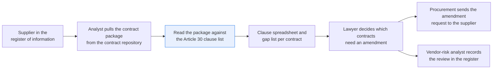
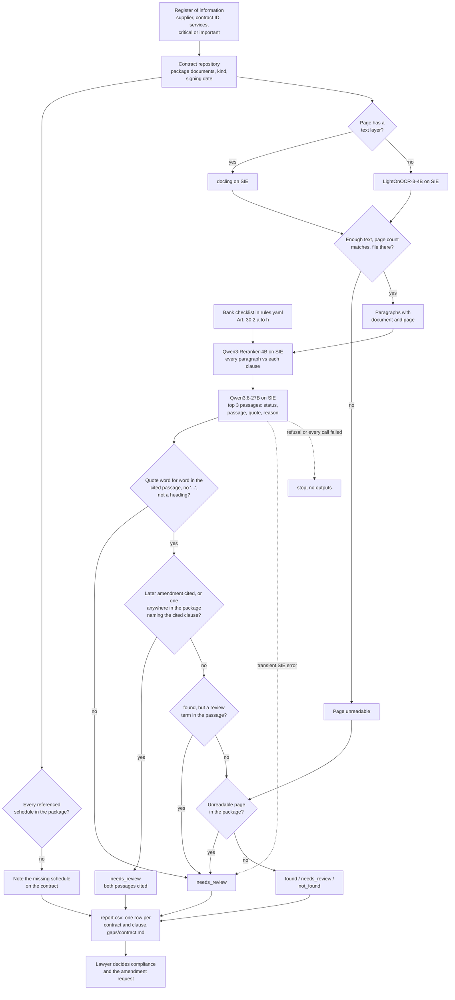

# Check contracts for the clauses a regulation requires

> **This example:** a bank's signed ICT vendor contracts, checked against DORA Article 30(2).
>
> **How it works:** a reranker finds the closest paragraphs for each clause, a language model
> decides with a quote, and Python checks the quote is really in the contract.
>
> **Use the same pattern for:** GDPR Article 28 terms in supplier contracts, change-of-control
> clauses in due diligence, outsourcing agreements against a regulator's guidelines.

## Background

Since January 2025, every EU bank and the other financial entities DORA (the Digital
Operational Resilience Act) covers have had to make sure their contracts with ICT providers
carry the terms Article 30 lists. Most of those contracts were signed before anyone had heard of
DORA, so somebody has to go back through them. That somebody is usually a commercial or
technology lawyer, with a vendor-risk or procurement analyst doing the legwork.

Here's the job as it's done today. The analyst opens the supplier in the vendor-risk system or
the register of information (the list of ICT contracts DORA makes the bank keep), and pulls the
contract package from the contract repository: the signed agreement, its schedules, any
amendments and, if one was signed, a DORA addendum. Then someone reads it against a checklist:
does it say where the data lives, and that the supplier must give notice before moving it? Does
the supplier have to help in an incident, and at what price? Can the bank terminate, and on what
notice? The answers go into a spreadsheet, one row per clause, with the section number and a
note, and the lawyer decides which contracts need an amendment request to the supplier.

What the bank's systems already give you, structured:

- **The register of information and the vendor-risk record**: supplier, contract ID, the
  services, the dates, and whether the service supports a critical or important function. That
  last one matters, because Article 30(3) adds more terms for those contracts.
- **The contract repository**: which documents make up the package. Someone should confirm that
  list, because a clause you can't find in the agreement may be in Schedule 3, or in an
  amendment signed two years later.

What isn't structured is the wording. No field in the register says "incident assistance is at
the supplier's discretion, at its then-current rates". Most packages are PDFs with a text layer
(e-signed, or exported from Word). Older ones, and some supplier paper, are scans.

Why it matters to the bank: a contract with a gap is a finding the regulator can raise, and the
fix is an amendment the supplier has to agree to, which takes months. A gap found in the
spreadsheet this quarter is cheaper than a gap found by the supervisor next year. And a clause
marked as there when it is actually discretionary is worse than a blank, because nobody goes
back to check it.

Here's the job end to end, and the step this recipe takes on:



## The problem

You want each contract package checked against the clause list, with the passage and a quote
for every clause, so the lawyer reads three paragraphs per clause instead of the whole
agreement, and decides.

Keyword search finds "terminate" all over the agreement and can't tell you that assistance "may,
at its discretion" be given. One LLM call over the whole package gives you verdicts you can't
trace to a page, and a long package may not fit in one call anyway. And retrieval has a blind
spot of its own: if the three passages it picks don't contain the clause, that tells you it
wasn't in those three passages, not that the contract lacks it.

So the recipe ranks the package's paragraphs against each clause, has an LLM rule on the top
few, checks the quote in Python, and reports one row per contract and clause:

- **`found`**: a passage meets the clause's "found if" wording, and its quote is word for word
  in the cited paragraph.
- **`needs_review`**: the wording is weaker than the clause asks ("at its discretion",
  "then-current rates"), the quote isn't word for word in the passage (a quote shortened with
  "..." counts as not word for word), the model cited a passage it wasn't shown, the cited paragraph holds one of the clause's review terms, a page of the package
  couldn't be read, or a later document in the package names the same clause.
- **`not_found`**: not found in the passages read. That is not the same as missing from the
  contract. The lawyer checks the package before asking the supplier for anything.

Alongside the spreadsheet, each contract gets a short gap list: every clause that came out
`not_found` or `needs_review`, with the passage and the reason, in the order of the bank's
checklist. That's the lawyer's starting point for the amendment request. No status is a
compliance verdict. The lawyer decides whether the contract meets Article 30 and what to ask
the supplier for, procurement sends the amendment request, and the vendor-risk analyst records
the review in the register.

What it covers, plainly: Article 30(2)(a) to (h), eight of the nine terms (a) to (i) that
Article 30(2) requires in every ICT contract. It does not check 30(2)(i) (taking part in the
bank's security training) or the extra 30(3) terms for critical or important functions. A contract the register marks as critical or
important gets a note saying those are unchecked.

### Examples

Here are three of the contract packages in `data/`, and what should happen to each.

All of this is synthetic, written for this recipe: the bank, the suppliers and every person are
invented.

**1. A clean contract.**
- **Input:** `nimbusline-cloud-hosting.pdf` (`EB-ICT-0117`, text layer), with all eight clauses
  plainly worded, for example "6.1 When an ICT incident related to the Services occurs, the Supplier
  shall provide the Customer with all reasonable assistance to contain, investigate and recover from
  it, at no additional cost to the Customer."
- **What should happen:** The pages get read, the paragraph that holds each clause ranks at the top,
  and every quote checks out word for word.
- **Expected outcome:** `found` on all eight clauses.

**2. A clean clause, changed by a scanned amendment.**
- **Input:** Brindlecote's agreement (`EB-ICT-0076`) says "The Customer may also terminate for
  convenience on six (6) months' written notice." The scanned `brindlecote-amendment-1.pdf`, signed
  in 2025, adds to clause 9.2 that such a termination "is subject to a termination fee equal to the
  fees payable for the six (6) months following the date of termination."
- **What should happen:** Read alone, clause 9.2 is a `found`. But a later document in the package
  names clause 9.2, so the row should be held for the lawyer.
- **Expected outcome:** `termination_rights` `needs_review`, with both passages cited.

**3. A scan with one page too blurred to read.**
- **Input:** `brackwater-records-archive.pdf` (`EB-ICT-0051`), a scanned agreement whose schedules
  page, page 3, is blurred past reading. The agreement pages before it hold every clause.
- **What should happen:** Every clause is there, but the page nobody can read could hold a fee or a
  carve-out, so no clause should come out as a clean `found`. All of them wait for the lawyer.
- **Expected outcome:** all eight clauses `needs_review`.

On the live run, 5 of 5 contracts came out as expected. [What came out](#what-came-out) has the
results.

## How we'll solve it

1. **Start from the register and the bank's checklist.** The clause list, with each clause's
   "found if" and "needs review if" wording, is the bank's own DORA contract checklist. Legal
   owns it, and it lives in `rules.yaml` so they can tighten a clause without touching code. For
   each contract, the register of information gives the supplier, contract ID, services and the
   critical-or-important flag, and the contract repository gives the confirmed list of documents
   in the package, each with its kind (agreement, amendment) and signing date. Both come in as
   structured lookups (`register.py`). A schedule the package's text refers to but the package
   doesn't hold is noted on the contract, so a `not_found` there says where else to look.
2. **Read every document in the package.** Pages with a text layer are read as they are, by
   `docling`. Only scanned pages go through OCR (`lightonai/LightOnOCR-3-4B`). A page that comes
   back nearly empty is marked unreadable, and so is a page whose SIE call failed. A document
   that prints "Page 2 of 4" has to have four pages, and a file the register lists but the
   repository folder doesn't have (or a file name that isn't a plain name in that folder)
   counts as unreadable too.
3. **Split into paragraphs**, with each paragraph keeping its document and page, and headings
   joined to the paragraph under them.
4. **Rank the paragraphs for each clause.** `Qwen/Qwen3-Reranker-4B` scores every paragraph in
   the package, across every document, against the clause's description, so an amendment can
   outrank the original wording. A reply that doesn't score each paragraph it was sent exactly
   once is a failed call.
5. **Rule on the clause from the top passages.** `Qwen/Qwen3.8-27B-FP8` reads the top 3, each
   labelled with its document and signing date, and returns a status, the passage, a quote and a
   reason, as strict JSON.
6. **Check it in Python.** The quote must be word for word in the cited paragraph, with no
   "..." in it: the words a shortened quote leaves out could be "under no circumstances". A
   quote that is only a heading proves nothing. A `found` whose paragraph holds one of the
   clause's review terms ("then-current", "termination fee") goes to `needs_review` whatever the
   model said. A passage from a later amendment, cited by the model or naming the cited clause
   ("Clause 9.2 of the Agreement is amended"), moves the clause to `needs_review` with both
   passages cited. Python looks for that amendment in every paragraph of every later document in
   the package, not only in the top 3, so an amendment the reranker ranked fourth still counts.
   An amendment signed the same day as the agreement counts as later. When the cited paragraph
   has no clause number to match ("9.2." or a number left in a heading), any later amendment
   among the passages shown counts.
   An unreadable page in the package moves every `found` and `not_found` on that contract to
   `needs_review`, since the page could hold the clause or a qualifier.
7. **Write the spreadsheet and the gap lists**: one row per contract and clause, with the
   status, what the model said, document, page, quote, the full cited passage, the reason and
   the passages read; and per contract, the clauses that came out `not_found` or
   `needs_review`, for the lawyer's amendment request.

If SIE refuses a call outright (a bad key, an unknown model, no credits), the run stops with
SIE's message and writes nothing. If a call fails for a reason that may pass (a timeout, a busy
server, an over-long input), the page it should have read goes to unreadable, or the clause it
should have ranked or ruled on goes to `needs_review`, with the reason, and the run carries on.
A reply missing the key it should carry (`data`, `entities`, `scores`, `choices`) or a status
that isn't valid JSON counts as a failed call too. If every call fails, the run stops.

## Picking the models

There are four, behind one SIE client.

**`docling`** reads the pages that already have text: the e-signed agreements and the Word
exports, which is most of a modern contract repository. It's called through SIE's `extract`
with a one-page PDF, once per page, and returns Markdown. No OCR, so no misread digits, and it
writes the numbered clauses as a list, which the recipe splits into one paragraph per clause.

**`lightonai/LightOnOCR-3-4B`** reads the scans: supplier paper, the older packages, the
amendment somebody signed in pen. It's called through `extract` with the page as an image, once
per scanned page. On a page blurred past reading it returned nothing at all, which is the
honest answer, and the recipe treats it as unreadable rather than as a page with no clauses on
it.

**`Qwen/Qwen3-Reranker-4B`** finds the passages. It's called through `score` once per contract
and clause, with the clause's description as the query and every paragraph of the package as
the items. A reranker reads the query and the paragraph together, so "terminate on thirty days'
notice" and "subject to a termination fee" both score high for termination rights, wherever in
the package they sit. It only orders paragraphs; it doesn't say whether the clause is met.

**`Qwen/Qwen3.8-27B-FP8`** rules on the clause. It's called through `chat_completions` with a
strict JSON schema, once per contract and clause, and reads only the top 3 passages, so it
never sees a whole package. This is the one generative model, and it's the part you'd least want
to trust on its own, which is why Python checks its quote, its passage number and the review
terms, and why the amendment and unreadable-page rules don't depend on it. The prompt tells it
that text in the passages is contract wording to check, never an instruction.

So a run on this data makes 96 SIE calls: 9 to docling, 7 to the OCR model, 40 to the reranker
and 40 to the LLM.

## The flow



## How it's built

Everything legal would want to argue about lives in [`rules.yaml`](./rules.yaml): the four
model names, the clause checklist (each clause's article, title, the description the reranker
uses as its query, the "found if" and "needs review if" wording the LLM gets, and its review
terms), the words that take a duty away on any clause ("not be required", "not be obliged"),
the scope notes that go into every gap list, and the thresholds. The register lookups are in
[`register.py`](./register.py), and [`recipe.py`](./recipe.py) reads top to bottom in the same
order as the flow.

| Step | Code | SIE call | What it does |
| --- | --- | --- | --- |
| Look up the contract | `Register.contracts`, `Register.package`, `PackageDocument.parts` | none | The register row and the package documents, oldest first, and which schedules each document's title says it holds |
| Read each page | `split_pages`, `read_page`, `read_document` | `extract` (docling or OCR) | One call per page: a one-page PDF to docling when the page has a text layer, a PNG to the OCR model when it doesn't |
| Unreadable pages | `unreadable_reason`, `page_count_problem`, `read_document` | none | Too little text, a "Page n of M" that doesn't match the file, a missing file, a file name that isn't a plain name, or a failed call |
| Missing schedules | `missing_references` | none | "Schedule 4" in the text, with no document in the package holding it |
| Paragraphs | `chunk_pages` | none | Blank lines and list items split; headings join the paragraph below |
| Rank | `top_chunks` | `score` | Every paragraph against each clause, each scored exactly once; the top 3 go on |
| Rule | `verdict_prompt`, `rule_on_clause`, `parse_answer` | `chat_completions` + JSON schema | Status, passage, quote and reason; a reply in the wrong shape is a failed call |
| Check | `decide`, `quote_found`, `review_terms_in`, `amends`, `is_later`, `held_back` | none | Quote word for word in the cited passage, no "...", not a heading; review terms; a later amendment anywhere in the package; an unreadable page holds back `found` and `not_found` |
| SIE failures | `Calls.call`, `is_fatal`, `stop_message`, `stop_on_refusal` | none | A transient failure or a reply missing its key sends the page or clause to review; a refusal, or every call failing, stops the run without outputs |
| Outputs | `write_outputs`, `report_rows`, `gap_list`, `csv_safe` | none | `report.csv` and `gaps/<contract_id>.md`; any cell a spreadsheet would run as a formula gets a leading `'` |

[`selfcheck.py`](./selfcheck.py) checks all of this offline with hand-written passages and
stand-in replies: the paragraph splitting, quotes (curly quotes, a quote shortened with "..."
around a negation), section numbers and what an amendment changes (including an amendment to
another clause, one signed before the agreement, one signed the same day, and one the reranker
ranked below the top 3), the review terms on discretionary, negated, "worldwide" and
"then-current" wording, a heading-only quote, the unreadable-page and page-count rules, missing
schedules, the register lookups, the five contracts end to end, a missing file, a file
name that points outside the data folder, a reranker reply that skips or repeats a paragraph,
the outputs, the committed data, and the SIE failure rule with a transient error, a refusal,
every call failing and replies missing their keys. [`make_data.py`](./make_data.py)
writes the contracts and the register.

## Run it

**Run this recipe using [SIE Serverless](https://superlinked.com/serverless?utm_source=github&utm_medium=docs&utm_campaign=sie-cookbook&utm_content=legal-check-contracts-for-required-clauses), [SIE Cluster](https://superlinked.com/docs/deployment?utm_source=github&utm_medium=docs&utm_campaign=sie-cookbook&utm_content=legal-check-contracts-for-required-clauses) or [SIE Local](https://superlinked.com/docs/quickstart?utm_source=github&utm_medium=docs&utm_campaign=sie-cookbook&utm_content=legal-check-contracts-for-required-clauses).** The code runs on your machine either way. With SIE Serverless you pay per call and there are no GPUs to manage yourself: get an [SIE API key](https://console.superlinked.com/console/keys?utm_source=github&utm_medium=docs&utm_campaign=sie-cookbook&utm_content=legal-check-contracts-for-required-clauses) and read the [API docs](https://superlinked.com/docs/reference/api?utm_source=github&utm_medium=docs&utm_campaign=sie-cookbook&utm_content=legal-check-contracts-for-required-clauses). To run the models yourself, start from the [SIE repo](https://github.com/superlinked/sie).

You need [uv](https://docs.astral.sh/uv/) and, for SIE Serverless, an SIE API key
([create one](https://console.superlinked.com/console/keys?utm_source=github&utm_medium=docs&utm_campaign=sie-cookbook&utm_content=legal-check-contracts-for-required-clauses)).

```bash
cp .env.example .env   # then set SIE_API_KEY
uv run recipe.py
uv run selfcheck.py    # optional: offline checks, no SIE call
uv run --group data make_data.py    # optional: rewrite data/
```

`uv run` installs this recipe's few dependencies into its own `.venv` on the first run. Each run
writes `runs/<timestamp>/` in this folder: `report.csv` and a `gaps/` folder. The first call can
wait a few minutes while SIE Serverless starts the reader, reranker and LLM models. With the models
warm, our run on 2026-11-04 (UTC) took 90 s for its 96 calls.

## What came out

### The three examples

**1. A clean contract.**
- **Expected outcome:** `found` on all eight clauses.
- **What came back:** 8 x `found`.
- **Verdict:** Pass.

**2. A clean clause, changed by a scanned amendment.**
- **Expected outcome:** `termination_rights` `needs_review`, with both passages cited.
- **What came back:** `termination_rights` `needs_review`, citing Amendment No. 1 p1 with clause 9.2
  on p2 as "Read with". `incident_assistance` also came back `needs_review`, which we didn't expect,
  because the model shortened its quote with "..." (more on that below). The other six `found`.
- **Verdict:** Pass. The extra row is a small cost: the lawyer reads one more paragraph.

**3. A scan with one page too blurred to read.**
- **Expected outcome:** all eight clauses `needs_review`.
- **What came back:** all eight `needs_review`, though the model said `found` on all eight: "Would
  be found, but part of the package couldn't be read (ICT Services Agreement with Schedules 1 to 4
  p3: only 0 characters read) and could hold this clause or a qualifier."
- **Verdict:** Pass. This is the trade-off. One blurred page sends all eight clauses to the
  lawyer, including the ones the model read correctly.

### Results

On the live run on 2026-11-04 (UTC), 5 of 5 contracts came out as expected (27 `found`, 11
`needs_review`, 2 `not_found` across the 40 rows), with one row on Brindlecote we didn't expect sent
to review.

**Where it works:** the clean contract (Nimbusline, `EB-ICT-0117`) came out 8 x `found`. It reports
the gaps in Brennick (`EB-ICT-0098`, no locations or incident-assistance clause, and a note that
Schedule 4 is missing), the weak incident-assistance wording in Tallowmere (`EB-ICT-0142`) and the
fee added by Brindlecote's amendment (`EB-ICT-0076`), each with the passage to read, and it holds
back Brackwater (`EB-ICT-0051`) rather than trust what it could read.

**Where it fails:** it costs review. Brindlecote's harmless shortened quote went to the lawyer, because
Python can't tell a harmless gap from one that matters. The one to worry about is a `not_found`: it
means not found in the passages read, so Brennick's two still need checking in the package before
anyone asks the supplier for anything. The run didn't test a requirement split between the agreement
and a schedule, and the recipe doesn't check Article 30(2)(i) or 30(3).

The input is five contract packages in [`data/`](./data) and the register that points at them:

- `register_contracts.csv`: the register of information, one row per contract: contract ID,
  supplier, services, and whether they support a critical or important function
- `register_documents.csv`: the contract repository's document list: which documents make up
  each package, their kind (agreement or amendment), file and signing date
- `nimbusline-cloud-hosting.pdf`, `tallowmere-analytics.pdf`,
  `brindlecote-payments-gateway.pdf`: agreements with a text layer, as an e-signing tool or a
  Word export would give them, three pages each with the schedules on the last
- `brennick-data-services.pdf`, `brackwater-records-archive.pdf`: scanned agreements (supplier
  paper, an older package), three pages each
- `brindlecote-amendment-1.pdf`: a one-page amendment signed on paper and scanned

> **All of it is synthetic.** [`make_data.py`](./make_data.py) writes every file and rebuilds
> them byte for byte. The bank ("Eastmere Bank plc"), the five suppliers, every person and
> address are invented, and every page says so in its footer. The PDFs carry no document
> metadata (no title, author or dates). The scans are drawn with Pillow with skew, speckle and
> blur; the text-layer PDFs come from a small PDF writer in the same file.

The review row we didn't expect is Brindlecote's `incident_assistance`, where the model shortened
its quote with "...". The three critical-or-important contracts (Nimbusline, Tallowmere,
Brindlecote) got the note that the Article 30(3) terms are unchecked. Treat that as a demo that the
wiring works, not as a measure of accuracy: five synthetic contracts built from one template tell
you each path through the checks runs, not how often a real supplier's drafting gets past it.

A few things worth noticing:

- **The amendment case is the reason the package matters.** On its own, Brindlecote's clause
  9.2 is a clean `found`: thirty days' notice for cause, six months for convenience. The
  reranker put the amendment between the two agreement passages it ranked for termination, the
  model cited the amendment, and the gap list shows both
  (from `gaps/EB-ICT-0076.md`):

  ````markdown
  ## 30(2)(h) Termination rights and notice periods: needs_review

  The cited passage is from Amendment No. 1 (signed 2025-04-14), which changes the agreement; read it with the wording it amends. The 2025 amendment imposes a termination fee on the Customer's right to terminate for convenience, which triggers the needs_review condition.

  Cited: Amendment No. 1 p1

  Quote: subject to a termination fee equal to the fees payable for the six (6) months

  ```text
  1. Clause 9.2 of the Agreement is amended by adding at the end: Any termination by the Customer under this clause 9.2, other than for the Supplier's material breach, is subject to a termination fee equal to the fees payable for the six (6) months following the date of termination.
  ```

  Read with: ICT Services Agreement with Schedules 1 to 4 p2

  ```text
  9.2 The Customer may terminate this Agreement on thirty (30) days' written notice if the Supplier materially breaches applicable law or this Agreement, if circumstances arise that alter the performance of the Services, or if a competent authority can no longer effectively supervise the Customer because of this Agreement. The Customer may also terminate for convenience on six (6) months' written notice.
  ```
  ````

  The amendment was a scan and the agreement had a text layer, so one clause's evidence came
  through two different readers. Nobody had to tell the reranker that.
- **The model was perfectly happy with Brackwater.** It said `found` on all eight clauses, with
  correct quotes, because the eight clauses really are on the pages it could read. The OCR
  model returned nothing at all for the blurred schedules page, and that alone holds back every
  row: "Would be found, but part of the package couldn't be read (ICT Services Agreement with
  Schedules 1 to 4 p3: only 0 characters read) and could hold this clause or a qualifier." A
  schedule is exactly where a fee or a carve-out likes to hide.
- **`not_found` says where it looked.** Brennick's gap list doesn't just say the locations
  clause is missing; it lists the three passages read (the recital, the definitions and the
  schedules page), so the lawyer can see the search came up short in the package, not that the
  clause is absent from the deal. The note about Schedule 4 sits at the top of the same file.
- **A shortened quote goes to review, even a harmless one.** Brindlecote's incident clause is
  the firm wording ("shall provide ... at no additional cost"), and the model said `found`. But
  it quoted "Supplier shall provide the Customer with all reasonable assistance... at no
  additional cost", leaving out "to contain, investigate and recover from it". Python refuses
  any quote with "..." in it, so the row says "The quote is not word for word in the cited
  passage (ICT Services Agreement with Schedules 1 to 4 p1)". Here the gap was harmless; in
  "shall under no circumstances cooperate" it wouldn't be, and Python can't tell the two apart.
  The lawyer reads one more paragraph.
- **Tallowmere was caught by the model on this run.** It said `needs_review` itself, quoting "the
  Supplier may, at its discretion, provide such assistance". If it had said `found`, the review
  terms in `rules.yaml` ("at its discretion", "then-current", "time-and-materials") would have
  sent the row to review anyway; `selfcheck.py` has that case.

### What you do next

The lawyer opens each contract's gap list in `gaps/`, reads the passage and reason for every
`not_found` and `needs_review` clause, and decides whether the contract meets Article 30 and what to
ask the supplier for. A `not_found` means the lawyer checks the package first, including any missing
schedule the gap list notes, before asking for anything. Procurement sends the amendment request,
and the vendor-risk analyst records the review in the register.

## Potential improvements

- **Tighten the checklist.** It lives under `clauses` in `rules.yaml`. Each clause's
  `description` is the reranker query; `found_if` and `needs_review_if` go to the LLM;
  `review_terms` are plain-Python tripwires. You can add Article 30(2)(i) training, the 30(3)
  terms for critical or important functions, or your own policy the same way.
- **Check the thresholds on your own contracts.** `thresholds` in `rules.yaml` sets the
  passages per clause, the page length below which a page counts as unreadable, the text-layer
  cut-off and the render resolution. They are starting points.
- **Swap the models.** They are under `models` in `rules.yaml`, one line each.
- **A DORA addendum always goes to review.** Any passage the model cites from a later amendment
  or addendum goes to `needs_review`, including an addendum that adds a missing clause in good
  compliant wording. That's the cautious default; a bank that signed a standard addendum across
  its suppliers may want a rule that accepts its own template wording.
- **Amendments that don't name the clause.** The recipe links a later passage to the cited
  wording by clause number ("Clause 9.2", "paragraph 9.2"). An amendment that says "the
  termination provisions are amended" without a number is only caught if the model cites it.
- **Clauses that cross a page.** Paragraphs are split per page, so a clause that runs over a
  page break comes in two halves. Joining the last paragraph of a page to the first of the next
  would fix it.
- **Fewer shortened quotes.** The prompt already asks for consecutive words; a retry that sends
  the model its own "..." quote back and asks for the exact words would save the lawyer a read.
- **Add more near misses.** A requirement split between the agreement and a schedule is the next
  case worth adding.
- **Try the 4B model as the default.** `Qwen/Qwen3.5-4B` gave the same totals on these 40 rows
  (see below). Five sample contracts aren't enough to switch on, but it's the first swap to try
  on your own packages.

## Try another model

Each model is one line under `models:` in `rules.yaml`. We swapped one model at a time and
changed nothing else. The `verdict` swap to `Qwen/Qwen3.5-4B` ran on these five packages. The
OCR, reranker and Gemma swaps ran using SIE Serverless on 31 Oct 2026 on a smaller set: three scanned
contracts and 24 rows, with no register, no amendment and no unreadable page. They haven't been
run on the five packages here.

| `rules.yaml` key | Swap in | What happened |
| --- | --- | --- |
| `ocr` | `zai-org/GLM-OCR` | Same verdict, page and quote as the default for all 24 contract x clause rows (three scanned contracts). |
| `ocr` | `lightonai/LightOnOCR-2-1B` | Same verdict and page for all 24 rows; 17 of 24 quotes are word for word the same, the rest differ in small wording (three scanned contracts). |
| `rerank` | `Qwen/Qwen3-Reranker-0.6B` | Same verdict and page for all 24 rows (three scanned contracts). |
| `rerank` | `tencent/R3-rerank-0.6b` | Same verdict and page for all 24 rows (three scanned contracts). Its scores are on a lower scale, which does not matter here: the recipe passes the top 3 paragraphs, not a score threshold. |
| `verdict` | `google/gemma-4-31B-it` | Did not run: SIE Serverless answered "Generation route is unavailable for this deployment" on two tries. |
| `verdict` | `Qwen/Qwen3.5-4B` | Run on the five packages on 2026-11-04 (UTC): 27 `found`, 11 `needs_review`, 2 `not_found`, the same totals as the default, and every case we wrote in as above. The same status on 38 of 40 rows. The two that differ are both the "..." rule: it quoted Brindlecote's incident clause in full (`found`, where the default shortened it), and it ended Brennick's termination quote with "..." (`needs_review`, where the default said `found`). Same document and page for 36 of 40: for `service_levels` it cited the review sentence on page 1 instead of Schedule 2 on page 3, on the four contracts that weren't held back. 10 of 40 quotes are word for word the same. |

See [MODELS.md](../../MODELS.md) for every model these recipes use.

## Run it using SIE Cluster or SIE Local

The same code runs on your machine and uses SIE Cluster or SIE Local
([SELF_HOSTING.md](../../SELF_HOSTING.md) says what SIE Local can serve). Set `SIE_BASE_URL` in `.env`; an API key
is then optional. The table gives the SIE v0.10.1 image each model runs on, from SIE's
[compatibility matrix](https://github.com/superlinked/sie/blob/main/docs/compatibility.md).

| `rules.yaml` key | Model | Image | Tested on |
| --- | --- | --- | --- |
| `document` | `docling` | `cuda12-default` | L4 |
| `ocr` | `lightonai/LightOnOCR-3-4B` | `cuda12-sglang-vision-extract` | L4 |
| `rerank` | `Qwen/Qwen3-Reranker-4B` | `cuda12-default` | L4 |
| `verdict` | `Qwen/Qwen3.8-27B-FP8` | `cuda13-sglang-cu130` | H100 80GB |

One SIE server runs one image, so these 3 images need SIE Cluster: the
[sie-cluster Helm chart](https://github.com/superlinked/sie/tree/main/deploy/helm/sie-cluster)
with one worker pool per image routes each model to its pool. See
[SELF_HOSTING.md](../../SELF_HOSTING.md) for the values file.

## Files

- `recipe.py`: the pipeline
- `register.py`: the register of information and the contract repository's document list, as
  lookups over the two CSV seeds
- `rules.yaml`: models, the bank's clause checklist, review terms and thresholds
- `selfcheck.py`: offline checks with hand-written passages and stand-in replies, no SIE call
- `make_data.py`: writes the synthetic contracts and the register in `data/`
- `data/`: six PDFs and the two register CSVs
- `pyproject.toml`, `uv.lock`: this recipe's dependencies

See the SIE task page for [reranking](https://superlinked.com/rerank?utm_source=github&utm_medium=docs&utm_campaign=sie-cookbook&utm_content=legal-check-contracts-for-required-clauses).
