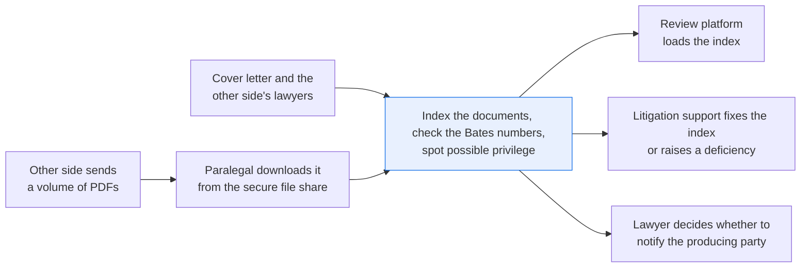
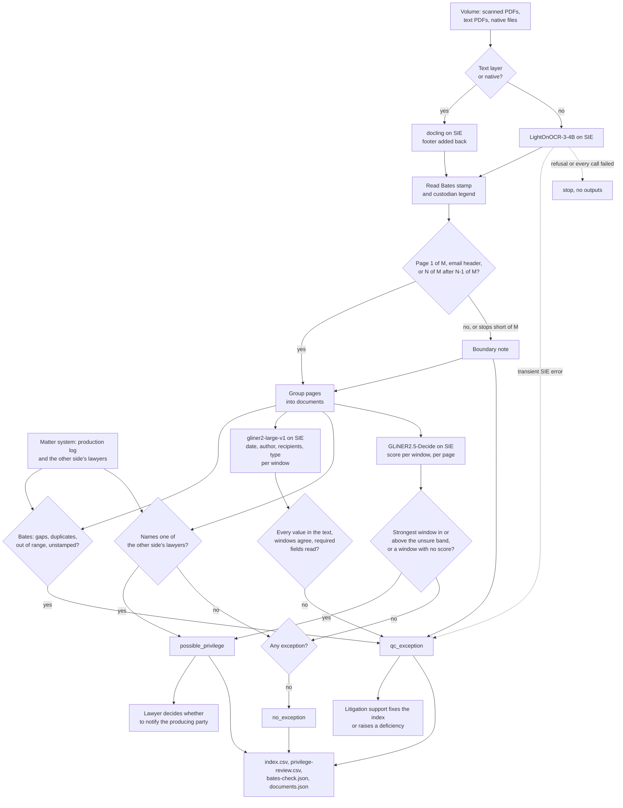

# Index and check a batch of documents you received

> **This example:** the receiving side of discovery: Bates gaps, and privileged documents the other
> side sent by mistake.
>
> **How it works:** OCR reads the PDFs, an extraction model pulls date, author and recipients, a
> classifier scores privilege, and Python checks the Bates numbers.
>
> **Use the same pattern for:** medical records returned under subpoena, a third party's subpoena
> response, a stamped exhibit binder.

## Background

When the other side hands over documents in discovery, they're supposed to send them in a form
your review platform can load: images or natives plus a load file (a DAT and an OPT, say) that
carries each document's Bates range, custodian, date and family. Often that's what you get.
Sometimes it isn't. A smaller opponent sends a folder of stamped PDFs and a cover letter. A
volume arrives with a load file that doesn't match the images. Or your firm takes over a matter
and inherits a box of old discovery as scans, with the original database long gone.

The person who deals with that is a litigation paralegal or a litigation-support specialist at
the receiving firm. Here's what they do today. They download the volume from the secure file
share, open the cover letter, and log the Bates range it claims to cover in the firm's matter
system. Then they open each PDF and go page by page: write down the Bates number, decide where
each document starts and ends, type the date, author, recipients and custodian into a
spreadsheet so the documents can be loaded and searched, and note any gap or duplicate in the
numbering. While they're at it, they watch for anything that looks like the other side's
privileged material: a letter from the opponent's General Counsel, an email to their outside
counsel. That one goes straight to the supervising lawyer.

What the receiving firm already has, structured, in its matter system:

- **The cover letter**, as logged when the volume came in: the producing party, the Bates
  prefix, the range the volume claims, and the custodian for any native file. A paralegal types
  these into a few fields in minutes.
- **The other side's lawyers**: their General Counsel and outside counsel, from the pleadings,
  the correspondence and their privilege log. That's the list a privileged document is most
  likely to name.

What isn't structured is everything in the PDFs: the stamp on each page, where one document ends
and the next begins, who wrote what to whom and when, and whether a page is legal advice.

Why it matters: a gap in the Bates numbers is a deficiency you raise with the other side, and
the sooner you raise it the better. And a privileged document sent by mistake isn't something
you can quietly read and use. The clawback clause a protective order usually has, and ABA Model
Rule 4.4(b), expect the receiving lawyer to tell the sender promptly. Finding it three months
later, quoted in your own draft brief, is the wrong time.

Here's the job end to end, and the step this recipe takes on:



## The problem

You want the volume turned into an index your review platform can load, the Bates numbering
checked against the cover letter, and the documents that might be the other side's privileged
material set in front of a lawyer before anyone on the team relies on them.

Reading it page by page is slow and nobody does it the same way twice. A text search for
"privileged" finds the legend on every page of some volumes and nothing on a letter of advice
that never uses the word. One LLM call per document gives you an index you can't audit, and
still needs someone to work out where the documents start and end.

So the recipe reads the pages, takes the stamps and legends with plain regexes, uses small
models only for the fields that are really prose (date, author, recipients, document type) and
for a privilege score, and gives each document one of three statuses:

- **`possible_privilege`**: it names one of the other side's lawyers, or its strongest window
  scores at or above the unsure band, or some window has no score. A lawyer decides whether to
  notify the producing party and set it aside.
- **`qc_exception`**: a Bates gap, a duplicate stamp, a number outside the claimed range, an
  unstamped page, a document boundary the recipe had to guess, a page or field window that
  wasn't read, or an index field that is missing or conflicting. Litigation support fixes the
  index or raises a deficiency with the other side.
- **`no_exception`**: none of the checks fired. That's a checked index row, not a reviewed
  document.

A `possible_privilege` document keeps its QC reasons too; the status just says who looks first.

This is the receiving side of discovery. `redact_documents_with_log` is the producing side:
redacting your client's documents before they go out, with the redaction log.

If the volume came with a load file that matches the images, load that instead. Your review
platform already does this job, and the recipe would be rebuilding what you were given.

### Examples

Here are three of the documents in `data/TFL-VOL001/`, and what should happen to each.

**1. A plain business memo.**
- **Input:** `scans.pdf` page 1, a scanned memo stamped TFL0000001: "From Monday 10 March, Kestrel
  Supply Co. loads move to the 06:00 slot at Bay 4."
- **What should happen:** OCR reads the page, Python reads the stamp and custodian from the footer,
  no lawyer is named and the privilege score stays low.
- **Expected outcome:** `no_exception`.

**2. The other side's General Counsel, sent by mistake.**
- **Input:** `scans.pdf` pages 2 and 3, a scanned letter stamped TFL0000002-0003, "Page 1 of 2" and
  "Page 2 of 2": "You asked whether we can serve notice of termination on Kestrel Supply Co. now ...
  My advice is that we should not serve notice yet." Signed "Owen Achterberg, General Counsel,
  Tollerby Freight Ltd."
- **What should happen:** The page numbering joins the two pages into one document. Owen Achterberg
  is on our list of the other side's lawyers, so it goes to a lawyer whatever the score says.
- **Expected outcome:** `possible_privilege`, naming Owen Achterberg.

**3. A letter from outside counsel with no page numbers.**
- **Input:** `letter.pdf`, two scanned pages stamped TFL0000011 and TFL0000012, neither one
  numbered. Page 1 goes through the delivery logs: "The logs show 14 scheduled runs to Brayford Park
  in February." Only page 2 says who wrote it, signed by Imogen Sallis, Associate, Wenlow & Croft
  LLP: "We will then advise you on how to answer the claim."
- **What should happen:** Nothing on the pages says page 2 continues page 1, so the recipe can't
  join them. It should treat them as two documents, say it had to guess where they start and
  end, and still send page 2 to a lawyer because it names one of the other side's lawyers.
- **Expected outcome:** page 1 `qc_exception` for the guessed boundary; page 2 `possible_privilege`,
  naming Imogen Sallis, with its own boundary note.

On the live run, 12 of 12 documents came out as expected. [What came out](#what-came-out) has the
results.

## How we'll solve it

1. **Start from the matter system.** `matter.py` looks the volume up in the production log (the
   cover letter's producing party, Bates prefix and digits, claimed range, and the custodian of
   each native file) and lists the lawyers who act for the producing party, with their initials
   and email addresses. A volume that was never logged, or a matter with no lawyers listed for
   the other side, stops the run before any SIE call: there'd be nothing to check against. The
   claimed range is read into numbers once, here; a range label that isn't the prefix and its 7
   digits stops the run too.
2. **Read every page.** Scanned pages go through OCR (`lightonai/LightOnOCR-3-4B`); PDF pages
   with a text layer and native Word files go through `docling`, with the page footer added back
   to the page text, since that's where the stamp lives.
3. **Read the stamps and legends in Python.** The Bates number is the prefix plus 7 digits,
   allowing OCR lookalikes (`O` for `0`), read from the page's footer: the lines at the bottom
   that hold only stamps, the legend and page numbering. A Bates number quoted in the body ("see
   TFL0000004") is a reference to another page, not this page's stamp. A native's stamp is its
   file name. The custodian comes from the footer legend, or from the cover letter for a native.
4. **Work out where documents start and end.** A page starts a document when it says "Page 1 of
   M", begins with an email header, or is a native file. "Page N of M" with N above 1 continues
   the document before it, but only if the page before was N-1 of the same M. Any other page,
   and a document that stops short of "M of M", gets a boundary note and a `qc_exception`, so a
   person confirms it.
5. **Check the numbering against the cover letter**: one stamp per page, no duplicates, no gaps,
   inside the claimed range, consecutive within a document. Each finding is written as a plain
   sentence, and that list is the start of the deficiency letter.
6. **Read the prose fields.** `fastino/gliner2-large-v1` pulls the date, author, recipients and
   document type from windows of about 512 tokens. Every value must appear in the text, dates
   are normalised, and a window that wasn't read, two windows that disagree, a date span holding
   two dates, an author span naming two people, or a required field that's missing is a
   `qc_exception`.
7. **Look for the other side's privileged material, two ways.** Any of their lawyers named
   anywhere, by name, initial or email address. And a `fastino/GLiNER2.5-Decide` score for
   "potentially privileged", taken per window, with windows cut per page, and the document
   routed on its strongest window as is, so counsel's advice in the second half of a long email
   still counts.
8. **Write the index and the queues**: the load-file-style index, the privilege queue for the
   lawyer, the Bates check, and the text each model read. Litigation support loads the index
   into the review platform, and the Bates findings become the list for the deficiency letter
   to the producing party.

If SIE refuses a call outright (a bad key, an unknown model, no credits), the run stops with
SIE's message and writes nothing; if a call fails for a reason that may pass (a timeout, a busy
server, an over-long input, or SIE's empty-result error), the document it covered goes to review
with the reason, and if every call fails the run stops. No generative model decides anything.

## Picking the models

There are four models, and each one does a job the next can't.

The OCR model is `lightonai/LightOnOCR-3-4B`, called through SIE's `extract` with the page as an
image, once per scanned page. Paper letters and forms come in with no text layer, so something
has to read the pixels. It keeps the page footer, which is where the Bates stamp and the
custodian legend sit, though it sometimes wraps them in Markdown bold (`**CONFIDENTIAL -
Custodian:** Tom Okoye`), which the custodian reader strips.

`docling` reads the pages that already have a text layer, and the native .docx, once per page or
file. There's no point running OCR over text the PDF already holds. One gotcha: docling drops
page headers and footers from its text and Markdown, and the footer is the part we need. They
are still in the DoclingDocument it returns, as `page_footer` items, so the recipe reads them
from there and adds them back.

The field finder is `fastino/gliner2-large-v1`, called through `extract` with an
`output_schema` (date, author, recipients as a list, and the document type as a fixed choice),
once per window. It reads about 512 tokens per item, and a window of 180 words is about that,
not a guarantee. It's good at pointing at the right words in a document it has never seen. It is
not something to trust on its own, which is why every value must be in the window's text and
two windows that disagree send the document to QC. The Bates number and custodian are
fixed-format text the vendor adds to every page (`TFL` + 7 digits, `Custodian: <name>`), so
Python reads them with a regex instead. Asked for them, gliner2 can run the custodian into the
stamp beside it ("Lena Fairbrook TFL0000006") or miss it on a page.

The privilege scorer is `fastino/GLiNER2.5-Decide`, called once per document with one item per
150-word window (windows overlap by 30 words and never cross a page). It answers one question
from `rules.yaml` with two options, "potentially privileged" and "not privileged", and gives a
probability for each. It's a classifier, not a chat model: it doesn't follow instructions, and
the documents can't talk it into anything beyond moving the score. That's the other reason the
lawyer list exists. A document that says "this is not privileged" next to outside counsel's name
still goes to the lawyer.

So: four models, the readers called once per page, the field finder once per window, the
privilege scorer once per document, and no generative model makes a decision.

## The flow



## How it's built

Everything you'd want to argue about lives in [`rules.yaml`](./rules.yaml): the four model
names, the window sizes and the two privilege thresholds, the OCR lookalikes for stamps, the
document-break patterns, the footer legend, the fields gliner2 is asked for, the required
fields, the date formats, and the privilege question with its two options. The cover letter and
the lawyer list come from [`matter.py`](./matter.py), which stands in for your matter system: it
loads three CSV seeds (`data/matter_productions.csv`, `data/matter_natives.csv`,
`data/matter_counsel.csv`) into an in-memory SQLite database and answers `find_volume`,
`find_native` and `counsel_for`. Matching is exact, so `TFL-VOL01` is not `TFL-VOL001`.
[`recipe.py`](./recipe.py) is about 1,200 lines and reads top to bottom in the order of the flow.

| Step | Code | SIE call | What it does |
| --- | --- | --- | --- |
| Look up the volume | `main`, `MatterSystem.find_volume`, `bates_value`, `counsel_for` | none | The cover letter's fields, its claimed range as numbers, and the producing party's lawyers; stops if either is missing or the range doesn't read as prefix plus digits |
| Read pages | `read_pdf`, `read_native`, `_docling_text`, `_markdown_entity` | `extract` (image or document) | One call per page or native file; docling's footer furniture is added back to the text |
| Stamps | `bates_pattern`, `find_stamps` | none | Prefix plus 7 digits with OCR lookalikes, from the footer lines only; a native's stamp is its file name |
| Document breaks | `page_numbering`, `split_documents` | none | Page 1 of M, an email header or a native starts a document; N of M joins only after N-1 of M; anything else gets a boundary note |
| Bates check | `check_bates` | none | One stamp per page, no duplicates or gaps, inside the claimed range, consecutive within a document; every finding as a sentence for the deficiency letter |
| Fields | `extract_fields`, `in_text`, `finish_fields`, `dates_in`, `several_people`, `read_custodians` | `extract` + `output_schema` | One call per window, with `overflow_policy: error` so an over-long window fails instead of being cut; a value must be in its window; windows that disagree, two dates in one span, two people as author, or a missing required field is a QC exception |
| Privilege score | `score_privilege`, `strip_footer_legend`, `window_score` | `extract` + `output_schema` choice | One call per document, one item per window per page; the legend and stamps are removed first; a window with no usable probability leaves the document without a score |
| Lawyer list and status | `lawyer_hits`, `decide_privilege`, `Document.status` | none | Any of the other side's lawyers by name, initial or email; the strongest window against `privileged_at` and `unsure_from` |
| SIE failures | `Calls.call`, `is_fatal`, `stop_message`, `stop_on_refusal` | none | A transient failure or a reply missing its key sends the document to review; a refusal, or every call failing, stops the run without outputs |
| Outputs | `write_outputs`, `csv_safe` | none | `index.csv`, `privilege-review.csv`, `bates-check.json`, `documents.json`; any cell a spreadsheet would run as a formula gets a leading `'` |

[`selfcheck.py`](./selfcheck.py) checks all of this offline with hand-written page text and
stand-in model replies: the whole committed volume end to end; the document breaks (glued "Page2of2",
a 2 of 2 after a 1 of 3, a skipped page, "From:" halfway down a page); stamps and their near
misses (eight digits, `TFLX`, a prefix glued to a word, a Bates number quoted in the body);
gaps, duplicates, out-of-range, unread and too-short pages; a claimed range written
`TFL-0000001` and one that isn't the prefix and 7 digits; two dates in one span, windows that
disagree, two authors, two custodians, a native the cover letter doesn't list; the lawyer list
(`Priya Ramanathan` is not `Priya Raman`, and our own lawyer doesn't count); the
strongest-window rule with windows of .45 and .01, which a renormalised peak would turn into
.31; 13 stand-in privilege replies that try to sneak a confident status through (NaN, 1.7, a
string, a missing label, fewer results than windows); the `overflow_policy` on every field
call; and the SIE failure rule. [`make_data.py`](./make_data.py) writes the volume and the matter seeds.

## Run it

You need [uv](https://docs.astral.sh/uv/) and an SIE API key
([create one](https://console.superlinked.com/console/api-keys?utm_source=github&utm_medium=docs&utm_campaign=sie-cookbook&utm_content=legal-index-and-check-received-documents)).

```bash
cp .env.example .env   # then set SIE_API_KEY
uv run recipe.py
uv run selfcheck.py    # optional: offline checks, no SIE call
uv run make_data.py    # optional: rewrite data/
```

`uv run` installs this recipe's few dependencies into its own `.venv` on the first run. Each run
writes `runs/<timestamp>/`. With one volume folder in `data/` the recipe finds it; with more,
name it with `--volume TFL-VOL001`. A run makes 39 SIE calls on this data: 6 to the OCR model, 7
to docling, 14 to gliner2 and 12 to GLiNER2.5-Decide. The first call can wait a few minutes
while SIE Cloud starts the OCR, document and GLiNER models; our run on 2026-11-04 (UTC), with
the models already warm, took 23 s.

## What came out

### The three examples

**1. A plain business memo.**
- **Expected outcome:** `no_exception`.
- **What came back:** `no_exception`, privilege score 0.045.
- **Verdict:** Pass.

**2. The other side's General Counsel, sent by mistake.**
- **Expected outcome:** `possible_privilege`, naming Owen Achterberg.
- **What came back:** TFL0000002-0003 as one document, `possible_privilege`, names Owen Achterberg,
  scored 0.766 (page 1, the advice; page 2 scored 0.456).
- **Verdict:** Pass.

**3. A letter from outside counsel with no page numbers.**
- **Expected outcome:** page 1 `qc_exception` for the guessed boundary; page 2 `possible_privilege`,
  naming Imogen Sallis, with its own boundary note.
- **What came back:** page 1 `qc_exception` (boundary note, score 0.090); page 2
  `possible_privilege` (names Imogen Sallis, 0.489, unsure) with its own boundary note.
- **Verdict:** Pass. This is the limit. The recipe can't see that the pages belong together, so
  a person has to put the letter back together. Only page 2 goes to the lawyer; page 1, on its own,
  goes to litigation support.

### Results

On the live run on 2026-11-04 (UTC), 12 of 12 documents came out as expected (the
unnumbered letter TFL0000011-0012 counts as the two documents the recipe was meant to split it
into). TFL0000013 also picked up QC reasons we didn't write in (a date it couldn't read, windows
disagreeing on author and type); they only add to a row already going to the lawyer.

**Where it works:** plain business records stay clean: the memo (TFL0000001), the delivery form
(TFL0000004) and the native rate amendment (TFL0000010). The other side's lawyers get caught by name
(TFL0000002-0003, TFL0000005 and the cc'd TFL0000006 on emails.pdf p2), and advice that names no one
on the list gets caught by the score (the chronology TFL0000007, the long email TFL0000013). "Legal"
in a sentence doesn't fool the score (TFL0000006 on emails.pdf p3, 0.090). The Bates check finds the
duplicate TFL0000006 and the missing TFL0000008, which puts the lunch email right after the gap
(TFL0000009) in `qc_exception`. The unnumbered letter comes out as the two documents it was meant
to, each with a boundary note, and counsel is still found on its second page (TFL0000011,
TFL0000012).

**Where it fails:** it can't join the unnumbered letter (TFL0000011-0012), and on TFL0000013 gliner2's
windows disagreed on author and type, so those are left blank for a person. The one to worry about
wasn't in this volume: emails and their attachments aren't linked, so a routine covering email with
a privileged attachment would be indexed as two unrelated documents.

The input is one volume, `TFL-VOL001`, in [`data/TFL-VOL001/`](./data/TFL-VOL001), received by
Kestrel Supply Co.'s counsel from Tollerby Freight Ltd. in a fictional dispute:

- `scans.pdf`: 4 scanned pages with no text layer (a memo, a two-page letter, a delivery receipt)
- `emails.pdf`: 6 emails printed to PDF with a text layer, one per page
- `letter.pdf`: a two-page scanned letter with no page numbers
- `TFL0000010.docx`: a native Word file, produced under its Bates number as its file name

and the matter system's seeds in `data/`: the production log (the cover letter claims
`TFL0000001`-`TFL0000013`), the native file's custodian, and the four lawyers on the matter
(three for Tollerby, one for Kestrel). Every page has a Bates stamp and a `CONFIDENTIAL -
Custodian: <name>` legend in its footer.

> **All of it is synthetic.** [`make_data.py`](./make_data.py) writes the volume and the seeds
> byte for byte (Pillow for the scans, a small stdlib PDF and .docx writer for the rest). The
> PDFs carry no document metadata (no producer, title or dates). The matter, both companies,
> every person, address and email domain (`.example`) is invented.

Treat these results as a demo that the wiring works, not as a measure of accuracy: twelve documents
tell you each path through the checks runs, not how often a real volume fools the models.

The Bates check, from `bates-check.json`, is the deficiency letter in two lines:

```json
"findings": [
  "TFL0000006 is stamped on 2 pages: emails.pdf p2, emails.pdf p3",
  "TFL0000008 is inside the claimed range TFL0000001-TFL0000013 but was not found"
]
```

A few things worth noticing:

- **The long email is the case the strongest-window rule is for.** Window 1 scored 0.047 and
  window 2, which holds the General Counsel's advice, 0.806; the document takes 0.806 as is.
  Averaging the windows, or renormalising each label's peak, would pull a lukewarm second window
  under the unsure band: windows of .45 and .01 renormalise to .31, the case `selfcheck.py`
  pins down. The same email shows why two windows that disagree go to a person instead of one
  value being picked. gliner2's second window read the author as "Marcus" and the document as a
  `delivery receipt`, so the row says, from `index.csv`:

  ```csv
  TFL0000013,...,Ravi Mendes,2025-04-04,,Depot Managers; management team,,emails.pdf,6,0.806,,possible_privilege,"Scored potentially privileged (0.806) | Date 'February' could not be read as a date | Windows disagree on the author: 'Marcus Bell' (window 1), 'Marcus' (window 2) | Windows disagree on the doc type: 'email' (window 1), 'delivery receipt' (window 2)"
  ```

  A delivery receipt about Q2 rotas. The author and type are left blank for a person to fill,
  rather than one of them being picked.
- **The unnumbered letter came within 0.011 of a confident score, and it didn't matter.** Page 2
  scored 0.489, just under `privileged_at`, so it reads "unsure"; it names Imogen Sallis, so it
  would have gone to the lawyer at 0.05 too. gliner2 couldn't read "February 10 to 14" as a date,
  found no type for page 2, and typed page 1 (a letter with no From or Subject line) as an
  `email`; the boundary notes already put both pages in front of a person.
- **Scoring per page keeps the advice from being diluted.** The General Counsel's letter is
  scored page by page: page 1 (the advice) scored 0.766 and page 2 (the recommendation and
  signature) 0.456, and the document takes the stronger. The list catches it either way, which
  is why the list doesn't depend on any score.
- **The cc'd-counsel email scored 0.061.** The model reads it as the business email it is, and
  only the list sends it to the lawyer. You need both checks: the score catches advice with no
  listed lawyer (the chronology at 0.909), the list catches a listed lawyer the score ignores.
  The near miss ("legal entity name") scored 0.090.
- **Schema wording matters for gliner2.** `doc_type` names the cues ("an email has From, Sent,
  To and Subject lines"); described only as "the kind of document" with an `other` option,
  every email and the contract come back `other`. There is no `other`, so an untyped document
  gets a QC exception. The date reads "or the date it takes effect"; without it, the contract's
  date is its reference to the 2023 agreement it amends. We tried these wordings on this volume
  only, so test yours on your own documents.

### What you do next

A lawyer works through `privilege-review.csv` and decides whether to notify Tollerby and set each
document aside. Litigation support takes the `qc_exception` rows in `index.csv`, fixes the
boundaries and fields a person has to confirm, and turns the findings in `bates-check.json` into the
deficiency letter: here, the duplicate TFL0000006 and the missing TFL0000008. Then they load the
index into the review platform.

## Potential improvements

- **The lawyer list.** It lives in your matter system; here, `data/matter_counsel.csv`: one row
  per lawyer, the party they act for, and their initials and email addresses as `aliases`. Add
  the other side's in-house counsel, outside firms and their paralegals. A surname on its own
  ("Raman said...") is not matched today; adding surnames as aliases catches it at the cost of
  more false hits.
- **The privilege question.** `privilege_question` and `privilege_options` are the
  GLiNER2.5-Decide question and its two options. `privileged_at` and `unsure_from` set when a
  score sends a document to the lawyer. They are starting points; set them on volumes you've
  received, and keep the unsure band wide: a missed privileged document costs more than a second
  look.
- **Your stamp and legend.** The Bates prefix and digits come from the cover letter. Change
  `footer_legend_pattern`, `document_breaks` and `ocr_digit_lookalikes` in `rules.yaml` to
  match the other side's vendor's stamp and legend. The stamp is read from the footer only; a
  vendor that stamps the page header needs `find_stamps` to read the top lines too.
- **Index fields.** `fields` is the gliner2 schema, `required_fields` what an index row must
  have, `date_formats` how dates are read. Rename the CSV columns in `INDEX_FIELDS` in
  `recipe.py` to match your review platform's load file (Concordance DAT, Relativity). Renaming
  columns doesn't give you image paths or the OPT file, so this is an index, not a full load
  file.
- **Natives.** `native_extensions` lists the file types read as natives; their custodian comes
  from the cover letter's entry in the matter system. A native the cover letter doesn't list
  gets a QC exception.
- **Families.** Emails and their attachments aren't linked. A routine covering email with a
  privileged attachment would be indexed as two unrelated documents; reading attachment names
  from the email and linking them to the next pages is the next thing to add.
- **Quoted threads.** A forwarded thread carries several messages' dates and participants. The
  recipe flags windows that disagree instead of picking one; splitting the thread into
  messages would let it index each.
- **Known SIE Cloud issue.** When gliner2-large-v1 finds no field in a window, SIE Cloud
  currently answers the `output_schema` call with HTTP 500 "Inference completed without a valid
  conserved billing settlement". The recipe treats it as a failed call, so the document gets a
  QC exception saying which window wasn't read; the run on 2026-11-04 didn't hit it.

## Try another model

Each model is one line under `models:` in `rules.yaml`. We swapped one model at a time, changed
nothing else, and ran the recipe on SIE Cloud on 2026-11-04 (UTC), on this 12-document volume.

| `rules.yaml` key | Swap in | What happened on this data |
| --- | --- | --- |
| `ocr` | `zai-org/GLM-OCR` | Its text leaves out the page footer on all six scanned pages, so no Bates stamp or custodian is read there. The memo and the delivery receipt go to `qc_exception` instead of `no_exception`, and the Bates check reports two false gaps, TFL0000001-TFL0000004 and TFL0000011-TFL0000012, which would have gone into the deficiency letter. The letters still reach the lawyer on the list (the General Counsel's letter scored 0.472, page 2 of the unnumbered letter 0.534). The six emails and the .docx come out as before. |
| `ocr` | `lightonai/LightOnOCR-2-1B` | Same status for all 12 documents. The General Counsel's letter scored 0.768 (default 0.766), and page 2 of the unnumbered letter 0.534, over `privileged_at` instead of just under it. |
| `document` | `docling:ocr` | Same index for all 12 documents. |
| `fields` | `fastino/gliner2-base-v1` | Same Bates numbers, statuses and privilege scores for all 12 documents. It found no date for 5 of the 6 emails, gave the .docx the 2023 date of the agreement it amends, typed both pages of the unnumbered letter as a `delivery receipt`, and returned authors and recipients with email addresses or job titles attached. |

SIE Cloud has no other model for `privilege` (`fastino/GLiNER2.5-Decide`) yet. SIE's catalog has
`fastino/GLiNER2.5-Decide-1B` and `fastino/GLiNER2.5-multi-Decide` to self-host; we have not run
them here. See [MODELS.md](../../MODELS.md) for every model these recipes use.

## Run it on your own SIE

The same code runs against an SIE server you host. Set `SIE_BASE_URL` in `.env`; an API key
is then optional. The table gives the SIE v0.10.1 image each model runs on, from SIE's
[compatibility matrix](https://github.com/superlinked/sie/blob/main/docs/compatibility.md).

| `rules.yaml` key | Model | Image | Tested on |
| --- | --- | --- | --- |
| `ocr` | `lightonai/LightOnOCR-3-4B` | `cuda12-sglang-vision-extract` | L4 |
| `document` | `docling` | `cuda12-default` | L4 |
| `fields` | `fastino/gliner2-large-v1` | `cuda12-default` | L4 |
| `privilege` | `fastino/GLiNER2.5-Decide` | `cuda12-transformers5` | L4 |

One SIE server runs one image, so these 3 images need a cluster: the
[sie-cluster Helm chart](https://github.com/superlinked/sie/tree/main/deploy/helm/sie-cluster)
with one worker pool per image routes each model to its pool. See
[SELF_HOSTING.md](../../SELF_HOSTING.md) for the values file.

## Files

- `recipe.py`: the pipeline
- `matter.py`: the matter system lookups (production log, natives, counsel)
- `selfcheck.py`: offline checks with hand-written text and stand-in replies, no SIE call
- `make_data.py`: the synthetic volume and the matter seeds
- `rules.yaml`: models, thresholds, patterns, fields and the privilege question
- `data/TFL-VOL001/`: the volume as received; `data/matter_*.csv`: the matter system's seeds
- `pyproject.toml`, `uv.lock`: this recipe's dependencies

See the SIE task page for [information extraction](https://superlinked.com/information-extraction?utm_source=github&utm_medium=docs&utm_campaign=sie-cookbook&utm_content=legal-index-and-check-received-documents).
