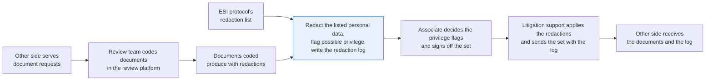
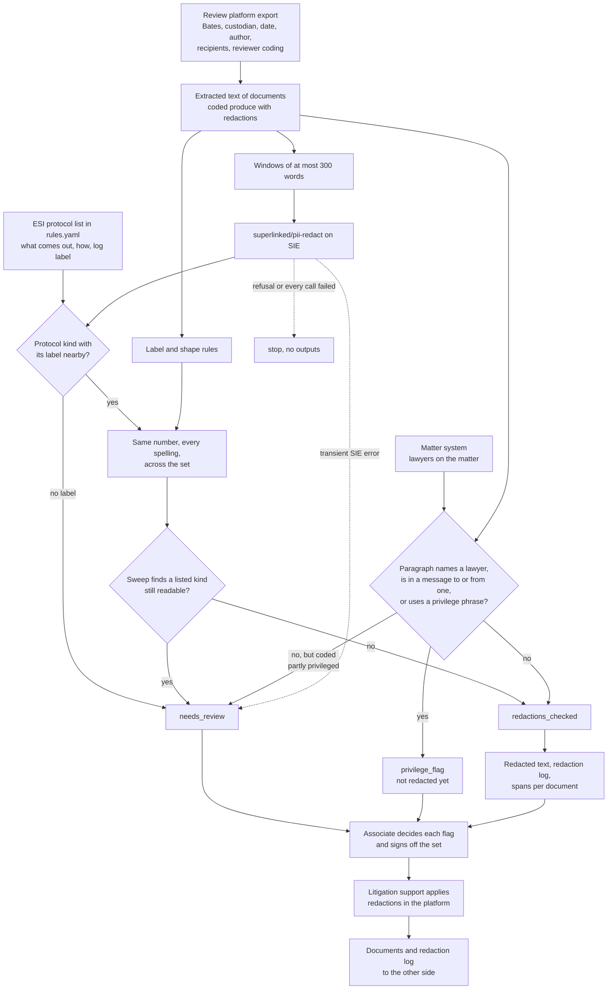

# Redact documents to the agreed rules and log every redaction

> **This example:** a paralegal preparing a client's documents for discovery.
>
> **How it works:** a PII model and regex find personal data, Python applies only the redactions
> the agreed rules allow and flags possible privilege, and the associate signs off.
>
> **Use the same pattern for:** public versions of sealed filings, medical records before they're
> produced, exhibits before filing.

## Background

Your client is in a lawsuit, and the other side has served document requests. The review team
has already been through the client's email and files in the review platform (Relativity or
Everlaw, say) and coded each document: responsive or not, privileged or not, and whether it
goes out marked CONFIDENTIAL under the protective order. What's left is the part nobody enjoys:
the documents coded "produce with redactions".

The person who does that is a litigation paralegal or a litigation-support specialist, working
for the associate who runs the discovery response. Here's how it goes today. They open each
document in the platform's redaction view and draw boxes. The ESI protocol (the order or
agreement that says how the parties exchange documents) lists what may be taken out: Social
Security numbers, dates of birth, bank account numbers down to the last four digits, the home
addresses of people who aren't parties. So they hunt for those, page by page. The crew member's
SSN in an insurance email. The operating account in a wire confirmation, written once as
`4471900321` and once as `4471 9003 21`. Then, on a chain the reviewer coded "partly
privileged", the paragraph where the client asks the firm's lawyer whether he can hold back a
payment. Every box gets a line in the redaction log: document, where, what kind of redaction,
and the basis. The other side gets that log with the documents, and if they think a redaction
hides something it shouldn't, the log is what they take to the court.

What the firm's systems already give you, structured:

- **The review platform's export of the discovery set**: Bates number, custodian, date,
  author, recipients, and the reviewer's coding (produce with redactions, confidentiality
  designation, privilege coding). That's what the log's columns come from.
- **The matter's lawyer list**: the firm's lawyers on the matter and the client's in-house
  counsel, from the client and matter system. A passage that writes to or quotes one of them is
  where privilege usually sits.
- **The ESI protocol's redaction list**: what may come out, how (all of it, or down to the last
  four digits), and the label the log uses for each.

What isn't structured is where those things sit in the text: the SSN pasted into an email body,
the account number in a forwarded wire confirmation, the one paragraph in a long chain that asks
counsel for advice.

Why it matters: a disclosed SSN or account number of somebody who isn't even in the case is
personal data the firm has to ask the other side to return, and explain to the client. A
redaction the protocol doesn't allow (a customer's name, an amount that hurts) is how you end up
in a motion to compel, explaining to a judge why you blacked out the evidence. And a privileged
paragraph that slips through starts a clawback fight under the protective order, at best, which
is a much worse afternoon.

Here's the job end to end, and the step this recipe takes on:



## The problem

The other side is entitled to the facts, so most of the document has to stay readable: the
parties, the employees, the counterparty, the dates, the amounts, the dispute. Only what the
protocol lists comes out, plus the privileged passages a lawyer confirms. That's the opposite of
"remove all the personal data": a model that blanks every name produces documents the other side
will rightly reject.

Find and replace finds only what you already know to look for, and it doesn't know that two
spellings of one account number are the same account. A regex finds SSN-shaped numbers, and
also the insurer's claim reference that happens to look like one. Neither one notices that a
paragraph is asking a lawyer for advice. And none of them writes the log.

So the recipe finds the listed personal data with a PII model and rules, redacts it the way the
protocol says, flags the passages that may be privileged for a lawyer to decide, and writes the
redaction log alongside. Each document gets a status that says what the checks found:

- **`redactions_checked`**: every listed item found was redacted with its log line, the sweep
  over the redacted text found nothing left, and no passage names a lawyer on the list.
- **`privilege_flag`**: a passage writes to, comes from or names a lawyer on the list, or uses
  words like "privileged" or "legal advice". It's shown to the associate and is not redacted
  until they decide.
- **`needs_review`**: the sweep still finds something shaped like a listed item (an SSN-shaped
  claim reference), the model found a listed kind with no label saying what it is, the reviewer
  coded the document partly privileged and nothing was flagged, a part of the document wasn't
  read, or an SIE call failed. When a document has a reason for review and a privilege flag, it
  says `needs_review` and the flag is still listed.

The associate running the discovery response decides every privilege flag and signs off the set;
the partner on the matter signs the response it goes out with. Litigation support then applies
the redactions to the page images in the review platform, from the recipe's list of spans per
document, and sends the set with the log. The recipe doesn't decide what's responsive, doesn't
redact for relevance, and doesn't mark anything CONFIDENTIAL: those come from the review team's
coding.

This is the producing side of discovery. `index_and_check_received_documents` is the receiving
side: it checks the volume the other side sends you.

### Examples

Here are three of the documents in `data/text/`, and what should happen to each.

All of this is synthetic, written for this recipe. No real person, company, firm or account appears.

**1. A crew member's personal data in an insurance email.**
- **Input:** `PMS0000002.txt`: "Tomas (date of birth 3 March 1991) has been with us since April.
  ..." and then "SSN: 666-52-1187" and "Home address: 9 Gull Lane, Marshfield, MA 02050".
- **What should happen:** The three listed items come out, each with its own log line, and
  everything else stays readable, including Tomas Reyna's name and the delivery date "12 June 2026"
  in the same paragraph.
- **Expected outcome:** `redactions_checked`, three log lines.

**2. The client asks the firm's lawyer for advice.**
- **Input:** `PMS0000004.txt`, an email from Osric Pellham to Priya Okonjo at Hollis & Crane: "Can I
  hold that back until they pay the invoice in full, or does that put us in breach of the lease?"
  Under it, the forwarded email from Kittering's Corwin Ashdale.
- **What should happen:** The paragraph sits in a message to a lawyer on the list, so it's flagged
  for the associate and not redacted yet. The forwarded email has no lawyer in it and stays
  readable.
- **Expected outcome:** `privilege_flag` on Osric's paragraph only.

**3. A claim number shaped like an SSN.**
- **Input:** `PMS0000003.txt`, a wire confirmation: "Credit account: 4471900321" and, four lines
  down, "Memo: cargo claim 404-18-2210".
- **What should happen:** The account number has its label and comes out down to the last four
  digits. The claim reference has no SSN label, so nothing redacts it, but a last check over the
  redacted text sees something shaped like an SSN still readable and hands it to a person.
- **Expected outcome:** `needs_review` for line 10, with the account shown as "account ending 0321".

On the live run, 8 of 8 cases came out as expected. [What came out](#what-came-out) has the results.

## How we'll solve it

1. **Start from the review platform and the matter.** The export of the volume (Bates number,
   custodian, date, author, recipients, the reviewer's coding) and the matter's lawyer list come
   in through two small lookups, `review_platform.py` and `matter_system.py`. The protocol's
   redaction list, with how each kind is redacted and its log label, is in `rules.yaml`. The
   document text is the platform's extracted text. If the export and the text files on disk
   don't agree, the run stops before any SIE call.
2. **Find the listed personal data.** `superlinked/pii-redact` reads each document in windows of
   at most 300 words and returns names, organizations, dates, SSNs, dates of birth, account
   numbers, addresses, phones and emails as spans of the text. Only the kinds on the protocol's
   list are kept, and only where a label says what the value is ("SSN", "Date of birth",
   "account", "home address") on the same line, shortly before it, with no other number in
   between. A value the model found without that label stays readable and goes to a person.
   Rules in Python catch the same kinds by their label and shape without the model. Names,
   organizations, phones, emails and ordinary dates stay readable.
3. **Spread what was found across the set.** An SSN or account number redacted once is redacted
   in every other spelling, compared by its digits, so `4471900321` and `4471 9003 21` both come
   out as "account ending 0321".
4. **Flag the passages that may be privileged.** A paragraph that names a lawyer on the list (or
   the firm), sits in a message to or from one, or uses words like "legal advice" or
   "privileged", is flagged with the paragraph and the reason. Opposing counsel isn't on the
   list, so an email quoting them doesn't flag anything.
5. **Sweep the redacted text.** The same label-and-shape rules, plus a plain SSN shape and a
   "City, ST 02050" line right after a home address, run over what goes out. Any hit sends the
   document to `needs_review`, with the line, never the value.
6. **Write the outputs.** The redacted text per document with labels like `[REDACTED: SSN]`, the
   list of spans to redact for the review platform, the redaction log (Bates number, line, kind,
   basis label from the protocol, never the value), and the privilege flags for the associate.
   Privilege redactions get their log line, with the author, recipients and date from the
   export, only after the associate confirms them.

If an SIE call fails for a reason that may pass (a timeout, a 5xx, a rate limit, or a reply
without its `entities` key), that document goes to `needs_review` with the reason and the run
carries on; if SIE refuses the call or every call fails, the run stops with SIE's message and
writes nothing.

## Picking the model

The one model is `superlinked/pii-redact`, through SIE's `extract` call with a list of labels.
It's SIE Serverless's PII model: `urchade/gliner_multi_pii-v1` and `numind/NuNER_Zero` composed on
the server, spans scoring 0.6 or more kept, the two models' spans unioned. You give it the
labels you care about and it returns spans with their offsets, so the recipe knows exactly which
characters to redact and which line to log. Nothing generative reads the documents or makes a
decision.

It's good at finding a value in prose where no regex would think to look: "Tomas (date of birth
3 March 1991)" in the middle of an injury report came back as a date of birth, while the
delivery date in the same sentence came back as a plain `date`. That's why the label list
includes `date`, `person` and `organization` even though the protocol never redacts them: the
model needs somewhere else to put a delivery date than "date of birth".

It's less good at knowing a label from a value. In our run it tagged the word "SSN" itself as a
social security number, right next to the actual number. A span with no digit in it can't hold
an SSN or an account number, so the recipe skips those. And it didn't tag the account number
written with spaces in the quoted email at all; the spread step found it from the wire
confirmation. That's the reason the rules and the spread are there: the model finds, the label
decides, and anything it found without a label goes to a person instead of out the door.

## The flow



## How it's built

Everything you'd want to argue about lives in [`rules.yaml`](./rules.yaml): the model, the labels
it's asked for, the review platform coding to prepare, the window size, how near a label has to
be, the minimum digits for the spread, and the protocol's redaction list. Each kind there has the
model labels that mean it, its label words, its shape, a label-and-shape rule, how it's redacted
(in full, or down to the last four digits), what the redacted text shows, and the log's name and
basis for it. The privilege phrases and the coding that means "partly privileged" are there too.
[`recipe.py`](./recipe.py) is about 950 lines and reads top to bottom in the order of the flow.
The two existing systems are small lookups backed by committed CSV seeds loaded into an
in-memory `sqlite3` database: [`review_platform.py`](./review_platform.py) stands in for the
platform's export of one volume with its extracted text, and
[`matter_system.py`](./matter_system.py) for the matter team lookup.

| Step | Code | SIE call | What it does |
| --- | --- | --- | --- |
| Load the set | `build_set`, `review_platform.production_set`, `review_platform.extracted_text` | none | The volume's rows from the export in Bates order, kept if coded `Produce with redactions`, with their text. A Bates number listed twice, one in the wrong shape, a missing text file or a text file the export doesn't list stops the run |
| Lawyers | `matter_system.lawyers_on_matter`, `flag_no_lawyers` | none | The lawyers on the matter by exact matter number. None at all sends every document to review |
| Find | `word_windows`, `detect_pii` | `extract` | One call per window of at most 300 words (here one per document), asking SIE to fail rather than cut a window short. A span whose offsets don't match its text, or a reply without `entities`, sends the document to review |
| Keep | `kind_of`, `labelled`, `model_spans`, `rule_spans` | none | Model spans of a protocol kind, cut to the values of the kind's shape inside them (two numbers in one span become two), kept where the kind's label sits within 40 characters before on the same line with no number in between. The label-and-shape rules add what they find on their own |
| Spread | `spread_values`, `digits_pattern`, `spread_spans`, `merge_spans` | none | Every redacted SSN or account number of 7 or more digits, found in any spelling (spaces, dots, dashes) across the set, never inside a longer number. Overlapping spans merge into one |
| Hold | `run` | none | A model value with no label, not confirmed by a rule or the spread, stays readable and goes to review |
| Redact and sweep | `replacement`, `redact`, `blanked`, `sweep` | none | The protocol's replacement for each span (the last four digits for an account of 8 or more digits). Then every kind's rule and the `sweep` shapes run on the text as it goes out; a hit is a reason for review with its line |
| Privilege | `paragraphs`, `is_header`, `lawyers_named`, `firm_names`, `privilege_flags` | none | Paragraphs split on blank lines. A header block (two or more From, To, Cc, Date, Sent or Subject lines) starts a message in a chain; the first message's people come from the export as well. A paragraph is flagged if its message is to or from a lawyer on the list, it names one (full name or email in any case, a listed surname as written) or the firm, or it matches a privilege phrase. A document coded partly privileged with no flag goes to review |
| Write | `report_rows`, `log_rows`, `flag_rows`, `spans_json`, `csv_safe`, `write_outputs` | none | The outputs below. Every CSV cell that a spreadsheet would run as a formula is quoted |

The SIE error rule is the same as in the security recipes. A call that fails for a reason that
may pass (a timeout, a lost connection, a 5xx, a rate limit, a model still loading, an over-long
window, or a reply missing `entities`) sends that document to `needs_review` with a short
reason, and the run carries on. A refusal every call would repeat (a bad key, no credits, a model
name SIE doesn't know) stops the run with SIE's full message and writes no outputs. If every call
failed, the run stops too. An empty `entities` list is a real result: the model found nothing.

[`selfcheck.py`](./selfcheck.py) checks the lookups, each protocol rule (glued and spaced
labels, negations like "SSN: none on file", two numbers in one span, a label that belongs to
another number), the spread and the sweep, the privilege flags and their near misses, that no
value reaches the log, report, flags or spans file, and the SIE error rule, offline, with
hand-written strings and stand-in model replies.

## Run it

**Try this recipe on [SIE Serverless](https://superlinked.com/serverless?utm_source=github&utm_medium=docs&utm_campaign=sie-cookbook&utm_content=legal-redact-documents-with-log).** You pay per call and there are no GPUs to manage yourself. Get an [SIE API key](https://console.superlinked.com/console/api-keys?utm_source=github&utm_medium=docs&utm_campaign=sie-cookbook&utm_content=legal-redact-documents-with-log), read the [API docs](https://superlinked.com/docs/reference/api?utm_source=github&utm_medium=docs&utm_campaign=sie-cookbook&utm_content=legal-redact-documents-with-log), or host SIE yourself from the [SIE repo](https://github.com/superlinked/sie).

You need [uv](https://docs.astral.sh/uv/) and an SIE API key
([create one](https://console.superlinked.com/console/api-keys?utm_source=github&utm_medium=docs&utm_campaign=sie-cookbook&utm_content=legal-redact-documents-with-log)).

```bash
cp .env.example .env   # then set SIE_API_KEY
uv run recipe.py
uv run selfcheck.py    # optional: offline checks, no SIE call
```

`uv run` installs this recipe's few dependencies into its own `.venv` on the first run. Each run
writes `runs/<timestamp>/` in this folder. The first call can wait a few minutes while SIE Serverless
starts the PII model. A warm run makes 6 SIE calls, one per document, and takes about 2 seconds.

## What came out

### The three examples

**1. A crew member's personal data in an insurance email.**
- **Expected outcome:** `redactions_checked`, three log lines.
- **What came back:** `redactions_checked`; the date of birth, SSN and home address redacted, one
  log line each (lines 8, 11, 12), "Tomas Reyna" and "12 June 2026" readable.
- **Verdict:** Pass.

**2. The client asks the firm's lawyer for advice.**
- **Expected outcome:** `privilege_flag` on Osric's paragraph only.
- **What came back:** `privilege_flag` on lines 6 to 8 only, reason "in a message to or from Priya
  Okonjo"; the forwarded email from Kittering readable.
- **Verdict:** Pass. It stays unredacted until the associate decides.

**3. A claim number shaped like an SSN.**
- **Expected outcome:** `needs_review` for line 10, with the account shown as "account ending 0321".
- **What came back:** `needs_review`: "line 10: an SSN-shaped number is still readable", and the
  account masked as "account ending 0321".
- **Verdict:** Pass. This is the limit. The recipe can't tell a claim reference from an SSN, so
  it leaves the number readable and a person decides.

### Results

On the live run on 4 Nov 2026 (UTC), 8 of 8 cases came out as expected.

**Where it works:** only what the protocol lists comes out. The shipment email (PMS0000001) goes out
with every name readable, the crew email (PMS0000002) loses its SSN, date of birth and home address
with a log line each, and the delivery date next to that date of birth stays (PMS0000002 again). One
account gets caught in two spellings (PMS0000003 and PMS0000005), and the claim reference shaped
like an SSN goes to a person (PMS0000003). The privilege flag lands on one paragraph of a chain
(PMS0000004), opposing counsel's words don't get flagged (PMS0000005), and the price list goes out
with nothing redacted, marked `CONFIDENTIAL` (PMS0000006).

**Where it fails:** it sends work to a person when it can't tell, as with the claim reference in
PMS0000003, and it doesn't decide privilege at all. The one to worry about is what this run doesn't
measure, which is how often the model misses a value. A value the model misses with its label on
another line, like a date of birth in a table, isn't caught by the sweep. A paragraph that says only
"Priya" isn't flagged unless it's in a message to or from her.

The input is one fictional matter, Pellham Marine Supply LLC v. Kittering Marine Holdings, with
Hollis & Crane LLP for Pellham:

- [`data/production.yaml`](./data/production.yaml): the matter number and the volume to prepare
- [`data/review_platform.csv`](./data/review_platform.csv): the export of volume `PMS-VOL001`,
  six documents from the client's custodians, PMS0000001 to PMS0000006, with their coding
- [`data/text/`](./data/text): each document's extracted text, named by its Bates number
- [`data/matter_system.csv`](./data/matter_system.csv): the lawyers on the matter (and one on
  another matter, who must not count)

> **All of it is synthetic.** Every person, company, firm, bank, number and address is invented.
> Emails use reserved `.example` domains; the SSN starts with 666, which is never issued.

Treat these results as a demo that the wiring works, not as a measure of accuracy: six documents
tell you the rules do what they say, not how often the model misses a value in your own documents.

A few things worth noticing:

- **The log says what and why, never the value.** This is the whole `redaction_log.csv` from the
  run, the file the other side gets:

  ```text
  bates,line,redaction,basis
  PMS0000002,8,Date of birth,ESI Protocol 7.2(b): personal identifier
  PMS0000002,11,Social Security number,ESI Protocol 7.2(a): personal identifier
  PMS0000002,12,Home address of a non-party,ESI Protocol 7.2(d): non-party personal information
  PMS0000003,6,Financial account number (last four shown),ESI Protocol 7.2(c): financial account
  PMS0000005,8,Financial account number (last four shown),ESI Protocol 7.2(c): financial account
  ```

  Five boxes in six documents. The model found dozens of names, companies, emails and dates
  in the set, and every one of them stayed readable, which is the point.
- **The second spelling came from the spread, not the model.** In PMS0000005, "It should land in
  4471 9003 21 by Friday" has no label and the model didn't tag it. `spans.json` says it was
  `found_by` "same number elsewhere": the wire confirmation's `Credit account: 4471900321` was
  redacted first, and its digits found the other spelling.
- **The claim reference stays readable on purpose.** The model left `404-18-2210` alone and no
  rule has an SSN label for it, so nothing redacted it. Blacking it out would be a redaction the
  protocol doesn't allow; leaving it unflagged would trust that it really is a claim reference.
  So the document goes to a person with the line number, and the bank record keeps its
  `CONFIDENTIAL` designation from the coding either way.
- **The privilege flag is one paragraph, with its log fields ready.** The flag in
  `privilege_flags.csv` has lines `6-8`, the reason "in a message to or from Priya Okonjo", the
  author, recipients and date from the export (dates in ISO 8601 UTC, `2026-07-07T22:05:00Z`,
  whether they came from the export or an email header), a proposed basis of "Attorney-client privilege",
  and an empty `associate_decision` column. The paragraph itself is the one asking "Can I hold
  that back until they pay the invoice in full, or does that put us in breach of the lease?" The
  forwarded email from Corwin Ashdale underneath has its own header, with no lawyer in it, so it
  stays readable.
- **The model tagged "SSN" as an SSN.** In PMS0000002 it returned the word "SSN" on line 11 as a
  social security number, right next to the real one. A span with no digit can't hold a number,
  so the recipe skips it rather than sending the document to a person for a "social security
  number with no label" that is only the label itself.

The run writes `redacted/<Bates>.txt`, `redaction_log.csv`, `privilege_flags.csv`, `report.csv`
(status, designation, counts and reasons per document) and `spans.json` (character offsets into
the extracted text, the replacement and how each span was found, for litigation support). None of
them holds a redacted value.

### What you do next

The associate opens `privilege_flags.csv`, decides each flag in the `associate_decision` column, and
clears every `needs_review` document by hand (here, whether `404-18-2210` really is a claim
reference). Confirmed privilege lines are copied into `redaction_log.csv`. The associate signs off
the set, litigation support applies the redactions from `spans.json` to the page images in the
review platform, and the set goes to the other side with the log.

## Potential improvements

- **Your own protocol.** The four kinds in `rules.yaml` are a common list, not every protocol's.
  Add a kind (a driver's license number, a medical record number) as one more entry with its
  model label, label words, shape, rule and basis.
- **Addresses without the word "home".** A street address the model finds is redacted only with
  "home", "residence" or "lives at" in front of it. A business address goes to a person, and an
  address with no label on its line (in a table, say) does too.
- **Labels on another line.** A date of birth in a table, with "DOB" in the column header, has its
  label on a different line, so the model's span goes to a person and a value the model misses
  isn't caught by the sweep.
- **First names of lawyers.** A paragraph that says only "Priya" isn't flagged unless it's in a
  message to or from her; list the first name in `other_names` if your documents use it alone.
- **A letter from opposing counsel to our lawyer.** It's a message to a lawyer on the list, so its
  body is flagged, and the associate clears it. A list of the other side's counsel in the matter
  system would let the recipe skip those.
- **Confirmed privilege into the log.** Today the associate's decision goes into
  `privilege_flags.csv` by hand and the confirmed rows are copied into the log. A second command
  that reads the decisions and appends the confirmed lines would close that loop.
- **Page numbers.** The log gives the line in the extracted text. Mapping offsets to the page
  image the platform produces would let the log say page and line.

## Try another model

The model is one line under `models:` in `rules.yaml`. On 4 Nov 2026 (UTC) we swapped it,
changed nothing else, and ran the recipe on SIE Serverless.

| `rules.yaml` key | Swap in | What happened on this data |
| --- | --- | --- |
| `pii` | `urchade/gliner_multi_pii-v1` | Same status for all six documents and the same five redactions on the same lines. The account written with spaces in PMS0000005 was again found by the spread, not the model |

The rules and the spread do most of the redacting on this set, so the one model drops in. It
loses `superlinked/pii-redact`'s union with `numind/NuNER_Zero` on the server, which matters more
in prose with no labels than in these mostly labelled documents.
See [MODELS.md](../../MODELS.md) for every model these recipes use.

## Run it on your own SIE

The same code runs against an SIE server you host. Set `SIE_BASE_URL` in `.env`; an API key
is then optional. The table gives the SIE v0.10.1 image each model runs on, from SIE's
[compatibility matrix](https://github.com/superlinked/sie/blob/main/docs/compatibility.md).

| `rules.yaml` key | Model | Image | Tested on |
| --- | --- | --- | --- |
| `pii` | `superlinked/pii-redact` | `cuda12-default` | L4 |

One container serves it:

```bash
docker run --gpus all -p 8080:8080 -v sie-hf-cache:/app/.cache/huggingface \
  ghcr.io/superlinked/sie-server:v0.10.1-cuda12-default
# then set SIE_BASE_URL=http://localhost:8080 in .env and run: uv run recipe.py
```

## Data and licenses

Everything in `data/` was written by hand for this recipe and is synthetic: the matter, the
export, the six documents and the lawyer list. No real person, company, firm, bank, account or
address appears. Emails use the reserved `.example` domain, the SSN starts with 666 (never
issued), and the phone numbers use the 555 range.

## Files

- `recipe.py`: the pipeline, top to bottom in the order of the flow
- `review_platform.py`: the review platform lookup (the volume's export and extracted text)
- `matter_system.py`: the client and matter system lookup (the lawyers on a matter)
- `selfcheck.py`: plain asserts on the lookups, rules, spread, sweep, privilege flags, outputs
  and SIE failure rule, no SIE call (`uv run selfcheck.py`)
- `rules.yaml`: model, labels, thresholds, the protocol's redaction list, sweep shapes and
  privilege phrases
- `data/`: the volume, the export, the extracted text and the matter's lawyers
- `pyproject.toml`, `uv.lock`: this recipe's dependencies

See the SIE task page for [PII redaction](https://superlinked.com/redact?utm_source=github&utm_medium=docs&utm_campaign=sie-cookbook&utm_content=legal-redact-documents-with-log).
