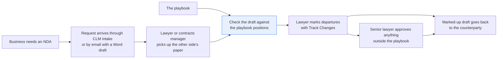
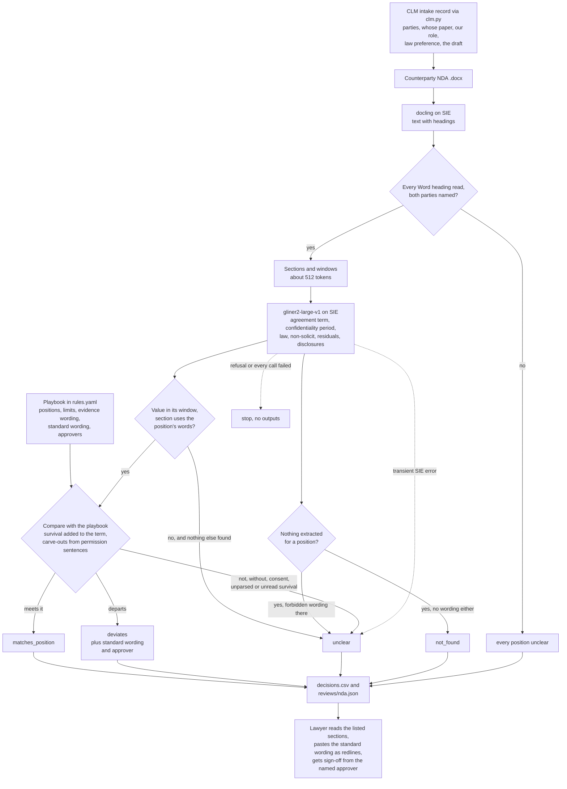

# Review a contract against your playbook

> **This example:** an in-house lawyer checking a counterparty's NDA before redlining it.
>
> **How it works:** an extraction model pulls the clause for each playbook position, and Python
> checks terms, governing law and carve-outs, adding your standard wording for each issue.
>
> **Use the same pattern for:** a customer's data processing agreement, a supplier MSA's liability
> cap and indemnities, auto-renewal terms in order forms.

## Background

Every company signs a steady stream of NDAs: a supplier wants to quote, an investor wants to
look at the numbers, a partner wants to demo a product. The request reaches in-house legal
through the contract intake form in the CLM (the contract lifecycle management system), or as
an email with a Word attachment. Someone on the commercial legal team, a lawyer or a contracts
manager, picks it up.

When the NDA is on our paper, there's little to do: the CLM generated it from our template and
knows the terms. When it's on the other side's paper, here's what happens. The lawyer opens the
.docx in Word, reads it top to bottom against the playbook (the team's list of positions: how
long confidentiality lasts, which governing laws we accept, no non-solicit, no residuals clause,
and the disclosures we must be allowed to make), and marks every departure with Track Changes.
Anything outside the playbook goes to a senior lawyer for approval. The marked-up draft goes back
to the counterparty, and the round trip starts again.

What the company's systems already give you, structured:

- **The CLM intake record**: counterparty, our entity, requester, business purpose, deal type,
  which side's paper it is, the governing law the business asked for, and whether we disclose,
  receive or both. That last one decides whose obligations the positions apply to. Here it's
  `clm.py`, a lookup over `data/clm_intake.csv`.
- **The playbook**: the positions, as a list someone in legal maintains. For each position it
  has our standard wording (the clause the lawyer pastes in as the redline) and who has to
  approve if we accept something else. Here it's `rules.yaml`.

What isn't structured is the counterparty's draft. Every company words and orders these
clauses differently. The term might be in "Duration", in "Miscellaneous", or split between how
long the agreement runs and how long confidentiality survives it. A non-solicit might never use
the word "solicit".

Why it matters: a five-year confidentiality period or a residuals clause slipped through on an
NDA nobody read closely is an obligation the company carries for years, usually discovered when
someone wants to hire from the counterparty or reuse an idea. And a lawyer reading the eighth
NDA of the week is exactly when that happens.

Here's the job end to end, and the step this recipe takes on:



## The problem

You want each counterparty NDA held to the same positions, with the clause text for each one,
so the lawyer starts from a list of departures instead of a blank read, and decides what to
redline.

Keyword rules break on the first rewording, and a found keyword proves nothing: a section can say
"employees" and "court" and still forbid disclosure under legal process without consent. A
single LLM call returns a judgment you'd have to check clause by clause anyway. And the
dangerous answer is the quiet one: "no non-solicit found" is only good news if the recipe was
able to look.

So the recipe extracts each position's clause with a schema extractor, checks the evidence in
plain Python, and compares it to the playbook. One row per NDA and position:

- **`matches_position`**: the clause was found, its wording checks out, and it meets the
  position.
- **`deviates`**: the clause was found and departs from the position (a five-year period, a law
  not on the list, a non-solicit, a residuals clause, a missing carve-out). The value and the
  clause text are in the row.
- **`not_found`**: the recipe found no clause for this position. For a required position that's
  a gap; for a forbidden one (non-solicit, residuals) it's what you hope for, but the recipe
  can't promise it. Either way it escalates: the lawyer confirms by reading the sections listed.
- **`unclear`**: something was found but the checks couldn't settle it, such as a carve-out
  next to "not" or "without consent", or wording the extractor marked in a section without the
  position's words.

Each `deviates` row also carries the playbook's standard wording for that position, ready to
paste into Track Changes, and the person the playbook says must approve if the lawyer would
rather accept the counterparty's wording. So the review is a draft issues list for the redline,
not a list of problems to go and research.

None of these is approval. The lawyer decides what goes back as a redline, what needs a senior
lawyer's sign-off, and when the NDA can be signed. The recipe checks the playbook's positions
and nothing else: it doesn't read the definition of confidential information, the purpose, or
anything outside the five positions.

### Examples

Here are three of the NDAs in `data/`, and what should happen to each.

**1. Our own paper.**
- **Input:** `nda-brackenridge-analytics.docx`, a mutual NDA on our template: "This Agreement and
  the obligations in it last for two (2) years from the date of this Agreement." and "This Agreement
  is governed by the laws of the State of Delaware, ..."
- **What should happen:** The extractor finds the term, the law and the carve-outs, and each meets
  the playbook. There's no non-solicit or residuals clause to find.
- **Expected outcome:** term, law and disclosures `matches_position`; non-solicit and residuals
  `not_found`.

**2. Two clauses we never accept.**
- **Input:** `nda-quillfeather-logistics.docx`: "neither party shall directly or indirectly solicit
  for employment or hire any employee of the other party ..." and "Nothing in this Agreement
  restricts either party from using Residuals for any purpose." Its term is "three (3) years from
  the date above".
- **What should happen:** Both forbidden clauses are found and deviate, each with the playbook's
  standard wording and approver. The term sits exactly on the three-year limit, so it passes.
- **Expected outcome:** non-solicit and residuals `deviates`; term `matches_position`.

**3. Two clocks, three sections apart.**
- **Input:** `nda-corrin-fabrication.docx`: Section 4 says the agreement "continues for two (2)
  years", and Section 7 says "The obligations of confidentiality in this Agreement survive for five
  (5) years after this Agreement expires or is terminated."
- **What should happen:** Python adds the survival period to the term instead of taking the longer
  of the two, so confidentiality lasts seven years, over the limit.
- **Expected outcome:** term `deviates`, with the agreement term reported as two years.

On the live run, 6 of 6 planted NDAs came out as expected; [What came out](#what-came-out) has each
one.

## How we'll solve it

1. **Start from the intake record and the playbook.** `clm.py` looks each open request up in
   the CLM: the two parties, whose paper, our role, the governing law the business asked for, and
   the attached draft. The positions, the evidence wording, the standard wording, the approvers
   and the limits are in `rules.yaml`, the only file legal edits.
2. **Read the NDA.** `docling` turns the .docx into text with its headings. No OCR: Word files
   already have their text.
3. **Check the read is whole, and that it's the right draft.** Python counts the headings Word
   holds in the .docx and checks every one came back in the text, and checks the NDA names both
   parties exactly as the intake record does. If either fails, every position is `unclear` and
   no extraction runs. A clause missing from a half-converted file isn't missing from the NDA,
   and "Ostermark Instruments GmbH" is not the entity on the request.
4. **Split into sections**, one per heading, with long sections cut into overlapping windows of
   about 512 tokens.
5. **Extract each position.** `fastino/gliner2-large-v1` fills a schema per window: the
   agreement term and the confidentiality period as two separate fields, governing law,
   non-solicit, residuals, and permitted disclosures.
6. **Check the evidence in Python.** A value must be in its window, and its section must use the
   position's wording. A value that fails that test isn't thrown away: if it's all the extractor
   marked for a position, the position is `unclear` and the section is cited. A carve-out counts
   only when a sentence that permits a disclosure ("may disclose") in a section the extractor
   marked grants it, and a "not", "without" or "consent" in that sentence makes the position
   `unclear`.
7. **Compare with the playbook.** The two clocks are kept apart: a confidentiality period that
   survives the agreement is added to the agreement term, so two years plus five years after is
   seven. Durations are read with their decimals, fractions and joined units ("2.5 years",
   "3 1/2 years", "three (3) years and six (6) months"). Days and weeks count only as the tail
   of a year or month ("3 years and 1 day"); a bare "thirty (30) days" is a notice period, not a
   term, so it reads as no duration and the position is `unclear`. A perpetual period always
   deviates; an unparseable one is `unclear`, never hidden behind one that parses; a section
   that says obligations survive with no period read from it stops a pass, and so does a
   sentence with term wording that states a longer duration than anything extracted ("in
   confidence for five (5) years from each disclosure" when only the two-year agreement term
   was read). Then the law against the allowed list, by whole place name ("New England" is not
   England, "Delaware County, Pennsylvania" is not Delaware), the forbidden clauses, the
   required carve-outs. A position with no clause is `not_found`, and a section that uses a
   forbidden clause's words with nothing extracted is `unclear`. Positions that limit us as the
   recipient (the period and the carve-outs) are skipped, with a note, when the intake says we
   only disclose.
8. **Write the review**: one row per NDA and position with the clause text, and for a
   `deviates` row the playbook's standard wording (the governing-law one names the law from the
   intake record) and the approver; and one JSON per NDA listing the sections the lawyer should
   read.

If SIE refuses a call outright (a bad key, an unknown model, no credits), the run stops with
SIE's message and writes nothing. If a call fails for a reason that may pass (a timeout, a busy
server, an over-long input, or a reply without its `data`), the positions it should have read
are `unclear` with the reason and the run carries on; if every call fails the run stops. GLiNER2
on SIE Cloud says "found nothing" in two ways (an HTTP 500 with a fixed message, or a reply
holding only empty result lists), and both read as nothing found. The 500 is the common case:
106 of the 135 GLiNER2 calls on our run got it, so treating it as a failure would make every
position `unclear`. Nothing found is not proof, though. A field the extractor missed looks the
same, and it can let a position pass on what was read. The guards are the checks above that
hold a pass on wording nobody extracted: an unread survival section, an unread longer duration,
a forbidden clause's words with nothing marked.

## Picking the models

The reader is `docling`, called through SIE's `extract` with the .docx, once per NDA. It returns
Markdown with the Word headings as Markdown headings, which is all the rest of the recipe needs:
the headings become sections, and the sections are what the lawyer is pointed at. The drafts are
Word files with a text layer, so nothing here needs OCR.

The clause finder is `fastino/gliner2-large-v1`, called through `extract` with an
`output_schema` (one field per position, two for the term, with the `description` from
`rules.yaml`), once per window and schema group: three groups, so three calls per window. It's
good at pointing at the right span in a clause it has never seen worded that way. It is not
something to trust on its own, which is why Python checks the span is in the window, that the
section uses the position's words, and reads the carve-outs from the clause's own sentences
instead of the extracted list. GLiNER2 reads at most 512 tokens per item; a window of 180 words
is about that, not a guarantee, and a window that runs over fails its call and its positions come
out `unclear`.

The groups matter more than you'd hope. On these NDAs one schema with every field dropped
governing law and the non-solicit, so governing law and non-solicit each get a call of their own
(`extract_groups` in `rules.yaml`). And the descriptions matter too: with "how long this
agreement lasts or stays in effect" as the agreement term's description, Brackenridge's "This
Agreement and the obligations in it last for two (2) years" came back empty; "how long the
agreement or its obligations last" finds it.

So: two models, docling once per NDA and GLiNER2 three times per window, and no generative model
makes a decision. Neither model takes a prompt, so there's no instruction in the drafts for
either to follow.

## The flow



## How it's built

The playbook is all in `rules.yaml`: each position's label, the fields GLiNER2 looks for, the
evidence wording a section must use, the limit or allowed list, the standard wording for the
redline and the approver, plus the schema groups, window size and model names. The intake records
live in `data/clm_intake.csv` behind `clm.py`, which loads the CSV into an in-memory SQLite
database and offers two lookups, `open_requests()` and `get_request(id)`, standing in for your
CLM's intake API. `recipe.py` is the pipeline and the checks.

| Step | Code | SIE call | What it does |
| --- | --- | --- | --- |
| Look up the request | `clm.CLM.open_requests`, `get_request` | none | The intake record for each open request, in the order they came in |
| Read the NDA | `read_nda` | `extract`, `docling` | .docx to Markdown with headings, once per NDA |
| Check the read and the parties | `docx_headings`, `unreadable`, `parties_missing` | none | Every Word heading is in the text; both intake parties are named exactly |
| Split | `split_sections`, `section_windows` | none | One section per heading, windows of 180 words overlapping by 30 |
| Extract | `extract_candidates`, `output_schema` | `extract`, `fastino/gliner2-large-v1` | Three schema groups per window; a failed call marks its group's positions |
| Check the evidence | `is_evidence`, `in_window` | none | The value is in its window and its section uses the position's wording |
| Term | `check_term`, `duration_years`, `unread_duration` | none | Agreement term and confidentiality period, survival added, against `max_years`; a longer duration nobody extracted holds a pass |
| Governing law | `check_governing_law`, `jurisdiction`, `extra_place_words` | none | Against the allowed list by whole place name; one value naming two places, or an allowed name inside a longer one, is `unclear`; a request preference not on the list is `unclear` |
| Forbidden clauses | `check_forbidden` | none | Found is `deviates`; never matches; missed wording is `unclear` |
| Carve-outs | `check_permitted_disclosures`, `permission_sentences` | none | Each required carve-out granted by a permission sentence, with no negation |
| Decide | `decide`, `applicable`, `deviates` | none | Runs the checks for our role, adds the standard wording and approver |
| Failures | `Calls`, `is_fatal`, `stop_on_refusal` | none | Transient failures to `unclear`, refusals and all-failed stop the run |
| Write | `write_outputs`, `csv_safe` | none | `decisions.csv` and `reviews/<nda>.json`, formula-looking cells quoted |

`selfcheck.py` runs all of this offline with hand-written NDA text, the committed data and a
stand-in SIE client: every check above, the near misses, the SIE error rule, and the statuses.
`make_data.py` writes the six .docx drafts and the intake CSV with the standard library.

## Run it

You need [uv](https://docs.astral.sh/uv/) and an SIE API key
([create one](https://console.superlinked.com/console/api-keys?utm_source=github&utm_medium=docs&utm_campaign=sie-cookbook&utm_content=legal-review-contract-against-playbook)).

```bash
cp .env.example .env   # then set SIE_API_KEY
uv run recipe.py
uv run selfcheck.py    # optional: offline checks, no SIE call
uv run make_data.py    # optional: rebuild data/ byte for byte
```

`uv run` installs this recipe's few dependencies into its own `.venv` on the first run. Each run
writes `runs/<timestamp>/`. The first call can wait a few minutes while SIE Cloud starts the
document and GLiNER2 models; a warm run makes 141 SIE calls (6 to docling, 135 to GLiNER2) and
took 34 s on ours.

## What came out

### The three examples

1. **Brackenridge:** term, law and disclosures `matches_position`; non-solicit and residuals
   `not_found`. As expected; the two `not_found` rows still go to the lawyer.
2. **Quillfeather:** non-solicit and residuals `deviates`, term `matches_position`. As expected. The
   non-solicit row carries "Delete the clause. Our NDAs place no restriction on hiring or engaging
   people." for the Head of People and General Counsel.
3. **Corrin:** term `deviates`, "Confidentiality lasts 7 years (five (5) years after an agreement
   term of 2 years), longer than 3 years". As expected.

### Every planted case

On the live run on 4 Nov 2026 (UTC), 6 of 6 planted NDAs came out as expected on the positions we
planted. The extractor also missed three clauses we didn't plant as misses (Lowfield Ridge's New
York law, and the permitted disclosures of Orlaith and Velloway), each `not_found` with its sections
cited.

The input is six NDA requests: `data/clm_intake.csv` (one intake record per request) and the six
drafts it points at in [`data/`](./data). Five are on the counterparty's paper; Brackenridge is
on ours.

> **All of it is synthetic.** Every company and person is invented, and our side is the fictional
> Ostermark Instruments, Inc. [`make_data.py`](./make_data.py) writes the .docx files and the
> intake CSV with the standard library and rebuilds them byte for byte (`uv run make_data.py`).
> The .docx files carry no document properties (no author, company or dates).

Our live run was on 4 Nov 2026 (UTC), with the settings as committed.

| Case | What we planted | Should come out | What came out | Why |
| --- | --- | --- | --- | --- |
| `nda-brackenridge-analytics.docx` (ours, mutual) | Compliant | Term, law and disclosures `matches_position`; non-solicit and residuals `not_found` | As planned | No forbidden clause is there, but "not found" still goes to the lawyer |
| `nda-lowfield-ridge-capital.docx` (theirs, one-way) | Five-year period; definitions long enough to need two windows; New York law; legal-process carve-out in Section 3 | Period `deviates`; law `matches_position` if found, `not_found` if not; carve-out `unclear` if the extractor marks only the definitions | Period `deviates`; law `not_found`; disclosures `matches_position` | The extractor misses New York, so it reaches the lawyer with Section 5 cited. It marks Section 3 as well as the definitions, and Section 3's sentences grant both carve-outs |
| `nda-quillfeather-logistics.docx` (theirs, mutual) | Non-solicit and residuals clauses; a term of exactly 3 years | Non-solicit and residuals `deviates`; term `matches_position` | As planned | A boundary: three years is the limit, not over it |
| `nda-orlaith-marine.docx` (theirs, one-way) | Singapore law; no term clause at all | Law `deviates`; term `not_found` | As planned, plus disclosures `not_found` | A missing term is a gap, never a pass. The extractor misses Section C |
| `nda-corrin-fabrication.docx` (term vs survival) | A two-year agreement term in Section 4; confidentiality survives five years after it ends, in Section 7 | Confidentiality period `deviates`; agreement term reported as two years | Term `deviates`, "Confidentiality lasts 7 years (five (5) years after an agreement term of 2 years)" | The two clocks are added, not compared: taking the longest period alone would say five years |
| `nda-velloway-robotics.docx` (reworded non-solicit) | "neither party shall engage any of the other party's personnel", with no "solicit" or "hire" | Non-solicit `not_found` or `unclear`, never `matches_position` | Non-solicit `unclear`, plus disclosures `not_found` | The extractor did mark something in "3. Personnel" ("one (1) year"), but the section lacks the non-solicit wording, so the position is `unclear` with the section cited, not `not_found`. Either way it reaches the lawyer |

These six NDAs show the wiring works; they are not an accuracy measure. Six drafts tell you each
path through the checks runs, not how often the extractor finds a clause.

Across the 30 rows: 11 `matches_position`, 5 `deviates`, 13 `not_found`, 1 `unclear`. A few
things worth noticing:

- **Corrin and Velloway don't need the model to be clever, they need Python to be suspicious.**
  Corrin's survival clause sits three sections after the term. The extractor read "two (2) years"
  as the agreement term and "five (5) years" as the confidentiality period, and the sentence the
  five years came from says "survive ... after this Agreement expires", so the recipe adds them.
  From `decisions.csv` (clause column left out):

  ```csv
  request,nda,counterparty,position,status,value,section,reason,standard_wording,approver
  NDA-2026-0471,nda-corrin-fabrication.docx,"Corrin Fabrication Works, Inc.",term,deviates,agreement term: two (2) years | confidentiality: five (5) years,4. Term; 7. Survival,"Confidentiality lasts 7 years (five (5) years after an agreement term of 2 years), longer than 3 years",This Agreement and the obligations in it last for two (2) years from the date of this Agreement.,Senior commercial counsel
  ```

- **Velloway's disguised non-solicit was half caught.** GLiNER2 marked "one (1) year" in
  "3. Personnel" as both an agreement term and a non-solicit. Neither counts as evidence there,
  because the section uses neither the term words nor the non-solicit words. The term still
  matched on "4. Duration" (two years), and the non-solicit became `unclear` instead of quietly
  vanishing. `unclear` is the more useful of the two answers it could give, since it points at
  the section.
- **Not every miss is a planted one.** The extractor didn't find Lowfield Ridge's New York law, or
  the permitted-disclosures clauses of Orlaith and Velloway. Each is `not_found` with the
  sections that use the position's wording cited, so the lawyer knows where to read. It's a fair
  reminder that "not found" means "not found in the passages read", which is why it never passes.
- **The redline is ready to paste.** Every `deviates` row carries the playbook's wording and the
  approver: Quillfeather's non-solicit says "Delete the clause. Our NDAs place no restriction on
  hiring or engaging people." for the Head of People and General Counsel, and Orlaith's Singapore
  clause gets "This Agreement is governed by the laws of Delaware, ..." because the requester left
  the law preference blank and the playbook's default is Delaware.
- **Whole place names matter.** Quillfeather's governing law came back as "law of England and
  Wales", not "England and Wales". The recipe strips the filler words (`filler_words` in
  `rules.yaml`) and matches the rest as whole place names, so it matches, while "New England"
  or "Delaware County, Pennsylvania" would be `unclear`.
- **The extractor marks the preamble a lot.** "Delaware" in Brackenridge's, "Ohio" in Corrin's,
  "England" in Velloway's and "UNILATERAL" in Orlaith's title were all marked and all ignored
  (noted in the per-NDA JSON) because those sections don't use governing-law or term wording.
  A company's state of incorporation is not its choice of law, however confidently it's marked.

### What you do next

The lawyer reads `decisions.csv` and each NDA's `reviews/<nda>.json`. For each `deviates` row they
paste the standard wording into Track Changes, or get sign-off from the named approver to accept the
counterparty's wording. Every `not_found` and `unclear` row means reading the sections listed before
anything passes. The marked-up draft then goes back to the counterparty.

## Potential improvements

- **Positions.** Under `positions`: `max_years`, the `allowed` jurisdictions and the wording that
  names each, the `required` carve-outs, `forbidden: true` for a clause we never accept, and the
  `standard_wording` and `approver`. Each field's `description` is what GLiNER2 is asked to find.
- **Evidence wording.** `evidence_terms` per position. Python doesn't count a value from a
  section without these words (a "Delaware corporation" in the preamble is not a governing-law
  clause). For a forbidden clause, a section with the words but no extracted value is `unclear`.
  Adding "engage" and "personnel" to the non-solicit's words would make Velloway's clause count,
  at the cost of matching more sections that aren't non-solicits.
- **Schema groups.** `extract_groups` sets which fields share one GLiNER2 call. On these NDAs one
  schema with every field missed governing law and the non-solicit. Re-check the groups whenever
  you change a description.
- **Thresholds.** Under `thresholds`: window size and overlap, and the minimum length of a
  readable NDA. They are starting points, so check them on your own NDAs.
- **Models.** Under `models`, one line each.
- **Trade secrets and other carve-outs from the period.** "Five years, or as long as it remains a
  trade secret" parses as five years today. A separate field for the exception would let it
  deviate on its own.
- **Express no-restriction clauses.** A clause saying "nothing restricts either party from hiring"
  would be marked as a non-solicit and come out `deviates`. That's the safe direction, but a
  negation check on forbidden clauses would save the lawyer a read.
- **Count tokens instead of words.** Windows are about 512 tokens by word count; counting with the
  model's tokenizer would turn "about" into a guarantee.
- **Read the CLM's tracked changes.** The recipe reads the draft as it stands. A counterparty's
  second-round draft with unresolved Track Changes should be checked against the round before.

## Try another model

Each model is one line under `models:` in `rules.yaml`. We swapped one model at a time, changed
nothing else, and ran the recipe on SIE Cloud on 4 Nov 2026 (UTC).

| `rules.yaml` key | Swap in | What happened on this data |
| --- | --- | --- |
| `document` | `docling:ocr` | Same status for all 30 NDA and position rows. |
| `extract` | `fastino/gliner2-base-v1` | 20 of 30 statuses match. It found no term in Brackenridge or Lowfield Ridge (both `not_found`, so Lowfield Ridge's planted five-year period is no longer `deviates`), marked "term of this Agreement" as Quillfeather's term (`unclear`), missed Quillfeather's residuals (`unclear`, the wording is there) and its disclosures (`not_found`), read Corrin's two years from Section 4 but nothing from the survival section (`unclear`), and marked Velloway's "one (1) year" as a term (`unclear`). It did find Lowfield Ridge's New York law and the disclosures of Orlaith and Velloway, which the default missed (`matches_position`). Without the check for an unread survival section, Corrin's term would come out `matches_position` with this model. |

See [MODELS.md](../../MODELS.md) for every model these recipes use.

## Run it on your own SIE

The same code runs against an SIE server you host. Set `SIE_BASE_URL` in `.env`; an API key
is then optional. The table gives the SIE v0.10.1 image each model runs on, from SIE's
[compatibility matrix](https://github.com/superlinked/sie/blob/main/docs/compatibility.md).

| `rules.yaml` key | Model | Image | Tested on |
| --- | --- | --- | --- |
| `document` | `docling` | `cuda12-default` | L4 |
| `extract` | `fastino/gliner2-large-v1` | `cuda12-default` | L4 |

One container serves them all:

```bash
docker run --gpus all -p 8080:8080 -v sie-hf-cache:/app/.cache/huggingface \
  ghcr.io/superlinked/sie-server:v0.10.1-cuda12-default
# then set SIE_BASE_URL=http://localhost:8080 in .env and run: uv run recipe.py
```

## Files

- `recipe.py`: the pipeline and the playbook checks
- `clm.py`: the CLM intake lookup over `data/clm_intake.csv`
- `selfcheck.py`: offline checks with hand-written NDA text and stand-in replies, no SIE call
- `make_data.py`: writes the synthetic NDAs and the intake CSV in `data/`
- `rules.yaml`: the playbook (positions, evidence wording, standard wording, approvers), schema
  groups, thresholds and models
- `data/`: the six NDAs and `clm_intake.csv`
- `pyproject.toml`, `uv.lock`: this recipe's dependencies

See the SIE task page for [document field extraction](https://superlinked.com/doc-field-extraction?utm_source=github&utm_medium=docs&utm_campaign=sie-cookbook&utm_content=legal-review-contract-against-playbook).
