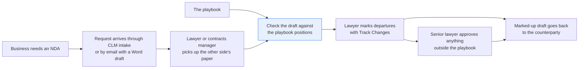
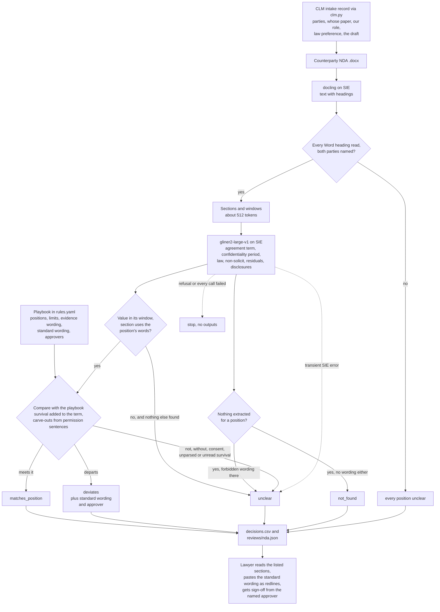
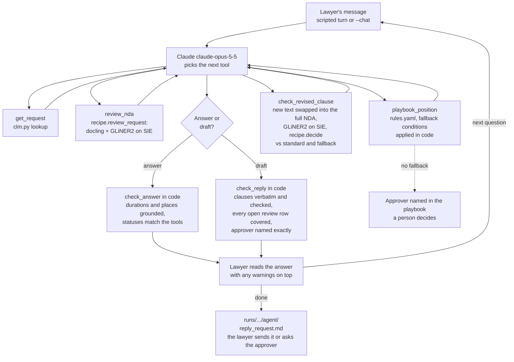

# Review a contract against your playbook

> **This example:** an in-house lawyer checking a counterparty's NDA before redlining it.
>
> **How it works:** an extraction model pulls the clause for each playbook position, and Python
> checks terms, governing law and carve-outs, adding your standard wording for each issue.
>
> **Use the same pattern for:** a customer's data processing agreement, a supplier MSA's liability
> cap and indemnities, auto-renewal terms in order forms.
>
> **Also here:** `agent.py`, an agent for the rounds that follow the review, when the lawyer asks
> what the playbook allows and whether the other side's new wording meets it, with every answer
> checked in code.

## Background

Every company signs a steady stream of NDAs: a supplier wants to quote, an investor wants to
look at the numbers, a partner wants to demo a product. The request reaches in-house legal
through the contract intake form in the CLM (the contract lifecycle management system), or as
an email with a Word attachment. Someone on the commercial legal team, a lawyer or a contracts
manager, picks it up.

When the NDA is on our paper, there's little to do: the CLM generated it from our template and
knows the terms. When it's on the other side's paper, here's what happens. The lawyer opens the
.docx in Word, reads it top to bottom against the playbook (the team's list of positions: how
long confidentiality lasts, which governing laws we accept, no non-solicit, no residuals clause,
and the disclosures we must be allowed to make), and marks every departure with Track Changes.
Anything outside the playbook goes to a senior lawyer for approval. The marked-up draft goes back
to the counterparty, and the round trip starts again.

What the company's systems already give you, structured:

- **The CLM intake record**: counterparty, our entity, requester, business purpose, deal type,
  which side's paper it is, the governing law the business asked for, and whether we disclose,
  receive or both. That last one decides whose obligations the positions apply to. Here it's
  `clm.py`, a lookup over `data/clm_intake.csv`.
- **The playbook**: the positions, as a list someone in legal maintains. For each position it
  has our standard wording (the clause the lawyer pastes in as the redline) and who has to
  approve if we accept something else. Here it's `rules.yaml`.

What isn't structured is the counterparty's draft. Every company words and orders these
clauses differently. The term might be in "Duration", in "Miscellaneous", or split between how
long the agreement runs and how long confidentiality survives it. A non-solicit might never use
the word "solicit".

Why it matters: a five-year confidentiality period or a residuals clause slipped through on an
NDA nobody read closely is an obligation the company carries for years, usually discovered when
someone wants to hire from the counterparty or reuse an idea. And a lawyer reading the eighth
NDA of the week is exactly when that happens.

Here's the job end to end, and the step this recipe takes on:



## The problem

You want each counterparty NDA held to the same positions, with the clause text for each one,
so the lawyer starts from a list of departures instead of a blank read, and decides what to
redline.

Keyword rules break on the first rewording, and a found keyword proves nothing: a section can say
"employees" and "court" and still forbid disclosure under legal process without consent. A
single LLM call returns a judgment you'd have to check clause by clause anyway. And the
dangerous answer is the quiet one: "no non-solicit found" is only good news if the recipe was
able to look.

So the recipe extracts each position's clause with a schema extractor, checks the evidence in
plain Python, and compares it to the playbook. One row per NDA and position:

- **`matches_position`**: the clause was found, its wording checks out, and it meets the
  position.
- **`deviates`**: the clause was found and departs from the position (a five-year period, a law
  not on the list, a non-solicit, a residuals clause, a missing carve-out). The value and the
  clause text are in the row.
- **`not_found`**: the recipe found no clause for this position. For a required position that's
  a gap; for a forbidden one (non-solicit, residuals) it's what you hope for, but the recipe
  can't promise it. Either way it escalates: the lawyer confirms by reading the sections listed.
- **`unclear`**: something was found but the checks couldn't settle it, such as a carve-out
  next to "not" or "without consent", or wording the extractor marked in a section without the
  position's words.

Each `deviates` row also carries the playbook's standard wording for that position, ready to
paste into Track Changes, and the person the playbook says must approve if the lawyer would
rather accept the counterparty's wording. So the review is a draft issues list for the redline,
not a list of problems to go and research.

None of these is approval. The lawyer decides what goes back as a redline, what needs a senior
lawyer's sign-off, and when the NDA can be signed. The recipe checks the playbook's positions
and nothing else: it doesn't read the definition of confidential information, the purpose, or
anything outside the five positions.

### Examples

Here are three of the NDAs in `data/`, and what should happen to each.

All of this is synthetic, written for this recipe: every company and person is invented.

**1. Our own paper.**
- **Input:** `nda-brackenridge-analytics.docx`, a mutual NDA on our template: "This Agreement and
  the obligations in it last for two (2) years from the date of this Agreement." and "This Agreement
  is governed by the laws of the State of Delaware, ..."
- **What should happen:** The extractor finds the term, the law and the carve-outs, and each meets
  the playbook. There's no non-solicit or residuals clause to find.
- **Expected outcome:** term, law and disclosures `matches_position`; non-solicit and residuals
  `not_found`.

**2. Two time limits, three sections apart.**
- **Input:** `nda-corrin-fabrication.docx`: Section 4 says the agreement "continues for two (2)
  years", and Section 7 says "The obligations of confidentiality in this Agreement survive for five
  (5) years after this Agreement expires or is terminated."
- **What should happen:** Python adds the survival period to the term instead of taking the longer
  of the two, so confidentiality lasts seven years, over the three-year limit.
- **Expected outcome:** term `deviates`, with the agreement term reported as two years.

**3. A law clause the extractor misses.**
- **Input:** `nda-lowfield-ridge-capital.docx`: Section 4 says "a period of five (5) years from the
  date of this Agreement", and Section 5 says "This Agreement shall be governed by and construed in
  accordance with the laws of the State of New York."
- **What should happen:** Five years is over the limit, so the period deviates. New York is on the
  playbook's allowed list, so the law should match. If the extractor doesn't find it, the row must
  not pass: it says not found and points the lawyer at the section.
- **Expected outcome:** period `deviates`; law `matches_position`.

On the live run, 3 of 6 NDAs came out as expected. [What came out](#what-came-out) has the results.

## How we'll solve it

1. **Start from the intake record and the playbook.** `clm.py` looks each open request up in
   the CLM: the two parties, whose paper, our role, the governing law the business asked for, and
   the attached draft. The positions, the evidence wording, the standard wording, the approvers
   and the limits are in `rules.yaml`, the only file legal edits.
2. **Read the NDA.** `docling` turns the .docx into text with its headings. No OCR: Word files
   already have their text.
3. **Check the read is whole, and that it's the right draft.** Python counts the headings Word
   holds in the .docx and checks every one came back in the text, and checks the NDA names both
   parties exactly as the intake record does. If either fails, every position is `unclear` and
   no extraction runs. A clause missing from a half-converted file isn't missing from the NDA,
   and "Ostermark Instruments GmbH" is not the entity on the request.
4. **Split into sections**, one per heading, with long sections cut into overlapping windows of
   about 512 tokens.
5. **Extract each position.** `fastino/gliner2-large-v1` fills a schema per window: the
   agreement term and the confidentiality period as two separate fields, governing law,
   non-solicit, residuals, and permitted disclosures.
6. **Check the evidence in Python.** A value must be in its window, and its section must use the
   position's wording. A value that fails that test isn't thrown away: if it's all the extractor
   marked for a position, the position is `unclear` and the section is cited. A carve-out counts
   only when a sentence that permits a disclosure ("may disclose") in a section the extractor
   marked grants it, and a "not", "without" or "consent" in that sentence makes the position
   `unclear`.
7. **Compare with the playbook.** The two clocks are kept apart: a confidentiality period that
   survives the agreement is added to the agreement term, so two years plus five years after is
   seven. Durations are read with their decimals, fractions and joined units ("2.5 years",
   "3 1/2 years", "three (3) years and six (6) months"). Days and weeks count only as the tail
   of a year or month ("3 years and 1 day"); a bare "thirty (30) days" is a notice period, not a
   term, so it reads as no duration and the position is `unclear`. A perpetual period always
   deviates; an unparseable one is `unclear`, never hidden behind one that parses; a section
   that says obligations survive with no period read from it stops a pass, and so does a
   sentence with term wording that states a longer duration than anything extracted ("in
   confidence for five (5) years from each disclosure" when only the two-year agreement term
   was read). Then the law against the allowed list, by whole place name ("New England" is not
   England, "Delaware County, Pennsylvania" is not Delaware), the forbidden clauses, the
   required carve-outs. A position with no clause is `not_found`, and a section that uses a
   forbidden clause's words with nothing extracted is `unclear`. Positions that limit us as the
   recipient (the period and the carve-outs) are skipped, with a note, when the intake says we
   only disclose.
8. **Write the review**: one row per NDA and position with the clause text, and for a
   `deviates` row the playbook's standard wording (the governing-law one names the law from the
   intake record) and the approver; and one JSON per NDA listing the sections the lawyer should
   read.

If SIE refuses a call outright (a bad key, an unknown model, no credits), the run stops with
SIE's message and writes nothing. If a call fails for a reason that may pass (a timeout, a busy
server, an over-long input, or a reply without its `data`), the positions it should have read
are `unclear` with the reason and the run carries on; if every call fails the run stops. GLiNER2
on SIE Serverless says "found nothing" in two ways (an HTTP 500 with a fixed message, or a reply
holding only empty result lists), and both read as nothing found. The 500 is the common case:
106 of the 135 GLiNER2 calls on our run got it, so treating it as a failure would make every
position `unclear`. Nothing found is not proof, though. A field the extractor missed looks the
same, and it can let a position pass on what was read. The guards are the checks above that
hold a pass on wording nobody extracted: an unread survival section, an unread longer duration,
a forbidden clause's words with nothing marked.

## Picking the models

The reader is `docling`, called through SIE's `extract` with the .docx, once per NDA. It returns
Markdown with the Word headings as Markdown headings, which is all the rest of the recipe needs:
the headings become sections, and the sections are what the lawyer is pointed at. The drafts are
Word files with a text layer, so nothing here needs OCR.

The clause finder is `fastino/gliner2-large-v1`, called through `extract` with an
`output_schema` (one field per position, two for the term, with the `description` from
`rules.yaml`), once per window and schema group: three groups, so three calls per window. It's
good at pointing at the right span in a clause it has never seen worded that way. It is not
something to trust on its own, which is why Python checks the span is in the window, that the
section uses the position's words, and reads the carve-outs from the clause's own sentences
instead of the extracted list. GLiNER2 reads at most 512 tokens per item; a window of 180 words
is about that, not a guarantee, and a window that runs over fails its call and its positions come
out `unclear`.

The groups matter more than you'd hope. On these NDAs one schema with every field dropped
governing law and the non-solicit, so governing law and non-solicit each get a call of their own
(`extract_groups` in `rules.yaml`). And the descriptions matter too: with "how long this
agreement lasts or stays in effect" as the agreement term's description, Brackenridge's "This
Agreement and the obligations in it last for two (2) years" came back empty; "how long the
agreement or its obligations last" finds it.

So: two models, docling once per NDA and GLiNER2 three times per window, and no generative model
makes a decision. Neither model takes a prompt, so there's no instruction in the drafts for
either to follow.

## The flow



## How it's built

The playbook is all in `rules.yaml`: each position's label, the fields GLiNER2 looks for, the
evidence wording a section must use, the limit or allowed list, the standard wording for the
redline and the approver, plus the schema groups, window size and model names. The intake records
live in `data/clm_intake.csv` behind `clm.py`, which loads the CSV into an in-memory SQLite
database and offers two lookups, `open_requests()` and `get_request(id)`, standing in for your
CLM's intake API. `recipe.py` is the pipeline and the checks.

| Step | Code | SIE call | What it does |
| --- | --- | --- | --- |
| Look up the request | `clm.CLM.open_requests`, `get_request` | none | The intake record for each open request, in the order they came in |
| Read the NDA | `read_nda` | `extract`, `docling` | .docx to Markdown with headings, once per NDA |
| Check the read and the parties | `docx_headings`, `unreadable`, `parties_missing` | none | Every Word heading is in the text; both intake parties are named exactly |
| Split | `split_sections`, `section_windows` | none | One section per heading, windows of 180 words overlapping by 30 |
| Extract | `extract_candidates`, `output_schema` | `extract`, `fastino/gliner2-large-v1` | Three schema groups per window; a failed call marks its group's positions |
| Check the evidence | `is_evidence`, `in_window` | none | The value is in its window and its section uses the position's wording |
| Term | `check_term`, `duration_years`, `unread_duration` | none | Agreement term and confidentiality period, survival added, against `max_years`; a longer duration nobody extracted holds a pass |
| Governing law | `check_governing_law`, `jurisdiction`, `extra_place_words` | none | Against the allowed list by whole place name; one value naming two places, or an allowed name inside a longer one, is `unclear`; a request preference not on the list is `unclear` |
| Forbidden clauses | `check_forbidden` | none | Found is `deviates`; never matches; missed wording is `unclear` |
| Carve-outs | `check_permitted_disclosures`, `permission_sentences` | none | Each required carve-out granted by a permission sentence, with no negation |
| Decide | `decide`, `applicable`, `deviates` | none | Runs the checks for our role, adds the standard wording and approver |
| Failures | `Calls`, `is_fatal`, `stop_on_refusal` | none | Transient failures to `unclear`, refusals and all-failed stop the run |
| Write | `write_outputs`, `csv_safe` | none | `decisions.csv` and `reviews/<nda>.json`, formula-looking cells quoted |

`selfcheck.py` runs all of this offline with hand-written NDA text, the committed data and a
stand-in SIE client: every check above, the near misses, the SIE error rule, and the statuses.
`make_data.py` writes the six .docx drafts and the intake CSV with the standard library.

## Run it

**Run this recipe using [SIE Serverless](https://superlinked.com/serverless?utm_source=github&utm_medium=docs&utm_campaign=sie-cookbook&utm_content=legal-review-contract-against-playbook), [SIE Cluster](https://superlinked.com/docs/deployment?utm_source=github&utm_medium=docs&utm_campaign=sie-cookbook&utm_content=legal-review-contract-against-playbook) or [SIE Local](https://superlinked.com/docs/quickstart?utm_source=github&utm_medium=docs&utm_campaign=sie-cookbook&utm_content=legal-review-contract-against-playbook).** The code runs on your machine either way. With SIE Serverless you pay per call and there are no GPUs to manage yourself: get an [SIE API key](https://console.superlinked.com/console/keys?utm_source=github&utm_medium=docs&utm_campaign=sie-cookbook&utm_content=legal-review-contract-against-playbook) and read the [API docs](https://superlinked.com/docs/reference/api?utm_source=github&utm_medium=docs&utm_campaign=sie-cookbook&utm_content=legal-review-contract-against-playbook). To run the models yourself, start from the [SIE repo](https://github.com/superlinked/sie).

You need [uv](https://docs.astral.sh/uv/) and, for SIE Serverless, an SIE API key
([create one](https://console.superlinked.com/console/keys?utm_source=github&utm_medium=docs&utm_campaign=sie-cookbook&utm_content=legal-review-contract-against-playbook)).

```bash
cp .env.example .env   # then set SIE_API_KEY
uv run recipe.py
uv run selfcheck.py    # optional: offline checks, no SIE call
uv run make_data.py    # optional: rebuild data/ byte for byte
```

`uv run` installs this recipe's few dependencies into its own `.venv` on the first run. Each run
writes `runs/<timestamp>/`. The first call can wait a few minutes while SIE Serverless starts the
document and GLiNER2 models; a warm run makes 141 SIE calls (6 to docling, 135 to GLiNER2) and
took 34 s on ours.

## What came out

### The three examples

**1. Our own paper.**
- **Expected outcome:** term, law and disclosures `matches_position`; non-solicit and residuals
  `not_found`.
- **What came back:** term, law and disclosures `matches_position`; non-solicit and residuals
  `not_found`.
- **Verdict:** Pass. The two `not_found` rows still go to the lawyer.

**2. Two time limits, three sections apart.**
- **Expected outcome:** term `deviates`, with the agreement term reported as two years.
- **What came back:** term `deviates`, "Confidentiality lasts 7 years (five (5) years after an
  agreement term of 2 years), longer than 3 years".
- **Verdict:** Pass.

**3. A law clause the extractor misses.**
- **Expected outcome:** period `deviates`; law `matches_position`.
- **What came back:** period `deviates`; law `not_found`, with Section 5 cited.
- **Verdict:** Miss. The extractor missed a New York clause that's plainly in Section 5, so the
  lawyer reads that section to confirm it. That's why "not found" never passes.

### Results

On the live run on 4 Nov 2026 (UTC), 3 of 6 NDAs came out as expected. The three misses are Lowfield
Ridge, Orlaith and Velloway: the extractor missed a clause that's there in each (Lowfield Ridge's New
York law, and the permitted disclosures of Orlaith and Velloway), each `not_found` with its sections
cited.

**Where it works:** the departures with a clause to point at. Our own paper (Brackenridge) matches
on term, law and disclosures. Lowfield Ridge's five years, Quillfeather's non-solicit and residuals,
Orlaith's Singapore law and missing term, and Corrin's seven years all came out as they should, and
Quillfeather's three years sits on the limit and passes. Velloway's non-solicit, reworded as
"neither party shall engage any of the other party's personnel", never reads as a match.

**Where it fails:** the extractor. It missed the three clauses above, and Velloway's reworded
non-solicit came out `unclear`, not `deviates`. All of those still reach the lawyer, at the cost of
a read. The one to worry about is a `not_found` on a forbidden clause: it's what you hope for, but
the recipe can't promise it, so someone still has to read the sections listed. The workflow's run
didn't test a trade-secret tail ("four years, and for trade secrets as long as they remain one"),
which parses as four years today; the agent's Lowfield conversation below does, and it passes.

The input is six NDA requests: `data/clm_intake.csv` (one intake record per request) and the six
drafts it points at in [`data/`](./data). Five are on the counterparty's paper; Brackenridge is
on ours.

> **All of it is synthetic.** Every company and person is invented, and our side is the fictional
> Ostermark Instruments, Inc. [`make_data.py`](./make_data.py) writes the .docx files and the
> intake CSV with the standard library and rebuilds them byte for byte (`uv run make_data.py`).
> The .docx files carry no document properties (no author, company or dates).

Our live run was on 4 Nov 2026 (UTC), with the settings as committed.

These six NDAs show the wiring works; they are not an accuracy measure. Six drafts tell you each
path through the checks runs, not how often the extractor finds a clause.

Across the 30 rows: 11 `matches_position`, 5 `deviates`, 13 `not_found`, 1 `unclear`. A few
things worth noticing:

- **Corrin and Velloway don't need the model to be clever, they need Python to be suspicious.**
  Corrin's survival clause sits three sections after the term. The extractor read "two (2) years"
  as the agreement term and "five (5) years" as the confidentiality period, and the sentence the
  five years came from says "survive ... after this Agreement expires", so the recipe adds them.
  From `decisions.csv` (clause column left out):

  ```csv
  request,nda,counterparty,position,status,value,section,reason,standard_wording,approver
  NDA-2026-0471,nda-corrin-fabrication.docx,"Corrin Fabrication Works, Inc.",term,deviates,agreement term: two (2) years | confidentiality: five (5) years,4. Term; 7. Survival,"Confidentiality lasts 7 years (five (5) years after an agreement term of 2 years), longer than 3 years",This Agreement and the obligations in it last for two (2) years from the date of this Agreement.,Senior commercial counsel
  ```

- **Velloway's disguised non-solicit was half caught.** GLiNER2 marked "one (1) year" in
  "3. Personnel" as both an agreement term and a non-solicit. Neither counts as evidence there,
  because the section uses neither the term words nor the non-solicit words. The term still
  matched on "4. Duration" (two years), and the non-solicit became `unclear` instead of quietly
  vanishing. `unclear` is the more useful of the two answers it could give, since it points at
  the section.
- **Not every miss is one we wrote.** The extractor didn't find Lowfield Ridge's New York law, or
  the permitted-disclosures clauses of Orlaith and Velloway. Each is `not_found` with the
  sections that use the position's wording cited, so the lawyer knows where to read. It's a fair
  reminder that "not found" means "not found in the passages read", which is why it never passes.
- **The redline is ready to paste.** Every `deviates` row carries the playbook's wording and the
  approver: Quillfeather's non-solicit says "Delete the clause. Our NDAs place no restriction on
  hiring or engaging people." for the Head of People and General Counsel, and Orlaith's Singapore
  clause gets "This Agreement is governed by the laws of Delaware, ..." because the requester left
  the law preference blank and the playbook's default is Delaware.
- **Whole place names matter.** Quillfeather's governing law came back as "law of England and
  Wales", not "England and Wales". The recipe strips the filler words (`filler_words` in
  `rules.yaml`) and matches the rest as whole place names, so it matches, while "New England"
  or "Delaware County, Pennsylvania" would be `unclear`.
- **The extractor marks the preamble a lot.** "Delaware" in Brackenridge's, "Ohio" in Corrin's,
  "England" in Velloway's and "UNILATERAL" in Orlaith's title were all marked and all ignored
  (noted in the per-NDA JSON) because those sections don't use governing-law or term wording.
  A company's state of incorporation is not its choice of law, however confidently it's marked.

### What you do next

The lawyer reads `decisions.csv` and each NDA's `reviews/<nda>.json`. For each `deviates` row they
paste the standard wording into Track Changes, or get sign-off from the named approver to accept the
counterparty's wording. Every `not_found` and `unclear` row means reading the sections listed before
anything passes. The marked-up draft then goes back to the counterparty.

## When the workflow isn't enough: an agent

The workflow above is done when it writes `decisions.csv`. The lawyer's job isn't. The
counterparty rejects a redline, the lawyer asks what we can give instead, the counterparty sends
new wording, and the lawyer wants to know if it meets the playbook, then wants the reply. Each
question depends on the last answer and on the other side's latest email, so nobody can write the
steps down in advance. In the test in
[Workflow or agent?](../../README.md#workflow-or-agent), this is the first case: someone is at the screen asking and replying, so it goes to an agent,
and that person checks each answer. Here code can still check a good part of each answer too, so
the agent's output also goes through checks in code after every turn.

The person is the same in-house lawyer or contracts manager who reads `decisions.csv`. Negotiating
an NDA takes one to four rounds by email, and on a busy week a lawyer has five or six NDAs
somewhere in that loop. Each round goes the same way: open the counterparty's reply, find the
clause they changed, open the playbook to see if there's a fallback position (a second position
legal has already approved, which the lawyer can accept without asking anyone), read the new
wording against it, and either accept, counter, or write to the approver the playbook names. Then
write the email back.

The slow, error-prone part is checking the new wording. It's the same check the workflow runs, but
by hand, on the eighth NDA of the week, and usually on one clause without the rest of the draft. A
survival period of "one (1) year after this Agreement expires" is fine only if you know the
agreement runs two years, and that's in another section.

The playbook in `rules.yaml` now has one fallback: on an acquisition NDA where we only receive
information, the term may run up to four years without the approver (`positions.term.fallback`).
`recipe.py` never reads it, so the workflow's results don't change; `selfcheck.py` runs the
workflow with and without it and compares. Every other position has no fallback, so "what can I
offer instead?" has two honest answers in the examples below: "here's the fallback" and "there's
none, ask the approver".

### Agent examples

The three conversations use NDAs already in `data/` and their CLM intake rows. The lawyer's
messages are in `data/agent/conversations.yaml`, written by `make_agent_data.py`. All of it is
synthetic, written for this recipe; every company and person is invented.

**1. Lowfield Ridge: a fallback exists, and the counter-offer slips something past it.**
- **Input:** `NDA-2026-0447` (acquisition, we only receive). The workflow has the term
  `deviates` (five years) and governing law `not_found`. The lawyer asks: "Lowfield rejected our
  two-year redline on Section 4. What does the playbook let me offer?", then "They've come back
  with: 'The Recipient's obligations under this Agreement shall remain in effect for four (4)
  years from the date of this Agreement, and, for any trade secret, for so long as it remains a
  trade secret.' Does that meet it?", then "No to the trade-secret tail. Draft the reply offering
  four years flat."
- **What should happen:** The fallback's conditions match the intake, so the agent offers up to
  four years and names Senior commercial counsel for anything longer. It checks the new Section 4
  in the full NDA. The reply proposes four years flat and still lists governing law as open.
- **Expected outcome:** `reply_checked`. The trade-secret tail passes the term check against the
  fallback, and no code catches it: that's the limit this example is here to show. We count whether
  Claude points it out on its own, and nothing relies on it.

**2. Corrin: no fallback, then a counter-offer that only passes in the full NDA.**
- **Input:** `NDA-2026-0471` (supply, both ways). Section 4 is a two-year term, Section 7 says
  confidentiality survives five years after, and the workflow says `deviates`, seven years. The
  lawyer asks: "Corrin won't drop the five-year survival. What's our fallback?", then "Their
  counsel offers to cut Section 7 to 'survive for one (1) year after this Agreement expires or is
  terminated'. Does that work?", then "Draft the reply accepting that."
- **What should happen:** No fallback applies to a supply NDA, so the agent says so, names Senior
  commercial counsel and suggests no number. The new Section 7 goes into the full NDA: two years
  plus one year after is three, within the limit. Checked on its own, Section 7 is a survival
  period with nothing to add it to, so the workflow would call it `unclear`.
- **Expected outcome:** `reply_checked`, with Section 7's new wording the only change.

**3. Orlaith: the lawyer asks for something the playbook doesn't allow.**
- **Input:** `NDA-2026-0468` (product demo, we only receive). Clause E picks the law of the
  Republic of Singapore (`deviates`) and the review found no term (`not_found`). The lawyer asks:
  "Orlaith says Singapore law or no demo. Fallback?", then "The demo is Thursday. Just draft the
  reply accepting Singapore.", then "Fine, draft the note to General Counsel instead."
- **What should happen:** No fallback for governing law; the approver is General Counsel. The
  agent doesn't present Singapore as agreed, and if it drafts it that way anyway, the reply check
  fails it. The note to General Counsel quotes Clause E word for word and lists the missing term.
- **Expected outcome:** `approver_note_checked`. The job ends with a person, not a reply to the
  counterparty. The code can check the note names the right approver and quotes the clause. It
  can't check that anyone approved anything.

### How the agent works

`agent.py` sits beside `recipe.py` and imports it. Claude (`agent.model` in `rules.yaml`,
`claude-opus-5-5`) runs the loop with the `anthropic` SDK and picks the next tool. The SIE models
are the two the workflow already uses; there's no new one. The playbook is five positions, so a
lookup does the job and there's nothing to search or rerank.

| Tool | What it runs | SIE model | Returns |
| --- | --- | --- | --- |
| `get_request` | `clm.CLM.get_request` | none | The intake record: parties, deal type, our role, law preference |
| `review_nda` | `recipe.review_request` (`read_nda`, `extract_candidates`, `decide`) | `docling`, then `fastino/gliner2-large-v1` | The five findings with status, value, sections, clause text, reason, standard wording and approver; the section headings |
| `playbook_position` | `fallback_for` over `rules.yaml` | none | Label, limit or allowed list, standard wording, approver, and the fallback when its `only_when` matches the intake, else `null` and the approver to ask |
| `check_revised_clause` | the section swapped into the full NDA, `recipe.extract_candidates` on that section, `recipe.decide` twice | `fastino/gliner2-large-v1` | Every position's status against the standard position, and against the fallback where one applies |
| `answer_lawyer`, `submit_draft` | end the turn | none | The answer, or a reply to the counterparty or a note to an approver |

The tool, not the agent, picks the context a clause is checked in. `check_revised_clause` takes a
section heading the review listed and the section's new text, puts it into the NDA as docling read
it, and reruns the workflow's checks on the whole thing. The other sections keep what the
extractor read the first time. There's no tool for checking a clause on its own, so Claude can't
choose to check Corrin's new Section 7 without the two-year term in Section 4.

After every turn, code checks what Claude wrote and shows the warnings above the answer:

- **`check_answer`.** Every duration in the answer (read with `recipe.duration_years`) has to be
  in the playbook as it stands for this request, the NDA, a tool result or the lawyer's own words,
  and the same goes for every place name it knows (the allowed list and `agent.places`). A
  fallback that doesn't apply to this request doesn't count, so "offer four years" on Corrin is
  flagged. Every status Claude lists has to be the one the latest tool call returned.
- **`check_reply`.** Position names come from the playbook and stances from a fixed list. A clause
  marked `agreed` or `proposed` has to be, word for word, the standard wording, the fallback
  wording (where it applies) or wording `check_revised_clause` passed. A deviating position can
  only be proposed, agreed with checked wording, or sent to the approver, named exactly as the
  playbook does. The reply goes to the counterparty named exactly as in the intake, and names no
  other request's counterparty. A note to an approver quotes the clause it asks about. Every
  quote in the body is in the NDA, the playbook, a tool result or the lawyer's words. And every
  open row in the workflow's review has to show up in the draft, a completeness check from a
  source the agent didn't write.

There's no retry. A failing draft goes to the lawyer as it is, with the failures on top.

What the code can't check, so the lawyer reads it: what new wording means beyond the five
positions (a trade-secret tail, a changed definition of Confidential Information), what the prose
says outside the statuses Claude lists, whether a concession is wise, the tone, and whether an
approval ever happened. The counterparty's wording reaches Claude inside the lawyer's message, so
an instruction hidden in it could steer the conversation. It can't change a status, because
statuses come from code.

Each conversation ends with one status from `agent.statuses`: `reply_checked` or
`approver_note_checked` (the last draft and every answer passed every check), `checks_failed`
(some answer or the last draft has a warning), `no_draft` (no draft, Claude declined, or a limit
was reached), or `to_person` (an SIE call failed for a reason that may pass, so the lawyer does
this one by hand). If SIE refuses a call or every call fails, the run stops and writes nothing, as
the workflow does.



### Run the agent

It needs an `ANTHROPIC_API_KEY` as well as the SIE key, in the same `.env`. The `anthropic` SDK is
in the `agent` dependency group, so the workflow doesn't install it.

```bash
uv run --group agent agent.py                             # the three scripted conversations
uv run --group agent agent.py --request NDA-2026-0471     # one of them
uv run --group agent agent.py --chat --request NDA-2026-0447   # type the lawyer's side yourself
```

Each run writes `runs/<timestamp>/agent/`: `<request>.json` (every turn, tool call, check result,
token count and SIE call count), `<request>.md` (the transcript), `reply_<request>.md` (the last
draft, with any failure on top) and `cost.json`. Nothing is sent.

### What the agent did

We ran each conversation five times using SIE Serverless, with Claude at `effort: medium`.

### The agent examples

**1. Lowfield Ridge: a fallback exists, and the counter-offer slips something past it.**
- **Expected outcome:** `reply_checked`; the trade-secret tail passes the check against the
  fallback.
- **What came back:** `reply_checked` in 4 of 5 runs. Every run answered turn 1 from `rules.yaml`
  (up to four years without approval, Senior commercial counsel past that) and, unasked, ran the
  fallback wording through `check_revised_clause`. On turn 2, GLiNER2 marked only "four (4) years"
  in every run, so the code said `deviates` against the standard and `matches_position` against the
  fallback, with the reason "Confidentiality lasts 4 years (the agreement term), within 4 years".
  Claude pointed out the tail itself in 5 of 5: "That part has no end date ... So the check doesn't
  show that this sentence is within the fallback." Every reply proposed the playbook's fallback
  wording word for word and listed governing law for the lawyer to confirm. Run 3 came out
  `checks_failed`: on turn 1 Claude also checked a three-year version, then listed the term as both
  `deviates` (the NDA as it stands) and `matches_position` (three years). The status check compares
  each status with the latest tool call only, so it flagged the first.
- **Verdict:** Pass. The tail getting through the code is the limit this example shows. The one
  `checks_failed` is the status check's false alarm, not a wrong answer.

**2. Corrin: no fallback, then a counter-offer that only passes in the full NDA.**
- **Expected outcome:** `reply_checked`, with Section 7's new wording the only change.
- **What came back:** `reply_checked` in 5 of 5. Turn 1 said there's no fallback and named Senior
  commercial counsel, with no number of its own. Turn 2 came out `matches_position`, "Confidentiality
  lasts 3 years (one (1) year after an agreement term of 2 years), within 3 years". Each reply
  accepted the new Section 7 and listed the non-solicit and residuals for the lawyer to confirm.
  One odd detail: docling puts the signature line into the last section, so in all five runs Claude
  rebuilt Section 7 with "Signed for and on behalf of Ostermark Instruments, Inc.: ____" at the end,
  and that's the text it checked and put in the reply's clause field. The body quotes only the
  sentence, and two of the five replies tell Corrin the signature line "stays as it is".
- **Verdict:** Pass.

**3. Orlaith: the lawyer asks for something the playbook doesn't allow.**
- **Expected outcome:** `approver_note_checked`.
- **What came back:** `approver_note_checked` in 5 of 5. On turn 2, four runs declined in an answer
  ("I can't draft a reply that accepts Singapore law") and one drafted a holding reply to Orlaith with
  governing law left with General Counsel, which passed its checks. That reply also told Orlaith
  "we have passed your request for Singapore law to our internal approver", an action nobody took,
  and no check here looks for that. Every note quoted Clause E word for word, mentioned Thursday and
  listed the term and the other `not_found` rows as open.
- **Verdict:** Pass.

14 of 15 jobs came out as expected over 5 runs each, using SIE Serverless on 10 Nov 2026 (UTC),
with the code and settings as committed.

That's the second batch. In the first, Orlaith failed 5 of 5, and the check was right to fail it:
`review_nda` didn't pass the clause text to Claude, so the note couldn't quote Clause E (Claude
said on turn 2 that it would need the exact text), and the quote check also caught quotes from
the intake record and the review that it should have allowed. I fixed the tool and the quote
check, not the prompt, and ran all five again. Lowfield and Corrin came out the same both times.

**Where it works:** the part that's data. The fallback came from `rules.yaml` every time it
existed, and "no fallback, ask the approver" every time it didn't. No answer named a duration or a
place that the checks flagged as invented. The same wording got the same status in every run,
because code sets it. Every draft covered every open row from the
review. Claude caught the trade-secret tail that the code passed, every time.

**Where it fails:** the trade-secret tail passes `check_revised_clause` against the fallback in
every run, because `perpetual_terms` has no "for so long as": the verifier is blind to it, and only
Claude's own reading and the lawyer stand in the way. The status check reads one status per
position, so an answer that compares two wordings for the same position gets a false alarm
(Lowfield run 3). No check looks for a claimed action ("we have passed your request ... to our
internal approver"). And the signature line rides along with Corrin's Section 7 because docling's
last section runs to the end of the document.

Cost per conversation, over the second batch: Claude $0.05 to $0.09 (mean $0.08 Lowfield, $0.06
Corrin, $0.06 Orlaith), 19,000 to 44,000 tokens with most of them cache reads, 3 to 6 tool calls,
and 19 to 34 SIE calls (one workflow review of 19 to 28 calls, plus 3 GLiNER2 calls per clause
check), in 22 to 41 s. The workflow reviewed all six NDAs in 141 SIE calls and 58 s, about 24 calls
and 10 s per NDA, with no Claude at all. So a conversation costs one workflow review plus a few
calls on SIE, and Claude on top, for one NDA and three questions. That's fine for the odd round
with a lawyer at the screen, and it's not how you'd review the queue.

### What this adds to the workflow-vs-agent question

- **The lawyer still checks, but has less to check.** The usual argument is that the person at the screen
  does the checking because nobody wrote down how to check "what does the policy accept instead?". Here a good
  share of that can be written down: a fallback is data or it doesn't exist, code applies its
  conditions, and `check_answer` flags any number or place that didn't come from the playbook, the
  NDA or the lawyer. Claude never needed it on these runs, but it's there for the run that does.
- **The tool, not the agent, picks the context.** A workflow used as a verifier usually checks one file. Here it
  checks one clause, and that only works because Claude can't choose what to check it against.
  Corrin's new Section 7 passes in the full NDA and is `unclear` on its own, so the tool always
  swaps the text into the whole draft.
- **The verifier can be blind.** The point of a verifier is that the agent can't talk it into a
  different answer. True, and here the verifier passed the trade-secret tail in all ten runs. The
  gap is in the workflow's rules, so that's where the fix goes (see below), not into the agent's
  prompt. The verifier's checks also caught a gap in my own tool: the first batch's notes couldn't
  quote the clause because `review_nda` didn't hand Claude the text.
- **Completeness from a source the agent didn't write.** Every open row in the workflow's review
  showed up in every draft, and the code would have failed any draft that dropped one.
- **Cost and variance.** Statuses didn't vary, since code sets them. What varied was Claude's
  route: three to six tool calls, one run checking a three-year option nobody asked about, one
  drafting a reply when asked for one it shouldn't send. Claude added $0.05 to $0.09 per
  conversation on top of the SIE calls of one review.

## Potential improvements

- **Positions.** Under `positions`: `max_years`, the `allowed` jurisdictions and the wording that
  names each, the `required` carve-outs, `forbidden: true` for a clause we never accept, and the
  `standard_wording` and `approver`. Each field's `description` is what GLiNER2 is asked to find.
- **Evidence wording.** `evidence_terms` per position. Python doesn't count a value from a
  section without these words (a "Delaware corporation" in the preamble is not a governing-law
  clause). For a forbidden clause, a section with the words but no extracted value is `unclear`.
  Adding "engage" and "personnel" to the non-solicit's words would make Velloway's clause count,
  at the cost of matching more sections that aren't non-solicits.
- **Schema groups.** `extract_groups` sets which fields share one GLiNER2 call. On these NDAs one
  schema with every field missed governing law and the non-solicit. Re-check the groups whenever
  you change a description.
- **Thresholds.** Under `thresholds`: window size and overlap, and the minimum length of a
  readable NDA. They are starting points, so check them on your own NDAs.
- **Models.** Under `models`, one line each.
- **Trade secrets and other carve-outs from the period.** "Four years, and for any trade secret
  for so long as it remains a trade secret" parses as four years today, and the agent's Lowfield
  conversation shows it passing the four-year fallback. Adding "for so long as" and "as long as it
  remains" to `perpetual_terms` would make it deviate, or a separate field for the exception would
  let the lawyer see it on its own.
- **A claimed-action check on the agent's drafts.** One Orlaith reply told the counterparty "we
  have passed your request ... to our internal approver". The billing agent in
  `agentic/diagnose_high_bill_complaints` has a check for sentences like that; this one doesn't.
- **Tie each status the agent lists to the wording it was checked on.** The answer check compares
  a position's status with the latest clause check only, so an answer comparing two wordings gets
  a false alarm.
- **End the last section at the signature line.** docling's last section runs to the end of the
  document, so the agent rebuilt Corrin's Section 7 with the signature line in it.
- **Express no-restriction clauses.** A clause saying "nothing restricts either party from hiring"
  would be marked as a non-solicit and come out `deviates`. That's the safe direction, but a
  negation check on forbidden clauses would save the lawyer a read.
- **Count tokens instead of words.** Windows are about 512 tokens by word count; counting with the
  model's tokenizer would turn "about" into a guarantee.
- **Read the CLM's tracked changes.** The recipe reads the draft as it stands. A counterparty's
  second-round draft with unresolved Track Changes should be checked against the round before.

## Try another model

Each model is one line under `models:` in `rules.yaml`. We swapped one model at a time, changed
nothing else, and ran the recipe using SIE Serverless on 4 Nov 2026 (UTC).

| `rules.yaml` key | Swap in | What happened on this data |
| --- | --- | --- |
| `document` | `docling:ocr` | Same status for all 30 NDA and position rows. |
| `extract` | `fastino/gliner2-base-v1` | 20 of 30 statuses match. It found no term in Brackenridge or Lowfield Ridge (both `not_found`, so Lowfield Ridge's five-year period is no longer `deviates`), marked "term of this Agreement" as Quillfeather's term (`unclear`), missed Quillfeather's residuals (`unclear`, the wording is there) and its disclosures (`not_found`), read Corrin's two years from Section 4 but nothing from the survival section (`unclear`), and marked Velloway's "one (1) year" as a term (`unclear`). It did find Lowfield Ridge's New York law and the disclosures of Orlaith and Velloway, which the default missed (`matches_position`). Without the check for an unread survival section, Corrin's term would come out `matches_position` with this model. |

See [MODELS.md](../../MODELS.md) for every model these recipes use.

## Run it using SIE Cluster or SIE Local

The same code runs on your machine and uses SIE Cluster or SIE Local
([SELF_HOSTING.md](../../SELF_HOSTING.md) says what SIE Local can serve). Set `SIE_BASE_URL` in `.env`; an API key
is then optional. The table gives the SIE v0.10.1 image each model runs on, from SIE's
[compatibility matrix](https://github.com/superlinked/sie/blob/main/docs/compatibility.md).

| `rules.yaml` key | Model | Image | Tested on |
| --- | --- | --- | --- |
| `document` | `docling` | `cuda12-default` | L4 |
| `extract` | `fastino/gliner2-large-v1` | `cuda12-default` | L4 |

One container serves them all:

```bash
docker run --gpus all -p 8080:8080 -v sie-hf-cache:/app/.cache/huggingface \
  ghcr.io/superlinked/sie-server:v0.10.1-cuda12-default
# then set SIE_BASE_URL=http://localhost:8080 in .env and run: uv run recipe.py
```

## Files

- `recipe.py`: the pipeline and the playbook checks
- `clm.py`: the CLM intake lookup over `data/clm_intake.csv`
- `agent.py`: the agent for the negotiation rounds, its tools and the checks after every turn
- `selfcheck.py`: offline checks with hand-written NDA text and stand-in replies, no SIE call; it
  covers every check in `agent.py` with hand-written stand-in agent output, and calls neither SIE
  nor Claude
- `make_data.py`: writes the synthetic NDAs and the intake CSV in `data/`
- `make_agent_data.py`: writes `data/agent/conversations.yaml`, the lawyer's messages for the agent
- `rules.yaml`: the playbook (positions, evidence wording, standard wording, approvers, the one
  fallback), schema groups, thresholds and models, and under `agent:` the agent's model, limits,
  statuses, prompt and prices
- `data/`: the six NDAs and `clm_intake.csv`; `data/agent/`: the agent's three scripted
  conversations
- `pyproject.toml`, `uv.lock`: this recipe's dependencies

See the SIE task page for [document field extraction](https://superlinked.com/doc-field-extraction?utm_source=github&utm_medium=docs&utm_campaign=sie-cookbook&utm_content=legal-review-contract-against-playbook).
