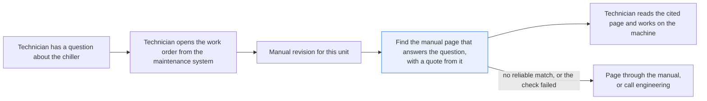
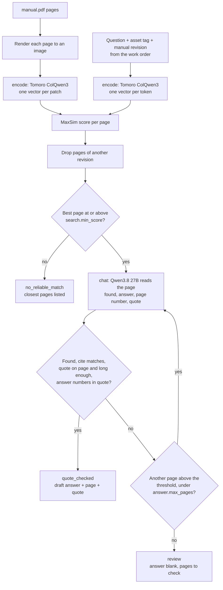

# Answer maintenance questions from the equipment manual, with the page

> **This example:** a technician at a stopped line asking about a coolant system's manual.
>
> **How it works:** a model that searches page images finds the right pages of this unit's manual
> revision, diagrams included, and a vision-language model answers from the page with a quote.
> Python checks the cited page, that the quote is printed on it and that the answer's numbers and
> tags are in the quote, or the answer isn't shown.
>
> **Use the same pattern for:** finding a torque spec in a scanned service manual, the right
> lockout steps for a machine, a spare part number from an exploded diagram.

## Background

A process chiller keeps the coolant for a line of machines at a set temperature, and when it
stops, the line usually stops with it. The people who keep it running are maintenance
technicians and controls engineers. A typical call goes like this: a line operator sees a fault
code on the chiller's display (say E07) and reports it. The technician opens the work order on a
tablet or a maintenance workstation. The work order comes from the plant's maintenance system (a
CMMS, e.g. IBM Maximo), and that system already knows a lot about the machine: its asset tag, the
make and model, where it sits, its work history, the preventive maintenance jobs and their
intervals, the parts list, and a link to the manual revision that goes with this unit.

What the maintenance system doesn't know is what's inside the manual. Which valve drains the
reservoir? Which two terminals take the remote start switch? What torque do the strainer cover
bolts get? Those answers live in the manufacturer's PDF (or the paper binder next to the machine),
and often only in a drawing: a valve tag on the piping diagram, a terminal number on the wiring
diagram. So the technician opens the PDF, pages through it to the right drawing, matches its
labels to the machine in front of them, and calls engineering or the one colleague who knows when
the drawing doesn't match.

Some questions have an easier answer already. The display may explain E07 on its own, the
refrigerant charge is often on the nameplate, and the condenser cleaning interval is probably a
scheduled job in the maintenance system. The drawings are where a search tool earns its keep.

Getting it wrong costs real money and sometimes more: opening the wrong valve dumps hot coolant on
the floor, a wrong terminal means a second visit with a meter, and a torque value from the wrong
manual revision leaves a leaking cover or a stripped bolt. The site in this recipe runs two
CR-220 chillers on different manual revisions, and the strainer cover torque changed between
them. The maintenance system says which revision each unit uses, so the search doesn't have to
guess.

Here's the job end to end, and the step this recipe takes on:



## The problem

Your technician asks which valve drains the coolant, and the answer is the V3 tag on the piping
diagram. Text search can help when the PDF has a text layer, but a scanned manual has none, and
even an exported PDF often keeps diagram labels as loose words with no link to the pipe or
terminal they label. Paging through by hand works; it's just slow, and it happens on the shop
floor with the line down.

Asking an LLM over the whole manual has the opposite problem. It answers every question
fluently, including the ones the manual doesn't answer, and you can't tell which is which. What
the technician needs is the page, a quote from it, and an honest "I didn't find it" when that's
the truth.

So for each question the recipe returns one of three statuses, plus the top pages with their
scores so a person can check the runners-up:

- **`quote_checked`**: a draft answer, the page it came from (printed page number and manual
  revision) and a quote that Python confirmed is printed on that page. The quote check means "the
  quote is in the manual", not "the answer is right". The technician reads the cited page before
  acting on it.
- **`review`**: a page was read but the reply didn't hold up (the model said the page doesn't
  answer, cited another page, quoted words that aren't on the page, or put a number or a tag in its
  answer that isn't in its quote), or an SIE call failed. The answer text is left blank, because an
  answer whose check failed shouldn't be read as an answer. The reason names the pages to check.
- **`no_reliable_match`**: no page of this unit's manual revision scored high enough, so no model
  read a page and nothing was generated. That's "no reliable match in the pages read; check the
  manual", not "the manual doesn't cover this": a low score is a hint, not proof.

The recipe never decides what to do with the machine. The technician does, from the cited page.

### Examples

Here are three of the questions in `data/questions.jsonl`, and what should happen to each.

All of this is synthetic, written for this recipe: the manual, the chiller and every value in it are
invented, so it isn't service advice.

**1. An answer that's only on a drawing.** Q2, unit CH-03, revision C.
- **Input:** "Which valve do I open to drain the coolant reservoir?"
- **What should happen:** a search over the manual's pages finds the piping diagram, a model reads
  it and names the valve tag, and Python confirms the quote is printed on that page.
- **Expected outcome:** `quote_checked`, page 4, valve V3.

**2. A question the manual doesn't answer.** Q8, unit CH-03, revision C.
- **Input:** "What torque should the pump impeller nut be tightened to?"
- **What should happen:** no revision C page should score high enough, so no page is read and
  nothing is generated.
- **Expected outcome:** `no_reliable_match`.

**3. The same question, two manual revisions.** Q6, unit CH-03, revision C.
- **Input:** "What torque do the strainer cover bolts need?"
- **What should happen:** the revision B strainer page gives another torque. This unit runs on
  revision C, so that page has to be dropped before we pick which pages to read, and only the
  revision C page gets read.
- **Expected outcome:** `quote_checked`, page 8 revision C, 20 N m.

On the live run, 10 of 10 questions came out as expected. [What came out](#what-came-out) has
the results.

## How we'll solve it

1. **Index the manual as page images.** Every page of the PDF is rendered to an image and
   encoded with a multivector model that gives each patch of the page its own vector. A small
   label inside a diagram gets vectors of its own, so it can match a question without an OCR step.
   The page vectors change only when the manual does, so you'd normally do this once.
2. **Take the unit's revision from the work order.** Each question arrives with the asset tag and
   the manual revision the maintenance system links to that unit. The recipe doesn't try to work
   out the revision from the question; the maintenance system already knows it.
3. **Rank the pages.** The question is encoded the same way (one vector per token) and every
   page gets a MaxSim score (each question vector's best match on the page, averaged). Pages from
   another manual revision are dropped **before** the shortlist is cut, so a superseded page can't
   push the right one out. If no page of the right revision reaches the threshold, the question
   ends as `no_reliable_match` and no answer is generated.
4. **Read the best page.** A vision LLM gets the page image and the question, and answers in JSON:
   whether this page answers it, a short answer, the page number printed in the footer, and the
   exact words it used. The prompt tells it that text printed on the page is something to read,
   never an instruction. If the page doesn't answer (a contents page often outranks the page it
   points to), the next page above the threshold gets read, up to two pages.
5. **Check the reply in Python.** The cited page number must be the page shown, and the quote must
   be printed on that page and long enough to mean something (a bare "V3" or "8" would match almost
   anywhere). A quote split over lines can't stitch a short bit (a tag, a terminal number, a value)
   onto text from elsewhere on the page: a short piece has to sit right next to the piece beside
   it. Every number (including one glued to its unit, like "25Nm", or with a minus sign) and every
   tag or part number (V1, TB1, R-513A) in the answer must also appear in the quote, so a true
   quote can't carry a different value or a different valve in the answer. A number written with a
   unit ("75 N m") must be in the quote with that same unit, so a quote that has 75 only as "O-ring
   75 x 3 mm" can't back a 75 N m torque; a tag the question itself names (e.g. CR-220) is allowed.
   Before that check, a page footer the model copied onto the very end of its answer ("Page 8 of
   8") is cut off; nothing else in the answer is touched. Anything that fails goes to `review` with
   its answer text blanked.

The order matters for cost as much as for honesty: the expensive model only reads a page that the
cheap ranking says is worth reading, and only pages from the right revision.

## Picking the models

Two models, both on SIE Serverless. The embedder is called once per page (9 pages) and once per
question; the answer model is called once per page it reads, at most twice per question.

The page search uses `TomoroAI/tomoro-colqwen3-embed-4b`, a visual document retrieval model. It
returns one 320-dim vector per patch of a page image and one per question
token, and you score a page with MaxSim. That's why a tag printed in a corner of a drawing can win
a page its rank: it has its own vectors. We run its `:compact` profile (the same weights, capped at
768 patch vectors per page) because the default profile wasn't billed on SIE Serverless when this
recipe was built (see What came out). It's a retriever and nothing more: it says which pages look
related, never whether a page answers the question.

The reader is `Qwen/Qwen3.8-27B-FP8`, a vision LLM that reads the page image at 150 dpi and fills
a JSON schema (`found`, `answer`, `page_number`, `quote`). Reading labels off a drawing and saying
which one answers the question is the part that needs a model. Checking its page number and quote
doesn't, so plain Python does that. A smaller reader, `Qwen/Qwen3.5-4B`, gave the same statuses
and cited pages on an earlier version of this recipe (see Try another model).

## The flow



An SIE call that fails for a reason that may pass (a timeout, a 5xx, a rate limit, a reply
missing its expected key) sends the affected questions to `review` with a short reason and the
run continues. A page that failed to encode wasn't searched, so no question can end as
`no_reliable_match` in that run; those go to `review` too. A refusal (a bad key, an unknown model,
no credits) stops the run with SIE's full message and writes no outputs, and so does a run where
every call failed.

## How it's built

`rules.yaml` holds everything you'd tune: the two model names, the render resolutions, the search
threshold (`search.min_score`, 0.50), how many pages the LLM may read (`answer.max_pages`, 2), the
quote rules (`answer.min_quote_chars`, 12; `answer.max_gap_chars`, 5; `answer.values_in_quote` and
the `answer.units` list; and the `answer.trailing_footer` pattern) and the three status names.
`recipe.py` is the pipeline.

| Step | Code | SIE call | What it does |
| --- | --- | --- | --- |
| Load | `load_manual`, `load_questions` | | Pages with their printed number, revision and text; questions with asset and revision |
| Encode pages | `encode_pages`, `_encode_one` | `encode`, multivector, once per page | Renders each page at 72 dpi; a failed page is recorded as not searched |
| Encode question | `encode_question` | `encode`, multivector, `is_query=True` | One vector per question token |
| Rank | `rank_pages`, `shortlist` | | `sie_sdk.scoring.maxsim` averaged per query vector; drops other revisions, then keeps pages at or above `min_score`, up to `max_pages` |
| Answer | `ask_page`, `parse_reply` | `chat_completions` with the page image and a JSON schema | Reads one page at 150 dpi |
| Check | `decide`, `strip_footer`, `quote_found`, `missing_values` (`measures_missing`, `numbers_missing`, `tags_missing`) | | Cuts a trailing page footer off the answer, checks the cite, the quote (short pieces next to their neighbours), and the numbers with their units, plain numbers and tags; sets the status and blanks the answer when a check fails |
| Per question | `answer_question` | | Ties the above together and writes the reason |
| SIE failures | `guarded`, `CallLog`, `is_fatal`, `stop_message` | | Transient failure: review; refusal or every call failed: stop, no outputs |
| Write | `write_outputs`, `render_markdown`, `csv_safe` | | `answers.json`, `answers.csv` (formula-safe cells; page and revision blank on rows with no answer, kept in the JSON) and `answers.md` |

`selfcheck.py` runs offline: hand-written stand-in replies and vectors, the committed `data/`, no
SIE call. It covers the quote length, how close short quote pieces must sit, the number, unit and
tag checks (with a reviewer's wrong-terminal, wrong-torque, wrong-valve and stitched 75 N m
answers, all built on the committed manual), the trailing footer cut, the blanked answer, the
printed-page cite, the revision filter, the status names, the "no reliable match" wording, the SIE
error rule (transient, refusal, every call failed, a reply missing its key) and formula-safe CSV
cells. `make_data.py` draws the manual.

## Run it

**Try this recipe on [SIE Serverless](https://superlinked.com/serverless?utm_source=github&utm_medium=docs&utm_campaign=sie-cookbook&utm_content=manufacturing-answer-from-equipment-manual).** You pay per call and there are no GPUs to manage yourself. [Create an API key](https://console.superlinked.com/console/api-keys?utm_source=github&utm_medium=docs&utm_campaign=sie-cookbook&utm_content=manufacturing-answer-from-equipment-manual) to start, or host SIE yourself from the [SIE repo](https://github.com/superlinked/sie).

You need [uv](https://docs.astral.sh/uv/) and an SIE API key
([create one](https://console.superlinked.com/console/api-keys?utm_source=github&utm_medium=docs&utm_campaign=sie-cookbook&utm_content=manufacturing-answer-from-equipment-manual)).

```bash
cp .env.example .env   # then set SIE_API_KEY
uv run recipe.py
uv run selfcheck.py    # optional: offline checks, no SIE call
```

`uv run` installs this recipe's few dependencies into its own `.venv` on the first run. Each run
writes `runs/<timestamp>/`. The first calls can wait a few minutes while SIE Serverless starts the
embedding and answer models.

## What came out

**Input.** In [`data/`](./data):

- `manual.pdf`: the site's document set for the CR-220 process chiller, as page images with no
  text layer: the 8 pages of the operator and service manual, revision C, then page 8 of
  revision B (the strainer page), kept for the older unit. Printed pages 3, 4, 5 and 8 are
  diagrams with callouts and labels.
- `manual.json`: for each PDF page, its printed page number, its revision and the text printed on
  it (headings, sentences, table cells and every diagram label), which is what the manual was
  drawn from. The recipe uses it to check the LLM's cites and quotes. A technician wouldn't have
  this next to a scan; see Potential improvements.
- `questions.jsonl`: 10 questions from operators, technicians and engineers, each with the asset
  tag and manual revision a work order would carry. Unit CH-03 runs on revision C; unit CH-01 on
  revision B.

> **All of it is synthetic.** `make_data.py` draws the manual. Brindlemoor Thermal Systems, the
> CR-220, the asset tags and every value and procedure in it are invented, so this is not a real
> manual and not service advice. Rebuild it with `uv run make_data.py` (byte for byte). The PDF's
> only metadata is its file name as the title and a fixed date (29 Oct 2026); no author or
> software tags.

### The three examples

From the live run on 2026-11-03 14:31 UTC (`runs/20261103T143143Z`):

**1. An answer that's only on a drawing.** Q2, unit CH-03, revision C.
- **Expected outcome:** `quote_checked`, page 4, valve V3.
- **What came back:** `quote_checked`, page 4: "Open valve V3 to drain the coolant reservoir."
- **Verdict:** Pass. The contents page scored a hair higher and was read first; the model reading
  it said it doesn't answer, so the recipe read the piping diagram next.

**2. A question the manual doesn't answer.** Q8, unit CH-03, revision C.
- **Expected outcome:** `no_reliable_match`.
- **What came back:** `no_reliable_match`. The best revision C page scored 0.496, under the 0.50
  threshold.
- **Verdict:** Pass. It was close, though, and a low score is a hint, not proof. The recipe isn't
  saying the manual doesn't cover this, and the technician still pages through the manual or calls
  engineering.

**3. The same question, two manual revisions.** Q6, unit CH-03, revision C.
- **Expected outcome:** `quote_checked`, page 8 revision C, 20 N m.
- **What came back:** `quote_checked`, page 8 revision C, 20 N m.
- **Verdict:** Pass. The revision B strainer page scored 0.664 and was never read.

### Results

On the live run on 3 Nov 2026, 10 of 10 questions came out as expected.

**Where it works:** It found answers in tables: the E07 fault code (Q1), the refrigerant charge (Q4)
and the condenser cleaning interval, a schedule row (Q5). It found answers that are only on a
drawing: the drain valve (Q2), the remote start terminals (Q3) and the amber lamp (Q7). It read only
the right revision's page for the strainer torque on both units (Q6, Q10). And it came back with no
answer for the pump impeller nut torque, where no page scored high enough (Q8), and for the pump
seal kit part number, where the two pages it read didn't answer (Q9).

**Where it fails:** This run didn't test the hard cases: it's one synthetic manual, with no degraded
scan or look-alike tags. The limit to worry about is that a checked quote doesn't make the answer
right or complete. An answer like "open V3" doesn't bring along the cool-down warning on page 1, and
a quote stitched from two labels can still pass (see Potential improvements), so the technician
reads the cited page before acting. Q8's 0.496 against the 0.50 threshold also shows how little
room that threshold had here.

In all: 8 `quote_checked`, 1 `review` and 1 `no_reliable_match`, every one as planned. That's
after one fix: in the run before it, Q6 and Q10 went to `review`, and the first bullet below says
why.

These results show the wiring works; they don't measure accuracy. Ten questions about one
synthetic manual can't tell you how this does on yours.

**What we saw.**

- **The revision filter did its job, and the footer nearly undid it.** For Q6 (revision C) the
  revision B strainer page scored 0.664 and was never read; for Q10 (revision B) the revision C
  page scored 0.677 and was never read. Each read only its own page and answered with the right
  torque (20 N m and 25 N m). In the run before this one (`runs/20261103T000738Z`), the same two
  answers went to `review`: the model had copied the page footer onto the end of each answer ("...
  in a cross pattern.", a line break, then "Page 8 of 8"; we saw that reply in a one-off call,
  since the recipe blanks a failed answer), and the number check found an 8 the quote doesn't have.
  The 31 Oct run had a similar habit on Q6 (`... in a cross pattern. page_number: 8`), which passed
  back then because nothing looked at the answer. That one is the JSON key leaking into the answer,
  not a footer, so it is not cut and its 8 would still be checked. A footer is page furniture, not
  part of the answer, so the recipe now cuts a tail matching `answer.trailing_footer` off the end
  of the answer before the check and before showing it. Only the very end is cut: a "Page 8 of 8"
  inside the answer is still checked, and `selfcheck.py` covers both. Every score was the same in
  all four runs on 3 Nov. Here's Q10 from `answers.json`:

```json
{"id": "Q10", "asset": "CH-01", "manual_revision": "B", "status": "quote_checked",
 "answer": "The strainer cover bolts need to be tightened to 25 N m in a cross pattern.",
 "page": 8, "revision": "B", "pdf_page": 9,
 "quote": "6. Refit the cover and tighten the bolts to 25 N m in a cross pattern.",
 "pages_asked": [8],
 "other_revision_pages": [{"page": 8, "revision": "C", "pdf_page": 8,
                           "title": "Strainer basket replacement", "score": 0.6774}]}
```

- **The revision filter matters beyond Q6 and Q10.** For Q8 the revision B strainer page
  scored 0.501, just over the 0.50 threshold, while the best revision C page scored 0.496. Without
  the filter the LLM would have read the old revision's page for a revision C unit.
- **The contents page still outranks the answer.** For Q2 the contents page scored 0.6245 against
  0.6238 for the piping diagram, and for Q4 0.709 against 0.698 for the spec table. The LLM said
  the contents page doesn't answer, and the recipe read the next page. A table of contents is,
  after all, a page that mentions everything and answers nothing.
- **Diagram quotes span labels.** Q2 quoted a valve tag and its label on separate lines; Q3 quoted
  two terminal rows and the jumper sentence under the diagram. The quote check treats a line break
  like "...": every piece has to be on the page, in order. Here's Q2:

```json
{"id": "Q2", "status": "quote_checked",
 "answer": "Open valve V3 to drain the coolant reservoir. It is labeled as the reservoir drain (ball valve, 1/2 in).",
 "page": 4, "revision": "C", "quote": "V3\nreservoir drain (ball valve, 1/2 in)",
 "pages_asked": [1, 4],
 "top_pages": [{"page": 1, "revision": "C", "pdf_page": 1, "title": "Contents and safety", "score": 0.6245},
               {"page": 4, "revision": "C", "pdf_page": 4, "title": "Coolant circuit and valves", "score": 0.6238},
               {"page": 7, "revision": "C", "pdf_page": 7, "title": "Maintenance schedule", "score": 0.5323}]}
```

The run made 31 SIE calls (19 `encode`: 9 pages and 10 questions; 12 `chat_completions`) and took
48 s with both models already warm. Earlier warm runs the same day took 28 s, 51 s and 46 s, so
read that as "under a minute", not a benchmark.

**Earlier runs** (29 and 31 October 2026). The default profile is not billed. Every `encode` to
`TomoroAI/tomoro-colqwen3-embed-4b` failed at once with HTTP 503 `missing rate for
model="TomoroAI/tomoro-colqwen3-embed-4b", profile="default", operation="encode", region="us"`,
through all six retries. So the recipe uses the model's `:compact` profile: the same weights,
capped at 768 patch vectors per page (the
[visual-document-search](https://superlinked.com/visual-document-search?utm_source=github&utm_medium=docs&utm_campaign=sie-cookbook&utm_content=manufacturing-answer-from-equipment-manual) run uses it too). To try
the default profile once it is billed, change `models.embed` and run live again. There is no
server-side MaxSim either. `score` on this model fails the same way (`missing rate ...
operation="score"`) and its model config declares no score task, so the ranking runs
`sie_sdk.scoring.maxsim` on the client, the SDK's encode-once, score-many pattern. See the SIE task
page for [visual document search](https://superlinked.com/visual-document-search?utm_source=github&utm_medium=docs&utm_campaign=sie-cookbook&utm_content=manufacturing-answer-from-equipment-manual).

### What you do next

The technician reads the answer in `answers.md` and then the cited page itself before touching
the machine: `quote_checked` means the quote is in the manual, not that the answer is right. A
`review` row has no answer, only the pages to check, and `no_reliable_match` means page through
the manual or call engineering, as they would today. The recipe never decides what to do with
the machine; the technician does, from the page.

## Potential improvements

- **Your manual.** Replace `data/manual.pdf`. The quote check needs each page's text, from a PDF
  text layer (`pypdfium2` `get_textpage().get_text_range()`) or an OCR pass, and each page's
  revision from your document system. If you have no text, keep the page-cite check and drop the
  quote check, which weakens what `quote_checked` means. Questions come from your work orders
  instead of `questions.jsonl`.
- **Index once.** The page vectors only change when the manual does, so store them (in a
  multivector-capable vector DB) and encode only the question at query time. MaxSim is the same
  call.
- **Thresholds.** `search.min_score` and `answer.min_quote_chars` are starting points, so check
  them on your own manuals and questions. Raising `min_score` sends more questions to
  `no_reliable_match`.
- **Resolution.** `render.encode_dpi` sets how many patch vectors a page gets (your index size),
  and `render.answer_dpi` sets how sharp the page the LLM reads is.
- **Your footer.** `answer.trailing_footer` matches this manual's "Page N of M". If your manual
  prints something else at the bottom of the page (a document number, a revision line), add it
  there, and keep the pattern anchored to the end of the answer so it can't eat a real value.
- **Two labelled pieces can still be stitched.** Long quote pieces may come from different parts of
  a page, which a real diagram quote needs (Q3 quotes two terminal rows and the sentence under the
  drawing). The unit check stops a value borrowed from a different kind of label (75 N m from
  "O-ring 75 x 3 mm"), but not one with the same unit: "Refrigerant charge" plus "Weight, empty 210
  kg" from the spec table still passes next to "the refrigerant charge is 210 kg" (we checked that
  offline). A model that reports which label each value belongs to, checked against the page's
  layout, would close that.
- **Prerequisites on another page.** Pages are read one at a time and the first checked quote
  wins, so an answer like "open V3" doesn't bring along the cool-down warning on page 1. Showing
  the cited page itself, and linked safety pages, to the technician before they act would cover
  that.
- **Show the full cited passage.** The output has the quote and the page; a page preview next to
  it would make the technician's check faster.
- **More near misses.** A degraded scan with look-alike tags, and two hardware options of one
  model with different terminals.
- **Try the smaller reader.** `Qwen/Qwen3.5-4B` matched on the 10 earlier cases; rerun the swap on
  this version before switching the default.

## Try another model

Each model is one line under `models:` in `rules.yaml`. We swapped one model at a time, changed
nothing else, and ran the recipe on SIE Serverless on 31 Oct 2026. That was the earlier version of this
recipe (8 pages, no revision B page, no number check, statuses `answered` and
`not in the manual`), so read these as history, not as a rerun of this version.

| `rules.yaml` key | Swap in | What happened on this data |
| --- | --- | --- |
| `embed` | `TomoroAI/tomoro-colqwen3-embed-4b` | Did not run: the first `encode` failed with HTTP 503 `missing rate for model=..., profile="default"`, as on 29 Oct |
| `embed` | `TomoroAI/tomoro-colqwen3-embed-4b:muvera` | Did not run: both tries failed on the first `encode` with `missing rate for model=..., profile="muvera"` |
| `answer` | `Qwen/Qwen3.5-4B` | 4B matched on these 10 cases: same decision and same cited page for all 10 questions, and every quote passed the check. Its quote for Q3 was only "remote start/stop", without the terminal numbers, though its answer named terminals 1 and 2 (the number check added since would send that to review). Q6's answer had no stray `page_number` tail |
| `answer` | `google/gemma-4-31B-it` | Did not run: both tries failed on the first `chat_completions` call with "Generation route is unavailable for this deployment" |

See [MODELS.md](../../MODELS.md) for every model these recipes use.

## Run it on your own SIE

The same code runs against an SIE server you host. Set `SIE_BASE_URL` in `.env`; an API key
is then optional. The table gives the SIE v0.10.1 image each model runs on, from SIE's
[compatibility matrix](https://github.com/superlinked/sie/blob/main/docs/compatibility.md).

| `rules.yaml` key | Model | Image | Tested on |
| --- | --- | --- | --- |
| `embed` | `TomoroAI/tomoro-colqwen3-embed-4b:compact` | `cuda12-default` | L4 |
| `answer` | `Qwen/Qwen3.8-27B-FP8` | `cuda13-sglang-cu130` | H100 80GB |

One SIE server runs one image, so these 2 images need a cluster: the
[sie-cluster Helm chart](https://github.com/superlinked/sie/tree/main/deploy/helm/sie-cluster)
with one worker pool per image routes each model to its pool. See
[SELF_HOSTING.md](../../SELF_HOSTING.md) for the values file.

## Files

- `recipe.py`: the pipeline
- `selfcheck.py`: offline checks, no SIE call
- `make_data.py`: draws the synthetic manual
- `rules.yaml`: models, render resolutions, thresholds and the three statuses
- `data/`: the manual (`manual.pdf`, `manual.json`) and `questions.jsonl`
- `pyproject.toml`, `uv.lock`: this recipe's dependencies
