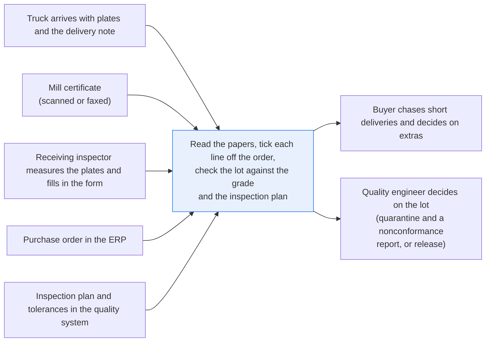
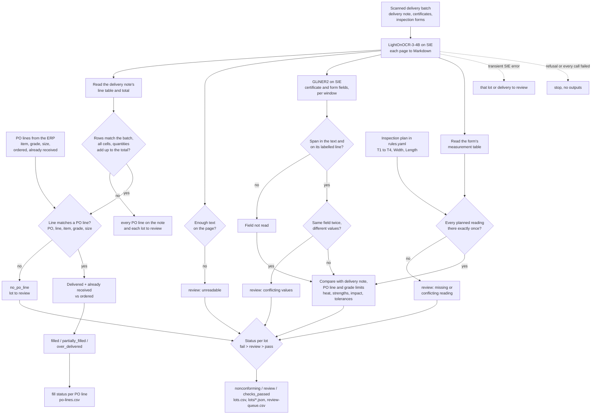

# Check a delivery against its purchase order and certificates

> **This example:** a steel plate delivery with its mill certificates and inspection forms.
>
> **How it works:** an OCR model reads the scanned delivery note, certificates and inspection
> forms, and an extraction model points at the fields. Python matches lines to the order, checks
> the totals, compares the strength results with the grade's limits and the measured dimensions
> with the inspection plan's tolerances.
>
> **Use the same pattern for:** a chemical delivery against its certificate of analysis, a
> supplier's first-article inspection report, a calibration certificate against the instrument
> record.

## Background

A fabricator that builds with steel plate buys it on purchase orders, and the mill ships it in
deliveries that don't always line up with the order: half a PO line this week, the rest next
month, now and then a couple of plates more than anyone asked for. Every delivery goes through
goods receipt and receiving inspection before it reaches the shop floor. The person doing that
is the receiving inspector, with a supplier quality engineer behind them for anything that looks
wrong and a buyer for anything that doesn't match the order.

When a truck comes in, the inspector starts with the supplier's delivery note (the packing list
that travels with the plates). It lists what is on the truck: for each line, the PO number and
line, the item, the grade, the size, the heat number and how many plates. The inspector opens the
PO in the ERP and ticks each delivered line off against its PO line: same item, same grade, same
size, and is this the whole quantity, part of it, or more than was ordered? Then come the
documents for each heat. They compare the heat number stamped or tagged on the plate with the
one on the mill's certificate. They measure thickness at each corner with a calibrated
ultrasonic gauge, and width and length with a tape. They write the readings on the receiving
inspection form and sign it.

The ERP already gives you the order side, structured: the PO number, and for each line the item,
supplier, grade, size, ordered quantity and how much has already been received on earlier
deliveries. The quality system already holds the inspection plan, meaning which readings the
inspector has to take on a plate (four thickness readings, a width and a length here) and the
tolerances. None of that needs a model, so this recipe takes it as structured input, the way
your ERP and quality system would export it.

What doesn't arrive structured is everything that comes from outside, or that gets written by
hand:

- **The delivery note.** It's the supplier's document, printed by their system and scanned at
  goods-in. Your ERP doesn't know what's on the truck until someone types it in.
- **The mill certificate.** An EN 10204 type 3.1 style document with the heat, the grade and the
  measured strengths and impact result. It comes as a scanned PDF or a faxed copy, and no barcode
  on the delivery gives you its yield and tensile numbers.
- **The receiving inspection form**, in shops where the inspector still writes readings on paper
  and the form gets scanned. If your inspectors type readings into the quality system or the
  gauge sends them straight in, you already have them, and you can skip that half of the recipe.

Why it matters to the company: a lot with a low yield strength or a thin corner that gets
released ends up welded into a structure, and finding it later costs far more than finding it at
goods-in. A PO line booked as fully received when half of it is still at the mill means nobody
chases the rest until the shop runs out. An over-delivery quietly booked in means paying for
plates nobody ordered. Today someone retypes the delivery note, the heat number, the grade, the
strengths and the readings, looks up the PO and the grade's limits, and decides by eye. Most
deliveries are fine, which is exactly what makes the bad one easy to miss.

Here's the job end to end, and the step this recipe takes on:



## The problem

You want the delivery note, the certificates and the inspection forms read; each delivered line
matched to its PO line; each PO line marked as filled or not; and the documents checked against
the order and the grade's limits. Then the exceptions go in front of the right person with the
reason. The obvious shortcuts each fail in their own way. There's no text layer to search,
because everything is a scan. Asking one model "is this delivery OK?" gives you an answer you
can't audit and limits you can't change. And a check that only looks at the numbers it managed
to read will happily pass a form whose failing row it never read.

So the recipe reads each page, finds the fields, and then plain Python does the matching and
comparing. Every status names what the checks found; a person makes the decision.

For each PO line on the delivery, a **fill status** for the buyer:

- **`filled`**: delivered plus previously received equals the ordered quantity.
- **`partially_filled`**: less than ordered; the open quantity is shown, so someone knows to
  chase the rest.
- **`over_delivered`**: more than ordered (beyond `over_delivery_allowance`, 0 plates here); the
  extra quantity is shown. The buyer decides whether to keep it or send it back.
- **`no_po_line`**: the delivered line names no PO line on the order, or names one whose item,
  grade or size doesn't match. Nothing on that line is booked against the order.
- **`review`**: the delivery note, or a line's quantity, couldn't be read, or its line table
  doesn't add up (more on that below), so no fill status is trusted.

For each delivered lot (one delivery line, one heat), a **check status** for the quality
engineer:

- **`nonconforming`**: a value read from the documents is outside its limit. You quarantine the
  lot, and a quality engineer confirms it and raises the NCR (nonconformance report).
- **`review`**: something didn't match, wasn't read, was read twice with different values, sits
  inside a gauge's guard band, or the line has no PO line to check against. A person looks before
  anything else happens.
- **`checks_passed`**: every document check below passed. That's not a release: the quality
  engineer decides whether the lot goes to the floor.

It's worth being plain about what `checks_passed` doesn't cover. The recipe checks the heat
number, grade, nominal thickness, yield and tensile strength, the impact (Charpy) result against
the minimum in `rules.yaml`, every reading on the inspection plan, the inspector and the dates. It
doesn't check chemistry, elongation, the certificate type or who validated it, or the delivery
condition, though they're on the page. It counts plates, not tonnes. And it can't check the
plate itself: the same heat number on the delivery note, the certificate and the form tells you
the paperwork agrees, not that the stamp on the steel says the same thing. The inspector still
looks at the plate. Nothing is scrapped, returned, booked or released automatically.

### Examples

Here are three of the twelve delivered lots in `data/`, and what should happen to each.

**1. A clean, full delivery.** `lot-01`.
- **Input:** PO line `PO-48213,1,41212,Harrowgate Steelworks Ltd,S355J2+N,12,2000,6000,6,0`;
  line 1 of delivery note DN-26-0712 (page 1 of `delivery-notes.pdf`) delivers 6 plates of heat
  A41873, with its certificate and inspection form on page 1 of the other two PDFs.
- **What should happen:** the line matches its PO line and fills it; every certificate value and
  every reading is inside its limit.
- **Expected outcome:** `filled` and `checks_passed`.

**2. Steel below the grade.** `lot-05`.
- **Input:** the certificate on page 5 of `mill-certificates.pdf` gives a yield strength of
  341 MPa for S355J2+N 12 mm plate, against PO-48230 line 1.
- **What should happen:** the strength check compares the yield with the grade's 355 minimum for
  that thickness and fails it.
- **Expected outcome:** `filled` and `nonconforming`, on `yield_strength`.

**3. A failing row left off the form.** `lot-11`.
- **Input:** the inspection form on page 11 of `inspection-reports.pdf`, for 15 mm plate, lists
  Thickness T1, T2 and T4, width and length, all passing; the T3 row (14.38 mm) isn't there.
- **What should happen:** the inspection plan check notices Thickness T3 is missing, so the lot
  can't pass on the rows that are left.
- **Expected outcome:** `filled` and `review`, on `dimensions`.

On the live run, 12 of 12 planted cases came out as expected; [What came out](#what-came-out) has each one.

## How we'll solve it

1. **Start from what the ERP already knows.** The PO lines come in structured: item, grade,
   size, ordered quantity and quantity already received. The inspection plan in `rules.yaml`
   lists the readings every plate needs. Goods-in scans each delivery as one batch (the delivery
   note, then a certificate and an inspection form for each delivered line), and `receipts.jsonl`
   records which page is which, the way a scan station would.
2. **Read each scanned page with an OCR model.** The delivery note's line table, the
   certificate's labelled boxes and the form's measurement table come back as tables, so each
   label stays next to its value and each number stays in its column. A page that comes back
   nearly empty goes to review as unreadable.
3. **Read the delivery note's lines in Python** (PO number and line, item, grade, size, heat,
   quantity), the same way the measurement table is read. We do this first because every later
   check needs to know which PO line a lot belongs to. Then the table has to add up: the rows
   read must match the number of lines the scan batch has, every row must have all its cells,
   and the quantities must add up to the note's own "Total plates" line. If any of that fails,
   or the total can't be read, every PO line on that delivery goes to `review` with the reason
   (the status the quantities as read would give stays in the detail), and so does each lot's
   `po_line` check. One misread digit, a dropped row or a row read twice would otherwise turn
   `partially_filled` into `filled`.
4. **Match each delivered line to its PO line and work out how full the line is.** The PO number
   and line must exist, and the item, grade and size on the delivery note must agree with the
   order; otherwise the line is `no_po_line`. Then delivered plus previously received (plus any
   other line on this run's deliveries for the same PO line) against ordered gives `filled`,
   `partially_filled` or `over_delivered`.
5. **Find the document fields with an extraction model, then make Python prove them.** On the
   certificate and the form, the model points at the heat number, grade, thickness, strengths,
   impact energy, inspector and dates. A value only counts when it is in the text and on a line
   carrying that field's label, and the recipe keeps the whole labelled cell, unit included. If
   the same field turns up twice with two different values, it goes to review instead of the
   first one winning.
6. **Check the inspection form against the inspection plan.** Every expected reading (Thickness
   T1 to T4, Width, Length) has to be there exactly once. A missing row, or a row read twice with
   different values, goes to review. This is the step that stops a form with its one failing row
   missing from passing on the rows that are left.
7. **Compare everything with the order and the limits.** Heat number on the certificate and the form
   against the delivery note; grade and thickness as ordered; yield, tensile and impact inside the
   grade's limits, and yield not above tensile (an OCR digit swap like "841" for 418 would pass the
   yield minimum on its own); every reading inside tolerance and outside the gauge's guard band;
   inspector on the qualified list; certificate dated on or before receipt, inspection on or after.
   The form's own "Result" column is ignored.
8. **Give each lot its status.** Any fail makes it `nonconforming`, otherwise any review makes it
   `review`, otherwise `checks_passed`. A lot on a `no_po_line` line goes to review, since
   there's no order to check its grade, size and limits against; its heat number, inspector and
   dates are still checked.

If an SIE call fails for a reason that may pass (a timeout, a 5xx, a rate limit, an over-long
window), the affected lot, or every lot on a delivery whose note couldn't be read, goes to review
with the reason, and the run carries on. A reply missing the key it should carry (`entities` from
the OCR model, `data` from the extraction model) counts as a failed call too; an empty answer is
a real "nothing found". If SIE refuses the call (a bad key, an unknown model, no credits), the
run stops with SIE's full message and writes nothing, and so it does when every call failed.

## Picking the models

The reader is `lightonai/LightOnOCR-3-4B`, called through SIE's `extract` with the page as an
image, once per page. Delivery notes and mill certificates come from outside as scans or faxed
copies with no text layer, and the inspection form is filled in on paper and scanned, so the
reading step has to be OCR. LightOnOCR returns tables as HTML, and writes a form box as
`label<br>value` in one cell. That's the shape the rest of the recipe leans on: each label stays
next to its value and each reading stays in its column. Neither the OCR model nor the extraction
model takes a prompt, so there's no instruction in the documents for either to follow.

The field finder is `fastino/gliner2-large-v1`, called through `extract` with an `output_schema`
(one optional string per field, with the `description` from `rules.yaml`), once per window of the
flattened certificate or form. GLiNER2 reads at most 512 tokens per item, and a window of 180 words
is about that, not a guarantee. A window that runs over may come back as an input-too-long error,
which the recipe treats as a failed call (the lot goes to review), or be cut short by the model
without telling us, which the recipe can't see; the windows overlap by 30 words so a pair cut at one
edge is still whole in the next. It's good at pointing at the right box on a form it has never seen.
It is not something to trust with the value itself, which is why Python checks that the span is
really in the text and on its label's line, and keeps the whole cell. The delivery note's lines and
the measurement table are plain tables, so Python reads those directly and the model never sees them
as fields.

So: two models, the OCR model called once per page and the extraction model once per window,
and no generative model makes a decision. The PO matching, quantities, limits, tolerances,
guard bands, heat number match and qualified-inspector list are plain Python reading
`rules.yaml`.

## The flow



## How it's built

Everything you'd want to argue about lives in [`rules.yaml`](./rules.yaml): the two model names,
the strength and impact limits per grade (the yield minimum depends on thickness), the
thickness bands and the width and length tolerances, each gauge's guard band, the inspection
plan, the delivery note and measurement table columns, the over-delivery allowance, the
qualified inspectors, the fields GLiNER2 is asked to find with their labels, and every
threshold. [`recipe.py`](./recipe.py) is about 1,270 lines and reads top to bottom in the same
order as the flow.

| Step | Code | SIE call | What it does |
| --- | --- | --- | --- |
| Load the order | `load_po_lines`, `load_receipts` | none | The PO lines as the ERP exports them, and which scanned page is which |
| Read each page | `read_page`, `flatten_markdown` | `extract` (image) | One call per page. Each form box becomes "Label \| value" and each table row one line |
| Delivery lines | `table_rows`, `note_total`, `delivery_problems` | none | Every row under the header naming PO number, line, item, grade, size, heat and quantity. A row with a different number of cells is a problem, not the end of the table. The rows must match the scan batch's line count and the quantities must add up to the note's "Total plates" line, or the delivery's PO lines go to review |
| Match and fill | `match_po_line`, `fill_status`, `settle_fills` | none | PO number and line must exist; item, grade and size must agree; delivered plus already received against ordered, summed over every line of the run for the same PO line |
| Find the fields | `extract_fields`, `labelled_cell`, `impact_temperature` | `extract` + `output_schema` | One call per window, one item per call. A span must be in the text and on a line carrying the field's label; the value is that whole cell. A span is cut at its first line break, since a flattened cell never spans two. Two different values for one field go to review. The Charpy test temperature is read from the impact label ("KV at -20 °C") in Python |
| Readings | `table_rows`, `check_dimensions`, `judge_measurement` | none | Every reading on the inspection plan exactly once, inside its tolerance and outside the guard band |
| Checks | `check_lot`, `check_heat`, `check_strengths`, `check_impact` | none | Heat against the delivery note; grade, thickness, yield, tensile and impact against the PO line and the grade; yield not above tensile; inspector; dates |
| SIE failures | `Calls.call`, `is_fatal`, `stop_message`, `stop_on_refusal` | none | A transient failure or a reply missing its key sends the lot to review; a refusal, or every call failing, stops the run without outputs |
| Outputs | `write_outputs`, `csv_safe` | none | `po-lines.csv`, `lots.csv`, `review-queue.csv` and `lots/<lot>.json`. In `lots.csv` and the JSON, `po_line` is the PO line the delivery note claims and `po_line_matched` says whether it matched the order. Any cell a spreadsheet would run as a formula gets a leading `'` |

[`selfcheck.py`](./selfcheck.py) checks all of this offline with hand-written OCR pages and
stand-in model replies: the PO matching and fill statuses; the delivery note's table (a quantity
misread as 8 against a total of 6, a row read twice, a dropped row, a row missing a cell, no
total); the inspection plan (the missing T3 row, a reading written twice with different values,
a row missing a cell); the strength limits on and just below the minimum, the yield band by
thickness, yield above tensile, the guard band, a heat mismatch and dates out of order; the
impact check; conflicting field values; `csv_safe`; the committed data (including that the PDFs
carry no metadata); and the SIE failure rule with a transient error, a refusal, every call
failing, a reply missing its key, an OCR reply with no markdown, and the empty-result 500
counted as "nothing found" only from the extraction model.
[`make_data.py`](./make_data.py) draws the scanned pages and writes the PO lines and receipts.

## Run it

You need [uv](https://docs.astral.sh/uv/) and an SIE API key
([create one](https://console.superlinked.com/console/api-keys?utm_source=github&utm_medium=docs&utm_campaign=sie-cookbook&utm_content=manufacturing-check-delivery-against-po)).

```bash
cp .env.example .env   # then set SIE_API_KEY
uv run recipe.py
uv run selfcheck.py    # optional: offline checks, no SIE call
uv run make_data.py    # optional: rewrite data/
```

`uv run` installs this recipe's few dependencies into its own `.venv` on the first run. Each run
writes `runs/<timestamp>/` in this folder. A run makes 52 SIE calls on this data: 28 to the OCR
model (one per page) and 24 to the extraction model (one per window). The first calls can wait
a few minutes while SIE Cloud starts the OCR and extraction models; our first run on
2026-11-03 (UTC) took 341 s, and warm runs took 188 to 190 s.

## What came out

The input is four deliveries and twelve delivered lots in [`data/`](./data):

- `delivery-notes.pdf`: the supplier's delivery note for each delivery, one page each, with a
  line table (PO number and line, item, grade, size, heat number, quantity of plates)
- `mill-certificates.pdf`: EN 10204 type 3.1 style certificates (labelled boxes for heat, grade,
  size, strengths and impact energy, plus a chemistry table), one page per lot
- `inspection-reports.pdf`: the receiving inspection form for each lot, with a measurement table
  (four thickness readings, width, length)
- `po_lines.csv`: the PO lines as the ERP exports them: PO number, line, item, supplier, grade,
  size, ordered quantity and quantity already received
- `receipts.jsonl`: one delivery per line: when it arrived, and which page of which PDF holds its
  delivery note and each delivered line's certificate and inspection form

> **All of it is synthetic.** [`make_data.py`](./make_data.py) draws the pages with Pillow as
> image-only PDFs (what a scanner would give you) and rebuilds them byte for byte. The PDFs
> carry no document metadata (no title, author or dates). The mill ("Harrowgate Steelworks"),
> the fabricator ("Quillmere Fabrication Ltd (fictional)"), the inspectors, the heat numbers and
> every value are invented, and every page says so in its footer. The strength limits follow
> the shape of EN 10025-2; the thickness tolerances are illustrative, in the shape of a plate
> tolerance table but not the EN 10029 Class A values. Both are starting points, so check them
> against the current standards and your purchase spec.

### The three examples

- **`lot-01`:** `filled` and `checks_passed`. The quantity matched the order and every check had
  a reading inside its limit. As expected.
- **`lot-05`:** `filled` and `nonconforming` on `yield_strength`, below the grade minimum for
  12 mm. As expected.
- **`lot-11`:** `filled` and `review` on `dimensions`, with the detail "Thickness T3 not read"
  (the JSON is below). As expected.

### Every planted case

On the live run on 3 Nov 2026, 12 of 12 planted cases came out as expected, both fill status and
check status.

| Lot | What we planted | Fill status | Check status | Why |
| --- | --- | --- | --- | --- |
| `lot-01` | Full delivery: 6 of 6 ordered, nothing received before; documents consistent, S355J2+N 12 mm | `filled` | `checks_passed` | Quantity matches the order and every check has a reading inside its limit |
| `lot-02` | Partial delivery: 6 of 10 ordered. Near miss on the documents: yield exactly the 355 minimum, written "355 N/mm2"; tensile 471 (minimum 470); thinnest reading 11.53 against an 11.50 limit, outside the 0.02 mm guard band; form heat written "A-41902" | `partially_filled` (4 open) | `checks_passed` | Less than ordered is a fill status, not a fault in the steel; a value on its limit passes, "N/mm2" is MPa and hyphens are ignored in heat numbers |
| `lot-03` | Over-delivery: 8 ordered, 6 received on an earlier delivery, 4 on this one; documents consistent | `over_delivered` (2 over) | `checks_passed` | The buyer decides about the extra 2; the steel itself checks out |
| `lot-04` | The delivery note line cites PO-48213 line 4, ordered as S355J2+N, but says S275JR | `no_po_line` | `review`: `po_line` | Wrong grade for the line it names, so nothing is booked and there's no limit to check against |
| `lot-05` | Yield strength 341 MPa, minimum 355 | `filled` | `nonconforming`: `yield_strength` | Below the grade minimum for 12 mm |
| `lot-06` | Delivery note says heat B17730; certificate and form say B17703 | `filled` | `review`: `heat_number` | Two digits swapped; the certificate may belong to another heat |
| `lot-07` | Thickness T3 14.38 mm on 15 mm plate (limit 14.50); the form marks it "OK" | `filled` | `nonconforming`: `dimensions` | The recipe compares the reading with `rules.yaml` and ignores the form's own "Result" column |
| `lot-08` | Thickness T2 11.51 mm: inside the 11.50 limit by less than the gauge's 0.02 mm | `filled` | `review`: `dimensions` | The gauge can't tell it from a reading just outside |
| `lot-09` | Inspector box and signature left blank | `filled` | `review`: `inspector` | Not read, so not assumed |
| `lot-10` | Near miss: 20 mm plate with yield 348, which passes the 345 minimum for 16 to 40 mm; grade written "S355 J2+N" | `filled` | `checks_passed` | The yield band follows the ordered thickness; spaces are ignored in grades |
| `lot-11` | New near miss: a 14.38 mm T3 reading like `lot-07`'s, with the T3 row left off the form; T1, T2, T4, width and length all pass | `filled` | `review`: `dimensions` | Thickness T3 is on the inspection plan and wasn't read. Before this change, the lot passed |
| `lot-12` | New near miss: S355J2+N with yield and tensile inside the limits, but no impact energy box on the certificate | `filled` | `review`: `impact_energy` | A J2 grade needs a Charpy result; strength alone isn't enough. Before this change, the lot passed |

On our live runs on 2026-11-03 (UTC), all 12 lots came out as planned, both fill status and
check status, with the settings as first written. Two warm reruns gave the same 12 results, the
last one after the delivery note table check went in; all four delivery notes added up (four,
two, two and four lines read, matching the scan batches and each note's total).
Treat that as a demo that the pipeline works, not as a measure of accuracy: twelve lots tell
you each path through the checks runs, not how often a real scan gets misread.

A few things worth noticing:

- **The two new near misses are the reason this version exists.** `lot-11`'s form simply has
  five rows instead of six, and every one of them passes. Here is what the recipe read from it,
  and the check it wrote (from `lots/lot-11.json`, abridged):

  ```json
  "measurements": [
    {"characteristic": "Thickness T1", "nominal": "15.00", "measured": "15.05"},
    {"characteristic": "Thickness T2", "nominal": "15.00", "measured": "14.98"},
    {"characteristic": "Thickness T4", "nominal": "15.00", "measured": "15.03"},
    {"characteristic": "Width", "nominal": "2000", "measured": "2006"},
    {"characteristic": "Length", "nominal": "6000", "measured": "6011"}
  ],
  {"check": "dimensions", "status": "review", "detail": "Thickness T3 not read"}
  ```

  A check that only judges the rows it can see would have called that lot fine. `lot-12` is the
  same trap on the certificate: 375 MPa yield, 531 MPa tensile, and no Charpy result at all.
- **The quantity and the steel are separate questions.** `lot-02` and `lot-03` both pass every
  document check, and still land in front of the buyer. From `po-lines.csv`:

  ```csv
  po_number,line,item,ordered_qty,previously_received,delivered,open_qty,over_qty,fill_status,deliveries,lots,detail
  PO-48213,2,41212,10,0,6,4,0,partially_filled,DN-26-0712,lot-02,4 plates still open
  PO-48213,3,41212,8,6,4,0,2,over_delivered,DN-26-0712,lot-03,2 plates over the order
  PO-48213,4,41212,,,4,,,no_po_line,DN-26-0712,lot-04,PO-48213 line 4 on the delivery note says grade S275JR (ordered S355J2+N)
  ```

- **`lot-04` is the delivery note's mistake, not the mill certificate's.** Its certificate,
  form and delivery note all agree on heat B17654 and S275JR, so the heat check passes. It's the
  order that says S355J2+N. The recipe doesn't book it and doesn't check its strengths, since
  there's no ordered grade to check them against.
- **`lot-07`'s form is the most confident document in the pile.** It says "OK" right next to the
  14.38 mm reading that fails. The recipe ignores that column and compares the reading with
  `rules.yaml`.
- **GLiNER2 read the 10 mm certificate this time.** On the earlier 9-lot version of this data
  (31 Oct 2026), it returned no thickness for the two 10 mm certificates, though it read the
  12, 15, 8 and 20 mm ones, and the `thickness` check went to review as "Not read" instead of
  assuming the ordered size. On 2026-11-03 it read "10.00 mm" on `lot-06`. On that earlier run,
  the grade span on one certificate ran over a line break into the next box's label
  ("S235JR\nStandard"), which is why Python cuts every span at its first line break. Neither run
  on 2026-11-03 hit SIE Cloud's empty-result error or dropped a span.

### What you do next

The buyer reads `po-lines.csv`: chase the open plates on a `partially_filled` line, decide
whether to keep or send back the extra on an `over_delivered` one, and sort out a `no_po_line`
with the supplier. The quality engineer works from `review-queue.csv` and `lots/<lot>.json`:
quarantine a `nonconforming` lot, confirm it and raise the NCR, and look at each `review` reason
before anything else happens. A `checks_passed` lot still needs the quality engineer's release,
and the inspector still checks the stamp on the plate itself.

## Potential improvements

- **Start with the limits.** `grades` in `rules.yaml` holds the yield minimum by thickness, the
  tensile range and the Charpy minimum and test temperature for each grade, and `dimensions`
  holds the thickness bands, the width and length tolerances and each gauge's `guard_mm`. They
  are all starting points, so take yours from the standard and your purchase spec. To add a
  grade, add its block.
- **Teach it your documents' labels.** `documents` in `rules.yaml` is what GLiNER2 is asked to
  find in each document. The `description` goes to the model, and `label` lists the box labels
  your certificates actually use. `delivery_columns` and `measurement_columns` list the table
  headers your supplier's delivery notes and your forms use.
- **Check what's on the page but not checked.** Elongation and chemistry are on every
  certificate and not checked. To check one, add the field and a check in `check_lot`.
  Chemistry is a table, so read it in Python the way the measurements are read. The certificate
  type, who validated it and the delivery condition are not checked either.
- **Plug in your own systems.** `po_lines.csv` stands in for the PO lines in your ERP and
  `receipts.jsonl` for your scan station's batch. `heat_number_separators` lists the characters
  ignored when comparing heat numbers. `qualified_inspectors` stands in for your training
  records. The models are in `models` in `rules.yaml`, one line each.
- **Born-digital PDFs.** If your certificates arrive as born-digital PDFs, `docling` is an
  option for the reading step.
- **What this does not do.** It does not decide what happens to a nonconforming lot, book a
  receipt, accept a concession or judge the mill's test method. It reads the documents, checks
  them against the order and the limits, and puts the exceptions in front of quality and the
  buyer with the reason.
- **Known SIE Cloud issue.** When GLiNER2 finds no field in a window, SIE Cloud currently answers
  the `output_schema` call with HTTP 500 "Inference completed without a valid conserved billing
  settlement". The recipe sends one window per call, so the error only hits that window, and
  records the answer as "no fields found" in the lot's notes. A field that is never found sends
  its check to review, never past it. It doesn't add a review reason of its own, which is worth
  revisiting if your windows can hold a field another window doesn't repeat.
- **Weights and split heats.** The recipe counts plates. A mill that invoices by tonne, or
  splits one PO line across several heats on one delivery, needs a weight column and the
  matching per heat; the summing over lines is already there.
- **Match the paperwork to the right lot by heat, not by page order.** Today the scan batch
  says which certificate goes with which delivery line. Matching a certificate to its line by
  heat number would catch a certificate stapled to the wrong lot. Other cases worth planting:
  a same-heat report for a different PO line, and a delivery line with no paperwork scanned.

## Try another model

Each model is one line under `models:` in `rules.yaml`. We swapped one model at a time, changed
nothing else, and ran the recipe on SIE Cloud on 31 Oct 2026, on the earlier 9-lot version of
this data (before the delivery notes, the inspection plan and the impact check). We haven't
rerun the swaps on the 12 lots.

| `rules.yaml` key | Swap in | What happened on this data |
| --- | --- | --- |
| `ocr` | `zai-org/GLM-OCR` | All 9 lots went to `review`. It read the values ("A41873", "12.00 mm", "372 MPa"), but laid the form boxes out differently from LightOnOCR's `label<br>value` cells that `flatten_markdown` expects, so no value sat on its label's line and the recipe dropped every one |
| `ocr` | `lightonai/LightOnOCR-2-1B` | 8 of 9 lots as planted. The near miss with the "A-41902" heat (now `lot-02`) went to `review`, because the report's heat number was not read |
| `extract` | `fastino/gliner2-base-v1` | All 9 lots as planted, and it read the 10 mm thickness the default missed that day, so the extra `thickness` review the default added there went away |

See [MODELS.md](../../MODELS.md) for every model these recipes use.

## Run it on your own SIE

The same code runs against an SIE server you host. Set `SIE_BASE_URL` in `.env`; an API key
is then optional. The table gives the SIE v0.10.1 image each model runs on, from SIE's
[compatibility matrix](https://github.com/superlinked/sie/blob/main/docs/compatibility.md).

| `rules.yaml` key | Model | Image | Tested on |
| --- | --- | --- | --- |
| `ocr` | `lightonai/LightOnOCR-3-4B` | `cuda12-sglang-vision-extract` | L4 |
| `extract` | `fastino/gliner2-large-v1` | `cuda12-default` | L4 |

One SIE server runs one image, so these 2 images need a cluster: the
[sie-cluster Helm chart](https://github.com/superlinked/sie/tree/main/deploy/helm/sie-cluster)
with one worker pool per image routes each model to its pool. See
[SELF_HOSTING.md](../../SELF_HOSTING.md) for the values file.

## Files

- `recipe.py`: the pipeline
- `selfcheck.py`: offline checks with hand-written pages and stand-in replies, no SIE call
- `make_data.py`: draws the synthetic delivery notes, certificates and reports, and writes the
  PO lines and receipts
- `rules.yaml`: limits, tolerances, the inspection plan, fields, checks and thresholds
- `data/`: the scanned PDFs, `receipts.jsonl` and `po_lines.csv`
- `pyproject.toml`, `uv.lock`: this recipe's dependencies

See the SIE task page for [document field extraction](https://superlinked.com/doc-field-extraction?utm_source=github&utm_medium=docs&utm_campaign=sie-cookbook&utm_content=manufacturing-check-delivery-against-po).
