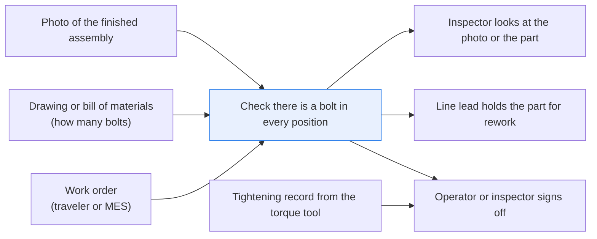
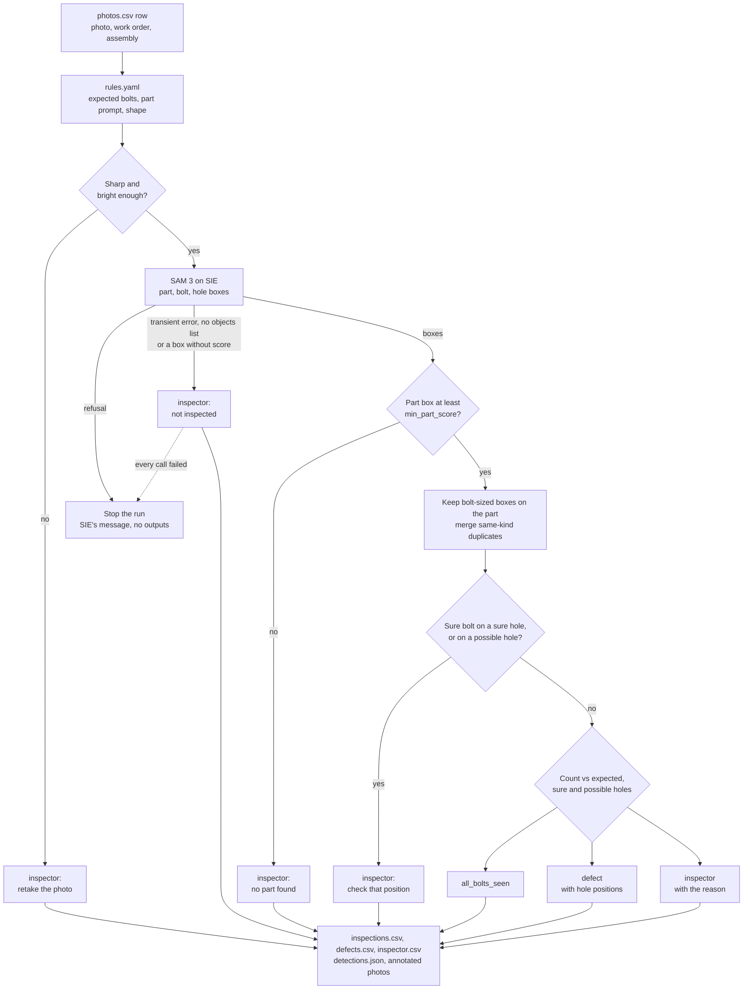

# Check no part is missing in assembly photos

> **This example:** bolts on a flange, where the empty hole is the proof one is missing.
>
> **How it works:** a detection model finds bolts and empty holes, and Python compares the bolt
> count with the expected count and reports where each empty hole is. A bolt is only called missing
> when the empty hole is seen; anything unclear goes to an inspector.
>
> **Use the same pattern for:** checking clips on a wiring harness, connectors seated on a board,
> labels present on a finished pallet.

## Background

At the end of an assembly or maintenance line, somebody has to check that every fastener is
actually there before the part moves on. Usually that's an assembly operator at the station, or
a quality inspector walking the line. They pull up the work order (on a paper traveler or an MES
screen), which says which assembly this is, and the drawing or bill of materials, which says how
many bolts it takes and where they go. Then they look around the flange or cover plate, bolt by
bolt, and record the result in the MES or quality system. If something is off, they raise
rework.

Some stations also take a photo of each finished assembly, with a fixed camera over the fixture
or a handheld device, and file it against the work order. That's the setup this recipe assumes.
It isn't every line, and if yours doesn't photograph assemblies, this recipe has nothing to read.

A lot of what the inspector needs already comes from existing systems, and the recipe takes it as
given instead of trying to work it out from the photo:

- **Which assembly it is** comes from the work order. The recipe reads the work order id and the
  assembly type from `photos.csv`, the way an MES export would hand them over.
- **How many bolts it takes** comes from the drawing or BOM. Here it's one number per assembly in
  `rules.yaml` (8 for a `pipe_flange_8`, 6 for a `cover_plate_6`).
- **Whether each bolt was tightened** comes from the tightening tool. A connected nutrunner or
  torque controller records each fastening and its result against the production record. That
  record stays where it is; this recipe doesn't look at torque at all.

What no system gives you is the visual check itself: is there a bolt in every position, right
now, in this photo? That's the only part a model does here.

Why it matters: a pipe flange or cover plate that leaves the line with a bolt missing will leak
or work loose in service. Counting bolts photo after photo is slow, and late in a shift it is easy
to get wrong. The mistake that hurts is the quiet one, where a short count gets signed off as
complete.

Here's the job end to end, and the step this recipe takes on:



## The problem

You have a photo per assembly and you know how many bolts it should show. You want each photo
sorted into one of three piles: **`all_bolts_seen`**, **`defect`** (bolts missing, with where),
or **`inspector`** (a person looks, with why). The obvious approach, counting bolt-shaped things
and comparing with the expected number, goes wrong in a few ways:

- A spare bolt left on the bench, or lying on the flange itself, adds one to the count.
- A rag over a bolt position takes one away, without the bolt actually being missing.
- A blurred or dark photo gives you a count of whatever the model happened to guess.
- A detector can read one spot as both a bolt and a hole. Taking the higher score settles that
  by coin toss with extra decimal places.

So a count alone isn't enough. To call a bolt missing, the recipe wants to see the empty hole.
To call an assembly complete, it wants exactly the expected number of bolts, sitting on the part,
with no empty hole and nothing it couldn't explain. Anything in between goes to a person, with a
reason they can check against the photo.

It's important to be clear about what `all_bolts_seen` means: a fastener is visible in every
position the count expects. It says nothing about torque, preload, thread engagement, the right
bolt grade or whether the joint will hold pressure. Those come from the tightening record and
your normal acceptance steps. The detector has never held a torque wrench.

Who decides next:

- **`all_bolts_seen`**: the operator or inspector signs off as they do today, alongside the
  tightening record. The recipe doesn't release anything.
- **`defect`**: the line lead or quality inspector looks at the annotated photo, holds the
  assembly and sends it for rework. `defects.csv` can open the rework ticket.
- **`inspector`**: an inspector looks at the photo (or the part) and decides. `inspector.csv` is
  that queue.

The model never closes a ticket on its own.

### Examples

Here are three of the ten photos in `data/inspection-photos.jpg`, and what should happen to each.

These photos are synthetic, drawn by `make_data.py`. There is no real part, site or company in them.

**1. A complete flange.** FL-101.
- **Input:** a drawn photo of an 8-bolt flange (`pipe_flange_8`, work order WO-4101) with all 8
  bolts fitted.
- **What should happen:** the photo is sharp and bright enough to read, and a model finds the
  flange, 8 bolts on it that it's sure about, and no empty hole.
- **Expected outcome:** `all_bolts_seen`, 8 of 8.

**2. One bolt missing.** FL-102.
- **Input:** the same flange (work order WO-4102) with 1 bolt missing and its hole empty.
- **What should happen:** the count comes up one short, and one empty hole is seen to prove it.
- **Expected outcome:** `defect`, with the clock position of the empty hole.

**3. A loose bolt lying over the empty hole.** FL-107.
- **Input:** the same flange (work order WO-4107) with 1 bolt missing and a loose bolt lying on
  the flange across the empty hole.
- **What should happen:** the count looks complete (8 bolts), but the model is sure about both a
  bolt and a hole on the same spot, so the recipe calls it a conflict and sends it to a person
  instead of letting the higher score win.
- **Expected outcome:** `inspector`, with the conflict's position.

On the live run, 10 of 10 photos came out as expected. [What came out](#what-came-out) has
the results.

## How we'll solve it

One model, SAM 3 (`facebook/sam3`), called once per photo through SIE's `extract`, finds the
things in the photo. Everything else is plain Python and `rules.yaml`. No generative model makes
the decision.

1. **Read the work order data.** For each photo, take the work order and assembly type from
   `photos.csv`, and the expected bolt count, part prompt and shape from `rules.yaml`.
2. **Check the photo before spending a call on it.** Sharpness (the variance of the Laplacian)
   and brightness. A blurred or dark photo goes back for a retake and never reaches SIE. Nobody
   can count bolts in a smudge, including a model.
3. **Find the part, the bolts and the holes.** One SAM 3 call per photo with three text prompts:
   the part (`flange` or `metal plate`), `bolt` and `hole`. It returns a scored `[x, y, w, h]`
   box for every instance of each. If the call fails for a reason that may pass (a timeout, a
   busy server, a reply with no `objects` list, a box with no score), that photo goes to the
   inspector as "not inspected", with empty count cells, and the run carries on. If SIE refuses the call outright (a bad key, an unknown
   model), the run stops with SIE's message and writes nothing, because every other photo would
   fail the same way. If every call fails, the run stops too.
4. **Keep only what's on the part.** Take the highest-scoring part box. If no part box scores at
   least `min_part_score`, the photo goes to the inspector. A bolt or hole counts only if it sits
   inside the part (inside the ellipse for a round flange) and is bolt-sized, so the pipe bore
   and a spare bolt on the bench are ignored.
5. **Merge duplicates.** SAM 3 boxes a nut and its washer separately, so a box whose center lies
   inside another of the same kind is the same bolt.
6. **Don't let a score settle an argument.** When a sure bolt (at least `bolt_sure`) and a sure
   empty hole (at least `hole_sure`) land on the same spot, the model is saying two opposite
   things about one position. Keeping whichever scored higher would let a bolt at 0.81 quietly
   erase a hole at 0.79. Instead the photo goes to the inspector with the clock position of the
   spot. An unsure bolt on a sure hole is different: it was only ever a maybe, so the hole stands.
7. **Don't throw away a possible hole.** A hole scoring between `hole_unsure` (0.40) and
   `hole_sure` (0.70) is a possible hole. It never counts as proof that a bolt is missing, but
   it's never ignored either: under a sure bolt, or on a count that otherwise looks complete, it
   sends the photo to the inspector with its position.
8. **Compare with the expected count.** A bolt scoring at least `bolt_sure` is counted; one
   between `bolt_unsure` and `bolt_sure` is unsure, so the count becomes a range.

| Count | Empty holes seen | Status |
| --- | --- | --- |
| exactly the expected count, nothing unsure | none | `all_bolts_seen` |
| short, even counting the unsure bolts | one per missing bolt | `defect`, with the clock position of each empty hole |
| short, but fewer empty holes than missing bolts | | `inspector`: the bolt may be covered, out of frame or missing |
| the unsure bolts decide it, or more bolts than expected, or complete but an empty hole seen | | `inspector` |
| a sure bolt and a sure empty hole on the same spot | | `inspector`, with the position |
| a possible hole (0.40 to 0.70) under a sure bolt, or on an otherwise complete count | | `inspector`, with the position |
| no part found, the photo is blurred or dark, or the SIE call failed | | `inspector` |

A bolt the recipe simply can't see (under a rag, out of frame) is never called missing on that
alone; a person looks.

## Picking the model

`facebook/sam3` (Meta's SAM 3) runs as an open-vocabulary detector on SIE: you give it one text
prompt per kind of object, and it returns a box and a score per instance (no masks here). That
fits this job well. You don't collect training images, label anything or host a model, and the
prompts are plain words in `rules.yaml` (`flange`, `metal plate`, `bolt`, `hole`).

On the run below it found the flange at 0.77 to 0.88 and the metal plate at 0.70 and 0.71, the bolts
it counted at 0.66 to 0.81, the empty holes at 0.89 to 0.94, and one possible hole at 0.66. It also
boxes things you didn't ask for: each bolt shows up again as a low-scoring `flange`, and the pipe
bore comes back as a `hole` at 0.93 to 0.96, which the size limit throws out. The rules after the
call exist because the raw boxes need that cleaning.

It is released under the SAM License, which is not an OSI license; read it at
<https://huggingface.co/facebook/sam3> before you rely on it. Two other detectors on SIE Serverless
take the same call and return the same shape; neither came close on these photos (see Try
another model).

## The flow



## How it's built

Everything you'd want to change lives in [`rules.yaml`](./rules.yaml): the model name, the
prompts, the assemblies (part prompt, shape and expected bolt count), the photo-quality limits
and every threshold. [`recipe.py`](./recipe.py) is about 770 lines and reads top to bottom in the
same order as the flow.

| Step | Code | SIE call | What it does |
| --- | --- | --- | --- |
| Load | `load_photos`, `open_photo`, `tile` | none | Reads `photos.csv` (photo, work order, assembly, tile box), opens the sprite with its EXIF orientation applied, and cuts out each photo |
| Photo check | `photo_quality`, `quality_problem` | none | Sharpness (variance of the grey Laplacian) and mean brightness against `photo_quality` in `rules.yaml`. A photo that fails goes to the inspector for a retake |
| Detect | `detect` | `extract` | One call per photo that passed the check, with the part prompt, `bolt` and `hole`. A reply without an `objects` list, or an object without a label, a numeric score or a four-number box (`well_formed`), raises, so it takes the failed-call path; an empty list is a real "nothing found" |
| SIE failures | `is_fatal`, `stop_message`, `short`, `every_call_failed_advice`, `stop_on_refusal` | none | A transient error sends that photo to the inspector with a short reason. A refusal, or every call failing, raises `SIEStopped` before anything is written; `main` turns it into a clean exit |
| Keep and merge | `inspect` (inner `candidates`), `inside_part`, `merge`, `same_object` | none | Takes the best part box, keeps bolt-sized boxes inside it, merges same-kind duplicates |
| Conflicts | `inspect` | none | A sure hole under a sure bolt goes to `conflict_at`; an unsure bolt on a sure hole is dropped and the hole stands. Holes from `hole_unsure` up to `hole_sure` go to `unsure_hole_at`, and the ones under a sure bolt are flagged |
| Decide | `decide`, `clock_position` | none | The count table above, with clock positions for empty holes, conflicts and possible holes |
| Report | `run`, `write_outputs`, `csv_safe`, `annotate`, `uninspected` | none | Writes the CSVs (each cell through `csv_safe`, so a cell starting with `=` can't run as a spreadsheet formula), `detections.json` and the annotated photos, only after every photo is done. A photo nothing was counted on (a retake or a failed call) gets empty count cells, not 0 |

[`selfcheck.py`](./selfcheck.py) checks the photo-quality check, the counting rules (the spare bolt
outside the part, the nut-and-washer merge), the statuses, the conflict and possible-hole rules and
the SIE failure handling offline, with hand-written boxes and stand-in replies, so you can change
`rules.yaml` and know right away if you broke something. [`make_data.py`](./make_data.py) draws the
photos.

## Run it

**Try this recipe with [SIE Serverless](https://superlinked.com/serverless?utm_source=github&utm_medium=docs&utm_campaign=sie-cookbook&utm_content=manufacturing-check-parts-in-assembly-photos).** The code runs on your machine and the models run on SIE Serverless, so you pay per call and there are no GPUs to manage yourself. Get an [SIE API key](https://console.superlinked.com/console/keys?utm_source=github&utm_medium=docs&utm_campaign=sie-cookbook&utm_content=manufacturing-check-parts-in-assembly-photos), read the [API docs](https://superlinked.com/docs/reference/api?utm_source=github&utm_medium=docs&utm_campaign=sie-cookbook&utm_content=manufacturing-check-parts-in-assembly-photos), or host SIE locally from the [SIE repo](https://github.com/superlinked/sie).

You need [uv](https://docs.astral.sh/uv/) and an SIE API key
([create one](https://console.superlinked.com/console/keys?utm_source=github&utm_medium=docs&utm_campaign=sie-cookbook&utm_content=manufacturing-check-parts-in-assembly-photos)).

```bash
cp .env.example .env   # then set SIE_API_KEY
uv run recipe.py
uv run selfcheck.py    # optional: offline checks, no SIE call
uv run make_data.py    # optional: redraw data/
```

`uv run` installs this recipe's few dependencies into its own `.venv` on the first run. Each run
writes `runs/<timestamp>/`. The first call can wait a few minutes while SIE Serverless starts SAM 3.
Once it's warm, the 10 photos take a few seconds.

The run writes:

- `inspections.csv`: one row per photo with the work order, status, sharpness, brightness,
  expected bolts, sure and unsure bolts, empty holes, where bolts are missing, where a bolt and a
  hole conflict, where a possible hole was seen, bolts ignored outside the part and the reason.
  The count cells are empty for a photo nothing was counted on
- `defects.csv`, `inspector.csv`: the rows someone has to act on
- `detections.json`: every box SAM 3 returned, and how each was used or why it was ignored
- `annotated/<photo>.jpg`: the photo with the part (blue), bolts (green), unsure bolts (yellow),
  empty holes (red), possible holes (orange), conflicting holes (magenta) and bolts ignored
  outside the part (grey)

## What came out

The input is in [`data/`](./data):

- `inspection-photos.jpg`: one sprite sheet holding ten 640x640 inspection photos (a stand-in
  for the per-assembly images a station would file against each work order)
- `photos.csv`: each photo's id, work order, assembly type and tile box in the sheet

> **All of it is synthetic.** [`make_data.py`](./make_data.py) draws the photos with Pillow and
> numpy from fixed seeds, so it always writes the same files. There is no real part, site or
> company in them. Pillow writes the sprite with no EXIF or XMP block, so it carries no camera,
> GPS or author metadata, and `selfcheck.py` checks that.

This is from the live run on 2026-11-03 (UTC), `runs/20261103T142629Z`.

### The three examples

**1. A complete flange.** FL-101.
- **Expected outcome:** `all_bolts_seen`, 8 of 8.
- **What came back:** `all_bolts_seen`, 8 of 8 bolts on the part, no empty hole.
- **Verdict:** Pass.

**2. One bolt missing.** FL-102.
- **Expected outcome:** `defect`, with the clock position of the empty hole.
- **What came back:** `defect`, hole at 6 o'clock: one empty hole (0.90) for the one missing bolt.
  An unsure bolt (0.33) on it was dropped.
- **Verdict:** Pass.

**3. A loose bolt lying over the empty hole.** FL-107.
- **Expected outcome:** `inspector`, with the conflict's position.
- **What came back:** `inspector`, conflict at 8 o'clock: the loose bolt (0.81) and the hole under
  it (0.79) on the same spot.
- **Verdict:** Pass. This catch depends on SAM 3 seeing the hole. If the loose bolt had covered the
  hole entirely, there'd be no hole box and this flange would count 8 and pass.

### Results

On the live run on 3 Nov 2026, 10 of 10 photos came out as expected.

**Where it works:** It passed the complete flange and cover plate (FL-101, CV-201), found missing
bolts when the empty hole was there to see (FL-102, FL-103, CV-202), and ignored a spare bolt on the
bench (FL-104). It sent to the inspector an out-of-focus, dark photo, for a retake with no SIE call
(FL-105), a rag over one bolt position (FL-106), a loose bolt lying across an empty hole (FL-107)
and a socket-head screw it read as a possible hole (FL-108).

**Where it fails:** This run didn't test real photos: these ten are drawn, and real ones have glare,
rust and paint. The limit to worry about is FL-107: the conflict rule only catches what SAM 3 sees,
so a loose bolt that covers its hole entirely would count as fitted and pass. The cost on the other
side is FL-108, a complete flange that goes to a person anyway. If your line uses socket-head screws
everywhere, every photo lands in that queue.

That's with the settings as written. That wasn't true on the first run of
this version: FL-108 came out `all_bolts_seen`, because the 0.66 socket hole sat under
`hole_sure` and was thrown away. A review pointed out that throwing a hole away is the wrong way
to be unsure, so possible holes now get their own band (more below). Nothing was tuned to these
photos. Treat this as a demo that the pipeline works, not as
a measure of accuracy: ten drawn photos tell you the wiring is right, not how often SAM 3 is
wrong on your parts.

A few things worth noticing:

- **FL-107 is the case the conflict rule exists for.** Eight sure bolts on an 8-bolt flange, so
  the count looks complete. But one of the eight is a loose bolt lying across the empty hole,
  and SAM 3 saw both:

  ```json
  {"photo": "FL-107", "work_order": "WO-4107", "status": "inspector",
   "bolts_sure": 8, "empty_holes": 0, "conflict_at": "8 o'clock",
   "reason": "a bolt and an empty hole were both seen at 8 o'clock (8 sure bolt(s) of 8): check that position"}
  ```

  That's the row from `detections.json`, abridged to the fields that matter.

  The bolt scored 0.81 and the hole 0.79. The old rule (the higher score wins) would have
  dropped the hole and called this flange complete, 8 of 8, with a bolt missing.
- **The conflict rule only catches what SAM 3 sees.** If the loose bolt had covered the hole
  entirely, there'd be no hole box and FL-107 would count 8 and pass. Counting can't tell a
  fitted bolt from one lying on top; an expected-position check could (see below).
- **FL-108 is a complete flange that goes to a person anyway.** A socket-head screw on a
  complete flange is fine, so a perfect checker would say `all_bolts_seen`. SAM 3 read the head
  as a bolt (0.76) and the socket as a 0.66 hole on the same spot. Is that a screw, or a hole
  with a bolt-ish shadow? The recipe can't tell, so an inspector looks:

  ```json
  {"photo": "FL-108", "work_order": "WO-4108", "status": "inspector",
   "bolts_sure": 8, "empty_holes": 0, "unsure_hole_at": "5 o'clock",
   "reason": "a bolt was seen over a possible empty hole at 5 o'clock (8 sure bolt(s) of 8): check that position"}
  ```

  If your line uses socket-head screws everywhere, every photo lands in this queue. That's the
  price of not ignoring possible holes; a per-position template, or a `socket screw` prompt,
  would be the way out.
- **FL-102 shows why the conflict rule needs both sides sure.** SAM 3 put an unsure bolt (0.33)
  on the empty hole (0.90). Sending every overlap to the inspector would have turned a clear
  defect into a review.
- **FL-104 and FL-106 are the near misses from the first version.** The spare bolt on the bench
  scored 0.83, higher than any fitted bolt, and was ignored only because it lies outside the
  flange. The rag photo went to the inspector because there was no hole to prove a bolt missing.

### What you do next

For a `defect`, the line lead or quality inspector opens the annotated photo, holds the assembly
and sends it for rework; `defects.csv` can open the rework ticket. `inspector.csv` is the queue
for an inspector, who looks at the photo or the part at the position the reason names, or asks
for a retake. An `all_bolts_seen` photo is signed off as today, alongside the tightening record,
since the recipe says nothing about torque.

## Potential improvements

- **Your assemblies.** Add one entry per assembly in `rules.yaml`, with a short noun phrase that
  finds the part (`flange`, `metal plate`), `round` or `rectangle`, and the bolt count. If bolts
  aren't what you count, use your own fastener prompt (`bolt`, `screw`, `rivet`, `clamp`). A new
  entry is a starting point, not an inspection-ready assembly: check it on your own photos.
- **Your photos.** Replace `data/photos.csv` and the sprite, or point `run()` at your own files.
  Each photo should show one part, face on. For parts seen at an angle, count per visible face.
  In production you'd read one image per work order from the station, not a sprite sheet.
- **Your thresholds.** The score thresholds (`bolt_sure` 0.60, `bolt_unsure` 0.30, `hole_sure`
  0.70, `hole_unsure` 0.40, `min_part_score` 0.50) and the photo-quality limits are starting
  points, set after looking at SAM 3's scores on these synthetic photos. Real photos have glare,
  rust and paint, so check them on a few hundred of your own photos before you trust an
  `all_bolts_seen`.
- **Where it goes next.** `defects.csv` can open a rework ticket, and `inspector.csv` is a review
  queue. The model never closes a ticket on its own.
- **Socket-head screws.** If your line uses socket-head cap screws, test them first. In earlier
  tests SAM 3 read every socket as an empty hole; on FL-108 in this run it read the head as a
  bolt and the socket as a 0.66 hole, which sends the photo to the inspector.
- **Check positions, not only the count.** An expected-position template per part (where each
  bolt should be, from the drawing) would match each detection to one position, allow one bolt
  per position, and send any position left unmatched to the inspector. That catches a loose bolt
  lying on the part even when SAM 3 misses the hole under it.
- **Check the inspection area, not the whole photo.** Sharpness and brightness are measured over
  the whole photo, so local glare over one bolt position can pass the check.

## Try another model

Each model is one line under `models:` in `rules.yaml`. On 2026-11-03 (UTC) we swapped one model
at a time, changed nothing else, and ran the recipe against SIE Serverless on all 10 photos.

| `rules.yaml` key | Swap in | What happened on this data |
| --- | --- | --- |
| `detect` | `IDEA-Research/grounding-dino-base` | Every photo went to the inspector: 0 `all_bolts_seen`, 0 `defect`, so all 4 photos we drew with bolts missing (FL-102, FL-103, FL-107, CV-202) were missed. It found no `flange` box on 7 of the 8 flange photos (one at 0.32 on FL-106) and gave bolts 0.25 to 0.41, under `bolt_sure` 0.60. It did find the `metal plate` (0.76 and 0.73) |
| `detect` | `google/owlv2-base-patch16-ensemble` | Returned almost nothing: no part box in any photo and at most 2 hole boxes, so all 9 photos it read went to the inspector |

The output shape is the same (`objects` with label, score and `[x, y, w, h]` box), so both run
without a code change. The score thresholds were set on SAM 3's scores, and these models score
much lower; they would need their own thresholds and prompts.
See [MODELS.md](../../MODELS.md) for every model these recipes use.

## Run it on your own SIE

The same code runs against an SIE server you host. Set `SIE_BASE_URL` in `.env`; an API key
is then optional. The table gives the SIE v0.10.1 image each model runs on, from SIE's
[compatibility matrix](https://github.com/superlinked/sie/blob/main/docs/compatibility.md).

| `rules.yaml` key | Model | Image | Tested on |
| --- | --- | --- | --- |
| `detect` | `facebook/sam3` | `cuda12-transformers5` | L4 |

One container serves it:

```bash
docker run --gpus all -p 8080:8080 -v sie-hf-cache:/app/.cache/huggingface \
  ghcr.io/superlinked/sie-server:v0.10.1-cuda12-transformers5
# then set SIE_BASE_URL=http://localhost:8080 in .env and run: uv run recipe.py
```

## Files

- `recipe.py`: the pipeline
- `selfcheck.py`: plain asserts on the rules and the SIE failure handling, no SIE call
- `make_data.py`: draws the photos (`uv run make_data.py`)
- `rules.yaml`: the model, prompts, assemblies, photo-quality limits and thresholds
- `data/inspection-photos.jpg`, `data/photos.csv`: the 10 photos and their work orders
- `pyproject.toml`, `uv.lock`: this recipe's dependencies

See the SIE task page for [object detection](https://superlinked.com/detect?utm_source=github&utm_medium=docs&utm_campaign=sie-cookbook&utm_content=manufacturing-check-parts-in-assembly-photos).
