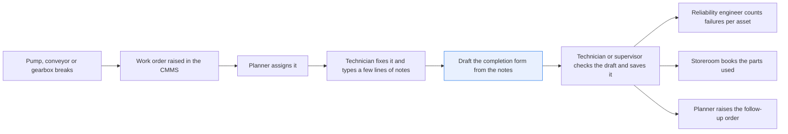
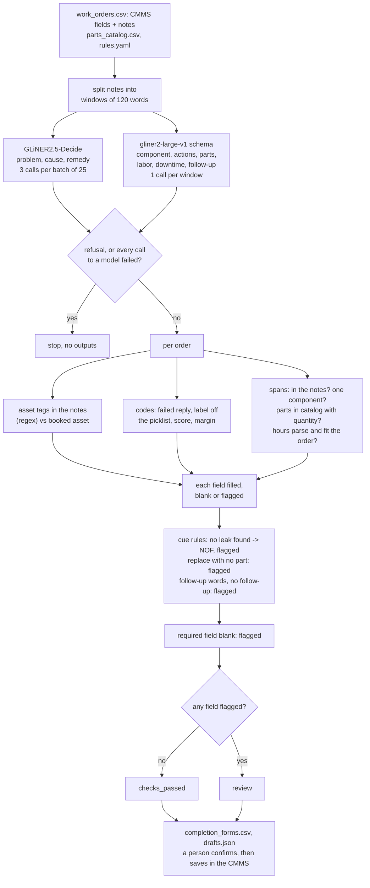

# Fill in a work-order completion form from the technician's notes

> **This example:** a maintenance team's work-order system (CMMS), where failure codes are usually
> left blank.
>
> **How it works:** a classification model picks the failure, cause and action codes from your
> picklists, and an extraction model points at the component, parts, hours and follow-up. Python
> checks codes against the picklist, parts against the catalog and hours against the time the order
> was open, and flags any field it can't back up rather than guess.
>
> **Use the same pattern for:** coding a safety near-miss report, filling a quality nonconformance
> form, closing out an inspection round.

## Background

When a pump, conveyor or gearbox breaks, someone raises a work order in the CMMS (the
computerized maintenance management system, e.g. Maximo or SAP PM). A planner assigns it, and a
technician gets it on a tablet or a shop workstation, goes out to the asset, finds the fault and
fixes it. Then comes the part nobody enjoys: closing the order. The CMMS completion form asks for
the problem, cause and remedy codes, the component that failed, what was done, labor hours, the
parts used and how many, the downtime, and whether any follow-up work is needed.

What the technician actually does, more often than not, is type a few lines in the notes box and
hit complete: "P-101 seal leaking again, product on floor. Replaced seal, flushed seal chamber."
It's 02:10, the line is down, and the form has a dozen dropdowns. Most of the fields stay blank,
or get whatever the first entry in the dropdown happens to be.

Everyone downstream pays for that:

- **The reliability engineer** counts failures per asset to find the bad actors (the few assets
  that keep failing). With blank cause and problem codes, they read the notes one by one and
  recode the history by hand before they can count anything.
- **The storeroom** loses track of what was used. A seal that was fitted but never booked against
  the order means the stock count is wrong and the reorder doesn't happen.
- **The planner** misses the follow-up. "Recommend a vibration reading next week" in the notes
  box doesn't raise a new order by itself.
- **Maintenance cost reports** are short the labor and the downtime nobody entered.

It's worth being clear about what the CMMS already knows. The work-order number, the asset the
order is booked to, the work type (corrective, preventive, inspection) and the dates are
structured fields on the order before the technician ever writes a word, and the code picklists
and the parts catalog are lists the CMMS already keeps. The recipe takes all of that as it is.
The part the CMMS can't do is read the technician's notes. That's the only part this recipe
hands to a model.

Here's the job end to end, and the step this recipe takes on:



## The problem

You want the completion form filled in from the notes the technician already wrote, so they
confirm a draft instead of filling a form from scratch. You also want every field either backed
by the notes or left blank. A field filled with a guess is worse than a blank one: the blank gets
noticed, and the guess goes into the history and gets counted.

Keyword rules handle the easy notes and then fall over. "No leak found" contains the word
"leak". "Knocking" and "rumbling" don't say "vibration". "Pump not right. Fixed." gives a rule
nothing to work with. A general chat model can read all of these, but then a generative model is
choosing the codes and making up part numbers that look right, and you'd still have to check
every answer against your picklists and catalog. I'd rather use small models that pick from your
lists and point at the words in the notes, and leave every check to plain Python.

For each work order the recipe writes a **draft completion form**: every field with its value,
the words it came from, and a status. A field is **`filled`** (backed by the notes and on the
picklist or in the catalog), **`blank`** (the notes don't say) or **`flagged`** (the recipe
couldn't check it, with the reason). The form as a whole is **`checks_passed`** when no field is
flagged, and **`review`** otherwise. Neither status is a decision. Nothing is written back to the
CMMS: the technician, or their supervisor, reads the draft, fills the gaps, fixes anything wrong
and saves the record. `checks_passed` only means they have less to read.

What a complete history enables is the bad-actor count (failures per asset over the last 90
days, the shortlist the reliability engineer works from). That count isn't part of this recipe;
it's what you get to do once the codes stop being blank.

The recipe assumes one work order per failure event. If your CMMS splits one incident into an
inspection, a repair and a follow-up order, each draft is filled on its own, and anything counted
later counts that incident more than once.

## How we'll solve it

1. **Start from the work order the CMMS already has.** The input is one row per order: `wo_id`,
   `asset_id`, `work_type`, `reported_at`, `completed_at` (UTC) and the technician's `notes`. The
   problem, cause and remedy picklists live in `rules.yaml`, and the parts catalog is a CSV
   export of the storeroom list. No model re-derives any of these.
2. **Split long notes.** Both models read about 512 tokens, so notes over 120 words are split
   into windows and merged back afterwards. That way no model quietly cuts the end off a long
   call-out report.
3. **Pick the codes from the picklists.** `fastino/GLiNER2.5-Decide` answers one choice
   question per picklist, with your codes' labels and one-line descriptions as the options, and
   returns a probability for every option. A code is filled only when it scores at least 0.50
   and beats the runner-up by at least 0.15. Each picklist has a "not stated" option: when it
   wins and clears both limits, the field stays blank, and when it wins without clearing them,
   the field is flagged like any other unsure answer. A label that isn't on the picklist is a
   failed reply, never a code.
4. **Pull the free-text fields.** `fastino/gliner2-large-v1` fills a schema: the component, the
   actions taken, the parts used, the labor, the downtime and any follow-up work. Every value
   has to be words from the notes, or it's dropped and the field is flagged.
5. **Check every field in Python.** A part number must be in the catalog exactly (a neighbouring
   number is a different part), and every part needs a quantity. A span that names two part
   numbers is flagged, since its quantities are easy to pair with the wrong part. Labor and
   downtime must parse to one duration, and must fit the order: downtime no longer than the time
   the order was open, labor no more than 4 people times that. More than one component flags
   the component. An asset tag in the notes that isn't the booked asset flags the form; that
   check is a plain regex over the notes, not a model.
6. **Apply a few plain-word rules.** Some things the models can't be trusted with, so
   `rules.yaml` has short cue lists. Notes that say the problem wasn't there ("no leak", "none
   found", "no fault found") get the no-fault code `NOF` instead of whatever the model picked,
   flagged for a person to confirm. A remedy of replace with no part booked flags parts used.
   Notes that mention follow-up work ("follow-up", "recommend", "needs replacing") with no
   follow-up extracted flag the follow-up. Problem, remedy and actions are required, so a blank
   one is flagged.
7. **Write the drafts.** One row per order in a CSV, and every field with its evidence in JSON.

GLiNER2.5-Decide is called three times per batch of 25 windows (once per picklist), and
gliner2-large-v1 once per window. If SIE refuses a call outright (a bad key, an unknown model, no
credits), the run stops with SIE's full message and writes nothing. If a call fails for a reason
that may pass (a timeout, a busy server, an over-long input), the fields that call should have
filled are flagged on the orders in it, and the run carries on. If every call to one model fails,
the run stops. A reply with the wrong number of results takes the same path as a call that
failed. A reply missing its expected key (`data`, or `data.answer.probabilities`) flags the
fields it should have filled and counts as a failed call toward that stop; an empty answer is a
real "nothing found". No generative model fills or decides anything here.

## Picking the models

**`fastino/GLiNER2.5-Decide` for the codes.** It answers a typed question about a text (pick
one, yes or no) with a probability for every option, through SIE's `extract` call. That's exactly
the shape of a CMMS picklist: your codes are the options, and the probabilities tell you when the
model is guessing. The options are plain data in `rules.yaml`, so changing your code list needs
no training. The catch is the window: the question and every option share about 512 tokens with
the notes, and the question may take at most half, which is why the descriptions are one line
each and the three picklists are three separate questions.

**`fastino/gliner2-large-v1` for the fields.** It pulls named fields out of text to a schema:
you give each field a name, a type (one string or a list) and a description, and it returns
spans of the text. Spans are what you want for a form a person has to confirm, since every
value points at the words it came from. It doesn't do arithmetic or know your catalog, so the
quantities, hours and part numbers are parsed and checked in Python. Both are small encoder
models; SIE Cloud hosts them, so there's nothing for you to run.

## The flow



## How it's built

Everything you'd change lives in `rules.yaml`: the two model IDs, the three picklists (code,
label, description), the gliner2 field schema, the required fields, the asset-tag pattern, the
cue lists and the thresholds. `recipe.py` reads the data, calls SIE and runs the checks.
`selfcheck.py` checks the parsing, the field checks, the cue rules and the SIE error rule
offline, with hand-written stand-in replies.

| Step | Code | SIE call | What it does |
| --- | --- | --- | --- |
| Load | `load_orders`, `load_catalog`, `load_rules` | | Reads the CMMS export, the storeroom list and the rules |
| Split | `windows`, `window_items` | | Notes over 120 words become windows with ids `<wo_id>#<n>` |
| Codes | `ask_codes`, `code_schema` | `extract` + `output_schema` (one choice question) on `fastino/GLiNER2.5-Decide` | One call per picklist per batch of 25 windows |
| Fields | `ask_fields`, `field_schema` | `extract` + `output_schema` on `fastino/gliner2-large-v1` | One call per window; SIE Cloud's empty-result HTTP 500 counts as "nothing found" |
| SIE errors | `call_sie`, `has_probabilities`, `has_data`, `check_calls`, `is_fatal`, `stop_message`, `stop_on_refusal` | | Transient failures and bad replies (`BadReply`: wrong length, missing key) flag fields; refusals and all-failed stop the run |
| Codes check | `code_probabilities`, `merge_probabilities`, `code_field` | | Missing key or off-picklist label is a failed reply; score and margin limits; "not stated" is blank |
| Fields check | `field_values`, `parse_part`, `parts_field`, `parse_hours`, `with_crew`, `hours_field`, `asset_field` | | Spans in the notes, one component, exact catalog match, one part number per span, quantities, durations, other asset tags |
| Cue rules | `check_cues`, `cue_in` | | No-fault words set `NOF`; replace with no part; follow-up words with no follow-up |
| Draft | `draft_form`, `draft_forms` | | Required fields, then `checks_passed` or `review` |
| Write | `write_outputs`, `form_row`, `csv_safe` | | `completion_forms.csv` (formula-looking cells quoted) and `drafts.json` |

## Run it

You need [uv](https://docs.astral.sh/uv/) and an SIE API key
([create one](https://console.superlinked.com/console/api-keys?utm_source=github&utm_medium=docs&utm_campaign=sie-cookbook&utm_content=manufacturing-fill-work-order-from-notes)).

```bash
cp .env.example .env   # then set SIE_API_KEY
uv run recipe.py
uv run selfcheck.py    # optional: offline checks, no SIE call
```

`uv run` installs this recipe's few dependencies into its own `.venv` on the first run. Each run
writes `runs/<timestamp>/`; `--output DIR` changes that. The first calls can wait a few minutes
while SIE Cloud starts the two models. With both models warm, our run of the 10 orders made 14
SIE calls (3 to GLiNER2.5-Decide, 11 to gliner2-large-v1) and took about 4 seconds.

## What came out

The input is [`data/work_orders.csv`](./data/work_orders.csv): 10 work orders with the CMMS
fields and the technician's notes, [`data/parts_catalog.csv`](./data/parts_catalog.csv) (11
parts) and the picklists in [`rules.yaml`](./rules.yaml). The work orders, notes, picklists and
parts catalog are synthetic: assets, part numbers, dates and text are invented. We looked at the
MaintIE corpus (MIT licence), but its texts carry no dates or asset IDs, and no parts or hours to
check.

Our run on 2026-11-03 (UTC) drafted 10 forms: 2 `checks_passed` and 8 `review`, with 19 fields
flagged between them.

| Planted | Order | Expected | What came out | Why |
| --- | --- | --- | --- | --- |
| Clean note | WO-26101, P-103 flange gasket | codes, component, actions, part filled; `checks_passed` | Not as planned. `review`: problem leak scored 0.436, under 0.50. Cause `AGE`, remedy `REPL`, `FG-100 x1`, 1.5 h filled | Everything the form needs is in the notes; the model was less sure than we were |
| Parts and hours | WO-26102, CV-203 | both parts with quantities, 3.5 h | As planned. `checks_passed`: `6205-2RS x2; LS-35 x1`, 3.5 h, `WEAR` / `WEAR` / `REPL` | The storeroom and cost fields |
| Vague note | WO-26103, "Pump not right. Fixed." | codes flagged; `review` | As planned. All three codes flagged (top scores 0.203, 0.410, 0.364, all "not stated") | Nothing to code from, so nothing is guessed |
| Part not in the catalog | WO-26104, impeller 44-0918 (catalog has 44-0919) | part flagged | As planned. "44-0918 is not in the parts catalog"; `WR-150 x1` kept. Actions also flagged: none found | A neighbouring part number is a different part |
| Different asset | WO-26105, booked to P-102, notes say P-104 | form flagged | As planned. "the notes name P-104 but the order is booked to P-102". Parts used also flagged: replaced, no part booked | The CMMS asset wins; a person decides which one is wrong |
| Suspected leak, none found | WO-26106, P-105 seal dry | problem no-fault or flagged, never leak | As planned. The model said leak (0.567 vs no fault found 0.279); the "no leak" cue set `NOF` and flagged it. Remedy (0.483) and actions also flagged | The word "leak" is in the notes and there's no leak |
| Follow-up needed | WO-26107, GB-501, 238 words | two windows; vibration; 2.5 h down; follow-up filled | Mostly. Two windows; `VIB`, `MISAL`; downtime 2.5 h from "03:10 to 05:40"; labor 7 h from "2 x 3.5 h"; follow-up "vibration reading". Remedy flagged (adjust 0.492), component flagged ("output shaft; coupling") | The long note, the downtime and the follow-up the planner must not miss |
| Fault found on a PM visit | WO-26108, F-402 preventive | breakage; follow-up filled | Partly. `BRK` filled; follow-up still not extracted, but now flagged by the "follow-up" cue. Cause flagged (aging 0.318 vs wear 0.306), actions flagged, parts used flagged (remedy `REPL`, no part) | The work type says preventive; the notes say something broke |
| Electrical trip | WO-26109, P-106 | electrical; replace; 0.75 h down | As planned. `checks_passed`: `ELF`, `OVLD`, `REPL`, `CT-40 x1`, 0.75 h from "45 min" | A short note that still fills most of the form |
| Part with no quantity | WO-26110, "Replaced drive belts" | part matched, quantity flagged | Partly. gliner2 still returned no parts span, but parts used is now flagged: "remedy REPL says a part went in, but no part is booked". Cause also flagged (0.499) | A part without a count can't be booked out of the storeroom |

The planted cases show the wiring working, not accuracy. Ten orders is a demo: 6 came out as
planned, 3 partly (WO-26107, WO-26108, WO-26110) and 1 not (WO-26101). We left the thresholds
alone and wrote down what happened.

- **The confident wrong answer is the one to worry about.** WO-26106 says "seal dry, no leak
  found" and GLiNER2.5-Decide still picked leak at 0.567, clearing both limits. The score and
  margin limits catch a model that's unsure; they can't catch one that's sure and wrong. A
  short cue list in `rules.yaml` now does, for this wording:

  ```csv
  wo_id,asset_id,work_type,status,problem,cause,remedy,component,actions,parts_used,labor_h,downtime_h,follow_up,flagged_fields,reasons
  WO-26106,P-105,corrective,review,NOF,CONT,,P-105 seal,,,0.5,,,problem; remedy; actions,problem: the notes say 'no leak'; set to NOF instead of LEAK; remedy: top option clean scored 0.483 < 0.50; actions: required on every closed order
  ```

  The cause on the same row is contamination at 0.779, and WO-26105 got contamination at 0.800,
  with nothing in either note about why the part failed. No cue catches that, which is why every
  draft goes past a person.
- **A miss by gliner2 used to be a quiet blank.** On WO-26110 it returned no parts at all, and
  on WO-26108 "raise a follow-up order for a new guard" didn't come back as a follow-up. Neither
  model got better; the cross-checks now notice. A replace remedy with nothing booked flags parts
  used (WO-26105, WO-26108, WO-26110), and follow-up words with no follow-up flag the follow-up.
- **The near miss works where the model hands over the span.** WO-26104 came back with
  "impeller 44-0918" and the exact catalog match flagged it, keeping `WR-150 x1`. A span that
  holds two part numbers at once is flagged as well, but in this run gliner2 returned one span
  per part, so that check only shows up in `selfcheck.py`.
- **Our own regex was the first bad actor.** On the first run the asset-tag pattern
  (`[A-Z]{1,3}-\d{3}`) also matched part numbers, so the recipe flagged WO-26101 for naming
  "FG-100" as another asset. A tag that's a catalog part number is now treated as a part.
- **Three thresholds, three near misses of their own.** Remedy scored 0.492 on WO-26107 and
  0.483 on WO-26106, and cause 0.499 on WO-26110, all just under 0.50. They're starting values,
  not tuned ones, and we didn't move them to make the table look better.

## Potential improvements

- **Your own picklists.** Put your CMMS's codes in `picklists` in `rules.yaml`, one entry per
  code, and keep a `code: null` "not stated" option in each. The question and its options share
  about half of GLiNER2.5-Decide's 512-token window, so keep each description to one line.
- **The thresholds.** `min_code_score`, `min_code_margin`, `max_crew` and the window size are
  starting points. Check them on your own orders.
- **The field schema.** `fields` in `rules.yaml` names each gliner2 field, its type and its
  description; `required` lists the fields a closed order must have.
- **The asset-tag pattern.** `asset_tag_pattern` is a regex for how your site writes tags.
  Checking tags against an asset register export would catch a tag that's mistyped too.
- **The models.** `models` in `rules.yaml` names the two models, one line each.
- **The cue lists.** `cues` in `rules.yaml` holds the no-fault words, the remedy codes that need
  a part, and the follow-up words. They are short on purpose: add your technicians' own
  wording, and expect a cue to fire on a note that mentions one problem found and another not
  found (it only flags; a person decides).
- **Sentence windows.** Splitting on sentence ends instead of every 120 words, and sending
  windows that disagree on a code to review, would keep a finding and its negation together.
- **One incident, one count.** Taking the CMMS parent or follow-up link as a column would let a
  later count group an inspection, a repair and a follow-up into one failure.
- **A code hierarchy.** ISO 14224 ties failure modes to equipment classes; filtering the
  picklist by the asset's class would cut options that can't apply.

## Try another model

Each model is one line under `models:` in `rules.yaml`. We swapped one model at a time, changed
nothing else, and ran the recipe on SIE Cloud on 2026-11-03 (UTC).

| `rules.yaml` key | Swap in | What happened on this data |
| --- | --- | --- |
| `fields` | `fastino/gliner2-base-v1` | 0 of 10 `checks_passed` instead of 2. Actions came back empty on 5 orders (WO-26102, 26103, 26104, 26108, 26109). It missed the parts on WO-26101 (flagged by the replace-needs-a-part rule) and the impeller on WO-26104, so the 44-0918 near miss wasn't flagged. On WO-26107 window 1 the reply had no `data` key: 1 of 11 calls counted as failed, and all six span fields were flagged. Codes unchanged |

SIE Cloud has no other model with GLiNER2.5-Decide's API for `codes` yet. SIE's catalog has
`fastino/GLiNER2.5-Decide-1B` and `fastino/GLiNER2.5-multi-Decide` to self-host; we have not run
them here. See [MODELS.md](../../MODELS.md) for every model these recipes use.

## Run it on your own SIE

The same code runs against an SIE server you host. Set `SIE_BASE_URL` in `.env`; an API key
is then optional. The table gives the SIE v0.10.1 image each model runs on, from SIE's
[compatibility matrix](https://github.com/superlinked/sie/blob/main/docs/compatibility.md).

| `rules.yaml` key | Model | Image | Tested on |
| --- | --- | --- | --- |
| `codes` | `fastino/GLiNER2.5-Decide` | `cuda12-transformers5` | L4 |
| `fields` | `fastino/gliner2-large-v1` | `cuda12-default` | L4 |

One SIE server runs one image, so these 2 images need a cluster: the
[sie-cluster Helm chart](https://github.com/superlinked/sie/tree/main/deploy/helm/sie-cluster)
with one worker pool per image routes each model to its pool. See
[SELF_HOSTING.md](../../SELF_HOSTING.md) for the values file.

## Files

- `recipe.py`: the pipeline
- `selfcheck.py`: offline checks with stand-in replies, no SIE call
- `rules.yaml`: picklists, field schema, required fields, asset-tag pattern, cue lists,
  thresholds, model IDs
- `data/work_orders.csv`: the synthetic work orders (CMMS fields and notes)
- `data/parts_catalog.csv`: the synthetic storeroom list
- `pyproject.toml`, `uv.lock`: this recipe's dependencies

See the SIE [classify](https://superlinked.com/classify?utm_source=github&utm_medium=docs&utm_campaign=sie-cookbook&utm_content=manufacturing-fill-work-order-from-notes) task page.
