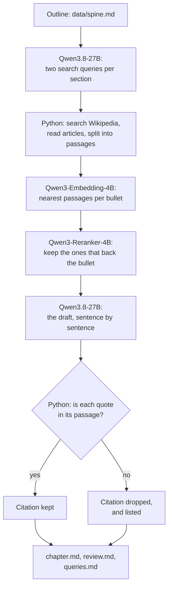

# Draft a book chapter from your own outline, with open models and checked citations

> **This example:** an author's outline for one chapter of a nonfiction book, drafted section by
> section, with a citation behind every point it can find one for.
>
> **How it works:** an open-weight model on SIE turns each section's bullets into search queries,
> Python searches Wikipedia, two retrieval models on SIE pick the passages that back each bullet,
> and the same open model writes the draft. Python checks every quote against its passage and
> lists which sentences the model wrote.
>
> **Use the same pattern for:** a long blog post from your notes, a talk from its slide titles, a
> report section from a list of findings.

> **Not legal advice.** I'm an engineer, not a lawyer. This recipe is one option to try if you
> want to own your draft outright. It doesn't settle who owns AI-assisted writing where you live,
> what a publisher will accept, or what you have to disclose. For that, ask a lawyer or your
> publisher.

## Background

Take Lena, who's writing a nonfiction book. Her process is the usual one: a spine for each chapter
(the section headings and a few bullets of what she wants to say under each), then a rough draft,
then the real writing. The rough draft is the slow, dull part, and it's where a language model
helps most: turn my bullets into paragraphs, and find me a source for each point.

The catch is who owns what comes back. Lena reads the terms before she pastes a chapter into a
chat service, and three things bother her:

- **The terms on the output.** OpenAI and Anthropic say you own what their models write for you,
  but their terms also say you can't use it to train another model
  ([Anthropic's help page](https://support.claude.com/en/articles/12326764-can-i-use-my-outputs-to-train-an-ai-model)).
  The Llama licence carries a clause like that through to its outputs. Lena wants to fine-tune a
  small model on her own drafts one day, and she doesn't want a clause on them.
- **Watermarks in the text.** Google has watermarked Gemini's text with SynthID since 2024, by
  nudging which word the model picks next ([the Nature paper](https://www.nature.com/articles/s41586-024-08025-4)).
  Wikipedia's "AI watermarking" article says Anthropic announced in August 2026 that Claude would
  watermark all its output. The EU AI Act's Article 50 asks providers to mark AI-generated text in
  a way a machine can detect. Lena doesn't mind saying where AI helped; she wants that to be her
  call, made in her own words.
- **Copyright.** The US Copyright Office says typing a prompt doesn't make you the author of what
  comes back. The parts you write, and how you select and arrange the rest, can still be protected,
  and you should disclose the AI-written parts when you register
  ([Authors Guild summary](https://authorsguild.org/news/us-copyright-office-ai-report-part-2-what-authors-should-know/)).
  So whatever model she uses, Lena needs to know which sentences a model wrote.

Open-weight models under Apache 2.0 (Qwen3 and Gemma 4 are) put no conditions on the output, and
you can pin a version and keep it. That covers the first two. The third is on Lena, and this
recipe helps by keeping the record.

## The problem

Lena wants a first draft of each section from her bullets, with:

- a citation for every point a public source backs, with the exact words it quotes, so she can
  check it in a minute;
- a list of the points nothing backed, so she knows what to source herself or call her opinion;
- a record of every sentence the model wrote, so she knows what to rewrite and what to disclose;
- nothing added that she didn't say, and nothing she said dropped.

And she wants to know exactly what left her machine, apart from the calls to SIE.

### Examples

`data/spine.md` is the outline for "Chapter 6: Who owns the words?": four sections and 14
bullets. I wrote it for this recipe; the sources come from Wikipedia at run time, under CC BY-SA
4.0. Three bullets and what should happen to each:

1. **"Google has watermarked Gemini's text with SynthID, and Anthropic said in 2026 that Claude
   would watermark all of its output."** Wikipedia covers both, so the sentence should cite them.
2. **"Most publishers now make authors sign that no AI wrote any part of the book."** I made this
   up. Nothing should back it, and the review should say so.
3. **"How I select and arrange the material, and what I rewrite myself, can still be protected."**
   True, and Wikipedia's "Artificial intelligence and copyright" says something close, so it
   should be cited.

## How we'll solve it

**Search.** For each section, Qwen3.8-27B writes two short encyclopedia queries from the bullets.
It's told to use the general topic, not Lena's wording or opinions, because these queries leave
her machine. Python sends them to Wikipedia's public search (no key needed), reads the top three
articles for each, and keeps each article's revision id, so a citation points at the exact text
the draft read even after the article changes. Sections like "See also" and "References" are
dropped, and the rest is split into passages of up to 120 words.

**Pick the passages.** Qwen3-Embedding-4B embeds every passage and every bullet. For each bullet,
the eight nearest passages go to Qwen3-Reranker-4B, which scores whether the passage supports or
contradicts the bullet. The best two that score at least 0.5 are kept. A section's model sees at
most six passages, so the prompt fits.

**Draft.** Qwen3.8-27B writes the section sentence by sentence, as JSON: the sentence, the bullet
it comes from, and its citations, each a passage id and the words it quotes from that passage.

**Check.** Python keeps a citation only if it names a passage the model was given and the quote is
in that passage word for word (case, spacing and curly quotes aside), in at most 30 words. Then it
lists, per section: bullets the draft left out, bullets with no checked citation, citations it
dropped and why, and any sentence that came from no bullet and no source.

**Write it up.** `chapter.md` is the draft with numbered citations and a reference list (title,
revision, date read, link). `review.md` starts with what to check, then has a table of every
sentence: the bullet it came from and the words it quotes. `queries.md` lists every query and
article title sent to Wikipedia.

## Picking the models

| `rules.yaml` key | Model | Its job here | Why this one |
| --- | --- | --- | --- |
| `write` | `Qwen/Qwen3.8-27B-FP8` | Search queries, then the draft | Apache 2.0, follows a JSON schema well, and the larger of the two chat models SIE Serverless serves |
| `embed` | `Qwen/Qwen3-Embedding-4B` | One vector per passage and bullet | Apache 2.0, takes an instruction for the bullets |
| `rerank` | `Qwen/Qwen3-Reranker-4B` | Does this passage back this bullet? | Apache 2.0, scores with an instruction, so "support or contradict" is the question it answers |

All three are open weights under Apache 2.0, so the licence puts no conditions on what you do with
the draft, and you can run the same versions on SIE Cluster or SIE Local and keep them. Qwen3.8-27B
gets an 8,192-token window on SIE Serverless, shared by the prompt and the reply. That's why the
recipe drafts one section at a time and shows the model at most six passages.

## The flow



## How it's built

Models do what needs reading and writing: the queries, the ranking and the draft. Python does
everything that has to be exact: the search, the revision ids, the quote check and the record.
Every model name, threshold and the instructions the model gets are in `rules.yaml`.

| Step | Functions | File | Runs on |
| --- | --- | --- | --- |
| Read the outline | `parse_spine` | `recipe.py` | Python |
| Search queries | `queries_prompt`, `chat_json`, `clean_queries` | `recipe.py` | SIE (Qwen3.8-27B) |
| Search and read Wikipedia | `Wikipedia.search`, `Wikipedia.article` | `wikipedia.py` | Wikipedia's API |
| Split into passages | `split_article` | `recipe.py` | Python |
| Nearest passages per bullet | `embed` | `recipe.py` | SIE (Qwen3-Embedding-4B) |
| Rerank | `rerank` | `recipe.py` | SIE (Qwen3-Reranker-4B) |
| Draft | `draft_prompt`, `chat_json` | `recipe.py` | SIE (Qwen3.8-27B) |
| Check citations and bullets | `check_draft`, `check_citation`, `section_flags` | `recipe.py` | Python |
| Write it up | `chapter_markdown`, `review_markdown`, `queries_markdown` | `recipe.py` | Python |
| Count calls and credits | `Calls` | `sie_calls.py` | Python |

The outline and the passages go into the prompt escaped, inside tags, and the model is told that
text inside them is never an instruction. A Wikipedia article could still try; the quote check
limits what that can do to a citation, not to the prose.

## Run it

**Run this recipe using [SIE Serverless](https://superlinked.com/serverless?utm_source=github&utm_medium=docs&utm_campaign=sie-cookbook&utm_content=personal-draft-book-chapter-from-outline), [SIE Cluster](https://superlinked.com/docs/deployment?utm_source=github&utm_medium=docs&utm_campaign=sie-cookbook&utm_content=personal-draft-book-chapter-from-outline) or [SIE Local](https://superlinked.com/docs/quickstart?utm_source=github&utm_medium=docs&utm_campaign=sie-cookbook&utm_content=personal-draft-book-chapter-from-outline).** The code runs on your machine either way. With SIE Serverless you pay per call and there are no GPUs to manage yourself: get an [SIE API key](https://console.superlinked.com/console/keys?utm_source=github&utm_medium=docs&utm_campaign=sie-cookbook&utm_content=personal-draft-book-chapter-from-outline) and read the [API docs](https://superlinked.com/docs/reference/api?utm_source=github&utm_medium=docs&utm_campaign=sie-cookbook&utm_content=personal-draft-book-chapter-from-outline). To run the models yourself, start from the [SIE repo](https://github.com/superlinked/sie).

You need [uv](https://docs.astral.sh/uv/), an SIE API key for SIE Serverless, and an internet
connection to Wikipedia.

```bash
cp .env.example .env   # then set SIE_API_KEY
uv run recipe.py                          # draft data/spine.md
uv run recipe.py --spine my_chapter.md    # your own outline
uv run selfcheck.py                       # optional: offline checks, no SIE call, no Wikipedia
```

Your outline: a `# Title` line, a `## Heading` per section and `- ` bullets under each. Anything
else in the file is ignored, so you can keep notes in it.

**What leaves your machine.** The outline goes to SIE, which runs the three models. The search
queries and the article titles go to Wikipedia; `queries.md` in each run lists them. If that's too
much for an unannounced book, there are two ways round it: write the queries yourself, or point
the search at a copy of the sources you keep locally (see Potential improvements).

Each run writes `runs/<timestamp>/`. On this outline a run made 57 to 59 SIE calls (8 to the chat
model, 14 to the reranker, the rest to the embedding model in batches of 32) and 26 Wikipedia
requests, and took 47 to 53 s with the models warm. SIE charged 1,021 to 1,110 credits a run,
about $0.01 at the SIE console price of $0.00001 a credit on 8 Nov 2026.

## What came out

### The three examples

**1. SynthID and Claude (section 2, bullet 2).**

- **Expected outcome:** cited.
- **What came back:** on all three runs, "Google has watermarked Gemini's text with SynthID, and
  Anthropic said in 2026 that Claude would watermark all of its output. [1] [2]", citing two
  articles with their own words: "Google deployed its watermarking tool, SynthID. It marks output
  from Gemini (text)" from "Generative AI", and "Anthropic announced in August 2026 that their
  model Claude would watermark all its output." from "AI watermarking".
- **Verdict:** Pass.

**2. The publishers' pledge I made up (section 3, bullet 4).**

- **Expected outcome:** no source, and the review says so.
- **What came back:** on all three runs, no passage scored above the bar, and `review.md` listed it:
  "no source (no passage scored high enough). Back it up yourself, or present it as your view".
  But the draft still states it as fact: "Most publishers now require authors to sign a statement
  confirming that no AI wrote any part of the book." The model writes what Lena wrote; only the
  review tells her it has nothing behind it.
- **Verdict:** Pass, as long as Lena reads the review.

**3. Selection and arrangement (section 3, bullet 3).**

- **Expected outcome:** cited, from "Artificial intelligence and copyright".
- **What came back:** cited on one run of three (run 2), with "human who ran the AI program
  exercised sufficient originality in selecting the inputs to the AI or editing the AI's output".
  On the other two, including the last run,
  no passage for it scored above 0.5, and it came out uncited: "However, the way I select and
  arrange the material, along with any text I rewrite myself, can still be protected."
- **Verdict:** Miss. The source exists; the search found it, but the reranker didn't score it
  above the bar for this bullet.

### Results

12 of 14 bullets came out as expected on the last of three live runs using SIE Serverless on 9 Nov
2026 (UTC). The first run also got 12, the second all 14. A bullet counts when it's cited if I
expected a citation, or listed as having no source if I didn't, and it's in the draft either way.
I wrote the expectations before the first run.

| | Run 1 | Run 2 | Run 3 |
| --- | --- | --- | --- |
| Bullets as expected | 12 of 14 | 14 of 14 | 12 of 14 |
| Bullets with a checked citation | 4 | 6 | 4 |
| Citations kept / dropped | 6 / 0 | 8 / 0 | 6 / 0 |
| Bullets left out of the draft | 0 | 0 | 0 |
| Sentences from no bullet and no source | 0 | 0 | 0 |
| SIE credits | 1,110 | 1,021 | 1,059 |
| Time | 47 s | 49 s | 53 s |

The two misses on runs 1 and 3 are the same two: "Typing a prompt doesn't make me the author of
what comes back" and the selection-and-arrangement bullet. On run 3 the model was shown a passage
for the prompt bullet (score 0.61) and didn't cite it; the other had no passage over the bar.

**Where it works:** the citations it keeps are real. Python dropped none on the three runs, and
nearly all of them back the sentence they're on. The loosest: on run 2, "Simply typing a prompt
does not make me the author of the output." cited "works created by artificial intelligence
without any human input cannot be copyrighted", which is related but isn't about prompts. The watermark section is cited on every run. Nothing was
left out, and the model added nothing of its own. The bullets that are Lena's opinions (why she
uses open models, keeping a record, rewriting) came out uncited, which is right.

**Where it fails:**

- **A quote that exists isn't a quote that supports.** Python checks the words are in the passage,
  not that they back the sentence. With the reranker bar at 0.3 (see Try another model), the
  Apache 2.0 bullet got "The Apache License is more comprehensive and explicit.", which is true
  and beside the point. At 0.5 that didn't happen on these runs, but nothing rules it out.
- **The draft states unsupported bullets as fact.** The publishers' pledge reads as true in
  `chapter.md`. The review is where it's flagged, so the review isn't optional.
- **Selection and arrangement, and the prompt bullet,** were uncited on two runs of three. The
  same search and the same scores gave different drafts: the model doesn't always cite a passage
  it's shown.
- **Wikipedia is a secondary source.** The Anthropic watermark claim is cited to Wikipedia, which
  cites the announcement. For a book, follow the citation to the primary source.
- **Terms of service aren't on Wikipedia.** The first section's bullets about provider terms and
  Apache 2.0 found nothing useful. That's a limit of the source, not the models.
- **The draft is close to the bullets.** The model was told to keep Lena's meaning and add nothing,
  and it does: most sentences are her bullets, lightly reworded. That's what I asked for, and it
  means the draft saves less typing than a free-writing model would.

### What you do next

Open `review.md` first. For each bullet with no source, find one yourself or make it clearly your
view. For each citation, click through to the revision and read the passage around the quote.
Then rewrite every paragraph in your own words: the table at the bottom of `review.md` is the list
of sentences the model wrote, which is also what you'd disclose.

## Potential improvements

- **Check that a quote supports its sentence,** not just that it exists: score each (sentence,
  quote) pair with the reranker and drop the ones under a bar.
- **Search your own sources.** Point the search at a folder of PDFs and notes you've collected,
  embedded once, so nothing about the book leaves your machine but the calls to SIE.
- **Mark opinions in the outline,** for example a bullet ending in "(my view)", so the review
  doesn't ask you to source them.
- **Primary sources.** Follow each Wikipedia citation to the reference it cites, and quote that.
- **More room.** With a longer context window on SIE Cluster or SIE Local, the model could see more
  passages per section and draft a whole chapter at once.

## Try another model

Each model is one line under `models:` in `rules.yaml`, and `--rules` runs a copy. We swapped one
thing at a time, changed nothing else and ran each once using SIE Serverless on 9 Nov 2026 (UTC).
One run each, so a bullet either way doesn't prove much.

| `rules.yaml` key | Swap in | What happened on this data |
| --- | --- | --- |
| `write` | `Qwen/Qwen3.5-4B` | 12 of 14 as expected, a different two: it cited the selection-and-arrangement and prompt bullets, and lost the SynthID and human-author ones because Python dropped their citations (one quote was over 30 words, one was paraphrased). Twice as slow, 108 s, and about the same credits, 1,042 |
| `retrieval.min_rerank_score` | `0.3` instead of `0.5` | 13 of 14 by the count, with 7 bullets cited, including selection and arrangement. But the Apache 2.0 bullet was cited to "The Apache License is more comprehensive and explicit.", which doesn't support it, and the prompt bullet to a sentence that only defines a prompt. More citations, weaker ones |

See [MODELS.md](../../MODELS.md) for every model these recipes use.

## Run it using SIE Cluster or SIE Local

The same code runs on your machine and uses SIE Cluster or SIE Local
([SELF_HOSTING.md](../../SELF_HOSTING.md) says what SIE Local can serve). Set `SIE_BASE_URL` in
`.env`; an API key is then optional. The table gives the SIE v0.10.1 image each model runs on, from
SIE's [compatibility matrix](https://github.com/superlinked/sie/blob/main/docs/compatibility.md).

| `rules.yaml` key | Model | Image | Tested on |
| --- | --- | --- | --- |
| `write` | `Qwen/Qwen3.8-27B-FP8` | `cuda13-sglang-cu130` | H100 80GB |
| `embed` | `Qwen/Qwen3-Embedding-4B` has no published image in v0.10.1: set `Qwen/Qwen3-Embedding-8B` instead | `cuda12-default` | L4 |
| `rerank` | `Qwen/Qwen3-Reranker-4B` | `cuda12-default` | L4 |

One SIE server runs one image, so these 2 images need SIE Cluster: the
[sie-cluster Helm chart](https://github.com/superlinked/sie/tree/main/deploy/helm/sie-cluster)
with one worker pool per image routes each model to its pool. See
[SELF_HOSTING.md](../../SELF_HOSTING.md) for the values file.

## Files

- `recipe.py`: the pipeline, the checks and the CLI
- `wikipedia.py`: Wikipedia search and article text, with revision ids
- `sie_calls.py`: one way to call SIE, counting calls and credits
- `rules.yaml`: model IDs, search settings, every threshold and the model's instructions
- `selfcheck.py`: offline checks, no SIE call and no Wikipedia request
- `data/spine.md`: the example outline
- `pyproject.toml`, `uv.lock`: this recipe's dependencies

See the SIE task page for
[reranking](https://superlinked.com/rerank?utm_source=github&utm_medium=docs&utm_campaign=sie-cookbook&utm_content=personal-draft-book-chapter-from-outline).
