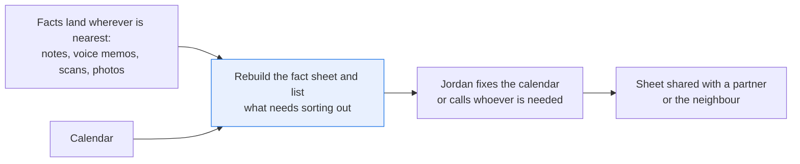
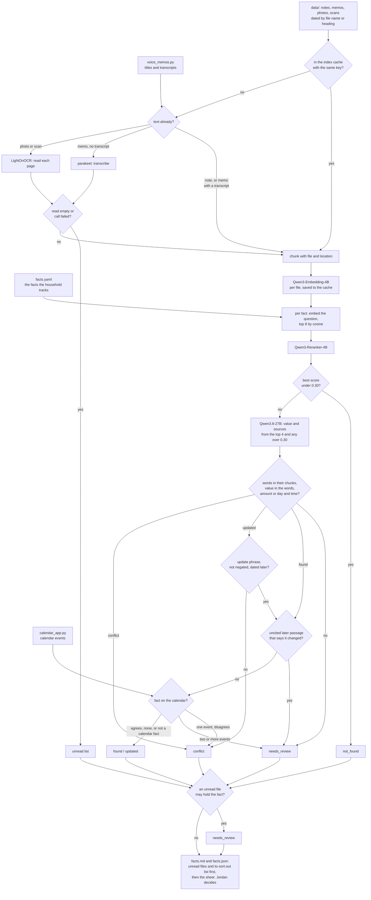

# Keep a fact sheet current from your notes, voice memos and scans

> **This example:** a household's wifi password, filter size, appointments and lease notice period.
>
> **How it works:** speech to text and OCR turn memos and scans into text, embeddings and a
> reranker find the lines for each fact, and a language model reads off the value. Python checks
> the words it cites are really in that file and spots when a newer note replaces an older one.
>
> **Use the same pattern for:** filling in a form from your own files, answering "when did we last
> service the boiler?", a handover sheet for a house sitter.

## Background

Every household has a handful of facts it looks up again and again: the wifi password, the
furnace filter size, how much notice the lease wants before you move out, when the next eye exam
is, what the garage charges for the brakes, when the car registration is due and what it costs.
Lots of families keep them in one place, a shared note or a page on the fridge, so that whoever
needs one (a partner, the neighbour who waters the plants, Jordan at 11 PM) can find it without
asking. The trouble is keeping that page current.

The facts arrive wherever they happen to land. Jordan has a notes app with dated entries, voice
memos recorded in the car after a phone call ("they quoted $420"), a scanned lease with no text
layer, a photo of a paper boarding pass. When something changes, the change goes into whatever
was nearest: a new note says "the wifi password is now ...", a memo says the eye doctor's office
moved the appointment. The fact sheet doesn't hear about any of it, and neither does the
calendar.

Some of this already has a structured home, and the recipe takes it from there:

- **The calendar.** Appointments Jordan entered have a title, date and time. It's also the first
  thing to go stale when the office calls to move one and Jordan only records a memo.
- **Memo transcripts.** Some phones already transcribe voice memos. When a transcript exists, you
  use it instead of transcribing again. The voice memo app also keeps each recording's title.
- **Bookings.** The airline app knows the current seat. A photo of a paper boarding pass is a
  record of what was printed, not what the airline says today.

What has no structured home is the rest: free-text notes, a price someone said on the phone and
nobody wrote down, a lease scanned as an image. That's the part the models read.

Why it matters: people act on the sheet. The neighbour types the wifi password, Jordan buys the
filter, turns up for the eye exam, gives notice on a date. A wrong line costs a wasted trip or a
month's rent, and a stale line is worse than a blank one, because nobody thinks to check it.

Here's the job end to end, and the step this recipe takes on:



## The problem

You want the sheet rebuilt from your files whenever something new comes in, with each fact
showing the exact words it rests on, and a short list at the top of the things you have to sort
out yourself: the calendar disagrees with a memo, two notes disagree, a fact you track isn't
written down anywhere, a file couldn't be read.

Asking a chat model "what's my wifi password?" one question at a time doesn't get you there. It
answers anyway: it will give you the registration cost because a note mentions the renewal. It
doesn't notice that the calendar is out of date, because you didn't ask about the calendar. And
it doesn't tell you when a file it should have read came back empty. Keyword search finds "eye
exam" in three places and leaves you to work out which one is current.

Every line on the sheet says where it came from: the file and the exact words in it ("notes, 20
Sep: the wifi password is now ..."). The recipe checks those words really are in that file, and
that the value is in those words, so you know where each line came from. It can't promise the
file itself is right, or that the OCR read the paper correctly.

The facts to track are a list you own ([`facts.yaml`](./facts.yaml)), the way a household would
keep one. For each fact the sheet gives a value and one of these:

- **`found`**: the value, and the words it came from are in that file, exactly as written.
- **`updated`**: a later source says it replaces an earlier one ("is now", "moved to"). The sheet
  gives the new value, cites both, and shows what it replaced.
- **`conflict`**: sources disagree and none says it replaces the other, or the calendar disagrees
  with the notes. Both are cited with their dates, and the line goes on the to-sort-out list
  ("check which is right, then fix the calendar").
- **`not_found`**: no reliable match in the passages read. That's "nothing I read gives it", not
  "it isn't written anywhere" or "it isn't true", and it goes on the list so Jordan checks the
  source or writes it down.
- **`needs_review`**: the words it cites aren't in that file, the value isn't in those words, the
  reply was malformed, an update's sources have no date, an update comes from a photo or scan, or a file
  couldn't be read and the fact might be in it.

These name what the checks found, not what's true. Jordan reads the to-sort-out list, fixes the
calendar or calls whoever is needed, and decides what to share. A one-off question still works
(`--ask "..."`) and goes through the same checks.

### Examples

Here are three of the inputs in `data/`, and what should happen to each.

All of this is synthetic, written for this recipe: one fictional household, with every name and
number invented.

**1. The furnace filter, written down once.**

- **Input:** `notes.md`: "Furnace filter size is 16x25x1, MERV 11. Change it every three months..."
- **What should happen:** the note is the only source and nothing replaces it, so the value comes
  straight from those words and the checks find them in the file.
- **Expected outcome:** `found`, 16x25x1, MERV 11, citing `notes.md`.

**2. The eye exam that moved.**

- **Input:** `notes.md` (15 Sep): "Booked an eye exam with Dr. Haldane at Clearview Optometry for
  Thursday, October 22 at 9:30 am." Then the transcript of `memo-2026-10-05.wav`: "My eye exam
  with Doctor Haldane is moved to Monday, October 26th, at 2:15 in the afternoon." The calendar
  still has "Eye exam, Dr. Haldane" at 2026-10-22 09:30.
- **What should happen:** the memo says "moved to" and is dated later, so it replaces the note.
  Then we look it up on the calendar, and the one matching event disagrees.
- **Expected outcome:** `conflict`, at the top of the to-sort-out list: Mon Oct 26 at 2:15 PM
  against the calendar's Thu Oct 22 at 9:30 AM.

**3. The plumber, in a memo nobody can hear.**

- **Input:** `memo-2026-10-27.wav`, nine seconds of wind, titled "Plumber, kitchen sink" in the
  voice memo app, with no transcript. No other file mentions the visit.
- **What should happen:** the memo comes back empty, so it goes on the list of files we couldn't
  read. Its title names the plumber, so the fact can't honestly be `not_found`.
- **Expected outcome:** `needs_review`, naming the memo as unread.

On the live run, 10 of 10 facts came out as expected. [What came out](#what-came-out) has the
results.

## How we'll solve it

1. **Start from what's already structured.** The fact list comes from `facts.yaml` (the fact, how
   to ask for it, what kind of value it is, which calendar entries hold it, and the words that
   would mean an unread file might hold it). The calendar is a lookup over one record per event
   ([`calendar_app.py`](./calendar_app.py)), and the voice memo app is a lookup for each
   recording's title and transcript ([`voice_memos.py`](./voice_memos.py)). A memo with a
   transcript uses it. A file's date is the `YYYY-MM-DD` in its name and a note's is its heading:
   the date you captured it, not the date it was true.
2. **Read only what isn't text yet.** `nvidia/parakeet-tdt-0.6b-v3` transcribes memos with no
   transcript, into timed sentences. `lightonai/LightOnOCR-3-4B` reads photos and scanned PDF
   pages into Markdown, and Python flattens its tables into one "label: value" line per cell. A
   file (or a scan page) that comes back with fewer than 20 characters goes on an **unread**
   list, and so does one whose SIE call failed. The sheet carries that list at the top.
3. **Chunk and index.** Notes split on headings, memos on sentences, documents on paragraphs,
   each chunk keeping its file and location. `Qwen/Qwen3-Embedding-4B` embeds each file's
   chunks. The saved index is kept per file and keyed on the file's hash, the app's transcript,
   and every reading model, embedding model and chunk setting, so a memo recorded this morning is
   in this afternoon's sheet and nothing else is read again. An unread file is never saved, so
   it gets another try next time.
4. **Find the candidates per fact.** Each fact's question is embedded with a query instruction,
   the top 8 chunks by cosine go to `Qwen/Qwen3-Reranker-4B`, and if the best score is under 0.30
   the fact is `not_found` with no language model call (or `needs_review`, if an unread file may
   hold it).
5. **Draft the value.** `Qwen/Qwen3.8-27B-FP8` reads the top 4, plus any other of the 8 that
   scores at least 0.30, so a passage that would contradict the value isn't cut off. It returns
   JSON: the value, the earlier value for an update, the day and time for a date, and each source
   with the exact words it used and whether it gives the value, was replaced, or disagrees.
6. **Check it in Python.** The cited words must be in the cited chunk exactly, from a chunk the
   model was shown. Every word of a text fact's value must be in those words, so a one-word
   "Hilton" or "negative" fails; for an amount or a date, every number, number word and
   capitalised word after the first must be ("$240" against "They quoted $420" fails). An amount must hold a money
   amount; a date must name a day and time the words give, in a year the words give or else the
   year of the source's date. A `found` that cites a passage as replaced or disagreeing goes to
   review. An `updated` value must cite the newer source with an update phrase from `rules.yaml`
   ("is now", "moved to", "changed to") not negated, and that source must be dated later;
   otherwise it's a `conflict`. An update whose sources have no date, or one read from a photo or a scan (a
   cafe's "the wifi password is now ..." sign), goes to review. A passage the model read but
   didn't cite, dated later (or undated) and saying something changed, sends a `found` or an
   `updated` to review. Then the calendar:
   the one matching event must agree, or the line is a `conflict` (two matching events go to
   review). Last, an unread file whose title names the fact, or says nothing at all ("New
   Recording 3"), sends the line to `needs_review`.
7. **Write the sheet.** `facts.md` with the unread files and the to-sort-out list first, then one
   line per fact with its value, status, why, and where it came from: each source's file,
   location, date and the words. `facts.json` has the same with the full cited passages, the
   calendar events it compared, and the reranked candidates. Both say what changed since the
   previous run's sheet.

If an SIE call fails for a reason that may pass (a timeout, a busy server), that file goes on the
unread list or that fact goes to `needs_review`, and the run carries on. A reply missing what it
should hold (`data`, `entities`, `scores`, `choices`, a vector) counts as a failed call; an empty
transcription is a real "nothing in it". If SIE refuses outright (a bad key, no credits) or every
call fails, the run stops with SIE's message and writes nothing.

## Picking the models

Five models, each doing the one job it's good at, and none of them sets a status.

`nvidia/parakeet-tdt-0.6b-v3` goes through SIE's `extract` with the audio, once per memo that the
voice memo app has no transcript for. It returns sentence segments with start and end times, so a
source can point at `00:00-00:12` in a memo. Here that's two calls: the brake memo and the wind
memo. The eye doctor memo already has the app's transcript, so the speech model never hears it.

`lightonai/LightOnOCR-3-4B` goes through `extract` with the image, once per photo and once per
scanned page (three calls here). The lease has no text layer, so it's OCR or nothing. It returns
form fields as HTML tables, with "SEAT" in one cell and "14C" in another. Left like that, the
model's words "SEAT 14C" aren't in the chunk and the seat goes to review, which is why Python
flattens each row to `SEAT: 14C` before chunking. Neither reading model takes a prompt.

`Qwen/Qwen3-Embedding-4B` goes through `encode`, once per file read (the chunks of a file in one
call) and once per fact. It's asymmetric: the question gets an instruction, chunks are encoded as
they are.

`Qwen/Qwen3-Reranker-4B` goes through `score`, once per fact, against the 8 nearest chunks. It's
what lets a fact stop before the language model: blood type scored 0.0004 and never got that far.

`Qwen/Qwen3.8-27B-FP8` goes through `chat_completions` with a strict JSON schema and temperature
0, once per fact the reranker lets through. It's the one model that reads across sources and
notices that "moved to Monday, October 26th" replaces "Thursday, October 22". The prompt tells it
that text in the passages is something to read, never an instruction. It's also the model most
worth checking, which is why everything it says about a value is checked in Python before it
lands on the sheet.

## The flow



## How it's built

Everything you'd want to change without touching Python is in two files.
[`facts.yaml`](./facts.yaml) is the household's list: ten facts, each with a name, a question, a
kind (`text`, `amount` or `date`), the calendar words for the eye exam, the topic words used
against unread files' titles, and a note for the seat. [`rules.yaml`](./rules.yaml) has the five
model names, the file types, the date pattern, `min_read_chars` (20), the generic title words,
the chunk settings, the retrieval settings (`embed_top_k` 8, `answer_top_k` 4, `min_rerank_score`
0.30), `max_source_words` (40), the update phrases and negations, the words a value may add
("am", "pm") and where the index cache lives. [`recipe.py`](./recipe.py) is about 1,530 lines and
reads top to bottom in the same order as the flow.

| Step | Code | SIE call | What it does |
| --- | --- | --- | --- |
| Load the lists | `load_facts`, `load_rules`, `Calendar`, `VoiceMemos` | none | The facts, the rules, and the two lookups over `data/calendar.csv` and `data/voice_memos.csv`, each loaded into an in-memory SQLite database |
| Read a file | `read_file`, `chunk_notes`, `chunk_transcript`, `chunk_audio`, `transcribe`, `ocr`, `paragraphs`, `chunk_page` | `extract` (audio or image) | Notes by heading, an app transcript by sentence, otherwise one speech call per memo or one OCR call per page. Under 20 characters, or a failed call, is an `Unread` with the reason |
| Index | `build_index`, `cache_key`, `embed_chunks` | `encode` | One call per file read. A file whose cache key matches is reused with no call; an unread file is never cached |
| Candidates | `embed_question`, `nearest`, `rerank`, `passages_to_read` | `encode`, `score` | Top 8 by cosine, reranked; the top 4 plus any other over 0.30 go on |
| Draft | `ask_model`, `answer_prompt` | `chat_completions` | One call per fact over the threshold, strict JSON schema |
| Check | `decide`, `unsupported_words`, `kind_problems`, `iso_day`, `check_update`, `has_update_phrase`, `check_later_change` | none | Words in their chunk, value in the words, amount or day, time and year, the update rule (dated, later, not from a photo or scan), an uncited later change |
| Calendar | `check_calendar`, `Calendar.find_events` | none | Events whose title has every calendar word; one that disagrees is a `conflict`, two go to review, none means "add it" |
| Unread files | `check_unread`, `may_hold` | none | An unread file whose title names the fact, or names nothing, sends the line to review |
| SIE failures | `Calls.call`, `is_fatal`, `stop_message`, `stop_on_refusal` | none | A transient failure or a reply missing its key puts the file on the unread list or the fact in review; a refusal, or every call failing, stops the run without outputs |
| Outputs | `changes`, `previous_sheet`, `render_markdown`, `write_outputs` | none | `facts.md` and `facts.json`, with what changed since the newest earlier sheet in `runs/` |

[`selfcheck.py`](./selfcheck.py) checks all of this offline with hand-written OCR pages, memo
segments and stand-in model replies: the ten facts in `facts.yaml`; the lookups; the OCR table
flattening, glued numbers ("$2,150", "26th", "3.5h"), times ("2:15 in the afternoon") and days;
the value check ("$240" against "$420", words stitched together, a passage it wasn't shown,
"Larkspur Inn" for "Larkspur Hotel", words over the limit); the registration near miss coming
back as a "found" with no amount; the update rule with no update phrase, swapped labels, a
replaced source dated later and a negated "not moved to"; the calendar agreeing, disagreeing,
matching two events, matching none and the same day at another time; the unread rules; the
cut-off; the model skipping a newer memo it was shown; an invented one-word hotel, a lowercase
password and "negative" for "positive"; a `found` citing a replaced passage; a date in the wrong
year or in the basic `20261022` form; an update dated the same day as what it replaces; an
undated source; an update read from a photo; the cache; the changes list; the sheet's wording;
and the SIE failure rule with a transient error, a refusal, every call failing and a reply
missing its key.
[`make_data.py`](./make_data.py) writes `data/`.

## Run it

**Run this recipe using [SIE Serverless](https://superlinked.com/serverless?utm_source=github&utm_medium=docs&utm_campaign=sie-cookbook&utm_content=personal-keep-facts-current-from-notes), [SIE Cluster](https://superlinked.com/docs/deployment?utm_source=github&utm_medium=docs&utm_campaign=sie-cookbook&utm_content=personal-keep-facts-current-from-notes) or [SIE Local](https://superlinked.com/docs/quickstart?utm_source=github&utm_medium=docs&utm_campaign=sie-cookbook&utm_content=personal-keep-facts-current-from-notes).** The code runs on your machine either way. With SIE Serverless you pay per call and there are no GPUs to manage yourself: get an [SIE API key](https://console.superlinked.com/console/keys?utm_source=github&utm_medium=docs&utm_campaign=sie-cookbook&utm_content=personal-keep-facts-current-from-notes) and read the [API docs](https://superlinked.com/docs/reference/api?utm_source=github&utm_medium=docs&utm_campaign=sie-cookbook&utm_content=personal-keep-facts-current-from-notes). To run the models yourself, start from the [SIE repo](https://github.com/superlinked/sie).

You need [uv](https://docs.astral.sh/uv/) and, for SIE Serverless, an SIE API key
([create one](https://console.superlinked.com/console/keys?utm_source=github&utm_medium=docs&utm_campaign=sie-cookbook&utm_content=personal-keep-facts-current-from-notes)).

```bash
cp .env.example .env   # then set SIE_API_KEY
uv run recipe.py                                        # rebuild the sheet from data/ and facts.yaml
uv run recipe.py --ask "When is the plumber coming?"    # one question, same checks
uv run recipe.py --data ~/my-notes --facts my-facts.yaml   # your own files and facts
uv run recipe.py --rebuild                              # ignore the index cache, read everything
uv run selfcheck.py                                     # optional: offline checks, no SIE call
uv run make_data.py                                     # optional: rewrite data/ (macOS, for `say`)
```

`uv run` installs this recipe's few dependencies into its own `.venv` on the first run. Each run
writes `runs/<timestamp>/`; `--output DIR` changes that. The index cache is
`runs/index-cache.json`. With `--data`, the calendar and the voice memo app are read from
`calendar.csv` and `voice_memos.csv` in that folder, if they're there.

A build from scratch makes 38 SIE calls on this data: 2 to the speech model, 3 to the OCR model,
15 to the embedding model (5 files, 10 questions), 10 to the reranker and 8 to the language
model. The same build with the cache makes 29: the five readable files come from the cache, and
the wind memo is transcribed again because it was unread. The first call can wait a few minutes
while SIE Serverless starts the models. On 2026-11-04 (UTC), with the models already warm, the build
from scratch took 26 s and the cached one 17 s.

## What came out

### The three examples

**1. The furnace filter, written down once.**

- **Expected outcome:** `found`, 16x25x1, MERV 11, citing `notes.md`.
- **What came back:** `found`, citing `notes.md`.
- **Verdict:** Pass.

**2. The eye exam that moved.**

- **Expected outcome:** `conflict`, at the top of the to-sort-out list: Mon Oct 26 at 2:15 PM
  against the calendar's Thu Oct 22 at 9:30 AM.
- **What came back:** `conflict`, with the value "Monday, October 26th, at 2:15 in the afternoon",
  the note shown as replaced, and the reason ending "the calendar still says Thu Oct 22 at 9:30 AM
  (Eye exam, Dr. Haldane)."
- **Verdict:** Pass. The full record is below.

**3. The plumber, in a memo nobody can hear.**

- **Expected outcome:** `needs_review`, naming the memo as unread.
- **What came back:** `needs_review`, naming the wind memo as unread. Its best passage scored
  0.009.
- **Verdict:** Pass. Without the unread rule it would have been `not_found`. You still don't get an
  answer: the visit is in no other file, so Jordan has to check the memo.

### Results

On the live runs on 2026-11-04 (UTC), 10 of 10 facts came out as expected.

**Where it works:** facts written down in one place come out `found`, whether that's a note (the
furnace filter), a memo (the brake job price), a photo (the seat to Denver) or a scanned lease (the
notice to move out), and so does a line built from two sources (the Denver flight and hotel). It
tells a real update (the wifi password, `updated`) from a calendar that never got one (the eye exam,
`conflict`). It says `not_found` when nothing it read gives a fact (blood type, and the car
registration cost, where a note has the due date but not the cost), and `needs_review` when a file
couldn't be read (the plumber's visit).

**Where it fails:** nothing missed here, but ten facts don't show how often a real memo gets
misheard, and the recipe can't promise the OCR read the paper correctly. A scan page that reads
half isn't caught, and the Denver line can look complete when only one of its two things is in the
files. The limit to worry about is the cut-off: a contrary passage outside the 8 nearest chunks, or
scoring under 0.30, is never read, and a stale line is worse than a blank one.

The input is one fictional household's files in [`data/`](./data):

- `notes.md`: 18 short notes, one per `## YYYY-MM-DD` heading.
- `memo-2026-10-05.wav`: the eye doctor's office moved the exam. The voice memo app has its
  transcript.
- `memo-2026-10-12.wav`: the garage's price for the brakes. No transcript in the app.
- `memo-2026-10-27.wav`: nine seconds of wind, titled "Plumber, kitchen sink" in the app.
- `boarding-pass-2026-10-20.png`: a photo of a paper boarding pass.
- `lease-2026-07-15.pdf`: a two-page scanned lease (images only, no text layer).
- `calendar.csv`: five calendar events, the seed for `calendar_app.py`. The eye exam is still on
  Thursday, October 22 at 9:30.
- `voice_memos.csv`: each recording's title and the app's transcript where it has one, the seed
  for `voice_memos.py`.

> **All of it is synthetic.** Jordan Ellery, Bluefinch Air, the Larkspur Hotel, Ridgeline Auto,
> Clearview Optometry, Cobblestone Row Properties and every number are invented.
> [`make_data.py`](./make_data.py) writes every file. The spoken memos are macOS `say` output,
> which can differ slightly on another macOS version, so the committed files are the inputs of
> our live run. The wind memo, the notes, the photo, the PDF and the two CSVs are rebuilt byte
> for byte. The photo and the PDF carry no metadata (no EXIF, no XMP, no author).

The ten facts in `facts.yaml` are the examples. Two of them test what the files alone
can't show: the calendar export with the eye exam still at the old time, and a memo that reads
empty.

We ran it twice with the settings as first written: once from scratch and once from the cache, with
the same statuses and values both times. The second run's sheet says "Nothing changed since the
build of 20261104T045112Z." Treat that as a demo that the pipeline works, not as a measure of
accuracy: ten facts show each path through the checks runs, not how often a real memo gets misheard.

A few things worth noticing:

- **The eye exam is both an update and a conflict, and that's the point.** The model read it
  right: the memo replaces the note. Python agreed (the memo says "moved to" and is dated after
  the note). Then the calendar disagreed. From `facts.json` (abridged):

  ```json
  {
    "id": "eye_exam",
    "status": "conflict",
    "value": "Monday, October 26th, at 2:15 in the afternoon",
    "previous_value": "Thursday, October 22 at 9:30 am",
    "date": "2026-10-26",
    "time": "14:15",
    "reason": "The 2026-10-05 source says it replaces the one from 2026-09-15. But the 2026-10-05 voice memo says Mon Oct 26 at 2:15 PM; the calendar still says Thu Oct 22 at 9:30 AM (Eye exam, Dr. Haldane).",
    "action": "Check which is right, then fix the calendar.",
    "sources": [
      {"role": "states", "source": "memo-2026-10-05.wav", "location": "transcript sentences 1-4",
       "date": "2026-10-05", "words": "My eye exam with Doctor Haldane is moved to Monday, October 26th, at 2:15 in the afternoon."},
      {"role": "replaced", "source": "notes.md", "location": "line 49",
       "date": "2026-09-15", "words": "Booked an eye exam with Dr. Haldane at Clearview Optometry for Thursday, October 22 at 9:30 am."}
    ],
    "calendar": [{"event_id": "evt-102", "title": "Eye exam, Dr. Haldane", "start": "2026-10-22 09:30"}]
  }
  ```

  A sheet that only read the files would have said `updated` and moved on. You'd have the right
  day on the fridge and the wrong one on your phone, which is the one that buzzes.
- **The registration near miss was settled by the language model, not the reranker.** The
  "due by November 30" note scored 0.379, just over the 0.30 bar, so the model read it and said
  it doesn't give the cost. Blood type never got that far (0.0004). If the model had answered
  "due by November 30" anyway, Python would have sent it to review: the fact is an `amount`, and
  that value has no money in it.
- **The plumber's visit scored 0.009 on its best passage.** Without the unread rule it would be a
  tidy `not_found`, on the list to write down, while the answer sits in a memo nobody can hear.
  The memo's title in the app ("Plumber, kitchen sink") is what ties it to the fact. Blood type
  stays `not_found`, because that title says nothing about blood.
- **The speech model wrote "tires" where the script said "tyres".** It's in the brake memo's
  transcript ("the rear tires are fine for now"). Harmless here, and a reminder that the words a
  line came from are the transcript's words, not necessarily what was said.
- **The wifi password is the one change the sheet can make on its own.** The September note says
  "is now", it's dated later, and nothing else holds a wifi password, so the line reads
  `juniper-lantern-77 (was copper-kettle-42)` and stays off the to-sort-out list.

### What you do next

Jordan opens `facts.md` and reads the unread files and the to-sort-out list first. Here that
means checking which eye exam time is right and fixing the calendar, checking
the plumber memo, and writing down the facts that came back `not_found`. Then Jordan decides what
to share with a partner or the neighbour; `facts.json` has the full cited passages for any line
worth a second look.

## Potential improvements

- **Your data.** Put notes (`.md`, `.txt`), audio (`.wav`, `.m4a`, `.mp3`, `.flac`), photos
  (`.png`, `.jpg`) and PDFs in a folder and pass `--data`. Notes are split on Markdown headings.
  Put a `YYYY-MM-DD` in headings and file names so an update can be dated. Add `calendar.csv`
  and `voice_memos.csv` next to them, or swap `calendar_app.py` and `voice_memos.py` for calls to
  your real calendar and phone.
- **Thresholds.** In `rules.yaml`: `min_rerank_score` (below it, no language model call),
  `embed_top_k`, `answer_top_k`, `min_read_chars`, chunk size and `max_source_words`. They are
  starting points; check them on your own files.
- **Models.** `models` in `rules.yaml`, one line each.
- **Escalation.** `needs_review` happens when the cited words aren't in their chunk, a chunk is
  cited that the model wasn't shown, the value isn't in the words, an amount has no money or a
  date's day, time or year isn't in the words, a `found` cites a replaced or disagreeing passage,
  the reply is malformed or cites nothing, a conflict cites fewer than two chunks, an update's
  sources have no date, an update comes from a photo or scan, an uncited later passage says something changed,
  two calendar events match, or an unread file may hold the fact.
- **Scale.** The index here is a NumPy matrix in a JSON file, which is fine for one household's
  notes. For more, keep the same chunk records and put the vectors in a vector database.
- **Look up the booking too.** The seat is checked against the photo only. The airline app is the
  source for the current seat, and a `bookings.py` lookup, like the calendar's, would turn the
  note on that line into a check.
- **Updates and conflicts beyond two sources.** The update rule compares the newer source with
  the ones it replaces. A cancellation, two similar appointments (Leo's eye exam and Jordan's),
  or a newly scanned copy of an old document would each need their own rule.
- **The top 8 is still a cut-off.** A contrary passage outside the 8 nearest chunks, or scoring
  under 0.30, is never read. Raising `embed_top_k` costs only reranker time.
- **Partial scans and compound questions.** A scan page that reads empty is unread while the
  other pages count, but a page that reads half is not caught. And the Denver line asks for two
  things; when only one is in the files, the value can still look complete.

## Try another model

Each model is one line under `models:` in `rules.yaml`. We swapped one model at a time, changed
nothing else, and built the sheet from scratch using SIE Serverless on 4 Nov 2026 (UTC). The default
gives the ten statuses in [Results](#results).

| `rules.yaml` key | Swap in | What happened on this data |
| --- | --- | --- |
| `transcribe` | `openai/whisper-large-v3-turbo` | All ten statuses as the default. The brake memo's transcript came out word for word the same ("the rear tires" included), and the wind memo still read empty |
| `ocr` | `zai-org/GLM-OCR` | All ten statuses as the default. It wrote the boarding pass as label and value pairs, so the seat cites "SEAT 14C" and the flight "FLIGHT BF 2217" |
| `ocr` | `lightonai/LightOnOCR-2-1B` | 8 of 10. It ran each label into its value on the boarding pass ("SEAT14C", "FLIGHTBF 2217"), so the seat and the Denver line went to `needs_review`: "14c" and "bf" are not words in what they came from |
| `embed` | `tencent/R3-embedding-0.6b` | All ten statuses as the default |
| `embed` | `Snowflake/snowflake-arctic-embed-l-v2.0` | All ten statuses as the default |
| `rerank` | `Qwen/Qwen3-Reranker-0.6B` | 9 of 10. The brake memo scored 0.075 for the brake price, under `min_rerank_score` (0.30), so the price came out `not_found` with no language model call. The registration near miss scored 0.074 and was settled the same way (6 answer calls instead of 8) |
| `rerank` | `tencent/R3-rerank-0.6b` | All ten statuses as the default, on a narrower scale: the brake memo scored 0.409 and the registration near miss 0.540, higher than the real answer, while blood type (0.254) and the plumber (0.219) stayed under 0.30. With this model the threshold barely separates answerable facts from the rest; the answer step and the checks did that |
| `answer` | `Qwen/Qwen3.5-4B` | 8 of 10. For the eye exam and the wifi password it labelled the old passage `states` and the new one `replaced`, so the value wasn't in the words of the source it said gives it, and both went to `needs_review`. The Denver line came back `found` with only "BF 2217", the hotel left out: the compound-question gap under Potential improvements |
| `answer` | `google/gemma-4-31B-it` | Did not run: SIE Serverless answered HTTP 503 "Generation route is unavailable for this deployment" to every answer call, so those facts went to `needs_review` as "Not checked" |

The answer model doesn't always word the value the same way. On some of these builds the lease's
notice came back as "at least sixty (60) days' written notice" instead of "sixty (60) days", with
the same status and the same cited words.

See [MODELS.md](../../MODELS.md) for every model these recipes use.

## Run it using SIE Cluster or SIE Local

The same code runs on your machine and uses SIE Cluster or SIE Local
([SELF_HOSTING.md](../../SELF_HOSTING.md) says what SIE Local can serve). Set `SIE_BASE_URL` in `.env`; an API key
is then optional. The table gives the SIE v0.10.1 image each model runs on, from SIE's
[compatibility matrix](https://github.com/superlinked/sie/blob/main/docs/compatibility.md).

| `rules.yaml` key | Model | Image | Tested on |
| --- | --- | --- | --- |
| `transcribe` | `nvidia/parakeet-tdt-0.6b-v3` | `cuda12-transformers5` | L4 |
| `ocr` | `lightonai/LightOnOCR-3-4B` | `cuda12-sglang-vision-extract` | L4 |
| `embed` | `Qwen/Qwen3-Embedding-4B` has no published image in v0.10.1: set `Qwen/Qwen3-Embedding-8B` instead | `cuda12-default` | L4 |
| `rerank` | `Qwen/Qwen3-Reranker-4B` | `cuda12-default` | L4 |
| `answer` | `Qwen/Qwen3.8-27B-FP8` | `cuda13-sglang-cu130` | H100 80GB |

One SIE server runs one image, so these 4 images need SIE Cluster: the
[sie-cluster Helm chart](https://github.com/superlinked/sie/tree/main/deploy/helm/sie-cluster)
with one worker pool per image routes each model to its pool. See
[SELF_HOSTING.md](../../SELF_HOSTING.md) for the values file. Changing the embedding model reads
every file again, since it's part of each file's cache key.

## Files

- `recipe.py`: the pipeline, the checks and the CLI
- `calendar_app.py`: the calendar lookup over `data/calendar.csv` (not `calendar.py`, which
  would hide Python's own `calendar` module)
- `voice_memos.py`: the voice memo app lookup over `data/voice_memos.csv`
- `facts.yaml`: the facts the household tracks
- `rules.yaml`: model IDs, every threshold and the update phrases
- `selfcheck.py`: offline checks, no SIE call
- `make_data.py`: writes `data/` (the spoken memos need macOS)
- `data/`: the six input files and the two lookup seeds
- `pyproject.toml`, `uv.lock`: this recipe's dependencies

See the SIE task page for
[reranking](https://superlinked.com/rerank?utm_source=github&utm_medium=docs&utm_campaign=sie-cookbook&utm_content=personal-keep-facts-current-from-notes).
