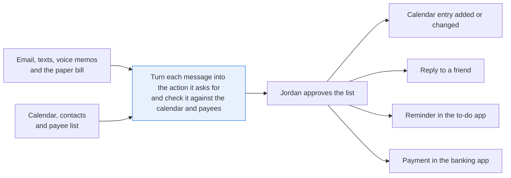
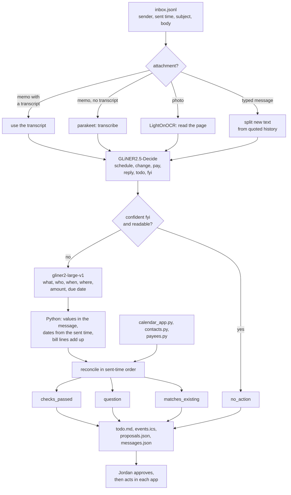

# Turn messages into calendar holds, payments, replies and to-dos

> **This example:** a parent's week of emails, texts, voice memos and a paper bill.
>
> **How it works:** speech to text and OCR read the memos and the bill, two models find the action
> and its details, and Python checks dates against your calendar and payees.
>
> **Use the same pattern for:** gathering tax documents and deadlines from a year of email,
> tracking return windows from order confirmations, chores from a family group chat.

## Background

This is a job one person does for their own household, or a personal assistant does for them.
Take Jordan, a parent in San Francisco. Every few days Jordan sits down with a phone or a laptop
and sweeps through everything that came in: email from the school and the dentist, texts from the
soccer coach and from Sam Ellery, a voice memo recorded in the car ("renew the car
registration before Friday"), and the paper bill on the kitchen counter. For each one Jordan
works out what it asks for and then does the typing: a new calendar entry, a change to one that's
already there, a reply to a friend, a reminder in the to-do app, a payment in the banking app.

A lot of this already lives in apps, structured, and nobody needs a model to read it:

- **Messages.** The mail and messaging apps give you the sender, the sent time with its time
  zone, the subject and the thread. What they don't give you is what the body asks for.
- **The calendar.** It already has the events Jordan entered or accepted from an invitation (the
  school sends one for the parent-teacher conference). A message that repeats one of those adds
  nothing new.
- **Contacts.** They say who Sam Ellery, Coach Dana and Brightsmile Dental are.
- **Bills.** Jordan's payee list (in the banking app) knows each payee, whether it's on autopay,
  and for the ones with an online account, the balance and due date. A utility that only sends
  paper has nothing there but its name, so the paper bill is the only place the amount lives.
- **Voice memo transcripts.** Some phones already transcribe memos. When a transcript exists,
  you use it.

Why it matters: the cost of getting this wrong lands on one person, and it's always small and
annoying. A practice at the old time, a friend who never got the plumber's name, a late fee on a
$84 water bill, two kids booked into the same dentist slot because one confirmation looked like a
copy of the other. And an assistant that books or pays on its own will, sooner or later, pick
the wrong Tuesday or pay the late fee instead of the amount due.

Here's the job end to end, and the step this recipe takes on:



## The problem

You want the sweep done for you, as a list you can approve in a couple of minutes: every message
turned into the calendar entry, payment, reply or to-do it asks for, each with the words it came
from, and checked against what your calendar and payee list already say. You don't want a guess
anywhere in it.

The obvious approaches each fall short. Keyword rules don't know that "practice moves to 11 AM"
changes an event instead of adding one, or that "next Tuesday" depends on when the text was sent.
One chat-model call per message will cheerfully pick a time for "let's grab coffee sometime next
week", and it can't see your calendar, so it proposes the conference you accepted a week ago.
Reading each message on its own also misses the cases people actually trip on: a reminder that
repeats a confirmed appointment, a second appointment from the same dentist on the same day, a
cancellation sitting on top of the original it replies to.

For each action the recipe writes one of these, and nothing is sent, booked or paid:

- **`checks_passed`**: every field the action needs was read from the message, its dates were
  worked out from the sent time, and it doesn't clash with the calendar or payee list. Jordan
  still approves it.
- **`question`**: something is missing, vague, unsure or contradictory, and the question says
  what (which time, which date, which bill amount).
- **`matches_existing`**: the calendar or payee list already has it (the event is on the
  calendar, the payee is on autopay). The message is attached as a source; there's nothing new to
  add.
- **`no_action`**: a newsletter, a delivery notice, a receipt.

Jordan (or the assistant, once Jordan says yes) decides what happens next and does it in the
calendar, the to-do app or the banking app. One message gives one action: a message that asks
for a reply and also books something comes out as whichever the model scores higher, or as a
question when the two are close.

### Examples

Here are three of the inputs in `data/`, and what should happen to each.

All of this is synthetic, written for this recipe: every person, business, address and number is
invented.

**1. The paper water bill.**

- **Input:** `bill-1028-bayview-water-power.png`, a photo of a Bayview Water & Power bill: amount
  due $84.17, due November 12, 2026, with a $5.00 late fee printed on the page.
- **What should happen:** OCR reads the page, a model reads it as a bill to pay, and Python takes
  the amount from the "amount due" line (not the late fee), checks the bill's summary adds up, and
  finds the payee in the payee list.
- **Expected outcome:** `checks_passed`, pay $84.17 to Bayview Water & Power, due Nov 12.

**2. A cancellation sitting on top of the original.**

- **Input:** msg-15 from Hillcrest PTA: "Sorry, Saturday's book-fair shift is cancelled..." and
  below it, the earlier email: "> Thanks for signing up for the book fair! Your shift is
  Saturday, November 7 at 10 AM..."
- **What should happen:** Python splits off the earlier email, so its 10 AM is never read as a
  new booking. The new text cancels something already planned, so it has to match the one calendar
  entry that day.
- **Expected outcome:** `checks_passed`, a `change` (an edit to an entry already on the calendar)
  removing the book-fair shift (`cal-06`), and no hold at 10 AM.

**3. A vet appointment nobody has booked yet.**

- **Input:** msg-09, a voice memo to self, with the phone's transcript: "Reminder. Book a vet
  appointment for Biscuit. His vaccines are due by November 20th."
- **What should happen:** booking it is a task for Jordan, and the appointment doesn't exist yet.
  The memo gives no time, so nobody should make one up.
- **Expected outcome:** a to-do or a `question`, with no time invented.

On the live run, 12 of 12 cases came out as expected. [What came out](#what-came-out) has the
results.

## How we'll solve it

1. **Start from what the apps already export.** Messages come in with sender, sent time and
   offset, subject and body. The calendar, the contacts and the payee list are three small lookup
   modules (`calendar_app.py`, `contacts.py`, `payees.py`) over CSV files, standing in for the
   calls you'd make to your calendar, address book and bank. A memo that comes with the phone's
   transcript uses it. No model re-reads any of this.
2. **Read only what isn't text yet.** `nvidia/parakeet-tdt-0.6b-v3` transcribes a memo that has
   no transcript; `lightonai/LightOnOCR-3-4B` reads a photo of a paper bill or flyer. One that
   comes back nearly empty, or can't be opened, becomes a question ("I could not read this").
3. **Separate the new text from the quoted history.** Python splits off "On Mon ... wrote:"
   blocks and `>` lines, so a cancellation isn't read as the original booking below it. The
   quoted part is kept in `messages.json` for you to look at, never used as the source of an
   action.
4. **Pick the action type.** `fastino/GLiNER2.5-Decide` chooses `schedule`, `change` (moves or
   cancels something already planned), `pay`, `reply`, `todo` or `fyi`, with a probability for
   each. An unsure answer, or two types close together, becomes a question.
5. **Pull the fields.** `fastino/gliner2-large-v1` returns what, who, when, where, amount and due
   date as spans of the message. A value that isn't in the message is dropped. Two windows that
   disagree on a date or an amount are a question.
6. **Check in plain Python.** "Next Tuesday at 10:30am" is resolved against the sent time and
   Jordan's time zone; "sometime next week" is a question, never a date. So is a span with two
   dates or two weekdays, a change whose sentence names two weekdays ("Monday's practice moves
   to Friday at 5 PM", even when the model's span is just "Friday at 5 PM"), a time in another
   time zone, or a date with no year that falls just before the message was sent. A range
   ("2-4 PM", "from 1 to 3 PM") starts at its first time; "11-1 PM" and "moves from 9 to 11 AM" are questions. A bill amount must be the bill's "amount due" line, its own summary must add up,
   and a credit stays negative.
7. **Reconcile with what's already known.** Messages are taken in sent-time order. Two messages
   are the same event only when the who (the sender's contact), the date and the time agree,
   what they're about shares a word, and they name the same people, so Jordan's and Leo's
   cleanings stay two holds. Names never count as the shared word for that match: "Leo's teeth cleaning"
   at 5 PM is not the "Leo swim lesson" at 5 PM (the overlap check does count names, so the two
   become a question). A `change` must match one calendar entry or earlier
   hold on the day it names, and the proposal edits or removes that entry; "is NOT cancelled"
   doesn't cancel, and a change from someone not in the contacts who didn't set up the event is
   a question. "In the contacts" means the sender's display name matches a contact's name or
   alias: `inbox.jsonl` carries no email address, so a stranger who sends as "Coach Dana Ramos"
   passes this check. Jordan still approves every change, and `todo.md` shows the message.
   An event already on the calendar is `matches_existing`; so is a bill from a payee on autopay.
   An unknown payee, or a new hold that overlaps a calendar event or sits next to a similar one
   the same day, is a question.
8. **Write the list.** `todo.md` with questions first and the source sentence under every item,
   `events.ics` with the new holds as tentative events, and `proposals.json` with every source.

If an SIE call fails for a reason that may pass (a timeout, a busy server), the message in it
becomes a question and the run carries on; if SIE refuses outright (a bad key, no credits) or
every call fails, the run stops with SIE's message and writes nothing.

## Picking the models

There are four models, and each one is called only where it's needed. No generative model
decides anything here: the two GLiNER models are small encoders that answer a typed question or
fill a typed schema, and the decisions after that are Python.

- **`nvidia/parakeet-tdt-0.6b-v3`** turns a voice memo into text, once per memo that has no
  transcript. Here that's one memo (msg-06); the vet memo (msg-09) arrives with the phone's
  transcript, so it never reaches the model.
- **`lightonai/LightOnOCR-3-4B`** reads a photo of a full page as Markdown, once per photo. A
  bill is a full page, which is what this model is good at. It sometimes writes the summary as an
  HTML table, so the recipe turns the Markdown into plain lines before anything else reads it.
- **`fastino/GLiNER2.5-Decide`** answers one choice question per message ("What should the
  person do about this message?") with the six action types and their one-line descriptions as
  the options. It gives a probability for each, which is what lets the recipe ask instead of
  guess. It reads names and words more than it reads intent, so the descriptions matter (more on
  that below).
- **`fastino/gliner2-large-v1`** fills what, who, when, where, amount and due date, once per
  window of about 512 tokens of each message that needs an action. It returns spans of the
  message, so every value can be checked against the text. When it finds nothing, SIE Serverless
  answers HTTP 500 "Inference completed without a valid conserved billing settlement"; the recipe
  reads that as "no fields found".

## The flow



## How it's built

Everything you'd want to change without reading Python is in [`rules.yaml`](./rules.yaml): the
four model names, Jordan's time zone, the action types and their descriptions, the fields, which
fields each type needs, the cancel words and the negations that undo them, the negation and
vague-time words, the bill's line labels, and
every threshold (`min_type_score` 0.50, `min_type_margin` 0.15, `hold_minutes` 60,
`change_search_days` 60, `yearless_past_days` 60). The calendar, contacts and payees are data,
in `data/calendar.csv`, `data/contacts.csv` and `data/payees.csv`. [`recipe.py`](./recipe.py)
reads top to bottom in the order of the flow.

| Step | Code | SIE call | What it does |
| --- | --- | --- | --- |
| Load | `load_inbox`, `parse_messages` | none | Reads `data/inbox.jsonl`, sorts by sent time; a repeated message id is an error |
| Lookups | `Calendar` in `calendar_app.py` (`events_between`, `events_on`), `Contacts` in `contacts.py` (`find_contact`), `Payees` in `payees.py` (`find_in_text`) | none | Each loads its CSV into an in-memory SQLite database. A contact is `found` only by its exact name or alias; "Dana" is a `possible_match` and doesn't count. A payee matches by its whole name; a shorter name inside a longer one counts once, as the longer payee |
| Read | `read_message`, `transcribe`, `read_photo`, `image_png`, `plain_text` | `extract` (audio, image) | The phone's transcript if there is one, else parakeet for a memo, LightOnOCR for a photo (turned upright from its EXIF first) |
| Quoted history | `split_quoted` | none | Typed messages only: everything from the first `>` line, "On ... wrote:" line or "Original Message" rule is kept apart |
| Action type | `classify`, `read_type_probabilities`, `merge_probabilities`, `type_question` | `extract` | One call per message, its windows as the items. Each type's best window wins. A reply without a probability from 0 to 1 for exactly the six types is a failed call. Under 0.50, or within 0.15 of the runner-up: a question |
| Fields | `extract_fields`, `in_text` | `extract` | One call per window of the message, with `overflow_policy: error` so an over-long window is a failed call, not a cut one. Values not in the window are dropped; two windows with different `when`, `amount` or `due_date` are a question |
| Check one message | `build_proposal`, `resolve`, `resolve_in_context`, `date_in_sentence`, `other_zone`, `_time_range`, `has_cancel`, `amounts`, `check_bill` | none | Dates against the sent time; a missing date is taken from the sentence that names the event. Two weekdays, an unclear range or a negated cancel word is a question. A bill needs its amount due line, and a printed summary must add up |
| Reconcile | `reconcile`, `same_as_event`, `same_hold`, `topic_words`, `people`, `fold_into`, `similar_events`, `change_targets`, `reconcile_change`, `reconcile_pay`, `has_account` | none | In sent order: calendar match, repeat of an earlier hold, overlap, a change's one target and who sent it, the payee and its account number. Contact names don't count as a shared word for a calendar match or a repeat |
| Write | `write_outputs`, `todo_md`, `events_ics`, `proposals_json` | none | Nothing is written until every message is done |

The SIE error rule is the one the security recipes use (`SIEStopped`, `is_fatal`, `Calls`). A
call that fails for a reason that may pass (a timeout, a lost connection, a 5xx, a rate limit, a
model still loading, or a reply without the key it should have) makes that message a question
with a short reason, and the run carries on. A refusal every call would repeat (a bad key, no
credits, a model name SIE doesn't know) stops the run with SIE's full message and writes no
outputs. If every call failed, the run stops too.

[`selfcheck.py`](./selfcheck.py) runs the whole sample inbox through the real code with
hand-written stand-in model replies, then checks the lookups and their near misses, the quoted
history split, the date, bill and payee rules, the reconcile rules, the SIE error rule and the
four statuses, offline. It also tries the cases a reviewer would: "2-4 PM", "Monday's practice
moves to Friday", "is not cancelled", a cancellation from a stranger, Leo's cleaning at the time
of Leo's swim lesson, two cleanings for two people at one time, and a model span with a line
break in it. [`make_data.py`](./make_data.py) writes the inbox, the CSV seeds, the
memos and the bill.

## Run it

**Run this recipe using [SIE Serverless](https://superlinked.com/serverless?utm_source=github&utm_medium=docs&utm_campaign=sie-cookbook&utm_content=personal-turn-messages-into-actions), [SIE Cluster](https://superlinked.com/docs/deployment?utm_source=github&utm_medium=docs&utm_campaign=sie-cookbook&utm_content=personal-turn-messages-into-actions) or [SIE Local](https://superlinked.com/docs/quickstart?utm_source=github&utm_medium=docs&utm_campaign=sie-cookbook&utm_content=personal-turn-messages-into-actions).** The code runs on your machine either way. With SIE Serverless you pay per call and there are no GPUs to manage yourself: get an [SIE API key](https://console.superlinked.com/console/keys?utm_source=github&utm_medium=docs&utm_campaign=sie-cookbook&utm_content=personal-turn-messages-into-actions) and read the [API docs](https://superlinked.com/docs/reference/api?utm_source=github&utm_medium=docs&utm_campaign=sie-cookbook&utm_content=personal-turn-messages-into-actions). To run the models yourself, start from the [SIE repo](https://github.com/superlinked/sie).

You need [uv](https://docs.astral.sh/uv/) and an SIE API key
([create one](https://console.superlinked.com/console/keys?utm_source=github&utm_medium=docs&utm_campaign=sie-cookbook&utm_content=personal-turn-messages-into-actions)).

```bash
cp .env.example .env   # then set SIE_API_KEY
uv run recipe.py
uv run selfcheck.py    # optional: offline checks, no SIE call
uv run make_data.py    # optional: rewrite data/ (memos need macOS)
```

`uv run` installs this recipe's few dependencies into its own `.venv` on the first run. Each run
writes `runs/<timestamp>/`; `--output DIR` changes that. The first call can wait a few minutes
while SIE Serverless starts the speech, OCR and GLiNER models. A warm run makes 30 SIE calls (15 to
GLiNER2.5-Decide, 13 to gliner2-large-v1, one each to parakeet and LightOnOCR) and takes about
11 seconds.

## What came out

### The three examples

**1. The paper water bill.**

- **Expected outcome:** `checks_passed`, pay $84.17 to Bayview Water & Power, due Nov 12.
- **What came back:** `checks_passed`: `pay` $84.17 to Bayview Water & Power, due Nov 12, with `pay`
  at 0.84 and the note "Checked: $79.40 - $79.40 + $84.17 = $84.17, the amount due."
- **Verdict:** Pass.

**2. A cancellation sitting on top of the original.**

- **Expected outcome:** `checks_passed`, a `change` removing the book-fair shift (`cal-06`), and no
  hold at 10 AM.
- **What came back:** `checks_passed`, a `change` removing `cal-06` with `"cancel": true`, and no
  hold at 10 AM.
- **Verdict:** Pass. gliner2-large-v1 found no fields at all, so the recipe worked from the sentence
  itself (the full item is below).

**3. A vet appointment nobody has booked yet.**

- **Expected outcome:** a to-do or a `question`, with no time invented.
- **What came back:** `question`: "What is the date and time for 'Book a vet appointment'?" The
  model read it as `schedule` (0.85).
- **Verdict:** Pass. No time got invented, and here's the trade-off: the model read a task as a
  booking, so Jordan answers a question about an appointment that doesn't exist yet instead of
  getting a to-do.

### Results

On the live run on 4 Nov 2026 (UTC), 12 of 12 cases came out as expected (13 items from
15 messages).

**Where it works:** messages with a date you can work out from the sent time (the plumber's name,
msg-04; the registration memo, msg-06; picking up Leo, msg-11), and the ones you'd trip on reading
each message alone: a conference already on the calendar (msg-01), a reminder that repeats a
confirmation (msg-03, msg-10), a second appointment on the same day (msg-14), a moved practice
(msg-02, msg-13), a cancellation above its original (msg-15). It asks instead of guessing on a vague
"next week" (msg-07) and on a vet memo with no time (msg-09), it takes the amount due from the bill,
not the late fee (msg-08), and it leaves the newsletter and the delivery notice alone (msg-05,
msg-12).

**Where it fails:** nothing missed here, but this run didn't test the limits the recipe knows it
has. One message gives one action, a hedged "Maybe practice is cancelled" still reads as a
cancellation, clashes between two new holds aren't checked (msg-03 and msg-14 overlap), and those
same two get identical titles in `todo.md`. The one to worry about is the `change` description: we
tuned that sentence until these fifteen messages behaved, so don't trust it on your own inbox
without trying it there.

The input is [`data/inbox.jsonl`](./data/inbox.jsonl): 15 messages from October 26 to
November 1, 2026 (emails, texts, one line per memo or photo), each with its sent time and UTC
offset, plus `memo-1028-registration.wav`, `memo-1029-vet.wav` (16 kHz mono) and
`bill-1028-bayview-water-power.png`. Jordan's calendar export has the parent-teacher conference
(accepted from the school's invitation), Saturday soccer at 9 AM on October 31 and again on
November 7, and the book-fair shift on November 7 at 10 AM. The payee list has Bayview Water &
Power as paper-billed, no autopay, and Bayview Waste Collection as a near miss on the name.

> **All of it is synthetic.** [`make_data.py`](./make_data.py) writes the messages and the
> seeds, renders the memos with macOS `say` and `afconvert` and draws the bill with Pillow. Every
> person, business, address and number is invented. The bill photo carries no EXIF or other
> metadata.

The run gave 8 `checks_passed`, 2 `question`, 1 `matches_existing` and 2 `no_action`, from 15
messages. We wrote the vet memo to come out as a to-do or a question, and it came out as the
question. Two warm runs gave the same results. Treat this as a demo that the wiring works, not as a
measure of accuracy: fifteen messages tell you the rules fire, not how often the models read your
own inbox right.

A few things worth noticing:

- **The first `change` description broke the dentist.** We first described `change` as "a new
  time or a cancellation for something already planned". GLiNER2.5-Decide then read both dentist
  confirmations as changes (0.47 and 0.51), most likely because both end with "Call us at
  555-0148 to make changes". The recipe would have asked about both, since a change with nothing
  to change is a question, but that's still two questions about plain bookings. We tried nine
  wordings, and the one in `rules.yaml` now is the only one that left every message in the inbox
  clear of both limits: "booked or confirmed" in `schedule`, and `change` as "a message saying a
  planned event moves to another time or is cancelled". The dentist confirmations now score 0.58
  for `schedule`, and the practice text 0.56 for `change` against 0.27 for `schedule`. Two other
  wordings fixed the dentist and turned the practice text into a question instead. So yes, we
  tuned a sentence until fifteen messages behaved, which is exactly what you should not trust on
  your own inbox without trying it there.
- **The cancellation works on very little.** gliner2-large-v1 found no field at all in "Sorry,
  Saturday's book-fair shift is cancelled", so the recipe works from the text itself: "Saturday"
  sent on Sunday, November 1 is November 7, "cancelled" is a cancel word, and "book", "fair" and
  "shift" are in one calendar title that day. The 10 AM is only in the quoted part, which nothing
  reads for actions. Here's the item from `proposals.json`, trimmed:

  ```json
  {"id": "act-msg-15", "type": "change", "status": "checks_passed",
   "title": "Cancel 'Book fair volunteer shift'", "fields": {},
   "notes": ["Window 1: no fields found (SIE Serverless answered HTTP 500)",
             "Quoted history below the new text was not read for actions.",
             "No time from the model; read from the sentence: Sorry, Saturday's book-fair shift is cancelled."],
   "sources": [{"message": "msg-15", "from": "Hillcrest PTA", "sent": "2026-11-01T10:20:00-08:00",
                "text": "Sorry, Saturday's book-fair shift is cancelled."}],
   "change": {"calendar": "cal-06", "title": "Book fair volunteer shift",
              "from": "2026-11-07T10:00:00-08:00", "cancel": true, "to": null}}
  ```

- **Leo's cleaning stays its own hold, under a confusing title.** gliner2 returned "teeth
  cleaning" as `what` for both dentist emails, so `todo.md` has two "teeth cleaning at 410 Larkin
  Street, Suite 2" lines, 45 minutes apart. That's why every item in `todo.md` carries the sentence
  it came from underneath; the one for msg-14 starts "Hi Jordan, Leo's teeth cleaning".
- **The bill passes because it adds up, not because the model was sure.** `pay` scored 0.84.
  The recipe turns LightOnOCR's HTML tables into plain lines before Decide reads them; given the
  raw HTML, the same photo scored 0.47 to 0.51. gliner2 also returned `what` "Statement date" for the bill, which is about as useful
  as it sounds; nothing depends on it. The source shown is the bill's own "Amount due $84.17"
  line, and the note says "Checked: $79.40 - $79.40 + $84.17 = $84.17, the amount due."
- **The vet memo is still a schedule.** Decide reads "Book a vet appointment" as `schedule`
  (0.85). The memo gives no time, and the date ("due by November 20th") is in the next sentence,
  so the recipe asks "What is the date and time for 'Book a vet appointment'?" instead of
  inventing one.

### What you do next

Jordan opens `todo.md`, answers the questions at the top first (the vet appointment's time, a day
for coffee with Theo), and reads the source sentence under each item before approving it. Then
Jordan (or the assistant, once Jordan says yes) does the approved items in each app: imports the
tentative holds from `events.ics`, edits or removes the changed calendar entries, sends the reply,
adds the to-dos, and pays the bill in the banking app. Nothing is sent, booked or paid until then.

## Potential improvements

- **Your action types.** `action_types` in `rules.yaml` are the GLiNER2.5-Decide options (label:
  description). Add `rsvp` or `book_travel`; `no_action_types` never become actions.
- **Fields and what each type needs.** `fields` is the gliner2 schema; `required` lists what a
  type needs (a calendar hold needs a time, a bill an amount and due date). A missing one becomes
  a question.
- **Dates.** `person.time_zone`, `vague_terms` and `bare_hour_pm_below` ("at 3" is 3 PM, "at 9"
  is 9 AM). "next Tuesday" said on a Monday could mean tomorrow or in eight days, so the recipe
  asks.
- **Thresholds.** Below `min_type_score`, or with a lead under `min_type_margin` over the
  runner-up, the action type becomes a question; `hold_minutes` is the length of a hold. They are
  starting points, so check them on your own inbox.
- **Your own calendar, contacts and bank.** Replace the bodies of `Calendar`, `Contacts` and
  `Payees` with calls to your calendar (events.list or CalDAV), address book and bank, and keep
  the function names.
- **Hook it up.** Feed `run` your own mail or messages, show the questions to the person, and
  only then write approved holds to a calendar or approved to-dos to a task list. Wrapping `run`
  as an agent tool (`propose_actions` with a JSON schema) is a few lines.
- **More than one action per message.** "Confirm Friday's appointment and bring the signed
  form" is a reply, a hold and a to-do. Today it comes out as one of them, or as a question.
  Asking Decide a yes or no question per type would let one message give several.
- **Who the event is for.** Holds already compare the contacts each message names, but only to
  keep them apart. Putting the patient or child ("Leo's cleaning") in the title would fix the two
  identical dentist lines.
- **Already done.** The recipe doesn't know a bill was paid or a reply sent. The banking app's
  payment history and the sent folder would turn some of these into `matches_existing`.
- **Hedged cancellations.** A negation anywhere earlier in the same clause stops a cancel ("is not
  going to be cancelled"), but a hedge with no negation word, "Maybe practice is cancelled", still
  reads as a cancellation.
- **Overlap between new holds.** Clashes are checked against the calendar, not between two new
  holds from the same sweep (Jordan's cleaning ends at 11:30, Leo's starts at 11:15).

Pro-tip: keep the `action_types` descriptions short. Decide reads all of them with every message,
and the `change` story above shows how one word moves the other scores.

`say` and Pillow output can change between versions, so the committed files in `data/` are the
inputs of our live run.

## Try another model

Each model is one line under `models:` in `rules.yaml`. We swapped one model at a time, changed
nothing else, and ran the recipe using SIE Serverless on 4 Nov 2026 (UTC). Every swap gave the same 13
items with the same statuses (8 `checks_passed`, 2 `question`, 1 `matches_existing`, 2
`no_action`).

| `rules.yaml` key | Swap in | What happened on this data |
| --- | --- | --- |
| `transcribe` | `openai/whisper-large-v3-turbo` | Same results. It wrote the registration memo as two sentences ("Note to self. Renew the car registration online before Friday."); `todo` scored 0.83 instead of 0.87, with the same due date |
| `ocr` | `zai-org/GLM-OCR` | Same results. It read the bill as plain lines with each label and amount on one line; `pay` 0.83, the same $84.17, due Nov 12, and the summary check passed |
| `ocr` | `lightonai/LightOnOCR-2-1B` | Same results. Its Markdown table left stray `|` characters around the amounts, which the amount parser ignores; `pay` 0.80, summary check passed |
| `fields` | `fastino/gliner2-base-v1` | Same statuses and dates. Some values were worse: `where` "Theo Marsh" for the coffee message (msg-07), so its title became "community garden plot at Theo Marsh", and a shorter "vet appointment" for msg-09 |

SIE Serverless has no other model for `action_type` (GLiNER2.5-Decide) yet. SIE's catalog has
`fastino/GLiNER2.5-Decide-1B` and `fastino/GLiNER2.5-multi-Decide` to self-host; we have not run
them here. See [MODELS.md](../../MODELS.md) for every model these recipes use.

## Run it using SIE Cluster or SIE Local

The same code runs on your machine and uses SIE Cluster or SIE Local. Set `SIE_BASE_URL` in `.env`; an API key
is then optional. The table gives the SIE v0.10.1 image each model runs on, from SIE's
[compatibility matrix](https://github.com/superlinked/sie/blob/main/docs/compatibility.md).

| `rules.yaml` key | Model | Image | Tested on |
| --- | --- | --- | --- |
| `transcribe` | `nvidia/parakeet-tdt-0.6b-v3` | `cuda12-transformers5` | L4 |
| `ocr` | `lightonai/LightOnOCR-3-4B` | `cuda12-sglang-vision-extract` | L4 |
| `action_type` | `fastino/GLiNER2.5-Decide` | `cuda12-transformers5` | L4 |
| `fields` | `fastino/gliner2-large-v1` | `cuda12-default` | L4 |

One SIE server runs one image, so these 3 images need SIE Cluster: the
[sie-cluster Helm chart](https://github.com/superlinked/sie/tree/main/deploy/helm/sie-cluster)
with one worker pool per image routes each model to its pool. See
[SELF_HOSTING.md](../../SELF_HOSTING.md) for the values file.

## Files

- `recipe.py`: the pipeline
- `calendar_app.py`: lookups in the calendar, over `data/calendar.csv` (not `calendar.py`, which
  would hide Python's own `calendar` module)
- `contacts.py`: lookups in the address book, over `data/contacts.csv`
- `payees.py`: lookups in the banking app's payee list, over `data/payees.csv`
- `selfcheck.py`: plain asserts on the sample inbox, the lookups, the date, bill and reconcile
  rules and the SIE failure rule, no SIE call (`uv run selfcheck.py`)
- `make_data.py`: the synthetic inbox, seeds, memos and bill
- `rules.yaml`: models, action types, fields, date rules and thresholds
- `data/`: the inbox, the three seeds, two voice memos and the bill photo
- `pyproject.toml`, `uv.lock`: this recipe's dependencies

See the SIE [information extraction](https://superlinked.com/information-extraction?utm_source=github&utm_medium=docs&utm_campaign=sie-cookbook&utm_content=personal-turn-messages-into-actions) task page.
