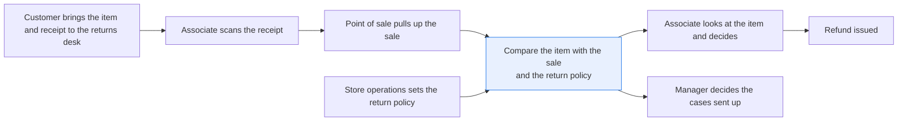
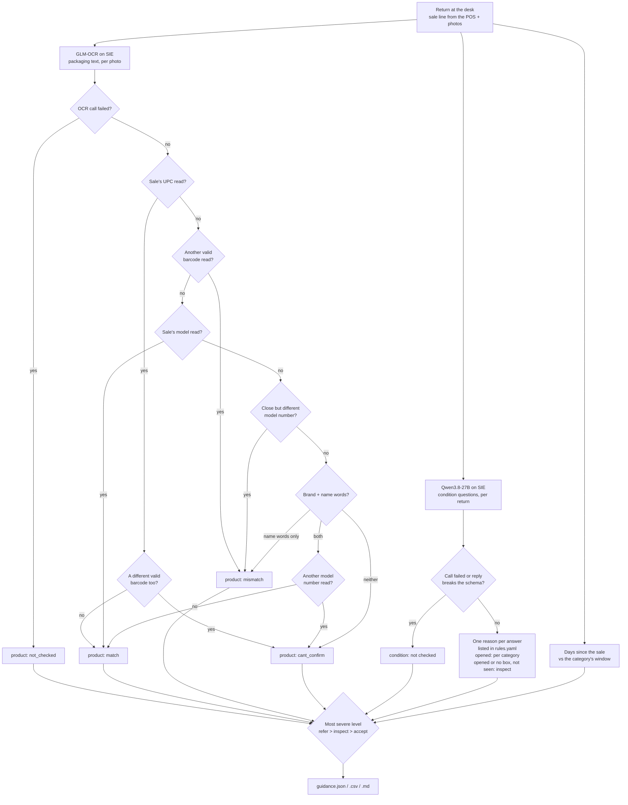

# Check a returned item against the sale before taking it back

> **This example:** a returns desk with the POS sale line and photos of the item.
>
> **How it works:** an OCR model reads the packaging, a vision-language model answers fixed
> questions about condition, and plain rules compare the text with the sale and apply the returns
> policy. The associate decides every return.
>
> **Use the same pattern for:** checking a delivery against the purchase order at the back door,
> inspecting a damaged-in-transit claim, checking a trade-in device.

## Background

A store's returns desk is where an associate spends the day taking things back: a mouse that
didn't pair, a toaster that was the wrong color, a phone a customer changed their mind about.
The flow is the same each time. The customer hands over the receipt, the associate scans its
barcode, and the point-of-sale (POS) system pulls up the sale: transaction ID, date, SKU, UPC,
product name, model number where there is one, price and the store's policy category. Then the
associate looks at the item, decides whether the store takes it back, and issues the refund or
calls a manager.

Scanning the receipt proves that a sale happened. It doesn't prove that the box on the counter is
the thing that was sold. That gap is where most of the cost of returns sits for a store:

- **The wrong item comes back.** A cheaper mouse in its own box against the receipt for a better
  one, or the same brand's lower model in a box that looks almost the same. Once it's on the shelf
  again, the store has refunded the price of one product for another.
- **The item isn't in the state it was sold in.** Opened electronics with a part missing, or a
  phone with a shattered screen. Each needs a person to look before it goes back to stock, and
  the cracked phone probably needs a manager.
- **The policy isn't applied the same way twice.** Return windows differ by category (a phone
  isn't office paper), and a busy associate at the end of a long line will apply them however
  they remember them.

The recipe is for whoever runs returns in the store system, usually a store operations or
loss-prevention team. They own `rules.yaml` (the policy and the thresholds). The associate gets
the guidance at the desk, and the store manager decides every case the recipe refers.

Here's the job end to end, and the step this recipe takes on:



## The problem

At the desk, you have the sale line from the POS, and you have the item. What you want is a
quick second pair of eyes that compares the two: is this the product on the receipt, what
condition is it in, and what does our policy say about that? An associate does this in a few
seconds by eye, and that's fine until the box on the counter is a near miss: the same brand, the
same kind of product, one character off in the model number.

A single "here are the photos and the receipt, should we accept this return?" prompt to a vision
model would be the obvious shortcut, and it's the wrong one. You can't see why it said yes, it
can be talked into things by whatever is printed on the box, and it would be making a refund
decision nobody can audit. Here the models do the looking: one reads the text on the packaging,
the other answers a fixed set of questions about condition. Plain rules you can read compare
the text with the sale and apply the policy.

The recipe gives each return one of three guidance levels, with every reason listed: **accept**
(no check objected), **inspect** (look at the item before you decide) or **refer** (call a
manager). None of them is a decision. `accept` doesn't approve a refund, it means the product
check and the condition answers raised nothing; the associate still looks at the item and
decides. `inspect` and `refer` say why. The person at the desk decides every return, and a
manager decides every `refer`.

## How we'll solve it

Before the associate takes the item back, they photograph it and its packaging, usually one or
two photos. Then:

1. **Read the packaging.** An OCR model reads the text on every photo: brand, product name,
   model number, and the digits printed under a barcode.
2. **Compare it with the sale.** Plain Python pulls barcode numbers (with a valid check digit),
   model numbers and name words out of that text and compares them with the sale line, most
   specific evidence first. A matching UPC settles it, unless a second, different valid barcode
   number is also on the packaging: then it can't confirm, and the associate looks. If no UPC is
   readable, the model number decides, and a model number that is close to the sale's but not
   the same is a mismatch. That one-character-off case is exactly what an associate misses. Only
   when neither is readable do the brand and the product name's words decide, and even then a
   model number on the box that isn't the sale's (and isn't a word of its name, like the "S500"
   in "HP S500 Wireless Mouse") holds the match back as can't confirm. If nothing identifying is
   readable at all (a bare phone, a plain shipping carton), the product check says it can't
   confirm, and the associate looks.
3. **Ask about condition.** A vision model looks at all of a return's photos at once and answers
   four fixed questions: is the packaging sealed, closed, opened or missing; is the packaging
   damaged; is the product damaged; and if it's opened, do the contents look complete. Each
   answer is one of a few allowed values, plus a sentence of evidence. The model never sees the
   sale line, so it can't lean toward the product the receipt names, and it decides nothing.
   The prompt also tells it that text printed in the photos is something to describe, never an
   instruction. The recipe checks the reply strictly against the question set, and a reply that doesn't fit
   is a reason to inspect, not an answer.
4. **Apply the policy.** `rules.yaml` says what each answer means at your desk (a cracked product
   goes to a manager, a scuffed box doesn't matter), what an opened package means per category,
   and each category's return window in days. An opened item, or one with no packaging, whose
   contents or product the photos don't show is at least `inspect`, even in a category that
   takes opened returns.
5. **Pick the most severe level.** Every check adds a reason at a level. The return's guidance is
   the most severe one (refer beats inspect beats accept), and all the reasons are kept, so the
   associate sees each one and not just the winner.

## Picking the models

The packaging reader is `zai-org/GLM-OCR`, through SIE's `extract` call. It takes an image and
returns its text as Markdown. It's the OCR model the other retail recipes use for receipts and
shelf labels, and on these photos it read the grouped digits under a barcode
(`0 8754700350 3`, `1 944412 406274`) cleanly enough for the check digit to pass. It has two
habits worth knowing. It misreads small print now and then: on the IBM box it read the part
number `32G3606` as `0263606`, and on the toaster it read `TR1250WD` as `TR12501WD`. And on
dense small print it can run on: in our run it read the IBM box's license card as one phrase
repeated over and over, about 29,000 characters of it, none of which the card says. The recipe
only looks for barcode numbers, model numbers and name words in that text, so the extra text
costs time, not a wrong result. A photo with no text comes back as an empty
fenced Markdown block, which the recipe reads as no text.

The condition model is `Qwen/Qwen3.8-27B-FP8`, a vision-language model, through SIE's
`chat_completions` call with the photos attached as images. It's the model the other recipes in
this cookbook use to read page images and answer in JSON. Here it gets a JSON schema with an
allowed list for each question (`response_format` with `strict: true`) and temperature 0. It
was good at the obvious things: a shattered screen is `major` product damage, a bag lying next
to an open box is `incomplete` contents. It was more forgiving than we planted on packaging: the
crumpled shipping carton came back as `minor` damage, and the shrink-wrapped diskette box as
`closed`, not `sealed`. That's why a scuffed or creased box doesn't change the guidance in
`rules.yaml`; only `major` packaging damage does.

## The flow



## How it's built

Everything you'd want to argue about lives in [`rules.yaml`](./rules.yaml): the model names, the
photo sizes sent to each model, the near-model and name-word thresholds, what each condition
answer means, the return window and opened-package rule per category, and the level for each
product check result. [`recipe.py`](./recipe.py) is about 820 lines, the prompt and schema
included, and reads top to bottom in the same order as the flow.

| Step | Code | SIE call | What it does |
| --- | --- | --- | --- |
| Load | `load_returns` | none | Reads `data/returns.jsonl`. A photo name that leads out of `data/photos/` or names a missing file raises an error before any SIE call |
| Read the packaging | `read_photo`, `clean_text` | `extract` | One call per photo. The photo is turned upright (EXIF rotation) and shrunk to a longest side of 2048 pixels, never enlarged. Code fences in the reply are dropped |
| Same product? | `barcodes`, `gtin_valid`, `model_tokens`, `name_words`, `check_product` | none | Barcode numbers are runs of digits on one line, spaces and hyphens dropped, kept only with a valid UPC-A, EAN-13 or GTIN-14 check digit. Then the checks in the order of the flow. A model number (here and below) is a token of four or more characters with both letters and digits. A near model number has a `difflib` ratio of at least 0.60 to the sale's; all-digit strings never count, since they're mostly dates, prices and quantities. Another model number next to a brand and name match makes it `cant_confirm`, unless the token is a word of the sale's product name. Name words are whole words of three letters or more from the product name, minus the brand, and half of them (0.50) must be on the packaging |
| Condition | `ask_condition`, `parse_condition` | `chat_completions` | One call per return with all its photos (longest side 1536 pixels), the fixed prompt and the JSON schema. The reply must have exactly the four answers plus `evidence`, each answer from its allowed list, and a finish reason of `stop`. Anything else is a reason to inspect, with what was wrong |
| Guidance | `condition_reasons`, `policy_reasons`, `most_severe`, `guide` | none | One reason per condition answer listed in `rules.yaml`, the opened-package rule for the category, the `unseen_when_open` rule (opened or no packaging with `contents` or `product_damage` `not_visible` is at least `inspect`), the return window, and the most severe level as the guidance |

The SIE error rule is the same as in the security recipes. A call that fails for a reason that
may pass (a timeout, a lost connection, a 5xx, a rate limit, a model still loading, or a reply
missing the key we asked for, `entities` or the chat message) sends that return to `inspect`
with a short reason, and the run carries on. A refusal every call would repeat (a bad key, no
credits, a model name SIE doesn't know) stops the run with SIE's full message and writes no
outputs. If every call failed, the run stops too. An empty `entities` list is a real result: the
OCR model read nothing.

[`selfcheck.py`](./selfcheck.py) checks the barcode parser, every branch of the product check,
the prompt's line about printed text, the strict condition parsing, the guidance rules, that the
committed photos carry no metadata, and that SIE error rule offline, with
hand-written strings and stand-in model replies, so you can change `rules.yaml` and know right
away if you broke something.

## Run it

You need [uv](https://docs.astral.sh/uv/) and an SIE API key
([create one](https://console.superlinked.com/console/api-keys?utm_source=github&utm_medium=docs&utm_campaign=sie-cookbook&utm_content=retail-check-returned-item-against-sale)).

```bash
cp .env.example .env   # then set SIE_API_KEY
uv run recipe.py
uv run selfcheck.py    # optional: offline checks, no SIE call
```

`uv run` installs this recipe's few dependencies into its own `.venv` on the first run. Each run
writes `runs/<timestamp>/` in this folder. The first call can wait a few minutes while SIE Cloud
starts the models. A warm run makes 15 SIE calls (8 OCR calls, one per photo, and 7 condition
calls, one per return) and takes about 31 seconds.

## What came out

The input is [`data/returns.jsonl`](./data/returns.jsonl): 7 returns, one JSON object per line,
each with a `return_id`, the `returned_on` date, the `photos` taken at the desk and the `sale`
line the POS pulled up from the receipt (`transaction_id`, `date`, `sku`, `upc`, `product`,
`brand`, `model`, `price`, `category`). The photos are in [`data/photos/`](./data/photos), with
their metadata removed.

> **The photos are real, the sales are not.** Every photo is a Creative Commons photo of a real
> product (see Data and licenses below). The transactions, SKUs, prices, dates and the store are
> synthetic, written to match the photos; the UPCs of the Galaxy S2, the toaster and the dinner
> set are made up, with a valid check digit. The Larkfield dinner set is an invented product.

All 7 returns came back on 30 Oct 2026; the days since the sale are counted from the sale's date.

| Return | What we planted | Guidance | Why |
| --- | --- | --- | --- |
| R-01 | A pack of Universal 3.5" diskettes in its shrink wrap, against the sale for that pack | accept | UPC 087547003503 read and matches; condition answers raised nothing; 28 of 90 days |
| R-02 | The HP S500 Wireless Mouse box, front and barcode side, against the sale for it | accept | UPC 1944412406274 read and matches; packaging damage `minor` changes nothing; 10 of 30 days |
| R-03 | **Wrong item.** A Microsoft Modern Mobile Mouse box against the HP S500 sale | refer | The box says "mouse" but none of the sale's brand (HP), model or UPC |
| R-04 | **Near miss.** A Black+Decker TR1250WD toaster box against the sale for a Black+Decker 2-slice toaster, model TR1300WD | refer | Brand and name words match, but the box shows another model number (read as TR12501WD) |
| R-05 | An IBM part 32G3606 box, opened, the part in its bag lying next to it | inspect | Brand and "part" read; opened, contents `incomplete`, and the product itself not seen |
| R-06 | A Samsung Galaxy S2 with a shattered screen, no box | refer | Product damage `major`; also no packaging and nothing to read |
| R-07 | A crumpled shipping carton with a FRAGILE sticker, against an online order for a stoneware dinner set | inspect | Nothing on the carton identifies the product |

On our live run on 2 Nov 2026 (UTC) all 7 came out as planned, with the settings as first
written: the same 7 guidance levels as our runs before the two-barcode, other-model-number and
opened-and-not-seen checks were added. Those checks added a reason to R-05 and R-06 and changed
no level. Two planted details came out differently,
and we left them that way. We planted R-07 as damaged packaging, and the condition model called
it `minor` damage, so the `inspect` comes from the product check alone. And the condition model
called R-01's shrink-wrapped box `closed`, not `sealed`; at a desk where sealed and closed lead
to the same place, that changes nothing. Treat all of this as a demo that the pipeline works,
not as a measure of accuracy: seven returns tell you the wiring is right, not how often it's
wrong.

A few things worth noticing:

- **R-04 is why the model number check exists.** Brand right, product right, box right. Only the
  model number is off. The box says `TR1250WD`, and GLM-OCR even misread that as `TR12501WD`,
  but the misread is still close enough to the sale's `TR1300WD` (ratio 0.71) to count as a
  different model of the same line. A misread that helps; we'll take it. Here's the row from
  `guidance.json`, abridged:

  ```json
  {"return_id": "R-04", "transaction_id": "T-20261018-0291", "product": "Black+Decker 2-Slice Toaster",
   "guidance": "refer",
   "reasons": [{"level": "refer", "check": "product", "reason": "The packaging shows model TR12501WD, close to but not the sale's TR1300WD."}],
   "product_check": {"status": "mismatch", "barcodes_read": [], "brand_read": true, "name_words_read": ["slice", "toaster"]}}
  ```

  A different photo of the same box might have shown the barcode, and then the UPC would have
  decided on its own.
- **R-03 is a judgment call, written down.** The Microsoft box has no barcode or model number in
  the photo, so the only evidence is words. "Mouse" is on the box, "HP" is not. The recipe calls
  that a mismatch: the box names the same kind of product from someone else. If your stores sell
  a lot of unbranded goods, that rule will be too strict, and `min_name_share` is where to look.
- **R-05 matched on less than it looks.** The part number on the box label is half struck
  through, and GLM-OCR read `32G3606` as `0263606`. All-digit strings never count as near model
  numbers, so that misread didn't turn into a false mismatch; the product check matched on the
  brand ("IBM" on the license card) and the word "part". The `inspect` comes from the condition
  model, whose evidence was "the product (a dark item in a plastic bag) is sitting outside the
  box on the carpet", and it said `product_damage` `not_visible`, so the opened-and-not-seen rule
  adds "Contents not seen; open and check before taking it back."
- **R-06 is a phone with nothing to read.** No box, no label, and GLM-OCR returned an empty
  block. The product check can't confirm anything and says so (`inspect`), but the condition
  model's `major` damage is the reason that wins:

  ```text
  R-06  refer    Samsung Galaxy S2 Smartphone, Refurbished
      inspect product   Nothing on the packaging identifies the product: none of the sale's UPC, model, brand or product name was read.
      inspect condition Returned without its packaging.
      refer   condition The product looks damaged.
      inspect condition Contents not seen; open and check before taking it back.
      accept  policy    4 days since the sale, within 14 days.
  ```

- **R-07 has one word to go on.** GLM-OCR read "FRAGILE" off the carton (and, when we tried it
  before writing the recipe, "transit label" too), which tells you how to carry the box and
  nothing about what's in it. The associate opens it.

The run writes the same guidance three ways: `guidance.json` for code (with the full packaging
text per photo, the condition answers and evidence, and what the product check read),
`guidance.csv` for a spreadsheet, and `guidance.md` with one card per return for a person.

## Potential improvements

- **Your own policy.** The categories, return windows and opened-package rule in `rules.yaml` are
  a simple made-up policy. Real ones have exceptions (holiday windows, restocking fees, opened
  media that can only be exchanged), and those are a few more lines in `policy` and
  `policy_reasons`.
- **A stricter or looser condition rule.** `condition.findings` says what each answer means.
  A store that resells open-box items might send `minor` product damage to `accept`; one that
  doesn't might send any opened electronics to `refer`.
- **Read the barcode, not just its digits.** The recipe only sees the human-readable digits
  printed under a barcode. A barcode decoder at the desk (the scanner the associate already
  has) would be more reliable than OCR, and the recipe would then use OCR only for model numbers
  and names.
- **Ask for the right photo.** R-04 would have been settled by its UPC if the photo showed the
  barcode side. A desk app could ask for a second photo whenever the product check comes back
  `cant_confirm` or matched on name words only.
- **Several barcodes on one box.** A different valid barcode on the packaging is a mismatch when
  the sale's isn't read, and `cant_confirm` next to it, even if it's an inner pack or a multipack
  code for the right product. A store with such packaging
  would want a list of the GTINs that belong to each SKU.
- **Measure it.** Seven planted returns prove the wiring. Before you trust the levels, run it on
  a few weeks of your own return photos and see how often `inspect` and `refer` were right.

## Try another model

Each model is one line under `models:` in `rules.yaml`. On 2 Nov 2026 (UTC) we swapped one model
at a time, changed nothing else, and ran the recipe on SIE Cloud.

| `rules.yaml` key | Swap in | What happened on this data |
| --- | --- | --- |
| `ocr` | `lightonai/LightOnOCR-3-4B` | Same guidance for all 7 returns. It read no valid barcode number on the diskette pack, so R-01 matched on model number `00350` instead of the UPC. It misread the toaster's model too, as `TRI250WD` rather than GLM-OCR's `TR12501WD`, and R-04 was still a mismatch. On the IBM box it read two other model-like tokens (`P4206379`, `JEREC0000000000`), so R-05's product check was `cant_confirm` rather than a brand-and-name match; R-05 was `inspect` either way. |
| `condition` | `Qwen/Qwen3.5-4B` | Same guidance for all 7 returns. It called R-01's box `sealed` (the 27B model said `closed`) and R-07's carton `opened` with `major` damage (the 27B model said `closed`, `minor`), so R-07's `inspect` had two more reasons: the damaged packaging, and the contents not seen. |

See [MODELS.md](../../MODELS.md) for every model these recipes use.

## Run it on your own SIE

The same code runs against an SIE server you host. Set `SIE_BASE_URL` in `.env`; an API key
is then optional. The table gives the SIE v0.10.1 image each model runs on, from SIE's
[compatibility matrix](https://github.com/superlinked/sie/blob/main/docs/compatibility.md).

| `rules.yaml` key | Model | Image | Tested on |
| --- | --- | --- | --- |
| `ocr` | `zai-org/GLM-OCR` | `cuda12-sglang-vision-extract` | L4 |
| `condition` | `Qwen/Qwen3.8-27B-FP8` | `cuda13-sglang-cu130` | H100 80GB |

One SIE server runs one image, so these 2 images need a cluster: the
[sie-cluster Helm chart](https://github.com/superlinked/sie/tree/main/deploy/helm/sie-cluster)
with one worker pool per image routes each model to its pool. See
[SELF_HOSTING.md](../../SELF_HOSTING.md) for the values file.

## Data and licenses

The transactions in `data/returns.jsonl` are synthetic, written for this recipe to match the
photos. The photos are real: the original files, not resized or re-encoded, with their EXIF,
XMP and Photoshop metadata (camera, date, GPS position, author name) removed losslessly with
`jpegtran -copy icc`, which keeps the color profile and every pixel. The licenses below allow
that change, and this is where we state it. The recipe shrinks the photos only in memory before
sending them to a model. Brand names and logos
in the photos are trademarks of their owners, and their use here doesn't mean any owner endorses
this recipe.

| File | Source | Author | License |
| --- | --- | --- | --- |
| `Universal_office_product_3.5_inch_diskette_bottom.jpg` | [Wikimedia Commons](https://commons.wikimedia.org/wiki/File:Universal_office_product_3.5_inch_diskette_bottom.jpg) | Rjluna2 | [CC BY-SA 4.0](https://creativecommons.org/licenses/by-sa/4.0) |
| `opf_1944412406274_1.jpg`, `opf_1944412406274_5.jpg` | [Open Products Facts, HP S500 Wireless Mouse](https://world.openproductsfacts.org/product/1944412406274), images 1 and 5 | abishek | [CC BY-SA 3.0](https://creativecommons.org/licenses/by-sa/3.0/) |
| `Modern_Mobile_Mouse_-_Microsoft_-_Front_of_Packaging_Box.jpg` | [Wikimedia Commons](https://commons.wikimedia.org/wiki/File:Modern_Mobile_Mouse_-_Microsoft_-_Front_of_Packaging_Box.jpg) | Wiki.cullin | [CC BY-SA 4.0](https://creativecommons.org/licenses/by-sa/4.0) |
| `opf_0050875827974_1.jpg` | [Open Products Facts, Black+Decker toaster](https://world.openproductsfacts.org/product/0050875827974), image 1 | detrumpezvous | [CC BY-SA 3.0](https://creativecommons.org/licenses/by-sa/3.0/) |
| `Ibm_part_32g3606_box.jpg` | [Wikimedia Commons](https://commons.wikimedia.org/wiki/File:Ibm_part_32g3606_box.jpg) | Rjluna2 | [CC BY-SA 4.0](https://creativecommons.org/licenses/by-sa/4.0) |
| `Samsung_Galaxy_S2_shattered_screen.jpg` | [Wikimedia Commons](https://commons.wikimedia.org/wiki/File:Samsung_Galaxy_S2_shattered_screen.jpg) | Ashwin Kumar | [CC BY-SA 2.0](https://creativecommons.org/licenses/by-sa/2.0) |
| `Damaged_fragile_parcel_delivered_to_doorstep.jpg` | [Wikimedia Commons](https://commons.wikimedia.org/wiki/File:Damaged_fragile_parcel_delivered_to_doorstep.jpg) | Meanwell Packaging | [CC BY 2.0](https://creativecommons.org/licenses/by/2.0) |

Two limits of this data. No real item appears both boxed and damaged: the damaged phone has no
box, and the boxes hold products we never see. And the toaster photo was taken on a store shelf,
not at a returns desk (the shelf label at the bottom says "B&D HONEYCOMB TOASTER"); the recipe
doesn't care, but your associates' photos will look different.

## Files

- `recipe.py`: the pipeline
- `selfcheck.py`: plain asserts on the barcode parser, product check, condition parsing, guidance
  rules and SIE failure rule, no SIE call (`uv run selfcheck.py`)
- `rules.yaml`: models, photo sizes, product check thresholds, condition findings, store policy
  and guidance levels
- `data/returns.jsonl`: the 7 planted returns
- `data/photos/`: the 8 photos, metadata removed
- `pyproject.toml`, `uv.lock`: this recipe's dependencies

See the SIE task page for [OCR](https://superlinked.com/ocr?utm_source=github&utm_medium=docs&utm_campaign=sie-cookbook&utm_content=retail-check-returned-item-against-sale).
