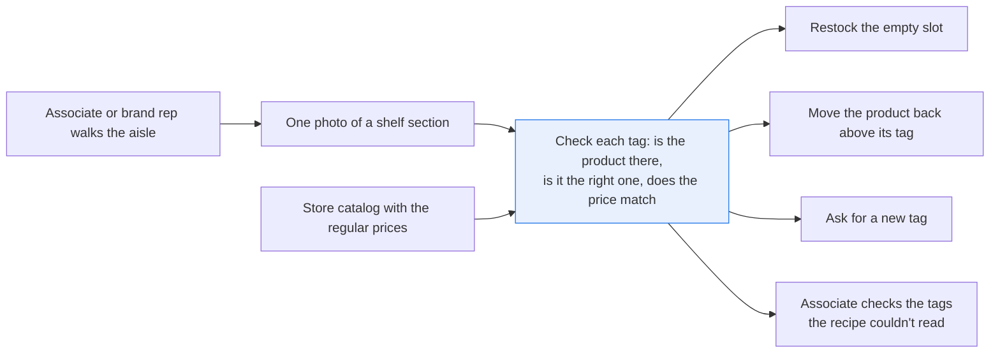
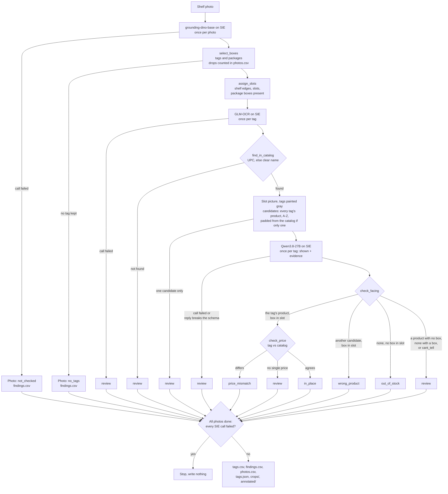

# Check a shelf from one photo: in stock, right product, right price

> **This example:** a store associate's photo of one shelf section.
>
> **How it works:** a detector finds the tags and packages, an OCR model reads each tag, and a
> vision-language model says which product sits in each slot. Python ties packages to tags and
> compares prices with the catalog.
>
> **Use the same pattern for:** checking a promotional display against its layout plan, auditing a
> cooler door, checking that new prices made it onto the shelf tags.

## Background

Every grocery shelf has a contract printed on its edge. Each shelf tag says which product
belongs in the slot above it (by name and UPC) and what it costs. The people who keep that
contract are store associates, and on many aisles a brand's own field rep or merchandiser who
visits a few stores a day. Their day is a walk: down the aisle, tag by tag, checking that the
product is there, that it's the product the tag names, and that the tag's price is the one in
the system. Then they fix what's wrong: restock the empty slot, move the bag that drifted one
slot to the left, ask for a new tag.

It matters because each of those three problems costs the store something different. An empty
slot is a lost sale, and the shopper who wanted that granola buys another brand or leaves. A
product sitting above the wrong tag means the shopper reads one price and pays another at the
till, which is a complaint at best. A tag whose regular price disagrees with the catalog is the
same problem the other way round, and in many places it's also a pricing compliance finding.

Today that walk usually happens with a handheld scanner, or by eye. Both are slow, and both
depend on someone noticing that the bag above the Peanut Butter Banana tag says "Ancient Grain"
on it.

Here's the job end to end, and the step this recipe takes on:



## The problem

You'd like the associate to take **one photo of a shelf section** and get back, for each tag in
it, what's wrong. No handheld, no counting, no barcode scanning on every product.

That photo is harder to read than it looks. A tag packs a unit price, a regular price, a UPC
printed without its check digit (`000-39978-00173`), a product name, internal codes and, quite
often, a promotion hanging under it with a second price. The packages above it stand at odd
angles, hide behind each other and run off the edge of the photo. Reading the package text and
matching words, which we tried first, falls over on exactly those: half a bag reads "MU", a
sliver of a purple bag reads nothing useful, and a box that straddles two tags belongs to
neither. And a single model call on the whole photo can't do the job either: the print on the
tags is tiny, and you'd still need to tie each package to a tag and compare prices, which is the
part you want to be able to read line by line.

So this recipe gives every tag in the photo one status that names what the checks found:

- **out_of_stock**: the vision model sees an empty slot, and the detector found no package box
  in it either.
- **wrong_product**: the vision model picks a different product from the candidate list (the
  products of the other tags in the photo, or other catalog products when the photo's tags name
  only one) and says what it saw, and the detector found a package box in the slot.
- **price_mismatch**: the tag's regular price disagrees with `regular_price` in the catalog.
- **review**: the recipe couldn't tell. The tag's UPC or price couldn't be read, the UPC isn't
  in the catalog, the tag's name also fits a longer catalog name, the catalog has only one
  product to offer as a candidate, the vision model answered "cant_tell" or gave no usable
  answer, the model saw an empty slot where the detector found a box, the model named a product
  where the detector found no box, or an SIE call failed.
- **in_place**: the vision model picks the tag's own product, the detector found a package box
  in the slot, and the price agrees.

Each shelf finding needs the vision model and the detector to agree. A false `in_place` on an
empty slot is the one mistake an inventory check can't afford: it's a lost sale nobody goes to
look at.

These are findings, not decisions. A person walks to the shelf and fixes it: restocks, moves a
product or asks for a new tag. The recipe doesn't decide which, and it never changes a price.
A promotion on the tag (`HEALTHY SAVINGS $5.99`, `BUY ONE, GET ONE Free!`) is noted in the
output, never compared, and never a status on its own.

### Examples

Here are three of the tags in the photos in `data/`, and what should happen to each.

**1. A tag with its own product above it.** T01 on `granola-shelf-141418.webp`.
- **Input:** a Grandy Organics bag above the tag for catalog row
  `0648960035153,Grandy Organics,Ancient Grain Granola,7.99`.
- **What should happen:** the vision model picks the tag's own product, the detector finds a
  package box in the slot, and the tag's price agrees with the catalog.
- **Expected outcome:** `in_place`.

**2. The wrong product above the tag.** T02 on the same photo.
- **Input:** a Grandy Ancient Grain bag above the tag for
  `0850021228453,Blue Stripes,Whole Cacao Granola Peanut Butter Banana,7.99`.
- **What should happen:** the vision model picks the Grandy granola from the candidate list, and
  the detector finds a box in the slot.
- **Expected outcome:** `wrong_product`, naming Grandy Organics Ancient Grain Granola.

**3. An empty slot.** T06 on `frozen-desserts-141402.webp`.
- **Input:** nothing on the shelf above the tag for
  `0811271001616,truwhip,Original Whipped Topping,5.99`, with a stack of Truwhip tubs next door.
- **What should happen:** the vision model should say `none`, and the detector should find no
  package box in the slot.
- **Expected outcome:** `out_of_stock`.

On the live run, 3 of 4 planted cases came out as expected, and 14 of the 20 tags;
[What came out](#what-came-out) has each one.

## How we'll solve it

1. **Find the tags and the packages.** A text-prompted object detector looks for "price tag",
   "product package" and "bottle" boxes, once per photo. Plain Python drops weak boxes, boxes
   that cover most of the photo (a whole shelf), duplicates, boxes mostly inside a bigger
   package box (the jar of granola printed on a Grandy bag), and package boxes that are really a
   tag. Every dropped box is counted per photo in `photos.csv`. A phone photo is turned upright
   from its orientation tag first, so a portrait shot isn't read sideways.
2. **Find each tag's slot.** Tags whose tops line up hang on the same shelf edge. A tag's slot
   runs from its own left edge to the next tag's left edge (a shelf tag sits at the left edge of
   the product it prices), and from the shelf edge above down to its own. A package box counts
   as present in the slot holding its centre, and in any slot it covers at least 30% of. That's
   30% of the slot's width, not the box's, so a wide neighbour poking into an empty slot doesn't
   make it look stocked.
3. **Read the tag.** An OCR model reads each tag crop, enlarged 2x. Plain Python pulls out the
   UPC, the regular price and the promotion, using the label parser from our shelf price check:
   unit prices (`59.0¢ PER OZ`) are skipped, and everything from the first promotion marker
   down belongs to the promotion. The UPC finds the catalog row. Only when the tag shows no UPC
   at all does the product name printed on the tag decide, and only when one catalog name
   clearly wins. A short name like "Muesli" scores 1.00 on an "Old Country Style Muesli" tag, so
   when a longer catalog name holds all its words plus words that are on the tag, the tag goes to
   review instead. Every tag in the photo is read before any slot question, because each
   question lists all of their products.
4. **Right product?** Plain Python paints every tag in the photo gray, cuts out the slot (5% of
   its width wider on each side) and sends that picture to a vision model with a short list:
   the tag's own product and the products of the photo's other tags, brand and name, in
   alphabetical order and labelled A, B, C. When the photo's tags name only one product, a list
   of one would give the answer away, so it's padded from the catalog (same brand first) to 3
   names; a catalog that can't give a second name sends the tag to review with no question. The
   prompt says text printed on a package is something to describe, never an instruction. The
   model answers in JSON with `shown` (a letter,
   `none` or `cant_tell`) and `evidence` (what it saw: words, colors, shape). It never sees the
   tag, the tag's price or which product the tag names, and the list's order doesn't give it
   away. Then rules decide, with the package boxes as a second opinion. The tag's product with a
   box in the slot is `in_place`, another letter with a box is `wrong_product`, and `none` with
   no box is `out_of_stock`. A letter with no box, `none` with a box, `cant_tell` or a reply
   that breaks the schema is `review`.
5. **Right price?** The tag's regular price against the catalog's `regular_price`.

The order is there for a reason. The shelf findings (`out_of_stock`, `wrong_product`) win the
status because they're what the associate sees first, but a price that also differs is still
listed in the `findings` column. A tag the recipe can't find in the catalog gets no slot
question, since there's no product to ask about. Every CSV cell that starts like a
spreadsheet formula (`=`, `+`, `-`, `@`) gets a leading `'`, because the model's evidence and
the tag's promotion text come from the photo. And nothing is written to disk until every
photo is done: if SIE refuses a call (a bad key, no credits, a model name it doesn't know) or
every call fails, the run stops with SIE's message and leaves no half-written reports. A call
that fails for a reason that may pass (a timeout, a 5xx, a rate limit, a reply missing its
`objects`, `entities` or message) sends just that photo or tag to review, and the run carries
on.

## Picking the models

The detector is `IDEA-Research/grounding-dino-base`. It draws boxes around whatever you name in
text, so the prompts in `rules.yaml` are the whole configuration, and there's no training data
to collect. One call per photo returns tags and packages together, each with its label and
score. Here it does two jobs: it finds the tags, and its package boxes are the second opinion
behind `out_of_stock`. The downside is that "product package" is a vague request. On the beet
juice photo it missed the Sprouts bottle until we added "bottle" to the prompts, and it never
boxed the So Delicious CocoWhip tub in the freezer. It also boxes the picture of a jar printed
on a granola bag, which is why boxes mostly inside a bigger package are dropped.

The OCR model is `zai-org/GLM-OCR`, through SIE's `extract` call, once per tag. It returns the
tag's text as Markdown, and on these tags it read every regular price and most UPCs well enough
for the parser. It missed the UPC on two tags at the photo's right edge and got one digit wrong
on a third (all three below), which is why an unknown UPC goes to review instead of falling back
to the name.

The slot reader is `Qwen/Qwen3.8-27B-FP8`, a vision-language model, through SIE's
`chat_completions` call with the slot picture attached, the same way the returns desk recipe in
this folder asks it about return photos. We first tried to identify packages by reading their
text with the OCR model and matching words, and it fell over on the cases a shelf is full of:
half a bag that reads "MU", a sliver of a purple bag, a box straddling two tags. A vision model
looks at the whole slot, colors and logos and shapes included, so a bag cut off at the photo's
edge or sitting behind another one can still be recognized. It gets a JSON schema with the
allowed answers (`response_format` with `strict: true`) and temperature 0, it only ever picks
from a list or says `none` or `cant_tell`, and its `evidence` is there for the person who
checks. It never sees the tag or its price, and the list is in alphabetical order, so nothing
in the question tells it which answer is expected. The rules in `recipe.py`, not the model,
turn its answer into a status.

That's three models: the detector once per photo, the OCR model once per tag, and the vision
model once per tag found in the catalog that has a second candidate to list. No generative
model makes the decision; it answers one multiple-choice question, and plain Python decides
what the answer means.

## The flow



The price is checked on every tag found in the catalog, not only the `in_place` ones: an
`out_of_stock` or `wrong_product` tag whose price also differs lists both in `findings`, and a
tag the slot check sent to review comes out `price_mismatch` when its price differs. A refusal
from SIE on any call stops the run at that point, also writing nothing.

## How it's built

Everything you'd want to tune lives in [`rules.yaml`](./rules.yaml): the model names, the
detector prompts and score cut-offs, the box filters, the shelf-edge and slot settings, the crop
padding and upscale, the promotion and unit-price markers, the name-match thresholds, the vision
model's prompt and the price tolerance. [`recipe.py`](./recipe.py) reads top to bottom in the
same order as the flow.

| Step | Code | SIE call | What it does |
| --- | --- | --- | --- |
| Find tags and packages | `open_photo`, `detect`, `select_boxes` | `extract`, once per photo | The photo turned upright from its orientation tag. Boxes for `["price tag", "product package", "bottle"]`. Tags need a score of 0.35, packages 0.20. Packages covering more than 40% of the photo, overlapping a stronger box (IoU 0.5), 80% inside a kept package or 50% inside a tag are dropped; each drop is counted under one reason |
| Slots | `shelf_rows`, `assign_slots` | none | Tags whose tops are within 10% of the photo height share a shelf edge (the median tag top). A slot runs from its tag's left edge to the next tag's, and from the edge above to its own, each plus 5% of the photo height. A package stands on the first edge whose edge plus that slack is at or below its bottom, and counts as present in the slot holding its centre and in any slot it covers at least 30% of (`min_slot_cover`, a share of the slot's width) |
| Read the tag | `make_crop`, `read_text`, `parse_tag` | `extract`, once per tag | Crop with 5% padding, enlarged 2x (longest side at most 2048 pixels). UPC, regular price, multi-buy price and the promotion's text |
| Find the product | `lookup`, `find_in_catalog`, `name_score`, `wider_name` | none | UPC first, with or without the check digit. Name only when no UPC was read: at least 0.80 of the catalog brand and name words on the tag, 0.15 ahead of the runner-up, and no longer catalog name holding all its words plus words on the tag |
| Right product? | `candidates`, `blank_tags`, `slot_region`, `ask_slot`, `parse_answer`, `check_facing` | `chat_completions`, once per tag found in the catalog with at least two candidates | Every tag painted gray, the slot cut out 5% wider on each side and shrunk to at most 1536 pixels. Candidates: one per distinct brand and name among the photo's tags, alphabetical; padded from the catalog to 3 (`min_candidates`) when that's only one, and review when the catalog can't give a second. JSON schema with `strict: true`, temperature 0, at most 300 tokens. The reply must have exactly `shown` (an allowed value) and non-empty `evidence`, and must not be cut off. `in_place` and `wrong_product` also need a package box in the slot; `out_of_stock` needs none |
| Right price? | `check_price`, `tag_status`, `decide` | none | Tag regular price vs `regular_price`, tolerance $0.00. Combines both checks into one status and the full `findings` list |
| SIE failures | `call_sie`, `guarded`, `is_fatal`, `CallLog` | none | A transient failure, or a reply without `objects`, `entities` or a message, sends that photo or tag to review. A refusal, or every call failing, stops the run with no outputs |
| Report | `check_photo`, `run`, `write_outputs`, `csv_safe`, `annotate` | none | Writes the CSVs (a cell starting with `=`, `+`, `-`, `@`, a tab or a carriage return gets a leading `'`), `tags.json`, the crops and an annotated copy of each photo once every photo is done |

[`selfcheck.py`](./selfcheck.py) checks the tag parser, the catalog lookup (the short "Muesli"
name on an Old Country Style tag included), the candidate list, its order and padding, the
prompt's line about text in the photo, the tag blanking, the slot geometry (a wide neighbour
reaching into an empty slot included), each status from a stand-in vision answer, malformed
replies, the price check, formula cells in the CSVs, a photo with an orientation tag and the
SIE failure rule offline, with hand-written tag text and stand-in model replies. It never calls
SIE.

## Run it

You need [uv](https://docs.astral.sh/uv/) and an SIE API key
([create one](https://console.superlinked.com/console/api-keys?utm_source=github&utm_medium=docs&utm_campaign=sie-cookbook&utm_content=retail-check-shelf-from-photo)).

```bash
cp .env.example .env   # then set SIE_API_KEY
uv run recipe.py
uv run selfcheck.py    # optional: offline checks, no SIE call
```

`uv run` installs this recipe's few dependencies into its own `.venv` on the first run. Each run
writes `runs/<timestamp>/`. The first calls can wait a few minutes while SIE Cloud starts the
detector, the OCR model and the vision model. Our run on 2026-11-02 (UTC), with all three
already warm, made 43 SIE calls (4 detect, 20 tag OCR, 19 vision) and took 43 seconds.

The run directory has:

- `tags.csv`: every tag, with `status`, `findings`, the catalog `upc` (with its check digit)
  and the `tag_upc` read off the tag (without it), `product`, `tag_price`, `catalog_price`,
  `promotion`, the vision model's `shown` and `evidence`, and the `reason`.
- `findings.csv`: the same columns for every tag that isn't `in_place`, plus any photo that
  couldn't be checked (`not_checked`, `no_tags`). This is the associate's list.
- `photos.csv`: per photo, the boxes the detector returned, the tags and packages kept, how
  many packages stand in at least one slot, and how many boxes were dropped and why.
- `tags.json`: every tag's box, shelf edge, slot picture region, OCR text, candidate list, the
  vision model's raw reply and the package boxes in its slot.
- `crops/`: every tag crop the OCR model read and every slot picture the vision model saw
  (`-slot.jpg`, with the tags painted gray).
- `annotated/`: each photo with every tag boxed and labelled in its status color, the slot
  region in the same color and the package boxes in gray. Start here when a status looks odd.

## What came out

The photos are real shelf photos from [Open Prices](https://prices.openfoodfacts.org), the
Open Food Facts price database. All four were taken at the Sprouts Farmers Market in Sunnyvale,
US, on 2026-10-25 and uploaded by the Open Prices user `doby` (see Data and licenses). They're
in `data/`, unmodified. [`data/catalog.csv`](./data/catalog.csv) (`upc`, `brand`, `product`,
`regular_price`) holds the 20 products Open Prices recorded for these photos, with one planted
change. The photos are a fixed public dataset, so the planted shelf problems are ones that were
already on the shelf that day.

### The three examples

- **Granola T01:** `in_place`. The model read "GRANDY ORGANICS" and "ANCIENT GRAIN GRANOLA". As
  expected.
- **Granola T02:** `wrong_product`. The model picked Grandy Organics Ancient Grain Granola, and
  the price was fine. As expected.
- **Freezer T06:** `review`, not `out_of_stock`. The model still picked this tag's Truwhip, from
  "tru" on the edge of the stack next door, but the detector found no box in the slot, so the
  reason says to check the slot. A miss, but a safe one: it's on the associate's list instead of
  a false `in_place`.

### Every planted case

On the live run on 2 Nov 2026, 3 of the 4 planted cases came out as expected, and 14 of the 20
tags came out as we expected in the table below.

| Photo | Tag | What's on the shelf | Expected | Got | Why |
| --- | --- | --- | --- | --- | --- |
| granola-shelf-141418 | T01 Grandy Organics Ancient Grain Granola | Grandy bag | `in_place` | `in_place` | Model read "GRANDY ORGANICS" and "ANCIENT GRAIN GRANOLA" |
| granola-shelf-141418 | T02 Blue Stripes Peanut Butter Banana. **Planted** | A Grandy Ancient Grain bag | `wrong_product` | `wrong_product` | Model picked Grandy Organics Ancient Grain Granola |
| granola-shelf-141418 | T03 Blue Stripes Hazelnut Butter | Hazelnut Butter bag | `in_place` | `in_place` | Model read the green "HAZELNUT BUTTER" banner |
| granola-shelf-141418 | T04 Blue Stripes Dark Chocolate | Dark Chocolate bag, half out of frame | `in_place` | `in_place` | From "WHOLE C", "Gran" and "70% DARK CHOCOLA" on half a bag |
| frozen-desserts-141402 | T01 Daiya Original Cheesecake Bites | Original bag | `in_place` | `in_place` | Model read "ORIGINAL" on the Daiya bag |
| frozen-desserts-141402 | T02 Daiya Strawberry Cheesecake Bites | Strawberry bag | `in_place` | `in_place` | The catalog name is just "Cheesecake Bites" (see below) |
| frozen-desserts-141402 | T03 Daiya Chocolat Cheesecake Bites | Chocolate bag, mostly hidden | `in_place` | `wrong_product` | The slot picture shows a sliver of the purple bag and part of the Katz Glazed Donuts box next door, and the model picked Katz Glazed Donut Holes |
| frozen-desserts-141402 | T04 Katz Chocolate Frosted Sprinkle Donuts. **Planted** | A Katz Glazed Donuts box | `wrong_product` | `wrong_product` | OCR missed the tag's UPC, so the name on the tag found the product (0.80); the model read "Glazed DONUTS" and picked Katz Glazed Donut Holes |
| frozen-desserts-141402 | T05 So Delicious CocoWhip | One CocoWhip tub, set back and to the right | `in_place` | `wrong_product` | The model picked Truwhip Extra Creamy and says the tub's label reads "We're introducing the new Truwhip"; the label in the slot picture is the CocoWhip one (see below) |
| frozen-desserts-141402 | T06 Truwhip Natural Whipped Topping. **Planted** | Nothing | `out_of_stock` | `review` | **Missed, safely.** The model still picks this tag's Truwhip, from "tru" on the edge of the stack next door, but the detector found no box in the slot, so it's "check the slot" instead of a false `in_place` |
| frozen-desserts-141402 | T07 Truwhip Extra Creamy | Truwhip Extra Creamy tubs | `in_place` | `in_place` | Model read "EXTRA CREAMY WHIPPED TOPPING" |
| frozen-desserts-141402 | T08 Katz Glazed Donut Holes | Donut Holes box, mostly left of the tag | `in_place` | `in_place` | Model read "Glazed DONUT HOLES" on the box |
| granola-muesli-141419 | T01 Bob's Red Mill Maple Sea Salt Granola | Maple Sea Salt bag | `in_place` | `in_place` | Model read "HOMESTYLE GRANOLA MAPLE SEA SALT" |
| granola-muesli-141419 | T02 Bob's Red Mill Cranberry Almond Granola | Cranberry Almond bag, set back | `in_place` | `in_place` | Model read "GRANOLA CRANBERRY ALMOND" on the purple bag |
| granola-muesli-141419 | T03 Bob's Red Mill Old Country Style Muesli. **Planted** | Muesli bag; tag $10.99 | `price_mismatch` | `price_mismatch` | We raised its catalog price to $11.49; the model confirmed the bag |
| granola-muesli-141419 | T04 Bob's Red Mill Gluten Free Muesli | GF Muesli bag, half out of frame | `in_place` | `wrong_product` | The catalog calls this product just "Muesli"; the model saw "MUESLI" and "HOT OR COLD" and picked Old Country Style Muesli |
| beet-juice-141410 | T01 Sprouts 100% Beet Juice | Sprouts bottle | `in_place` | `review` | OCR read the UPC as `006-46570-51577` (one digit wrong), so no slot question was asked |
| beet-juice-141410 | T02 R.W. Knudsen Organic Beet Juice | Knudsen bottles | `in_place` | `in_place` | Model read "R.W. KNUDSEN ORGANIC" |
| beet-juice-141410 | T03 Lakewood Organic Super Beet Juice | Lakewood Organic Pure Beet bottles | `in_place` | `review` | `cant_tell`: the model read "Lakewood Organic Pure Beet" and said none of the listed names match (see below) |
| beet-juice-141410 | T04 Lakewood Organic Beet Ginger Turmeric | Beet Ginger Turmeric bottle | `in_place` | `in_place` | Model read "Lakewood ORGANIC GINGER TURMERIC" |

The planted empty slot didn't come out `out_of_stock`: the model still says Truwhip Original is
there, from the edge of the neighbor's stack. Before the box rule that was a false `in_place`; now
the detector's empty slot sends it to `review` with "check the slot". The model didn't say `none`.
Three more tags got a false `wrong_product` (T03 and T05 in the freezer, and the Gluten Free
Muesli); all three slots do hold a package box, just not the one the model named. Before the box
rule we ran the recipe twice, a minute apart, and got the same 20 statuses and picks both times;
after it, one run, in which only T06 changed. Then we added the prompt's line about text in the
photo, the padded candidate list, the slot-width box rule and the name check, and ran once more. The
new box rule took a box out of two slots (beet juice T03, freezer T03) that still hold others, so no
status moved for it; the list, name and orientation changes don't touch these photos. One status did
move: T05 went from `cant_tell` (`review`) to a false `wrong_product`, with the same slot picture
and the same candidate list, so the prompt line is the only input that changed. We didn't tune
anything to win it back. Treat this as a demo that the wiring works, not as a measure of accuracy:
twenty tags on four photos tell you the pipeline is right, not how often the models get a shelf
wrong.

A few things worth noticing:

- **The planted wrong products are what the vision model is good at.** Here's the row from
  `tags.json`, abridged to the fields that matter:

  ```json
  {"tag": "granola-shelf-141418-T02", "status": "wrong_product", "findings": "wrong_product",
   "upc": "0850021228453", "tag_upc": "0085002122845",
   "product": "Whole Cacao Granola Peanut Butter Banana", "tag_price": "7.99", "catalog_price": "7.99",
   "shown": "D",
   "evidence": "The package clearly shows the brand name 'GRANDY ORGANICS' and the product name 'ANCIENT GRAIN GRANOLA'. It also features a USDA Organic seal and text indicating it is 'MAINE MADE' and 'GLUTEN FREE'."}
  ```

  The associate gets the tag, what's actually sitting there in the model's own words, and the
  fact that the price is fine. That's a two-second fix at the shelf.
- **It recognizes what the word matcher couldn't.** Half a Dark Chocolate bag at the photo's
  edge ("WHOLE C", "Gran", "70% DARK CHOCOLA") came out `in_place`, and so did the Donut Holes
  box that straddles two tags. Both were misses when we matched OCR words.
- **The slot picture is the weak spot now.** A slot is a strip of shelf, and the model answers
  for whatever it can name in it. T03's strip shows a sliver of the purple Daiya bag and part of
  the Katz box next door, and Katz won. T06's strip is empty shelf with the edge of a Truwhip
  stack, and since the tag's own product is a Truwhip, the model's guess landed on it. That's
  why `in_place` needs a package box too: here's T06's reason now (abridged).

  ```text
  The vision model named truwhip Original Whipped Topping but no product box is in the slot;
  check the slot. It saw: The containers on the right have red and white labels with the word
  'tru' clearly visible, matching the Truwhip brand.
  ```

  An associate who walks over finds the empty slot. It isn't the `out_of_stock` we planted, but
  it's on the list, which is the part that matters. `crops/frozen-desserts-141402-T06-slot.jpg`
  shows what the model was looking at.
- **The candidate list is only as good as the catalog's names.** Open Food Facts calls the
  Gluten Free Muesli just "Muesli" and the Old Country Style one "OLD COUNTRY STYLE MUESLI WHOLE
  GRAIN HOT OR COLD CEREAL". The model saw "MUESLI" and "HOT OR COLD" on half a bag (the gluten
  free one says "HOT OR COLD" too) and picked the longer name. Likewise both the Strawberry and
  the Chocolat Daiya bites are "Cheesecake Bites", so they're one option and the model can't tell
  them apart. A store catalog with the flavor and the full name makes this sharper for free.
- **The Lakewood tag is a real question, and we don't know the answer.** The tag reads
  "LAKEWOOD ORGANIC SUPER BEET JUICE" with UPC `000-42608-47071`, and Open Food Facts names that
  UPC "Organic Super Beet Juice". The bottles above it say "ORGANIC PURE BEET". The model read the
  bottles correctly and said none of the listed names match, so the tag goes to review. It may be
  a different product in the slot, or the same bottle under two names; a person with the
  bottle's barcode finds out in ten seconds.
- **T05 is a miss that a small prompt change caused.** On the run before the prompt line, the
  model described "a round tub of a dairy-free whipped topping" and said `cant_tell`. On this
  run it said:

  ```text
  A white tub with a blue label is visible on the right side of the shelf. The text on the
  label reads 'We're introducing the new Truwhip' and 'Extra Creamy'.
  ```

  The tub in `crops/frozen-desserts-141402-T05-slot.jpg` is the CocoWhip, and the line on its
  label, upside down, reads "We're reimagining what's possible". The detector found a box there,
  so the rules had no reason to doubt the pick. An associate who walks over finds the right
  product; the cost is a wasted trip, not a missed empty slot.

`photos.csv` shows what the detector returned and what the recipe kept. Across the four photos
it returned 84 boxes; the recipe kept 20 tags and 33 packages, and 27 of those packages stand in
at least one slot:

```text
photo,status,boxes_returned,tags_kept,packages_kept,packages_in_slots,dropped_low_score,dropped_too_large,dropped_overlap,dropped_contained,dropped_on_tag,reason
beet-juice-141410.webp,checked,22,4,8,8,2,1,4,3,0,
frozen-desserts-141402.webp,checked,34,8,13,10,5,0,5,1,2,
granola-muesli-141419.webp,checked,11,4,5,5,1,0,0,1,0,
granola-shelf-141418.webp,checked,17,4,7,4,2,0,0,4,0,
```

A package that isn't in any slot stands on the shelf below the last tag row (its tag is out of
frame) or mostly left of the first tag on its edge.

### What you do next

The associate or brand rep works through `findings.csv`, which lists every tag that isn't
`in_place`: restock the empty slot, move the product back above its tag, or ask for a new tag.
A `review` row means walk over and look; the model's `evidence` and `reason` say what to look
for, and `annotated/` and the slot pictures in `crops/` show what the recipe saw. The recipe
never changes a price; for a `price_mismatch`, the associate asks for a new tag.

## Potential improvements

- **Your own catalog.** Export `upc,brand,product,regular_price` from your item master. Names
  with the flavor and the full product name in them make the candidate list sharper (see the
  muesli and the Daiya bites above).
- **A better slot picture.** Crop tighter to the tag's own facing, or draw the slot's edges on
  the picture and ask about what's between them, so a neighbor's box can't fill the frame.
- **Your own shelf layout.** The slot rule assumes a tag sits at the left edge of its product,
  which is common in US grocery but not universal. If your tags sit under the middle of the
  product, change `assign_slots` and `slot_region` to centre the slot on the tag.
- **Your own thresholds and prompt.** The detector score cut-offs, the box filters, `row_gap`,
  `band_slack`, `min_slot_cover`, the slot padding, the name thresholds, `min_candidates`, the
  vision prompt and the price tolerance in `rules.yaml` are starting points. Check them on your
  own photos.
- **Your own tag layout.** `promo_markers` and `unit_markers` in `rules.yaml` tell the parser
  which prices belong to a promotion or are unit prices. The UPC pattern is `_UPC` in
  `recipe.py`; change it if your tags print the UPC differently.
- **Swap a model.** `models` in `rules.yaml` names the three models, one line each.
- **Check the promotions too.** Promotion prices are noted, never compared. A promotion-price
  column in the catalog would let the recipe check those as well.
- **A smarter "inside a bigger package" filter.** It drops pictures printed on a bag, and on
  the granola photo it also dropped the Dark Chocolate bag's box that the Hazelnut box
  overlapped. That box only matters for `out_of_stock` now, but a partly hidden neighbor should
  survive the filter.
- **Read the package barcode.** When a package's barcode faces the camera, its UPC settles the
  product question better than any picture, and would answer the Lakewood question on the spot.

## Try another model

Each model is one line under `models:` in `rules.yaml`. We haven't swapped any model since the
vision model took over the product check, and we haven't tried another detector or another
vision model. On an earlier version of this recipe, which read the packages with OCR instead,
we swapped the OCR model once on 2026-11-02 (UTC). Only what it did on the tags still applies:

| `rules.yaml` key | Swap in | What happened on the tags |
| --- | --- | --- |
| `ocr` | `lightonai/LightOnOCR-3-4B` | It read the Sprouts and Katz Sprinkle UPCs that GLM-OCR got wrong or missed. But it returns tags as HTML tables: on two Daiya tags it put "$1.25 PER OZ \| $9.99" on one line, the parser skipped the line as a unit price, and both tags went to `review`. The run took 172 seconds with the model starting cold. |

See [MODELS.md](../../MODELS.md) for every model these recipes use.

## Run it on your own SIE

The same code runs against an SIE server you host. Set `SIE_BASE_URL` in `.env`; an API key
is then optional. The table gives the SIE v0.10.1 image each model runs on, from SIE's
[compatibility matrix](https://github.com/superlinked/sie/blob/main/docs/compatibility.md).

| `rules.yaml` key | Model | Image | Tested on |
| --- | --- | --- | --- |
| `detect` | `IDEA-Research/grounding-dino-base` | `cuda12-default` | L4 |
| `ocr` | `zai-org/GLM-OCR` | `cuda12-sglang-vision-extract` | L4 |
| `vision` | `Qwen/Qwen3.8-27B-FP8` | `cuda13-sglang-cu130` | H100 80GB |

One SIE server runs one image, so these 3 images need a cluster: the
[sie-cluster Helm chart](https://github.com/superlinked/sie/tree/main/deploy/helm/sie-cluster)
with one worker pool per image routes each model to its pool. See
[SELF_HOSTING.md](../../SELF_HOSTING.md) for the values file.

## Data and licenses

The four photos are Open Prices proofs, all taken at Sprouts Farmers Market, Sunnyvale, US
(Open Prices location 4393) on 2026-10-25 and uploaded by the Open Prices user `doby`:

| File | Open Prices proof | Shelf |
| --- | --- | --- |
| `granola-shelf-141418.webp` | [141418](https://prices.openfoodfacts.org/proofs/141418) | Grandy Organics and Blue Stripes granola |
| `frozen-desserts-141402.webp` | [141402](https://prices.openfoodfacts.org/proofs/141402) | Daiya, Katz, So Delicious and Truwhip frozen desserts |
| `granola-muesli-141419.webp` | [141419](https://prices.openfoodfacts.org/proofs/141419) | Bob's Red Mill granola and muesli |
| `beet-juice-141410.webp` | [141410](https://prices.openfoodfacts.org/proofs/141410) | Sprouts, R.W. Knudsen and Lakewood beet juice |

**License.** Open Prices proof images are licensed under
[CC BY-SA 4.0](https://creativecommons.org/licenses/by-sa/4.0/). The photos are unmodified. The
crops and slot pictures in `crops/` and the pictures in `annotated/` that each run writes are
adaptations of them
and are shared under the same CC BY-SA 4.0 license, credited to Open Prices / Open Food Facts
contributors. The price data is under the
[ODbL](https://opendatacommons.org/licenses/odbl/1.0/).

`data/catalog.csv` has one row per Open Prices price record on these four proofs (20 records).
`upc` is the record's product code. `brand` and `product` are the Open Food Facts brand and
product name linked to it (also ODbL), as written there, with two changes: the brand
"Florida Bottling Company Inc., Lakewood" is shortened to "Lakewood", and the sprinkle donuts,
which have no brand on Open Food Facts, get "Katz" from their tag. `regular_price` is the
record's `price_without_discount` where Open Prices has one (the record was a promotion) and its
`price` otherwise, so it is the regular price printed on the tag. The one planted change: Bob's
Red Mill Old Country Style Muesli is $11.49 in the catalog, $10.99 on the tag and in Open
Prices.

## Files

- `recipe.py`: the pipeline
- `selfcheck.py`: plain asserts on the parser, slots, candidate list, vision answers, price
  check and the SIE failure rule, no SIE call (`uv run selfcheck.py`)
- `rules.yaml`: models, detection, shelf, crop, tag, vision prompt and price settings
- `data/`: the four photos and `catalog.csv`
- `pyproject.toml`, `uv.lock`: this recipe's dependencies

See the SIE task page for [object detection](https://superlinked.com/detect?utm_source=github&utm_medium=docs&utm_campaign=sie-cookbook&utm_content=retail-check-shelf-from-photo).
