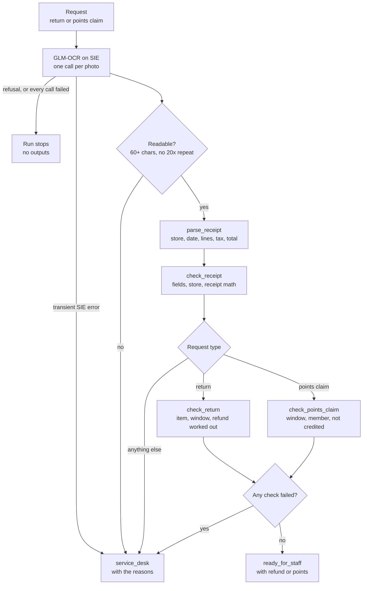

# Read receipt photos for returns and rewards

## Background

Every store chain with a loyalty program has two queues that run on receipts. At the service
desk, an associate takes back a skillet or a pair of headphones and works out the refund. In
loyalty support, someone answers the member who writes in because the points from last month's
shop never showed up. More and more of both arrive with a phone photo of the receipt instead of
the paper itself, taken on a kitchen counter, a bit tilted, under whatever light was on.

For each one, the person reads the store, the date and the lines off the photo, adds it up,
looks for the returned item, counts the days since purchase, works out the refund or the
points, and checks the loyalty system for a receipt that was already credited. Most requests
are fine. The work is spotting the few that aren't, and the cost of missing one is real money:
a refund on an item that isn't on the receipt, a return past its window, or points credited
twice for the same shop.

## The problem

Reading the photo is the slow part, and it's the part a person is worst at after the fortieth
one of the day. Squinting at a price, adding three lines and a coupon in your head, and
counting days on a calendar is exactly where errors creep in. Then there are the photos nobody
can read at all.

A single "read this receipt and decide" prompt to a generative model would be the obvious
shortcut, and it's the wrong one for money. You can't see why it took a number, and a model
that misreads a blurred photo doesn't say so; it makes up a plausible receipt. Here you want
the model to do only the reading, and plain rules you can check to do the rest.

The recipe gives each request one of two statuses: **ready_for_staff** (every check passed, and
the request comes with the worked-out refund or points) or **service_desk** (a check failed,
with the reason). Neither is a business decision. `ready_for_staff` means the receipt checks
out; an associate still inspects the item and issues the refund, and loyalty support still
credits the points. Nothing is refused
automatically either: a receipt that doesn't add up, an unreadable photo, an item that isn't on
the receipt or a field that wasn't read goes to a person with the reason.

## How we'll solve it

1. **Read each photo once.** An OCR model turns the whole receipt into text, one receipt line
   per line. That's the only model call, one per photo.
2. **Decide whether the text can be trusted.** Too little text means an unreadable photo. So
   does one character repeated 20 or more times in a row, which is what GLM-OCR returned when
   it invented text for a blurred photo (more on that below). Either way the request goes to
   the desk with "photo not legible", not some confusing downstream failure.
3. **Parse it with plain Python.** Chain name, `Store # Reg Trans`, date, member number, SKU
   lines with their amounts (`2 @ 12.00` gives the unit price), coupon, subtotal, tax rate and
   amount, and total. Every field sits on a labelled line or a SKU line on these receipts, so
   rules can read it and you can see why each value was taken.
4. **Check it.** Our store; lines plus discounts plus tax equal the total, to the cent; the tax
   is the printed rate times the taxable lines, within a cent; and every line with an amount is
   understood. For a return: the returned SKU is on the receipt with no voided or negative line
   and is returnable, the days since purchase are inside the department's window, and the refund
   can be worked out and is no more than the receipt total. For a points claim: the claim window,
   the member number on the receipt, and that the transaction isn't already credited. A request
   that is neither a `return` nor a `points_claim` goes to the desk as an unknown request type.
5. **Work out the money.** Refund: one unit, less its prorated share of the coupon, plus tax at
   the printed rate. Points: 1 per whole dollar of spend without gift cards, after coupons; a
   return takes back the points on its refund.

## Picking the model

`zai-org/GLM-OCR` reads each photo through SIE's `extract` call and returns the receipt as
Markdown text, sometimes with HTML tables. `flatten` turns tables into one line per row, drops
the Markdown marks and joins a lone amount back onto its label's line ("TOTAL", then "118.63").
On the live run it read all the legible photos line for line, with item and price on one line
and the tax rate as printed. It's MIT licensed and runs on the `cuda12-sglang-vision-extract`
SIE image.

Its weak spot showed up on the blurred photo, and it's the reason step 2 exists: it didn't come
back empty. It returned an invented header ("BRUNELLE STORY WEEKLY", "17 MARCH 2019") and then
the digit 2 about 8,000 times. A length check passes that cheerfully.

There's no second model. One OCR model is enough; dates, exact SKU matching, windows and
arithmetic belong in rules, and no generative model makes the decision.

## The flow



An unreadable photo or a failed call still runs the later checks on an empty receipt, so those
fail too and show up in `failed_checks`.

## How it's built

[`rules.yaml`](./rules.yaml) holds everything a store would change: the model name, our stores,
the line labels, return windows by department, the points rate, the OCR thresholds and a
one-line description of every check. [`recipe.py`](./recipe.py) holds the steps:

| Step | Code | SIE call | What it does |
| --- | --- | --- | --- |
| Read | `run`, `read_page` | `extract` (image item) | Renders each PDF page at 150 dpi, caps the longest edge at 2048 px, and reads it with GLM-OCR. A reply with no `entities` list counts as a failed call |
| Readable? | `unreadable_reason` | none | Fewer than 60 characters, or one character repeated 20+ times in a row (separator dashes and stars don't count) |
| Parse | `flatten`, `parse_receipt` | none | Turns tables and Markdown into lines, then reads the fields; a line with an amount that matches no label lands in `unparsed` |
| Check the receipt | `check_receipt`, `taxable_spend` | none | `receipt_fields`, `receipt_store`, `receipt_math` (the sums, and the tax against the printed rate; gift cards carry no tax) |
| Pick the checks | `check_request` | none | A `return` or a `points_claim`; any other type fails `request_type` |
| Check a return | `check_return`, `refund_for` | none | `returned_item` (fails on a voided or negative line for the SKU), `return_window` (longest SKU prefix wins), `refund_worked_out` (only for a returnable line; fails above the receipt total) |
| Check a claim | `check_points_claim`, `points_for` | none | `claim_window`, `receipt_member`, `not_credited` against `credited-transactions.csv` |
| Write | `write_outputs` | none | `requests/<request>.json`, `statuses.csv`, `service-desk.csv` |

SIE failures follow the same rule as the security recipes. A transient error (a timeout, a
lost connection, a 5xx, a rate limit, a model still loading, or a reply with no `entities`
list) fails `readable` for that request with the error, and the run goes on. A refusal (a bad
key, no credits, a model name SIE doesn't know) stops the run at once with SIE's full message
and writes nothing. If every call failed, the run stops too, since then no receipt was read.

[`selfcheck.py`](./selfcheck.py) checks the parser, the receipt math and tax rate, voided lines,
unknown request types, the return gates and refund (coupon share, quantity line, windows, gift
card), the points claim, the statuses and that SIE failure rule offline, with hand-written
receipt text and stand-in replies.
[`make_data.py`](./make_data.py) draws the receipt photos.

## Run it

You need [uv](https://docs.astral.sh/uv/) and an SIE API key
([create one](https://console.superlinked.com/console/api-keys)).

```bash
cp .env.example .env   # then set SIE_API_KEY
uv run recipe.py
uv run selfcheck.py    # optional: offline checks, no SIE call
uv run --group data make_data.py   # rewrite data/
```

`uv run` installs this recipe's few dependencies into its own `.venv` on the first run. Each run
writes `runs/<timestamp>/`. The first calls can wait a few minutes while SIE Cloud starts the
OCR model; a warm run of the 10 requests took about 20 seconds.

## What came out

The input is ten requests in [`data/`](./data):

- `requests.jsonl`: one return or missing-points claim per line: member number, request date,
  for a return the SKU scanned from the item's tag, and which page holds the receipt photo
- `receipt-photos.pdf`: ten receipt photos, one per page: tilted on a counter, unevenly lit,
  with sensor noise and JPEG compression
- `credited-transactions.csv`: transactions the loyalty system already credited

> **All of it is synthetic.** [`make_data.py`](./make_data.py) draws the photos with Pillow
> and rebuilds them byte for byte. The Brambleway Market chain, its stores, members, products,
> SKUs and transaction numbers are invented.

| Request | Planted | Status | Why |
| --- | --- | --- | --- |
| `RET-1001` | Skillet returned 12 days after purchase | `ready_for_staff`, refund 37.53, points -34 | Every check passed |
| `PTS-2001` | Near miss: quantity line (`2 @ 12.00`), a gift card, a -10.00 member coupon, tax only on the taxable lines, photo tilted 2.5 degrees | `ready_for_staff`, 63 points | Gift card earns none; the receipt adds up to the cent |
| `RET-1002` | Near miss: returned on day 30, the last day of the window | `ready_for_staff`, refund 31.10, points -29 | The window includes its last day |
| `RET-1003` | Returned 34 days after purchase | `service_desk`: `return_window` | Past the 30-day window |
| `RET-1004` | Headphones returned after 20 days: inside 30, outside the 15-day electronics window | `service_desk`: `return_window` | SKU prefix `4` is electronics |
| `RET-1005` | The 10in skillet (SKU 310442) is returned on a receipt for the 12in (310450) | `service_desk`: `returned_item` | SKU not on the receipt; the detail names the similar line |
| `PTS-2002` | Printed total is 20.00 more than the lines and tax | `service_desk`: `receipt_math` | 47.70 added up, 67.70 printed |
| `RET-1006` | Out-of-focus, underexposed photo | `service_desk`: `readable` and every check that needed the receipt | OCR repeated '2' 8165 times |
| `PTS-2003` | The transaction is already in `credited-transactions.csv` | `service_desk`: `not_credited` | Credited 28 points on 2026-10-12 |
| `RET-1007` | Near miss: the receipt adds up, but its tax line reads `TAX 2.54` with no rate | `service_desk`: `refund_worked_out` | No rate, so no refund to hand staff |

On the live run of 2026-11-02 (UTC) all 10 came out as planned, with the settings as first
written. Treat that as a demo that the wiring works, not as a measure of accuracy: ten planted
receipts from one template can tell you the pipeline is put together right, not how often it
gets a real receipt wrong.

A few things worth noticing:

- **RET-1007 has no rate to refund the tax at.** `refund_worked_out` guards against handing
  staff a return with no refund on it: a receipt that prints a tax amount and no rate passes
  every other return check, so this is the check that sends it to the desk:

  ```json
  {"request": "RET-1007", "status": "service_desk", "failed_checks": ["refund_worked_out"],
   "computed": {"refund": null, "points": -22},
   "checks": [{"check": "receipt_math", "passed": true,
               "detail": "2 items 35.00, discounts 0, tax 2.54 = total 37.54"},
              {"check": "refund_worked_out", "passed": false,
               "detail": "Tax 2.54 read with no rate; the refund needs the printed rate"}]}
  ```

  (abridged from `requests/RET-1007.json`). The receipt adds up fine. It just doesn't say what
  rate to refund the tax at, and guessing the rate is not a job for a refund rule.
- **The blurred photo got a real reason.** `RET-1006` would have gone to the desk anyway, since
  no store, date or items were read. The repeat check puts "photo not legible" first, ahead of
  the five checks that fail because of it; all six rows still appear in `service-desk.csv`.
- **The near misses are boundaries, and they held.** Day 30 on a 30-day window, a quantity line,
  a gift card that earns no points and carries no tax, and a member coupon taken off the points
  all came out `ready_for_staff` with the expected money. No return in the data has a coupon;
  the coupon's share on a returned unit is covered by `selfcheck.py`, not the planted data.
- **The desk sees one row per failed check.** From `service-desk.csv`:

  ```csv
  request,check,detail
  RET-1004,return_window,20 days after purchase; electronics window is 15 days
  RET-1005,returned_item,SKU 310442 is not on the receipt; similar lines with another SKU: 310450 CAST IRON SKILLET 12IN
  ```

The run writes `requests/<request>.json` per request (status, what was read, every check with
its detail, the refund or points), `statuses.csv` (one row per request; the refund and points
columns are filled only for `ready_for_staff`) and `service-desk.csv` (one row per failed
check).

## Potential improvements

- **Your stores and return windows.** They go in `stores`, `returns.window_days` and
  `returns.departments` (by SKU prefix) in `rules.yaml`. `not_returnable_prefixes` lists SKUs
  that never come back (gift cards here).
- **Your points program.** It's `points.per_dollar`, `excluded_prefixes` and
  `claim_window_days`. Bonus-point promotions would be a new rule in `eligible_spend`.
- **Another chain's receipts.** `parse_receipt` expects a 6-digit SKU at the start of an item
  line and the labels in `labels`. Another layout means new labels (`AMOUNT DUE`, `HST`) and
  perhaps a different SKU pattern.
- **The thresholds.** `money_tolerance` is zero, so receipts must add up to the cent.
  `min_chars` and `max_repeat_run` decide when a photo is unreadable, and the repeat check
  catches one failure we saw, not every invented text. They are starting points; check them
  against your own receipts.
- **Another OCR model.** Change `models.ocr` in `rules.yaml`. `lightonai/LightOnOCR-3-4B` is
  one to try on receipts unlike these (handwritten notes, long receipts); neither model was
  tested on handwriting or long receipts here.
- **Mixed tax and item coupons.** The refund applies one tax rate to every item and spreads
  every coupon over every returnable item. A basket with tax-exempt lines now fails closed:
  its tax doesn't match the printed rate, so `receipt_math` sends it to the desk. Refunding it
  needs per-item tax status. A coupon for one item is still spread over every item.
- **Transaction history.** The recipe never looks up the transaction in the point-of-sale
  system, so the same receipt claimed twice, a unit already returned, or a points claw-back on
  a purchase that never earned points all pass; a small history lookup is the first thing to
  add.
- **What it doesn't do.** It doesn't check that a receipt is genuine (an edited photo, a receipt
  reused across stores), or handle exchanges (an `exchange` request goes to the desk as an
  unknown request type), partial-quantity returns of a multi-unit line
  beyond one unit, or returns without a receipt. It reads the photo and checks it against the
  rules, so staff start from the problems.

## Try another model

Each model is one line under `models:` in `rules.yaml`. We swapped one model at a time, changed
nothing else, and ran the recipe on SIE Cloud on 31 Oct 2026. That was before `RET-1007` was
added, so these swaps cover the first 9 requests.

| `rules.yaml` key | Swap in | What happened on this data |
| --- | --- | --- |
| `ocr` | `lightonai/LightOnOCR-3-4B` | Same status for all 9 requests, and the same parsed receipt (store, date, items, tax, total) for the 8 legible photos. On the blurred `RET-1006` it returned no text, so `readable` failed on "only 0 characters read" instead of the repeated-digit check. |
| `ocr` | `lightonai/LightOnOCR-2-1B` | Same status for all 9 requests and the same parsed receipts for the 8 legible photos. On `RET-1006` it invented a small table ("Linear Regression 0.85 0.82 ...") that passed the `readable` check; the request still went to the desk because no store, date or items were read. |

See [MODELS.md](../../MODELS.md) for every model these recipes use.

## Run it on your own SIE

The same code runs against an SIE server you host. Set `SIE_BASE_URL` in `.env`; an API key
is then optional. The table gives the SIE v0.10.1 image each model runs on, from SIE's
[compatibility matrix](https://github.com/superlinked/sie/blob/main/docs/compatibility.md).

| `rules.yaml` key | Model | Image | Tested on |
| --- | --- | --- | --- |
| `ocr` | `zai-org/GLM-OCR` | `cuda12-sglang-vision-extract` | L4 |

One container serves it:

```bash
docker run --gpus all -p 8080:8080 -v sie-hf-cache:/app/.cache/huggingface \
  ghcr.io/superlinked/sie-server:v0.10.1-cuda12-sglang-vision-extract
# then set SIE_BASE_URL=http://localhost:8080 in .env and run: uv run recipe.py
```

## Files

- `recipe.py`: the pipeline
- `selfcheck.py`: plain asserts on the parser, receipt checks, return and points rules,
  statuses and SIE error rule, no SIE call (`uv run selfcheck.py`)
- `make_data.py`: draws the synthetic receipt photos and writes the requests in `data/`
- `rules.yaml`: stores, windows, points, labels and thresholds
- `data/`: the receipt photos, the requests and the credited transactions
- `pyproject.toml`, `uv.lock`: this recipe's dependencies

See the SIE task page for [OCR](https://superlinked.com/ocr) and the
[retail](https://superlinked.com/retail) industry page.
