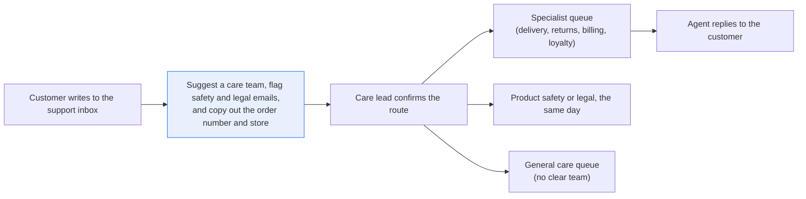
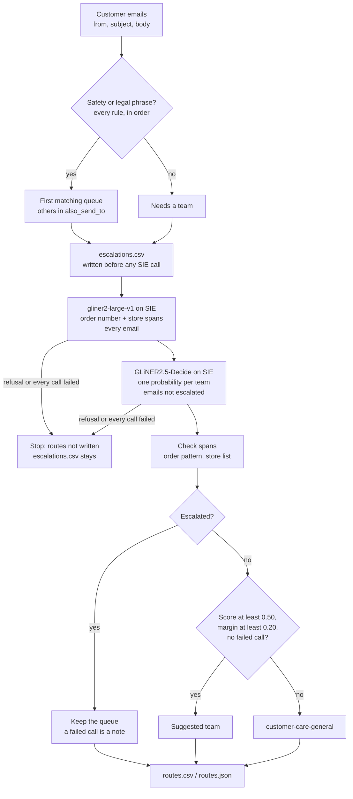

# Route customer emails to the right team, escalating safety and legal

> **This example:** a retailer's shared customer care inbox.
>
> **How it works:** phrase rules catch safety and legal emails first, a classification model
> suggests a team for the rest, and an extraction model pulls the order number and store. Python
> checks the order number's format and the store against the store list before either goes in the
> routes file.
>
> **Use the same pattern for:** routing supplier emails to buyers, sorting store incident reports,
> triaging marketplace seller messages.

## Background

Most retailers with an online shop and a few stores run a customer care team, and most of
that team's day goes through one shared support inbox: support@ or help@, the address on the
website and at the bottom of every order confirmation. Most of what lands there is routine.
Where is my order, where is my refund, how do I put this thing together, why didn't my points
show up. A larger retailer splits the work into specialist queues (delivery, returns, billing,
loyalty and so on), so somebody has to open each email first, decide which queue it belongs in,
and copy the order number and the store into the ticket so the next person doesn't have to ask
again.

That first read matters more than it looks. An email in the wrong queue waits until someone
notices and moves it, and the customer waits with it. An email with no order number gets a
reply asking for one, and the customer starts the wait again. And every so often an email
isn't routine at all: a heater that sparked and burned a child, or a customer replying for the
third time to say they've talked to a lawyer. Those belong with product safety or legal, today,
not behind fifty "where is my order" emails. A missed safety report is the kind of mistake a
retailer hears about again, from a regulator or a court.

Here's the job end to end, and the step this recipe takes on:



## The problem

Customer emails land in one shared inbox. Someone opens each one, picks a care team, and copies
the order number and the store into the ticket. Meanwhile, an email about a child's burn or a
threat to call a lawyer sits in that inbox behind fifty "where is my order" emails, looking
exactly like them in the subject list.

Keywords alone don't get you far. "Refund" shows up in returns, billing and legal complaints
alike. A single LLM call per email would work, but you'd be paying a generative model to pick
one of seven labels and you'd have to parse its prose. What you want is a cheap first pass that
sends safety and legal emails to their queues on rules you can read, suggests a team for the
rest with a score you can threshold, and pulls the order number and store out so the agent
doesn't have to.

This recipe produces a **suggested team** for every email, with **escalation**, **model** or
**general** as the method that picked it, plus the sender, the checked **order numbers** and
**store**, and, for a reply, the email it answers. It doesn't assign anything in a ticket
system. A care lead (or whoever owns the inbox on that shift) confirms each route, or imports
the file into the ticket tool and lets agents correct it there. The `product-safety` and
`legal-escalations` queues need a named person watching them, since a suggestion nobody reads
is just a nicer-looking inbox.

Two limits up front. Escalation is phrase-only: an email has to contain one of the listed
phrases, in its subject or body, to escalate, so an injury told in other words gets past it
(E-11 below is planted to show exactly that). And everything here is English: the phrases, the
team descriptions and the planted emails.

### Examples

Here are three of the emails in `data/emails.json`, and what should happen to each.

**1. A routine question.** E-01.
- **Input:** "Hi, my order LK-204517 was supposed to arrive on Tuesday and the tracking page still
  says label created. Can you tell me where it is?"
- **What should happen:** no safety or legal phrase, so the team model picks a team, and the order
  number passes the `LK` + 6 digits check.
- **Expected outcome:** `orders-delivery` by `model`, order `LK-204517`.

**2. A safety report.** E-03.
- **Input:** "The space heater I bought at the Cedar Falls store started sparking last night and
  my son burned his hand on the front grille. Order LK-199402. Has this model been recalled?"
- **What should happen:** the safety phrases fire before any model call, and the email is in
  `escalations.csv` even if SIE never answers. The order and store are still read.
- **Expected outcome:** `product-safety` by `escalation`, on `burned`, `sparking`, `recalled`.

**3. A near miss.** E-05, subject "Thank you to Sue".
- **Input:** "Just wanted to say Sue at the Maple Grove store was so helpful finding the right
  stain for my fence."
- **What should happen:** "Sue" is a name, and bare "sue" isn't a legal phrase, so it must not
  escalate. The team model picks a team.
- **Expected outcome:** `store-experience` by `model`, not `legal-escalations`.

On the live run, 8 of 12 planted cases came out as expected; [What came out](#what-came-out) has
each one.

## How we'll solve it

1. **Escalate on phrases first, in Python.** Safety phrases (burn, sparking, choking, recall...)
   send an email to `product-safety`, and legal phrases (attorney, lawsuit, sue you...) send it
   to `legal-escalations`. This runs before any model, so the model can't talk a burn out of
   the safety queue because the email is mostly about a late refund. An email that matches
   both keeps both: it goes to the first queue in `rules.yaml` order, and the other goes in
   `also_send_to`.
2. **Write the escalations to disk before any model call.** The models run on SIE Cloud, and
   the first call can wait minutes while a cold model starts. If SIE refuses the call or every
   call fails, the run stops. The escalations shouldn't depend on that, so `escalations.csv` is
   written first, and it stays there whatever happens next.
3. **Read the order number and store from every email.** A small extraction model finds the
   spans, including on escalated emails (product safety wants the order number too). Then
   Python checks them: an order number must fit `LK` + 6 digits, and a store must be on the
   store list. Anything else becomes a note for the agent.
4. **Ask a second model to pick a team for the rest.** It returns a probability for every
   team in the catalog, from the teams' one-line descriptions.
5. **Only trust a clear pick.** A low top score, a small gap to the runner-up, or a failed SIE
   call sends the email to the general queue, with the model's guess still shown.

## Picking the models

Both models are small GLiNER encoders from Fastino, and neither is generative, so no generative
model makes the decision.

The team picker is `fastino/GLiNER2.5-Decide`. It answers a typed question about a text (pick
one, yes or no) with a score. Here the question is "Which customer care team should handle this
email?" and each catalog team becomes one option, the team id plus its description. You get
back a probability per team, which is exactly what you need to set a threshold and a margin. The
team list is the routing catalog itself, so you add a team by giving it a description, and the
next run can route to it without any training. The catch is that it goes with the cues in the
descriptions: if two descriptions share a cue, it can pick the wrong one confidently (E-09
below). The question and the options take up to half of its window of about 512 tokens, so team
descriptions stay one short line.

The field reader is `fastino/gliner2-large-v1`. It pulls named spans out of text. We give it
plain labels (`order number`, `store location`) rather than a schema, because plenty of
emails have no order number and no store, and labels return an empty list for those instead
of an error. It finds the span; Python decides whether the span is a real order number or a real
store.

## The flow



## How it's built

The things you'd want to change live in [`rules.yaml`](./rules.yaml): the safety and legal
phrases, the queues, the order-number pattern, the question the model answers, the thresholds
and the model IDs. The teams and stores live in
[`data/routing_catalog.yaml`](./data/routing_catalog.yaml). [`recipe.py`](./recipe.py) is about
750 lines and reads top to bottom in the same order as the flow.

| Step | Code | SIE call | What it does |
| --- | --- | --- | --- |
| Escalate | `escalations`, `screen` | none | Safety phrases, then legal phrases, as whole words in any case on the subject and body. Every match is kept: the first queue is the team, the rest go in `also_send_to`. The team model is not asked |
| Write escalations | `write_escalations` | none | `escalations.csv`, with the same columns as `routes.csv`, before the client is even built |
| Find fields | `extract_windows` | `extract` with labels, `fastino/gliner2-large-v1` | Order number and store spans in every email, escalations included. Emails are split into windows of 120 words, and 25 windows go in one call |
| Pick a team | `classify_windows`, `team_probabilities` | `extract` + `output_schema` (one choice question), `fastino/GLiNER2.5-Decide` | Emails not escalated: one probability per care team. A long email's windows are merged by `merge_probabilities` |
| Handle SIE errors | `call_in_batches`, `is_fatal`, `reply_error` | | A transient error (timeout, 5xx, rate limit, an over-long window) marks its batch as failed: those emails go to the general queue, and an escalated one keeps its queue with a note. A reply missing `entities` or `data` counts as a failed call (and a call where every window came back that way, or with an item error, counts toward "every call failed"); an empty list is a real "nothing found". A reply that names a team not in the catalog is an error too, and the email goes to the general queue. A refusal (bad key, no credits, unknown model) or every call to a model failing stops the run with SIE's full message |
| Check fields | `read_fields`, `normalize_order_number`, `match_store` | none | A span must appear in the email, read with line breaks and double spaces collapsed the way the model's windows are; an order number must fit `LK` + 6 digits once spaces, hyphens and `#` are removed; a store must match the store list (name, alias or a close spelling). Anything else becomes a note |
| Check the pick | `route_by_model` | none | Top score under 0.50, top-2 margin under 0.20 or a failed call: general queue, with the model's suggestion. Orders, returns and billing with no order number get "ask the customer for it" |

[`selfcheck.py`](./selfcheck.py) checks the phrase rules, the field checks, the thresholds and
the SIE error handling offline, with hand-written strings and stand-in model replies. It also
runs `main` against a stand-in SIE that refuses the first call, and checks that
`escalations.csv` still holds E-03, E-04 and E-12 while `routes.csv` was never written.

## Run it

You need [uv](https://docs.astral.sh/uv/) and an SIE API key
([create one](https://console.superlinked.com/console/api-keys?utm_source=github&utm_medium=docs&utm_campaign=sie-cookbook&utm_content=retail-route-customer-emails)).

```bash
cp .env.example .env   # then set SIE_API_KEY
uv run recipe.py
uv run selfcheck.py    # optional: offline checks, no SIE call
```

`uv run` installs this recipe's few dependencies into its own `.venv` on the first run. Each run
writes `runs/<timestamp>/`. The first calls can wait a few minutes while SIE Cloud starts the
classification and extraction models; our run on 2026-11-02 (UTC) took about a minute and a
half from start to finish, and a warm run right after it took under two seconds. `--output DIR`
changes the output directory.

## What came out

The input is three files:

- [`data/emails.json`](./data/emails.json): twelve customer emails to the care inbox of
  Hollowbrook Home & Garden, a fictional retailer. Each has an `id`, a `from` address on a
  `.example` domain, a `subject` and a `body`; E-04 is a reply in a thread, so it also has
  `in_reply_to`.
- [`data/routing_catalog.yaml`](./data/routing_catalog.yaml): seven care teams, each with a
  one-line description of what customers write to it about, and four stores with aliases.
- [`rules.yaml`](./rules.yaml): the rules described above.

The retailer, its stores, customers, addresses and orders are synthetic, written for this
recipe.

The run writes `escalations.csv` first, then `routes.csv` and `routes.json`, one row per
email, with the sender in `from` and, for a reply, `in_reply_to`, so the care lead can find
the thread. `method` says what picked the team: `escalation` (a safety or legal phrase), `model`
(GLiNER2.5-Decide, with its score and margin) or `general` (the model wasn't sure or a call
failed, and `suggested_team` still shows its guess). `escalations` lists every escalation that
matched, and `also_send_to` the queues after the first.

### The three examples

- **E-01:** `orders-delivery`, model, score 0.98. As expected.
- **E-03:** `product-safety`, escalation, on `burned`, `sparking`, `recalled`, with the order and
  store still read. As expected.
- **E-05:** `store-experience`, model, score 0.98, and no legal escalation. As expected.

### Every planted case

On the live run on 2 Nov 2026, 8 of 12 planted cases came out as expected.

| Email | Planted | Route on our live run | Why |
| --- | --- | --- | --- |
| E-01 | Where is order LK-204517 | `orders-delivery`, model (0.98) | Plain delivery question |
| E-02 | Refund for an in-store return, order written `lk 208 331` | `returns-refunds`, model (0.80); `LK-208331`, Riverside Plaza | The order check turns `lk 208 331` into `LK-208331`; the model read "Riverside Plaza", the store's full name |
| E-03 | Heater sparked and burned a child's hand | `product-safety`, escalation; order and store still read | `burned`, `sparking`, `recalled` |
| E-04 | Third reply on a refund thread, mentions an attorney | `legal-escalations`, escalation; `in_reply_to` kept | `attorney` |
| E-05 | Near miss: "Sue at the Maple Grove store was so helpful", subject "Thank you to Sue" | `store-experience`, model (0.98); "Sue" is a name, not a legal threat | Bare "sue" is not a legal phrase |
| E-06 | Two issues: charged twice and not delivered | `orders-delivery`, model (0.65 vs `billing` 0.33) | Margin 0.32, over the 0.20 limit |
| E-07 | Rewards points missing | `loyalty`, model (0.68, margin 0.52) | Clear enough to pass both limits |
| E-08 | Vague call-back request naming an unknown "Northgate store" | `store-experience`, model (0.98); store flagged as not in the list | "Northgate store" isn't on the store list |
| E-09 | Assembly question for a garden bed picked up at the Eastport store | `store-experience`, model (0.59 vs `product-help` 0.38) | "picked up at the store" matches the `in-store pickup` cue |
| E-10 | "I need some help with something. Could someone get back to me?" | `customer-care-general`: top `orders-delivery` 0.32 | Under 0.50 |
| E-11 | Near miss: a glass table top shattered and "a piece cut my child's cheek", no listed phrase | `customer-care-general`: top `product-help` 0.39; not escalated | Phrase-only escalation: nothing in the list matches |
| E-12 | A ladder collapsed, "my husband was injured", and "we have spoken to a lawyer" | `product-safety`, escalation; `also_send_to` `legal-escalations` | Both flags kept: `injured` and `lawyer` |

On our live run (2026-11-02, UTC) the 12 emails came out as 3 escalated, 7 by model and 2 to
`customer-care-general`. Four emails didn't go where we wrote them to go, and we left the
rules and thresholds alone after seeing them: E-06, E-08 and E-09 (more below), and E-11, which
we planted knowing it would miss the escalation and which is the one to worry about. Treat the
table as a demo that the wiring works, not as a measure of accuracy: twelve emails tell you
the pipeline runs end to end, not how often it's wrong.

A few things worth noticing:

- **E-12 keeps both flags.** It mentions an injury and a lawyer, and both queues need to know.
  It goes to `product-safety` first because safety comes first in `rules.yaml`, and legal is
  still on the row. Here it is from `routes.csv`, with the empty `in_reply_to`, `store_id` and
  `store_name` and the empty model columns (`suggested_team`, `score`, `margin`,
  `second_team`, `notes`) cut:

  ```text
  email_id,from,team,method,escalations,also_send_to,matched_phrases,order_numbers,reason
  E-12,c.mbeki@mail.example,product-safety,escalation,safety; legal,legal-escalations,injured; lawyer,LK-205588,safety escalation: 'injured'; legal escalation: 'lawyer'
  ```

  The same row is in `escalations.csv`, written before either model was called, just without
  the order number yet.
- **E-11 is the phrase list's blind spot.** A child cut by shattered glass is a safety report,
  but "cut" and "shattered" aren't in the list, so it didn't escalate. It reached a person in
  the general queue only because GLiNER2.5-Decide wasn't sure what it was either (top
  `product-help` at 0.39, `store-experience` next). That's luck, not a rule. A slightly more
  confident model would have sent it to `product-help` as an assembly question. We didn't add
  "cut" to the list to make this row look better; for a home and garden retailer, "the mower
  won't cut" is a Tuesday.
- **E-06 was written to split between billing and delivery**, but the model chose delivery with
  a margin of 0.32, clear of the 0.20 limit. The customer has two problems and the row names
  one.
- **E-08 was written as too vague to route.** The model read "my visit to the Northgate store"
  as a store matter, which is defensible, and the store check flagged that Northgate isn't on
  the list.
- **E-09 is plain wrong.** It's a product question, but "picked up at the ... store" matches the
  `in-store pickup` cue in the store-experience description, and the model went with the cue at
  0.59. Its margin was 0.21, one hundredth over the 0.20 limit, so it routed instead of going to
  the general queue. A confident-looking score doesn't mean the route is right. If your emails
  route like this, rewrite the team descriptions so the cues don't overlap (move pickup to
  orders, say "product questions, even for items bought in a store"), or require a higher
  margin. E-10 was added after the first live run, because no email had reached the general
  queue.

### What you do next

The named people watching `product-safety` and `legal-escalations` open `escalations.csv`
first; it's there even when the models never answered. The care lead (or whoever owns the inbox
on that shift) goes through `routes.csv`, confirms or corrects each route, or imports it into
the ticket tool and lets agents correct it there. Rows that landed in `customer-care-general`
still show the model's guess, and a note about a missing order number or an unknown store tells
the agent what to ask the customer.

## Potential improvements

- **Your teams and stores.** They go in `data/routing_catalog.yaml`: `teams` with a one-line
  description of what customers write to each about, `stores` with names and aliases. The
  descriptions and the question take up to half of GLiNER2.5-Decide's window of about 512
  tokens, so keep each to one line.
- **Your escalation phrases.** They're under `escalations` in `rules.yaml`, one entry per queue,
  checked in order. Matching is whole words with no stemming, so list every word form you want
  caught, and keep names out ("sue" alone is also a first name). The phrase match errs toward
  escalating: "nobody was hurt" still goes to safety, and so would "do you sell smoking chips?".
- **Your order numbers.** The format is `order_number.pattern` and `format`.
- **Your thresholds.** `min_team_score`, `min_team_margin`, `min_entity_score`,
  `store_match_cutoff`, the window size and the batch size are starting points. Check them on
  your own emails.
- **Your queue names and models.** The queues are `general_queue` and each escalation's
  `queue`, and the models are under `models` in `rules.yaml`.
- **Catch injuries told in other words.** Add a second, model-based safety screen (another
  GLiNER2.5-Decide yes-or-no question would do) whose "yes" sends the email to a person, on top
  of the phrase list, so E-11 escalates on meaning rather than on luck.
- **Keep both issues on a two-issue email.** E-06 needs billing and delivery to talk to each
  other; listing every team over a probability floor, and letting a person pick the owner,
  would show that instead of hiding it behind one label.
- **Ask for an order number only when the request needs one.** `needs_order_number` covers all
  of billing, but a declined card or a gift card balance usually has no order.
- **Leave the store open when several are named.** Today the highest-scoring store wins, which
  can't tell a purchase store from a return store; a person should pick.
- **Find order numbers with the pattern directly.** They have a fixed format, so a regex over
  the text would catch them without depending on the model finding the span first.
- **Send long emails to a person instead of merging windows.** None of the planted emails
  runs past 120 words, and `merge_probabilities` adds code that a "too long, read it yourself"
  rule wouldn't.
- **Test a reply above a quoted old complaint.** A "Thanks, resolved" over a quoted email that
  names a burn and another store would test stale escalations and store mix-ups.
- **Other languages.** The phrases, team descriptions and planted emails are all English;
  another language needs its own phrase list and a check of the descriptions.

## Try another model

Each model is one line under `models:` in `rules.yaml`. We swapped one model at a time, changed
nothing else, and ran the recipe on SIE Cloud on 2026-11-02 (UTC), on all twelve emails.

| `rules.yaml` key | Swap in | What happened on this data |
| --- | --- | --- |
| `fields` | `fastino/gliner2-base-v1` | Same route, order numbers and stores for all 12 emails. One note changed: on E-08 it read the unknown store as "Northgate" instead of "Northgate store". |

SIE Cloud has no other model for `team` (GLiNER2.5-Decide) yet. SIE's catalog has
`fastino/GLiNER2.5-Decide-1B` and `fastino/GLiNER2.5-multi-Decide` to self-host; we have not run
them here. See [MODELS.md](../../MODELS.md) for every model these recipes use.

## Run it on your own SIE

The same code runs against an SIE server you host. Set `SIE_BASE_URL` in `.env`; an API key
is then optional. The table gives the SIE v0.10.1 image each model runs on, from SIE's
[compatibility matrix](https://github.com/superlinked/sie/blob/main/docs/compatibility.md).

| `rules.yaml` key | Model | Image | Tested on |
| --- | --- | --- | --- |
| `team` | `fastino/GLiNER2.5-Decide` | `cuda12-transformers5` | L4 |
| `fields` | `fastino/gliner2-large-v1` | `cuda12-default` | L4 |

One SIE server runs one image, so these 2 images need a cluster: the
[sie-cluster Helm chart](https://github.com/superlinked/sie/tree/main/deploy/helm/sie-cluster)
with one worker pool per image routes each model to its pool. See
[SELF_HOSTING.md](../../SELF_HOSTING.md) for the values file.

## Files

- `recipe.py`: the pipeline
- `rules.yaml`: escalation phrases, queues, order-number pattern, question, thresholds, models
- `data/`: the emails and the routing catalog
- `selfcheck.py`: offline checks, no SIE call
- `pyproject.toml`, `uv.lock`: this recipe's dependencies

See the SIE [classify](https://superlinked.com/classify?utm_source=github&utm_medium=docs&utm_campaign=sie-cookbook&utm_content=retail-route-customer-emails) task page.
