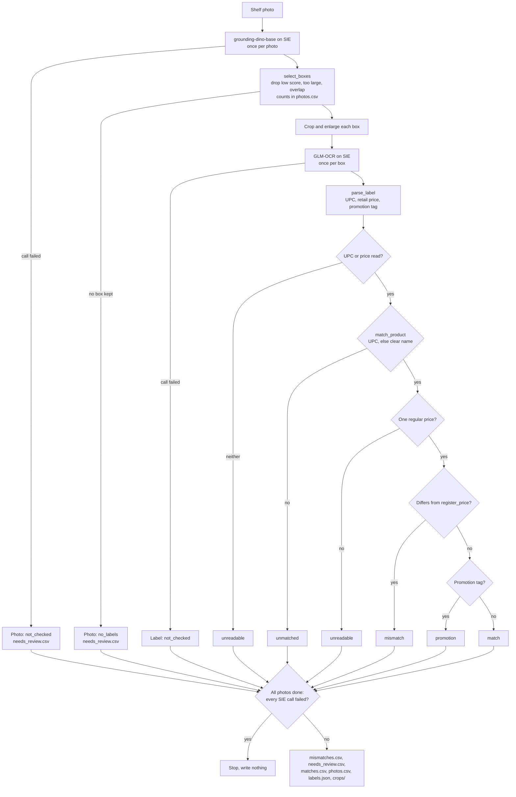

# Check shelf price labels against the price file

## Background

In a grocery store, the price a customer sees on the shelf label is supposed to be the price the
register charges. Keeping those two in step is the job of the store's pricing associate (in
bigger chains, a price-integrity team). Prices change every week. New labels get printed, old
ones get swapped, promotion tags get hung under the regular label and taken down again when the
promotion ends. Every one of those steps is done by hand, on a shelf, often by someone with a
stack of fifty other labels to put up before the store opens.

When a label and the register disagree, the customer finds out at the till. At best that's an
awkward conversation and a refund. At worst it's a complaint, and in many places a compliance
finding when an inspector does the same check. So the pricing associate walks the aisle with a
printout from the price system and compares label after label by eye. It's slow, it's boring,
and the boring part is exactly where mistakes slip through.

This recipe takes the first pass off their hands: it reads shelf photos and lists the labels
that need a person. The associate (or whoever owns price integrity in the store) still decides
what happens next: they check the physical item, its size and the actual register price before
any label is replaced or any price is corrected.

## The problem

Each label packs a lot into a small space: a unit price, a retail price, a UPC printed without
its check digit, a product name, internal codes, and quite often a promotion tag hanging under
it with a second price. A photo of a shelf has a dozen of these at odd angles, next to product
packaging that's covered in its own text.

A single model call on the whole photo can't do this well. The print is tiny, and you'd still
need to match each label to the price file and compare the numbers, which is the part you want
to be able to audit line by line. What you want instead is a list, per label, of what the checks
found:

- **mismatch**: the label's regular retail price disagrees with the price file.
- **promotion**: the regular price agrees, but the label also carries a promotion tag. The
  register might charge the promotion price, and this recipe doesn't check that, so a person
  does.
- **unreadable**, **unmatched**, **not_checked**: the recipe couldn't read a single price, find
  the product, or get an answer from SIE.
- **match**: the regular price agrees and there's no promotion on the label.

Read this as a **regular-label discrepancy screen**. It compares the regular retail price on the
label with `register_price` in your price file. It doesn't prove that the register charges what
the shelf says: it never sees the register, and it doesn't compare promotion prices. A `match`
means "this label's regular price agrees with the file", nothing more. And an empty
`mismatches.csv` doesn't mean the aisle passed an audit, since a label the detector never found
can't show up in it (that's what `photos.csv` is for).

## How we'll solve it

1. **Find the labels.** A text-prompted object detector looks for "price label" boxes in each
   photo. It's called once per photo. We drop boxes that score too low, boxes too big to be a
   label (that's a product), and boxes that overlap one we already kept. Every dropped box is
   counted per photo in `photos.csv`, so you can see what the recipe never read.
2. **Crop and enlarge.** Each kept box is cut out with a little padding (small, so the
   neighbor's barcode stays out) and enlarged 2x so the small print is legible.
3. **Read each label.** An OCR model reads each crop. It's called once per kept box.
4. **Parse.** Plain Python pulls out the UPC (`000-39978-00173`) and the retail price (`$6.49`).
   Unit prices (`59.0¢ PER OZ`) are skipped. Everything from the first promotion marker down
   (`HEALTHY SAVINGS`, `SAVE`, ...) is the promotion tag: its prices are never taken as the
   regular price, but the recipe remembers that the label carries one.
5. **Match.** UPC first: the label prints it without the check digit, so the recipe compares
   with and without it. Only when no UPC was read does the product name decide, and then only
   if one name clearly beats the rest.
6. **Compare.** The label's regular price against `register_price`, with a tolerance set in
   `rules.yaml`. A regular price that disagrees is a `mismatch` whether or not there's a
   promotion. A regular price that agrees on a label with a promotion is `promotion`, not
   `match`.

The order matters in one place: nothing is written to disk until every photo is done. If SIE
refuses a call (a bad key, no credits, a model name it doesn't know), or every call fails, the
run stops with SIE's message and leaves no half-written reports behind. A call that fails for a
reason that may pass (a timeout, a 5xx, a rate limit, a reply missing its `objects` or
`entities`) sends just that photo or label to review, and the run carries on.

## Picking the models

The detector is `IDEA-Research/grounding-dino-base`. It draws boxes around whatever you name in
text, so "price label" is the whole configuration. That's handy here: there's no training data
to collect, and you can change the prompt in `rules.yaml`. The downside is that "price label"
is a fuzzy idea to a detector. In our run it boxed a bag of potato starch as a label, and on
each photo it returned a handful of boxes below our score cut-off. That's why boxes are filtered
in Python and counted per photo.

The OCR model is `zai-org/GLM-OCR`. It reads receipts, labels and handwriting from photos and
returns the text as Markdown through SIE's `extract` call. On these labels it read the UPCs and
prices well enough for the parser, with the odd wrong digit (see Red Star Organic below), which
is why an unknown UPC goes to review instead of falling back to the name.

No generative model makes the decision. Both models only find and read; the matching and the
comparison are plain Python.

## The flow



A refusal from SIE on any call stops the run at that point, also writing nothing.

## How it's built

Everything you'd want to tune lives in [`rules.yaml`](./rules.yaml): the model names, the
detector prompt and score cut-offs, the crop padding and upscale, the name-match thresholds, the
price tolerance, and the words that mark a promotion tag or a unit price.
[`recipe.py`](./recipe.py) reads top to bottom in the same order as the flow.

| Step | Code | SIE call | What it does |
| --- | --- | --- | --- |
| Find the labels | `detect_labels`, `select_boxes` | `extract`, once per photo | Boxes for labels `["price label"]`. Low-score and product-sized boxes are dropped and overlapping ones merged; each dropped box is counted by reason |
| Crop | `crop_box`, `make_crop` | none | Small padding, enlarged 2x, longest side capped at 2048 pixels |
| Read | `read_label` | `extract`, once per kept box | The label's text: brand, name, UPC, unit price, retail price, promotion tag |
| Parse | `parse_label` | none | UPC, regular retail price, multi-buy price (`2/$3`) and the promotion tag's text. Unit prices and prices in the promotion tag are not taken as the regular price |
| Match | `match_product`, `name_score` | none | UPC first. Fuzzy product name only when no UPC was read, and only when the best name beats the runner-up by `min_name_margin` |
| Compare | `decide` | none | Regular price vs `register_price`: `mismatch`, `promotion` or `match`, or a review status with the reason |
| SIE failures | `call_sie`, `is_fatal`, `CallLog` | none | A transient failure, or a reply without `objects` or `entities`, sends that photo or label to review. A refusal, or every call failing, stops the run with no outputs |
| Report | `check_photo`, `run`, `write_outputs` | none | Writes the CSVs, `photos.csv`, `labels.json` and the crops once every photo is done |

[`selfcheck.py`](./selfcheck.py) checks the parser, the matching, the promotion rule, the
per-photo counts and the SIE failure rule offline, with hand-written label text and stand-in
model replies. It never calls SIE.

## Run it

You need [uv](https://docs.astral.sh/uv/) and an SIE API key
([create one](https://console.superlinked.com/console/api-keys)).

```bash
cp .env.example .env   # then set SIE_API_KEY
uv run recipe.py
uv run selfcheck.py    # optional: offline checks, no SIE call
```

`uv run` installs this recipe's few dependencies into its own `.venv` on the first run. Each run
writes `runs/<timestamp>/`. The first calls can wait a few minutes while SIE Cloud starts the
detector and the OCR model. Our run on 2026-11-02 (UTC), with both models already warm, made 22
SIE calls (3 detect, 19 OCR) and took about 23 seconds.

The run directory has:

- `mismatches.csv`: labels whose regular price disagrees with the price file, each with its crop.
- `needs_review.csv`: everything the recipe won't call either way, each with a reason.
  `promotion` means the regular price agrees but the label carries a promotion tag.
  `unmatched` means the product could not be found in `prices.csv`. `unreadable` means no
  single retail price could be read (for example a multi-buy `2/$3`). `not_checked` means an
  SIE call for that label or photo failed. A photo where the detector kept no label shows up
  here as `no_labels`.
- `matches.csv`: labels whose regular price agrees and that carry no promotion.
- `photos.csv`: per photo, the boxes the detector returned, how many were dropped and why, and
  how many labels were read.
- `labels.json`: every label's box, score, crop path and the raw OCR text.
- `crops/`: the image of every label the recipe read.

## What came out

The photos are real shelf photos from [Open Prices](https://prices.openfoodfacts.org), the
Open Food Facts price database. They were taken at a Sprouts Farmers Market in Sunnyvale, US,
on 2026-10-25 and uploaded by the Open Prices user `doby`:

| File | Open Prices proof | Labels |
| --- | --- | --- |
| `granola-aisle-141419.webp` | [141419](https://prices.openfoodfacts.org/proofs/141419) | Bob's Red Mill granola and muesli |
| `baking-aisle-141416.webp` | [141416](https://prices.openfoodfacts.org/proofs/141416) | yeast and potato starch |
| `ice-cream-freezer-141431.webp` | [141431](https://prices.openfoodfacts.org/proofs/141431) | Cosmic Bliss and Alden's ice cream |

**License.** Open Prices proof images are licensed under
[CC BY-SA 4.0](https://creativecommons.org/licenses/by-sa/4.0/). The price data is under the
[ODbL](https://opendatacommons.org/licenses/odbl/1.0/). The photos are unmodified. The label
crops each run writes to `crops/` are adaptations of them and are shared under the same
CC BY-SA 4.0 license, credited to Open Prices / Open Food Facts contributors.

[`data/prices.csv`](./data/prices.csv) (`upc`, `product`, `register_price`) holds the UPCs and
regular (non-promotion) prices that Open Prices recorded for these photos, with these changes
planted. The photos are a fixed public dataset, so the near miss is a label that was already on
the shelf, not a new one:

| Product | Label | `prices.csv` | Expected | Got | Why |
| --- | --- | --- | --- | --- | --- |
| Bob's Red Mill Cranberry Almond Granola | $6.49 | 6.99 | `mismatch` | `mismatch` | We raised the file price by $0.50 |
| Bob's Red Mill Potato Starch | $5.49 | 5.29 | `mismatch` | `mismatch` | We lowered the file price by $0.20 |
| Cosmic Bliss Chocolate Mint Supernova | $9.99 | 10.99 | `mismatch` | `mismatch` | We raised the file price by $1.00 |
| Sprouts Nutritional Yeast | $6.49 | left out | `unmatched` | `unmatched` | We removed its row, so its UPC isn't in the file |
| Bob's Red Mill Maple Sea Salt Granola. **Near miss** | $6.49, promotion tag $5.99 | 6.49 | `promotion` | `promotion` | The regular price agrees, but a register charging $6.49 during the promotion would be wrong, so it can't be a `match` |

The rest of the file agrees with the labels. Every mismatch comes from a price we changed in
`prices.csv`; none of them says anything about the store's actual shelf or register prices. All
three planted mismatches also carry a promotion tag. They stay `mismatch`, because a regular
price that disagrees is a finding whatever the promotion says, and the reason mentions the tag.

Our live run also escalated labels we did not plant, which is what the recipe should do when it
can't read a label cleanly:

| Label | What happened | Status |
| --- | --- | --- |
| Red Star Organic Instant Yeast | OCR read the UPC as `000-17829-00360` (one digit wrong), so the UPC is not in the file. The reason names the closest product. | `unmatched` |
| Red Star Instant Sourdough Yeast | The label price is a multi-buy, `2/$3` | `unreadable` |
| (no product) | The detector boxed a potato-starch bag, not a label: no UPC and no price | `unreadable` |
| 10 more labels (yeast, muesli, ice cream) | Regular price agrees, promotion tag on the label | `promotion` |

All five planted cases came out as planned on our run of 2026-11-02 (UTC). The planted cases on
three photos show the pipeline working; they don't measure accuracy. Nineteen labels tell you
the wiring is right, not how often the detector or the OCR model gets it wrong.

A few things worth noticing:

- **Sprouts runs a lot of promotions.** 16 of the 19 boxes read carry a "HEALTHY SAVINGS" tag,
  11 of them land in review as `promotion`, and only one label in the whole run is a plain
  `match` (Bob's Red Mill Muesli 40 oz). That's a busy review queue, and it's the honest answer:
  without the promotion prices in the price file, the recipe can't tell you whether those 11 are
  right at the register. The fix is more data, not a looser rule (see Potential improvements).
- **The near miss is the case the old version got wrong.** Before this change the parser
  stopped at the promotion marker and called Maple Sea Salt Granola a `match`. Here's the label
  now, from `labels.json` (abridged to the fields that matter):

  ```json
  {"label": "granola-aisle-141419-L01", "status": "promotion",
   "product": "Bob's Red Mill Maple Sea Salt Granola 11 oz",
   "label_price": "6.49", "register_price": "6.49",
   "reason": "Matched by UPC 0003997800173. Regular price $6.49 agrees with the register, but the label also carries a promotion tag: HEALTHY SAVINGS / $599 / SAVE 50¢ / VALID THRU 10/27/26. Check the register's promotion price."}
  ```

  Note the `$599`: the OCR model drops the decimal point on the promotion price, which is one
  more reason not to compare it automatically.
- **The promotion text is what OCR saw below the marker, warts and all.** On two ice cream labels
  it picked up the neighbor's packaging ("Serving size 2/3 cup (89g)", "Alden's"). It's there for
  the person reading the reason, not for any rule.
- **`photos.csv` shows what never got read.** The detector returned 32 boxes across the three
  photos and the recipe read 19 of them. The other 13 scored below `min_score` (5 on the baking
  aisle, 2 on the granola aisle, 6 in the freezer); none were dropped for size or overlap. We
  didn't inspect those 13 one by one, so we can't promise none of them is a label. That's the
  point of the file: on your own photos, this is where a missed label shows up:

  ```text
  photo,status,boxes_returned,dropped_low_score,dropped_too_large,dropped_overlap,labels_read,reason
  baking-aisle-141416.webp,checked,12,5,0,0,7,
  granola-aisle-141419.webp,checked,6,2,0,0,4,
  ice-cream-freezer-141431.webp,checked,14,6,0,0,8,
  ```

- **The potato starch bag is the detector's honest mistake.** It's a bag covered in text, and
  "price label" is a vague request. The recipe found no UPC and no price on it, so it went to
  review as "may not be a price label" instead of being matched to Potato Starch by name.

## Potential improvements

- **Your own price file.** Export `upc,product,register_price` from your point-of-sale system as
  the price file. It should be store-specific and dated to match the day the photos were taken.
- **Check the promotion prices too.** Promotion-tag prices are not compared. To check them, add a
  promotion-price column to `prices.csv` and compare the prices found after the first promotion
  marker. That would also empty most of the `promotion` queue on shelves like these.
- **Your own thresholds.** The thresholds in `rules.yaml` (the detector score and box-size
  limits, crop padding and upscale, the product-name match score and margin, and the price
  tolerance) are starting points. Check them on your own photos.
- **Your own label layout.** Fit the parser to your labels. `promo_markers` and `unit_markers`
  in `rules.yaml` tell it which prices belong to a promotion tag or are unit prices. The UPC
  pattern is `_UPC` in `recipe.py`; change it if your labels print the UPC differently.
- **Swap a model.** `models` in `rules.yaml` names the two models, one line each.
- **What goes to review today.** A label goes to `needs_review.csv`, never into the match or
  mismatch counts, when its UPC is not in the price file, it shows two UPCs, no UPC was read and
  the name matches no product (or more than one), no single retail price could be read, it
  carries a promotion with a regular price that agrees, or its SIE call failed.
- **Pack size on name matches.** The name match leaves out numbers and short units, so a label
  with no readable UPC for a different pack size of a listed product can match the listed size.
  Treating size and pack count as required, or making name-only matches a suggestion, would
  close that.
- **An annotated photo for the reviewer.** `photos.csv` counts dropped boxes; drawing every kept
  and dropped box on the original photo would let an associate see a missed label at a glance
  and ask for a close-up.

## Try another model

Each model is one line under `models:` in `rules.yaml`. We swapped one model at a time, changed
nothing else, and ran the recipe on SIE Cloud on 31 Oct 2026. Our run with the default models
failed that day (the detector returned "upstream request timeout" twice), so the swaps below are
compared with an earlier live run with the default models. These swaps ran before the promotion
rule was added, so "same status" below means the old statuses, when promotion labels still came
out `match`; we haven't rerun them since.

| `rules.yaml` key | Swap in | What happened on this data |
| --- | --- | --- |
| `ocr` | `lightonai/LightOnOCR-3-4B` | Same status for all 19 labels: the 3 planted mismatches, Nutritional Yeast unmatched, Red Star Organic unmatched on a misread UPC, and 2 unreadable. It returns each label as an HTML table, and the parser still read the UPCs and prices. On the `2/$3` sourdough label it read no UPC, so the reason is "no UPC and no price read". |
| `ocr` | `lightonai/LightOnOCR-2-1B` | Caught the 3 planted mismatches, but Potato Starch matched by name because its UPC was misread. The `2/$3` sourdough label came out `unmatched` on a misread UPC instead of `unreadable`; it still goes to review. The other labels came out the same. |
| `detect` | `google/owlv2-base-patch16-ensemble` | Did not run: the first detect call returned "upstream request timeout" on two tries. |
| `detect` | `facebook/sam3` | Did not run: the first detect call returned "upstream request timeout" on two tries. |

See [MODELS.md](../../MODELS.md) for every model these recipes use.

## Run it on your own SIE

The same code runs against an SIE server you host. Set `SIE_BASE_URL` in `.env`; an API key
is then optional. The table gives the SIE v0.10.1 image each model runs on, from SIE's
[compatibility matrix](https://github.com/superlinked/sie/blob/main/docs/compatibility.md).

| `rules.yaml` key | Model | Image | Tested on |
| --- | --- | --- | --- |
| `detect` | `IDEA-Research/grounding-dino-base` | `cuda12-default` | L4 |
| `ocr` | `zai-org/GLM-OCR` | `cuda12-sglang-vision-extract` | L4 |

One SIE server runs one image, so these 2 images need a cluster: the
[sie-cluster Helm chart](https://github.com/superlinked/sie/tree/main/deploy/helm/sie-cluster)
with one worker pool per image routes each model to its pool. See
[SELF_HOSTING.md](../../SELF_HOSTING.md) for the values file.

## Files

- `recipe.py`: the pipeline
- `selfcheck.py`: plain asserts on the parser, matching, promotion rule, per-photo counts and
  SIE failure rule, no SIE call (`uv run selfcheck.py`)
- `rules.yaml`: models, detection, crop, pricing and matching thresholds
- `data/`: the three photos and `prices.csv`
- `pyproject.toml`, `uv.lock`: this recipe's dependencies

See the SIE task page for [object detection](https://superlinked.com/detect) and the
[retail](https://superlinked.com/retail) industry page.
