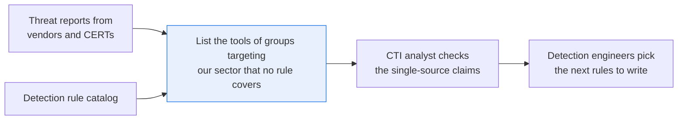
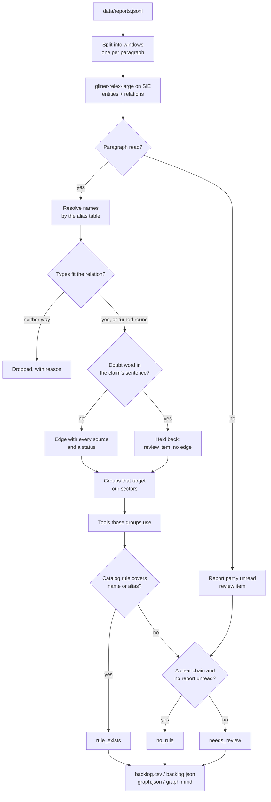

# Find the attacker tools your detection rules don't cover

> **This example:** reports on groups that target ports and freight, compared with the detection
> rule catalog.
>
> **How it works:** a relation model reads who uses what and who targets whom, Python builds the
> graph with sources and drops denials, and the graph is compared with your detection rule
> catalog.
>
> **Use the same pattern for:** checking your incident playbooks cover the techniques in recent
> reports, finding gaps in vendor-risk questions from breach reports, matching red-team findings
> to existing detections.

## Background

Detection engineers write the rules that catch attackers in your logs, and there are always more
rules to write than time to write them. The usual way to choose is to start with what the groups
targeting your sector actually use. That information is in threat reports: "Saltmarsh Kettle used
the Quillstep loader against port operators", "Velvet Gorse deployed Thornpipe against a freight
broker". The CTI team reads them; the detection engineers want a list.

Two things are already structured. The detection rule catalog (the SIEM or EDR rule list) says
which malware families and tools each rule covers. The company's sector and the sectors it cares
about are a short list. What isn't structured is the reports, where the claims sit in sentences,
often hedged ("possibly"), sometimes denied ("we found no evidence that...").

Here's the job end to end, and the step this recipe takes on:



Why it matters: a rule for a tool nobody in your sector uses is time not spent on one that would
have fired. And a backlog built on a misread sentence ("no evidence that X used Y" read as "X used
Y") sends engineers after the wrong tool.

## The problem

Reading the claims is half the job, and it's the half that needs care: denials, hedges and each
vendor's own name for a group. The other half is the comparison that makes the claims useful to
someone. An edge saying "Saltmarsh Kettle uses Quillstep" only matters to a detection engineer if
Saltmarsh Kettle targets your sector and you have no Quillstep rule.

A single LLM call over the reports ("which tools do port attackers use that we can't detect?")
would answer with confidence, and you'd have no way to see that it read "we found no evidence
that Saltmarsh Kettle used Thornpipe" as a yes. A keyword search for tool names finds every
mention, including the denial. So the model reads and plain Python sorts.

The output is a backlog, one row per malware family or tool, with a status:

- **`no_rule`**: used by a group that targets your sector, by a claim at least one publisher made
  without hedging, and nothing in the catalog covers it. The row lists the groups, the sentences
  and the publishers.
- **`rule_exists`**: covered by a rule in the catalog. Listed for completeness, not for work.
- **`needs_review`**: the only claims are hedged, denied or in review, so the CTI analyst checks
  before it goes on the backlog.

The detection engineers choose what to build. The recipe doesn't write rules or rate how good an
existing rule is. It also doesn't see your exposure, your telemetry or how recent the activity
is, and those matter for what to build first.

### Examples

Here are three of the sentences in `data/reports.jsonl`, and what should happen to each.

**1. A tool you already have a rule for.**
- **Input:** "Gorse Moth, the group other vendors call Velvet Gorse, deployed Thornpipe against a freight broker in July." (R-02, Dunmore Intel)
- **What should happen:** "Gorse Moth" merges into Velvet Gorse, the sentence makes it a group targeting freight, and the catalog's DR-0101 covers "Thornpipe implant", an alias of Thornpipe.
- **Expected outcome:** Thornpipe is `rule_exists`, with Velvet Gorse on the row.

**2. A tool nobody wrote a rule for.**
- **Input:** "Saltmarsh Kettle used the Quillstep loader to gain a foothold on harbour networks. Saltmarsh Kettle targeted port operators along the northern coast." (R-03, Northfold CERT)
- **What should happen:** a clear use by a group that targets port operators, and nothing in the catalog covers Quillstep.
- **Expected outcome:** Quillstep is `no_rule`, with Saltmarsh Kettle on the row.

**3. A denial.**
- **Input:** "We found no evidence that Saltmarsh Kettle used Thornpipe." (R-04, Northfold CERT)
- **What should happen:** the model may well read this as a use, but the negation word holds it back, so it never becomes an edge.
- **Expected outcome:** no edge; Saltmarsh Kettle is not one of Thornpipe's groups, and the sentence shows up under `held_back`.

On the live run, 6 of 6 planted cases came out as expected; [What came out](#what-came-out) has each one.

## How we'll solve it

1. **Start from what's structured.** The detection rule catalog (each rule and the malware or
   tools it covers) is a CSV read through `rule_catalog.py`, the way you'd query your own rule
   repository. Your sectors and the alias table are in `rules.yaml`.
2. **Read the claims** with `knowledgator/gliner-relex-large-v1.0`, and build the graph with
   its statuses (multi_publisher, single_source, review). A claim whose sentence has a negation
   or hedging word is held back: it never becomes an edge.
3. **Pick the groups that target your sectors**, then every malware family or tool those groups
   use. A group targets your sector when a report says so directly, or when one sentence says the
   group used a tool against it ("Gorse Moth deployed Thornpipe against a freight broker").
4. **Compare with the catalog** by canonical name and alias, and write the backlog with the
   sentences behind each row. A close name in the catalog is a note on the row, never a match.

The order matters. Names are merged before anything is compared, so "Gorse Moth" and "Velvet
Gorse" are one group by the time we ask who targets freight. And the catalog comes last, so a
rule never hides a claim: the row still shows every group and sentence, the status just says a
rule exists.

## Picking the model

The model is `knowledgator/gliner-relex-large-v1.0` (Apache 2.0), called through SIE's `extract`
with the entity labels as `labels` and the relation labels as `options.relation_labels`. It
returns two lists per paragraph: entities (text, label and offsets) and relations (head text,
relation, tail text and a score). One model reads the entities and the relations between them.
Without it you'd run an NER model (named entity recognition) plus a relation classifier, or an
LLM per sentence. The labels and relation types are plain words in `rules.yaml`, so you change
what it looks for without touching code. The 12 paragraphs of the six reports go to SIE Cloud in
one batched call (`batch_size` is 16), and you host nothing.

The score it gives each relation is extraction confidence: how sure it is the sentence says
this. It says nothing about whether the report is right. On our live run the relations the
backlog rests on scored 0.96 to 1.0.

What it's bad at, and what the Python is there for:

- **It doesn't understand "no evidence".** From "We found no evidence that Saltmarsh Kettle used
  Thornpipe." it returned "Saltmarsh Kettle uses Thornpipe" with a score of 0.92. That's why
  negation is a rule and not a score.
- **It doesn't understand "possibly" either.** "Murkbell is possibly attributable to Saltmarsh
  Kettle" came back as an attribution at 0.99, and "Velvet Gorse possibly uses the Quillstep
  loader" as a `uses` at 0.92.
- **It's confident about junk.** It returned "Murkbell exploits code overlap" at 0.98, which is
  as high as the real claims, so no score threshold can separate them. That's why `not_entities`
  and `listed_types_only` exist.
- **It splits "used X against Y".** "Gorse Moth ... deployed Thornpipe against a freight broker"
  comes back as "Gorse Moth uses Thornpipe" and "Thornpipe targets freight broker", never as
  "Gorse Moth targets freight broker". That's why step 3 joins the two when they come from the
  same sentence.
- **The relations SIE returns carry no types and no offsets.** The upstream model's relation
  format has endpoint types and offsets, but the `relations` in the SIE response this recipe
  reads give the head and tail as plain text. The code looks each end up in the alias table, and
  for a name the table doesn't know, it uses the label the model gave that text in the same
  paragraph. When a name occurs twice in a paragraph, the code can't tell which occurrence the
  model meant, so the negation check reads every sentence that holds both names.

The thresholds are `entity_threshold` 0.40 (relex needs at least 0.1) and `relation_threshold`
0.70 (the model card suggests 0.7 to 0.9).

## The flow



A chain is clear when neither claim in it is held back: the group uses the tool, and the group
targets your sector, both without a doubt word and both on edges that aren't in review.

## How it's built

Everything you'd want to argue about lives in [`rules.yaml`](./rules.yaml): your sectors, the
model ID, the entity and relation labels, the alias table, which entity types each relation may
join, the doubt words, the generic words and the thresholds. The catalog lives in
[`data/detection_rules.csv`](./data/detection_rules.csv) and is read only through
[`rule_catalog.py`](./rule_catalog.py), which loads it into an in-memory SQLite database and
offers `find_rules` (exact match on any of a tool's names) and `near_rules` (close names, for a
note). Swap it for a query against your own rule repository and the recipe doesn't change.
[`recipe.py`](./recipe.py) reads top to bottom in the same order as the flow.

| Step | Code | SIE call | What it does |
| --- | --- | --- | --- |
| Split | `paragraph_windows`, `sentences` | none | One window per paragraph (split on sentences above 200 words, and a longer sentence on words). A relation is read inside one window |
| Entities + relations | `extract_windows` | `extract` + `labels` + `options.relation_labels`, once per 16 windows | threat actor, malware, vulnerability, sector, software, campaign; uses, exploits, targets, attributed to, alias of. A failed call or a reply without `entities` or `relations` marks its windows unread; a refusal or a run where every call failed stops (`is_fatal`, `stop_message`) |
| Names | `window_labels`, `AliasTable`, `name_key`, `unusable_end` | none | Names merge by the alias table, which also sets the type; CVE IDs are upper-cased; generic words ("operators") are dropped |
| Types | `orient`, `check_relation` | none | Each relation must join the types in `rules.yaml`. One that fits only the other way round is turned round and goes to review; one whose types fit either way round is flagged "direction unverifiable"; one that fits neither way is dropped with a reason |
| Doubt | `claim_sentences`, `negated_sentence` | none | Any negation or hedging word in the claim's sentence ("not", "never", "no evidence", "possibly", "likely", "may", ...) holds the claim back, quoting the sentence and the score |
| Graph | `build_graph` | none | One edge per (head, relation, tail) with every source. Status: `review` (an unknown name, a turned-round claim, an unverifiable direction, or a report with a doubt word on it), `single_source` (fewer than 2 publishers), `multi_publisher`, or `provisional` when a report was partly unread |
| Sectors | `our_sectors`, `targets`, `as_use` | none | Your sectors must be sectors in the alias table, or the run stops before any model call. A group targets one directly, or through a tool aimed at it in the sentence that says the group used the tool |
| Backlog | `backlog_links`, `build_backlog`, `held_item` | none | Every tool a targeting group uses (`uses`, or the tool `attributed to` the group). `rule_exists` if `RuleCatalog.find_rules` matches its canonical name or an alias; else `no_rule` with a clear chain and every report read; else `needs_review`. Held-back chains are listed with the reason; near catalog names are notes |
| Output | `backlog_json`, `graph_json`, `mermaid`, `write_outputs`, `csv_safe` | none | Writes `backlog.csv`, `backlog.json`, `graph.json` and `graph.mmd` |

A few details worth knowing. Unknown names are matched like table names (case, a leading "the"
and a possessive don't count). A sentence ends at `.`, `!` or `?` followed by a space, so "e.g. "
ends one too, and a negation word before such a break isn't read with the claim. "May" counts as
a hedge only in lower case, so the month doesn't hold a claim back. A tool the alias table
doesn't know never reaches `no_rule`: its edges are in review, because it may be another
vendor's name for a tool your catalog already covers.

[`selfcheck.py`](./selfcheck.py) checks the negation rule, name matching, edge statuses, the
backlog on the committed reports with hand-written stand-in model replies, the adversarial cases
below, the SIE failure rule, Mermaid and CSV output and window splitting. It never calls SIE.
Change `rules.yaml` and it tells you right away if you broke something.

## Run it

You need [uv](https://docs.astral.sh/uv/) and an SIE API key
([create one](https://console.superlinked.com/console/api-keys?utm_source=github&utm_medium=docs&utm_campaign=sie-cookbook&utm_content=security-find-detection-gaps)).

```bash
cp .env.example .env   # then set SIE_API_KEY
uv run recipe.py
uv run selfcheck.py    # optional: offline checks, no SIE call
```

`uv run` installs this recipe's few dependencies into its own `.venv` on the first run. Each run
writes `runs/<timestamp>/` in this folder; pass `--output DIR` to write somewhere else. The first
call can wait a few minutes while SIE Cloud starts the relation extraction model. A warm run makes
one SIE call and took under 3 seconds on our machine, uv start included.

## What came out

The inputs are [`data/reports.jsonl`](./data/reports.jsonl), six short reports from three
fictional publishers (Brindle Point Security, Dunmore Intel, Northfold CERT), one JSON object per
line with `id`, `publisher`, `published` (the date), `title` and `text`; and
[`data/detection_rules.csv`](./data/detection_rules.csv), six detection rules with `rule_id`,
`title`, `platform` and `covers` (the names each rule covers, separated by `;`). Your sectors are
set to port operators and freight.

> The reports, publishers, actors, malware, products, rules and the CVE ID are all made up for
> this recipe. `CVE-2099-41877` uses the year 2099 so it can't be a real CVE (not yet, anyway).
> The reports contain no indicators, URLs or code.

We ran it live on 4 Nov 2026 (UTC).

### The three examples

- **Thornpipe:** `rule_exists`, Velvet Gorse, matched to DR-0101 through the alias table. As expected.
- **Quillstep:** `no_rule`, Saltmarsh Kettle, with Dunmore Intel and Northfold CERT as publishers (the row is quoted below). As expected.
- **The denial:** the model returned it at 0.92 anyway, and the recipe held it back: no edge, and the line "R-04: Saltmarsh Kettle uses Thornpipe: a negation or hedging word in its sentence" under Thornpipe. As expected.

### Every planted case

On the live run on 4 Nov 2026, 6 of 6 planted cases came out as expected:

| Item | What we planted | Result on our live run | Why |
| --- | --- | --- | --- |
| Quillstep | Saltmarsh Kettle uses it (two Northfold reports) and targets port operators; no rule | **`no_rule`**, Saltmarsh Kettle | The case the recipe exists for |
| Thornpipe | Velvet Gorse used it against a freight broker; DR-0101 covers "Thornpipe implant" | **`rule_exists`**, Velvet Gorse | Already handled. The rule names an alias, and the alias table makes it a match |
| Thornpipe and Saltmarsh Kettle | "We found no evidence that Saltmarsh Kettle used Thornpipe." | No edge; Saltmarsh Kettle isn't one of Thornpipe's groups, and the sentence is in `held_back` | A denial is not a claim. The model returned it at 0.92 anyway |
| Larchwick | A commodity stealer Velvet Gorse and Saltmarsh Kettle both used; no rule | **`no_rule`**, both groups listed | Shared tooling still counts |
| Murkbell | Only a hedged attribution: "Murkbell is possibly attributable to Saltmarsh Kettle" | **`needs_review`** | A hedge isn't enough to spend an engineer's week on |
| Larchwood (near miss) | DR-0103 covers "Larchwood stealer", which scores 0.82 against "Larchwick stealer" (difflib), above the 0.8 `near_name_ratio` | Larchwick stays **`no_rule`**, with a note naming DR-0103 | A close name is a different tool until someone says otherwise |

The run gave 4 backlog rows (2 `no_rule`, 1 `needs_review`, 1 `rule_exists`), and a graph of 17
nodes, 15 edges, 16 review items and 4 dropped relations. Treat the planted cases as a demo of
how the recipe behaves: they tell you the wiring is right, and nothing about accuracy.

A few things worth noticing:

- **The denial is the case the design is for.** The model was sure (0.92) and wrong about what
  the sentence means. In the backlog it isn't evidence; it's a line under Thornpipe saying why it
  was held back:

  ```text
  R-04: Saltmarsh Kettle uses Thornpipe: a negation or hedging word in its sentence: 'We found no evidence that Saltmarsh Kettle used Thornpipe.'
  ```

  The recipe also doesn't record "Saltmarsh Kettle does not use Thornpipe". A vendor saying it
  found no evidence isn't proof of absence, and that call belongs to the analyst.
- **Velvet Gorse targets freight only through Thornpipe.** No report says "Velvet Gorse targets
  freight". The model read R-02 as "Gorse Moth uses Thornpipe" plus "Thornpipe targets freight
  broker", and because both came from one sentence, the recipe joins them. That one sentence is
  also why Velvet Gorse is on the Larchwick row, and why the R-02 sentence shows up there next to
  the Larchwick sentence. Velvet Gorse also targets water utilities (R-01), which isn't one of
  your sectors, so that claim alone would have put nothing on the backlog.
- **Quillstep is `no_rule` with a hedge attached.** Brindle Point says Velvet Gorse "possibly"
  uses Quillstep. That doesn't change the status, since Saltmarsh Kettle's claim is clear, but it
  sits in `held_back` for the CTI analyst. Ashen Lark also used Quillstep, against a regional
  hospital network; that's not your sector, so it's not on the row.
- **Here are the Murkbell and Quillstep rows** from `backlog.csv` (sentences shortened to the
  first one):

  ```csv
  tool,type,status,rules,groups,sectors,publishers,reports,sentences,held_back,notes
  Quillstep,malware,no_rule,,Saltmarsh Kettle,port operators,Dunmore Intel | Northfold CERT,R-03 | R-04 | R-05,"R-03: Saltmarsh Kettle used the Quillstep loader to gain a foothold on harbour networks. | ...","R-06: Velvet Gorse uses Quillstep: a negation or hedging word in its sentence: 'Velvet Gorse possibly uses the Quillstep loader as well, but we have a single sample.'",
  Murkbell,malware,needs_review,,Saltmarsh Kettle,port operators,Dunmore Intel | Northfold CERT,R-03 | R-05,"R-03: Based on code overlap and shared infrastructure, Murkbell is possibly attributable to Saltmarsh Kettle. | ...","R-03: Murkbell attributed to Saltmarsh Kettle: a negation or hedging word in its sentence: 'Based on code overlap and shared infrastructure, Murkbell is possibly attributable to Saltmarsh Kettle.'",
  ```

  Publishers and reports cover both halves of the chain: Dunmore Intel is there because R-05
  says Reedcutter (Saltmarsh Kettle) targeted port operators.
- **The graph still has its noise.** "Murkbell uses packer", "Murkbell uses staging server" and
  "Quillstep targets regional hospital network" went to review as unknown names; "Velvet Gorse
  exploits outbound connections" and "Murkbell exploits code overlap" got the "new flaw, or not a
  flaw at all?" question. Apparently "code overlap" is a vulnerability now. None of it reaches the
  backlog, because none of it is a group using a tool.

We also tried to break it offline before the live run, with stand-in replies built to get a
confident wrong status. `selfcheck.py` keeps each one: a clear use with only a hedged targeting
claim (`needs_review`), a claim the model read backwards ("Larchwick uses Saltmarsh Kettle",
turned round and held back), two tools glued into one span (an unknown name, so `needs_review`,
never dropped), a catalog rule on the shorter name "Quill" or the near name "Quillsteps" (no
match, `no_rule` with a note), a tool the alias table doesn't know (`needs_review`), a tool whose
only claim is a hedge, a victim's product read as a tool the group "used", a reply with one
result fewer than it was sent or a `null` key (both failed calls), and a failed SIE call on one paragraph (every `no_rule` becomes
`needs_review`, since the unread paragraph may hold a denial).

### What you do next

The CTI analyst reads `backlog.csv` first: the `needs_review` rows (Murkbell here), the `held_back` sentences, and any `no_rule` row that rests on a single source, and decides what goes on the backlog. The detection engineers then pick the next rules to write from the `no_rule` rows (Quillstep and Larchwick on this run), weighing what the recipe can't see: your exposure, your telemetry and how recent the activity is.

## Potential improvements

- **Your own sectors.** They're `our_sectors` in `rules.yaml`, and each must be a sector in the
  alias table. List the phrasings your reports use as aliases there, the way "freight forwarders"
  and "harbour operators" are: a sector name the table doesn't know is never matched.
- **Your own catalog.** Replace `RuleCatalog` with a query against your detection-as-code
  repository or SIEM. If your rules name tools by a vendor alias the alias table doesn't know,
  add the alias, or the tool will come out `no_rule` even though a rule exists.
- **Your own alias table.** It's `aliases` in `rules.yaml`: the canonical name, its type and its
  aliases. Put in only the equivalences an analyst has confirmed. A platform's list of
  "associated" group names is not that: vendors often track overlapping clusters. The recipe
  refuses to run if one name points to two different entries.
- **Your own labels and relation rules.** They're `entity_labels`, plus `relations` with the
  allowed head and tail types, and `backlog` with the types that count as groups and tools.
  A product victims run (type `product` in the alias table, such as Halvard Gateway) can be a
  `targets` tail but is never a tool, so "a group used Halvard Gateway" never puts it on the
  backlog. The model has no `product` label; only the table gives that type, so a victim product
  the table doesn't list still comes back as `software`.
  `note_other_tails` lists the relations where one head with several tails gets a note naming
  the others (today only `attributed to`).
- **More negation and hedging words.** They live in `doubt_words`, one regex. A denial or hedge
  phrased without one ("stopped using", "retracted", "we assess with moderate confidence") stays
  a claim. Run `uv run --frozen python selfcheck.py` after a change.
- **More generic words.** They live in `not_entities`.
- **Thresholds.** They're `entity_threshold`, `relation_threshold`, `min_sources`,
  `near_name_ratio`, `max_words_per_window` and `batch_size`. Treat them as starting points.
- **The model.** It's `models` in `rules.yaml`.
- **Idea: join a group to a sector across sentences.** Today "Gorse Moth used Thornpipe. Thornpipe
  hit a freight broker." is not a chain, because the two claims sit in different sentences. A
  next step would send such pairs to review instead of leaving them out.
- **Idea: rank the backlog.** Rows are sorted by status and name. Activity dates, how many
  publishers carry each chain and your own telemetry would make a better order; the recipe has
  the report dates but not when the activity happened.
- **Idea: let the analyst's answers flow back.** Write each decision (confirmed claim, new alias,
  rejected claim) back into `rules.yaml` or your threat-intel platform, so the next run doesn't
  ask again. A suggestion, not something the recipe does.

## Try another model

Each model is one line under `models:` in `rules.yaml`. As of 31 Oct 2026, SIE Cloud has no
other relation extraction model for `relations`, so there's nothing to swap in here yet.
[MODELS.md](../../MODELS.md) lists every model these recipes use and links SIE's full catalog.

## Run it on your own SIE

The same code runs against an SIE server you host. Set `SIE_BASE_URL` in `.env`, and the API
key becomes optional. The table gives the SIE v0.10.1 image each model runs on, from SIE's
[compatibility matrix](https://github.com/superlinked/sie/blob/main/docs/compatibility.md).

| `rules.yaml` key | Model | Image | Tested on |
| --- | --- | --- | --- |
| `relations` | `knowledgator/gliner-relex-large-v1.0` | `cuda12-default` | L4 |

One container serves it:

```bash
docker run --gpus all -p 8080:8080 -v sie-hf-cache:/app/.cache/huggingface \
  ghcr.io/superlinked/sie-server:v0.10.1-cuda12-default
# then set SIE_BASE_URL=http://localhost:8080 in .env and run: uv run recipe.py
```

## Data and licenses

Everything in `data/` is synthetic and written for this recipe: the six reports and the six
detection rules. No real groups, malware, vendors, products or CVEs. The model is Apache 2.0.

## Files

- `recipe.py`: the pipeline
- `rule_catalog.py`: the detection rule catalog as lookups (`find_rules`, `near_rules`,
  `get_rule`) over `data/detection_rules.csv`
- `selfcheck.py`: offline checks with hand-written sentences, the committed data and
  hand-written stand-in model replies; it never calls SIE
- `rules.yaml`: your sectors, labels, relation rules, alias table, doubt words, thresholds and
  the model ID
- `data/reports.jsonl`: the synthetic reports
- `data/detection_rules.csv`: the synthetic rule catalog
- `pyproject.toml`, `uv.lock`: this recipe's dependencies

See the SIE task page for
[information extraction](https://superlinked.com/information-extraction?utm_source=github&utm_medium=docs&utm_campaign=sie-cookbook&utm_content=security-find-detection-gaps).
