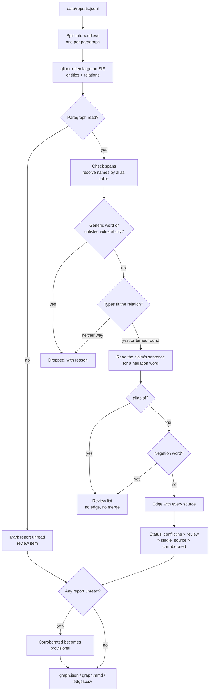

# Map how threats relate across reports

## Background

A threat-intelligence team (often called CTI, for cyber threat intelligence) keeps track of who is
attacking companies like yours and how. The people doing that work are CTI analysts. On a normal
day an analyst reads reports from several security vendors, government CERTs and the odd
researcher blog, pulls out the claims that matter (this group uses that malware, that malware
exploits this vulnerability, this group goes after hospitals), and records them somewhere the rest
of the security team can use. Most teams keep that record as a graph: threat actors, malware,
tools, vulnerabilities and the sectors or software they target are the nodes, and "uses",
"exploits", "targets" and "attributed to" are the edges.

The graph isn't a reference shelf. Other people act on it:

- **Detections.** If the graph says a group that targets your sector uses a particular backdoor,
  the detection engineers write rules for that backdoor first.
- **Hunting.** Threat hunters search your own logs for the tools and infrastructure tied to the
  actors you care about. The graph tells them what to look for.
- **Briefing leadership.** When someone asks "are we a target, and of whom?", the answer comes from
  this graph, usually with the edges that point at your sector or your software.

That makes a wrong edge expensive in a quiet way. Attribute a malware family to the wrong group
and your hunters chase the wrong infrastructure, your detections cover the wrong tools, and
leadership hears about a threat that the reports never actually supported. Record a vendor's
"we found no evidence that X used Y" as "X uses Y" and you've turned a denial into a fact. Miss a
real edge and the gap only shows up when it matters. So the analyst needs every edge with the
sentences behind it, and needs to know which edges are solid and which ones still need a person.

## The problem

Your team reads reports from several vendors and keeps a graph of who does what: which group uses
which malware, which malware exploits which vulnerability, who targets whom, and which actor a
malware family is attributed to. Three things make that harder than it sounds:

- **Every vendor has its own name for the same group.** "Gorse Moth" is "Velvet Gorse", and
  "Reedcutter" is "Saltmarsh Kettle".
- **Reports disagree.** One says Murkbell belongs to Velvet Gorse, another says Saltmarsh Kettle.
- **One source can add an edge nobody else has seen.** A single blog post is enough to put a line
  in the graph, and nothing tells you later that it rests on one publisher.

Reading reports with a model helps with volume, but the model's answer isn't the graph. It will
happily return a relation from a sentence that denies it, and it will tag phrases like "code
overlap" as vulnerabilities. The recipe uses the model to read and plain Python to decide.

What comes out is a graph where every edge carries its sources (report, publisher, date, sentence,
score) and one status: **corroborated**, **single_source**, **conflicting**, **review** or
**provisional**. Next to it are a **review list** for the analyst and a **dropped list** with the
reason each relation didn't make it.

The key design choice: **the recipe never records a denial on its own.** Any claim whose sentence
has a negation word ("not", "never", "no longer", "no evidence", ...) goes to review, not to the
graph. Deciding which claim a "not" belongs to, and whether it denies the claim or only limits it,
has no natural end, so the recipe doesn't try. Planted case E6 below is exactly that sentence. And
an edge that would be corroborated while part of a report went unread is only **provisional**
until someone looks.

What the recipe covers, and what it doesn't:

- Every claim whose sentence has a negation word goes to review, not to the graph. That covers
  plain denials ("we found no evidence that X used Y", "X did not deploy Y"), hedges ("has not
  been observed using", "no longer uses"), limits that still mean yes ("did not deploy Thornpipe
  until March 2024", "is not linked to any group other than Velvet Gorse") and a "not" about
  something else in the same sentence ("used Thornpipe but did not exploit CVE-2099-41877"). If
  other reports make the same edge, it gets status `review` with the sentence in its flags.
- That means some true claims wait for a person. On reports that hedge a lot, expect a longer
  review list.
- It doesn't catch a denial phrased without a negation word ("Velvet Gorse stopped using
  Thornpipe", "the Thornpipe claim was retracted"). The model's relation then stands as an edge.
- Names in different sentences ("Saltmarsh Kettle is active. It has never used Thornpipe.") go to
  review when any sentence from one name to the other has a negation word.

`selfcheck.py` holds every sentence above that names two entities, with the outcome the rule
gives it.

## How we'll solve it

1. **Split each report into windows.** One window per paragraph. A paragraph above 200 words is
   split on sentences, and a single sentence longer than that is cut on words. The model only
   links two names inside the same window, so a claim has to fit in one.
2. **Read entities and relations in one model call.** The model tags threat actors, malware,
   vulnerabilities, sectors, software and campaigns, and the relations between them (uses,
   exploits, targets, attributed to, alias of). This is the only step that needs a model.
3. **Clean up the names.** The alias table merges vendor names into one canonical name and sets
   its type. CVE IDs are upper-cased. Generic words ("operators") and "vulnerabilities" that are
   neither a CVE ID nor a table entry are dropped. This comes before anything else, because every
   later check compares names.
4. **Check the types.** Each relation may only join the types `rules.yaml` allows (malware can't
   `use` anything, for example). One that fits only the other way round is turned round and
   flagged; one that fits neither way is dropped with a reason.
5. **Look for a negation word in the claim's sentence.** If there is one, the claim goes to review
   and never becomes an edge. A proposed `alias of` also goes to review and is never merged on
   its own. Both are checked after the names and types, so the review list only holds claims that
   would otherwise have been real edges.
6. **Build the graph and set the status.** One edge per (head, relation, tail), carrying every
   source. Then each edge gets one status, most serious first: conflicting, review,
   single_source, corroborated. Last, if SIE failed to read a paragraph, every corroborated edge
   becomes provisional, because the missing paragraph might have contradicted it.

## Picking the model

The model is `knowledgator/gliner-relex-large-v1.0` (Apache 2.0), called through SIE's `extract`
with the entity labels as `labels` and the relation labels as `options.relation_labels`. It returns
two lists per window: entities (text, label and offsets) and relations (head text, relation, tail
text and a score). One model reads the entities and the relations between them in a single call.
Without it you'd run an NER model (named entity recognition) plus a relation classifier, or an LLM
per sentence. The labels and relation types are plain words in `rules.yaml`, so you change what it
looks for without touching code. The five reports go to SIE Cloud in one batched call, and you host
nothing.

What it's good at, on our reports: on the first live run the planted relations came back with
scores of 0.88 to 1.0.

What it's bad at, and what the Python is there for:

- **It doesn't understand "no evidence".** On E6 the model returned "Saltmarsh Kettle uses
  Thornpipe" with a score of 0.92 from a sentence that says the opposite. That's why negation is a
  rule and not a score.
- **It's confident about junk.** It returned "Murkbell exploits code overlap" and similar
  relations at 0.84 to 0.98, which overlaps the planted range, so no score threshold can separate
  them. That's why `not_entities` and `listed_types_only` exist (more on that below).
- **Relations carry no types and no offsets.** The model's `relations` give the head and tail as
  plain text. The code looks each end up in the alias table, and for a name the table doesn't
  know, it uses the label the model gave that same text in the same window. So an unknown name
  can get a different type in another window; its edges then carry a "typed as A and B in
  different claims" flag. And when a name occurs twice in a window, the code can't tell which
  occurrence the model meant (see the negation check below).

The thresholds are `entity_threshold` 0.40 (relex needs at least 0.1) and `relation_threshold`
0.70 (the model card suggests 0.7 to 0.9).

## The flow



## How it's built

Everything you'd want to argue about lives in [`rules.yaml`](./rules.yaml): the model ID, the
entity and relation labels, the alias table, which entity types each relation may join, the
negation words, the generic words and the thresholds. [`recipe.py`](./recipe.py) reads top to
bottom in the same order as the flow.

| Step | Code | SIE call | What it does |
| --- | --- | --- | --- |
| Split | `paragraph_windows`, `sentences` | none | One window per paragraph (split on sentences above 200 words, and a longer sentence on words). A relation is read inside one window |
| Entities + relations | `extract_windows` | `extract` + `labels` + `options.relation_labels` | threat actor, malware, vulnerability, sector, software, campaign; uses, exploits, targets, attributed to, alias of. `batch_size` windows per call |
| Names | `window_labels`, `AliasTable`, `name_key`, `unusable_end` | none | An entity span whose text doesn't match the window at its offsets is dropped with a note in the review list. Names merge by the alias table, which also sets the type; CVE IDs are upper-cased; generic words ("operators") and vulnerabilities that are not a CVE ID or a table entry are dropped |
| Types | `orient`, `check_relation` | none | Each relation must join the types in `rules.yaml`. One that fits only the other way round is turned round (and flagged); one that fits neither way is dropped with a reason |
| Negation | `claim_sentences`, `negated_sentence` | none | Any negation word in the claim's sentence ("not", "n't", "never", "no longer", "no evidence", ...) sends the claim to review. It never becomes an edge, and the recipe never records a denial on its own |
| Graph | `build_graph` | none | One edge per (head, relation, tail), carrying every source: report, publisher, date, sentence, score |
| Flags | `build_graph`, `map_relations` | none | `single_source`: fewer than 2 publishers (two reports from one publisher count once). `conflicting`: a family attributed to two actors. `review`: an end that is not in the alias table, or a report that states the claim in a sentence with a negation word. `provisional`: it would be corroborated, but a report was partly unread. A proposed `alias of` is never merged; it goes to review |
| Output | `graph_json`, `mermaid`, `write_outputs`, `csv_safe` | none | Writes `graph.json`, `graph.mmd` and `edges.csv` |

A few details in the names and negation steps worth knowing. Unknown names are matched like table
names (case, a leading "the" and a possessive don't count), so "Ashen Lark", "ASHEN LARK" and
"Ashen Lark's" are one node, named by the first spelling the run meets. The relations carry no
offsets, so when a name occurs twice the negation check reads every sentence that holds both
names, and a negation word in any of them sends the claim to review. When no sentence holds both,
it reads every sentence from one name to the other. A sentence here ends at `.`, `!` or `?`
followed by a space, so "e.g. " ends one too, and a negation word before such a break isn't read
with the claim ("no evidence, e.g. in logs, that X used Y" stays an edge).

[`selfcheck.py`](./selfcheck.py) checks the negation rule, name matching, the edge statuses and
dropped relations from `map_relations` and `build_graph`, Mermaid and CSV output and window
splitting, offline, with hand-written sentences, the committed reports and hand-written stand-in
model replies. Change `rules.yaml` and it tells you right away if you broke something.

## Run it

You need [uv](https://docs.astral.sh/uv/) and an SIE API key
([create one](https://console.superlinked.com/console/api-keys)).

```bash
cp .env.example .env   # then set SIE_API_KEY
uv run recipe.py
uv run selfcheck.py    # optional: offline checks, no SIE call
```

`uv run` installs this recipe's few dependencies into its own `.venv` on the first run. Each run
writes `runs/<timestamp>/` in this folder. If you'd rather write somewhere else, pass
`--output DIR`. The first call can wait a few minutes while SIE Cloud starts the relation
extraction model.

## What came out

The input is [`data/reports.jsonl`](./data/reports.jsonl): five short reports from three
fictional publishers (Brindle Point Security, Dunmore Intel, Northfold CERT), one JSON object per
line with `id`, `publisher`, `published` (the date), `title` and `text`.

> The reports, publishers, actors, malware, products and the CVE ID are all made up for this
> recipe. `CVE-2099-41877` uses the year 2099 so it can't be a real CVE (not yet, anyway). The
> reports contain no indicators, URLs or code.

| Case | Planted | Result on our live run | Why |
| --- | --- | --- | --- |
| E1 | Velvet Gorse uses Thornpipe; Dunmore writes "Gorse Moth" | **corroborated** | The alias merges, 2 publishers |
| E2 | Thornpipe exploits CVE-2099-41877 (Brindle Point, Northfold) | **corroborated** | 2 publishers |
| E3 | Velvet Gorse targets water utilities, one report | **single_source** | 1 publisher |
| E4 | Murkbell attributed to Velvet Gorse (Dunmore) and to Saltmarsh Kettle (Northfold) | both edges **conflicting** | `attributed to` is single-valued |
| E5 | Saltmarsh Kettle uses Quillstep in two Northfold reports | **single_source** | One publisher counts once |
| E6 | Near miss: "We found no evidence that Saltmarsh Kettle used Thornpipe." | **review**, with no edge | The model returned the relation (score 0.92); the negation word sends it to review. It's the only sentence in the reports with a negation word |
| E7 | Ashen Lark, a name not in the table, uses Quillstep | **review** | Unknown name |
| E8 | Saltmarsh Kettle targets port operators; Dunmore writes "Reedcutter" | **corroborated** | The alias merges, 2 publishers |

We ran it again live on 1 Nov 2026 with the current negation rule: E6 went to review, the other
seven cases came out as before, and the run gave 12 nodes, 11 edges and 9 review items.

**Two rules were added after the first live run.** That run returned "Operators uses Halvard
Gateway" (from "Operators should patch..."), plus "Murkbell exploits code overlap", "...
shared infrastructure" and "Velvet Gorse exploits outbound connections", scored 0.84 to 0.98.
Apparently "code overlap" is a vulnerability now. The planted edges scored 0.88 to 1.0, so no
score threshold could separate the two groups. Instead we added two rules to `rules.yaml`:
`not_entities` (generic words that are never nodes) and `listed_types_only` (a vulnerability must
be a CVE ID or a table entry). Both were fitted to this demo data, and no threshold changed. The
results above come from a later live run with the final rules, and the planted cases matched the
first run.

Treat the planted cases as a demo of how the recipe behaves: eight cases tell you the wiring is
right. They say nothing about accuracy.

A few things worth noticing:

- **E6 is the one the design is for.** The model was sure (0.92) and wrong about what the sentence
  means. In the run's `graph.json` it's a review item that quotes the sentence, not an edge:

  ```text
  R-04: Saltmarsh Kettle uses Thornpipe has a negation word in its sentence; not an edge: 'We found no evidence that Saltmarsh Kettle used Thornpipe.'
  ```

  The recipe also didn't record "Saltmarsh Kettle does not use Thornpipe". A vendor saying it found
  no evidence isn't the same as proof of absence, and that call belongs to the analyst.
- **The run also produced edges nobody planted.** "Thornpipe targets Halvard Gateway" came out
  corroborated, which is a fair reading of the text. "Thornpipe targets freight broker" and
  "Quillstep targets regional hospital network" went to review, because neither target is in the
  table. The model also returned relations such as "Murkbell uses packer" (in the type rules,
  malware can't `use` anything) and "Reedcutter uses phishing wave" (a campaign isn't malware).
  Both were dropped, and `graph.json` lists them with the reason.
- **Most of the review list is the same few problems seen from two sides.** An unknown name gets
  one item for the node ("Ashen Lark (threat actor) is not in the alias table: new or an alias?")
  and one for each edge it sits on. Read the node items first: once a name is in the table, its
  edges lose the "not in the alias table" flag on the next run.
- **E4 shows why both conflicting edges stay.** Neither report is dropped in favor of the other,
  and each edge says who disagrees with it. Here are both rows, plus E1 and E5, from `edges.csv`:

  ```csv
  head,relation,tail,status,publishers,reports,flags
  Velvet Gorse,uses,Thornpipe,corroborated,Brindle Point Security;Dunmore Intel,R-01;R-02,
  Murkbell,attributed to,Velvet Gorse,conflicting,Dunmore Intel,R-02,other reports say attributed to Saltmarsh Kettle; only 1 publisher(s): Dunmore Intel
  Murkbell,attributed to,Saltmarsh Kettle,conflicting,Northfold CERT,R-03,other reports say attributed to Velvet Gorse; only 1 publisher(s): Northfold CERT
  Saltmarsh Kettle,uses,Quillstep,single_source,Northfold CERT,R-03;R-04,only 1 publisher(s): Northfold CERT
  ```

The run writes three files:

- `graph.json` has the nodes (name, type, known, mentions), the edges (status, flags, sources
  with the sentence), the dropped relations with the reason, the review list, and `unread`: the
  reports with a paragraph SIE didn't read. Every edge from such a report gets a "report R-0x
  partly unread" flag. The unread paragraph might also contradict or question an edge from
  another report, so every edge that would be corroborated gets status `provisional` instead,
  with a flag naming the unread reports, and the run prints a warning that edges may be missing
  and that statuses elsewhere may be wrong too. There's no `denials` list any more (earlier
  versions had one): a claim with a negation word is a review item that quotes its sentence.
- `graph.mmd` is a Mermaid flowchart. Solid arrows are corroborated, dashed arrows are every
  other status (provisional included), red arrows are conflicting or need review, and `?` marks
  a name not in the table.
- `edges.csv` has one row per edge. A cell that starts with `=`, `+`, `-`, `@`, a tab or a
  carriage return gets a leading `'`, so a spreadsheet won't run it as a formula.

## Potential improvements

- **Your own alias table.** It's `aliases` in `rules.yaml`: the canonical name, its type and its
  aliases. In practice you'd export it from your threat-intel platform. The recipe refuses to run
  if one name points to two different entries.
- **Your own labels and relation rules.** They're `entity_labels`, plus `relations` with the
  allowed head and tail types. `single_valued` lists the relations that may have only one tail
  per head.
- **More negation words.** They live in `doubt_words`, one regex. If your reports deny a link in
  words ours don't (e.g. "stopped using", "retracted"), add them there so those claims go to
  review too. Run `uv run --frozen python selfcheck.py` after a change.
- **More generic words.** They live in `not_entities`: if your reports use one ours don't (e.g.
  "intruders" where ours say "attackers"), add it there.
- **Stricter types.** `listed_types_only` names the types whose names must be a CVE ID or an
  alias-table entry.
- **Thresholds.** They're `entity_threshold`, `relation_threshold` (the model card suggests 0.7
  to 0.9), `min_sources`, `max_words_per_window` and `batch_size`. Treat them as starting points
  and check them on your own reports.
- **The model.** It's `models` in `rules.yaml`.
- **Idea: let the analyst's answers flow back.** Today a review item is text. A next step would be
  to write each analyst decision (confirmed edge, new alias, rejected claim) back into
  `rules.yaml` or your threat-intel platform, so the next run doesn't ask the same question. This
  is a suggestion, not something the recipe does.
- **Idea: measure it on your own reports.** Eight planted cases prove the wiring. Before you trust
  the statuses, run it on a month of reports your team already graphed by hand and compare. Also
  not something we've done.

## Try another model

Each model is one line under `models:` in `rules.yaml`. As of 31 Oct 2026, SIE Cloud has no
other relation extraction model for `relations`, so there's nothing to swap in here yet.
[MODELS.md](../../MODELS.md) lists every model these recipes use and links SIE's full catalog.

## Run it on your own SIE

The same code runs against an SIE server you host. Set `SIE_BASE_URL` in `.env`, and the API
key becomes optional. The table gives the SIE v0.10.1 image each model runs on, from SIE's
[compatibility matrix](https://github.com/superlinked/sie/blob/main/docs/compatibility.md).

| `rules.yaml` key | Model | Image | Tested on |
| --- | --- | --- | --- |
| `relations` | `knowledgator/gliner-relex-large-v1.0` | `cuda12-default` | L4 |

One container serves it:

```bash
docker run --gpus all -p 8080:8080 -v sie-hf-cache:/app/.cache/huggingface \
  ghcr.io/superlinked/sie-server:v0.10.1-cuda12-default
# then set SIE_BASE_URL=http://localhost:8080 in .env and run: uv run recipe.py
```

## Files

- `recipe.py`: the pipeline
- `selfcheck.py`: offline checks of the negation rule, name matching, the edge statuses and
  dropped relations from `map_relations` and `build_graph`, Mermaid and CSV output and window
  splitting. It uses hand-written sentences, the committed reports and hand-written stand-in
  model replies; it never calls SIE
- `rules.yaml`: labels, relation rules, alias table, negation words, thresholds and the model ID
- `data/reports.jsonl`: the synthetic reports
- `pyproject.toml`, `uv.lock`: this recipe's dependencies

See the [security](https://superlinked.com/security) industry page and the SIE
[information extraction](https://superlinked.com/information-extraction) task page.
