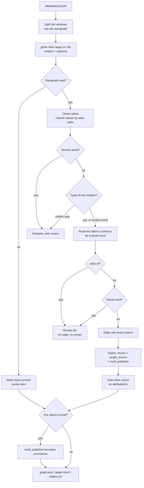

# Map how threats relate across reports

## Background

A threat-intelligence team (often called CTI, for cyber threat intelligence) keeps track of who is
attacking companies like yours and how. The people doing that work are CTI analysts. On a normal
day an analyst reads reports from several security vendors, government CERTs and the odd
researcher blog, pulls out the claims that matter (this group uses that malware, that malware
exploits this vulnerability, this group goes after hospitals), and records them somewhere the rest
of the security team can use. Teams that run a threat-intelligence platform (TIP) or a graph keep
that record as a graph: threat actors, malware, tools, vulnerabilities and the sectors or software
they target are the nodes, and "uses", "exploits", "targets" and "attributed to" are the edges.

The graph isn't a reference shelf. Other people act on it:

- **Detections.** If the graph says a group that targets your sector uses a particular backdoor,
  the detection engineers write rules for that backdoor first.
- **Hunting.** Threat hunters search your own logs for the tools and infrastructure tied to the
  actors you care about. The graph tells them what to look for.
- **Briefing leadership.** When someone asks "are we a target, and of whom?", the answer comes from
  this graph, usually with the edges that point at your sector or your software.

That makes a wrong edge expensive in a quiet way. Attribute a malware family to the wrong group
and your hunters chase the wrong infrastructure, your detections cover the wrong tools, and
leadership hears about a threat that the reports never actually supported. Record a vendor's
"we found no evidence that X used Y" as "X uses Y" and you've turned a denial into a fact. Miss a
real edge and the gap only shows up when it matters. So the analyst needs every candidate edge
with the sentences behind it, and needs to know which ones rest on more than one publisher and
which ones still need a person. Detection and hunting priorities also depend on your exposure,
your telemetry and how recent the activity is; this recipe doesn't see any of that.

## The problem

Your team reads reports from several vendors and keeps a graph of who does what: which group uses
which malware, which malware exploits which vulnerability, who targets whom, and which actor a
malware family is attributed to. Three things make that harder than it sounds:

- **Every vendor has its own name for a group.** In our alias table "Gorse Moth" is "Velvet
  Gorse", and "Reedcutter" is "Saltmarsh Kettle". Those entries are equivalences an analyst has
  confirmed. Vendors often track overlapping clusters, so a name a platform lists as "associated
  with" a group isn't automatically the same group.
- **Reports name different actors.** One says Murkbell belongs to Velvet Gorse, another says
  Saltmarsh Kettle. That may be a disagreement, or two groups using one stealer: malware gets
  shared, sold and leaked. Only an analyst can tell which.
- **One source can add an edge nobody else has seen.** A single blog post is enough to put a line
  in the graph, and nothing tells you later that it rests on one publisher.

Reading reports with a model helps with volume, but the model's answer isn't the graph. It will
happily return a relation from a sentence that denies it, and it will tag phrases like "code
overlap" as vulnerabilities. The recipe uses the model to read and plain Python to sort.

What comes out is a graph of **candidate claims for an analyst to accept**, not finished
intelligence. Every edge carries its sources (report, publisher, date, sentence, the names as the
report wrote them, and the model's score) and one status: **multi_publisher**, **single_source**,
**review** or **provisional**. Next to it are a **review list** for the analyst and a **dropped
list** with the reason each relation didn't make it.

Two of those words need pinning down. `multi_publisher` means at least two distinct publisher
names carry the claim. That isn't independent evidence: two vendors quoting one original report
pass too, and one careful first-hand report stays `single_source`. And the score is the model's
confidence that it read the relation out of the sentence, not how credible the claim is.

The key design choice: **the recipe never records a denial or a doubt on its own.** Any claim
whose sentence has a negation word ("not", "never", "no longer", "no evidence", ...) or a hedging
word ("possibly", "likely", "suspected", "may", ...) goes to review, not to the graph. Deciding
which claim a "not" belongs to, and whether it denies the claim or only limits it, has no natural
end, so the recipe doesn't try. Planted cases E6 and E9 below are exactly those sentences. And an
edge that would be `multi_publisher` while part of a report went unread is only **provisional**
until someone looks.

What the recipe covers, and what it doesn't:

- Every claim the model returns whose sentence has a negation or hedging word goes to review, not
  to the graph. That covers plain denials ("we found no evidence that X used Y", "X did not deploy
  Y"), hedges ("has not been observed using", "no longer uses", "possibly uses", "we suspect",
  "may have used"), limits that still mean yes ("did not deploy Thornpipe until March 2024", "is
  not linked to any group other than Velvet Gorse") and a "not" about something else in the same
  sentence ("used Thornpipe but did not exploit CVE-2099-41877"). If other reports make the same
  edge, it gets status `review` with the sentence in its flags.
- That means some true claims wait for a person. On reports that hedge a lot, expect a longer
  review list.
- The check only sees relations the model returned. If a third report disputes "Velvet Gorse uses
  Thornpipe" and the model, correctly, returns no relation from it, the dispute never reaches the
  rule and the edge keeps its status.
- It doesn't catch a denial or a hedge phrased without a word from the list ("Velvet Gorse
  stopped using Thornpipe", "the Thornpipe claim was retracted", "we assess with moderate
  confidence", "according to another vendor", a hypothetical example). The model's relation then
  stands as an edge. "May" counts only in lower case, so the month doesn't send a claim to review.
- Names in different sentences ("Saltmarsh Kettle is active. It has never used Thornpipe.") go to
  review when any sentence from one name to the other has a negation or hedging word.

`selfcheck.py` holds every sentence above that names two entities, with the outcome the rule
gives it.

## How we'll solve it

1. **Split each report into windows.** One window per paragraph. A paragraph above 200 words is
   split on sentences, and a single sentence longer than that is cut on words. The model only
   links two names inside the same window, so a claim has to fit in one.
2. **Read entities and relations in one model call.** The model tags threat actors, malware,
   vulnerabilities, sectors, software and campaigns, and the relations between them (uses,
   exploits, targets, attributed to, alias of). This is the only step that needs a model.
3. **Clean up the names.** The alias table merges vendor names into one canonical name and sets
   its type; each source keeps the names as the report wrote them. CVE IDs are upper-cased.
   Generic words ("operators") are dropped. A "vulnerability" that is neither a CVE ID nor a
   table entry stays, with its own review question: it might be junk like "code overlap", or a
   new flaw that has no CVE ID yet. This comes before anything else, because every later check
   compares names.
4. **Check the types.** Each relation may only join the types `rules.yaml` allows (a group can't
   `use` a campaign, for example; malware may `use` a packer or a loader). One that fits only the
   other way round is turned round and goes to review, because the model may have read the
   sentence backwards. One whose types fit either way round (malware uses malware) also goes to
   review, flagged "direction unverifiable": the types can't tell a loader that drops a payload
   from the payload that drops the loader, so two publishers that disagree on direction would
   otherwise both pass. One that fits neither way is dropped with a reason.
5. **Look for a negation or hedging word in the claim's sentence.** If there is one, the claim
   goes to review and never becomes an edge. A proposed `alias of` also goes to review and is
   never merged on its own. Both are checked after the names and types, so the review list only
   holds claims that would otherwise have been real edges.
6. **Build the graph and set the status.** One edge per (head, relation, tail), carrying every
   source. Then each edge gets one status, most serious first: review, single_source,
   multi_publisher. A malware family attributed to two actors gets a note on each edge naming the
   other, and a review item, but no status of its own: shared tooling isn't a contradiction. Last, if SIE failed to
   read a paragraph, every multi_publisher edge becomes provisional, because the missing
   paragraph might have contradicted it.

## Picking the model

The model is `knowledgator/gliner-relex-large-v1.0` (Apache 2.0), called through SIE's `extract`
with the entity labels as `labels` and the relation labels as `options.relation_labels`. It returns
two lists per window: entities (text, label and offsets) and relations (head text, relation, tail
text and a score). One model reads the entities and the relations between them in a single call.
Without it you'd run an NER model (named entity recognition) plus a relation classifier, or an LLM
per sentence. The labels and relation types are plain words in `rules.yaml`, so you change what it
looks for without touching code. The six reports go to SIE Cloud in one batched call, and you host
nothing.

What it's good at, on our reports: on the first live run the planted relations came back with
scores of 0.88 to 1.0.

The score it gives each relation is extraction confidence: how sure it is the sentence says
this. It says nothing about whether the report is right.

What it's bad at, and what the Python is there for:

- **It doesn't understand "no evidence".** On E6 the model returned "Saltmarsh Kettle uses
  Thornpipe" with a score of 0.92 (the review item shows it) from a sentence that says the
  opposite. That's why negation is a rule and not a score.
- **It's confident about junk.** It returned "Murkbell exploits code overlap" and similar
  relations at 0.84 to 0.98, which overlaps the planted range, so no score threshold can separate
  them. That's why `not_entities` and `listed_types_only` exist (more on that below).
- **The relations SIE returns carry no types and no offsets.** The upstream model's relation format
  has endpoint types and offsets, but the `relations` in the SIE response this recipe consumes give
  the head and tail as plain text. The code looks each end up in the alias table, and for a name the
  table doesn't know, it uses the label the model gave that same text in the same window. So an
  unknown name can get a different type in another window; its edges then carry a "typed as A and B
  in different claims" flag. And when a name occurs twice in a window, the code can't tell which
  occurrence the model meant (see the negation check below).

The thresholds are `entity_threshold` 0.40 (relex needs at least 0.1) and `relation_threshold`
0.70 (the model card suggests 0.7 to 0.9).

## The flow



## How it's built

Everything you'd want to argue about lives in [`rules.yaml`](./rules.yaml): the model ID, the
entity and relation labels, the alias table, which entity types each relation may join, the
doubt words, the generic words and the thresholds. [`recipe.py`](./recipe.py) reads top to
bottom in the same order as the flow.

| Step | Code | SIE call | What it does |
| --- | --- | --- | --- |
| Split | `paragraph_windows`, `sentences` | none | One window per paragraph (split on sentences above 200 words, and a longer sentence on words). A relation is read inside one window |
| Entities + relations | `extract_windows` | `extract` + `labels` + `options.relation_labels` | threat actor, malware, vulnerability, sector, software, campaign; uses, exploits, targets, attributed to, alias of. `batch_size` windows per call |
| Names | `window_labels`, `AliasTable`, `name_key`, `unusable_end` | none | An entity span whose text doesn't match the window at its offsets is dropped with a note in the review list. Names merge by the alias table, which also sets the type; CVE IDs are upper-cased; generic words ("operators") are dropped |
| Types | `orient`, `check_relation` | none | Each relation must join the types in `rules.yaml`. One that fits only the other way round is turned round and flagged for review; one whose types fit either way round (malware uses malware) is flagged "direction unverifiable" and goes to review; one that fits neither way is dropped with a reason |
| Doubt | `claim_sentences`, `negated_sentence` | none | Any negation or hedging word in the claim's sentence ("not", "n't", "never", "no evidence", "possibly", "likely", "suspected", "may", ...) sends the claim to review, quoting the sentence and the model's score. It never becomes an edge, and the recipe never records a denial on its own |
| Graph | `build_graph` | none | One edge per (head, relation, tail), carrying every source: report, publisher, date, sentence, score, and the head and tail as the report wrote them |
| Flags | `build_graph`, `map_relations` | none | `review`: an end that is not in the alias table (an unlisted vulnerability gets its own "new flaw, or not a flaw?" question), a claim turned round to fit the types, types that fit either way round (direction unverifiable), or a report that states the claim in a sentence with a doubt word. `single_source`: fewer than 2 publishers (two reports from one publisher count once). `multi_publisher`: 2 or more publishers and none of the above. `provisional`: it would be multi_publisher, but a report was partly unread. A family attributed to two actors gets a note naming the other on each edge, and each such edge is a review item too (its status doesn't change). A proposed `alias of` is never merged; it goes to review |
| Output | `graph_json`, `mermaid`, `write_outputs`, `csv_safe` | none | Writes `graph.json`, `graph.mmd` and `edges.csv` |

A few details in the names and negation steps worth knowing. Unknown names are matched like table
names (case, a leading "the" and a possessive don't count), so "Ashen Lark", "ASHEN LARK" and
"Ashen Lark's" are one node, named by the first spelling the run meets. The relations carry no
offsets, so when a name occurs twice the negation check reads every sentence that holds both
names, and a doubt word in any of them sends the claim to review. When no sentence holds both,
it reads every sentence from one name to the other. A sentence here ends at `.`, `!` or `?`
followed by a space, so "e.g. " ends one too, and a negation word before such a break isn't read
with the claim ("no evidence, e.g. in logs, that X used Y" stays an edge).

[`selfcheck.py`](./selfcheck.py) checks the negation rule, name matching, the edge statuses and
dropped relations from `map_relations` and `build_graph`, Mermaid and CSV output and window
splitting, offline, with hand-written sentences, the committed reports and hand-written stand-in
model replies. Change `rules.yaml` and it tells you right away if you broke something.

## Run it

You need [uv](https://docs.astral.sh/uv/) and an SIE API key
([create one](https://console.superlinked.com/console/api-keys)).

```bash
cp .env.example .env   # then set SIE_API_KEY
uv run recipe.py
uv run selfcheck.py    # optional: offline checks, no SIE call
```

`uv run` installs this recipe's few dependencies into its own `.venv` on the first run. Each run
writes `runs/<timestamp>/` in this folder. If you'd rather write somewhere else, pass
`--output DIR`. The first call can wait a few minutes while SIE Cloud starts the relation
extraction model.

## What came out

The input is [`data/reports.jsonl`](./data/reports.jsonl): six short reports from three
fictional publishers (Brindle Point Security, Dunmore Intel, Northfold CERT), one JSON object per
line with `id`, `publisher`, `published` (the date), `title` and `text`.

> The reports, publishers, actors, malware, products and the CVE ID are all made up for this
> recipe. `CVE-2099-41877` uses the year 2099 so it can't be a real CVE (not yet, anyway). The
> reports contain no indicators, URLs or code.

| Case | Planted | Result on our live run | Why |
| --- | --- | --- | --- |
| E1 | Velvet Gorse uses Thornpipe; Dunmore writes "Gorse Moth" | **multi_publisher** | The alias merges, 2 publishers |
| E2 | Thornpipe exploits CVE-2099-41877 (Brindle Point, Northfold) | **multi_publisher** | 2 publishers |
| E3 | Velvet Gorse targets water utilities, one report | **single_source** | 1 publisher |
| E4 | Murkbell attributed to Velvet Gorse (Dunmore) and to Saltmarsh Kettle (Northfold) | both edges **single_source**, each with a note naming the other actor and a review item | Two actors on one family may be shared tooling or a disagreement; the analyst decides |
| E5 | Saltmarsh Kettle uses Quillstep in two Northfold reports | **single_source** | One publisher counts once |
| E6 | Near miss: "We found no evidence that Saltmarsh Kettle used Thornpipe." | **review**, with no edge | The model returned the relation (score 0.92); the negation word sends it to review. It's the only sentence in the reports with a negation word |
| E7 | Ashen Lark, a name not in the table, uses Quillstep | **review** | Unknown name |
| E8 | Saltmarsh Kettle targets port operators; Dunmore writes "Reedcutter" | **multi_publisher** | The alias merges, 2 publishers |
| E9 | Near miss: "Velvet Gorse possibly uses the Quillstep loader as well, but we have a single sample." | **review**, with no edge | The model returned the relation (score 0.92); "possibly" is a hedging word |
| E10 | Near miss: Velvet Gorse and Saltmarsh Kettle both use Larchwick, a commodity stealer (Brindle Point) | both edges **single_source**, no note | Two groups using one stealer is ordinary; nothing flags it as a clash |

We ran it again live on 2 Nov 2026 (UTC) after the changes above (multi_publisher, hedging words, the
attribution note and its review items, review for turned-round claims, direction-unverifiable
claims and unlisted vulnerabilities, the score in each doubt-word review item, and the new report
R-06 with E9 and E10). All ten cases came out as the table says, and the run gave 19 nodes, 19
edges and 22 review items. No claim on that run had types that fit either way round, so the
"direction unverifiable" rule didn't fire on these reports; `selfcheck.py` covers it.

**Two rules were added after the first live run.** That run returned "Operators uses Halvard
Gateway" (from "Operators should patch..."), plus "Murkbell exploits code overlap", "...
shared infrastructure" and "Velvet Gorse exploits outbound connections", scored 0.84 to 0.98.
Apparently "code overlap" is a vulnerability now. The planted edges scored 0.88 to 1.0, so no
score threshold could separate the two groups. Instead we added two rules to `rules.yaml`:
`not_entities` (generic words that are never nodes) and `listed_types_only` (a vulnerability that
isn't a CVE ID or a table entry). Both were fitted to this demo data, and no threshold changed. At
first `listed_types_only` dropped such relations. It now sends them to review instead, because a
newly disclosed flaw without a CVE ID yet is exactly what an analyst wants to see. The cost is a
longer review list: the latest run asks whether "code overlap", "shared infrastructure" and
"outbound connections" are new flaws, once for each node and once more for the edge it sits on,
so six items for three phrases. They aren't.

Treat the planted cases as a demo of how the recipe behaves: ten cases tell you the wiring is
right. They say nothing about accuracy.

A few things worth noticing:

- **E6 is the one the design is for.** The model was sure (0.92) and wrong about what the sentence
  means. In the run's `graph.json` it's a review item that quotes the sentence, not an edge:

  ```text
  R-04: Saltmarsh Kettle uses Thornpipe (score 0.92) has a negation or hedging word in its sentence; not an edge: 'We found no evidence that Saltmarsh Kettle used Thornpipe.'
  ```

  The recipe also didn't record "Saltmarsh Kettle does not use Thornpipe". A vendor saying it found
  no evidence isn't the same as proof of absence, and that call belongs to the analyst.
- **E9 is the hedge.** Brindle Point has one sample and says "possibly". Before the hedging words
  went into `doubt_words`, that sentence would have been an edge like any other. Now it's a review
  item:

  ```text
  R-06: Velvet Gorse uses Quillstep (score 0.92) has a negation or hedging word in its sentence; not an edge: 'Velvet Gorse possibly uses the Quillstep loader as well, but we have a single sample.'
  ```
- **The run also produced edges nobody planted.** "Thornpipe targets Halvard Gateway" came out
  multi_publisher, which is a fair reading of the text. "Thornpipe targets freight broker" and
  "Quillstep targets regional hospital network" went to review, because neither target is in the
  table. "Murkbell uses packer" and "Murkbell uses staging server" (from "Murkbell shares a packer
  and a staging server with earlier Thornpipe builds") now go to review too; earlier versions
  dropped them because malware couldn't `use` anything. The model also read R-06's "Larchwick, a
  commodity credential stealer" as "Larchwick targets credential stealer" (score 0.73), which went
  to review because "credential stealer" isn't in the table. "Reedcutter uses phishing wave" (a
  campaign isn't something a group `uses` here) was dropped, and `graph.json` lists it with the
  reason. No relation was turned round on this run.
- **Most of the review list is the same few problems seen from two sides.** An unknown name gets
  one item for the node ("Ashen Lark (threat actor) is not in the alias table: new or an alias?")
  and one for each edge it sits on. Read the node items first: once a name is in the table, its
  edges lose the "not in the alias table" flag on the next run.
- **E4 and E10 are two actors on one malware family, and neither is a contradiction by itself.**
  Murkbell keeps both attributions, each with a note naming the other actor and a line in the
  review list, so the analyst sees the pair and decides whether it's shared tooling or a real disagreement. Larchwick is a `uses`
  relation, where two groups on one stealer is ordinary, so it gets no note. Here are those rows,
  plus E1 and E5, from `edges.csv`:

  ```csv
  head,relation,tail,status,publishers,reports,flags
  Murkbell,attributed to,Saltmarsh Kettle,single_source,Northfold CERT,R-03,also attributed to Velvet Gorse in other claims (shared tooling or a disagreement: analyst to check); only 1 publisher(s): Northfold CERT
  Murkbell,attributed to,Velvet Gorse,single_source,Dunmore Intel,R-02,also attributed to Saltmarsh Kettle in other claims (shared tooling or a disagreement: analyst to check); only 1 publisher(s): Dunmore Intel
  Saltmarsh Kettle,uses,Larchwick,single_source,Brindle Point Security,R-06,only 1 publisher(s): Brindle Point Security
  Saltmarsh Kettle,uses,Quillstep,single_source,Northfold CERT,R-03;R-04,only 1 publisher(s): Northfold CERT
  Velvet Gorse,uses,Larchwick,single_source,Brindle Point Security,R-06,only 1 publisher(s): Brindle Point Security
  Velvet Gorse,uses,Thornpipe,multi_publisher,Brindle Point Security;Dunmore Intel,R-01;R-02,
  ```

  In `graph.json` the Dunmore source for Velvet Gorse uses Thornpipe keeps `"head_text": "Gorse
  Moth"`, so you can always see which name the report actually used.

The run writes three files:

- `graph.json` has the nodes (name, type, known, mentions), the edges (status, flags, sources
  with the sentence), the dropped relations with the reason, the review list, and `unread`: the
  reports with a paragraph SIE didn't read. Every edge from such a report gets a "report R-0x
  partly unread" flag. The unread paragraph might also contradict or question an edge from
  another report, so every edge that would be multi_publisher gets status `provisional` instead,
  with a flag naming the unread reports, and the run prints a warning that edges may be missing
  and that statuses elsewhere may be wrong too. There's no `denials` list any more (earlier
  versions had one): a claim with a doubt word is a review item that quotes its sentence.
- `graph.mmd` is a Mermaid flowchart. Solid arrows are multi_publisher, dashed arrows are every
  other status (provisional included), red arrows need review, and `?` marks a name not in the
  table.
- `edges.csv` has one row per edge. A cell that starts with `=`, `+`, `-`, `@`, a tab or a
  carriage return gets a leading `'`, so a spreadsheet won't run it as a formula.

## Potential improvements

- **Your own alias table.** It's `aliases` in `rules.yaml`: the canonical name, its type and its
  aliases. Put in only the equivalences an analyst has confirmed. A platform's list of
  "associated" group names is not that: vendors often track overlapping clusters, and exporting
  it wholesale would merge groups that aren't the same. The recipe refuses to run if one name
  points to two different entries.
- **Your own labels and relation rules.** They're `entity_labels`, plus `relations` with the
  allowed head and tail types. `note_other_tails` lists the relations where one head with several
  tails gets a note naming the others (today only `attributed to`).
- **More negation and hedging words.** They live in `doubt_words`, one regex. If your reports deny
  or doubt a link in words ours don't (e.g. "stopped using", "retracted", "we assess"), add them
  there so those claims go to review too. Run `uv run --frozen python selfcheck.py` after a
  change.
- **More generic words.** They live in `not_entities`: if your reports use one ours don't (e.g.
  "intruders" where ours say "attackers"), add it there.
- **Stricter types.** `listed_types_only` names the types whose names should be a CVE ID or an
  alias-table entry; any other name of that type goes to review with a "new flaw, or not a flaw
  at all?" question.
- **Thresholds.** They're `entity_threshold`, `relation_threshold` (the model card suggests 0.7
  to 0.9), `min_sources`, `max_words_per_window` and `batch_size`. Treat them as starting points
  and check them on your own reports.
- **The model.** It's `models` in `rules.yaml`.
- **Idea: let the analyst's answers flow back.** Today a review item is text. A next step would be
  to write each analyst decision (confirmed edge, new alias, rejected claim) back into
  `rules.yaml` or your threat-intel platform, so the next run doesn't ask the same question. This
  is a suggestion, not something the recipe does.
- **Idea: measure it on your own reports.** Ten planted cases prove the wiring. Before you trust
  the statuses, run it on a month of reports your team already graphed by hand and compare. Also
  not something we've done.
- **Idea: track where a claim originally came from.** `multi_publisher` counts publisher names,
  so a next step would record when a report cites another one and count the original once.
- **Idea: keep activity dates and evidence offsets.** A source has the report's publication date
  but not when the activity happened or where in the text the evidence sits, so a 2026 report
  about 2023 activity looks current.
- **Idea: assertion-aware extraction.** The doubt words are a word list; a step that reads
  whether each claim is asserted, hedged, denied or hypothetical, including disputes the model
  emits no relation for, would replace it.

## Try another model

Each model is one line under `models:` in `rules.yaml`. As of 31 Oct 2026, SIE Cloud has no
other relation extraction model for `relations`, so there's nothing to swap in here yet.
[MODELS.md](../../MODELS.md) lists every model these recipes use and links SIE's full catalog.

## Run it on your own SIE

The same code runs against an SIE server you host. Set `SIE_BASE_URL` in `.env`, and the API
key becomes optional. The table gives the SIE v0.10.1 image each model runs on, from SIE's
[compatibility matrix](https://github.com/superlinked/sie/blob/main/docs/compatibility.md).

| `rules.yaml` key | Model | Image | Tested on |
| --- | --- | --- | --- |
| `relations` | `knowledgator/gliner-relex-large-v1.0` | `cuda12-default` | L4 |

One container serves it:

```bash
docker run --gpus all -p 8080:8080 -v sie-hf-cache:/app/.cache/huggingface \
  ghcr.io/superlinked/sie-server:v0.10.1-cuda12-default
# then set SIE_BASE_URL=http://localhost:8080 in .env and run: uv run recipe.py
```

## Files

- `recipe.py`: the pipeline
- `selfcheck.py`: offline checks of the negation rule, name matching, the edge statuses and
  dropped relations from `map_relations` and `build_graph`, Mermaid and CSV output and window
  splitting. It uses hand-written sentences, the committed reports and hand-written stand-in
  model replies; it never calls SIE
- `rules.yaml`: labels, relation rules, alias table, doubt words, thresholds and the model ID
- `data/reports.jsonl`: the synthetic reports
- `pyproject.toml`, `uv.lock`: this recipe's dependencies

See the [security](https://superlinked.com/security) industry page and the SIE
[information extraction](https://superlinked.com/information-extraction) task page.
