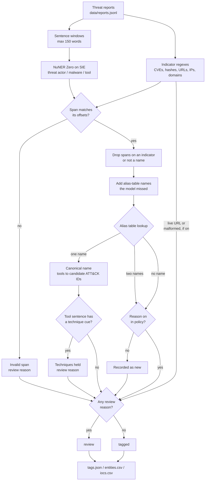

# Tag actors, malware and tools in threat reports

## Background

A cyber threat intelligence (CTI) team keeps track of who is attacking companies like yours, with
what, and how. The people on it are CTI analysts, and a big part of their day is reading. Reports
come in from security vendors and partners: a write-up of an intrusion at a freight operator, a
partner advisory about a water utility, a note that a known group is back with a new loader. The
analyst reads each one and files it in the team's threat-intel platform, tagged with the threat
actors (the groups behind the attack), the malware they used, the tools they ran (often ordinary
admin tools like PsExec or rclone) and the indicators the report lists: IP addresses, domains,
URLs, file hashes and CVE IDs.

The indicators usually arrive defanged. A report writes `hxxps://relay[.]heron-cdn[.]example[.]net`
instead of the real URL, and `198.51.100[.]23` instead of the IP, so nobody opens a malicious link
by accident and no mail client turns it into one. Every vendor defangs a little differently, and
now and then someone forgets and pastes the live link.

Those tags are what makes the reports useful to the rest of the company:

- **Search.** When someone asks "what do we know about Ashen Heron?", the answer is every report
  tagged with that actor. A report that wasn't tagged doesn't come up.
- **Detections.** Once an analyst has checked them in context, hashes, domains and IPs feed
  blocklists and detection rules. The ATT&CK techniques a tool is known for (Mimikatz is usually
  about credential dumping) hint at which behavior the people writing detections should look for.
- **Linking reports.** Two vendors describe the same group under different names. If both reports
  carry the same canonical tag, an analyst sees they're about one actor, and the story adds up.

A wrong or missed tag costs you in both directions. Miss an actor or an indicator and the report
quietly drops out of search, and the hash never makes it into a detection. Merge two names that
aren't the same group and you've pinned the activity on the wrong actor, which is worse, because
every later report linked to it inherits the mistake. And a live URL copied into a ticket is one
click away from someone visiting the attacker's server.

## The problem

Names don't line up. One report says "LX-0417", another says "Ashen Heron", a third says "Grey
Lantern", and two vendors use that last name for two different groups. Vendors each track their
own clusters of activity, built from what they saw, and two clusters can overlap without being
the same group. (Naming things is hard; naming things you've only seen part of is harder.) So
the alias table here holds only equivalences an analyst has confirmed, and a name it lists twice
goes to a person. Indicators show up defanged in several styles, and now and then live or
truncated. Tagging by hand is slow, and if you merge two names wrongly, you've pinned the
activity on the wrong actor.

The obvious shortcuts each fall short. A list of known names can't find the group you haven't
heard of yet, and that's the one an analyst most needs to see. A model on its own can find new
names, but it doesn't know that "LX-0417" and "Ashen Heron" are the same group, and you don't want
it guessing. And a model is the wrong tool for indicators: a hash is a fixed number of hex
characters, which a regex reads exactly.

This recipe tags each report with its canonical actors, malware and tools, the **candidate ATT&CK
techniques** associated with the tools it mentions, and its **candidate indicators**, and gives
it a status: **tagged** when none of the configured review flags fired, or **review** with a
reason an analyst can check.

Read those words narrowly. `tagged` doesn't mean the extraction is complete or correct. If the
model misses an unknown actor, nothing is left to flag, and the report comes out tagged without
it. A mention that happens to match a known alias is accepted. The techniques come from looking
the tool's name up in `rules.yaml`, not from what the report says the tool did: "IT used rclone
to back up the file server" isn't exfiltration. A plain cue check (below) catches the
plainly worded cases, and an analyst confirms the rest before anything feeds a detection. The
indicators are strings that look like CVE IDs, hashes, URLs, domains and IPs. The recipe can't
tell an attacker's server from a vendor advisory link or a victim's mail domain, and a CVE ID
names a vulnerability, not an indicator of compromise. They need that context before they go
anywhere near a blocklist.

**What the indicator regexes cover, and what they don't.** They find CVE IDs, hex hashes, URLs
with an `http`, `https`, `hxxp` or `hxxps` scheme, and IPs, domains and email domains defanged
with `[.]`, `(.)` or `[@]`. A bare domain or IP written live is skipped on purpose, so `build
4.2.0.118` and `cfg.dat` stay out. That's a parser limit, not a judgment: real infrastructure
written as `203.0.113.9` or `evil.example.com` is missed too, traded for fewer false
positives. What the regexes can't read cleanly goes to review instead of being cut down to
something that looks right: a hash of the wrong length, an IP that isn't a
valid address, a CVE ID with too few digits, and a domain whose last label isn't letters only
(`evil[.]example[.]c0m`, kept whole). Punycode top-level domains (`xn--...`) land there too,
even real ones, so an analyst checks them. So does a version number someone defanged
(`4[.]2[.]0`): the recipe can't tell it from a truncated IP, so it doesn't drop it. A plain dot
before a capital letter ends a domain, since that's a full stop with the space missing
(`evil[.]example[.]com.Then`), so write a domain in lower case or defang every dot.
A defanged file name looks just like a domain, so `evil[.]exe` comes out as the domain
`evil[.]exe`. Anything else, like an IPv6 address or a domain defanged some other way, isn't
found at all, so read the report before you trust an empty `iocs.csv`.

A URL counts as live when its scheme and host are written the way a browser opens them, so
`https://evil.example/login[.]php` is live even though its path is defanged. A defanged email
gives its whole domain: `user@evil[.]example[.]com` is `evil[.]example[.]com`, not
`example[.]com`. That holds when only the `@` is defanged (`billing[@]evil-pay.example.com`)
and when the local part is missing, quoted or defanged itself. `john[.]smith@evil[.]example[.]com`
gives only `evil[.]example[.]com`: the local part is never read as a domain or a hash.

## How we'll solve it

Each kind of thing in a report needs a different tool, so the recipe splits the work.

1. **Pull the indicators out with regex.** CVE IDs, MD5/SHA-1/SHA-256 hashes (told apart by
   length), defanged URLs, domains, IPs and email domains. Live URLs and malformed indicators
   are flagged here. This comes first because the next steps need to know where the indicators
   are: a model span or a name that sits inside an indicator is part of that indicator, not a
   separate tag.
2. **Split each report into windows.** Sentences are packed into windows of at most 150 words,
   because NuNER Zero reads 384 tokens. Cutting on sentence ends keeps every name whole.
3. **Ask the model for names.** NuNER Zero tags `threat actor`, `malware` and `tool` spans,
   zero-shot. This is the only step that needs a model, and it's here for the names nobody
   has written down yet.
4. **Check every span.** Each span must equal the text at its offsets, or it's invalid and the
   report goes to review. Spans on an indicator, or that are not names ("MD5", "threat group"),
   are dropped.
5. **Fill in what the model missed.** Alias-table names and mapped tools written in the text are
   matched as whole words, in any case, so `powershell` and `ASHEN HERON` count. A match inside
   an indicator is dropped. Where a model span overlaps a table match, the table match is dropped
   only if the model span reads as the same name (`Mothvine Loader` covers `Mothvine`). If it
   reads as something else (`PowerShell scripts`), both are kept, so the exact name keeps its
   mapping.
6. **Normalize.** Every mention goes through the alias table to one canonical name, and tools go
   to their candidate ATT&CK technique IDs. When a name is in the alias table, the table decides
   whether it's an actor, malware or a tool, whatever label the model gave it.
7. **Check the sentence around each tool.** If the sentence holding a mapped tool has a word from
   `technique_cues` (a negation like "no" or "not", or a routine-use word like "back up" or
   "administrators"), the tool is still tagged, but its candidate techniques are held back from
   the report and the report goes to review.
8. **Escalate.** An unknown actor or malware, an alias listed under two names, a tool with no
   mapping, held techniques, a live URL, a malformed indicator, an invalid model span or a window
   the model failed to tag: the report goes to review with the reason. Only an SIE call that
   fails for a reason that may pass (a dropped connection, a timeout, a 5xx server error, a rate
   limit, a model still loading, a window too long for the model) marks the windows in its batch
   failed and sends their reports to review; the run still writes its outputs and prints one
   line with the count and the first error. A refusal every call would repeat stops the run
   with SIE's full message and writes nothing: for example a bad key (401), an unknown model
   (404), no credits or a spend limit (402), an inactive account, or a model SIE marks as
   permanently unable to load (that message points at the model name). So does a run where
   every SIE call failed: when the first failure is a lost connection the message says to check
   `SIE_BASE_URL` and your network, and for any other error it says the model may still be
   starting or SIE is busy, so run again in a few minutes. An error in the recipe's own code
   stops it too. Otherwise
   the report is tagged.

The order matters most at the end. The model proposes names, but the alias table and the policy
decide. When the table and the model disagree, the table wins, and when the table can't decide,
a person does.

## Picking the model

The model is `numind/NuNER_Zero` (MIT license), a small zero-shot named-entity model: you give it
label words, and it returns the spans in the text that match, each with a label, offsets and a
score. The labels are plain words in `rules.yaml` (the model card asks for lower-case labels), so
you can add `vulnerability` or `target sector` without training anything. Spans below the 0.50
`min_entity_score` aren't returned. There's no LLM in this recipe at all.

**Why NuNER Zero and not gliner2-large-v1.** The job is plain span tagging with three labels.
There's no structure to fill, so `output_schema` adds nothing. When NuNER Zero finds nothing, it
returns `entities: []`. When a GLiNER2 model finds no spans, SIE Cloud answers with an HTTP 500
instead of an empty list, with or without `output_schema`, and that fails the whole batch. That's
our inference from how SIE behaves: `security/triage_reported_phishing` hits the same 500 on a plain
`labels` call. NuNER Zero's labels are plain words in `rules.yaml`. The alias table already
knows the familiar names, so what you really need the model for is the names the table doesn't
know yet (e.g. "Velvet Ostrich", "Chisel"). Those are exactly the ones an analyst has to see.

It isn't perfect, and the recipe is built around that. On our runs it called `LX-0417` malware
(the table fixed that), tagged "threat group" as an actor and "MD5" as a tool (rules now drop
those), and tagged the fictional product "Corvane VPN" as a tool at a score of 0.54 (that one
goes to review). None of those mistakes came out as a tag, because the table and the rules
overrule or flag them. That only covers mistakes the rules can see: a name the model misses
entirely leaves nothing to flag, which is why `tagged` is weaker than it sounds.

## The flow



A window the model failed to tag, or a window whose SIE call failed for a reason that may pass,
also adds a review reason. A refused call, or a run where no call succeeded, stops the run
instead.

## How it's built

Everything you'd want to argue about lives in [`rules.yaml`](./rules.yaml): the labels, the alias
table, the tool-to-technique mapping, the review policy, the thresholds and the model ID.
[`recipe.py`](./recipe.py) holds the regexes and the logic, in the same order as the flow.

| Step | Code | SIE call | What it does |
| --- | --- | --- | --- |
| Indicators | `find_indicators`, `domain_indicator`, `defang` | none | CVE IDs, MD5/SHA-1/SHA-256 by length, defanged URLs, domains, IPs and email domains by regex; live URLs, malformed hashes, IPs, CVE IDs and top-level domains flagged |
| Split | `sentence_windows` | none | Sentences packed into windows of at most 150 words (NuNER Zero reads 384 tokens) |
| Tag | `tag_windows` | `extract` + `labels` | `threat actor`, `malware` and `tool` spans from `numind/NuNER_Zero`, zero-shot, `batch_size` windows per call; a transient failure marks its windows failed, a refusal or a run with no successful call stops |
| Check spans | `model_entities` | none | Each span must equal the text at its offsets; spans on an indicator, or that are not names ("MD5", "threat group"), are dropped |
| Fill misses | `table_mentions`, `merge_entities` | none | Alias-table names and mapped tools written in the text, any case, whole words; a match inside an indicator is dropped; an exact name survives an overlapping model span that reads as something else |
| Normalize | `AliasTable`, `resolve` | none | Every mention through the alias table to one canonical name; tools to candidate ATT&CK technique IDs |
| Cue check | `technique_cue` | none | A `technique_cues` word in a mapped tool's sentence holds its candidate techniques back |
| Escalate | `resolve`, `tag_reports` | none | Unknown actor or malware, an alias listed under two names, a tool with no mapping, held techniques, a live URL, a malformed indicator, an invalid model span or a window the model failed to tag: the report goes to review with the reason |

`tag_reports()` runs those steps for every report, and `write_outputs()` writes the three files.
Indicators, alias merges and technique mappings are code and tables you can read, so when a merge
goes wrong, a person can see why. All windows go to SIE Cloud in one batched call (each demo
report fits in one window, well under `batch_size`), and you host nothing. With one call, a
transient failure on the demo data is also a run where every call failed, so it stops the run
rather than sending all ten reports to review.
[`selfcheck.py`](./selfcheck.py) checks the indicator regexes, the alias table, the any-case
fallback, the overlap rule, the technique cues, which SIE errors send reports to review and which
stop the run, the review rules and the rules check offline, with hand-written strings and stand-in model replies, so you can
change `rules.yaml` and know right away if you broke something.

## Run it

You need [uv](https://docs.astral.sh/uv/) and an SIE API key
([create one](https://console.superlinked.com/console/api-keys)).

```bash
cp .env.example .env   # then set SIE_API_KEY
uv run recipe.py
uv run selfcheck.py    # optional: offline checks, no SIE call
```

`uv run` installs this recipe's few dependencies into its own `.venv` on the first run. Each run
writes `runs/<timestamp>/` in this folder. If you'd rather write somewhere else, pass
`--output DIR`. The first call can wait a few minutes while SIE Cloud starts the NuNER Zero
model.

## What came out

The input is three files:

- [`data/reports.jsonl`](./data/reports.jsonl) holds ten short synthetic reports, one per line.
- [`data/attack_techniques.csv`](./data/attack_techniques.csv) holds nine MITRE ATT&CK
  Enterprise techniques (ID, name, tactic), just the subset the tool mapping uses.
- [`rules.yaml`](./rules.yaml) holds the labels, the alias table, the tool-to-technique mapping,
  the review policy, the thresholds and the model ID.

The reports, actors, malware, victims, products and CVE IDs are synthetic, written for this
recipe. CVE IDs use the year 2099, so they can't collide with a real advisory. Hashes are
SHA-256, SHA-1 and MD5 digests of short demo strings, not of any file. Domains are RFC 2606
reserved names, and IPs are from the RFC 5737 documentation ranges. The tools (Mimikatz, PsExec,
AdFind, rclone, PowerShell, vssadmin, Chisel) are real, widely documented admin and
offensive-security tools.

| Report | What we planted | Result on our live run | Why |
| --- | --- | --- | --- |
| R-01 | Canonical names, a CVE, a defanged URL and IP, a SHA-256 | tagged | Ashen Heron, QuillRAT, Mimikatz and PsExec, with three candidate techniques |
| R-02 | Aliases `LX-0417`, `QRAT`, `Mothvine Loader` | tagged | Normalized to Ashen Heron, QuillRAT, Mothvine |
| R-03 | `Grey Lantern`, listed under two actors | **review** | Ambiguous alias, both candidates named |
| R-04 | New actor `Velvet Ostrich` | **review** | Not in the alias table; SaltGlass and vssadmin still tagged |
| R-05 | Tool `Chisel` with no ATT&CK mapping | **review** | No mapping. NuNER Zero also tagged the fictional product "Corvane VPN" as a tool (score 0.54), a second review reason |
| R-06 | Live `https://` and `http://` URLs, an MD5 one character short | **review** | Two live URLs, defanged in the output, and a malformed hash |
| R-07 | Near miss: `build 4.2.0.118` and `mothvine_cfg.dat` look like an IP and a domain | tagged | Only the defanged `cdn-sync[.]example[.]org` counts |
| R-08 | Patch summary, no threats | tagged | Nothing found |
| R-09 | Near miss: administrators used `rclone` to back up a file server | **review** | rclone tagged, its candidate T1567.002 held: the sentence says "back up" |
| R-10 | Near miss: "No Mimikatz execution was observed" | **review** | Copper Moth and Mimikatz tagged, T1003.001 held: the sentence says "no". NuNER Zero called Mimikatz malware, which the table overrules, and also tagged "mail gateway" as a tool (score 0.91), a second review reason |

Treat the planted cases as a demo that the recipe works. They say nothing about accuracy: ten
reports tell you the wiring is right, not how often it's wrong. On this run that's 4 tagged and
6 to review.

`tags.json` holds every report with its canonical actors, malware and tools, its
`candidate_techniques`, every mention (offsets, score, and whether it came from the `model` or
the `table`), its indicators and its status, `tagged` or `review`. `entities.csv` has one row per
mention, with `candidate_techniques` and `techniques_held`, and `iocs.csv` has one row per
candidate indicator, always defanged (every `http:` becomes `hxxp:`, even one percent-encoded
inside a query, and every dot becomes `[.]`, the port stays).

A few things worth noticing:

- **The near misses matter most.** R-07 mentions `build 4.2.0.118` and `mothvine_cfg.dat`, which
  look like an IP and a domain, and R-08 is a patch summary with no threats in it. Both came out
  tagged, with only the defanged `cdn-sync[.]example[.]org` counted in R-07. A tagger that
  flagged every version number would bury the analysts it's meant to help.
- **The table overrules the model.** In R-02 the model called `LX-0417` malware, and the table,
  which lists it as an alias of the actor Ashen Heron, overruled it. R-03 is where the table
  can't decide, so it says so and names both candidates:

  ```text
  report_id,kind,mention,start,end,source,score,canonical,candidate_techniques,techniques_held,status,reason
  R-02,actor,LX-0417,0,7,model,0.96875,Ashen Heron,,False,tagged,model said malware; the table lists Ashen Heron as actor
  R-03,actor,Grey Lantern,63,75,model,1.0,,,False,review,ambiguous alias: 'Grey Lantern' is listed under Ashen Heron and Copper Moth
  ```

- **A tool name is not a behavior.** R-02 says the group "copied files to cloud storage with
  rclone", and R-09 says administrators "used rclone to back up the main file server to cloud
  storage". Both name the same tool; only one reads like exfiltration. R-02 keeps its candidate
  T1567.002, and R-09 holds it back and goes to review. R-10 does the same for a negation:

  ```text
  R-09,tool,rclone,20,26,model,0.98828125,rclone,T1567.002,True,tagged,candidate techniques T1567.002 held: the sentence says 'back up'
  R-10,tool,Mimikatz,106,114,model,0.98974609375,Mimikatz,T1003.001,True,tagged,model said malware; the table lists Mimikatz as tool; candidate techniques T1003.001 held: the sentence says 'no'
  ```

  A held tag keeps its earlier reason, so R-10 also shows that NuNER Zero called Mimikatz
  malware. Earlier runs gave the same span and score, but the held note replaced that reason.

  The cue check is a keyword list, so it's blunt. It would hold Mimikatz back in "the operators
  ran Mimikatz, not PsExec", and it misses "rclone handled the nightly sync". Even R-02's
  techniques are only candidates: "AdFind to enumerate the domain" doesn't show both account and
  domain-trust discovery. R-10 also picked up a model surprise: NuNER Zero tagged "mail gateway"
  as a tool at 0.91, which goes to review as an unmapped tool. We left it in rather than add
  "mail gateway" to `ignore_mentions`.

- **R-06 had the attacker's links written live.** Both URLs went to review, and the output
  defangs them anyway, so `iocs.csv` is safe to paste into a ticket:

  ```text
  report_id,type,value,live_in_source,malformed,note
  R-06,url,hxxp://192[.]0[.]2[.]44/q[.]ps1,True,False,written live in the report
  ```

- **The first live run wasn't this clean.** It sent R-08, a patch summary with no threats in it,
  to review, because NuNER Zero tagged "threat group" as an actor. Technically true, and no use to
  anyone. It also tagged "MD5" in R-06 as a tool. We added `ignore_mentions` and a rule that a
  span made only of `generic_words` isn't a name, then ran live again. Both rules are fitted to
  the demo data. No threshold was changed. The results above come from a later run, after R-09,
  R-10 and the cue check were added; R-01 to R-08 came out the same as before.

## Potential improvements

Everything below lives in `rules.yaml` unless it says otherwise.

- **Your own alias table.** The alias table is `actors` and `malware`: one canonical name each,
  with the aliases other vendors use. If two groups share an alias, list it under both names, and
  every mention of it goes to review. A canonical name can sit under only one of `actors`,
  `malware` and `tool_techniques`; list it under two and the recipe refuses to start. In
  production, export this table from your threat-intel platform.
- **Your own technique cues.** `technique_cues` lists the words that hold a tool's candidate
  techniques back, and `policy.technique_cue` turns the check off. Quote each cue: YAML reads a
  bare `no` as false.
- **More tools and techniques.** The tool mapping is `tool_techniques`. Every technique ID must be
  in `data/attack_techniques.csv`, or the recipe refuses to start. If you need more techniques,
  swap the CSV for the full ATT&CK Enterprise catalog from
  [attack.mitre.org](https://attack.mitre.org/).
- **A stricter or looser review policy.** `policy` turns each name and indicator reason on or off.
  A name reason that's off (unknown actor or malware, ambiguous alias, unmapped tool) is recorded
  as `new` and doesn't send the report to review. An indicator reason that's off (live URL,
  malformed hash, IP, CVE ID or domain) is dropped; the indicator row still keeps its `malformed`
  flag and note. An invalid model span, a window the model failed to tag or an SIE call that
  failed for a reason that may pass always sends the report to review. Which SIE errors count as
  passing and which stop the run is `is_fatal` in `recipe.py`, not a policy switch.
- **What the model looks for.** `labels`, `generic_words` and `ignore_mentions` control what the
  model looks for and which of its spans get thrown away as not being names. You can change the
  label words the model sees, but not the keys: the code reads `actor`, `malware` and `tool`, and
  any other set of keys stops the recipe at start.
- **Thresholds.** `min_entity_score`, `max_words_per_window`, `min_hex_run` and `batch_size` are
  starting points. Check them on your own reports.
- **The model.** `models` holds the model ID.
- **Idea: more indicator formats.** IPv6 addresses and domains defanged some other way aren't
  found today. If your vendors write them, the regexes in `recipe.py` are the place to add them,
  with a case in `selfcheck.py` for each.
- **Idea: keep the evidence.** Carry each report's source and publication date (`published` is
  read and then dropped today) and a short excerpt around every mention and indicator into the
  outputs, so an analyst can check a tag without opening the report.
- **Idea: smarter windows.** A sentence longer than `max_words_per_window` is cut on words, which
  can split a multiword name, and the 150-word limit is a rough stand-in for NuNER Zero's
  384-token budget, not a token count.
- **Idea: map behavior, not names.** Techniques should come from what the report says a tool did
  (`vssadmin delete shadows` versus `vssadmin list shadows`), with the command or sentence as
  evidence, rather than from the tool's name plus a cue list.
- **Idea: measure it.** Ten planted reports prove the wiring. Before you trust it, run it on a
  month of your own reports and look at what lands in review and what an analyst would have
  tagged differently.

## Try another model

Each model is one line under `models:` in `rules.yaml`. We swapped one model at a time, changed
nothing else, and ran the recipe on SIE Cloud on 31 Oct 2026, then again on 2 Nov 2026 with
R-09, R-10, the cue check and the overlap fix; the table gives the 2 Nov results. Dates are UTC,
like the `runs/` folder names.

| `rules.yaml` key | Swap in | What happened on this data |
| --- | --- | --- |
| `entities` | `numind/NuNER_Zero-span` | 3 tagged, 7 to review (default: 4 and 6). R-01, R-02, R-04, R-06 and R-08 came out the same. On R-03 it tagged "PowerShell scripts" as a tool, a second review reason; the exact `PowerShell` match is kept, so T1059.001 stays. On R-05 it tagged "RDP" instead of "Corvane VPN". The R-07 near miss went to review over a tool "SvcHealth". R-09 and R-10 held their techniques as the default did, without the "mail gateway" span. |
| `entities` | `urchade/gliner_multi-v2.1` | 2 tagged, 8 to review. Same R-03 "PowerShell scripts" span, with T1059.001 kept. On R-05 it did not tag "Corvane VPN", so only Chisel went to review. It tagged "Defenders" (R-07) and "The IT team" (R-08) as actors, so both clean reports went to review. R-09 and R-10 as for NuNER Zero-span. The 0.50 `min_entity_score` was chosen with NuNER Zero in mind, and these spans passed it. |

See [MODELS.md](../../MODELS.md) for every model these recipes use.

## Run it on your own SIE

The same code runs against an SIE server you host. Set `SIE_BASE_URL` in `.env`, and the API
key becomes optional. The table gives the SIE v0.10.1 image each model runs on, from SIE's
[compatibility matrix](https://github.com/superlinked/sie/blob/main/docs/compatibility.md).

| `rules.yaml` key | Model | Image | Tested on |
| --- | --- | --- | --- |
| `entities` | `numind/NuNER_Zero` | `cuda12-default` | L4 |

One container serves it:

```bash
docker run --gpus all -p 8080:8080 -v sie-hf-cache:/app/.cache/huggingface \
  ghcr.io/superlinked/sie-server:v0.10.1-cuda12-default
# then set SIE_BASE_URL=http://localhost:8080 in .env and run: uv run recipe.py
```

## Data and licenses

- Reports, actor and malware names, victims, products and CVE IDs: synthetic, written for this
  recipe. Another recipe ([`security/threat_relations`](../../security/threat_relations))
  uses its own fictional names.
- `data/attack_techniques.csv`: nine technique IDs, names and tactics copied by hand from the
  [MITRE ATT&CK Enterprise](https://attack.mitre.org/) matrix. We can't name the ATT&CK
  version: the file has only the three columns `technique_id`, `name` and `tactic`, with no
  version, `modified` date or source bundle, and there is no fetch script, so nothing in the
  repository records which release the rows came from. It was first committed on 31 Oct 2026 (UTC).
  Check the rows against the current release before you rely on them. © The MITRE Corporation.
  This work is reproduced and distributed with the permission of The MITRE Corporation, under the
  [ATT&CK terms of use](https://attack.mitre.org/resources/legal-and-branding/terms-of-use/),
  which allow reuse with this attribution.

## Files

- `recipe.py`: the pipeline
- `selfcheck.py`: plain asserts on the indicator regexes, the alias table, the review rules
  and the rules check, using hand-written strings, the committed `data/` and hand-written
  stand-in model replies. It never calls SIE (`uv run --frozen python selfcheck.py`)
- `rules.yaml`: labels, alias table, tool mapping, policy, thresholds, model ID
- `data/`: the reports and the ATT&CK subset
- `pyproject.toml`, `uv.lock`: this recipe's dependencies

See the SIE [information extraction](https://superlinked.com/information-extraction) task page
and the [security](https://superlinked.com/security) industry page.
