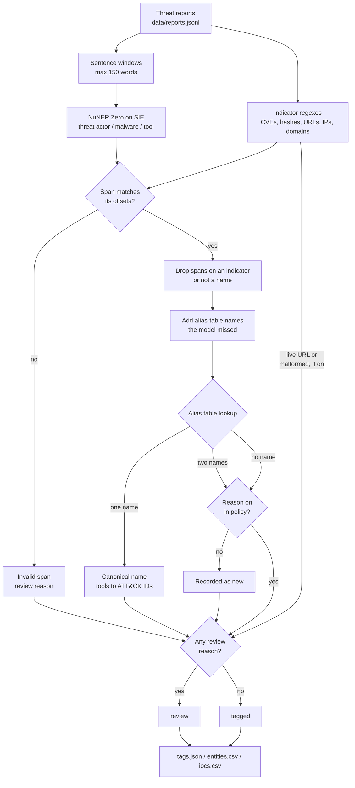

# Tag actors, malware and tools in threat reports

## Background

A cyber threat intelligence (CTI) team keeps track of who is attacking companies like yours, with
what, and how. The people on it are CTI analysts, and a big part of their day is reading. Reports
come in from security vendors and partners: a write-up of an intrusion at a freight operator, a
partner advisory about a water utility, a note that a known group is back with a new loader. The
analyst reads each one and files it in the team's threat-intel platform, tagged with the threat
actors (the groups behind the attack), the malware they used, the tools they ran (often ordinary
admin tools like PsExec or rclone) and the indicators the report lists: IP addresses, domains,
URLs, file hashes and CVE IDs.

The indicators usually arrive defanged. A report writes `hxxps://relay[.]heron-cdn[.]example[.]net`
instead of the real URL, and `198.51.100[.]23` instead of the IP, so nobody opens a malicious link
by accident and no mail client turns it into one. Every vendor defangs a little differently, and
now and then someone forgets and pastes the live link.

Those tags are what makes the reports useful to the rest of the company:

- **Search.** When someone asks "what do we know about Ashen Heron?", the answer is every report
  tagged with that actor. A report that wasn't tagged doesn't come up.
- **Detections.** Hashes, domains and IPs feed blocklists and detection rules, and the ATT&CK
  technique behind a tool ("Mimikatz means credential dumping") tells the people writing
  detections which behavior to look for.
- **Linking reports.** Two vendors describe the same group under different names. If both reports
  carry the same canonical tag, an analyst sees they're about one actor, and the story adds up.

A wrong or missed tag costs you in both directions. Miss an actor or an indicator and the report
quietly drops out of search, and the hash never makes it into a detection. Merge two names that
aren't the same group and you've pinned the activity on the wrong actor, which is worse, because
every later report linked to it inherits the mistake. And a live URL copied into a ticket is one
click away from someone visiting the attacker's server.

## The problem

Nobody agrees on names. One report says "LX-0417", another says "Ashen Heron", a third says "Grey
Lantern", and two vendors use that last name for two different groups. (Naming things is hard;
apparently it's hard for threat-intel vendors too.) Indicators show up defanged in several
styles, and now and then live or truncated. Tagging by hand is slow, and if you merge two names
wrongly, you've pinned the activity on the wrong actor.

The obvious shortcuts each fall short. A list of known names can't find the group you haven't
heard of yet, and that's the one an analyst most needs to see. A model on its own can find new
names, but it doesn't know that "LX-0417" and "Ashen Heron" are the same group, and you don't want
it guessing. And a model is the wrong tool for indicators: a hash is a fixed number of hex
characters, which a regex reads exactly.

This recipe tags each report with its canonical actors, malware and tools, its ATT&CK techniques
and its indicators, and gives it a status: **tagged** when everything resolved cleanly, or
**review** with a reason an analyst can check.

**What the indicator regexes cover, and what they don't.** They find CVE IDs, hex hashes, URLs
with an `http`, `https`, `hxxp` or `hxxps` scheme, and IPs, domains and email domains defanged
with `[.]`, `(.)` or `[@]`. A bare domain or IP written live isn't an indicator, so `build
4.2.0.118` and `cfg.dat` stay out. What the regexes can't read cleanly goes to review instead
of being cut down to something that looks right: a hash of the wrong length, an IP that isn't a
valid address, a CVE ID with too few digits, and a domain whose last label isn't letters only
(`evil[.]example[.]c0m`, kept whole). Punycode top-level domains (`xn--...`) land there too,
even real ones, so an analyst checks them. So does a version number someone defanged
(`4[.]2[.]0`): the recipe can't tell it from a truncated IP, so it doesn't drop it. A plain dot
before a capital letter ends a domain, since that's a full stop with the space missing
(`evil[.]example[.]com.Then`), so write a domain in lower case or defang every dot.
A defanged file name looks just like a domain, so `evil[.]exe` comes out as the domain
`evil[.]exe`. Anything else, like an IPv6 address or a domain defanged some other way, isn't
found at all, so read the report before you trust an empty `iocs.csv`.

A URL counts as live when its scheme and host are written the way a browser opens them, so
`https://evil.example/login[.]php` is live even though its path is defanged. A defanged email
gives its whole domain: `user@evil[.]example[.]com` is `evil[.]example[.]com`, not
`example[.]com`. That holds when only the `@` is defanged (`billing[@]evil-pay.example.com`)
and when the local part is missing, quoted or defanged itself. `john[.]smith@evil[.]example[.]com`
gives only `evil[.]example[.]com`: the local part is never read as a domain or a hash.

## How we'll solve it

Each kind of thing in a report needs a different tool, so the recipe splits the work.

1. **Pull the indicators out with regex.** CVE IDs, MD5/SHA-1/SHA-256 hashes (told apart by
   length), defanged URLs, domains, IPs and email domains. Live URLs and malformed indicators
   are flagged here. This comes first because the next steps need to know where the indicators
   are: a model span or a name that sits inside an indicator is part of that indicator, not a
   separate tag.
2. **Split each report into windows.** Sentences are packed into windows of at most 150 words,
   because NuNER Zero reads 384 tokens. Cutting on sentence ends keeps every name whole.
3. **Ask the model for names.** NuNER Zero tags `threat actor`, `malware` and `tool` spans,
   zero-shot. This is the only step that needs a model, and it's here for the names nobody
   has written down yet.
4. **Check every span.** Each span must equal the text at its offsets, or it's invalid and the
   report goes to review. Spans on an indicator, or that are not names ("MD5", "threat group"),
   are dropped.
5. **Fill in what the model missed.** Alias-table names and mapped tools written in the text are
   matched exactly. A match inside an indicator is dropped. Where a model span and a table match
   overlap, the model span wins.
6. **Normalize.** Every mention goes through the alias table to one canonical name, and tools go
   to ATT&CK technique IDs. When a name is in the alias table, the table decides whether it's an
   actor, malware or a tool, whatever label the model gave it.
7. **Escalate.** An unknown actor or malware, an alias listed under two names, a tool with no
   mapping, a live URL, a malformed indicator, an invalid model span or a window the model failed
   to tag: the report goes to review with the reason. Otherwise it's tagged.

The order matters most at the end. The model proposes names, but the alias table and the policy
decide. When the table and the model disagree, the table wins, and when the table can't decide,
a person does.

## Picking the model

The model is `numind/NuNER_Zero` (MIT license), a small zero-shot named-entity model: you give it
label words, and it returns the spans in the text that match, each with a label, offsets and a
score. The labels are plain words in `rules.yaml` (the model card asks for lower-case labels), so
you can add `vulnerability` or `target sector` without training anything. Spans below the 0.50
`min_entity_score` aren't returned. There's no LLM in this recipe at all.

**Why NuNER Zero and not gliner2-large-v1.** The job is plain span tagging with three labels.
There's no structure to fill, so `output_schema` adds nothing. When NuNER Zero finds nothing, it
returns `entities: []`. When a GLiNER2 model finds no spans, SIE Cloud answers with an HTTP 500
instead of an empty list, with or without `output_schema`, and that fails the whole batch. That's
our inference from how SIE behaves: `security/phishing_triage` hits the same 500 on a plain
`labels` call. NuNER Zero's labels are plain words in `rules.yaml`. The alias table already
knows the familiar names, so what you really need the model for is the names the table doesn't
know yet (e.g. "Velvet Ostrich", "Chisel"). Those are exactly the ones an analyst has to see.

It isn't perfect, and the recipe is built around that. On our runs it called `LX-0417` malware
(the table fixed that), tagged "threat group" as an actor and "MD5" as a tool (rules now drop
those), and tagged the fictional product "Corvane VPN" as a tool at a score of 0.54 (that one
goes to review). None of these mistakes gets through as a confident tag, which is the point of
keeping the model to proposing names.

## The flow



A window the model failed to tag also adds a review reason.

## How it's built

Everything you'd want to argue about lives in [`rules.yaml`](./rules.yaml): the labels, the alias
table, the tool-to-technique mapping, the review policy, the thresholds and the model ID.
[`recipe.py`](./recipe.py) holds the regexes and the logic, in the same order as the flow.

| Step | Code | SIE call | What it does |
| --- | --- | --- | --- |
| Indicators | `find_indicators`, `domain_indicator`, `defang` | none | CVE IDs, MD5/SHA-1/SHA-256 by length, defanged URLs, domains, IPs and email domains by regex; live URLs, malformed hashes, IPs, CVE IDs and top-level domains flagged |
| Split | `sentence_windows` | none | Sentences packed into windows of at most 150 words (NuNER Zero reads 384 tokens) |
| Tag | `tag_windows` | `extract` + `labels` | `threat actor`, `malware` and `tool` spans from `numind/NuNER_Zero`, zero-shot, `batch_size` windows per call |
| Check spans | `model_entities` | none | Each span must equal the text at its offsets; spans on an indicator, or that are not names ("MD5", "threat group"), are dropped |
| Fill misses | `table_mentions`, `merge_entities` | none | Alias-table names and mapped tools written in the text, matched exactly; a match inside an indicator is dropped |
| Normalize | `AliasTable`, `resolve` | none | Every mention through the alias table to one canonical name; tools to ATT&CK technique IDs |
| Escalate | `resolve`, `tag_reports` | none | Unknown actor or malware, an alias listed under two names, a tool with no mapping, a live URL, a malformed indicator, an invalid model span or a window the model failed to tag: the report goes to review with the reason |

`tag_reports()` runs those steps for every report, and `write_outputs()` writes the three files.
Indicators, alias merges and technique mappings are code and tables you can read, so when a merge
goes wrong, a person can see why. All windows go to SIE Cloud in one batched call (each demo
report fits in one window, well under `batch_size`), and you host nothing.
[`selfcheck.py`](./selfcheck.py) checks the indicator regexes, the alias table, the review rules
and the rules check offline, with hand-written strings and stand-in model replies, so you can
change `rules.yaml` and know right away if you broke something.

## Run it

You need [uv](https://docs.astral.sh/uv/) and an SIE API key
([create one](https://console.superlinked.com/console/api-keys)).

```bash
cp .env.example .env   # then set SIE_API_KEY
uv run recipe.py
uv run selfcheck.py    # optional: offline checks, no SIE call
```

`uv run` installs this recipe's few dependencies into its own `.venv` on the first run. Each run
writes `runs/<timestamp>/` in this folder. If you'd rather write somewhere else, pass
`--output DIR`. The first call can wait a few minutes while SIE Cloud starts the NuNER Zero
model.

## What came out

The input is three files:

- [`data/reports.jsonl`](./data/reports.jsonl) holds eight short synthetic reports, one per line.
- [`data/attack_techniques.csv`](./data/attack_techniques.csv) holds nine MITRE ATT&CK
  Enterprise techniques (ID, name, tactic), just the subset the tool mapping uses.
- [`rules.yaml`](./rules.yaml) holds the labels, the alias table, the tool-to-technique mapping,
  the review policy, the thresholds and the model ID.

The reports, actors, malware, victims, products and CVE IDs are synthetic, written for this
recipe. CVE IDs use the year 2099, so they can't collide with a real advisory. Hashes are
SHA-256, SHA-1 and MD5 digests of short demo strings, not of any file. Domains are RFC 2606
reserved names, and IPs are from the RFC 5737 documentation ranges. The tools (Mimikatz, PsExec,
AdFind, rclone, PowerShell, vssadmin, Chisel) are real, widely documented admin and
offensive-security tools.

| Report | What we planted | Result on our live run | Why |
| --- | --- | --- | --- |
| R-01 | Canonical names, a CVE, a defanged URL and IP, a SHA-256 | tagged | Ashen Heron, QuillRAT, Mimikatz and PsExec mapped to three techniques |
| R-02 | Aliases `LX-0417`, `QRAT`, `Mothvine Loader` | tagged | Normalized to Ashen Heron, QuillRAT, Mothvine |
| R-03 | `Grey Lantern`, listed under two actors | **review** | Ambiguous alias, both candidates named |
| R-04 | New actor `Velvet Ostrich` | **review** | Not in the alias table; SaltGlass and vssadmin still tagged |
| R-05 | Tool `Chisel` with no ATT&CK mapping | **review** | No mapping. NuNER Zero also tagged the fictional product "Corvane VPN" as a tool (score 0.54), a second review reason |
| R-06 | Live `https://` and `http://` URLs, an MD5 one character short | **review** | Two live URLs, defanged in the output, and a malformed hash |
| R-07 | Near miss: `build 4.2.0.118` and `mothvine_cfg.dat` look like an IP and a domain | tagged | Only the defanged `cdn-sync[.]example[.]org` counts |
| R-08 | Patch summary, no threats | tagged | Nothing found |

Treat the planted cases as a demo that the recipe works. They say nothing about accuracy: eight
reports tell you the wiring is right, not how often it's wrong.

`tags.json` holds every report with its canonical actors, malware and tools, its ATT&CK
techniques, every mention (offsets, score, and whether it came from the `model` or the `table`),
its indicators and its status, `tagged` or `review`. `entities.csv` has one row per mention, and
`iocs.csv` has one row per indicator, always defanged (every `http:` becomes `hxxp:`, even one
percent-encoded inside a query, and every dot becomes `[.]`, the port stays).

A few things worth noticing:

- **The near misses matter most.** R-07 mentions `build 4.2.0.118` and `mothvine_cfg.dat`, which
  look like an IP and a domain, and R-08 is a patch summary with no threats in it. Both came out
  tagged, with only the defanged `cdn-sync[.]example[.]org` counted in R-07. A tagger that
  flagged every version number would bury the analysts it's meant to help.
- **The table overrules the model.** In R-02 the model called `LX-0417` malware, and the table,
  which lists it as an alias of the actor Ashen Heron, overruled it. R-03 is where the table
  can't decide, so it says so and names both candidates:

  ```text
  report_id,kind,mention,start,end,source,score,canonical,techniques,status,reason
  R-02,actor,LX-0417,0,7,model,0.96875,Ashen Heron,,tagged,model said malware; the table lists Ashen Heron as actor
  R-03,actor,Grey Lantern,63,75,model,1.0,,,review,ambiguous alias: 'Grey Lantern' is listed under Ashen Heron and Copper Moth
  ```

- **R-06 had the attacker's links written live.** Both URLs went to review, and the output
  defangs them anyway, so `iocs.csv` is safe to paste into a ticket:

  ```text
  report_id,type,value,live_in_source,malformed,note
  R-06,url,hxxp://192[.]0[.]2[.]44/q[.]ps1,True,False,written live in the report
  ```

- **The first live run wasn't this clean.** It sent R-08, a patch summary with no threats in it,
  to review, because NuNER Zero tagged "threat group" as an actor. Technically true, and no use to
  anyone. It also tagged "MD5" in R-06 as a tool. We added `ignore_mentions` and a rule that a
  span made only of `generic_words` isn't a name, then ran live again, and the results above come
  from that second run. Both rules are fitted to the demo data. No threshold was changed.

## Potential improvements

Everything below lives in `rules.yaml` unless it says otherwise.

- **Your own alias table.** The alias table is `actors` and `malware`: one canonical name each,
  with the aliases other vendors use. If two groups share an alias, list it under both names, and
  every mention of it goes to review. A canonical name can sit under only one of `actors`,
  `malware` and `tool_techniques`; list it under two and the recipe refuses to start. In
  production, export this table from your threat-intel platform.
- **More tools and techniques.** The tool mapping is `tool_techniques`. Every technique ID must be
  in `data/attack_techniques.csv`, or the recipe refuses to start. If you need more techniques,
  swap the CSV for the full ATT&CK Enterprise catalog from
  [attack.mitre.org](https://attack.mitre.org/).
- **A stricter or looser review policy.** `policy` turns each name and indicator reason on or off.
  A name reason that's off (unknown actor or malware, ambiguous alias, unmapped tool) is recorded
  as `new` and doesn't send the report to review. An indicator reason that's off (live URL,
  malformed hash, IP, CVE ID or domain) is dropped; the indicator row still keeps its `malformed`
  flag and note. An invalid model span or a window the model failed to tag always sends the
  report to review.
- **What the model looks for.** `labels`, `generic_words` and `ignore_mentions` control what the
  model looks for and which of its spans get thrown away as not being names. You can change the
  label words the model sees, but not the keys: the code reads `actor`, `malware` and `tool`, and
  any other set of keys stops the recipe at start.
- **Thresholds.** `min_entity_score`, `max_words_per_window`, `min_hex_run` and `batch_size` are
  starting points. Check them on your own reports.
- **The model.** `models` holds the model ID.
- **Idea: more indicator formats.** IPv6 addresses and domains defanged some other way aren't
  found today. If your vendors write them, the regexes in `recipe.py` are the place to add them,
  with a case in `selfcheck.py` for each.
- **Idea: measure it.** Eight planted reports prove the wiring. Before you trust it, run it on a
  month of your own reports and look at what lands in review and what an analyst would have
  tagged differently.

## Try another model

Each model is one line under `models:` in `rules.yaml`. We swapped one model at a time, changed
nothing else, and ran the recipe on SIE Cloud on 31 Oct 2026.

| `rules.yaml` key | Swap in | What happened on this data |
| --- | --- | --- |
| `entities` | `numind/NuNER_Zero-span` | 3 tagged, 5 to review (default: 4 and 4). R-01, R-02, R-04, R-06 and R-08 came out the same. On R-03 it tagged "PowerShell scripts" as a tool, so T1059.001 was lost and a second review reason added. On R-05 it tagged "RDP" instead of "Corvane VPN". The R-07 near miss went to review over a tool "SvcHealth". |
| `entities` | `urchade/gliner_multi-v2.1` | 2 tagged, 6 to review. Same R-03 "PowerShell scripts" problem. On R-05 it did not tag "Corvane VPN", so only Chisel went to review. It tagged "Defenders" (R-07) and "The IT team" (R-08) as actors, so both clean reports went to review. The 0.50 `min_entity_score` was chosen with NuNER Zero in mind, and these spans passed it. |

See [MODELS.md](../../MODELS.md) for every model these recipes use.

## Run it on your own SIE

The same code runs against an SIE server you host. Set `SIE_BASE_URL` in `.env`, and the API
key becomes optional. The table gives the SIE v0.10.1 image each model runs on, from SIE's
[compatibility matrix](https://github.com/superlinked/sie/blob/main/docs/compatibility.md).

| `rules.yaml` key | Model | Image | Tested on |
| --- | --- | --- | --- |
| `entities` | `numind/NuNER_Zero` | `cuda12-default` | L4 |

One container serves it:

```bash
docker run --gpus all -p 8080:8080 -v sie-hf-cache:/app/.cache/huggingface \
  ghcr.io/superlinked/sie-server:v0.10.1-cuda12-default
# then set SIE_BASE_URL=http://localhost:8080 in .env and run: uv run recipe.py
```

## Data and licenses

- Reports, actor and malware names, victims, products and CVE IDs: synthetic, written for this
  recipe. Another recipe ([`security/threat_relations`](../../security/threat_relations))
  uses its own fictional names.
- `data/attack_techniques.csv`: nine technique IDs, names and tactics copied from the
  [MITRE ATT&CK Enterprise](https://attack.mitre.org/) matrix. We didn't record which ATT&CK
  version they came from, so check them against the current release. © The MITRE Corporation. This work is
  reproduced and distributed with the permission of The MITRE Corporation, under the
  [ATT&CK terms of use](https://attack.mitre.org/resources/legal-and-branding/terms-of-use/),
  which allow reuse with this attribution.

## Files

- `recipe.py`: the pipeline
- `selfcheck.py`: plain asserts on the indicator regexes, the alias table, the review rules
  and the rules check, using hand-written strings, the committed `data/` and hand-written
  stand-in model replies. It never calls SIE (`uv run --frozen python selfcheck.py`)
- `rules.yaml`: labels, alias table, tool mapping, policy, thresholds, model ID
- `data/`: the reports and the ATT&CK subset
- `pyproject.toml`, `uv.lock`: this recipe's dependencies

See the SIE [information extraction](https://superlinked.com/information-extraction) task page
and the [security](https://superlinked.com/security) industry page.
