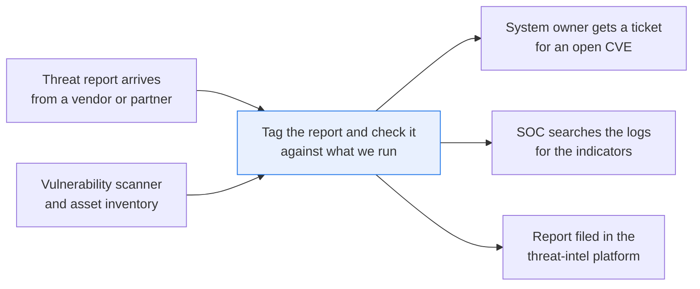
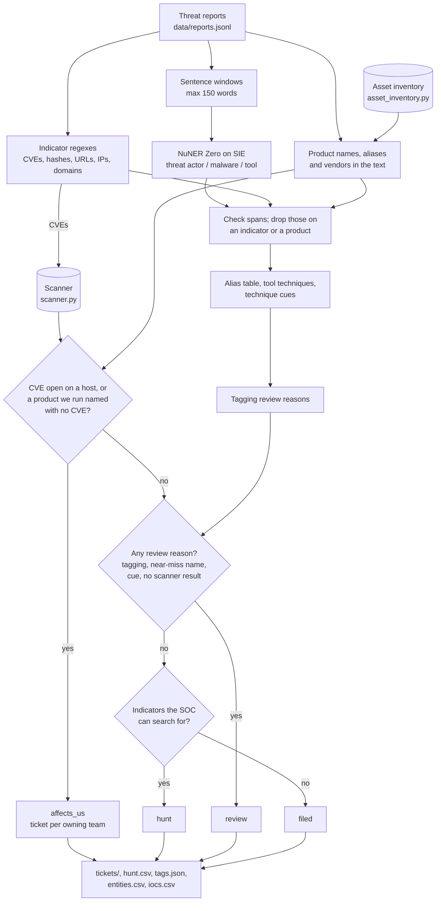

# Triage threat reports against what your company runs

> **This example:** a CTI analyst's daily vendor and partner reports.
>
> **How it works:** regex pulls the CVEs and indicators, an entity model finds the actors, malware
> and tools, and Python checks the CVEs and products against your vulnerability scanner and asset
> inventory. Matches go to the system owner; indicators go to the SOC to search for.
>
> **Use the same pattern for:** vendor security advisories against your software list, bug bounty
> reports against your services, supplier breach notices against your vendor register.

## Background

A cyber threat intelligence (CTI) analyst reads reports all day: vendor write-ups of an
intrusion, a partner advisory about a water utility, a note that a known group is back with a new
loader. Each one gets filed in the team's threat-intel platform, tagged with the actors, malware
and tools, and the indicators the report lists (IP addresses, domains, URLs, file hashes, CVE
IDs). That part is filing. The question the rest of the company asks is different: does this one
affect us?

Answering it means looking things up in systems the company already has. The vulnerability
scanner knows which CVEs are open on which hosts. The asset inventory knows which products run
where, and which team owns each system. The SOC (security operations centre) can search the last
30 days of logs for an IP, a domain or a hash. Today the analyst does those lookups by hand for the
reports that look important, and the rest wait.

Here's the job end to end, and the step this recipe takes on:



Why it matters: a report that names a CVE open on your VPN gateway is urgent, and it reads exactly
like the nine that don't concern you. When the lookups only happen for the reports that look
important, the one that matters can sit in the queue for a week.

## The problem

Names and indicators are messy: vendors call the same group different things, and every vendor
defangs URLs its own way. Tagging alone doesn't answer the question, though. The step that
matters is turning tags into "this affects these hosts, owned by this team". A keyword match on
the product name "Corvane VPN Gateway" misses a report that says "the Corvane gateway" (an alias
the inventory lists for the hosts running version 7.2.1), and a chat model asked "does this
affect us?" has no idea what you run.

So the recipe tags each report and then does the lookups. Each report gets a status:

- **`affects_us`**: a CVE in the report is open on one of your hosts, or a product it names is in
  your inventory. The owning team gets a ticket draft with the report, the CVE and the hosts.
- **`hunt`**: nothing you run is named, but the report has indicators. They go on the SOC's hunt
  list for a log search.
- **`filed`**: nothing you run and no indicators. Tagged and filed, nobody pinged.
- **`review`**: a tagging review reason (an unknown actor, a live URL, a malformed indicator),
  or a product name that's close to something in the inventory but not an exact match.

One detail on "a product it names is in your inventory": when the report also gives CVEs, the
scanner has the last word. A product we run, named next to a CVE the scanner shows patched on
every host running it, is a note, not a ticket (that's R-05 below). A product named with no CVE
at all gets a ticket, so its owner can check. And when a report trips both a ticket and a review
reason, it comes out `affects_us` with the reasons attached, because an open CVE shouldn't wait
behind an unknown actor name.

The analyst and the system owner decide what to do; the recipe doesn't patch, block or close
anything.

### Examples

Here are three of the reports in `data/reports.jsonl`, and what should happen to each.

The reports are synthetic, written for this recipe, with invented actors, malware and CVE IDs. The
technique names are real, copied from MITRE ATT&CK under MITRE's terms of use.

**1. A CVE that's open on our VPN gateway (R-01).**
- **Input:** "Ashen Heron gained access to a Fenwick Freight file server through CVE-2099-41077 in
  the Corvane VPN gateway."
- **What should happen:** "Corvane VPN gateway" matches an inventory alias, and the scanner shows
  the CVE open on `vpn-gw-02` and patched on `vpn-gw-01`.
- **Expected outcome:** `affects_us`, one ticket to the `network` team for `vpn-gw-02`.

**2. A product with almost our name (R-11).**
- **Input:** "Ashen Heron is exploiting CVE-2099-61840 in the Corvane VPN Concentrator, a separate
  hardware appliance line."
- **What should happen:** it shares a vendor and the words "Corvane VPN" with what we run, but it
  isn't the same product. A name that close to one of ours should go to a person instead of the hunt
  list, and no ticket goes out.
- **Expected outcome:** `review`, not `affects_us`.

**3. A CVE the scanner says is patched (R-05).**
- **Input:** "Copper Moth operators tunnelled RDP traffic out of the network through Chisel and kept
  a QuillRAT backdoor on two hosts. Initial access came through CVE-2099-50213 in an unpatched
  Corvane VPN gateway. The Chisel server listened on 203.0.113[.]58."
- **What should happen:** it names the gateway we run, but the scanner shows this CVE patched on
  both of ours, so nobody gets a ticket. Its IP should go to the SOC to search for.
- **Expected outcome:** `hunt`, no ticket.

On the live run, 10 of 11 reports came out as expected. [What came out](#what-came-out) has the
results.

## How we'll solve it

1. **Start from what's structured.** The scanner export (host, CVE, status), the asset inventory
   (host, product and version, owning team) and the alias table come in as files.
2. **Pull the indicators with regex** and the actors, malware and tools with
   `numind/NuNER_Zero`.
3. **Look up every CVE** in the scanner export and **every product name** in the inventory,
   matching on the inventory's product names and aliases, never on a partial word.
4. **Set the status and write three outputs**: ticket drafts per owning team, the SOC's hunt list
   (indicators refanged only inside the hunt file, never in a ticket), and the tagged reports for
   the platform.

The order matters in two places. Indicators and product names are found before the model runs,
because a model span that sits on one of them is part of it, not a separate tag: NuNER Zero
tags "Corvane VPN" in R-05 as a tool, and the recipe drops it, since that's a
product we look up, not an attacker's tool. And the status comes last, after every lookup, so a
ticket never goes out on the strength of a name alone when the scanner says otherwise.

Here's what "never a partial word" means in practice. The product name or alias has to appear
whole, as words, in any case. If a capitalized word follows it ("Corvane VPN Gateway Manager"),
that's a longer name and a different product. If a number follows it, that's the version the
report names, and only hosts running that version count ("Corvane VPN Gateway v8", "version
6.1", "(6.1)" or a sentence-final "6.1." against an inventory of 7.2.1 goes to review; "7.x"
reads as 7). Any other version wording in the next few words ("versions 8.0 and later",
"Corvane VPN Gateway, 7.4 only", "prior to 7.0") is a range or list the recipe can't compare,
so it goes to review instead of a ticket for every host running the product. A CVE ID right
after the name is the CVE, not part of a longer name. And a vendor we buy from, named without one
of our product names around it ("Corvane VPN Concentrator"), is a near miss: close to something we run, so a
person looks. A product named in a sentence that says "not", "no", "never", "unaffected",
"isn't" or "aren't" goes to review too, since "the Larkfield Mail Relay is not affected" is the
opposite of a ticket.

## Picking the model

The model is `numind/NuNER_Zero` (MIT license), a small zero-shot named-entity model: you give it
label words, and it returns the spans in the text that match, each with a label, offsets and a
score. The labels are plain words in `rules.yaml` (the model card asks for lower-case labels), so
you can add `vulnerability` or `target sector` without training anything. Spans below the 0.50
`min_entity_score` aren't returned. No generative model makes any decision here: the alias
merges, the lookups and the status are Python you can read.

The model is there for one thing: the names nobody has written down yet ("Velvet Ostrich",
"Chisel"). Everything with a fixed shape (CVE IDs, hashes, defanged URLs) is regex, and
everything you already know (aliases, product names, hosts, owners) is a table lookup. That
split is the whole design. A model that guessed whether "the Corvane gateway" is yours would be
guessing; the inventory knows.

**Why NuNER Zero and not gliner2-large-v1.** The job is plain span tagging with three labels.
There's no structure to fill, so `output_schema` adds nothing. When NuNER Zero finds nothing, it
returns `entities: []`. When a GLiNER2 model finds no spans, SIE Serverless answers with an HTTP 500
instead of an empty list, with or without `output_schema`, and that fails the whole batch. That's
our inference from how SIE behaves: `security/triage_reported_phishing` hits the same 500 on a
plain `labels` call.

It isn't perfect, and the recipe is built around that. On our runs it called `LX-0417` malware
(the table fixed that), tagged "threat group" as an actor and "MD5" as a tool (rules drop those),
and on this run it tagged "RDP" in R-05 as a tool at 0.55 and "mail gateway" in R-10 as a tool at
0.91, both of which go to review as unmapped tools. A name the model misses entirely leaves
nothing to flag, so a report with no review reason still isn't proof the tags are complete.

## The flow



An open CVE on a host the inventory has no owner for, a product named with CVEs where the scanner
has no result for one of those CVEs on one of that product's hosts (a patched CVE doesn't vouch
for another one the scanner never checked), and a window the model failed to tag are review reasons
too. A refused SIE call, or a run where no call succeeded, stops the run instead.

## How it's built

Everything you'd want to argue about lives in [`rules.yaml`](./rules.yaml): the labels, the alias
table, the tool-to-technique mapping, the technique and product cues, which indicator types go on
the hunt list, the review policy, the thresholds and the model ID. The hosts, products, versions,
aliases and owners live in the inventory seed, and the open and patched CVEs in the scanner seed,
because that's where they live in a real company too. [`recipe.py`](./recipe.py) holds the
regexes and the logic, in the same order as the flow.

The two existing systems are small lookup modules backed by committed CSV seeds, each loaded into
an in-memory SQLite database. [`scanner.py`](./scanner.py) stands in for your scanner's findings
API: `Scanner.find_cve` returns every host it has a result for, `open` or `patched`. A CVE with no
rows is "no result", not "patched". [`asset_inventory.py`](./asset_inventory.py) stands in for your
CMDB: `AssetInventory.find_product` matches a whole product name or alias exactly (case, extra
spaces and a leading "the" ignored), `find_host` gives a host's owner, and `names`, `vendors` and
`find_vendor` feed the search of the report text. An alias two products share comes back as both,
and goes to review.

| Step | Code | SIE call | What it does |
| --- | --- | --- | --- |
| Indicators | `find_indicators`, `domain_indicator`, `defang` | none | CVE IDs, MD5/SHA-1/SHA-256 by length, defanged URLs, domains, IPs and email domains by regex; live URLs, malformed hashes, IPs, CVE IDs and top-level domains flagged |
| Products | `find_products`, `AssetInventory.names`, `.find_product`, `.vendors`, `.find_vendor` | none | Inventory product names and aliases as whole words, longest first; a longer name, another version or a bare vendor name is a near miss; a product cue in the sentence is noted |
| Split | `sentence_windows` | none | Sentences packed into windows of at most 150 words (NuNER Zero reads 384 tokens) |
| Tag | `tag_windows` | `extract` + `labels` | `threat actor`, `malware` and `tool` spans from `numind/NuNER_Zero`, zero-shot, `batch_size` windows per call; a transient failure or a reply with no `entities` marks its windows failed, a refusal or a run with no successful call stops |
| Check spans | `model_entities` | none | Each span must have whole-number offsets and a numeric score and equal the text at its offsets (a malformed one is an invalid span); spans on an indicator or a product mention, or that are not names ("MD5", "threat group"), are dropped |
| Fill misses | `table_mentions`, `merge_entities` | none | Alias-table names and mapped tools written in the text, any case, whole words |
| Normalize | `AliasTable`, `resolve`, `technique_cue` | none | Every mention through the alias table to one canonical name; tools to candidate ATT&CK technique IDs, held back when the sentence has a `technique_cues` word |
| Look up | `check_relevance`, `Scanner.find_cve`, `AssetInventory.find_host`, `defanged_excerpt` | none | Open CVEs become tickets for the host's owning team; a product with no CVE becomes a ticket per host; patched CVEs become notes; near misses, cues, missing scanner results and unowned hosts become review reasons |
| Status | `report_status`, `hunt_indicators` | none | `affects_us` if any ticket, else `review` if any reason, else `hunt` if any well-formed `hunt_types` indicator, else `filed` |
| Write | `write_outputs`, `ticket_drafts` | none | `tickets/<team>.md`, `hunt.csv` (refanged), `tags.json`, `entities.csv` and `iocs.csv` (defanged) |

`tag_reports()` runs those steps for every report. All windows go to SIE Serverless in one batched call
(each demo report fits in one window, and 11 windows are under the `batch_size` of 16), and you
host nothing. With one call, a transient failure on the demo data is also a run where every call
failed, so it stops the run rather than sending all eleven reports to review.

The SIE error rule is the same as in the other security recipes. A call that fails for a reason
that may pass (a dropped connection, a timeout, a 5xx, a rate limit, a model still loading, a
window too long for the model, or a reply missing `entities`) marks its windows failed and sends
their reports to review; the run still writes its outputs and prints one line with the count and
the first error. A refusal every call would repeat (a bad key, an unknown model, no credits or a
spend limit, an inactive account, a model SIE marks as permanently unable to load) stops the run
with SIE's full message and writes nothing. So does a run where every call failed. An empty
`entities` list is a real "nothing found".

[`selfcheck.py`](./selfcheck.py) checks the indicator regexes, the alias table, the overlap rule,
the technique cues, both lookups, every product-name near miss (a longer name, another version
however it's written, a bare vendor, a name inside an indicator), a second CVE the scanner never
checked, the "not affected" cue, an open CVE on an unowned host,
an alias two products share, that tickets never carry a live link and that only `hunt.csv` does,
the status of the committed reports, and which SIE errors send reports to review and which stop the
run. It runs offline with hand-written strings and stand-in model replies, so you can change
`rules.yaml` or a seed and know right away if you broke something.

## Run it

**Try this recipe with [SIE Serverless](https://superlinked.com/serverless?utm_source=github&utm_medium=docs&utm_campaign=sie-cookbook&utm_content=security-triage-threat-reports).** The code runs on your machine and the models run on SIE Serverless, so you pay per call and there are no GPUs to manage yourself. Get an [SIE API key](https://console.superlinked.com/console/keys?utm_source=github&utm_medium=docs&utm_campaign=sie-cookbook&utm_content=security-triage-threat-reports), read the [API docs](https://superlinked.com/docs/reference/api?utm_source=github&utm_medium=docs&utm_campaign=sie-cookbook&utm_content=security-triage-threat-reports), or host SIE locally from the [SIE repo](https://github.com/superlinked/sie).

You need [uv](https://docs.astral.sh/uv/) and an SIE API key
([create one](https://console.superlinked.com/console/keys?utm_source=github&utm_medium=docs&utm_campaign=sie-cookbook&utm_content=security-triage-threat-reports)).

```bash
cp .env.example .env   # then set SIE_API_KEY
uv run recipe.py
uv run selfcheck.py    # optional: offline checks, no SIE call
```

`uv run` installs this recipe's few dependencies into its own `.venv` on the first run. Each run
writes `runs/<timestamp>/` in this folder. If you'd rather write somewhere else, pass
`--output DIR`. The first call can wait a few minutes while SIE Serverless starts the NuNER Zero
model. A warm run makes one SIE call and took about a second on our machine, uv start included.

## What came out

The input is five files:

- [`data/reports.jsonl`](./data/reports.jsonl) holds eleven short synthetic reports, one per line.
- [`data/scanner_findings.csv`](./data/scanner_findings.csv) is the scanner export: six rows of
  host, CVE and status (`open` or `patched`).
- [`data/asset_inventory.csv`](./data/asset_inventory.csv) is the inventory: five hosts, each
  with its product, vendor, version, aliases and owning team. Two of them, `vpn-gw-01` and
  `vpn-gw-02`, run the Corvane VPN Gateway 7.2.1 for the `network` team.
- [`data/attack_techniques.csv`](./data/attack_techniques.csv) holds nine MITRE ATT&CK
  Enterprise techniques (ID, name, tactic), just the subset the tool mapping uses.
- [`rules.yaml`](./rules.yaml) holds the labels, the alias table, the tool-to-technique mapping,
  the cues, the review policy, the thresholds and the model ID.

The reports, actors, malware, victims, products, vendors, hosts, teams and CVE IDs are
synthetic, written for this recipe. CVE IDs use the year 2099, so they can't collide with a real
advisory. Hashes are SHA-256, SHA-1 and MD5 digests of short demo strings, not of any file.
Domains are RFC 2606 reserved names, and IPs are from the RFC 5737 documentation ranges. The
tools (Mimikatz, PsExec, AdFind, rclone, PowerShell, vssadmin, Chisel) are real, widely
documented admin and offensive-security tools.

The scanner shows CVE-2099-41077 open on `vpn-gw-02` and patched on `vpn-gw-01`, and
CVE-2099-50213 patched on both. Our live run was on 4 Nov 2026 (UTC).

### The three examples

**1. A CVE that's open on our VPN gateway (R-01).**
- **Expected outcome:** `affects_us`, one ticket to the `network` team for `vpn-gw-02`.
- **What came back:** `affects_us`, one ticket to `network` for `vpn-gw-02`, with `vpn-gw-01` noted
  as patched (the ticket is quoted below).
- **Verdict:** Pass.

**2. A product with almost our name (R-11).**
- **Expected outcome:** `review`, not `affects_us`.
- **What came back:** `review`, no ticket, with the reason "close to the inventory's Corvane VPN
  Gateway but not the same name".
- **Verdict:** Pass.

**3. A CVE the scanner says is patched (R-05).**
- **Expected outcome:** `hunt`, no ticket.
- **What came back:** `review`, no ticket, with "patched on vpn-gw-01, vpn-gw-02" noted. The report
  names Chisel, which has no ATT&CK mapping, and NuNER Zero tagged "RDP" as a tool at 0.55.
- **Verdict:** Miss. The gateway part worked, but tagging review reasons come before `hunt`, so its
  IP stays off the hunt list until the analyst clears the report.

### Results

On the live run on 4 Nov 2026, 10 of 11 reports came out as expected. R-05 is the one that
didn't: it came out `review` instead of `hunt`, for tagging reasons explained below. R-10 counts as
expected with one unplanned extra review reason, "mail gateway" tagged as a tool.

**Where it works:** an open CVE gets one ticket to the team that owns the host (R-01), and a patch
summary is just filed (R-08). Indicators go on the hunt list (R-02), and a version number and a
filename that look like indicators don't (R-07). The rest go to a person: a product with a close
name (R-11), an alias under two actors (R-03), a new actor (R-04), live URLs and a malformed hash
(R-06), an admin's `rclone` backup (R-09) and "No Mimikatz execution was observed" (R-10).

**Where it fails:** R-05 should have reached the hunt list and went to review, because any tagging
review reason comes first, including a tool nobody mapped or a word the model mistook for a tool. So
7 of the 11 reports wait for an analyst, and that's the cost. The one to worry about is R-11's CVE:
the scanner has no result for it, which could mean you don't run it or that the scanner doesn't
check for it, and the recipe can't tell those apart.

The run gave 1 `affects_us`, 2 `hunt`, 1 `filed` and 7 `review`. Treat these reports as a demo that
the wiring works. They say nothing about accuracy: eleven reports tell you the lookups and rules
fire where they should, not how often they're wrong.

The run writes five things. `tickets/network.md` is the only ticket draft, since only the
network team owns a host with an open CVE. `hunt.csv` has the seven indicators from R-01, R-02 and
R-07, refanged, and it's the only file with live indicators in it. `tags.json` has every report
with its tags, indicators, product mentions, scanner rows, tickets, notes, reasons and status.
`entities.csv` has one row per actor, malware or tool mention, and `iocs.csv` one row per candidate
indicator, always defanged.

A few things worth noticing:

- **R-01 is the whole point, and it's one line.** The ticket goes to the team that owns the host,
  with the sentence from the report, and only for the host where the CVE is still open:

  ```text
  ## R-01: Ashen Heron intrusion at a freight operator (published 2026-03-02)

  - CVE-2099-41077 on `vpn-gw-02` (Corvane VPN Gateway): open, per the scanner

  Actors and malware named: Ashen Heron, QuillRAT

  > Ashen Heron gained access to a Fenwick Freight file server through CVE-2099-41077 in the Corvane VPN gateway.
  ```

- **R-05 didn't come out the way we wrote it, and we left it.** The gateway part worked: no ticket,
  and `tags.json` records why. But the report names Chisel, which has no ATT&CK mapping in
  `rules.yaml`, and on this run NuNER Zero tagged "RDP" as a tool at 0.55. Both are tagging
  review reasons, and `review` comes before `hunt`. We could have mapped Chisel to T1572
  and added "RDP" to `ignore_mentions`, and R-05 would have come out `hunt`. That would be fitting
  the rules to the demo, so we didn't. The analyst sees its IP in `tags.json` and `iocs.csv`; it
  just isn't on the hunt list until they clear the report:

  ```json
  "notes": [
    "CVE-2099-50213: patched on vpn-gw-01, vpn-gw-02, per the scanner"
  ]
  ```

- **The near miss is the one a keyword search gets wrong.** R-11 names the "Corvane VPN
  Concentrator", which shares a vendor and the words "Corvane VPN" with what we run. The
  inventory has no such product, so no ticket, but the vendor name sends it to a person rather
  than straight to the hunt list:

  ```text
  product 'Corvane VPN Concentrator': close to the inventory's Corvane VPN Gateway but not the same name; a person checks whether it's a product we run
  ```

  The scanner has no result for its CVE-2099-61840 on any host, which is recorded as a note. That
  could mean you don't run it, or that the scanner doesn't check for it yet, and the recipe can't
  tell those apart.

- **The model's mistakes stay contained.** NuNER Zero tagged "Corvane VPN" in R-05 as a tool
  (0.74 when we called it again with the same text to look); it sits on a product mention, so it's
  dropped. It called `LX-0417` malware in R-02, and the alias table overruled it. In
  `entities.csv`:

  ```text
  R-02,actor,LX-0417,0,7,model,0.96923828125,Ashen Heron,,False,tagged,model said malware; the table lists Ashen Heron as actor
  R-03,actor,Grey Lantern,63,75,model,1.0,,,False,review,ambiguous alias: 'Grey Lantern' is listed under Ashen Heron and Copper Moth
  ```

- **Live links live in exactly one file.** R-06 wrote its URLs live, so it goes to review, and
  `iocs.csv` defangs them anyway. R-01's URL is refanged in `hunt.csv`, because the SOC pastes
  those into a log search, and stays defanged in `iocs.csv` and `tags.json`. It isn't in the
  ticket at all: the ticket quotes only the sentence with the CVE. Any indicator in a quoted
  sentence, and a link in a report title, is written defanged, since a ticket that turned
  `hxxps://relay[.]heron-cdn[.]example[.]net` back into a link would be a phishing email you sent
  yourself. A bare domain the regexes don't count as an indicator (a live `www.example.com` or
  `user@example.com`) stays as written in the excerpt, and a Markdown viewer may make it a link.
The title and the quoted sentence are written as code spans, so a Markdown link in a report
(`[advisory](//evil.example/fix)`) shows as text, not as a link.

### What you do next

The network team gets `tickets/network.md` and decides what to do about `vpn-gw-02`. The SOC takes
`hunt.csv` and searches the logs for those seven indicators. The CTI analyst clears the `review`
reports from `tags.json`, and once they clear R-05, its IP can go on the hunt list too. Nothing is
patched, blocked or closed by the recipe.

## Potential improvements

Everything below lives in `rules.yaml` or a seed unless it says otherwise.

- **Your own scanner and inventory.** `scanner.py` and `asset_inventory.py` read CSV seeds. In
  production, swap their bodies for calls to your scanner's findings API and your CMDB, and keep
  the function names; the recipe only calls `find_cve`, `find_product`, `find_host`, `find_vendor`,
  `names` and `vendors`.
- **Your own aliases and vendors.** A product name people use that the inventory doesn't list
  goes to review as a near miss, every time. Add it to the product's `aliases` and it becomes an
  exact match. A vendor whose other product lines show up in reports a lot will send each of those
  reports to review; a list of product lines you know you don't run would let them through.
- **Your own alias table.** The alias table is `actors` and `malware`: one canonical name each,
  with the aliases other vendors use. If two groups share an alias, list it under both names, and
  every mention of it goes to review. A canonical name can sit under only one of `actors`,
  `malware` and `tool_techniques`; list it under two and the recipe refuses to start. In
  production, export this table from your threat-intel platform.
- **Your own technique and product cues.** `technique_cues` lists the words that hold a tool's
  candidate techniques back, and `policy.technique_cue` turns that check off.
  `relevance.product_cues` lists the words that send a product mention to review, and
  `relevance.version_words` the version wording the recipe can't read. All are keyword lists, so
  they're blunt: "the patch is not yet applied to the Larkfield Mail Relay" goes to review instead of a ticket.
  Quote each cue: YAML reads a bare `no` as false.
- **More tools and techniques.** The tool mapping is `tool_techniques`. Every technique ID must be
  in `data/attack_techniques.csv`, or the recipe refuses to start. If you need more techniques,
  swap the CSV for the full ATT&CK Enterprise catalog from
  [attack.mitre.org](https://attack.mitre.org/). Chisel and RDP are the two this run would have
  liked.
- **A stricter or looser review policy.** `policy` turns each name and indicator reason on or off.
  A name reason that's off (unknown actor or malware, ambiguous alias, unmapped tool) is recorded
  as `new` and doesn't send the report to review. An indicator reason that's off (live URL,
  malformed hash, IP, CVE ID or domain) is dropped; the indicator row still keeps its `malformed`
  flag and note. The product reasons (a near miss, a cue, no scanner result, an unowned host), an
  invalid model span, a window the model failed to tag and a failed SIE call always send the
  report to review. Which SIE errors count as passing and which stop the run is `is_fatal` in
  `recipe.py`, not a policy switch.
- **What the model looks for.** `labels`, `generic_words` and `ignore_mentions` control what the
  model looks for and which of its spans get thrown away as not being names. You can change the
  label words the model sees, but not the keys: the code reads `actor`, `malware` and `tool`, and
  any other set of keys stops the recipe at start.
- **Thresholds.** `min_entity_score`, `max_words_per_window`, `min_hex_run`, `batch_size`,
  `relevance.max_extra_name_words` and `relevance.version_window_words` are starting points.
  Check them on your own reports.
- **The model.** `models` holds the model ID.
- **Idea: more indicator formats.** IPv6 addresses and domains defanged some other way aren't
  found today. If your vendors write them, the regexes in `recipe.py` are the place to add them,
  with a case in `selfcheck.py` for each.
- **Idea: smarter windows.** A sentence longer than `max_words_per_window` is cut on words, which
  can split a multiword name, and the 150-word limit is a rough stand-in for NuNER Zero's
  384-token budget, not a token count.
- **Idea: map behavior, not names.** Techniques should come from what the report says a tool did
  (`vssadmin delete shadows` versus `vssadmin list shadows`), with the command or sentence as
  evidence, rather than from the tool's name plus a cue list.
- **Idea: version ranges.** The version check is a prefix match against what the report writes
  next to the product name ("7.2" matches 7.2.1). Advisories usually say "before 7.2.3" or
  "7.0 through 7.2.1", and reading those ranges would let the recipe tell an affected version from
  a fixed one without the scanner.
- **Idea: the scanner's dates.** A `patched` finding from a scan older than the report is weaker
  evidence than one from yesterday. Carrying the scanner's last-seen date would let the recipe
  send stale results to review.
- **Idea: measure it.** Eleven sample reports prove the wiring. Before you trust it, run it on a
  month of your own reports and look at what lands in review and what an analyst would have
  routed differently.

## Try another model

Each model is one line under `models:` in `rules.yaml`. We swapped one model at a time, changed
nothing else, and ran the recipe against SIE Serverless on 4 Nov 2026 (UTC) on the eleven reports above.

| `rules.yaml` key | Swap in | What happened on this data |
| --- | --- | --- |
| `entities` | `numind/NuNER_Zero-span` | 1 `affects_us`, 1 `hunt`, 1 `filed`, 8 `review` (default: 1, 2, 1, 7). The lookups came out the same: R-01's ticket, R-05's patched note, R-11's near miss. R-07 went to review over a tool "SvcHealth"; on R-03 it tagged "PowerShell scripts" as a tool, a second review reason, and the exact `PowerShell` match is kept. R-10 held its technique without the "mail gateway" span. |
| `entities` | `urchade/gliner_multi-v2.1` | 1 `affects_us`, 1 `hunt`, 0 `filed`, 9 `review`. Same lookups again. It tagged "Defenders" (R-07) and "The IT team" (R-08) as actors, so both went to review, and the same R-03 "PowerShell scripts" span. On R-05 it didn't tag "RDP", so only Chisel sent it to review. The 0.50 `min_entity_score` was chosen with NuNER Zero in mind, and these spans passed it. |

The lookups don't touch the model, so every swap gave the same ticket and the same near miss;
what changed is how many reports a spurious name sends to review.

See [MODELS.md](../../MODELS.md) for every model these recipes use.

## Run it on your own SIE

The same code runs against an SIE server you host. Set `SIE_BASE_URL` in `.env`, and the API
key becomes optional. The table gives the SIE v0.10.1 image each model runs on, from SIE's
[compatibility matrix](https://github.com/superlinked/sie/blob/main/docs/compatibility.md).

| `rules.yaml` key | Model | Image | Tested on |
| --- | --- | --- | --- |
| `entities` | `numind/NuNER_Zero` | `cuda12-default` | L4 |

One container serves it:

```bash
docker run --gpus all -p 8080:8080 -v sie-hf-cache:/app/.cache/huggingface \
  ghcr.io/superlinked/sie-server:v0.10.1-cuda12-default
# then set SIE_BASE_URL=http://localhost:8080 in .env and run: uv run recipe.py
```

## Data and licenses

- Reports, actor and malware names, victims, products, vendors, hosts, teams, scanner findings
  and CVE IDs: synthetic, written for this recipe. R-05 ends with a defanged IP
  (`203.0.113[.]58`) so it has something to hunt for, and R-11 is the near-miss product. Another
  recipe
  ([`security/find_detection_gaps`](../../security/find_detection_gaps)) uses its own fictional names.
- `data/attack_techniques.csv`: nine technique IDs, names and tactics copied by hand from the
  [MITRE ATT&CK Enterprise](https://attack.mitre.org/) matrix. We can't name the ATT&CK
  version: the file has only the three columns `technique_id`, `name` and `tactic`, with no
  version, `modified` date or source bundle, and there is no fetch script, so nothing in the
  repository records which release the rows came from. It was first committed on 31 Oct 2026 (UTC).
  Check the rows against the current release before you rely on them. © 2026 The MITRE
  Corporation. This work is reproduced and distributed with the permission of The MITRE
  Corporation. Under the
  [ATT&CK terms of use](https://attack.mitre.org/resources/legal-and-branding/terms-of-use/):
  "The MITRE Corporation (MITRE) hereby grants you a non-exclusive, royalty-free license to use
  ATT&CK® for research, development, and commercial purposes. Any copy you make for such purposes is authorized provided
  that you reproduce MITRE's copyright designation and this license in any such copy."

## Files

- `recipe.py`: the pipeline
- `scanner.py`: the vulnerability scanner lookup, over `data/scanner_findings.csv`
- `asset_inventory.py`: the asset inventory lookup, over `data/asset_inventory.csv`
- `selfcheck.py`: plain asserts on the indicator regexes, the alias table, the lookups, the
  product near misses, the status rules and the SIE error rule, using hand-written strings, the
  committed `data/` and hand-written stand-in model replies. It never calls SIE
  (`uv run --frozen python selfcheck.py`)
- `rules.yaml`: labels, alias table, tool mapping, cues, hunt types, policy, thresholds, model ID
- `data/`: the reports, the scanner and inventory seeds, and the ATT&CK subset
- `pyproject.toml`, `uv.lock`: this recipe's dependencies

See the SIE
[information extraction](https://superlinked.com/information-extraction?utm_source=github&utm_medium=docs&utm_campaign=sie-cookbook&utm_content=security-triage-threat-reports)
task page.
