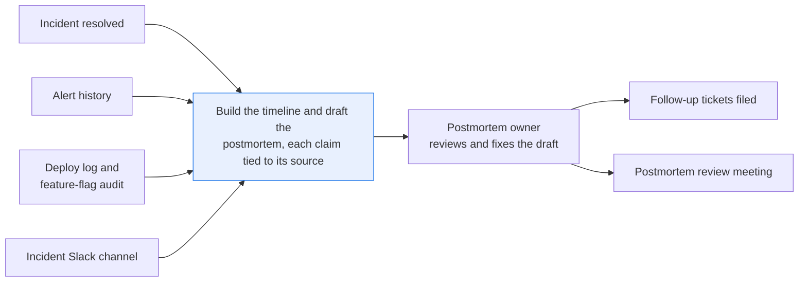
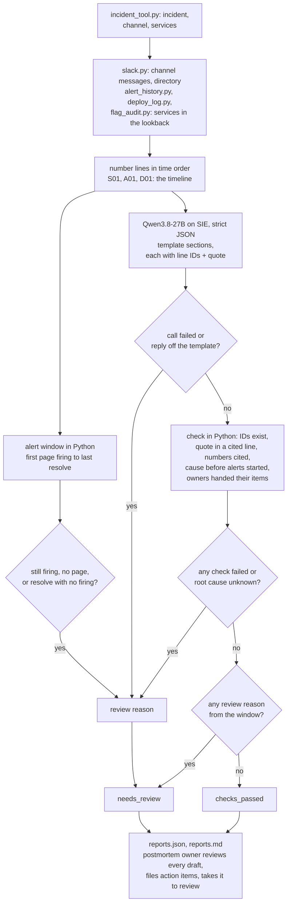

# Draft a postmortem from the incident channel, alerts and deploys, with a source for every claim

> **This example:** the incident commander writing up a payments outage for the review meeting.
>
> **How it works:** Python builds the timeline, a language model fills in your template with a
> quote per sentence, and Python checks every quote and time.
>
> **Use the same pattern for:** a status page summary, the weekly on-call handoff, a game day
> write-up.

## Background

After an incident is resolved, someone owns the postmortem. Usually it's the incident commander
or the on-call engineer who was paged, and they get it a day or two later on top of their normal
work. At a laptop, they open the incident record, scroll back through the incident's Slack
channel, pull up the alert history and the graphs, check the deploy log and the feature-flag
audit for what changed, and piece together a timeline in a postmortem document. Then they write
the parts that take thought: what happened, what the impact was, why, what made it worse, and
what the team agreed to do about it. They chase people for the bits they don't remember, file
the follow-up tickets, and send the draft round for review before the postmortem meeting.

A good half of that is already structured, and nobody should retype it. The incident tool has
the incident's ID, title, channel and affected services. The alerting system has every alert's
name, service, severity, firing time and resolve time. The deploy pipeline and the flag system
log every deploy, rollback, flag flip and config change with a time, a service and an actor.
Slack has every message with its author and timestamp, and a directory of everyone in the
workspace. Incident tools that collect PagerDuty and Slack activity give you most of a timeline
for free. So the recipe asks each of those systems for what it already knows, the way you would
through their APIs, and doesn't ask a model to work any of it out.

What isn't structured is the conversation. Why the rollback was chosen, which hypothesis turned out
wrong, that the certificate expired because its renew job had been failing since a DNS API token
was rotated in September, that Dev assigned Sam to make the upload alert page someone: that's in
people's messages, in their words, and writing it up is the real work.

Why it matters: postmortems are how a team stops having the same incident twice. A draft that
gets a time wrong, blames the deploy that happened to land mid-outage, or lists an action item
nobody agreed to does damage twice: once in the review meeting, and again when the wrong fix gets
built.

Here's the job end to end, and the step this recipe takes on:



## The problem

You want the timeline built from the systems that already record it, and a narrative draft
where every claim points at the messages and events it came from. The sections come from the
team's own postmortem template (here: summary, impact, root cause, contributing factors, action
items), which sits in `rules.yaml` as a list of sections with a one-line instruction each, so a
team with a different template changes the file, not the code. Then the postmortem owner reads
the draft, fixes it, files the action items as tickets and takes it to the review meeting.

Asking a chat model to "write the postmortem from this channel" gets you something readable that
invents durations, picks the most recent deploy as the cause, and assigns action items to
whoever was mentioned last. Checking it means rereading the whole channel, which is the job you
wanted to skip.

So Python does the times and the arithmetic, the model writes the narrative with a citation and a
verbatim quote on every claim, and Python checks those citations. The checks can tell you a quote
is really in the line it cites; they can't tell you the claim is right. For each incident the
recipe reports:

- **`checks_passed`**: every claim cites lines that exist and quotes one of them, the numbers it
  states are in the lines it cites, the root cause is identified, no change cited as the cause
  happened after the alerts started, every action item has an owner from the Slack directory
  whom a cited message hands it to, everyone the channel gave an action item owns one, and the
  alert history is complete.
- **`needs_review`**: anything above failed, or the root cause is unknown, or an alert is still
  firing, or no paging alert fired at all, or a resolve has no matching firing event, or the
  model's reply didn't fit the template, or the SIE call failed. The reasons are listed.

Neither is approval. The postmortem owner reviews every draft: confirms the impact against
request metrics or support data, checks the cause, and confirms each owner actually accepted
their action item before the tickets are filed.

## How we'll solve it

1. **Look things up in the systems that already have them.** The incident tool gives the
   incident's ID, title, Slack channel and affected services. Slack gives the channel's
   messages and the workspace directory. The alert history gives firing and resolved events
   with `startsAt`, `endsAt` and `fingerprint`. The deploy log and the flag audit give every
   deploy, rollback, renewal, flag flip and config change. The team's template sections come
   from `rules.yaml`.
2. **Collect each incident's events in Python.** Slack messages from its channel; alerts and
   changes for its services from a lookback before the first message to the last one. Each line
   gets an ID in time order (`S01`, `A01`, `D01`), and the numbered list is the timeline.
3. **Work out the alert window in Python.** From the first firing of a paging alert to its last
   resolve, using each alert's own `startsAt` and `endsAt`. When an alert flapped (resolved, then
   fired again), the time actually firing is shown too. It's labelled an alert window, since
   alerts start and stop on thresholds and customers may have been affected before or after.
   Still firing, no paging alert, or a resolve whose firing event fell outside the record:
   `needs_review` with that reason, and the draft is still written.
4. **Have the model write the narrative.** `Qwen/Qwen3.8-27B-FP8` returns the template's
   sections (summary, impact, root cause as `identified` or `unknown`, contributing factors and
   action items) as strict JSON. Every claim carries line IDs (the schema only allows IDs that
   exist) and a verbatim quote. The model is told not to state times; the report shows the
   window Python computed. It's also told that text in the record is something to describe,
   never an instruction.
5. **Check the draft in Python.** Every cited ID exists; the quote is in one of the cited lines;
   every number the text states is in a cited line; a deploy or flag change cited as the root
   cause happened before the alerts started, and so did any change a cited message names; an
   `identified` cause isn't resting on a question or on alerts alone, and neither a cited line
   nor a message posted at or after the last cited line says the cause isn't known; every action
   item names someone in the Slack directory, a cited message hands it to them, and `unassigned`
   is a review reason; and everyone an action-item message hands work to owns at least one item
   in the draft. Only an "Action items:" or "Follow-ups:" message hands work out, so a
   mid-incident "I'll roll back" doesn't.
6. **Write the report** with the timeline, the alert window, each claim with its citations and
   check result, and the reasons for review. A claim that failed its checks is held, not shown
   as part of the draft.

If SIE refuses a call outright (a bad key, an unknown model, no credits), the run stops with
SIE's message and writes nothing; if a call fails for a reason that may pass (a timeout, a busy
server) or its reply has no readable JSON, that incident goes to `needs_review` with the reason,
the others are still written, and the run stops only if every call fails. A channel with no
messages sends its incident to `needs_review` without a call.

## Picking the model

There's one model, `Qwen/Qwen3.8-27B-FP8`, called through SIE's `chat_completions` once per
incident with a strict JSON schema built from the template (`response_format` with
`strict: true`, temperature 0). It's the model the other recipes in this cookbook use to read
text and answer in JSON with citations. Two things about the schema do a lot of work: the
`citations` items are an enum of this record's line IDs, and `owner` is an enum of the Slack
directory's handles plus `unassigned`. So the model can't cite a line that doesn't exist or hand
a task to someone who isn't in the workspace. It can still quote a real line under a claim that
line doesn't support, and that's what the Python checks are for.

On these seven channels it was good at the hard part: it put the certificate, not the
mid-outage deploy, as INC-0103's cause, and it called INC-0104 `unknown` instead of guessing.
It's not a timekeeper, and we don't let it be one: every time and duration in the report comes
from Python.

## The flow



## How it's built

Everything you'd want to argue about lives in [`rules.yaml`](./rules.yaml): the model, the
lookbacks, the paging severities, the minutes a cause may trail the alerts, the template
(each section with its kind and its one-line instruction), the minimum quote length, the
phrases that mean "we don't know", and the patterns that mark an action-item message. A team
with another template edits the `template:` list; each section's `kind` (`claim`, `list`,
`root_cause` or `action_items`) says which checks run on it.

The five systems are five small modules, each named after the system it stands in for and
backed by a CSV seed in `data/` that it loads into an in-memory SQLite database. Swap one for a
real API call and nothing else changes:

| Module | Stands in for | Lookup |
| --- | --- | --- |
| `incident_tool.py` | the incident tool's API (PagerDuty, incident.io) | `find_incident`, `list_incidents` |
| `slack.py` | Slack's `users.list` and `conversations.history` | `users`, `channel_history` |
| `alert_history.py` | wherever alert history lives (an Alertmanager webhook log, PagerDuty log entries) | `events(services, since, until)` |
| `deploy_log.py` | the deploy pipeline's deployment history | `deploys(services, since, until)` |
| `flag_audit.py` | the flag system's audit log, runtime config included | `changes(services, since, until)` |

[`recipe.py`](./recipe.py) is about 1,000 lines with the prompt and the checks, and reads top to
bottom in the order of the flow:

| Step | Code | SIE call | What it does |
| --- | --- | --- | --- |
| Look up and number | `Systems.from_seeds`, `build_record`, `episodes_from`, `alert_text` | none | The channel's messages, alerts from 60 minutes before the first message and changes from 360 minutes before, for the incident's services, to the last message. Firing and resolved events are paired by fingerprint and `startsAt`; a resolve with no firing event keeps its episode and says when it fired |
| Alert window | `alert_window`, `alerts_started` | none | First `startsAt` to last `endsAt` of the `critical` alerts, and the time with one firing (shorter when it flapped). Any alert still firing, no `critical` alert, or a resolve-only episode is a review reason |
| Draft | `report_prompt`, `report_schema`, `ask_model`, `parse_draft` | `chat_completions` | One call per incident. The reply must be exactly the template's sections, each claim with `text`, `citations` and `quote` (plus `status` or `owner`), and a finish reason of `stop` (or none, since not every server sends one). Content that is missing or not JSON is a failed call; JSON off the template is a review reason, not a draft |
| Check | `check_claim`, `quote_in`, `numbers`, `root_cause_problems`, `later_changes`, `check_owner`, `assigned_by`, `verify` | none | The checks in step 5 above. A quote is at least 12 characters and appears verbatim in one cited line after collapsing whitespace and straightening quote marks. Numbers drop thousands commas and leading zeros, so "1,140" matches "1140", and the `5` of `5xx` doesn't count |
| Report | `report_incident`, `render_markdown`, `write_outputs` | none | `checks_passed` or `needs_review` with the reasons; failed claims are held, not shown as draft text |

The SIE error rule is the same as in the security recipes. A call that fails for a reason that
may pass (a timeout, a lost connection, a 5xx, a rate limit, a model still loading, or a reply
whose `choices[0].message.content` is missing, null or not JSON) sends that incident to
`needs_review` with a short reason, and the run carries on. A refusal every call would repeat (a
bad key, no credits, a model name SIE doesn't know) stops the run with SIE's full message and
writes no outputs. If every call failed, unusable replies included, the run stops too.

[`selfcheck.py`](./selfcheck.py) checks the lookups, the alert window (a truncated resolve, an
open warning, flapping), INC-0105 and INC-0106 going to review for their window even with a
draft that passes every claim check, an empty channel, the quote, number, root-cause and
action-item checks, the strict parsing, the template loading, the prompt's line about text in
the record, the two statuses and that SIE error rule, offline, with hand-written records and
stand-in model replies.
[`make_data.py`](./make_data.py) writes the six CSV seeds in `data/`, the same bytes every time.

## Run it

You need [uv](https://docs.astral.sh/uv/) and an SIE API key
([create one](https://console.superlinked.com/console/api-keys?utm_source=github&utm_medium=docs&utm_campaign=sie-cookbook&utm_content=sre-draft-postmortem-from-incident-data)).

```bash
cp .env.example .env   # then set SIE_API_KEY
uv run recipe.py
uv run selfcheck.py    # optional: offline checks, no SIE call
uv run make_data.py    # optional: rewrite data/ (deterministic)
```

`uv run` installs this recipe's few dependencies into its own `.venv` on the first run. Each run
writes `runs/<timestamp>/`. The first call can wait a few minutes while SIE Cloud starts the
report model. A warm run makes 7 SIE calls (one per incident, all to `Qwen/Qwen3.8-27B-FP8`) and
took 37 seconds on our run.

## What came out

The input is the six seeds in [`data/`](./data), written by `make_data.py`:

- `incidents.csv`: 7 incidents, each with a title, its Slack channel and the affected services
- `slack_users.csv` and `slack_messages.csv`: the workspace directory and each incident
  channel's messages (`ts` in epoch seconds, as Slack gives it)
- `alert_events.csv`: Alertmanager-style `firing` and `resolved` events for every service
- `deploys.csv`: deploys, rollbacks and a certificate renewal
- `flag_audit.csv`: flag flips and config changes

> **All of it is synthetic.** Larkspur Outfitters, its engineers, services and hostnames (under
> the reserved `.example` domain) are invented for this recipe.

All seven incidents are at a fictional shop, Larkspur Outfitters. The seeds also hold events for
unrelated services on the same days (a search deploy, a recommendation memory alert, a search
index lag alert, a later checkout deploy), which no report should pick up, and none did. Here's
what our live run on 4 Nov 2026 (UTC) gave:

| Case | What we planted | Came out | Why |
| --- | --- | --- | --- |
| INC-0101 | A deploy shrinks the payment client pool to 8; rollback fixes it | `checks_passed`, 36.0 min alert window | The straightforward case: deploy, symptom, rollback |
| INC-0102 | A flag queries the DB once per line item; flag turned off | `checks_passed`, 45.0 min | The cause is a flag flip, not a deploy |
| INC-0103 | A gateway deploy lands 12 min into the outage; the cause is an expired certificate | `checks_passed`, 43.5 min; root cause cites S04, never D01 | Near miss: the deploy closest to the outage didn't cause it |
| INC-0104 | Latency recovers on its own; nobody finds the cause | `needs_review`: root cause not established | "We don't know" is an honest answer and a person decides what to do with it |
| INC-0105 | The page is still firing when the record ends | `needs_review`: the alert window has not closed | No end time to report |
| INC-0106 | Customer-reported; only a warning alert, no page | `needs_review`: no alert window | The window has to come from support data or metrics |
| INC-0107 | The page flaps: fires, resolves, fires again | `checks_passed`, 50.3 min (39.7 min firing) | The gap between firings isn't proof customers recovered |
| Truncated history (in INC-0106) | The warning fired at 10:21, six minutes after the bad deploy and more than the 60-minute lookback before the first message; only its resolve is in range | `needs_review`: the alert history is incomplete | The record can't show when the alert started, so the review item says when it fired |
| Late impact confirmation (in INC-0101) | Support posts the final count the next morning, 18 hours after the alert resolved | the impact claim cites that message (S11) and passes | A late message is still evidence; nothing ties impact lines to the alert window |

Every planted case came out as planned. We put the truncated history in INC-0106 rather than add
an eighth incident, because that's where it happens naturally (a warning that paged nobody, well
over an hour before the customers noticed), so INC-0106 has both reasons. Treat all of this as a demo
that the wiring works, not as a measure of accuracy: seven incidents tell you the checks run,
not how often the drafts are right.

A few things worth noticing:

- **The near miss held.** In INC-0103 the model blamed the expired certificate and cited only
  S04, the message where Sam found it. If it had cited the gateway deploy (D01), or Lena's
  "Gateway v3.8.1 just rolled out. Could it be the deploy?" (S02), the root cause would have gone
  to review: D01 came almost 12 minutes after the alerts started, S02 names only that later change,
  and its sentence is a question.
- **The late count is the best impact line in the run.** Here's INC-0101's impact claim from
  `reports.json`. Every number in it (63, 1,140, 812, the 6x and the 1 of "1h") is in S11 or
  A02, so the number check passes:

  ```json
  {"text": "The incident resulted in 63 support tickets and 1,140 failed checkout attempts from 812 customers. Frontend availability error budget burn rate reached 6x over 1 hour.",
   "citations": ["S11", "A02"],
   "quote": "Payments logs show 1,140 failed checkout attempts from 812 customers.",
   "checks_passed": true, "problems": []}
  ```

- **INC-0104 said "unknown", in so many words.** Its root cause quotes Lena's "We still don't
  know what caused it." (S04), and the draft goes to review with "Root cause not established in
  the record." The model was asked for an honest answer and gave one, which is more than some
  postmortem meetings manage.
- **Passing the checks isn't being right.** INC-0103's contributing factor says "The auto-renew
  job failure went undetected for a month because there was no alert for certificate expiry or
  job failure", quoting "add an alert when any certificate is under 14 days from expiry" (S08).
  The quote is real and the claim is a fair reading, but "a month" is the model's arithmetic on
  "since September", and no check can tell that from a fact. That's why the postmortem owner
  reads every draft.
- **Earlier runs caught real slips.** On an earlier version of this recipe, the first live run
  caught a mis-citation: INC-0102's summary quoted "Turning the flag off now." (S05) but cited
  D01, A01, A02, D02 and S06, so the quote check flagged it and the report went to review. That
  run also offered only the channel's own members as owners. Dev had assigned Sam "Sam makes
  the upload error-rate alert page" (INC-0106), but Sam wasn't in the channel, so as far as the
  recipe knew there was no Sam, and the item came back `unassigned`. Owners are now everyone in
  the Slack directory. And on this version's first live run, the model turned Priya's "Handing
  over to the EU on-call; keep this channel open." in INC-0105 into an action item, which passed
  because she wrote it. Now an action item has to cite a message that hands it out (an
  "Action items:" or "Follow-ups:" message that names the owner, or "I'll" from the owner); on
  the run above, the model left INC-0105 with no action items.

The run writes `reports.json` for code (every claim with `citations`, `quote`, `checks_passed`
and `problems`, next to the numbered `timeline` it cites) and `reports.md`, one section per
incident with the alert window, the review reasons, the draft and the timeline.

## Potential improvements

- **Use your own systems.** Replace the five lookup modules' seeds with calls to your incident
  tool, Slack, alert history, deploy pipeline and flag system. Each lookup takes the services
  and a time range, so the rest of the recipe doesn't change.
- **Pick the alert that means impact.** `alert_window.paging_severities` in `rules.yaml` picks
  the alerts that define the alert window. If you have an SLO-burn alert, use that.
- **Check the starting points.** `sources.*_lookback_min`, `alert_window.change_after_start_min`
  and `checks.min_quote_chars` are starting points. Check them on your own incidents.
- **Your own template.** The `template:` list in `rules.yaml` defines the report sections. If
  you add a section, give it a `kind`, and the checks for that kind run on it.
- **Read further back when history is cut off.** A resolve-only alert says when it fired. A
  second lookup from that `startsAt` would fill in the timeline instead of only flagging it.
- **Two incidents on one service.** Alerts and changes are picked by service and time, so two
  overlapping incidents on the same service would share events. Use the incident tool's linked
  alerts where it has them, or flag any event two records both picked.
- **Withdrawn hypotheses and cancelled actions.** A channel where someone proposes a cause and
  later takes it back, or agrees to an action and then cancels it, isn't planted here; the
  checks would only catch it if the model cites the withdrawn line.
- **Numbers written as words.** The number check reads digits only, so "sixty-three tickets" or
  "a month" isn't checked.
- **A cited line that doesn't support the claim.** A real quote from a real line can sit under a
  claim it doesn't support (e.g. "The deploy came after the errors." under "The deploy caused
  it"). Only the person reading the draft catches that.
- **The smaller model.** `Qwen/Qwen3.5-4B` matched the 27B model's statuses in our swap below.
  If that holds on your incidents, it's the cheaper default.

## Try another model

Each model is one line under `models:` in `rules.yaml`. We swapped one model at a time, changed
nothing else, and ran an earlier version of this recipe (before the lookups, the number check
and the action-item checks) on SIE Cloud on 31 Oct 2026.

| `rules.yaml` key | Swap in | What happened on this data |
| --- | --- | --- |
| `report` | `Qwen/Qwen3.5-4B` | Same decision for all 7 incidents (4 drafts ready, 3 to review, same durations). INC-0103's root cause cited the certificate (S04) and not the deploy. Shorter text, and action items differed in two incidents: one fewer in INC-0103, a different owner set in INC-0105. |
| `report` | `google/gemma-4-31B-it` | Did not run: SIE Cloud answered "Generation route is unavailable for this deployment" on both tries. |

"Drafts ready" is that version's name for `checks_passed`. See [MODELS.md](../../MODELS.md) for
every model these recipes use.

## Run it on your own SIE

The same code runs against an SIE server you host. Set `SIE_BASE_URL` in `.env`; an API key
is then optional. The table gives the SIE v0.10.1 image each model runs on, from SIE's
[compatibility matrix](https://github.com/superlinked/sie/blob/main/docs/compatibility.md).

| `rules.yaml` key | Model | Image | Tested on |
| --- | --- | --- | --- |
| `report` | `Qwen/Qwen3.8-27B-FP8` | `cuda13-sglang-cu130` | H100 80GB |

One container serves it:

```bash
docker run --gpus all -p 8080:8080 -v sie-hf-cache:/app/.cache/huggingface \
  ghcr.io/superlinked/sie-server:v0.10.1-cuda13-sglang-cu130
# then set SIE_BASE_URL=http://localhost:8080 in .env and run: uv run recipe.py
```

## Data and licenses

Everything in `data/` is synthetic, written by `make_data.py` for this recipe: the shop, the
people, the services, the hostnames (under the reserved `.example` domain), the messages, the
alerts and the changes. No real incident, company or person is in it.

## Files

- `recipe.py`: the pipeline
- `incident_tool.py`, `slack.py`, `alert_history.py`, `deploy_log.py`, `flag_audit.py`: the
  lookups, one per system, each loading its CSV seed into SQLite
- `selfcheck.py`: plain asserts on the lookups, the alert window, the parsing and every check,
  no SIE call (`uv run selfcheck.py`)
- `make_data.py`: writes the synthetic seeds in `data/`
- `rules.yaml`: model, lookbacks, paging severities, the template and the check settings
- `data/`: the six CSV seeds
- `pyproject.toml`, `uv.lock`: this recipe's dependencies
